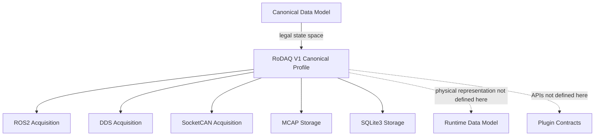
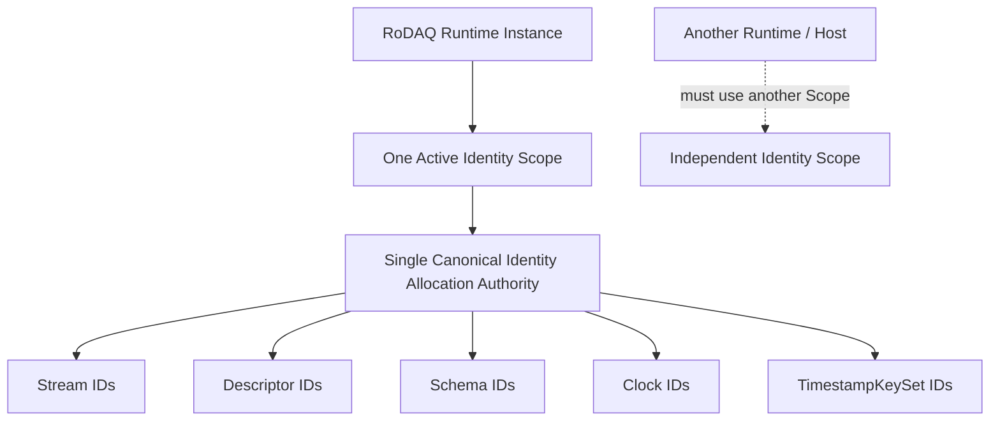
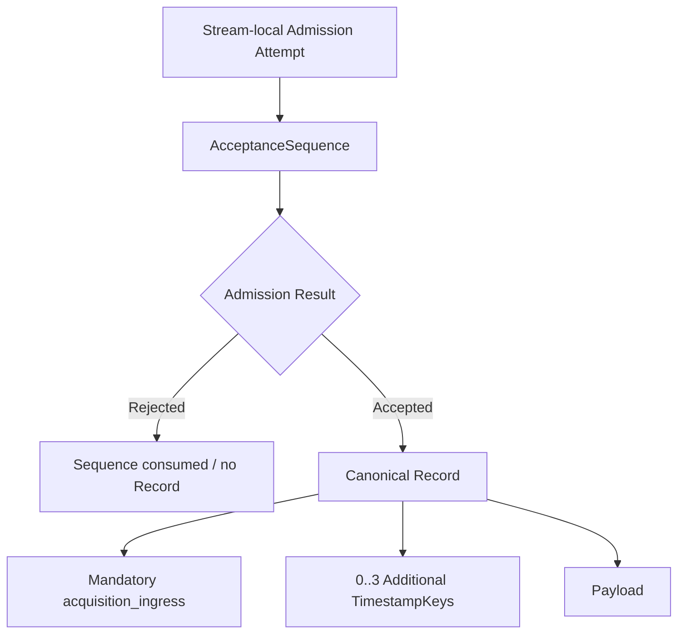
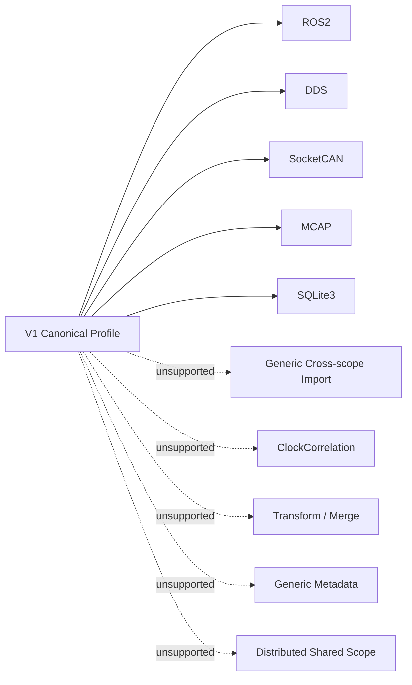
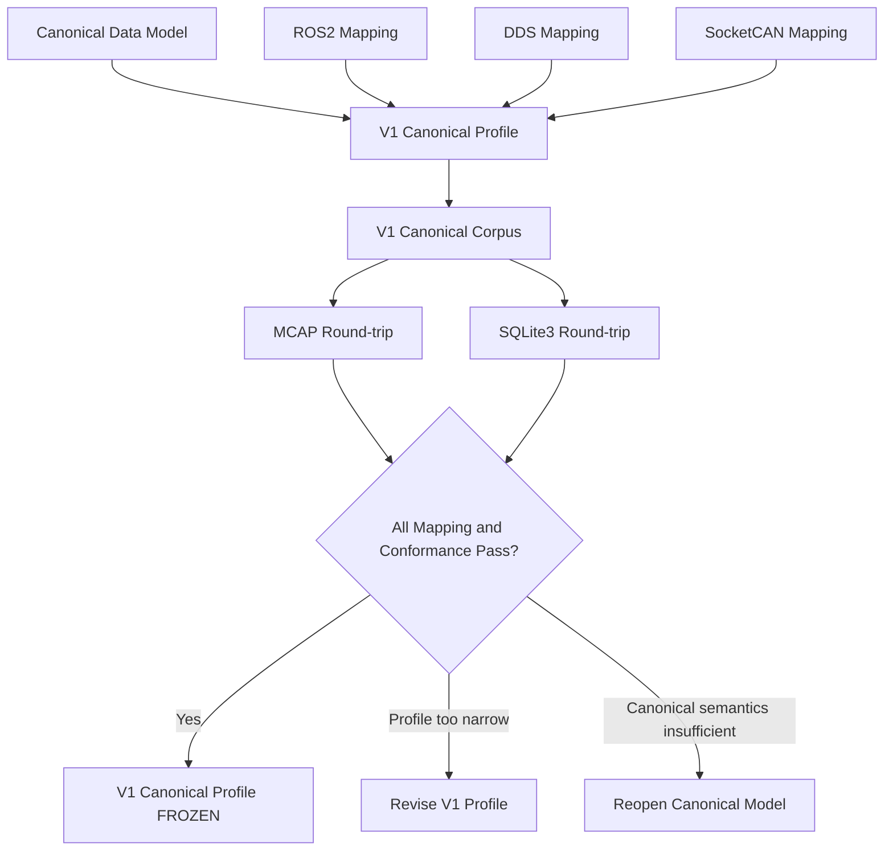

# RoDAQ V1 Canonical Profile Design Specification

**Version:** Draft v0.4
**Status:** Mapping Review Candidate
**Scope:** RoDAQ V1 Canonical Capability Profile
**Normative Base:** RoDAQ Canonical Data Model Design Specification v0.9

---

# 1. 目标、范围与 Profile 原则

## 1.1 目标

RoDAQ Canonical Data Model 定义完整的：

> **Canonical State Space**

它回答：

> 哪些 Canonical State 在语义上合法。

一个具体 RoDAQ release 不需要立即实现 Canonical Model 允许的全部能力。

RoDAQ V1 Canonical Profile 的职责是进一步定义：

> **RoDAQ V1 实际接受、产生、持久化和验证的 Canonical State 子集。**

因此二者关系为：

```text
Canonical Data Model
    │
    │ defines all legal canonical semantics
    ▼
Canonical State Space
    │
    │ restricted by V1 capability boundary
    ▼
RoDAQ V1 Canonical Profile
    │
    ├── Acquisition mappings
    │   ├── ROS2
    │   ├── DDS
    │   └── SocketCAN
    │
    └── Storage projections
        ├── MCAP
        └── SQLite3
```

V1 Profile 不重新定义 Canonical semantics。

如果某个状态：

```text
Canonical-valid
```

但超出 V1 Profile 能力边界，则：

```text
V1 unsupported
```

而不是：

```text
Canonical-invalid
```

例如 Canonical Model 可以表达任意合法大小的 `TimestampKeySet`。

V1 当前定义：

```text
1 <= TimestampKeySet.size <= 4
```

超过该上限的状态仍然可以是 Canonical-valid，但不是：

> V1-profile-valid

这种区分是本文件最核心的设计原则。

---

## 1.2 本文件定义什么

本文件定义：

- V1 Identity Scope 能力；
- V1 支持的 Canonical Descriptor；
- V1 Record capability；
- V1 Source / SourceSequence 能力；
- V1 Schema capability；
- V1 Timestamp / Clock capability；
- V1 Payload semantic capability；
- V1 Acquisition mapping 范围；
- V1 Storage Projection 范围；
- V1 明确不支持的 Canonical capabilities；
- V1 Profile conformance requirements；
- V1 Profile 冻结前必须通过的验证。

本文件不定义：

```text
C++ struct layout
C ABI
Plugin ABI
Runtime queue
thread model
allocator
buffer ownership
SourceHandle physical type
RoleHandle physical type
Timestamp slot physical layout
Storage extension wire format
MCAP sidecar format
SQLite table schema
Runtime error class
HTTP / Server / Client
Session lifecycle
Artifact lifecycle
```

这些内容属于：

```text
Runtime Data Model
Payload Ownership Contract
Acquisition Plugin Contract
Storage Plugin Contract
Artifact / Runtime Lifecycle
```

后续设计。

---

## 1.3 Profile 不得改变 Canonical semantics

V1 Profile 可以：

```text
限制支持范围
限制 capability 数量
拒绝 unsupported state
限制当前可用 Plugin 集合
限制当前可用 Storage 集合
```

但不得：

```text
改变 Canonical field 的含义
改变 Canonical equality
改变 identity semantics
静默删除 Canonical State
把 Absent 改写成 0
把 unknown identifier 改成 known default
把 SourceSequence 借用为 AcceptanceSequence
把 Runtime Handle 当成 Canonical ID
```

因此：

> **Profile 的作用是裁剪能力，而不是改写语义。**

如果 V1 无法正确表示一个 Canonical-valid state：

> 必须拒绝。

不能：

> 接受后静默降级。

---

## 1.4 V1 设计取向

V1 Profile 采用以下工程取向：

> **能力足够、实现明确、边界保守。**

V1 不以尽可能覆盖全部 Canonical State Space 为目标。

优先级是：

```text
语义正确
    ↓
实现边界明确
    ↓
Plugin burden 可控
    ↓
Storage full-fidelity 可验证
    ↓
性能实现可优化
```

而不是：

```text
distributed scope
+
generic import
+
clock correlation
+
generic metadata
+
transform pipeline
```

一次性进入 V1。

V1 只覆盖当前已有明确工程目标的：

```text
Acquisition:
    ROS2
    DDS
    SocketCAN

Storage:
    MCAP
    SQLite3
```

同时保留 Canonical Model 为未来能力扩展提供的长期语义基础。

---

## 1.5 规范性用语

本文中的：

**必须 / MUST**

表示 V1 Profile 的强制要求。

**不得 / MUST NOT**

表示 V1 Profile 明确禁止的行为。

**应该 / SHOULD**

表示强烈推荐，除非实现能够给出明确理由偏离。

**可以 / MAY**

表示允许但不强制的行为。

---

## 1.6 V1 Profile 总览

| 能力 | V1 |
|---|---|
| Active Identity Scope | 每个 Runtime instance 同时最多 1 个 |
| Canonical allocation authority | 每个 active Scope 恰好 1 个 |
| Multi-Runtime shared active Scope | 不支持 |
| Multi-Host shared active Scope | 不支持 |
| StreamDescriptor | 支持 |
| SchemaDescriptor | 支持，optional |
| ClockDescriptor | 支持 |
| TimestampKeySet | 支持 |
| SourceDescriptor | 不支持 |
| Generic per-record metadata | 不支持 |
| AcceptanceSequence | 支持，mandatory |
| SourceId | 支持，optional |
| SourceSequence | 支持，optional |
| TimestampKeySet size | 1～4，冻结前经 Mapping Review 验证 |
| Mandatory Timestamp Role | `rodaq/acquisition_ingress` |
| Plugin-specific Timestamp Role | 支持 |
| ClockCorrelation | 不支持 |
| Generic Cross-scope Import | 不支持 |
| Transform / Merge Pipeline | 不支持 |
| Acquisition Plugin | ROS2 / DDS / SocketCAN |
| Storage Plugin | MCAP / SQLite3 |
| Full-fidelity Storage | V1 conformant mode 必须支持 |
| Payload semantics | opaque immutable logical bytes |
| Payload physical layout | 不由本 Profile 定义 |

### 图 1-1 V1 Profile 在整体架构中的位置



---

# 2. V1 Canonical State Profile

## 2.1 Identity Scope

### 2.1.1 一个 Runtime instance 同时最多一个 active Identity Scope

RoDAQ V1 必须满足：

> **一个 Runtime instance 在任一时刻最多拥有一个 active Identity Scope。**

本文中的 **Runtime instance** 指：

> 一个具有独立 RoDAQ Runtime 生命周期、Canonical registry 和 active Identity Scope ownership 的 RoDAQ 运行实例。

通常一个独立 RoDAQ 进程只包含一个 Runtime instance，但：

> **Runtime instance 不与 operating-system process 强制一一对应。**

如果同一进程中存在多个彼此独立的 RoDAQ Runtime lifecycle，例如两个分别创建、启动和销毁的 Runtime：

```text
Process
├── Runtime A
└── Runtime B
```

则它们在 V1 中视为：

> 两个独立 Runtime instance。

它们不得共享同一个 active Identity Scope。

反之，如果多个线程共同工作于同一个 Runtime lifecycle 和同一套 Canonical registries：

```text
Runtime
├── Thread A
├── Thread B
└── Thread C
```

则这些线程仍然属于：

> 同一个 Runtime instance。

Runtime instance 的具体：

```text
construction API
lifecycle state machine
thread ownership
process embedding
```

属于 Runtime Contract。

本 Profile 只冻结：

> Identity Scope ownership 边界以 Runtime instance 为单位。

一个 Runtime instance：

```text
at most one active Scope
```

不表示 Runtime lifetime 中只能创建一个 Scope。

一个 Scope 结束后，Runtime 可以在后续生命周期建立新的 Scope。

但是 V1 不允许：

```text
Runtime
├── active Scope A
└── active Scope B
```

同时存在。

这一限制用于降低 V1：

```text
ID allocation
registry lookup
descriptor ownership
source registry
clock registry
storage handoff
```

的复杂度。

---

### 2.1.2 Single Canonical Identity Allocation Authority

每个 active Identity Scope：

> **必须恰好只有一个 Canonical Identity Allocation Authority。**

该 authority 负责建立当前 Scope 中的：

```text
StreamId
StreamDescriptorId
SchemaId
ClockId
TimestampKeySetId
```

等 scope-local canonical identities。

SourceId 是例外。

SourceId identity evidence 来自 Acquisition Source，并由 Acquisition Plugin 按对应 Acquisition Contract canonicalize。

但是：

```text
SourceId registration
SourceId interning
SourceId scope association
```

仍由当前 Runtime 的 Canonical infrastructure 负责。

---

### 2.1.3 V1 不支持 shared active Scope

V1 明确不支持：

```text
Runtime A ─┐
           ├── same active Identity Scope
Runtime B ─┘
```

也不支持：

```text
Host A ─┐
        ├── same active Identity Scope
Host B ─┘
```

即使理论上可以通过 distributed coordinator 满足 Canonical Model 的 single-authority requirement：

> **V1 也不提供这种能力。**

多个 Runtime 或 Host 必须使用独立 Identity Scope。

未来如果需要：

```text
distributed Runtime
multi-host shared acquisition scope
central identity coordinator
```

应定义新的 Profile 或 V1 之后的扩展。

V1 保持：

```text
single Runtime instance
    ↓
single active Scope
    ↓
single allocation authority
```

这一关系。

### 图 2-1 V1 Identity Scope 模型



---

### 2.1.4 Scope persistence 不属于 V1 Canonical Profile

V1 Canonical Profile 不定义：

```text
Runtime restart
    ↓
是否恢复原 Scope

Artifact reopen
    ↓
是否恢复原 Scope

Crash recovery
    ↓
是否继续原 ID allocation state
```

这些属于 Runtime / Artifact lifecycle。

如果下游设计声称恢复原 logical Identity Scope，则仍必须满足 Canonical Model 的 identity-preserving requirements：

```text
no ID collision
no ID reuse
same ID → same canonical identity
descriptor references remain valid
```

否则必须建立新的 Scope。

V1 不提供 Generic Cross-scope Import 自动解决这个问题。

---

## 2.2 Descriptor Graph

V1 支持：

```text
StreamDescriptor
SchemaDescriptor
ClockDescriptor
TimestampKeySet
```

不支持：

```text
SourceDescriptor
```

所有 V1 Canonical Record 必须具有 referentially closed Descriptor Graph：

```text
Record
    ↓
StreamDescriptor
    ├── optional SchemaDescriptor
    └── TimestampKeySet
            ↓
        ClockDescriptor(s)
```

在 Record 成为 consumer-visible Canonical State 前：

> 所有 required Descriptor 必须已经存在并可解析。

---

### 2.2.1 Descriptor Immutability

V1 完整支持 immutable Descriptor semantics。

以下变化必须创建新的 StreamDescriptorId：

```text
StreamName change
Schema absent → present
Schema present → absent
Schema A → Schema B
PayloadEncoding change
TimestampKeySet change
```

Clock restart/reset 导致：

```text
new ClockId
    ↓
new TimestampKeySetId
    ↓
new StreamDescriptorId
```

V1 不引入：

```text
DescriptorRevision
DescriptorVersion
mutable descriptor
```

---

### 2.2.2 Descriptor Dedup

V1 Runtime 可以对完全相同 Descriptor content 执行 dedup。

也可以不 dedup。

因此：

```text
same descriptor content
⇏
same DescriptorId
```

仍然成立。

但：

```text
same DescriptorId
⇒
same immutable descriptor
```

必须成立。

Descriptor dedup 是实现优化，不是 V1 semantic requirement。

---

## 2.3 Stream 与 Record

V1 支持：

```text
StreamId
StreamDescriptorId
StreamName
AcceptanceSequence
```

模型。

StreamId 由 Core / Runtime 建立。

Acquisition Plugin 不分配 Canonical StreamId。

Plugin 只提供：

> 对识别 source-native logical stream 必要的 source-specific facts。

---

### 2.3.1 Record Identity

V1 Canonical Record identity：

```text
(StreamId, AcceptanceSequence)
```

其中 StreamId 通过：

```text
Record
    ↓
StreamDescriptorId
    ↓
StreamDescriptor
    ↓
StreamId
```

解析。

---

### 2.3.2 AcceptanceSequence

V1 使用 Canonical Model 定义的 admission-attempt allocation semantics。

对每个 Stream：

```text
admission attempt
    ↓
allocate next AcceptanceSequence
    ↓
final admission outcome
```

如果 accepted：

```text
canonical Record created
+
Record carries assigned AcceptanceSequence
```

如果 rejected：

```text
no canonical Record
+
assigned sequence value remains consumed
+
value MUST NOT be reused
```

因此：

```text
10
11
15
```

是合法的 accepted Record sequence。

Sequence gap 本身不能证明 data loss。

V1 Profile 不规定：

```text
mutex
atomic
CAS
per-stream worker
serialized callback
```

等具体 Runtime linearization mechanism。

只规定：

```text
stream-local
strictly increasing
stable
never reused
```

并要求：

> 对实际存在的 canonical Records，AcceptanceSequence 必须保持 accepted Records 的相对 acceptance order。

---

## 2.4 SourceId 与 SourceSequence

V1 支持：

```text
optional SourceId
optional SourceSequence
```

SourceId canonical representation：

```text
non-empty opaque byte sequence
```

同一 Identity Scope 中 equality：

```text
byte-for-byte
```

如果 Source identity：

```text
unknown
invalid
unstable
ambiguous
```

则：

```text
SourceId = absent
```

不得创建 fake SourceId。

如果 native identity 需要：

```text
padding normalization
endianness normalization
GUID formatting
vendor-specific conversion
```

必须由对应 Acquisition Plugin / Contract 在提交给 Core 前完成。

---

### 2.4.1 SourceSequence

只有满足：

```text
source-originated
+
SourceId-scoped
```

的 sequence 才能映射为 SourceSequence。

并且：

```text
SourceSequence present
⇒
SourceId present
```

V1 不支持通过 Generic Metadata 保存无法归类的 native sequence。

如果该 sequence 已经包含在 native Payload：

> 随 Payload 保存。

如果只存在于 Plugin metadata，且不符合 SourceSequence semantics：

> 不进入 V1 Canonical Record。

---

## 2.5 Schema

Schema 在 V1 中：

> optional

支持：

```text
SchemaId absent
SchemaId present
```

支持：

```text
late schema
schema evolution
schema removal
```

SchemaDescriptor：

```text
SchemaDescriptor
├── SchemaId
├── SchemaFormat
├── optional TypeIdentifier
└── opaque representation bytes
```

V1 不解析 Schema representation。

Storage full-fidelity 必须恢复：

```text
SchemaFormat
TypeIdentifier presence/value
representation bytes
```

其中 representation bytes：

```text
byte-for-byte identical
```

---

### 2.5.1 Late Schema

V1 允许 Canonical Model 定义的两种策略。

策略 A：

```text
native sample
    ↓
Plugin temporarily buffers
    ↓
schema available
    ↓
register Schema + StreamDescriptor
    ↓
emit Record
```

策略 B：

```text
Descriptor A:
    SchemaId = absent
    ↓
emit Records

schema becomes available
    ↓
Descriptor B:
    SchemaId = Schema X
    ↓
future Records use B
```

V1 不允许：

> retroactively 修改 Descriptor A。

历史 Record 必须保持原 Canonical State。

---

## 2.6 Payload

V1 Payload semantics：

> **immutable opaque encoded logical byte string**

V1 支持 source-native serialized/encoded Payload。

例如：

```text
ROS2 CDR
DDS CDR / XCDR
SocketCAN logical raw-frame encoding
```

V1 不要求 Canonical Core：

```text
deserialize
decode message fields
convert to JSON
convert CAN to signals
convert encoded image to RGB
```

---

### 2.6.1 Runtime Buffer 形式不属于本 Profile

本 Profile 不规定 Payload 必须：

```text
inline
contiguous external
scatter/gather
shared
copied
borrowed
```

这些属于 Runtime Data Model / Payload Ownership Contract。

因此也不定义：

```text
inline byte capacity
maximum external buffer size
maximum segment count
```

这些属于物理实现限制，而不是 Canonical semantic capability。

Runtime 可以因为资源限制拒绝 Record，但不得在接受后：

```text
truncate payload
rewrite payload
silently transcode payload
```

# 3. V1 时间与 Ordering Profile

## 3.1 TimestampKeySet Capacity

V1 当前规定：

```text
1 <= TimestampKeySet.size <= 4
```

其中：

```text
rodaq/acquisition_ingress
```

占用一个 TimestampKey。

因此每个 StreamDescriptor 最多可以拥有：

> **3 个额外 Canonical TimestampKey**

这些额外 TimestampKey 可以来自：

```text
Acquisition Plugin Contract
vendor-specific source semantics
```

`4` 是：

> **V1 Profile capability limit**

而不是 Canonical Model limit。

Canonical Model 本身允许更大的合法 TimestampKeySet。

---

### 3.1.1 为什么当前选择 4

V1 Acquisition 范围：

```text
ROS2
DDS
SocketCAN
```

预计常见 Record-level canonical time 可以由：

```text
mandatory acquisition ingress
+
source-native timestamp
+
transport / receive timestamp
+
optional hardware/source timestamp
```

覆盖。

因此 Draft v0.4 使用：

```text
MaxTimestampKeysPerSet = 4
```

作为一个明确、固定、可测试的候选 Profile boundary。

它能够为后续 Runtime Data Model 提供：

```text
small fixed timestamp representation
```

的设计空间。

但是：

> **该上限尚未冻结，必须经过 ROS2 / DDS / SocketCAN Mapping Review 验证。**

如果任何 V1 Acquisition Mapping 证明：

> 为了无损表达该 Plugin 必须 canonical-visible 的时间语义，需要超过 4 个不同 TimestampKey

则必须在 V1 Profile freeze 前：

> **按照 Mapping Review 证明的实际最小需要提高该上限。**

不得为了保留 `4` 而：

```text
合并语义不同的 RoleIdentifier
合并不同 ClockId
删除必须 canonical-visible 的 timestamp
把 required timestamp 隐藏到 Payload
把两个不同 TimestampKey 重新解释成一个 TimestampKey
```

如果两个 timestamp observation 在 Canonical semantics 上本来就是：

```text
same RoleIdentifier
+
same ClockId
```

那么它们在 Canonical Model 中：

> **就不是两个不同的 TimestampKey，因此不构成数量压缩的机会。**

除此之外：

> Profile 不允许通过“语义简化”人为减少 TimestampKey 数量。

因此本文件不预先指定：

```text
6
8
```

等备用容量。

新的上限应来自 Mapping evidence，而不是预设。

---

## 3.2 TimestampKeySet

TimestampKey：

```text
(RoleIdentifier, ClockId)
```

V1 完整保留：

> unordered set semantics

因此：

```text
slot order
slot index
Runtime array layout
```

不属于 V1 Canonical State。

V1 当前只限制：

```text
TimestampKey count <= 4
```

不冻结 Runtime 如何将其编译成 physical slots。

---

## 3.3 TimestampStateMap

每个 V1 Record 必须对 TimestampKeySet 中所有 key 提供完整状态：

```text
TimestampKey
    →
Absent
or
Present(ClockReading)
```

因此：

```text
TimestampStateMap.keys
==
TimestampKeySet.keys
```

不能通过 omission 表示 Absent。

其中：

```text
Present(0)
```

是合法状态。

```text
Absent
```

必须显式表示。

---

## 3.4 `rodaq/acquisition_ingress`

每个 V1 Record 必须包含：

```text
(
    rodaq/acquisition_ingress,
    Runtime-designated local-monotonic ClockId
)
```

对应：

```text
TimestampState = Present(...)
```

不得 Absent。

其语义是：

> RoDAQ Runtime acceptance path 中的 canonical local-monotonic ingress event。

不等于：

```text
middleware receive
socket receive
hardware receive
source capture
source publish
```

---

### 3.4.1 其他 Role

V1 唯一由 Canonical Profile 标准化的 mandatory Role：

```text
rodaq/acquisition_ingress
```

以下不作为 V1 global standard Role 冻结：

```text
rodaq/capture
rodaq/publish
rodaq/transport_receive
rodaq/hardware_receive
```

V1 Acquisition Contract 可以定义：

```text
contract-specific RoleIdentifier
vendor-specific RoleIdentifier
```

但必须遵守 namespace rules。

第三方 / Plugin-specific role 不得占用：

```text
rodaq/*
```

Unknown but valid RoleIdentifier：

> 对 V1 full-fidelity Storage 必须无损保存。

---

## 3.5 Clock Capability

V1 必须支持：

### Runtime local monotonic Clock

用于：

```text
rodaq/acquisition_ingress
```

### Plugin-declared source Clock

Acquisition Plugin 可以声明：

```text
device clock
middleware source clock
hardware timestamp clock
```

只要能够建立合法 ClockDescriptor。

ClockDescriptor 保持：

```text
ClockId
resolution
ClockOrigin
```

其中 resolution 必须满足 Canonical Model 的：

```text
positive
reduced rational
seconds-per-tick
```

约束。

---

### 3.5.1 Clock Restart

如果 native Clock restart/reset 破坏连续解释关系：

```text
old ClockId
    ↓
new ClockId
```

必须发生。

因此：

```text
new ClockId
    ↓
new TimestampKeySet
    ↓
new StreamDescriptor
```

V1 必须支持这种 Descriptor evolution。

---

### 3.5.2 不支持 ClockCorrelation

V1 不支持：

```text
ClockCorrelation
offset
drift model
uncertainty
clock transform
cross-clock synchronization graph
```

因此：

```text
same Scope
+
same ClockId
```

才可以直接比较 ClockReading。

不同 ClockId：

> 默认不可直接比较。

即使：

```text
ClockOrigin same
resolution same
```

也不能推导为可比较。

---

## 3.6 Timestamp Capability Rejection

本文区分两个语义阶段：

- **capability negotiation**：Plugin 与 Core 在 canonical registration 之前确定某个 Stream 当前最终允许启用哪些 timestamp capabilities，并形成被接受的 capability configuration；
- **registration**：capability configuration 已确定后，Core 根据该 configuration 正式建立或注册对应的 TimestampKeySet，以及依赖该 TimestampKeySet 的 StreamDescriptor。

具体 Runtime Contract 可以把 negotiation 与 registration 合并在同一 API、同一控制路径甚至同一次事务中实现，但二者在本 Profile 中语义不同：

```text
capability negotiation
    → 决定哪些 timestamp capabilities 被接受

registration
    → 将已经接受的 capability configuration 建立为 Canonical State
```

本文中的 **binding 生命周期** 指：

> 某次 capability negotiation 得到的 configuration 成功完成 registration，并成为当前 Stream 生效的 canonical binding 后，到后续新的 capability configuration 成功 registration 并替换它、或该 Stream binding 结束之间的时间段。

这里的 `binding` 只表示控制路径上“某个已接受 capability configuration 当前绑定到对应 Canonical Descriptor state”的关系和时间边界；它不是新的 Canonical object，也不要求 Runtime 存在名为 `RuntimeBinding` 的公开类型或独立 subsystem。

在同一个 binding 生命周期中，已经通过 negotiation 显式禁用的 optional capability 不得自行激活。若希望重新启用，必须进入新的 capability negotiation / registration path，并重新执行 capacity validation。

V1 的：

```text
TimestampKeySet.size <= 4
```

必须在 capability 建立过程中严格执行。

本文中的：

> **required TimestampKey count**

表示：

> 在当前已接受的 Plugin capability configuration 下，一个 StreamDescriptor 在正常运行过程中可能需要同时进入同一个 TimestampKeySet 的最大 TimestampKey 数量，包括 mandatory capability，以及所有仍被允许在当前 configuration 中激活的 optional capability。

因此：

- mandatory timestamp capability 必须计入；
- optional capability 如果已经在 capability negotiation 阶段被显式禁用，并且当前 binding 生命周期内不得再自行激活，则不计入；
- optional capability 如果仍然允许在当前运行过程中动态激活，而无需重新 negotiation，则必须计入；
- Plugin 不得通过把“当前暂时没有 Present value”的 capability 排除在 required count 之外来绕过 capacity，因为 TimestampKeySet 描述的是允许存在的 TimestampKey 集合，而不是某一条 Record 当前 Present 的 key 数量。

例如：

```text
mandatory keys = 3
optional key A = enabled
optional key B = disabled for this binding lifetime
```

则：

```text
required TimestampKey count = 4
```

如果 optional key B 未来希望重新启用，则必须结束当前 capability configuration 的稳定假设，进入新的 capability negotiation / registration path，并重新执行 capacity validation；不能在现有 binding 生命周期内无条件激活。

如果 Plugin 在 discovery / capability declaration 阶段已经知道：

```text
required TimestampKey count > 4
```

Core 必须明确拒绝该 capability configuration，或者在 Contract 允许的前提下先通过显式 negotiation 禁用部分 optional capability，使最终接受的 configuration 满足上限。

如果 Runtime 中发生：

```text
existing TimestampKeySet
    ↓
native capability changes
    ↓
new TimestampKeySet would contain > 4 keys
```

则：

> 新 TimestampKeySet registration 必须失败。

原有 Descriptor：

> 保持有效。

后续 Record：

> 不得引用未注册成功的 TimestampKeySet。

任何情况下不得：

```text
truncate TimestampKeys
silently omit a key
change RoleIdentifier
change ClockId semantics
turn required Present into Absent
```

如果某项 timestamp capability 是 Acquisition Contract 明确定义的 optional capability，可以在 registration 前通过显式 capability negotiation 不启用。

但是：

> 一旦 TimestampKey 已进入已注册 TimestampKeySet，就不能通过 per-record silent omission 删除该 key。

Record 只能使用：

```text
Present
or
Absent
```

表达当前 observation state。

---

## 3.7 Ordering

V1 只保证：

> per-stream AcceptanceSequence ordering

不提供：

```text
GlobalSequence
cross-stream global acceptance order
distributed total order
physical-world total order
```

如果两个 Record 都具有：

```text
same ClockId
+
Present ClockReading
```

则可以通过该 ClockReading 直接比较。

如果其中任何一个 Record 在该 TimestampKey 下是：

```text
Absent
```

则：

> 两个 Record 不能通过该 ClockReading 直接比较。

原因是 `Absent` 表示：

> 当前 Record 没有该 TimestampKey 的有效 ClockReading。

这与：

```text
Present(0)
```

严格不同。

如果两个 Record 使用不同 ClockId：

> 默认同样不能直接比较。

该规则与 §3.5.2 的 Clock comparability requirement 一致；这里保留重述，是为了让 Ordering 章节能够独立说明跨 Record 比较边界。

### 图 3-1 V1 Record 时间与 Ordering



---

# 4. V1 Acquisition、Storage 与明确不支持的能力

## 4.1 Acquisition Mapping 范围

V1 Profile 面向：

```text
ROS2
DDS
SocketCAN
```

三个 Acquisition Plugin。

每一个 Plugin 必须通过独立 Acquisition Plugin Contract 定义：

```text
native stream identity evidence
SourceId canonicalization
SourceSequence mapping
SchemaFormat
TypeIdentifier
PayloadEncoding
timestamp capability
native Clock semantics
Clock restart/reset detection
```

Canonical Profile 不在这里重复定义 Middleware-specific API。

---

## 4.2 ROS2 Profile Expectations

ROS2 Mapping 至少需要验证：

```text
Topic / logical Stream mapping

message type

Schema representation

serialized CDR Payload

publisher GID → optional SourceId

SourceSequence availability

middleware timestamp semantics

rodaq/acquisition_ingress
```

其中 `SourceSequence availability` 明确表示：

> 如果 ROS2 native API 提供的 sequence 能够证明同时满足 `source-originated` 和 `SourceId-scoped`，则可以映射为 SourceSequence；否则 `SourceSequence = absent`。

因此：

```text
RMW reader reception sequence
```

不能仅因为它是一个 sequence 就映射为 SourceSequence。

如果：

```text
SourceId = absent
```

则：

```text
SourceSequence = absent
```

必须成立。

同样：

```text
message.header.stamp
```

不能被 Core 自动解释为 capture time。

只有 Acquisition Contract 明确证明其 semantic role 时，才可以作为 contract-defined timestamp capability 暴露。

---

## 4.3 DDS Profile Expectations

DDS Mapping 至少需要验证：

```text
DDS Topic / Stream mapping
Writer GUID → optional SourceId
publication sequence → optional SourceSequence
DynamicType / TypeIdentifier
CDR / XCDR Payload
source timestamp
receive timestamp
rodaq/acquisition_ingress
```

DDS Writer GUID 只有在：

```text
valid
stable
reliably producer-scoped
```

时才能经过 DDS Acquisition Contract canonicalization 后建立 SourceId。

如果 DDS API 返回：

```text
empty Writer GUID
invalid Writer GUID
unreliable Writer identity
```

则：

```text
SourceId = absent
SourceSequence = absent
```

必须同时成立。

不得为了保存 publication sequence：

```text
construct fake SourceId
use StreamId as SourceId
invent temporary SourceId
```

publication sequence 只有在 Writer SourceId 已经可靠存在，并且该 sequence 确认是：

```text
writer-originated
+
Writer/SourceId-scoped
```

时才能映射为 SourceSequence。

以下 DDS semantics 不属于当前 V1 Canonical Profile 已解决能力：

```text
dispose
unregister
sample lifecycle event
generic instance lifecycle
```

如果 DDS Mapping Review 证明其中某项是 V1 数据采集不可缺失的 canonical semantics：

> 必须重新评估 V1 Profile 或 Canonical Model。

不能通过 Generic Metadata 临时塞入。

---

## 4.4 SocketCAN Profile Expectations

SocketCAN Mapping 必须支持：

```text
Schema absent
small binary Payload
kernel / hardware receive timestamp where available
rodaq/acquisition_ingress
```

如果 CAN application counter 已存在 Payload：

> 随 Payload 保存。

如果 driver 提供额外 counter，但无法建立可靠 SourceId：

> 不得映射为 SourceSequence。

以下内容：

```text
CAN ID
EFF
RTR
ERR
DLC
interface identity
```

必须在 SocketCAN Mapping Review 中明确其归属：

```text
Stream identity
Source identity
PayloadEncoding
Payload bytes
Timestamp / Clock semantics
SourceSequence
intentionally non-canonical source metadata
structural gap requiring Profile / Canonical Model revision
```

其中：

> 只有本来已经属于 source-native logical Payload representation，或者由 SocketCAN Acquisition Contract 明确定义为该 PayloadEncoding 的组成部分的信息，才能归入 Payload bytes。

不得为了保存原本独立于 Payload 的 metadata 而静默改写 source-native Payload。

不得为了快速实现增加：

```text
Generic PropertyBag
Generic Metadata
```

---

## 4.5 Storage Projection

V1 提供：

```text
MCAP
SQLite3
```

两种 Storage Projection。

V1 conformant Storage mode：

> 必须是 full-fidelity。

即：

```text
Canonical State
    ↓ Encode
Storage
    ↓ Decode
Canonical State
```

在 identity-preserving round-trip 条件满足时：

> 必须恢复相同 Canonical State。

至少必须保存：

```text
StreamId
StreamDescriptorId
StreamName

SchemaId
SchemaFormat
TypeIdentifier
Schema representation bytes

ClockId
Clock resolution
ClockOrigin

TimestampKeySetId
RoleIdentifier
TimestampState
ClockReading

AcceptanceSequence

SourceId presence/bytes
SourceSequence presence/value

PayloadEncoding
Payload logical bytes
```

---

### 4.5.1 Backend native field 不决定 Canonical capability

例如 MCAP 原生只有有限 timestamp field。

不能因此反向限制：

```text
TimestampKeySet.size
```

SQLite fixed columns 同样不能导致：

```text
unknown RoleIdentifier
```

被丢弃。

Storage Plugin 必须通过：

- backend-native structure；
- extension；
- common persistence support；

保存完整 V1 Canonical State。

具体 wire format 不属于本 Profile。

---

### 4.5.2 V1 Storage 必须支持 Unknown Identifier Preservation

V1 full-fidelity Storage 不需要理解全部：

```text
RoleIdentifier
ClockOrigin
SchemaFormat
PayloadEncoding
TypeIdentifier
```

但必须：

> byte-exact 保存并恢复。

特别是 Plugin-specific Role：

```text
com.vendor/hardware_latch
```

即使 MCAP/SQLite Plugin 不理解其业务含义：

> 也不得删除或替换。

---

## 4.6 V1 明确不支持的 Canonical 能力

V1 不支持：

```text
SourceDescriptor

Generic per-record metadata
PropertyBag
AnyValue
AttributeSet

GlobalSequence

ClockCorrelation

Generic Cross-scope Import

Transform Pipeline
Merge Pipeline

TransformRecord
TransformDescriptor

multiple active Identity Scopes per Runtime instance

shared active Identity Scope across Runtime instances

shared active Identity Scope across Hosts

distributed Canonical ID allocator

generic HostId / Device hierarchy

generic Event / RecordKind hierarchy

BufferGraph / Tensor / Plane canonical hierarchy
```

这里的“不支持”表示：

> 当前 V1 implementation 不提供该 capability。

并不表示：

> Canonical Data Model 永久禁止未来 Profile 扩展这些能力。

`GlobalSequence` 虽然在 Canonical Model 本身已经没有被引入，但这里仍显式列出：

> 是为了让 V1 capability boundary 对使用者完整可见，而不是定义新的 Canonical restriction。

---

## 4.7 不支持 Generic Cross-scope Import

Canonical Model 已定义 Cross-scope Import semantics。

V1 不实现 generic importer。

因此不需要提供：

```text
arbitrary Source Scope
    ↓
automatic remapping
    ↓
Target Scope
```

能力。

Storage round-trip 与 Generic Import 必须区分。

V1 Storage Conformance 只要求：

> 在测试环境能够确认 Decode 重新进入原 logical Identity Scope 时，验证 identity-preserving round-trip。

V1 不要求 Storage Artifact 单独承担：

```text
recover arbitrary original Scope identity
```

的完整 Artifact semantics。

Scope persistence、artifact lineage 和 import mapping 属于后续设计。

---

## 4.8 不支持 Transform / Merge

V1 Canonical Profile 不提供：

```text
Stream merge
Record resequence
Payload transformation
timestamp rewrite
canonical provenance graph
```

作为 Runtime pipeline capability。

如果外部工具产生新的 Canonical State：

> 新 state 本身仍可以按照 Canonical Model 被验证。

但 Transform 过程不属于 RoDAQ V1 Canonical Profile 标准能力。

### 图 4-1 V1 支持边界



---

# 5. Conformance、验证与冻结条件

## 5.1 V1-profile-valid Canonical State

一个 Canonical State 只有同时满足：

```text
Canonical Model valid
+
V1 Profile constraints
```

才属于：

> **V1-profile-valid Canonical State**

至少必须满足：

```text
one Runtime instance owns at most one active Identity Scope

single canonical identity allocation authority

Descriptor Graph referentially closed

only supported Descriptor types

TimestampKeySet size 1..4

mandatory rodaq/acquisition_ingress Present

no ClockCorrelation dependency

no SourceDescriptor dependency

no generic per-record metadata dependency

no Generic Cross-scope Import dependency

Record follows AcceptanceSequence semantics

Payload follows canonical logical-byte semantics
```

---

## 5.2 Canonical State Validation

V1 应提供独立 Canonical State validation。

Validator 至少必须拒绝：

```text
missing StreamDescriptor

missing ClockDescriptor

TimestampKeySet size == 0

TimestampKeySet size > 4

duplicate TimestampKey

TimestampStateMap key mismatch

rodaq/acquisition_ingress missing

rodaq/acquisition_ingress = Absent

SourceSequence present while SourceId absent

SourceId present but empty

invalid Canonical Identifier

ClockDescriptor resolution is not a positive reduced rational

mutable / conflicting DescriptorId mapping
```

对于 ClockDescriptor resolution，Validator 至少必须验证：

```text
numerator > 0
denominator > 0
gcd(numerator, denominator) == 1
```

即：

> resolution 已经处于 Canonical Model 要求的 reduced positive rational form。

Validator 不应该检查：

```text
Runtime memory address
slot order
C++ struct padding
allocator type
queue implementation
```

因为这些不是 Canonical State。

---

## 5.3 Acquisition Plugin Conformance

每个 V1 Acquisition Plugin 必须证明：

```text
Native Source
    ↓
Plugin Mapping
    ↓
V1-profile-valid Canonical State
```

并至少覆盖：

### ROS2

```text
schema present
schema unavailable / late schema where applicable
SourceId present
SourceId absent
SourceSequence valid mapping
SourceSequence absent when semantics do not qualify
timestamp capability
serialized payload fidelity
```

### DDS

```text
valid Writer SourceId
empty / invalid Writer identity
SourceSequence present
SourceSequence absent when SourceId absent
DynamicType / Schema
source timestamp
receive timestamp
clock restart / source lifecycle where relevant
```

### SocketCAN

```text
Schema absent
small Payload
timestamp present / unavailable
SourceId absent
native counter not misclassified as SourceSequence
```

---

## 5.4 Storage Plugin Conformance

MCAP 和 SQLite3 必须通过同一套：

> **V1 Canonical Corpus**

不能各自定义不同 Canonical semantics。

测试路径：

```text
Canonical Corpus
    ↓
Storage Encode
    ↓
Artifact
    ↓
Storage Decode
    ↓
Canonical State
    ↓
Field-wise equality
```

必须验证：

```text
Descriptor identity

Descriptor contents

SourceId bytes

SourceSequence presence/value

AcceptanceSequence

TimestampKeySet

TimestampStateMap

Unknown RoleIdentifier

ClockDescriptor:
    ClockId
    reduced resolution
    ClockOrigin

Schema bytes

Payload bytes
```

ClockDescriptor equality 必须按照 Canonical Model 的：

> field-wise canonical equality

验证。

其中 resolution 必须在 Encode 前和 Decode 后都保持：

```text
positive reduced rational
```

不能把：

```text
1 / 1,000,000,000
```

Decode 成：

```text
1000 / 1,000,000,000,000
```

然后仅因为数学值相同就认为 full-fidelity equality 成立。

被 §5.6 Mapping Review 明确归类为：

```text
intentionally non-canonical acquisition metadata
```

的信息不属于 Canonical State，因此：

> **V1 full-fidelity Storage 不要求在 canonical round-trip 中保存或恢复这些 metadata。**

如果 Acquisition Plugin、Storage Plugin 或用户仍希望保留此类信息，可以使用明确的 Plugin-specific / Storage-specific extension；这类扩展不属于 V1 Canonical State，也不构成 V1 full-fidelity conformance 的一部分。

如果某项信息本来已经存在于 source-native Payload 中，它会随着 Payload logical bytes 自然被 full-fidelity 保存。不得为了绕过 Canonical Model、仅为了保存 non-canonical metadata，而把原本独立于 Payload 的 metadata 注入或改写进 Payload。

---

## 5.5 Negative Conformance

V1 Conformance 不只测试成功路径。

还必须验证明确拒绝 unsupported state。

至少包括：

```text
TimestampKeySet with 5 keys

shared active Scope across independent Runtime authorities

SourceDescriptor-dependent state

ClockCorrelation-dependent state

Generic Metadata-dependent state

Cross-scope Import request

Transform / Merge request

SourceId = present(empty)

SourceSequence present while SourceId absent

ClockDescriptor with non-reduced resolution
```

期望结果不是：

```text
silent downgrade
```

而是：

> explicit unsupported / rejected result

具体 error type 属于后续 API Contract。

---

## 5.6 Mapping Review 是 Profile Freeze Gate

Draft v0.4 中：

```text
MaxTimestampKeysPerSet = 4
```

以及当前 V1 capability set，必须通过：

```text
ROS2
DDS
SocketCAN
MCAP
SQLite3
```

五个 Mapping Review 才能冻结。

---

### Acquisition Mapping Review

必须回答：

1. 当前 Stream / Source 模型是否能够稳定且无歧义地映射 source-native logical identity；
2. SourceSequence mapping 是否真实 source-originated 且 SourceId-scoped；
3. SchemaDescriptor 是否足够；
4. 是否存在必须 canonical-visible、但当前 V1 无法表达的 native metadata；
5. 每个 StreamDescriptor 是否能在最多 4 个 TimestampKey 内无损表达 V1 必需时间语义；
6. Clock restart/reset 是否能通过 `ClockId → TimestampKeySet → StreamDescriptor` evolution 正确表达；
7. 是否出现真正要求新增 Generic Metadata 或其他 Canonical primitive 的结构性反例；
8. 每个 Acquisition Contract 是否已经逐项列出该 Middleware / Source 的关键 native metadata，并明确每一项的归属，确保不存在“尚未分类”的 native semantics。

这里的 **关键 native metadata** 不是“所有底层 API 暴露的 metadata”，也不是由 Plugin 作者主观挑选的字段集合。若某项 native metadata 在采集过程中丢失，会导致以下任一后果，则它属于 Mapping Review 必须逐项分类的关键 native metadata：

1. 两个不同 logical Stream 或 Source 被错误合并；
2. 同一个 logical Stream 或 Source 被错误拆分；
3. Payload 无法按照正确 Schema / Type / Encoding 被解释，或解释结果发生歧义；
4. Canonical ordering / alignment 所需的时间、Clock 或 sequence 语义无法正确建立；
5. V1 所声称的 full-fidelity Canonical State 无法被正确建立或恢复。

不满足上述任一条件、仅用于诊断、统计、实现内部 bookkeeping 或 source-specific observability 的 metadata，不因“底层 API 可见”而自动成为关键 native metadata，也不因此自动进入 Canonical State。

第 8 项中的归属至少应在以下类别中作出明确决定：

```text
Stream identity evidence
Source identity evidence
Schema / Type facts
PayloadEncoding
Payload bytes
Timestamp / Clock semantics
SourceSequence
intentionally non-canonical acquisition metadata
unsupported structural gap requiring Profile / Canonical Model revision
```

其中需要特别遵守：

> 不能因为某项 metadata 当前没有独立 Canonical field，就默认把它塞入 Payload。

只有当该信息本来就是 source-native logical Payload 的组成部分，或者对应 Acquisition Contract 明确定义其为该 PayloadEncoding 的组成部分时，才能归入：

```text
Payload bytes
```

如果某项 metadata 被归为：

```text
intentionally non-canonical acquisition metadata
```

Mapping Review 必须明确说明：

- 为什么该信息不参与 canonical identity；
- 为什么不参与 canonical interpretation；
- 为什么不参与 ordering / alignment / replay fidelity；
- 丢弃该 metadata 不会让 V1 声称的 full-fidelity Canonical State 失真。

如果无法给出这些理由，则该 metadata 不能简单标记为 non-canonical，必须重新评估其归属。

如果某项 native semantics 无法合法归入现有类别，并且对 V1 acquisition correctness 又不可缺失：

> 必须将其视为 structural gap，重新评估 V1 Profile；只有证明 Canonical Model 本身不足时，才重新打开 Canonical Model。

这里的：

> **稳定且无歧义地映射 logical identity**

不是指 raw native value 必须一一映射到 Canonical ID。

而是指 Acquisition Contract 必须先定义：

> 哪些 native observations 属于同一个 logical Stream / Source，哪些属于不同 logical Stream / Source。

在这个 contract-defined logical equivalence domain 上必须满足：

```text
same logical native entity
    → stable same canonical identity

different logical native entities
    → distinct canonical identities
```

即 mapping 必须满足：

```text
deterministic
stable
identity-distinction preserving
```

对于 SourceId，还必须满足 Canonical Model 定义的：

```text
non-empty canonical representation
byte-exact equality
```

规则。

对于 StreamId，最终 Canonical ID 仍由 Core / Runtime 分配；Acquisition Contract 负责提供足够且无歧义的 native stream identity evidence。

---

### Storage Mapping Review

必须回答：

1. 是否能 full-fidelity 保存所有 V1 Descriptor；
2. 是否能保存 opaque SourceId；
3. 是否能保存全部 1～4 个 TimestampKey；
4. 是否能保存 Unknown RoleIdentifier；
5. 是否能保存 `Absent` 与 `Present(0)` 区别；
6. 是否能保存完整 AcceptanceSequence；
7. 是否能 byte-exact 保存 Schema 和 Payload；
8. 是否能保持 ClockDescriptor 的 canonical field equality，包括 reduced resolution；
9. 是否存在 backend limitation 迫使 Canonical State 被静默丢失。

---

## 5.7 V1 Profile Freeze Criteria

RoDAQ V1 Canonical Profile 可以进入：

> **FROZEN**

只有以下条件全部满足：

```text
Canonical Data Model 已冻结

V1 Profile 的 Normative Base 已更新为 Canonical Data Model 的实际冻结版本

ROS2 Mapping Review 通过

DDS Mapping Review 通过

SocketCAN Mapping Review 通过

MCAP Mapping Review 通过

SQLite3 Mapping Review 通过

4-key TimestampKeySet limit 被实际 Mapping Review 证明足够
或在 Mapping Review 后被调整为实际所需的冻结值

若冻结值相较当前 4-key 假设显著增大，则 Runtime Data Model 已重新评估 fixed timestamp representation 的容量、Record footprint、cache locality 与 hot-path 成本，并确认其实现策略仍满足 V1 性能目标

V1 Canonical Corpus 完成

MCAP full-fidelity round-trip 通过

SQLite3 full-fidelity round-trip 通过

所有 unsupported capability 均有明确 rejection behavior

不存在要求重新打开 Canonical Model 的结构性反例
```

TimestampKeySet 上限属于 Canonical Profile capability boundary，但它会直接影响 Runtime Data Model 的物理实现假设。当前 `4` 为后续 `small fixed timestamp representation` 提供了明显设计空间；如果 Mapping Review 把冻结值提高到显著大于 4 的值，例如 8 或更多，Runtime Data Model 必须重新评估：

```text
fixed-slot representation 是否仍合适
Runtime Record footprint
cache locality
hot-path copy / initialization cost
validity representation
是否仍需保持完全 fixed-size
```

这种重新评估属于跨文档影响分析，不改变 Canonical Profile 根据真实 Mapping evidence 选择正确 capacity 的原则，也不能成为压缩 Timestamp semantics 的理由。

因此，如果 Canonical Data Model v0.9 在冻结时发布为例如：

```text
v1.0 FROZEN
```

那么本文件在自身冻结时必须同步把文件头的：

```text
Normative Base
```

更新为该实际冻结版本，而不能继续引用设计阶段版本。

如果 Mapping Review 发现：

```text
V1 Profile too narrow
```

优先修改：

> V1 Canonical Profile

而不是立即修改：

> Canonical Data Model。

只有发现：

> 当前 Canonical Model 本身无法正确表达必要的跨 Source / 跨 Storage 语义

时，才重新打开 Canonical Data Model。

---

## 5.8 V1 Profile 当前基线

Draft v0.4 的核心基线：

```text
Identity
--------
at most one active Identity Scope per Runtime instance
single allocation authority
no shared active Scope across Runtime instances
no shared active Scope across Hosts
no distributed allocator

Runtime Instance
----------------
independent RoDAQ lifecycle / canonical registry boundary
not necessarily identical to OS process
threads inside one Runtime do not create separate Runtime instances

Canonical Objects
-----------------
StreamDescriptor
SchemaDescriptor
ClockDescriptor
TimestampKeySet
Record

Source
------
optional SourceId
optional SourceSequence
no SourceDescriptor
SourceSequence requires valid SourceId

Schema
------
optional
opaque
late schema supported
immutable evolution supported

Timestamp
---------
1..4 TimestampKeys per StreamDescriptor in current draft
mandatory rodaq/acquisition_ingress
0..3 additional Plugin/Contract-defined keys
complete TimestampStateMap
Present(0) valid
Absent explicit
4-key limit must pass Mapping Review
required TimestampKey count uses the maximum key set allowed by the accepted capability configuration
capability negotiation selects the accepted timestamp capability configuration before canonical registration
registration establishes the accepted configuration as TimestampKeySet / StreamDescriptor Canonical State
binding lifetime runs from successful registration until replacement by the next successfully registered configuration or binding end
binding is a control-path relationship / lifetime concept, not a Canonical object or required RuntimeBinding type
optional capability disabled for the binding lifetime does not consume capacity
optional capability that may activate without renegotiation does consume capacity
significant increase of the frozen TimestampKeySet capacity requires Runtime Data Model representation reassessment

Clock
-----
local monotonic ingress Clock
Plugin-declared source clocks
Clock resolution = positive reduced rational
Clock restart creates new ClockId
no ClockCorrelation

Ordering
--------
stream-local AcceptanceSequence
sequence allocated per admission attempt
rejected attempt may create gap
accepted Record preserves assigned sequence
no GlobalSequence

Payload
-------
immutable opaque logical bytes
source-native encoding
no canonical physical buffer layout

Acquisition
-----------
ROS2
DDS
SocketCAN
critical native metadata is defined by identity / interpretation / ordering-alignment / canonical-fidelity impact
every critical native metadata item must have an explicit Mapping Review classification
intentionally non-canonical metadata is outside V1 full-fidelity Storage guarantees
no unclassified critical native semantics at Profile freeze

Storage
-------
MCAP
SQLite3
full-fidelity required for conformant mode
ClockDescriptor field-wise equality required

Deferred / Unsupported
----------------------
SourceDescriptor
Generic Metadata
ClockCorrelation
Generic Cross-scope Import
Transform / Merge
Distributed shared Scope
Host / Device canonical hierarchy
Generic Event hierarchy
```

### 图 5-1 V1 Conformance Flow



---

# 结论

RoDAQ V1 Canonical Profile 不重新设计 Canonical Model。

它的职责是：

> **从完整 Canonical State Space 中选择一个明确、有限、可实现、可验证的 V1 子集。**

V1 保留必要的长期语义：

```text
Stream identity
immutable Descriptor graph
optional Source identity
optional Schema
opaque Payload
multi-clock Timestamp semantics
per-stream AcceptanceSequence
full-fidelity Storage
```

同时主动推迟：

```text
distributed shared Scope
ClockCorrelation
Generic Cross-scope Import
Transform / Merge
Generic Metadata
SourceDescriptor
```

避免 V1 在没有真实 Mapping evidence 的情况下承担额外架构复杂度。

当前最需要验证的 Profile-specific 假设是：

```text
TimestampKeySet.size <= 4
```

是否能够完整覆盖：

```text
ROS2
DDS
SocketCAN
```

三个 V1 Acquisition Mapping。

如果真实 Mapping Review 证明 4 不够：

> 应按真正需要的最小 capacity 修改 V1 Profile。

不得通过：

```text
隐藏 required timestamp
合并不同 Role
合并不同 Clock
改变 TimestampKey semantics
```

来人为维持该限制。

同时，Mapping Review 不仅需要确认“是否存在当前 V1 无法表达的 metadata”，还必须：

> **逐项关闭关键 native metadata 的归属问题。**

在 Profile freeze 前，不应该存在：

```text
重要 native metadata
    ↓
尚未决定属于 Stream / Source / Schema / Payload / Timestamp / Sequence
    ↓
先留到实现阶段再说
```

这样的未分类状态。

因此后续设计顺序为：

```text
V1 Canonical Profile Draft v0.4
        ↓
ROS2 Mapping Review
        ↓
DDS Mapping Review
        ↓
SocketCAN Mapping Review
        ↓
根据 Acquisition Mapping 修订 V1 Profile
        ↓
MCAP Mapping Review
        ↓
SQLite3 Mapping Review
        ↓
V1 Canonical Corpus
        ↓
更新 Normative Base 到冻结 Canonical Model 版本
        ↓
V1 Canonical Profile FROZEN
```

只有 Mapping Review 证明：

> 当前 Canonical Model 本身不能正确表达必要语义

时，才重新打开 Canonical Data Model。
