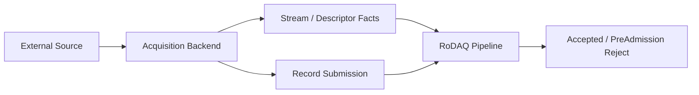
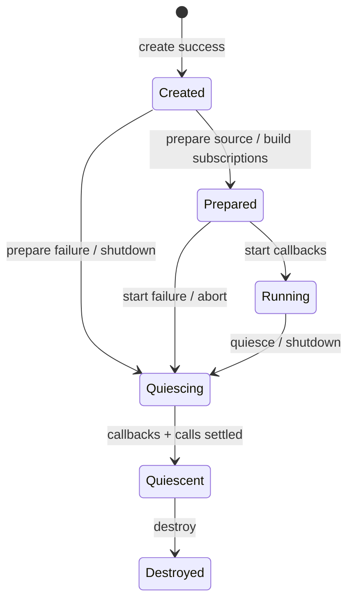

# RoDAQ Acquisition Plugin 设计

| 文档属性 | 内容 |
| --- | --- |
| 文档类型 | 角色模块详细设计 |
| 状态 | V1 详细设计基线 |
| 适用范围 | 所有 RoDAQ Acquisition Plugin 的 Source、Stream、Descriptor、Record Submission、Payload、Callback 与 Quiescence 规则 |
| 上位设计 | [系统架构设计](architecture.md) |
| 公共插件接口契约 | [Plugin](plugin.md) |
| 关联设计 | [Pipeline](pipeline.md) · [Task](task.md) · [Storage](storage.md) |

## 1. 目标与职责边界

Acquisition Plugin 负责把外部数据源转换为 RoDAQ 可接纳的 Source、Stream、Descriptor 和 Record Submission 事实。

它负责：

- 外部协议连接、订阅或接收；
- Source/Session 识别；
- Stream 与 Stream Descriptor 事实；
- Payload 和来源时间事实；
- 向 RoDAQ 提交 Record attempt；
- Source reconnect / disconnect；
- 有界协议缓存；
- callback concurrency；
- quiesce。

它不负责：

- 分配 `acceptance_sequence`；
- 打开/关闭 Pipeline Admission Gate；
- 决定 Task Desired State；
- 直接写 Storage；
- 宣称 Record durable；
- 在 RoDAQ 拒绝后私自认为该 Record 已接纳。

## 2. 数据源、Stream 与配置语义

### 2.1 数据关系、实例与配置

**数据流关系。**



Acquisition 与 Storage 不存在直接依赖。

**Acquisition Instance 生命周期。**

公共 Plugin 生命周期之上，Acquisition 角色至少包含：



Prepared 可以已经创建协议对象或 subscription，但 RoDAQ Admission Gate 仍可能关闭。

Running 只表示插件可以产生 callback；Record 是否被接纳仍由 Pipeline Admission 决定。

**配置规则。**

Acquisition-specific configuration 由插件定义，例如：

- source endpoint；
- subscription/topic/service；
- message/type/encoding；
- protocol QoS；
- source readiness policy；
- reconnect/backoff；
- protocol-specific bounded buffers；
- source identity policy；
- timestamp extraction；
- payload holding preference。

配置描述通过 Plugin Configuration Schema 发布。

插件语义校验必须拒绝：

- 协议不支持的组合；
- 超出声明最大记录；
- 无法形成有界资源计划的配置；
- Required Source/Descriptor 信息缺失；
- 可能造成未声明无界缓存的配置。

**Acquisition Capability。**

Acquisition Capability 至少表达：

| 能力 | 说明 |
| --- | --- |
| source identity | 是否能稳定识别实际 producer |
| source sequence | 是否提供 native sequence，以及 sequence scope 类型 |
| source timestamp | 可用时间角色和 clock domain |
| payload encoding | 交付给 RoDAQ 的字节语义 |
| max record | 最大单 Record |
| payload modes | Copy / Transfer / Retain |
| callback concurrency | 最大并发 callback |
| descriptor behavior | static / runtime change |
| reconnect behavior | 是否形成新 Source Session |
| readiness | 能否判断 source/subscription ready |

不能提供的能力必须显式缺失，不得填入伪值。

### 2.2 Source Identity 与 SourceSequence

**Source Identity。**

Data Source 表示实际 producer，不等价于逻辑 Stream。

例如同一 Topic 可能：

- 只有一个 publisher；
- publisher 重启；
- publisher 被另一个进程替换；
- 同时存在多个 publisher。

插件只有在协议事实足够时才提供稳定 `SourceId`。

无法稳定识别时：

```text
SourceId = absent
```

而不是根据地址、Topic 或时间戳伪造稳定身份。

**Source Session。**

协议重连不一定等于同一 Source Session。

如果 native sequence 或 timestamp continuity 只在连接期间成立，插件必须建立新的 source-session boundary，并把该作用域随 Record 提交。

**SourceSequence。**

SourceSequence 只有在 sequence scope 明确时才可用于顺序和缺口。

允许的 scope 示例：

- stable SourceId lifetime；
- connection/session；
- protocol producer epoch。

插件提交：

```text
native_sequence
sequence_scope
optional source/session identity
```

如果 scope 不明：

- 可以把 sequence 作为 opaque metadata fact 保存；
- 不允许 RoDAQ 用它报告 source loss/duplicate；
- 多 producer 的本地序号不能拼成单序列。

### 2.3 Stream 与 Descriptor

**Stream。**

Stream 是 RoDAQ Task 配置中的稳定逻辑数据流。

Acquisition Plugin 不分配 `stream_id`。

RoDAQ 在 create/configure 时建立 Stream identity，并在实例创建时把已解析的 Stream 关联信息交给插件。

插件用 RoDAQ 提供的 stream handle/id 报告：

- Descriptor；
- Source；
- timestamp；
- payload。

插件不得通过“发现了一个新 native topic”无界创建 Stream。

动态发现只允许：

- 映射到预配置 Stream；
- 在明确支持的未来能力中经过有界 admission。

V1 默认采用配置驱动 Stream 集合。

**Stream Descriptor。**

Acquisition 提供 Stream 的解释事实。

Descriptor 至少可以形成：

- payload encoding；
- schema/type；
- source clock/time role；
- namespaced metadata extension。

Descriptor 不可变。

解释语义变化时，插件提出新 Descriptor，而不是原地修改旧对象。

**Descriptor Proposal。**

流程：

```text
Acquisition observes new interpretation
  ↓
propose Descriptor
  ↓
RoDAQ validates/bounds
  ↓
Storage prepare
  ↓
Pipeline Descriptor Cut
  ↓
new submissions use new descriptor generation
```

插件在 Cut 前不能把新语义 payload 标记为旧 Descriptor。

**Prepare 期间数据。**

若协议已经产生新格式数据，而 Descriptor 尚未 ready：

- 插件可使用 Resource Plan 中声明的有界 staging；
- staging 满时 PreAdmission Reject/drop with evidence；
- 不允许阻塞无限期；
- 不允许无界积累；
- 不允许错误使用旧 Descriptor。

## 3. Record 提交与 Payload 规则

### 3.1 Record Submission 与 Callback

**Record Submission Contract。**

Acquisition callback 向 RoDAQ 提交的是一次 **Record Attempt**。

最小事实包括：

- bound Stream；
- Descriptor generation/id；
- optional Source identity/session；
- optional SourceSequence + scope；
- source timestamps；
- payload view/handle；
- callback instance identity。

RoDAQ 返回的结果至少区分：

- Accepted；
- GateClosed；
- StaleGeneration；
- DescriptorNotReady；
- InvalidRecord；
- RecordTooLarge；
- ResourceExhausted；
- InstanceObsolete；
- Internal/Unavailable。

只有 Accepted 才表示 Record 已越过 Pipeline Admission Commit。

**Callback 线程模型。**

Acquisition 可以从多个协议线程产生 callback，但必须在 Capability/Resource Plan 中声明最大并发。

RoDAQ 依据该值预留：

- callback execution capacity；
- commit-domain concurrency；
- temporary submission metadata；
- payload accounting。

插件不得在声明 `max_callback_concurrency=N` 后产生超过 N 个同时在途 callback。

若后端无法自然限制，插件必须在内部做有界调度。

**Callback 与 RoDAQ 的重入。**

默认：

```text
Plugin callback -> RoDAQ submit
```

RoDAQ submit 不同步调用该 Acquisition instance 的控制接口。

插件 callback 不应持有会阻塞：

- quiesce；
- reconnect；
- plugin destroy；

的全局协议锁。

禁止依赖 RoDAQ submit 内部执行 Storage I/O；submit 只承担接纳路径的有界 Core 工作。

### 3.2 Payload Holding

**Payload Holding。**

**Copy。**

所有 V1 Acquisition 必须支持 Copy baseline。

插件保证 payload pointer 在 submit 调用返回前有效。

RoDAQ 若选择 Copy：

- Commit 前复制到 RoDAQ-owned bounded memory；
- callback 返回后插件可立即复用/释放原内存。

**Ownership Transfer。**

若 Capability 声明支持 Transfer：

- 提供唯一 owner handle；
- 通过 `acquire()` 显式、可失败地转移 ownership；
- `acquire()` 成功后 RoDAQ 成为唯一 owner，并在最终结算时 exactly-once `release()`；
- `acquire()` 前 Reject 时 owner 仍归插件；
- `acquire()` 后但 Admission Commit 前 Reject 时 owner 已归 RoDAQ，由 RoDAQ 负责释放。

**Shared Retain。**

若 Capability 声明支持 Retain：

- 使用同一 `acquire()/release()` ABI 表达 RoDAQ 额外持有；
- callback stack 结束不影响 RoDAQ 已 acquire 的 payload；
- acquire/release 必须满足 V1 的线程安全、非阻塞要求；
- quiesce 不得使 accepted retained payload 失效。

**Payload Metadata。**

插件同时报告：

- logical payload bytes；
- known physical allocation bytes（若适用）；
- ownership mode；
- alignment/encoding constraints。

不能用 logical bytes 代替实际资源占用。

## 4. 时间、就绪与覆盖语义

### 4.1 时间与来源连续性

**Receive Timestamp。**

RoDAQ 在 callback/submit 入口尽早采集：

- monotonic；
- realtime；
- `system_boot_id`；
- current Clock Epoch。

Acquisition 可以额外提供协议来源时间。

插件不得用来源 timestamp 覆盖 RoDAQ Receive Timestamp。

**Source Timestamp。**

每个来源时间值必须带：

- time role；
- clock identity/domain；
- value；
- quality/presence；
- optional synchronization relation。

缺失时保持缺失。

不允许：

- `0` 表示 unknown；
- receive time 冒充 source time；
- 没有同步证据却声明跨主机可比较。

**Clock/Source Discontinuity。**

插件负责报告它能够识别的 source clock discontinuity，例如：

- producer restart；
- device clock reset；
- connection/session change；
- protocol epoch change。

RoDAQ Clock Epoch 由 Core 的 realtime↔monotonic correlation 管理，不由 Acquisition 插件私自生成。

### 4.2 Readiness、Backpressure 与 Coverage

**Readiness。**

Acquisition readiness 与数据活动分离。

至少区分：

- plugin configured；
- subscription/connection established；
- source discovered/ready；
- receiving data；
- `0 Hz` activity。

“没有收到 Record”不能自动解释为 plugin failure。

Task 可配置 Required readiness policy，例如：

- subscription created 即可；
- 至少发现一个匹配 source；
- 必须在 deadline 内收到首条数据。

Readiness policy 必须在 Start Prepare 阶段可有界判定。

**Backpressure。**

Pipeline Admission 不承诺接受每个 Record Attempt。

当 RoDAQ 资源不足：

```text
PreAdmission Reject(ResourceExhausted)
```

Acquisition 必须遵守插件自己的 overflow policy。

允许：

- protocol-native drop；
- bounded plugin queue；
- bounded retry where protocol semantics allow。

不允许：

- callback 内无限等待 RoDAQ；
- unbounded queue；
- 将被 RoDAQ Reject 的 Record 报成 accepted；
- 在不记录证据的情况下重排/重复协议数据。

**Coverage Evidence。**

Acquisition 负责提供来源侧能观察到的证据：

- source disconnect/reconnect；
- protocol sequence gap；
- plugin queue overflow；
- plugin-side drop；
- invalid payload；
- source/session change；
- descriptor-not-ready rejection；
- source timestamp discontinuity。

Pipeline 负责记录 RoDAQ 侧：

- PreAdmission Reject；
- Accepted；
- post-admission failure/Unknown。

两类证据不能混成单一“丢包数”。

### 4.3 Reconnect

Reconnect 必须有明确状态和有界退避。

重连后插件重新确认：

- source/session identity；
- subscription；
- Descriptor；
- native sequence scope；
- source timestamp continuity。

不能假设重连后 native sequence 一定连续。

如果 producer identity 无法证明连续，建立新 Source/Session boundary。

## 5. 生命周期、资源与实现设计

### 5.1 Quiesce、资源与后端边界

**Quiesce。**

RoDAQ 先关闭 Admission Gate，再调用 Acquisition `quiesce`。它继承 Plugin 公共契约：`quiesce()` 对 create 成功后的 Created/Prepared/Started/failed instance 都是合法的幂等收敛操作；prepare/start 失败后也必须经 quiesce 才能 destroy，已 Quiescent 重复调用返回 OK。

quiesce success 必须保证：

1. 不再产生新的 callback；
2. 所有在途 callback 已返回；
3. 后台协议执行不会再次访问该 instance 绑定的 Acquisition Services handle 或 callback target；
4. 插件不再向 RoDAQ 提交该实例 Record；
5. RoDAQ 可以安全销毁 callback target；
6. 所有仍被 Pipeline 持有的 Transfer/Retain payload 都已经满足独立 payload-owner contract，后续 release 不访问该 instance 或它绑定的 Services。

quiesce 不要求已接纳 Record 写完 Storage；这些 Record 已由 Pipeline 持有并继续 drain。Acquisition instance 可以在 quiesce 后销毁，正是因为已 acquire payload 的 backing/owner 已与 instance 生命周期解耦。

**Timeout。**

quiesce timeout：

- instance 保留；
- Acquisition Services handle 与 callback target 保留；
- library 保留；
- instance 仍可能访问的 Resource Plan 占用保留；已 acquire payload 的独立 charge 由 Pipeline owner 继续保留到 release；
- 后续迟返仍归旧 instance；
- 达到局部清理 deadline 后进入 process recovery。

**Acquisition Resource Plan。**

角色专有资源至少包括：

- protocol receive buffers；
- subscription count；
- source/session entries；
- internal bounded queue；
- max callback concurrency；
- threads/executors；
- socket/FD；
- TLS/protocol memory；
- max payload；
- optional staging；
- retained payload upper bound；
- discovery metadata cardinality。

ROS 2/DDS、MQTT 等中间件内部资源无法由 Core 精确计费时，列为 Plugin-declared 或 Shared/External，并进入资格测试。

**Security。**

Acquisition 配置不得直接把 secret 导出到可移植 Task Configuration。

Task 保存 credential reference。

Deployment/secure source 解析：

- password；
- token；
- certificate；
- private key。

Acquisition 实例只获得运行所需 secret material。

不得：

- 写入 Segment Manifest；
- 写入普通日志；
- 返回 HTTP；
- 保存到 Task export。

可以保存不敏感的 credential version/fingerprint 用于 `effective_config_id` 和审计。

**后端映射要求。**

具体后端文档必须说明如何映射 Acquisition 接口契约。

**ROS 2。**

至少说明：

- subscription type；
- serialized payload lifetime；
- QoS；
- publisher identity；
- callback executor；
- source timestamp；
- discovery；
- multiple publishers；
- shutdown/quiesce。

**MQTT。**

至少说明：

- Broker/session；
- Topic；
- QoS；
- retained；
- reconnect；
- payload；
- packet/message identity；
- callback thread；
- TLS credential。

具体实现不能重新定义通用 Accepted/Descriptor/Payload 语义。

### 5.2 内部组成与 Role ABI

**内部组成。**

Acquisition 插件内部建议至少拆分：

| 对象 | 主要职责 |
| --- | --- |
| `AcquisitionInstance` | 角色 operation table 对应的实例根对象 |
| `SourceConnection` | 协议连接/会话生命周期 |
| `StreamSubscription` | 一个预配置 Stream 的协议订阅与 Descriptor 事实 |
| `SourceTracker` | SourceId/Session/Sequence scope 判定 |
| `DescriptorPublisher` | 产生 immutable Descriptor proposal |
| `RecordDispatcher` | 把协议 callback 转换为 RoDAQ RecordAttempt |
| `PayloadAdapter` | Copy/Transfer/Retain 所有权适配 |
| `AcquisitionSnapshot` | bounded readiness/source/receive/drop 快照 |

不得让协议 client object 直接调用 Pipeline/Storage 私有对象。

**Acquisition ABI operation table。**

在公共 Plugin ABI 之上，Acquisition V1 required role table 固定为：

```c
typedef struct rodaq_acquisition_services rodaq_acquisition_services_t;
typedef struct rodaq_acquisition_capability rodaq_acquisition_capability_t;
typedef struct rodaq_acquisition_resource_plan rodaq_acquisition_resource_plan_t;
typedef struct rodaq_acquisition_instance_config rodaq_acquisition_instance_config_t;
typedef struct rodaq_acquisition_stream_config rodaq_acquisition_stream_config_t;
typedef struct rodaq_record_attempt rodaq_record_attempt_t;
typedef struct rodaq_descriptor_proposal rodaq_descriptor_proposal_t;
typedef struct rodaq_source_event rodaq_source_event_t;
typedef struct rodaq_acquisition_instance* rodaq_acquisition_instance_t;

typedef struct rodaq_acquisition_operations {
    rodaq_abi_header_t header;

    rodaq_result_code_t (*validate_config)(
        const rodaq_config_api_t* config_api,
        rodaq_config_node_t config,
        rodaq_error_buffer_t* error);

    rodaq_result_code_t (*get_configured_capability)(
        const rodaq_config_api_t* config_api,
        rodaq_config_node_t config,
        rodaq_acquisition_capability_t* capability,
        rodaq_error_buffer_t* error);

    rodaq_result_code_t (*get_resource_plan)(
        const rodaq_config_api_t* config_api,
        rodaq_config_node_t config,
        rodaq_acquisition_resource_plan_t* resource_plan,
        rodaq_error_buffer_t* error);

    rodaq_result_code_t (*create)(
        const rodaq_config_api_t* config_api,
        rodaq_config_node_t config,
        const rodaq_acquisition_instance_config_t* instance_config,
        const rodaq_plugin_services_t* services,
        const rodaq_acquisition_services_t* acquisition_services,
        rodaq_acquisition_instance_t* instance,
        rodaq_error_buffer_t* error);

    rodaq_result_code_t (*prepare)(
        rodaq_acquisition_instance_t instance,
        const rodaq_deadline_t* deadline,
        rodaq_error_buffer_t* error);

    rodaq_result_code_t (*start)(
        rodaq_acquisition_instance_t instance,
        const rodaq_deadline_t* deadline,
        rodaq_error_buffer_t* error);

    rodaq_result_code_t (*quiesce)(
        rodaq_acquisition_instance_t instance,
        const rodaq_deadline_t* deadline,
        rodaq_error_buffer_t* error);

    void (*destroy)(rodaq_acquisition_instance_t instance);
} rodaq_acquisition_operations_t;
```

`header.version_major/minor` 是 **Acquisition Role Protocol** 版本，不是 Common ABI 版本；RoDAQ 同时校验 descriptor 中的 role protocol、operation table header 和 `role_operations_size`。V1 `RODAQ_ACQUISITION_OPERATIONS_BASE_SIZE` 覆盖 `validate_config / get_configured_capability / get_resource_plan / create / prepare / start / quiesce / destroy`，这些 required function pointer 全部不得为 NULL。ABI Freeze 后函数顺序、required prefix 与已发布 result/output 语义不得在 minor 中改变，只能尾扩展。具体内部 C++ 命名可调整，但 ABI 字段/函数职责不能重新合并。`rodaq_acquisition_instance_t` 只允许传给 Acquisition operations；任何跨 role instance pointer 转换都属于调用方错误，C/C++ conformance 示例以 `-Werror` 验证类型误传不能通过。`role_operations_size` 必须等于 operation table 自身 `header.struct_size`；descriptor role protocol version 必须与 operation table header 完全一致。V1 同时冻结 `RODAQ_ACQUISITION_CAPABILITY_BASE_SIZE`、`RODAQ_ACQUISITION_RESOURCE_PLAN_BASE_SIZE`、`RODAQ_ACQUISITION_INSTANCE_CONFIG_BASE_SIZE`、`RODAQ_ACQUISITION_STREAM_CONFIG_BASE_SIZE`、`RODAQ_RECORD_ATTEMPT_BASE_SIZE`、`RODAQ_DESCRIPTOR_PROPOSAL_BASE_SIZE`、`RODAQ_SOURCE_EVENT_BASE_SIZE` 与 `RODAQ_PAYLOAD_BASE_SIZE`。

官方 C++ 开发路径使用 `rodaq::plugin::AcquisitionFactory` 与 `rodaq::plugin::Acquisition`，由 `export.hpp` adapter 自动生成上述 C operation table。`acquisition.hpp` 中的 `AcquisitionCapability`、`AcquisitionResourcePlan`、`AcquisitionInstanceConfig`、`AcquisitionServices` 与本节 C ABI 事实一一对应；`prepare()` 和 `start()` 当前没有额外参数结构，只接收 `Deadline`。这些 C++ 类型只在插件 DSO 内使用，不成为 RoDAQ↔Plugin ABI。ROS 2、MQTT 等官方 Acquisition 后端应优先实现 C++ 接口，而不是手写 C trampoline。

**Acquisition V1 value layout。** 下列结构都是 Acquisition Role Protocol 的正式 C ABI；`header.version_major/minor` 写当前调用 negotiated Role version。V1 的 `*_BASE_SIZE` 等于下列 V1 required prefix 的末尾，未来 minor 只能尾扩展。

```c
typedef struct rodaq_descriptor_token {
    uint64_t value;
    uint64_t generation;
} rodaq_descriptor_token_t;

typedef struct rodaq_acquisition_capability {
    rodaq_abi_header_t header;
    rodaq_environment_fingerprint_t environment_fingerprint;

    uint64_t max_record_bytes;
    uint64_t payload_mode_bits;
    uint64_t source_identity_bits;
    uint64_t source_sequence_bits;
    uint64_t source_timestamp_role_bits;
    uint64_t descriptor_behavior_bits;
    uint64_t readiness_bits;

    uint32_t max_callback_concurrency;
    uint32_t reserved0;
} rodaq_acquisition_capability_t;

typedef struct rodaq_acquisition_resource_plan {
    rodaq_abi_header_t header;
    rodaq_environment_fingerprint_t environment_fingerprint;

    uint64_t rodaq_buffer_bytes;
    uint64_t plugin_buffer_bytes;
    uint64_t max_inflight_bytes;
    uint64_t max_retained_payload_bytes;
    uint64_t max_staging_bytes;

    uint32_t max_inflight_records;
    uint32_t max_staging_records;
    uint32_t thread_count;
    uint32_t executor_count;
    uint32_t fd_count;
    uint32_t max_callback_concurrency;
    uint32_t max_sources;
    uint32_t reserved0;
} rodaq_acquisition_resource_plan_t;

typedef struct rodaq_acquisition_stream_config {
    rodaq_abi_header_t header;
    rodaq_stream_id_t stream_id;
    rodaq_config_node_t config;
    uint64_t max_record_bytes;
    uint32_t readiness_policy;
    uint32_t reserved0;
} rodaq_acquisition_stream_config_t;

typedef struct rodaq_acquisition_instance_config {
    rodaq_abi_header_t header;

    rodaq_task_id_t task_id;
    rodaq_pipeline_id_t pipeline_id;
    rodaq_instance_id_t instance_id;
    rodaq_effective_config_id_t effective_config_id;
    uint64_t control_generation;

    rodaq_environment_fingerprint_t expected_environment_fingerprint;

    uint64_t max_record_bytes;
    uint64_t max_inflight_bytes;
    uint64_t max_retained_payload_bytes;
    uint32_t max_inflight_records;
    uint32_t max_callback_concurrency;

    const rodaq_secret_bundle_t* secrets;
    const rodaq_acquisition_stream_config_t* streams;
    uint32_t stream_count;
    uint32_t reserved0;
} rodaq_acquisition_instance_config_t;
```

`rodaq_effective_config_id_t` 是 Common ABI 中独立的 256-bit 语义类型，不与任意普通 digest typedef 混用。`rodaq_acquisition_stream_config_t::config`、`streams`、`secrets` 以及其内部 string/bytes/node 只在 `create()` 调用期间 borrowed；插件在返回前复制跨调用需要的普通配置与凭据。`stream_count` 必须不超过 Effective Limits，`streams == NULL` 仅在 `stream_count == 0` 时合法。所有 `reserved0` 必须为 0。

Capability 与 Resource Plan 的 `environment_fingerprint` 必须完全相同；count 使用 `uint32_t`，byte size 使用 `uint64_t`。RoDAQ 只有在 caller-owned capability/plan 的 `header.struct_size >= 对应 BASE_SIZE` 时调用插件；adapter 对返回后的 header/version/reserved/上界进行再次校验。

`create()` 只建立准入后的本地实例。`config_api`、根 config node、Stream config node/string、Stream 数组和 secret bundle 只在 create 调用期间有效；`services` 与 `acquisition_services` 在 create 失败时返回前失效，成功后可由该 Acquisition instance 保存到 destroy 返回。`create()` 必须重新观察影响 capability/resource plan 的环境并与 `expected_environment_fingerprint` 比较；不一致时返回 Conflict/Unavailable 且不发布 instance，RoDAQ 重新执行 capability→plan→admission。

角色调用顺序冻结为：

| 调用 | 可以执行的工作 | 返回成功后保证 |
| --- | --- | --- |
| `validate_config` | 纯配置语义检查 | 配置可由本插件解释 |
| capability / plan | 读取配置及必要环境事实，不创建运行实例 | 得到可准入的确定能力/资源事实 |
| `create` | 建立本地 instance 对象和已获准的固定资源 | 不启动外部连接/订阅，不产生 callback |
| `prepare` | 建立连接/订阅、准备 Source/Descriptor、执行 readiness 前置工作 | 外部资源已建立到可以 start 的状态 |
| `start` | 启用协议接收/callback，完成配置要求的 start readiness | callback 域已工作且受声明并发上限约束 |
| Pipeline Open Admission | **不是插件调用** | 从此之后符合条件的 Record Attempt 才可能 Accepted |

因此 `prepare/start` 都属于 Task Prepare Barrier。插件在 `start` 成功后、Pipeline Open Admission 之前可能已经观察到 native 数据；此时 submit 得到 `GateClosed` 属于**录制覆盖尚未开始**，不能被解释为“已开始录制后的数据丢失”。正式 Coverage 从 Pipeline Open Authorization/Open boundary 建立。

### 5.3 Acquisition Services、RecordAttempt 与 Payload ABI

**Acquisition Services。**

Acquisition 的 role-specific callbacks 使用独立 typed service table，不经 `PluginServices` 中的 `void*` 或泛化 context 间接取得：

```c
typedef struct rodaq_acquisition_services_handle* rodaq_acquisition_services_handle_t;

typedef struct rodaq_acquisition_services {
    rodaq_abi_header_t header;
    rodaq_acquisition_services_handle_t handle;

    rodaq_result_code_t (*submit_record)(
        rodaq_acquisition_services_handle_t handle,
        const rodaq_record_attempt_t* record,
        rodaq_submit_result_t* submission);

    rodaq_result_code_t (*propose_descriptor)(
        rodaq_acquisition_services_handle_t handle,
        const rodaq_descriptor_proposal_t* proposal,
        const rodaq_deadline_t* deadline,
        rodaq_descriptor_token_t* descriptor_token,
        rodaq_error_buffer_t* error);

    rodaq_result_code_t (*report_source_event)(
        rodaq_acquisition_services_handle_t handle,
        const rodaq_source_event_t* event);
} rodaq_acquisition_services_t;
```

`rodaq_acquisition_services_t::header.version_major/minor` 使用**已协商的 Acquisition Role Protocol version**。V1 定义 `RODAQ_ACQUISITION_SERVICES_BASE_SIZE`；table、handle 以及 base prefix 内 `submit_record/propose_descriptor/report_source_event` 均为 required、不得为 NULL。未来 role-service tail 只有在 negotiated Role minor、`struct_size` 和对应 Configured Capability/role feature 同时允许时才可使用。它与 `PluginServices` 的 Common ABI version domain 明确分离。

Acquisition service callback 不允许同步调用同一 Acquisition instance 的 mutable control operation。`submit_record()` 是热路径有界调用，不执行 Storage I/O；`propose_descriptor()` 可能触发 Storage prepare，因此必须从非热回调锁域调用并携带 operation deadline。`report_source_event()` 必须是有界、非阻塞或短临界区状态更新。RoDAQ 对同一 Source/Session 的重复连接状态、活动状态和连续 gap 事件进行 coalesce/计数，而不是为每次协议抖动创建永久对象；如果事件无法记录则返回结构化错误，插件将“来源证据记录失败”计入自身 bounded counter，并通过 Logging 留痕，而不是静默假装 Coverage 完整。RoDAQ 通过 bounded source-state/cardinality 限制防止事件风暴形成无界内存。

**RecordAttempt ABI。**

RoDAQ 对一个合法 ABI submit 调用使用独立 disposition 返回业务接纳结果：

```c
typedef uint32_t rodaq_submit_disposition_t;

enum {
    RODAQ_SUBMIT_ACCEPTED = 0,
    RODAQ_SUBMIT_GATE_CLOSED = 1,
    RODAQ_SUBMIT_OBSOLETE_INSTANCE = 2,
    RODAQ_SUBMIT_STALE_DESCRIPTOR = 3,
    RODAQ_SUBMIT_DESCRIPTOR_NOT_READY = 4,
    RODAQ_SUBMIT_INVALID_RECORD = 5,
    RODAQ_SUBMIT_RECORD_TOO_LARGE = 6,
    RODAQ_SUBMIT_RESOURCE_EXHAUSTED = 7,
    RODAQ_SUBMIT_PAYLOAD_ACQUIRE_FAILED = 8
};

typedef struct rodaq_submit_result {
    rodaq_abi_header_t header;
    rodaq_submit_disposition_t disposition;
} rodaq_submit_result_t;
```

`submit_record()` 的函数返回码表示 RoDAQ callback 本身是否成功执行；对于正常的 PreAdmission Reject，函数返回 `RODAQ_RESULT_OK`，具体原因由 `disposition` 表达。函数返回非 OK 表示 RoDAQ/ABI 级异常，Record 同样视为未接纳，插件不得把它计为 Accepted。

`rodaq_record_attempt_t`、Descriptor proposal 与 Source event 的 V1 required layout 固定如下。时间戳采用固定容量 inline array，避免跨 ABI 动态 vector：

```c
#define RODAQ_RECORD_TIMESTAMP_CAPACITY 4u

typedef uint32_t rodaq_timestamp_role_t;
typedef uint32_t rodaq_clock_domain_t;
typedef uint32_t rodaq_source_event_kind_t;
typedef uint32_t rodaq_sequence_scope_t;

typedef struct rodaq_record_timestamp {
    rodaq_timestamp_role_t role;
    rodaq_clock_domain_t clock_domain;
    int64_t value_ns;
} rodaq_record_timestamp_t;

typedef struct rodaq_descriptor_proposal {
    rodaq_abi_header_t header;
    rodaq_stream_id_t stream_id;
    rodaq_string_t encoding;
    rodaq_string_t schema_name;
    rodaq_bytes_t schema;
    rodaq_digest256_t schema_digest;
    uint64_t source_timestamp_role_bits;
    uint64_t flags;
} rodaq_descriptor_proposal_t;

typedef struct rodaq_source_event {
    rodaq_abi_header_t header;
    rodaq_stream_id_t stream_id;
    rodaq_source_id_t source_id;
    rodaq_source_session_id_t source_session_id;
    uint64_t source_sequence;
    rodaq_source_event_kind_t kind;
    rodaq_sequence_scope_t sequence_scope;
    uint32_t flags;
    uint8_t has_source_id;
    uint8_t has_source_session_id;
    uint8_t has_source_sequence;
    uint8_t reserved[5];
} rodaq_source_event_t;

typedef struct rodaq_payload {
    rodaq_abi_header_t header;
    uint32_t mode;
    uint32_t reserved0;
    const uint8_t* data;
    uint64_t logical_size;
    uint64_t physical_charge;

    void* owner_context;
    rodaq_result_code_t (*acquire)(void* owner_context);
    void (*release)(void* owner_context);
} rodaq_payload_t;

typedef struct rodaq_record_attempt {
    rodaq_abi_header_t header;

    rodaq_stream_id_t stream_id;
    rodaq_descriptor_token_t descriptor_token;
    rodaq_source_id_t source_id;
    rodaq_source_session_id_t source_session_id;
    uint64_t source_sequence;

    rodaq_payload_t payload;
    rodaq_record_timestamp_t timestamps[RODAQ_RECORD_TIMESTAMP_CAPACITY];

    uint64_t flags;
    rodaq_sequence_scope_t sequence_scope;
    uint32_t timestamp_count;
    uint8_t has_source_id;
    uint8_t has_source_session_id;
    uint8_t has_source_sequence;
    uint8_t reserved[5];
} rodaq_record_attempt_t;
```

`descriptor_token.value == 0` 或 `generation == 0` 无效；token 只对绑定的 Stream/instance generation 有意义。`timestamp_count <= RODAQ_RECORD_TIMESTAMP_CAPACITY`，未使用的 timestamp slots 必须清零。presence flag 只允许 0/1；对应 `has_* == 0` 时相关 ID/sequence 字段必须为零值。Proposal/Event/RecordAttempt 内的 string/bytes 只在 callback 调用期间 borrowed，除非 payload acquire 规则明确延长 payload 本身的 lifetime。

**Payload ABI。**

- Copy：`owner_context/acquire/release` 全部为 NULL；`data` 在 `submit_record()` 返回前有效，RoDAQ 若接纳必须在返回前复制到 RoDAQ-owned bounded memory。
- Transfer/Retain：`data`、`owner_context`、`acquire`、`release` 全部必须有效；`acquire()` 成功后，**payload owner lifetime 与 Acquisition instance lifetime 解耦**。`data + owner_context + release function` 必须一直有效到 RoDAQ 最后一次 exactly-once `release()`，即使原 Acquisition instance 已经 quiesce/destroy。
- Transfer：`acquire()` 成功即把唯一 ownership 转移给 RoDAQ，插件随后不得再访问或释放该 owner；若 Admission Commit 前最终 Reject，RoDAQ 仍负责 release。
- Retain：`acquire()` 为 RoDAQ 增加一份稳定持有，插件可保留其它引用；RoDAQ 只释放自己的持有。
- 非 Copy 的 `acquire/release` 必须 thread-safe、non-blocking、bounded，且**不得访问 Acquisition instance、PluginServices、AcquisitionServices 或 instance-owned pool 生命周期对象，也不得反调 RoDAQ/插件控制接口**。如果底层 native buffer 来自 instance-local pool，插件必须把实际 backing/引用计数提升为独立 payload-owner object，使 pool 的必要 backing 至少活到最后一次 release。
- `acquire()` 失败时不越过 Admission Commit；`physical_charge` 是准入/持有期间的保守物理资源收费，不能低于资格规则要求。

因此 Acquisition `quiesce()` 只证明 instance/callback/control 域静止，不要求已接纳 Record 已完成 Storage drain；它能够安全 destroy 的前提是所有仍在 Pipeline 中的非 Copy payload 已通过上面的独立 owner contract 脱离 instance lifetime。DSO 本身保持 resident，保证 `release` function pointer 在 payload owner 存活期间不会失效。对应的 `physical_charge`、retained-payload count/bytes 与 backing memory reservation 也随 payload owner 转移到 Pipeline owner 域，在最后一次 release 前不得因为 Acquisition instance destroy 而归还给全局容量池；instance 自身其它已静止资源可以正常释放。这样 ownership lifetime 与 resource-accounting lifetime 保持一致。

**Stream 配置映射。**

RoDAQ 在 create/prepare 时提供固定 Stream 关联表：

```text
stream handle
stable stream_id
plugin-specific address/config
initial descriptor expectation
effective limits
readiness policy
```

插件只能对这些 Stream 提交 Record。V1 不因为协议动态发现新 native source/topic 就自动新增 RoDAQ Stream。

### 5.4 Callback、Source 与 Descriptor 执行

**Descriptor Token。**

Descriptor Proposal 成功后，RoDAQ 返回稳定 token/generation。RecordAttempt 只携带 token，不在 callback 热路径复制 Schema。

插件内部 `StreamSubscription` 保存当前 token。新 token 只有 Storage prepare 与 Descriptor Cut 成功后才成为 Active；旧 token 能明确判定 Stale。

**Callback 热路径。**

```text
receive native message
→ identify configured stream/source/session
→ collect source metadata
→ build lightweight RecordAttempt
→ RoDAQ submit_record
→ account local reject/drop
→ return
```

callback 禁止执行：

- 文件 I/O；
- Task control wait；
- Storage 调用；
- DNS/reconnect；
- 无界 metadata 创建；
- 逐条重日志格式化。

**Callback 并发控制。**

插件必须明确：

```text
max_native_callbacks
max_rodaq_callbacks
internal_queue_records
internal_queue_bytes
overflow_policy
```

如果协议天然并发高于声明上限，插件内部用有界执行器/队列收敛；不能把超额并发直接推给 RoDAQ。

**SourceTracker。**

每个 Source entry 至少保存：

```text
source identity
session identity
sequence scope
last native sequence（若可解释）
source clock identity
last activity monotonic
bounded state flags
```

entry 数量受 `max_sources_per_pipeline` 限制。达到上限后不得无界增长 map；按配置拒绝、降级 SourceId absent 或保留一个 bounded aggregate overflow counter。

**Reconnect 状态。**

连接型协议使用等价于：

```text
Disconnected
Connecting
Ready
Backoff
Quiescing
Quiescent
```

backoff 使用 monotonic clock，配置 initial/max delay、jitter 和 retry budget。进入 Quiescing 后不得启动新的 reconnect。

**Readiness 实现。**

Readiness 发布结构化 snapshot：

```text
Configured
TransportReady
SubscriptionReady
SourceReady
Receiving
LastReceiveAge
```

Task Prepare 只读取定义好的 readiness condition。`0 Hz` 不自动把 SubscriptionReady 改为 false。

**Descriptor Change。**

```text
observe native schema/type change
→ deduplicate proposal
→ propose_descriptor()
→ bounded wait outside callback hot lock
→ atomically replace current descriptor token
→ subsequent records use new token
```

等待期间只能使用 Resource Plan 中声明的有界 staging，或立即 drop/reject；不得挂住 callback 等待 Storage prepare。

**PayloadAdapter。**

每个 backend 必须明确回答：

```text
native payload owner
callback-return lifetime
whether move is legal
whether retain across callback is legal
release-thread restriction
physical allocation accounting
```

任何一项无法证明时，回退 Copy。

### 5.5 Shutdown、Wrapper 与开发约束

**Quiesce 实现步骤。**

```text
mark stopping
→ block new reconnect/subscription work
→ stop protocol receive callbacks
→ wait plugin callback counter == 0
→ wait role service callbacks return
→ stop protocol worker/executor participation
→ publish Quiescent
```

quiesce success 后 callback counter 必须恒为 0，且不再访问该 instance 的 Acquisition Services handle 或 callback target。

**Deadline。**

Acquisition ABI 的 `prepare/start/quiesce` deadline 都是 **operation deadline**。插件接收 RoDAQ monotonic absolute deadline，多个子步骤共享同一总预算，不能每一步重新获得完整 timeout。`create()` 不执行协议连接或等待来源 ready；它只建立本地实例资源，因此不使用长操作 deadline。真正可能阻塞的连接、订阅和 readiness 工作放在 `prepare/start`。

**Destroy。**

`destroy()` 只清理已经 Quiescent 的实例，不得首次触发 unsubscribe、等待未知 callback、执行无界 join 或把 destroy 当 quiesce fallback。

**C++ RoDAQ-side Wrapper。**

Core 侧 wrapper 与 Plugin 公共文档中的 `rodaq::plugin::AcquisitionHandle` 对齐：

```cpp
class AcquisitionHandle {
public:
    Result<void> prepare(Deadline deadline);
    Result<void> start(Deadline deadline);
    Result<void> quiesce(Deadline deadline);
    AcquisitionSnapshot snapshot() const;
};
```

当前 `prepare/start` 没有独立 request object；实例配置已经在 create 阶段冻结，不为了未来扩展预留空的 `PrepareRequest/StartRequest`。Record submission 通过创建时绑定的 Acquisition Services 进入 Pipeline，不向其它模块公开 mutable submit 方法。`AcquisitionHandle::snapshot()` 是 RoDAQ Core 根据 callback counters、readiness/source state 与 instrumentation 维护的内部快照，不对应新增的 Plugin ABI operation，也不要求插件实例提供 `snapshot()` 虚函数；因此它不改变 C/C++ authoring 契约。

**Backend 实现表。**

每个 backend 文档必须回答：

| 项目 | 必须回答 |
| --- | --- |
| native callback thread | 哪些线程调用、最大并发 |
| payload lifetime | callback 返回后是否有效 |
| source identity | 如何获得、何时失效 |
| source sequence | scope 是什么 |
| source time | clock domain / role |
| reconnect | 是否形成新 session |
| descriptor change | 如何检测 |
| readiness | 哪个 native 事件表示 ready |
| quiesce | 哪个 API 能证明 callbacks stopped |
| external resources | middleware/kernel 哪些不由插件精确控制 |

**Test Seam。**

Acquisition conformance harness 必须能让测试插件主动制造：

- N 线程 submit；
- callback 迟返；
- quiesce race；
- Descriptor change storm；
- source/session 高基数；
- resource-plan 与实际不符；
- acquire/release failure；
- payload lifetime violation；
- reconnect storm。

**代码组织约束。**

```text
acquisition/
  instance.*
  source_connection.*
  stream_subscription.*
  source_tracker.*
  descriptor_publisher.*
  record_dispatcher.*
  payload_adapter.*
  snapshot.*

plugins/
  ros2/
  mqtt/
```

目录已经表达 Acquisition 领域，因此内部文件不再重复 `acquisition_` 前缀，也不保留 `types.*` 这类兜底文件。文件按实际职责命名；确需共享值类型时放入最接近其所有权的文件或公开 `plugin/acquisition.hpp`，不能把新增领域对象不断堆入 `types/common/utils/detail`。通用 `acquisition/` 不包含 ROS 2、MQTT 第三方头。

## 6. 不变量与资格

### 6.1 核心不变量

1. Acquisition submit 是 attempt，不是 accepted。
2. Acquisition 不分配 AcceptanceSequence。
3. Acquisition 不直接调用 Storage。
4. Stream 集合 V1 有界且配置驱动。
5. Descriptor 语义变化必须经过 Descriptor Cut。
6. callback concurrency 不超过声明。
7. Copy baseline 对所有 V1 Acquisition 可用。
8. 非 Copy 模式必须显式 acquire/release 且资源计费。
9. SourceSequence 只有 scope 明确时才具有 loss 语义。
10. quiesce success 后不得再有该 instance callback。
11. quiesce timeout 不允许释放 Acquisition Services handle 或 callback target。
12. reconnect 不隐式证明 source/session 连续。

### 6.2 资格验证

**通用测试 Acquisition。**

实现可控 Fake Acquisition：

- 单线程 callback；
- N 线程 callback；
- Descriptor runtime change；
- Source reconnect；
- sequence gap；
- Copy/Transfer/Retain；
- callback late return；
- quiesce hang；
- declared resource overflow。

用于验证 RoDAQ 规则，不作为生产性能证据。

**真实后端。**

每个真实后端必须验证：

- 协议连接/断开；
- 配置非法；
- source idle；
- sustained load；
- callback concurrency；
- backpressure；
- descriptor change；
- payload ownership；
- reconnect；
- quiesce；
- process restart；
- resource HWM；
- source interference。

**Source Interference。**

采集插件作为读端也可能改变源系统行为。

资格必须证明协议配置不会不可接受地反向影响机器人控制，例如：

- ROS 2 reliable history/backpressure；
- MQTT broker flow control；
- socket buffer pressure；
- discovery storms；
- duplicate subscriptions；
- reconnect storms。

发布支持矩阵记录最终生效的协议/QoS 参数，而不是只记录 `system_default` 之类未解析字符串。

### 6.3 V1 完成条件

Acquisition 角色契约完成需要：

- Fake Acquisition conformance 全通过；
- ROS 2 Acquisition 能按通用规则实现而无需修改 Pipeline 核心语义；
- Source/Sequence/Time/Payload 每个可选事实都有明确 absence 语义；
- callback 与 quiesce race 可证明；
- sustained overload 时所有队列与 metadata 有界；
- Copy 路径通过正确性资格；
- 若 Copy 性能不足，至少一个非 Copy 模式在发布前通过所有权和真实负载资格。
