# RoDAQ 系统架构设计说明书

| 文档属性 | 内容 |
| --- | --- |
| 文档类型 | 系统架构设计说明书（System Architecture Design Specification） |
| 文档状态 | V1 架构评审基线 |
| 日期 | 2026-11-08 |
| 适用范围 | RoDAQ V1 工业级录制核心、本机服务端及 Web 应用 |
| 目标读者 | 架构设计、核心开发、插件开发、测试与现场集成人员 |
| 设计依据 | 工业现场控制隔离、数据完整性、故障恢复、资源有界和长期运行要求；[早期设计笔记](note.md)仅作为设计演进参考 |
| 相关文档 | [Task 设计](task.md) · [Pipeline 设计](pipeline.md) · [Plugin 公共框架](plugin.md) · [Acquisition 设计](acquisition.md) · [Storage 设计](storage.md) · [技术选型](technology_selection.md) · [术语表](../../GLOSSARY.md) |

## 0. 文档说明

### 0.1 目的

本文定义 RoDAQ V1 的系统边界、核心领域对象、控制与数据路径、插件接口契约、持久化与恢复、资源治理、运维安全及生产资格要求。本文是核心实现、接口冻结、故障注入和发布验收的共同架构基线，而不是功能介绍或实现笔记。

V1 的目标是交付**可在工业生产环境长期运行的录制核心**。版本范围可以限制后端和拓扑能力，但凡进入 V1 的功能，都必须同时满足正确性、资源有界、故障可解释、性能可验证和长期运行要求。

### 0.2 范围与非目标

| 类别 | V1 范围 |
| --- | --- |
| 纳入 | 多 Task、本机控制、连续/滚动录制、ROS 2 → MCAP 主链路、MQTT → MCAP 与 ROS 2 → rosbag2 SQLite3 替换验证、稳定插件 C ABI + C++ authoring API、持久控制、恢复、查询、Reset、Web/API、生产观测与资格验证 |
| 明确不纳入 | 多采集器汇入同一 Pipeline、单 Pipeline 多 Storage fan-out、跨节点自动接管、插件进程隔离、在线 Transform/分析图、复杂灾难恢复和分布式时间融合 |
| 不降低的 V1 要求 | 已纳入功能的并发语义、数据完整性、资源上限、故障行为、性能画像和 72h/168h 长时资格不得以后续版本为理由省略 |

### 0.3 规范性语言

本文使用以下规范性含义：**必须**表示 V1 接口契约或发布门禁；**应**表示强烈建议且偏离时需要设计评审和证据；**可**表示在不破坏既有接口契约的前提下允许的实现选择。示例、候选实现和解释性文字不改变明确写出的接口契约、不变量和验收条件。

#### 0.3.1 文档层级与权威

本文只冻结**跨模块架构契约**：系统边界、事实所有权、模块依赖方向、生命周期和故障边界、持久化与恢复语义、资源治理以及发布资格。`task.md`、`pipeline.md`、`plugin.md`、`acquisition.md` 和 `storage.md` 是对应模块的详细设计权威，负责定义模块内部状态、接口布局、算法步骤和测试缝隙；`technology_selection.md` 只记录实现技术与第三方依赖选择，不重新定义业务语义。

同一规则在本文和详细设计中同时出现时，本文决定跨模块可观察语义和不变量，详细设计不得削弱该契约；模块局部机制以对应详细设计为准。新增或修改跨模块契约时必须先更新本文，再同步受影响的详细设计；不得在某个模块文档中私自引入新的全局状态权威、持久化线性化点或反向依赖。本文中的后端示例只用于说明架构约束，具体 ROS 2、MQTT、MCAP、SQLite3 行为以角色详细设计和发布支持矩阵为准。

### 0.4 阅读路径


首次阅读建议依次阅读第 1、2、3、4、5、7 章；插件开发重点阅读第 2.5、2.6、4、5 章；服务端与 Web 开发重点阅读第 3、6 章；测试与现场集成人员重点阅读第 3.6、3.7、5.2、7 章。

### 0.5 核心架构决策摘要

| 决策 | V1 结论 | 主要目的 |
| --- | --- | --- |
| 进程模型 | 每节点一个 RoDAQ 守护进程，外部服务管理器负责进程级恢复 | 简化生命周期与持久状态所有权，明确进程级故障边界 |
| Pipeline 拓扑 | `1 Collector + 1 Storage`，单 Collector 可承载多数据流 | 保持录制路径和故障隔离简单且可证明 |
| Task 状态 | 期望控制状态与执行条件正交建模 | 避免 `Running/Failed` 单状态混淆持久意图与运行事实 |
| 记录身份 | `stream_id + acceptance_sequence`，按 Stream 持久区间预留并跨实例/重启不复用 | 保持稳定记录身份，同时避免制造不存在的跨流全局顺序 |
| 接纳边界 | Pipeline Admission Gate 建立全链路 cut，per-Stream commit 完成 Descriptor/Sequence；接纳提交点是“可拒绝→必须结算”的唯一边界 | 统一 Start/Pause/Stop/failure cutoff 与并发提交语义 |
| 插件边界 | 受管 Plugin Package + 固定 bootstrap C ABI + Role Protocol + C++ authoring adapter + 配置 Schema catalog + Capability/Resource Plan | C ABI 稳定跨 DSO；C++ API 提高插件开发效率但不成为二进制边界；在 `dlopen` 前完成 artifact 准入 |
| Storage V1 | 同步有界批次；Writer 与 Commit Lane 有界解耦；真实性能不合格时发布前补齐异步写入能力 | 隔离 fsync 尾延迟，同时保持 backlog 和所有权可证明 |
| 持久化 | 不可变 Task Config + Stream Identity State + 单一 Task Control authority + Recovery Progress + Segment 原子发布 + Durable Artifact Ledger | 分离身份、控制、执行、数据内容与“已提交产物曾存在”的持久事实，避免依赖可重建索引反推历史 |
| 资源模型 | Core 硬计费、Plugin 声明、共享外部资源分层治理，并限制长期对象 cardinality | 防止“内存池有界但元数据/中间件/提交积压无界”的长期失控 |
| 发布门禁 | 真实 ROS 2 → MCAP、故障矩阵、72h 工程预资格、168h 生产画像 | V1 按工业交付而非功能演示验收 |

## 1. 系统目标与生产约束

RoDAQ 通过适配器读取已配置的数据流，在运行节点形成可独立读取的录制产物。操作者能够控制录制，查看各流的实际收数与频率，判断哪些时段有数据，以及数据是否被接纳和持久保存。现场断开上位网络时，已启动的录制继续执行本地策略。

### 1.1 系统上下文

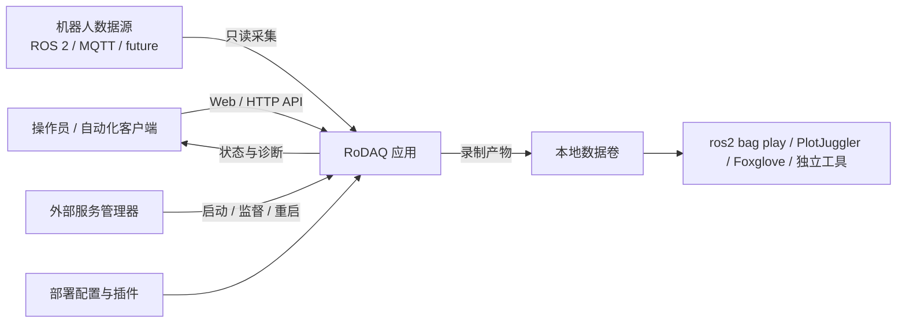

系统边界刻意把**机器人控制**留在 RoDAQ 之外。RoDAQ 是数据读取和持久化应用，不负责机器人安全停机，也不以录制成功作为机器人控制成功的前提。对外部数据源只使用部署允许的读取接口；对存储和管理入口则通过明确资源预算和最小权限限制影响范围。

### 1.2 生产约束

| 编号 | 系统要求 | 生产验收依据 |
| --- | --- | --- |
| SAF-01 | RoDAQ 只使用获准的数据读取接口。安装、满载、故障及重启都受现场控制预算约束 | 在真实机器人控制负载下对照测量控制周期、抖动、错过周期和通信负载 |
| AVL-01 | 可恢复的采集器错误、存储器错误、阻塞和超时按录制链路隔离；插件崩溃、内存破坏或进程关键服务失效属于进程级故障，由外部服务管理器恢复 | 注入单链路订阅建立错误、写入失败和阻塞，验证资源独立的链路与控制面继续推进；注入插件进程级故障并强制终止守护进程，验证重启后的历史查询和中断区间 |
| RES-01 | 输入、执行、磁盘、查询、导出及长期运行元数据全部有界 | 超额输入、慢盘、满盘、慢客户端、多任务、长期创建任务、隔离产物和审计增长同时发生时，验证预算、停止策略和故障传播范围 |
| SEC-01 | 本机管理入口采用最小权限、请求来源校验和本机认证；回环监听只限制网络暴露，不作为用户身份认证 | 验证非授权本地进程、跨站请求、非法 Host/Origin、越权产物路径和重放控制请求均不能执行高影响操作 |
| DAT-01 | 应用显示每条配置数据流的实际收数和频率。能够依据证据判断接纳、持久提交与覆盖缺口 | 验证静默 Topic 可启动且显示 `0 Hz`，后续消息正常录制，暂停前已接纳记录可完整读回。同一 Topic 被两个任务录制时，各任务独立控制和保存 |
| DUR-01 | 已报告提交且未按策略回收或重置的产物，在声明的故障模型内可恢复。中断产物有明确处置 | 在写入、封口、发布和索引之间注入故障。分别验证进程终止、整机重启和现场要求的断电模型 |
| OPS-01 | 通过本机 Web 和版本化 API 运维。控制操作可重试，恢复证据可查询 | 覆盖并发操作、重启和重置。验证回环监听、本机操作记录、备份和升级 |

任何运行 RoDAQ 所支持系统且满足所选后端依赖的电脑都可运行数采应用。节点可以是机器人主机、工作站、工控机或独立采集主机。系统版本、架构和后端组合由发布支持矩阵声明。生产资格按实际部署画像验证。与机器人控制共享资源时，现场验收包含对控制周期和抖动的实测。Linux 是首个参考环境，服务管理、资源限制、独占锁和文件提交通过平台适配层提供。

首版产物用于独立读回、回放和离线处理，保留来源与接收时间供离线对齐。一般连续录制允许出现可解释的缺口。需要抵御整机或介质损毁的现场须另定冗余、数据复制与接管设计。需要无缺口交付时，先核实来源能否提供可核对的序列和重放能力，以及是否允许控制源端流速。

### 1.3 V1 交付范围

V1 交付本机可安装和操作的数采应用。操作者能配置并并行运行多个录制任务，执行 Start、Pause、Resume、Stop 和 Reset，通过本机 Web 或 API 查看各数据流的实际频率，查询并获取录制产物。两种录制模式共用分片写入，连续录制保留历史，滚动录制按配置回收窗口外分片。

V1 是**工业生产环境可交付的录制核心**，不是功能演示版。凡进入 V1 的录制能力，都必须同时闭合数据语义、接纳边界、载荷所有权、插件配置与资源计划、写入和分片提交、故障恢复、可观测性、性能容量以及长期运行资格；不得以“后续版本再完善”为理由保留会影响正确性、资源有界性或目标负载的未定义行为。后续版本主要扩展更多采集与存储后端、跨节点能力、在线处理以及超出 V1 故障矩阵的高级恢复，而不是补齐 V1 已承诺录制路径的基础正确性。

开发先冻结数据流与记录语义、录制链路规则和插件边界，再打通 ROS 2 → MCAP。随后完成 `rodaq` 模块的任务控制、两种录制模式、恢复、产物查询和生产观测；`rodaq` 模块通过功能、故障和性能门槛后，再设计 HTTP 接口并接入 Web。V1 分别验证 MQTT → MCAP 和 ROS 2 → rosbag2 SQLite3，以确认同一套采集器和存储器插件边界支持替换。采集入口、暂停排空、分片提交、资源上限和端到端性能门槛从首个闭环落实。[实施顺序与验收](#7-实施门槛与生产资格)

## 2. 进程、模块与故障域

本章给出 RoDAQ 的逻辑分层、进程边界、Pipeline 划分、插件责任和故障传播范围。设计目标是让**控制意图、数据热路径、产物维护和外部监督**彼此解耦，同时明确哪些故障能够在链路内隔离、哪些故障必须通过整进程恢复处理。

### 2.1 逻辑架构总览

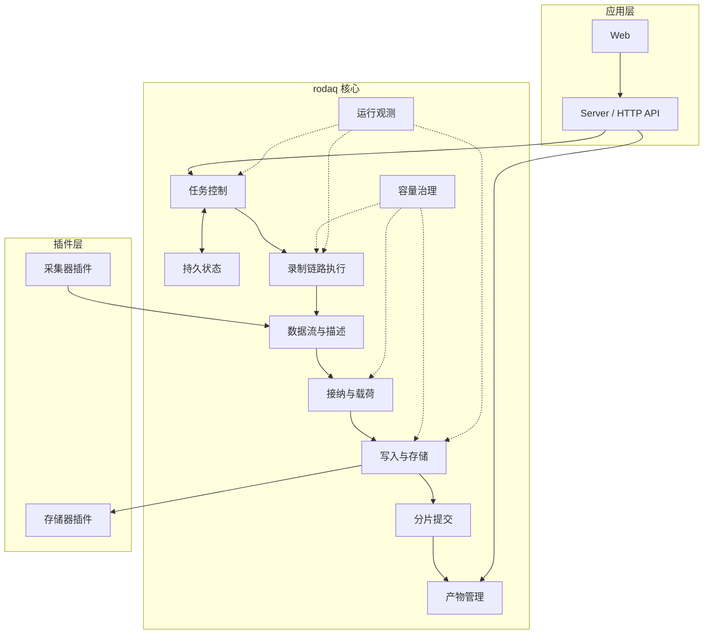

图中的箭头表示主要依赖方向，而不是线程调用关系。`server/` 只通过 `rodaq` 公共接口进入核心；插件只通过带显式版本字段的稳定 C ABI 与宿主交互；任务控制不直接操作 Writer、队列或插件私有对象；产物管理不反向控制采集器。容量治理和运行观测横向读取或约束多个责任域，但不成为数据热路径的同步依赖。

### 2.2 进程与执行域

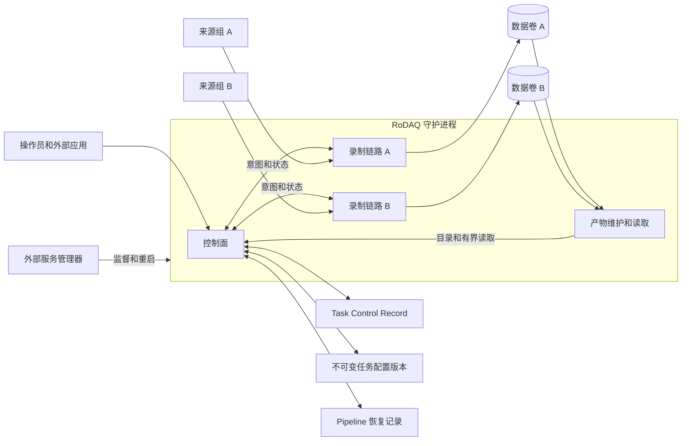

每个节点运行一个 RoDAQ 守护进程，以简化部署和插件生命周期管理。控制面、采集、写入和产物管理共用进程故障边界，各自持有明确的状态与执行容量。整进程故障可能中断节点上的所有录制，由外部服务管理器恢复。独立卷是图中的一种部署，同卷链路共享磁盘故障域。

| 执行域 | 所有权与容量 | 停机与迟返处理 |
| --- | --- | --- |
| 控制面 | 管理任务配置、持久期望状态与控制代次、有界操作账本，以及内存中的执行投影和独立恢复记录。限制请求大小、并发和控制队列，预留健康查询与停止能力 | 先关闭新任务及启动入场，再协调已受理操作。迟返只能更新与其控制代次、链路和实例匹配的资源结算或观察事实 |
| 录制执行域 | 每个录制链路独立拥有插件实例、数据入口、有界队列、串行写入权限和当前分片。准入计入插件内部缓冲、线程和 FD | 关闭接纳，排空并结算分片。释放插件及输出所有权前确认相应执行和引用已经静止。超时保留占用和迟返归属 |
| 产物维护和读取 | 分页索引、验证、读回、导出、保留回收。每卷有界作业和带宽，使用与控制提交和录制不同的执行资源 | 下载取消后释放读引用。回收通过持久意图重试。超时卷的维护任务不占用其他卷预留容量 |
| 外部服务管理器 | 启动、限制和监视单个 RoDAQ 守护进程，配置重启退避、频率上限和正常关停期限 | 区分退出请求、超时与真实退出。确认旧守护进程退出后才启动替代实例。无法退出时告警并保留排他约束 |

### 2.3 录制链路划分

录制链路（Pipeline）是任务内从采集到存储的一条路径。V1 每条链路固定配置**一个采集器和一个存储器**，运行时各创建一个实例，由 `rodaq` 模块的数据接纳和有界写入路径连接。一个采集器可以提供多条数据流，同一存储器保存该链路的这些数据流。一个任务可以包含多条链路，用于分别配置协议、格式、存储目标或故障隔离范围。各链路独立关闭接纳、结算在途记录和报告覆盖。普通故障发生时，资源独立的其他链路继续运行。

V1 不把多个采集器合并到同一链路，也不把一条链路同时扇出到多个存储器；需要 ROS 2 与 MQTT 进入同一个物理产物、或同一输入同时写入多个后端的场景属于后续拓扑扩展。这个边界只限制链路拓扑，不限制单个采集器提供多个数据流，也不允许通过插件私有接口绕过 `rodaq` 模块直接连接采集器和存储器。

每条链路在创建实例前独立预留串行写入容量及可能阻塞的采集控制调用容量。采集器停止调用阻塞时，该链路的写入者仍可排空已接纳的数据。存储器的写入、封口及其他需要与写入串行的操作使用该链路的写入容量。可能无限迟返的插件控制调用不得与 Writer、控制提交或健康查询共用一个没有隔离配额的线程池；实现必须为其提供链路专属或严格分区的执行槽位。C++17 不尝试强行终止任意卡死线程，到达局部清理期限仍无法证明静止时按整进程恢复规则处理。阻塞调用在所属链路执行，控制面读取快照，结构锁内不调用插件、文件系统或外部回调。停止操作的受理与调度、健康查询及诊断使用单独的预留容量。

`rodaq` 模块按链路统一检查并预留所需额度，检查范围包括进程的链路槽位、线程、文件描述符及内存预算。准备中、录制中及待清理的实例均计入占用。每条链路在一次预留中取得全部所需额度，资源不足时报告该链路准备失败。任务按照配置的 `AllRequired` 或 `BestEffort` 策略聚合各链路准备结果并结算 Start、Resume 或自动恢复；资源是否已实际取得和入口是否已开放始终按链路单独报告。插件初始化及失败收尾期间保留其占用，关联调用、引用和资源实际释放后才归还对应额度。

共享磁盘、网卡、内核或同一物理设备需单独限制和验证。Linux cgroup v2 可约束整个守护进程的部署资源，具体控制器与目标 I/O 行为需要实测。[Linux cgroup v2](https://docs.kernel.org/admin-guide/cgroup-v2.html) · [systemd 服务单元](https://man7.org/linux/man-pages/man5/systemd.service.5.html)

控制模块通过 `rodaq` 模块调度录制操作。部署层限制守护进程的设备、网络和写入权限。

### 2.4 故障处理

| 故障 | 处置与可见事实 |
| --- | --- |
| 数据流在观测窗口内没有消息 | 显示 `0 Hz`，保持任务与已建立的采集入口。后续收到符合配置的记录时继续接纳和写入 |
| 采集器返回可恢复错误、存储器返回可恢复错误 | 按所属链路关闭、保护或降级，报告 RoDAQ 操作错误与数据影响。能够安全收尾的链路释放资源，按任务策略退避重试。资源独立的链路和控制面继续运行 |
| 同卷空间或 I/O 故障 | 在实际受影响的卷范围内限制启动、录制和读取。记录仍能推进的卷和链路 |
| 链路调用超时，静止状态未确认 | 关闭该链路的接纳，标记待清理，保留实例、缓冲、执行容量及可能仍被访问的库。资源独立的健康链路继续录制。局部清理期限内确认静止的实例可按策略清理和重试。到期仍未完成清理时，进入整进程恢复 |
| 插件崩溃、进程内存破坏、不可恢复异常、控制面失去响应或无法维持关键服务 | 不承诺进程内故障隔离，直接进入整进程故障处置。守护进程仍可响应时，先在有限期限内收尾健康链路；否则由外部服务管理器终止并重启。重启后仅依据持久事实核对已提交产物、控制意图和中断区间 |

部署配置分别设置以下时限，进程内计时使用单调时钟。

| 时限 | 起点及到期行为 |
| --- | --- |
| 插件操作时限 | 从实际发起受监测的插件调用计时。超时使受影响链路关闭接纳并进入待清理，调用及其引用仍归原实例。HTTP 请求的等待时限只影响调用方取结果的方式 |
| 局部清理时限 | 从链路因故障进入待清理计时。后续调用超时或迟返沿用原截止时间。到期仍无法安全完成清理时，触发整进程恢复 |
| 整进程关停时限 | 从守护进程开始关停计时。先关闭新录制准入，健康链路在有限期限内排空和封口。部署时协调应用收尾与外部服务管理器的强制终止期限，确认旧进程已退出后才允许替代进程启动 |

### 2.5 采集器与存储器插件

采集器和存储器分别作为插件提供，在 RoDAQ 守护进程中执行。首个开发闭环采用 ROS 2 采集器插件和 MCAP 存储器插件。`rodaq` 模块按录制链路的配置装配插件实例，采集器与存储器通过 `rodaq` 模块的数据接纳和写入路径协作。

| 角色 | 职责 |
| --- | --- |
| 采集器插件 | 负责数据源协议、订阅、数据流与 Schema 信息以及向 `rodaq` 模块提交记录 |
| 存储器插件 | 负责目标格式的写入、滚动分片的格式封口及所需文件的清单 |
| `rodaq` 模块 | 管理任务、插件实例和执行预算，负责数据接纳、文件提交、产物索引与清理 |

同进程插件须来自受管发布渠道并通过 Plugin Package admission。daemon 初始化阶段以有界扫描一次性验证 Deployment 启用的 package manifest、artifact/schema digest、目标平台、权限、allow-list 与依赖支持矩阵，之后才允许 `dlopen` 并形成进程生命周期内 immutable Plugin Catalog；Task Create/Start 不触发新的插件目录扫描或 DSO 装载。运行时先通过独立且永久稳定的 Bootstrap Foundation 协商 Common ABI，再按所选 Common ABI descriptor 校验 plugin identity、RoDAQ feature floor 与 Role Protocol。Bootstrap 不依赖 Common ABI descriptor/result 类型，也不携带 feature bits。兼容承诺覆盖发布矩阵中经过联合验证的应用版本、插件版本、操作系统、架构和依赖组合。同进程插件的隔离边界只覆盖符合 ABI 契约的返回错误、迟返所有权、超时和资源占用；插件触发的进程崩溃、未定义行为、内存破坏、全局死锁或无界资源消耗不属于链路级隔离保证，按进程级故障处理。

动态库边界采用单一固定 Bootstrap Foundation。bootstrap 只协商 Common ABI 并返回该 ABI descriptor 的 opaque pointer/size；只有协商成功后 Loader 才按对应 Common ABI 解释 Plugin Descriptor，再取得 Acquisition/Storage Role Protocol operation table。不是每个角色导出一组全局入口。Common/Role ABI 使用结构大小、typed opaque handle、有界缓冲和固定结果码，插件内部可用 C++17。所有权、借用期限、逐函数并发、deadline/late-return 和释放责任由 Plugin 公共详细设计冻结；`rodaq` 模块与插件各自处理内部异常，任何 C++ exception 不跨稳定 C ABI。

#### 2.5.1 插件配置、能力与资源计划

统一插件接口不要求不同插件共享同一组业务配置字段。任务配置保存链路公共字段和各插件自己的参数对象；ROS 2 的 Topic、类型和 QoS，MQTT 的 Broker、Topic 和 QoS，以及 MCAP 的压缩、Chunk 和索引参数都由对应插件定义。`rodaq` 模块不维护包含所有后端字段的巨大联合配置，也不让 `nlohmann::json`、`std::string`、`std::vector` 或具体后端 C++ 类型跨稳定 C ABI。

每个 Plugin Package 提供可机器读取、带版本的 **JSON Schema catalog**。服务端和 `rodaq` 模块按 Task 保存的精确 schema version 完成结构校验；插件仍是协议相关语义校验最终权威。Config Schema 与 Common/Role ABI 分开版本化，旧 Task 只能在当前 package 仍明确提供该 schema 时继续解释，不隐式迁移。完整 dialect、local-only `$ref` 和资源上限规则以 `plugin.md` 为权威。 Config API 是 validate/capability/plan/create 的 per-call 只读协议，不属于 `PluginServices`；运行实例长期可借用的公共服务只包含 Clock、Logging，Acquisition 另有 typed `AcquisitionServices`。

插件能力区分静态协议支持、Configured Capability 与 Runtime State。静态协议支持由 Role Protocol operation table 和 Extension Query 表达，不额外维护一份重复的静态 Capability 列表；Configured Capability 由已验证配置和稳定环境事实计算，不能由 `rodaq` 模块通过配置字段猜测；连接、发现、吞吐和错误等瞬时事实由各 Role 的 Snapshot/运行状态表达；Plugin Common Services 不定义额外的 Diagnostic 通道。采集器 Configured Capability 至少覆盖来源标识、来源序号、时间信息、单记录上限及载荷持有方式；存储器至少覆盖载荷/Schema 表示、记录/批次限制、物理大小、封口余量、滚动和耐久能力。真正可选的新协议通过版本化 Extension Query 增加；兼容字段优先在结构尾部增加并受结构大小保护，破坏语义的变化提升协议主版本。

插件参数通过静态校验后，在创建录制实例前产生**插件资源计划**。资源计划给出当前配置可能占用的 RoDAQ-facing buffer 和插件内部缓冲上界、线程或内部执行者上界、文件描述符、可能阻塞的控制槽位、最大单记录和在途记录/字节、存储封口余量以及其它必须硬限制的资源。CPU 使用率和实际 I/O 吞吐不伪装成可精确预留的硬额度，而由生产性能画像验证。资源计划是当前配置的申请量，链路资源档位是部署允许的上限；申请超过档位时链路在创建插件实例前准备失败。

`rodaq` 模块把采集器能力与资源计划、存储器能力与资源计划、Core 自身限制和链路资源档位求交，形成该录制实例的**链路生效约束**。至少冻结单记录上限、记录/字节在途上限、可用载荷持有方式、批次上限、Descriptor/Schema 可表示性、滚动能力以及需要预留的执行和内存资源。所有 Required 条件都满足且资源已经取得后，链路才允许开放接纳；运行中不得因为普通资源压力重新放宽这些上限。

同进程插件组合还必须通过依赖共存资格。Package manifest 和发布矩阵记录关键 SONAME、版本/build identity、RUNPATH 与符号可见性；ROS 2 中间件、Fast DDS/Fast CDR、OpenSSL、压缩库等存在不兼容依赖闭包时，不因 RoDAQ C ABI 本身稳定就宣称可以同时装载。未通过联合验证的组合在 `dlopen` 前的 Deployment/package admission 阶段拒绝。

已注册的库句柄保留到守护进程退出，不做运行期热卸载。实例一旦 create 成功，后续成功、失败或停止路径都必须先通过幂等 quiesce 证明调用、回调、Payload 和后台访问静止，之后才 destroy；RoDAQ watchdog 超时但 ABI call 尚未返回不等于静止。Reset 要求此前实例已静止。插件升级通过受管 package 发布和整进程重启生效。

#### 2.5.2 停止采集回调

采集器的 C ABI 提供独立的 `quiesce` 操作。`rodaq` 模块先关闭该实例的接纳入口，再调用 `quiesce`，插件据此停止产生回调。成功结果保证当前实例所有在途回调均已返回，并且插件侧后续执行不会再发起该实例的回调或访问其回调上下文。`quiesce` 保留插件实例，销毁由 `rodaq` 模块在链路收尾后单独执行。

RoDAQ 在途插件调用、插件回调及关联引用都实际结束后，`rodaq` 模块才释放实例和容量。超时或失败尚无法证明静止时，实例保持待清理，保留其资源和迟返归属。`rodaq` 模块通过已关闭的入口拒绝尚未接纳的回调。队列中由 `rodaq` 模块持有的记录可继续结算。

#### 2.5.3 存储器批次结果

存储器按接纳顺序同步写入批次。每次调用报告该批次已确认写入的连续前缀长度，成功时前缀覆盖整个批次。失败时对剩余部分报告确定未写入或写入结果未知。插件只有在可以证明剩余部分没有写入时才返回确定未写入。`rodaq` 模块校验批次结果与请求范围，无法通过校验时将该批次标为未知。写入失败时关闭该链路的接纳，保留证据并防止未知记录被重复写入。

任何写入结果未知的记录都会污染当前分片。污染分片不得进入正常持久提交和正常产物目录，也不得通过普通重试再次写入未知记录。V1 将其封闭为隔离产物，保存已知前缀、未知后缀范围、实例与分片标识及故障证据，并在覆盖报告中标记对应区间为未知。只有存储器提供经过单独资格验证的故障后内容核验能力，并能够重新证明实际记录集合、顺序和格式完整性时，后续专项设计才允许把污染分片恢复为正常提交产物。

已写入前缀表示存储器确认的格式写入进度。`rodaq` 模块依据分片封口和持久提交证据结算已保存记录。同步调用实际返回后才释放传给存储器借用的载荷，等待超时仍保留其占用。

#### 2.5.4 插件开发交付

发布包同时提供 `include/rodaq/plugin/abi/` 下可由 C 编译器独立包含的稳定 ABI headers、`include/rodaq/plugin/` 下的 C++17 authoring headers、Plugin Package/manifest/schema 规范、统一 `rodaq_add_plugin()` CMake helper、C/C++ Acquisition/Storage 最小示例和 conformance harness。发布验收在源码树外构建真实 package，验证 C 与 C++ 两条开发路径最终生成同一 C ABI、manifest/digest、ELF export/RUNPATH、bootstrap/Role negotiation、真实 `dlopen/dlsym` 和最小生命周期闭环。兼容范围按经过联合验证的发布矩阵声明。

#### 2.5.5 插件线程安全与重入规则

插件 ABI 不允许把线程安全留给实现自行猜测。V1 冻结以下最小并发规则：

| 调用类别 | V1 并发规则 |
| --- | --- |
| Acquisition 控制调用 | 同一实例的 create 后 mutable control 串行；不同实例默认可并发。prepare/start 失败后仍必须 quiesce，再 destroy |
| Acquisition 数据回调 | 插件可以从多个内部线程并发回调，但必须在 configured capability/resource plan 中声明最大并发；RoDAQ service callback 不同步反调同一实例 mutable control |
| Storage 变更调用 | 同一实例 descriptor prepare、write batch、seal/close 等由一个逻辑 Storage lane 串行；不同实例默认可并发 |
| Library-level immutable query | descriptor、Role/Extension table 和 extension query 必须可被多个实例并发读取，不允许依赖隐式 DSO-wide serialization |
| RoDAQ service callback | 逐入口冻结并发、阻塞、所有权与重入规则；插件不得持有会与 quiesce/control 冲突的全局锁去调用 RoDAQ service callback |

插件销毁前必须满足公共 quiescence：没有未返回的 RoDAQ→Plugin call、Plugin→RoDAQ service callback、Payload/Buffer 访问或插件后台任务仍可能触及实例/RoDAQ service state。RoDAQ watchdog 先到但同步 ABI call 仍执行时只登记 cleanup pending，不能并发 quiesce/destroy；迟返后再收敛，永久不返则进入整进程恢复。任何新增可并发扩展都必须声明最大并发、所有权和关闭规则，并进入 ABI/package conformance gate。

### 2.6 多后端组合

采集器标识接入协议与数据地址，数据流描述声明载荷编码、可用的 Schema 和解释数据所需的有界扩展信息，存储器声明能写入的编码、Schema 及产物约定。三个维度分别配置。例如 MQTT 可以承载 JSON 或其他应用定义的字节，MCAP 可以保存不同编码的流。`rodaq` 模块依据数据流描述、插件能力、资源计划和链路资源档位形成链路生效约束，在开放接纳前拒绝不兼容或资源不可满足的录制配置。[MQTT 5.0 载荷与内容类型](https://docs.oasis-open.org/mqtt/mqtt/v5.0/mqtt-v5.0.html) · [MCAP 格式注册表](https://mcap.dev/spec/registry)

Stream Descriptor 可以携带**有界、不可变、带命名空间的扩展信息**，用于保存通用字段无法表达、但独立读回或标准工具互操作所必需的描述事实。例如 ROS 2 采集器可以提供 `rodaq.ros2` 扩展信息，MCAP 存储器在配置要求 ROS 2 兼容产物时读取它。`rodaq` 模块负责限制大小、保存和转交，但不解释插件专有内容。这样可以避免 MCAP 直接依赖 ROS 2 采集器私有对象，也不需要为 V1 引入通用的跨插件投影服务。未知且非 Required 的扩展可以忽略；被当前存储组合声明为 Required 的扩展缺失或不合法时，在开放接纳前失败。

| 角色 | 后端 | 设计边界 |
| --- | --- | --- |
| 采集器 | ROS 2 | 首个支持的采集器。按 Topic、消息类型和 QoS 订阅，提供序列化载荷及 ROS 2 消息定义 |
| 采集器 | MQTT | 第二个支持的采集器。按 Broker 和明确配置的 Topic 订阅，每条流声明 QoS 和载荷编码 |
| 采集器 | gRPC | 扩展候选。先约定服务、方法、流式方向、消息编码和定义。可从客户端调用服务端流式 RPC 读取记录起步。[gRPC 调用类型](https://grpc.io/docs/what-is-grpc/core-concepts/) |
| 存储器 | MCAP | 首个开发闭环。按流记录 Channel、编码和可用 Schema。ROS 2 组合遵守 ROS 2 profile 与回放兼容要求，其他组合按各自声明的编码和消费工具验收 |
| 存储器 | rosbag2 SQLite3 | 第二个验证的存储器，按参考 ROS 2 发行版的 rosbag2 布局交付 |

后端组合按采集器、载荷编码、存储器产物约定和参考消费工具分别验收。首个闭环为 ROS 2 → MCAP，第二个采集器用 MQTT → MCAP 验证，首个 MQTT 验收载荷为 JSON。存储器替换单独用 ROS 2 → rosbag2 SQLite3 验证，复用同一 ROS 2 采集器进行对照。Humble 和 Jazzy 在 Open Robotics 2025 年报告中的 ROS 包下载占比分别为 48.53% 和 24.45%。Humble 默认写入 SQLite3，Iron 起默认改为 MCAP，Jazzy 继续提供两种存储器。这些工具链证据用于确定 ROS 2 存储验收范围。[2025 ROS Metrics Report](https://discourse.openrobotics.org/t/2025-ros-metrics-report/52575) · [Humble 存储格式](https://github.com/ros2/rosbag2/tree/humble#storage-format-plugin-architecture) · [Iron 格式切换](https://github.com/ros2/ros2_documentation/blob/iron/source/Releases/Release-Iron-Irwini.rst) · [Jazzy 存储格式](https://github.com/ros2/rosbag2/tree/jazzy#storage-format-plugin-architecture)

用独立动态装载的可控测试采集器验证接口契约，再用真实 MQTT 链路验证采集器替换。ROS 2 发行版的中间件配置属于 ROS 2 采集器的验证范围。MQTT 和后续接入协议分别按其接口和消息语义验证。[ROS 2 中间件实现说明](https://github.com/ros2/ros2_documentation/blob/jazzy/source/Concepts/Intermediate/About-Different-Middleware-Vendors.rst)

### 2.7 模块与构建依赖

| 模块 | 负责的行为 | 对外接口及依赖 |
| --- | --- | --- |
| `web/` | 编辑任务、提交操作，展示任务状态、采集频率与已提交产物 | 通过 `/api/` 获取权威状态。页面只保存表单和展示状态 |
| `server/` | 装配进程、加载部署配置、提供本机 HTTP 和静态页面 | 将 HTTP 请求转换为 `rodaq` 模块的控制、查询及读取请求。HTTP 类型留在服务端 |
| `rodaq/` | 实现任务控制、录制链路、产物提交与查询。管理任务配置、身份/控制/恢复事实和已提交产物 | 向服务端和开发验收程序提供同一套控制与查询接口。装载插件并通过 C ABI 调用。模块可独立于采集和存储后端及 HTTP 框架构建 |
| `common/` | 提供多个核心模块共同依赖、无业务所有权的稳定基础类型与低层原语 | 只允许放置 `Status/Result`、强类型 ID、时间/期限、失败维度、版本/摘要及确有跨模块需要的有界低层类型；不得承载 Task/Pipeline/Record/Segment/Plugin 等领域状态或通用 `utils` 杂项 |
| 插件（拟放在 `plugins/`） | 采集器实现协议接入和记录交付，存储器实现格式写入和封口 | 各插件独立构建为动态库。跨 DSO 通过稳定 C ABI 交互，插件作者优先使用 C++ authoring API；协议与格式依赖分别留在对应插件 |

`rodaq` 模块按以下职责管理状态。这里定义的是所有权和依赖边界，不要求每一行都对应一个 C++ 类；实现可以合并紧密相关且具有相同生命周期的私有对象，但不得重新把所有状态集中到一个承担配置、接纳、写入、恢复和查询的单体对象中。队列、线程调度和状态文件序列化属于实现细节，控制请求和插件均通过对应接口提交工作。

| 内部职责 | 状态归属与交接 |
| --- | --- |
| 任务控制 | 持有任务配置、持久期望状态、控制代次和操作结果。只根据逐链路事实投影任务执行条件，不直接操作链路队列、插件对象或文件 Writer |
| 持久状态 | 负责不可变配置、Stream Identity State、Task Control Record 和 Recovery Record 的版本、原子发布及重启读取；不拥有数据热路径 |
| 录制链路执行 | 每条链路持有本次实例、入口状态、链路生效约束和收尾进度，编排采集、接纳、写入和故障处置；不重新定义任务意图 |
| 数据流与描述 | 持有链路内数据流、当前 Stream Descriptor、描述切换代次、来源和时间解释事实，保证记录引用的描述在写入前已经可用 |
| 接纳与载荷 | 持有接纳入口、记录/字节额度、载荷物理占用和每条数据流的接纳序号，建立接纳提交点并把已接纳记录交给有界队列 |
| 写入与存储 | 串行取得有界批次，调用存储器，记录格式写入进度、已知失败和未知结果；不直接发布最终产物 |
| 分片提交 | 负责滚动边界、封口、同步、清单和最终目录发布；文件系统持久完成后登记 Durable Artifact Ledger，再产生正常 Committed 事实 |
| 产物提交事实 | Durable Artifact Ledger 独立于 Segment 目录和可重建 Catalog，持有仍受 RoDAQ 管理的已提交 Segment 最小事实；合法回收/Reset 完成前不得删除对应事实 |
| 产物管理 | 从 Durable Artifact Ledger、文件系统和恢复证据重建 Catalog，持有读租约并在维护执行域完成查询、验证、回收和 Reset；Catalog 本身不是“产物曾提交”的持久权威，不调用采集器或修改接纳状态 |
| 容量治理 | 汇总链路资源计划、全局内存/线程/FD 预算和卷容量，执行 Start/Resume 准入及低水位保护 |
| 运行观测 | 从上述责任域读取有界快照，生成计数、速率、延迟、资源和覆盖事实；观测导出不得成为数据热路径的同步依赖 |

依赖装配、配置描述检查、插件能力检查、资源计划和 ABI 检查在启动录制链路前完成。采集器把记录提交给 `rodaq` 模块，`rodaq` 模块再按接纳后的有序路径批量交给存储器。两个插件只依赖明确的宿主接口，不得访问任务控制或彼此的私有对象，因此替换采集协议或存储格式时，任务控制、滚动策略和产物提交顺序可以复用。

构建依赖必须保持单向。高层模块只依赖下层稳定接口或项目值类型，不得为了复用实现细节反向包含上层私有类型；跨模块事件和快照使用拥有明确语义的 contract 类型，不共享可写内部状态。`common/` 位于依赖图底部，且不得以“公共”为理由吸收领域对象。

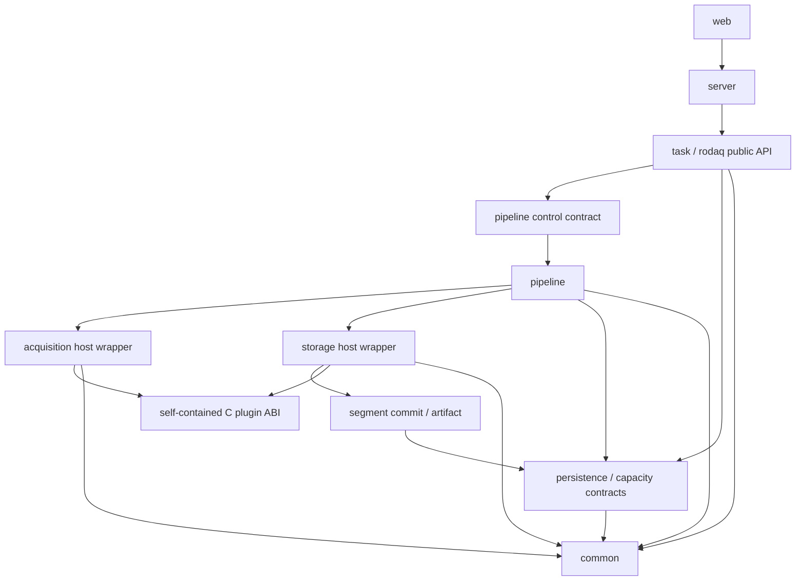

允许的依赖关系是面向接口的单向依赖，而不是要求每个图节点对应一个物理库。Acquisition/Storage 的 Core 侧 host wrapper 可以使用 `common/` 项目类型，但稳定插件 C ABI 头必须保持自包含、可由 C 编译器独立包含，不依赖 C++ `Status/Result` 或其它 Core 私有类型。明确禁止 `pipeline` 反向依赖 Task 状态机类型、`storage` 依赖 Task/Pipeline 私有状态、`plugin` 访问 Core 领域对象、`common` 依赖任何业务模块，以及通过共享可写单例绕过上述方向。

### 2.8 执行域与阻塞边界

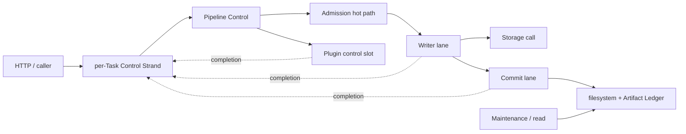

执行域冻结的是**允许阻塞的位置和状态写入权**，不是线程数量。Task Control Strand 是单 Task 生命周期唯一写入权，不在状态转换、Guard 或结构锁内执行插件、网络、文件同步或无界等待；Pipeline Control 只编排实例和工作归属。Admission 热路径不得等待网络、文件系统或 Storage；Writer lane 允许执行受监测的 Storage 调用；Commit lane 负责文件/目录 durability 与 Durable Artifact Ledger 登记；可能迟返的插件控制调用使用链路专属或严格分区的执行槽位；维护/读取使用与控制、Writer、Commit 分离的有界容量。所有异步完成都以项目事件回到对应 Task Control Strand，不能由工作线程直接写 Task 状态。

## 3. 领域对象与控制语义

录制任务是应用层发起控制、查询历史与关联产物的基本对象。启动、暂停、恢复、停止和重置均操作同一个 `task_id`。录制实例用于内部资源所有权、迟返隔离和恢复对账；记录顺序由每条数据流的接纳序号与实际 Writer 交付事实分别表达。[RoDAQ 术语表](../../GLOSSARY.md)

### 3.1 领域模型总览

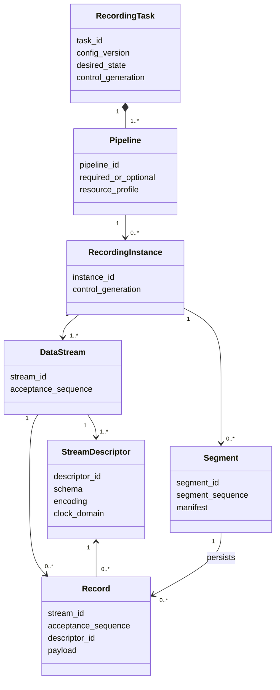

领域关系中需要特别区分三种身份：`task_id / pipeline_id / instance_id` 表示**运行归属**，`stream_id / acceptance_sequence` 表示**记录身份**，`descriptor_id` 表示**解释版本**。三者不能相互替代，也不能因为当前 Storage 的物理顺序而合并成单一全局序号。

| 对象 | 语义 |
| --- | --- |
| 录制任务 | 操作者对来源、录制策略和交付结果的持久配置。可关联一个或多个录制链路 |
| 控制代次 | Task 每次建立新的持久控制事实时单调递增的代次，用于隔离迟返、自动恢复、Stop 接管和 Reset 前后的执行 |
| 控制操作 | 一次可查询的生命周期变更请求，由 `operation_id`、幂等键、请求摘要、目标控制代次及结果标识 |
| 录制实例 | 一个录制链路的一次执行。重新启动分配新实例标识，用于资源归属、恢复对账和迟返隔离；不作为记录的全局排序空间 |
| 数据流 | 以 Topic 等业务地址和稳定流身份标识的逻辑记录序列。每条数据流独立分配接纳序号；同一逻辑流可随解释属性变化产生多个 Stream Descriptor |
| 数据来源 | 可选的实际生产者身份。来源重启或生产者变化可以建立新的来源标识，而逻辑数据流可以保持不变；协议无法稳定识别生产者时明确标记缺失 |
| Stream Descriptor | 绑定数据地址、载荷编码、Schema、来源时钟域、时间角色及有界扩展信息的不可变版本化描述。解释属性变化必须创建新 Descriptor |
| 已接纳记录 | 由 `stream_id + acceptance_sequence` 唯一标识的数据记录，同时保存所属任务、链路、录制实例、Descriptor、时间、可选来源和载荷 |
| 分片 | 可独立验证并读取的一次持久化提交，具有稳定标识、文件清单与覆盖信息 |
| 覆盖报告 | 描述录制有效时段、已知缺口和无法判定区间的证据，按任务、链路、数据流和时间范围查询 |

#### 3.1.1 标识域与持久唯一性

V1 对所有参与恢复、去重、引用和迟返隔离的标识冻结其作用域。标识的作用域不是实现细节；任何跨作用域比较都必须由明确关系建立，不能依赖整数值偶然相等。

| 标识 | 唯一作用域 | 跨进程重启 | 允许复用 | 说明 |
| --- | --- | --- | --- | --- |
| `task_id` | 当前受管部署 | 是 | 否 | Task 创建后稳定，Reset 不改变 |
| `pipeline_id` | Task | 是 | 否 | 来自不可变 Task 配置中的稳定 Pipeline 身份 |
| `stream_id` | Task 的逻辑数据流 | 是 | 否 | Pause/Resume、Recording Instance 和守护进程重启不改变同一逻辑流身份 |
| `acceptance_sequence` | `stream_id` | 是 | 否 | 只要求单调且唯一，允许因崩溃或区间预留产生空洞 |
| `descriptor_id` | `stream_id` | 是 | 否 | 每次解释语义变化产生新标识 |
| `instance_id` | `task_id / pipeline_id` 的执行历史 | 是 | 否 | 每次新的实际执行分配新实例 |
| `segment_id` | 当前受管部署的产物命名空间 | 是 | 否 | 即使发布失败或进入隔离也不得复用 |
| `operation_id` | 当前受管部署 | 是 | 否 | 在操作恢复窗口外仍不得与仍可见历史事实产生歧义 |
| `system_boot_id` | 一次主机启动 | 是 | 否 | 用于隔离不同 boot 的 monotonic 时间域 |
| `clock_epoch_id` | `system_boot_id` | 是 | 否 | 同一 boot 内 realtime↔monotonic 相关性发生不连续变化时递增或重新分配 |

Task 配置中的每个 Pipeline 和逻辑数据流都携带稳定 `pipeline_id / stream_id`。Configure 保留既有对象时必须显式保留对应 ID；删除的 ID 永不重新分配给其它对象，后续重新新增即使名称、Topic 或地址相同也默认获得新身份。退役 Stream 的 Identity State 只要仍被配置版本、产物或恢复事实引用就继续保留；引用全部消失后可以由有界 GC 删除状态，但新的 Stream ID 必须由不复用的生成规则重新产生。

`stream_id + acceptance_sequence` 是记录身份，因此 `acceptance_sequence` 必须跨 Recording Instance 和守护进程重启保持不重复。V1 不在每条记录接纳时同步持久化计数器；Core 为每个 Stream **持久预留序号区间**，然后在内存中无 I/O 分配。只有新的区间上界已经按状态文件原子提交协议持久发布后，才能从该区间分配序号。崩溃后未使用的尾部直接废弃，允许形成 gap，但任何已经预留过的序号都不重新使用。区间大小是部署参数并受长期元数据和恢复开销资格验证。

Stream 的序号预留状态属于 Core 持久身份事实，不放入 Segment Manifest，也不能仅由最后一个已提交 Segment 反推。临时、隔离或尚未提交的记录可能已经消费序号，因此恢复时只能从持久预留上界继续。`descriptor_id`、`segment_id` 和其它可持久引用标识遵循同样的“允许跳号、不允许复用”原则；具体生成算法可以使用随机/单调组合，但必须形成碰撞不可接受且可测试的稳定身份规则。

### 3.2 意图、执行条件、操作与观察事实

RoDAQ 将“操作者希望任务处于什么状态”和“系统当前实际能够做到什么”分开建模。控制意图是需要跨重启保持的事实，执行条件由当前各录制链路、资源保护和清理状态聚合。二者不得压缩为单个布尔量或单个模糊的 `Running/Failed` 标志。

| 事实 | 语义与权威 |
| --- | --- |
| 任务配置 | 每个已生效配置保存为不可变的版本化 JSON 快照。Task Control Record 只引用当前活动配置版本；录制实例在启动时取得该版本，分片记录实例使用的配置版本 |
| 期望控制状态 | `Stopped`、`Running`、`Paused`。Task Control Record 是期望状态和控制代次的唯一权威；Pipeline 恢复记录中的续录信息只有在代次匹配且期望状态仍为 Running 时才有效 |
| 执行条件 | `Idle`、`Preparing`、`Active`、`Degraded`、`Draining`、`Protected`、`PendingCleanup`、`Failed`。它是任务各链路当前真实状态的投影，不替代期望控制状态 |
| 操作 | 具有 `operation_id`、请求摘要、幂等键、目标控制代次、操作类型、受理代次和终态结果。耗时副作用由执行结果事件推进 |
| 即时观察事实 | 收数、频率、队列、最近进展、来源连接、重试等快照，可随进程结束释放；不得反向覆盖已经持久受理的控制意图 |

#### 3.2.1 控制操作持久受理时序

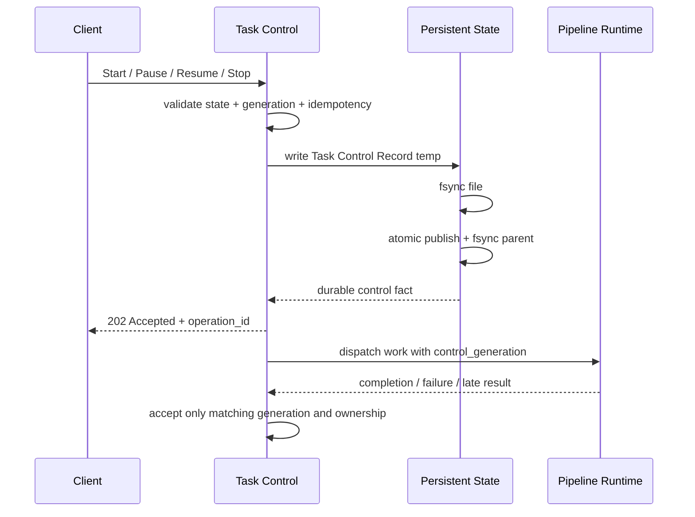

该时序明确区分**持久受理**与**操作完成**。客户端获得 `Accepted` 时，只能说明新的控制意图已经成为跨重启权威；链路准备、排空、封口和资源释放仍由后续异步工作完成，并通过 `operation_id` 查询最终结果。

每条录制链路在任务配置中声明 `Required` 或 `Optional`。任务同时声明启动策略：生产默认使用 `AllRequired`，只有明确选择 `BestEffort` 时才允许以部分链路成功启动。所选策略对 Start、Resume 和自动恢复一致生效。

- **持久受理点。** 每个 Task 只有一个 Task Control Record，保存当前活动配置版本、期望状态、控制代次、Reset 代次和有界操作账本。修改控制意图的操作先完成格式、状态和控制代次校验，分配 `operation_id`，再把规范化请求摘要、目标控制代次及新的期望状态写入该记录；完成文件与父目录同步后才成为 `Accepted`，随后才允许向调用方返回受理成功。Pipeline 恢复记录中的旧续录许可通过控制代次不匹配自动失效，不要求与 Task Control Record 做跨文件原子修改。这样，客户端看到已受理的 Pause 或 Stop 后即使守护进程立即崩溃，重启也不得依据旧许可自动恢复录制。
- **操作重试。** 幂等键和请求摘要在有界的持久操作账本中保存到规定的恢复窗口。匹配的重试返回原 `operation_id` 或其恢复后的终态；同键不同请求返回冲突。超过保留窗口后，调用方通过控制代次、期望状态和产物事实重新确认结果，不承诺无限期保存所有操作历史。
- **启动以声明的就绪策略为准。** Start 和 Resume 检查配置、资源、采集入口、存储写入与所选来源就绪要求。ROS 2 默认只要求本地订阅入口建立成功，不等待第一条消息；静默 Topic 可正常运行并显示 `0 Hz`。需要来源已连接的采集器可由链路配置声明更严格的启动就绪条件。
- **状态投影。** `Required/Optional` 表示配置完整性要求，`AllRequired/BestEffort` 表示本次运行允许的开放策略，两者不合并成一个布尔量。`AllRequired` 下任一 Required 未 Ready 都不得形成合法开放集合；`BestEffort` 下只要至少一条 eligible Pipeline Ready 即可形成合法部分运行集合，但任何配置 Pipeline 缺失都会使任务至多为 `Degraded`。`Protected` 表示 Run intent 仍有效、当前没有可继续接纳的合法运行集合，但原因仍具有自动恢复路径；`Failed` 只用于当前不存在合法运行集合且错误不可自动恢复或恢复预算已耗尽。只要仍有策略允许的 Pipeline 正常接纳，即使另一 Required Pipeline 永久失败，`BestEffort` 任务也投影为 `Degraded` 而不是 `Failed`。`Paused + PendingCleanup` 表示 Pause 意图已持久生效但旧实例尚未证明静止。API 和 Web 必须同时暴露期望状态、执行条件、启动策略和逐链路事实。

| 启动策略 | Required Pipeline 未就绪/失败 | Optional Pipeline 未就绪/失败 | Task 级结果 |
| --- | --- | --- | --- |
| `AllRequired` | Barrier 不通过；临时可恢复条件为 `Protected`，不可恢复或预算耗尽为 `Failed` | 不阻止 Required Barrier；成功开放后为 `Degraded` | 只有全部 Required Ready 才允许形成运行集合 |
| `BestEffort` | 不阻止其它 eligible Pipeline 开放；只要仍存在运行集合即为 `Degraded` | 同样允许其它 eligible Pipeline 开放并投影为 `Degraded` | 至少一个 eligible Pipeline Ready 才允许形成运行集合；不存在运行集合时再按可恢复性投影 `Protected/Failed` |

### 3.3 任务操作

下面的状态图只表示**期望控制状态**。准备、排空、保护、降级、待清理和失败属于执行条件，不能用该图推断资源已经释放或数据已经提交。

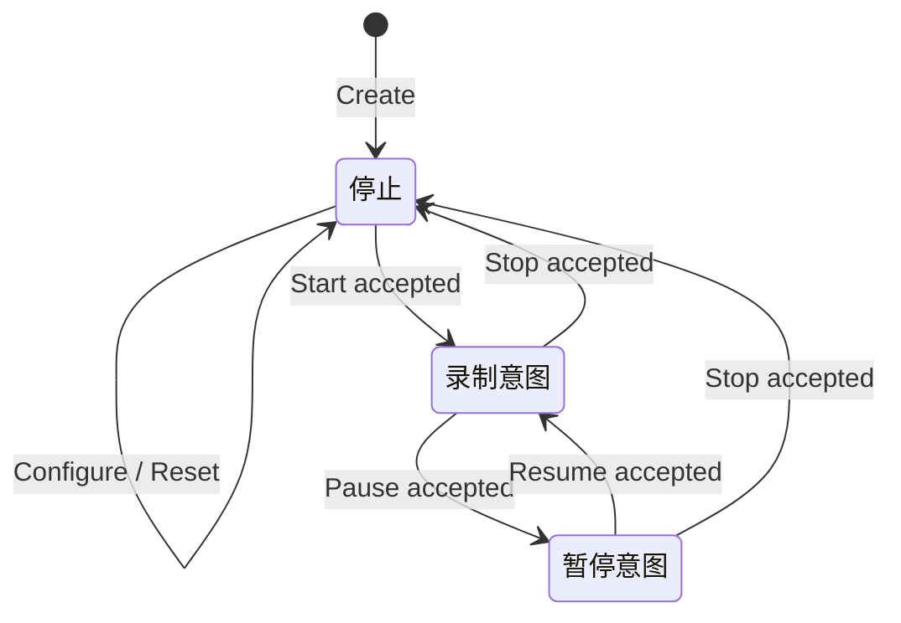

| 操作 | 受理与成功条件 |
| --- | --- |
| Create | 校验录制配置并持久化，分配稳定 `task_id`。任务以 `Stopped + Idle` 创建；创建成功以配置正式文件和必要控制记录持久发布为准 |
| Start | 持久受理 Run 意图后进入两阶段启动：先让各 Pipeline 完成配置解析、资源准入、插件/Descriptor/Storage 准备和实例事实持久化，但保持接纳入口关闭；达到启动策略的 Prepare Barrier 后，再以不会执行外部调用或分配普通资源的 Core 操作开放获准 Pipeline。`AllRequired` 只有所有 Required 都通过 Barrier 后才允许任何 Required Pipeline 接纳数据 |
| Configure | 仅在期望状态为 Stopped 且所有旧实例静止时校验并原子发布新配置版本。配置文件持久提交是该变更的线性化点 |
| Pause | 先持久撤销续录许可并记录 Paused 意图，再关闭各链路入口。只有关闭前全部已接纳记录完成正常持久提交、实例静止并销毁、预留额度实际归还后，Pause 才成功 |
| Resume | 与 Start 使用同一 Prepare Barrier 和开放协议，使用暂停前 Task Config 重新形成 Effective Recording Configuration 并创建新实例。失败时 Run 意图的后续处置由操作结果明确：资源暂不可用进入 Protected，配置或永久错误进入 Failed，调用方可 Stop 或修复后重试 |
| Stop | 先持久撤销续录许可并记录 Stopped 意图，再关闭入口和结算在途数据。只有实例静止、应提交产物完成结算且资源实际释放后，执行条件才回到 Idle；超时则保持 `Stopped + PendingCleanup` 并进入分级恢复 |
| Reset | 仅在 Stopped 且所有录制实例静止后受理。先持久登记重置代次与范围，再阻止旧代次的启动、读取和重新公开，完成逐卷清理后回到 `Stopped + Idle` |

**系统关停不是 Stop。** 守护进程正常退出时，对 `Running` Task 执行的是进程级 drain：停止新的 Start/Resume 入场，关闭当前实例 Admission Gate，结算已接纳记录并写入实例正常结束/中断证据，但**不修改 `desired_state`、不递增用户控制代次、不撤销 Run intent，也不把该动作登记成用户 Stop 操作**。能够完成受控收尾时记录 `Ended(reason=ProcessShutdown)`；未能在关停期限内静止时保留原实例和 PendingCleanup/恢复证据。下次启动仍依据原 `Running` intent、当前代次和恢复策略执行 Boot Reconciliation。只有显式 Stop 才把期望状态改为 `Stopped` 并使旧续录许可失效。

同一任务只允许一个修改生命周期的操作在途。Stop 可以接管在途的 Start、Pause 或 Resume，但接管本身也必须先持久建立新的控制代次，使旧操作的开放入口、自动恢复和后续状态推进请求失效。其他冲突请求返回当前在途操作。迟返结果只能结算其原 `operation_id`、控制代次、录制实例和资源所有权，不得推进更新代次的任务状态。

Start/Resume 的结果必须区分 `Succeeded`、`PartiallySucceeded` 与 `Failed`。准备阶段完成所有可能失败或阻塞的工作：解析当前部署引用、生成 Effective Recording Configuration、一次性预留硬资源、创建并配置插件、准备 Stream Descriptor 与 Storage、持久记录新 `instance_id` 及 Prepared facts。准备完成的 Pipeline 仍保持 Admission Gate Closed，不得提前接纳业务记录。

`AllRequired` 的 Prepare Barrier 只有在全部 Required Pipeline 都处于 Ready 且其 **Prepared instance facts** 已经持久发布后才能通过；任一 Required 准备失败时，所有尚未授权开放的 Prepared Pipeline 直接按正常静止规则回收，因此不会产生“普通准备失败但某 Required Pipeline 已接纳记录”的中间状态。Optional 失败不阻止 Required Barrier，通过后可形成 `PartiallySucceeded + Degraded`。`BestEffort` 在至少一条允许运行的 Pipeline Ready 且所有准备结果确定后通过 Barrier，只选择成功 Pipeline。

Barrier 通过后，控制域在同一 Task Recovery Record 原子发布本次获准 Pipeline 的 **Open Authorization**：包含 `instance_id`、控制代次、`effective_config_id`、Prepared boundary、允许开放的 Pipeline 集合和续录许可。只有该授权持久完成后才执行 **Open Admission**。Open Admission 只执行 Core 内部、预先资源完备且保证不会因普通资源不足失败的 Gate 切换，不调用插件、不执行文件 I/O、不分配普通热路径资源。Gate 实际开放后可以异步补记 Opened observation/时间边界，但它不是授权本身的权威。

若进程在 Open Authorization 持久后、全部 Gate 实际开放前崩溃，恢复必须把被授权的实例视为“**可能已经开放**”，而不能凭缺少 Opened observation 断言从未接纳过数据。恢复以持久授权边界生成保守覆盖证据，结束旧实例，并由 Boot Reconciliation 创建新实例继续当前 Run intent。由于 Barrier 之后的 Gate 切换本身没有普通失败路径，这个窗口属于进程崩溃恢复，而不是 `AllRequired` 准备失败。入口已就绪但没有记录的数据流保持正常运行，来源连接状态与 `0 Hz` 活动状态分别显示。

Pause 与每个链路的接纳点在同一同步域内排序。入口关闭后，新提交及尚未完成入队的记录不进入接纳集合。已入队、已出队待写和已写入待封口的记录继续结算。任何已接纳记录出现写入未知结果、污染分片、封口失败或持久提交失败时，Pause 不得报告成功，而应返回失败及可证实的已保存、已知失败和未知范围；后续仍按实例静止规则回收资源。

Pause 成功要求其 acceptance cut 之前的全部已接纳记录均进入正常持久提交产物，录制实例静止并销毁，预留额度实际归还。清理超时时入口保持关闭，执行条件为 PendingCleanup，实例仍占用资源且已提交分片仍可查询。其他任务只能使用已经实际归还的额度。

录制配置包含录制模式、启动策略、链路 Required/Optional 属性、资源档位引用、插件选择、各插件参数、数据流定义和输出位置。ROS 2 的参数包括 Topic、消息类型和 QoS。只有 Stopped 且所有相关实例静止的任务可以修改录制配置。配置版本与控制代次分别标识；暂停和恢复可以产生新的控制代次，同时继续使用原录制配置版本。

操作的 `Succeeded / PartiallySucceeded / Failed` 描述本次执行是否实现目标，不自动回滚已经持久受理的期望控制状态。Start 或 Resume 已受理后若当前没有策略允许的运行集合、但临时资源或外部条件仍具备自动恢复路径，任务保持 `Running + Protected` 并按策略恢复；当不存在策略允许的运行集合且错误不可自动恢复或重试预算耗尽时才投影为 `Running + Failed`。`AllRequired` 下 Required 缺失意味着没有合法运行集合；`BestEffort` 下只要仍有获准 Pipeline 正常接纳，Required 或 Optional 缺失均投影为 `Running + Degraded`，并在逐链路事实中保留失败严重度。调用 Stop 明确撤销 Run 意图后才能回到 Stopped；因此调用方不能通过一次失败的 Start 结果推断控制意图已自动回滚。

#### 3.3.1 控制状态机与事件串行化

每个 Task 只有一个生命周期写入权。来自 API、系统关停、资源保护、插件完成、迟返和恢复扫描的控制事件都进入该 Task 的串行控制执行域；不同 Task 可以并行。状态机实现负责校验事件与当前控制代次、更新最小内存事实、形成需要持久化的控制变更并发布异步工作，不在转换、Guard 或持有结构锁期间调用插件、等待线程、执行文件同步或运行外部回调。

异步工作完成后以项目事件回到同一控制域。每个异步工作具有仅用于进程内归属的 `work_id`，完成事件至少携带 `work_id`、控制代次、`pipeline_id`、`instance_id` 和工作类型；属于用户生命周期操作的工作还必须携带对应 `operation_id`，Process Shutdown Drain、恢复扫描等内部工作不得为了满足字段要求伪造用户 operation。缺少归属、属于旧代次或已被 Stop/Reset 接管的事件只能完成其原资源结算与诊断。状态机框架属于 Task 控制实现细节，Pipeline 热路径、Writer、Segment 提交、插件 ABI 和 HTTP 类型不得依赖状态机框架类型。

任务执行条件由逐 Pipeline 事实和启动策略投影，不允许另有一个可独立写入且可能与 Pipeline 状态矛盾的“任务健康枚举”。至少遵守：所有 Required 正常且没有其它影响完整性的链路缺失时可为 Active；仍存在策略允许的运行集合但配置未完整实现时为 Degraded；当前没有合法运行集合、Run intent 仍保留且原因可自动恢复时为 Protected；存在尚未证明静止的旧实例时为 PendingCleanup；当前没有合法运行集合且错误不可自动恢复或恢复预算耗尽时为 Failed。BestEffort 下某条 Required 的永久失败不会覆盖仍在正常接纳的合法部分运行集合，而应投影为 Degraded 并保留该 Pipeline 的不可恢复失败事实。Draining 和 Preparing 只表示当前确有对应工作在推进。

### 3.4 实例所有权与恢复

守护进程取得本机控制状态目录及所使用输出根的排他使用权。锁文件的身份保持稳定，锁句柄由守护进程持有。进程内由资源登记器管理录制链路、独占来源与输出命名空间的占用。新录制实例在旧实例达到静止条件、资源重新获准后才能接管。迟返结果按控制代次及实例标识关联，只结算原操作与资源。

正常暂停或停止先关闭接纳入口，确定待结算的记录集合，再要求采集器 `quiesce` 并排空已接纳记录。采集回调收尾和写入排空使用各自的执行容量，已接纳载荷由 `rodaq` 模块持有，可在采集器收尾时继续写入。分片提交或按故障处理规则隔离后记录结算结果。确认所有实例调用、回调及载荷引用静止后，才销毁插件实例和释放执行许可。超过截止期限时保持待清理状态，资源仍由原实例持有。系统关停先关闭新启动入场，再并行收尾录制链路，诊断接口保留到收尾或截止期限。Task Control Record、目标配置目录或必要恢复记录不可写时，拒绝需要更新对应持久事实的变更；已经运行的实例不因控制持久化故障释放数据所有权，继续执行本地资源保护并报告控制面降级。机器人安全停机由独立的现场系统负责。

守护进程重启时核对卷身份、Recovery Record 及已提交分片，分卷恢复历史查询。索引在后台限速重建，查询明确区分已覆盖范围和仍在恢复的范围。只有具有 Open Authorization 的实例才按“可能已经开放”生成中断及潜在未知尾部；仅有 Prepared facts、从未获得 Open Authorization 的实例只作为未完成准备/清理事实处理，不虚构录制覆盖。即使已授权实例从未提交过分片，其可能开放区间仍可查询并明确标记证据强度。

日常启动先校验已初始化的受管目录。目录不可用或初始化未完成时进入诊断模式。单个任务的配置文件或必要恢复记录缺失或无法校验时，标记该任务不可用并暂停其录制、回收及重置。缺少恢复证据的历史范围标为不可查询，待文件恢复并完成对账后开放。

重启后先从 Task Control Record 恢复期望状态、控制代次和操作账本，再对照 Recovery Record 执行 **Boot Reconciliation**。恢复必须区分“已受理但尚未完成的控制操作”和“此前已经 Active、因进程中断而需要续录的实例”，不能用同一条续录许可规则处理两者。

| 持久事实 | 重启行为 |
| --- | --- |
| `Running` + 当前代次存在 `Accepted/InProgress Start/Resume`，Recovery Record 只有 Prepared facts、没有 Open Authorization | 继续原操作：重新核对/完成 Prepare Barrier，必要时清理旧 Prepared 实例并创建新 `instance_id`；不要求旧实例续录许可 |
| `Running` + 当前代次存在 `Accepted/InProgress Start/Resume`，Recovery Record 已有 Open Authorization（`OpenedObserved` 可有可无） | 该旧实例按“可能已经开放”处理中断与产物；不得重用实例。随后以新 `instance_id` 继续当前 Run 操作，直到新的 Prepare/Open 完成后再结算原 operation |
| `Running` + 当前代次没有未完成 Start/Resume + Recovery Record 有当前代次 Open Authorization/有效续录许可 | 将旧实例按已开放或可能已开放处理中断，按自动恢复策略重新准入并创建新实例 |
| `Running` + 既无可恢复操作也无可验证续录事实 | 不猜测录制历史；任务进入 `Protected` 或诊断状态并报告缺失证据，由明确策略/人工决定是否重新 Start |
| `Paused` 或 `Stopped` | 无论旧 Recovery Record 是否仍有 Run 事实，都不得自动开放入口；只允许完成旧实例结算和清理 |
| 存在更高控制代次的 Pause、Stop 或 Reset | 旧 Start/Resume、旧续录许可和旧实例开放请求全部失效，只能完成原资源结算 |

操作账本中的 `Accepted/InProgress` 状态必须持久化到足以跨重启区分上述情况；操作完成后写入终态摘要。磁盘保护停录使用同一 Run intent 与 Boot Reconciliation 规则重新准入。任何控制事实冲突、代次无法确认、Effective Configuration 无法重新形成或恢复预算耗尽都进入保护/诊断，不从文件时间戳猜测用户意图。

#### 3.4.1 独立恢复记录

恢复记录按任务单独保存为 `recovery/<task_id>.json`，用于 Pipeline 执行与数据恢复事实，不作为 Task 控制意图的权威。它至少包含最近观察到的控制代次、`config_version`、每个实例的 `effective_config_id`、累计录制时间、任务使用过的产物位置，以及每条 Pipeline 当前或最近实例的标识、`Prepared / OpenAuthorized / OpenedObserved / Ended` 证据、与控制代次绑定的续录许可、待清理状态和已确认中断区间。`OpenedObserved` 是运行观察，缺失不能推翻已持久的 Open Authorization；恢复必须对授权后崩溃采用保守的“可能已开放”解释。未完成的回收保存为带代次和对象范围的持久意图；Reset 的权威代次来自 Task Control Record，恢复记录只保存其逐卷执行进度。已提交分片的详细时间、覆盖和格式信息仍由分片清单保存。

任务控制代次单调递增。Start、Pause、Resume、Stop 和 Reset 在建立新的持久控制事实时携带目标代次；Configure 通过新的不可变配置版本和 Task Control Record 中的活动配置指针线性化，不依赖覆盖旧配置文件。Pipeline 的迟返、恢复、提交通知和自动重试都必须同时匹配 `task_id`、控制代次、`pipeline_id` 与 `instance_id`。旧代次结果只能完成其原资源结算和诊断，不得重新开放入口、改变当前期望状态或重新公开 Reset 已清除的产物。

Prepared instance facts 在 Prepare Barrier 前持久写入；Open Authorization 在任何 Gate 开放前按 Task 原子发布；实际 Gate Open 后可记录 Opened observation，正常结束边界在实例完成收尾后更新。Pause 和 Stop 的续录许可撤销在操作进入 Accepted 前持久完成。回收先在 Recovery Record 登记待处理范围；Reset 则先在 Task Control Record 发布权威 `reset_generation` 与范围，再由 Recovery Record 记录逐卷执行进度，之后才执行文件删除。

Recovery Record 只保存**生命周期与恢复 checkpoint**，不得按 Record、Batch 或正常 Segment 提交进度高频重写，也不得承担“已提交 Segment 曾存在”的长期权威；正常 committed artifact 事实由 Durable Artifact Ledger 保存。Deployment 必须给出 Recovery Record 的序列化字节上限、每 Task 可保留的中断区间/待清理项/卷进度上限和最小更新间隔或等价写放大预算。接近上限时先压缩已终结且可由其它权威事实重建的条目；无法在不丢失必要恢复证据的前提下继续增长时，Task 进入保护/诊断并拒绝新的非紧急工作，而不是无界扩张状态文件。

恢复记录和持久操作账本均采用有界结构与版本化格式，使用与任务配置相同的临时文件、文件同步、原子发布和父目录同步协议。即时统计可以随进程结束释放；需要跨重启确认的控制操作只保留有界恢复窗口及必要终态摘要，审计事件按独立日志保留策略管理。

### 3.5 V1 录制模式

V1 交付连续录制和滚动录制两种模式。两种模式在 Start 或 Resume 后持续录制，直到暂停、停止、系统关停或触发资源保护。两者共用数据接纳、分片滚动和磁盘保护规则。

| 模式 | 产物保留行为 |
| --- | --- |
| 连续录制 | 默认保留已提交的历史产物。时长、大小或时钟边界触发分片滚动，任务继续录制 |
| 滚动录制 | 配置任务时显式设置保留时长。应用随已提交录制进度推进窗口，并自动回收符合规则的窗口外分片 |

保留窗口以任务的录制时间计算。窗口右边界仅随新数据持久提交推进，暂停、停止和无新提交时保持原位。V1 按时长配置保留窗口。分片滚动决定何时结束当前文件，保留窗口决定历史产物的回收范围。

### 3.6 核心架构不变量

实现、测试和故障注入必须共同维护以下不变量。任何优化都不能绕过这些边界。

| 不变量 | 约束 |
| --- | --- |
| 记录身份 | 每条已接纳记录由 `stream_id / acceptance_sequence` 唯一标识；`acceptance_sequence` 只在所属数据流内单调分配，并通过持久区间预留跨实例/跨重启保持不复用；允许 gap，不允许 reuse |
| 标识域 | 所有参与持久引用和迟返隔离的 ID 都有冻结作用域；`task/pipeline/stream/descriptor/instance/segment/operation/boot/clock epoch` 不因数值相同跨作用域比较或复用 |
| 运行归属 | 每条已接纳记录同时具有确定的 `task_id / pipeline_id / instance_id` 运行归属，迟返和资源结算只能作用于原归属 |
| 接纳提交 | 接纳提交点之前可以因为入口关闭、描述失效或资源不足被拒绝；越过接纳提交点后结果只能进入已提交、已知失败或未知，不能重新解释成接纳前拒绝 |
| 接纳前资源完备 | 正常已接纳路径需要的队列槽位、记录/字节额度和载荷持有资源必须在接纳提交前取得；普通资源压力不得在接纳后才被发现 |
| 描述先于记录 | 正常写入的记录引用某个 Stream Descriptor 时，存储器已经具备解释并保存该 Descriptor 所需的 Schema 和 Required 扩展信息 |
| 提交蕴含接纳 | 任何正常提交记录都必须来自先前成功接纳的记录，禁止用恢复扫描或插件迟返凭空增加正常提交计数 |
| Pause 成功边界 | Pause 成功意味着接纳切点之前的全部已接纳记录均已进入正常持久提交产物；存在已知失败、未知写入或污染分片时只能失败并报告影响范围 |
| 载荷释放 | 已接纳载荷在 Writer、存储器或其它合法使用者可能继续访问期间保持有效，所有持有方式都必须 exactly-once 释放且计入物理资源预算 |
| 实例销毁 | 插件实例销毁前必须证明宿主调用、插件回调、载荷持有、执行任务及关联引用全部静止 |
| 资源归还 | 只有内存、FD、线程许可、队列槽位和其他额度对应的真实占用已经释放后，额度才可重新分配 |
| 正常分片 | 正常持久提交分片不得包含结果未知的 Storage 写入；污染分片只能隔离或经资格化核验后恢复 |
| 已提交产物权威 | 正常 Committed 必须同时具有可证明的 Segment 文件系统持久性和独立 Durable Artifact Ledger committed fact；Catalog 可重建，不是“产物曾提交”的持久权威 |
| 可见产物 | Catalog 只能公开具有 Durable Artifact Ledger committed fact 且文件核对通过、或经恢复补齐该事实的 Segment；不能只依据目录存在 |
| 合法删除 | retention/Reset 必须先持久登记删除意图并阻止新读取；文件删除核对完成前不得移除对应 Ledger committed fact，避免把合法删除与历史丢失混淆 |
| 控制受理 | Pause 或 Stop 一旦对调用方返回 Accepted，旧续录许可必须已经持久失效；重启不得恢复到更旧的 Run 意图 |
| 系统关停 | Process Shutdown Drain 不等于用户 Stop；不得修改 `desired_state`、递增用户控制代次或撤销 Run intent，重启仍按原持久意图恢复 |
| 控制恢复 | `Accepted/InProgress` Start/Resume 与此前 Active 实例的中断恢复使用不同证据路径；Boot Reconciliation 不依赖缺失的旧续录许可来否定一个已经持久受理但尚未完成的 Run 操作 |
| Reset 单一权威 | `reset_generation` 和 Reset intent 只由 Task Control Record 持有；Recovery Record 只保存当前 Reset 的逐卷执行进度 |
| Required 启动 | `AllRequired` 先完成全部 Required Pipeline 的 Prepare Barrier，再执行不会调用插件/I/O/普通分配的 Open Admission；Barrier 失败前任何 Required Pipeline 都不得接纳业务记录 |
| 生效配置 | 每个 Recording Instance 绑定唯一 `effective_config_id`；运行中 Deployment 变化不得原地改变实例，恢复时必须重新证明配置兼容性 |
| 有界长期运行 | Core 硬计费资源、Plugin 声明资源和共享/外部资源分别治理；队列、载荷池、对象基数、操作账本、审计、隔离产物、待提交 Segment、维护作业和查询均受显式上限或保留策略约束 |
| 提交积压 | Writer 与 Commit Lane 可以解耦，但 sealed Segment 数量、物理字节和 commit 执行容量严格有界；Pause/Stop 必须等待本实例 commit backlog 结算 |

### 3.7 统一失败与结果模型

RoDAQ 不用一个 `Failed` 字符串同时表达调用失败、任务健康、数据损失和是否可重试。每个对外失败至少由以下正交事实组成：

```text
Status Code
+ Retryability
+ Failure Domain
+ Data Impact
+ bounded diagnostic context
```

V1 Core 使用稳定的项目 Status Code 集合，至少覆盖：`InvalidArgument`、`InvalidState`、`Conflict`、`ResourceExhausted`、`DeadlineExceeded`、`Unavailable`、`PermissionDenied`、`DataLoss`、`Internal`。插件 C ABI 使用可稳定映射到这些语义的独立结果码；HTTP 只做协议状态映射，不重新定义业务错误。

| 维度 | 示例 |
| --- | --- |
| Retryability | `Never`、`AfterConditionChange`、`AfterBackoff`、`AfterProcessRestart`、`ManualRecoveryRequired` |
| Failure Domain | Request、Task Control、Pipeline、Collector、Storage、Volume、Persistence State、Process |
| Data Impact | `None`、`PreAdmissionOnly`、`AcceptedKnownFailed`、`PersistenceUnknown`、`ArtifactQuarantined`、`HistoricalArtifactLostOrCorrupt` |

操作结果 `Succeeded / PartiallySucceeded / Failed` 只说明这一次控制目标是否完整实现；它不替代期望状态、执行条件或 Data Impact。例如 Stop 可以成功撤销 Run intent、静止实例并释放资源，但若 cut 前已接纳记录存在持久失败/Unknown，则 **Stop operation result 必须为 Failed**，Task 最终仍可以是 `Stopped + Idle`，并在覆盖/Data Impact 中保留录制结果异常。相反，资源暂不可用导致 Start 未达到目标时可以是 `Failed + Running/Protected + DataImpact=None`。

所有可重试策略都依据结构化 Retryability 和当前控制代次决定，不从错误文本解析。诊断字符串可包含有界上下文，但不得作为程序逻辑、幂等判定或恢复权威。

## 4. 数据接纳、时序与质量

本章定义记录从采集器进入 RoDAQ 到进入 Storage 的数据面语义。核心原则是：**提交尝试、接纳、格式写入和持久提交是四个不同的事实**；任何故障、Pause/Stop 或性能优化都不得模糊这些边界。

| 边界 | 形成的事实 | 后续失败能否撤销 |
| --- | --- | --- |
| 提交尝试 | 采集器向 RoDAQ 提供一次候选记录 | 可以在接纳前拒绝 |
| 接纳提交点 | 记录获得 `stream_id + acceptance_sequence` 并进入必须结算集合 | **不能**重新解释成未接纳 |
| Storage 格式写入 | Storage 确认某个批次前缀已经写入格式对象 | 仍不等于分片已持久提交 |
| 分片持久提交 | 文件、清单和目录提交协议完成 | 在保留/Reset 前作为可恢复已保存事实 |

### 4.1 数据流配置与多任务

ROS 2 任务持久保存明确的 Topic 列表，以及每个 Topic 的消息类型和生效 QoS。界面发现可辅助填写。启动时按已保存的配置建立订阅和准备类型支持，不依赖发布者已出现。消息尚未到达时，任务可以运行并显示 `0 Hz`。消息类型、Schema 或订阅创建失败属于可诊断的准备错误。[ROS 2 Humble 通用订阅接口](https://github.com/ros2/rclcpp/blob/humble/rclcpp/include/rclcpp/create_generic_subscription.hpp)

数据流观测至少区分三个维度：采集入口是否就绪、来源连接/会话状态、近期来源活动。`0 Hz` 只表示观测窗口内没有收到记录，不能替代来源连接状态。对 ROS 2，发布者未出现时可报告入口已就绪、来源活动为静默；对有显式连接的协议则同时报告连接中、已连接、断开或退避重连等状态。告警和自动恢复分别依据连接事实、活动事实和接纳事实，避免把正常低频或静默来源误判为链路故障。

MQTT 采集器按配置的 Broker 和完整 Topic 名称建立订阅。首版的订阅范围来自任务中明确列出的 Topic，每条流配置 QoS 和载荷编码。准备阶段验证本地配置、资源与接收执行域。默认 `local_ready` 启动策略允许 Broker 暂不可达时链路进入 `Running + Degraded` 或 `Protected` 并以有界退避等待连接；若链路配置要求 `source_connected`，则 Broker 连接和订阅确认必须在 Start/Resume 成功前完成。两种策略下都分别展示连接状态与实际收数，连接恢复后按正常入口录制匹配 Topic 的消息。

首版 MQTT 验收覆盖 MQTT 3.1.1 与 QoS 0、1。每次连接使用 `CleanSession=1`，连接后重新订阅已配置 Topic，从实际交付的应用消息继续录制。断线区间按可验证证据记录覆盖。QoS 和协议确认与 RoDAQ 接纳及持久提交分别统计。

初次订阅在本地接纳就绪后发起。验收覆盖 Broker 在订阅确认前发送匹配消息的情况。Broker 在订阅时发送且带 `RETAIN` 标记的保留消息按正常接纳规则录制，并标记为保留样本。接收时间记录实际到达时刻，来源时间沿用来源证据。[MQTT 3.1.1 规范](https://docs.oasis-open.org/mqtt/mqtt/v3.1.1/os/mqtt-v3.1.1-os.html)

每个 MQTT 采集器实例的连接请求和待处理数据受资源预算约束。停止或替换实例时取消重连，并按 `quiesce` 规则结算连接和消息回调。可在准备阶段确认的配置错误按链路准备失败处理，运行期间收到的协议错误按链路故障处理规则记录和处置。

首版允许同一 Topic 同时被多个任务录制，各任务独立订阅、接纳、计费和写入。相同 Topic 的两份输入计入各任务额度和全局预算。一个任务的 Pause、Stop 或 Reset 作用于该任务自己的入口、状态和产物。

### 4.2 接纳与写入

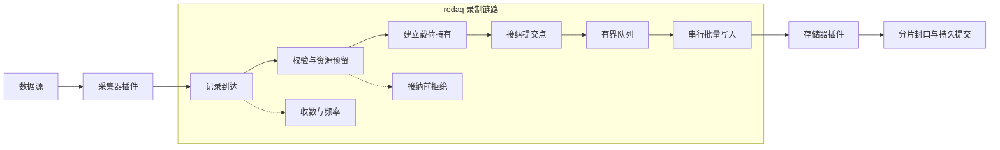

1. **获取。** 采集器插件报告逻辑数据流、当前 Stream Descriptor、可选来源标识和来源序号、一个有界时间集合以及载荷。时间集合至少允许表达 RoDAQ 接收时间和来源提供的时间；每个非主机时间都明确关联其时钟域和角色。协议对象和格式库对象留在插件内。RoDAQ 在入口记录主机单调时间、接收壁钟、Clock Epoch 和当前录制实例。
2. **预留。** `rodaq` 模块执行结构校验、单记录限制和 Descriptor 代次检查，然后一次性取得正常接纳路径需要的记录额度、逻辑字节额度、物理载荷额度和队列位置。不能在此时取得的资源按策略有限等待或接纳前拒绝；不得先宣布 Accepted 再等待普通队列或内存资源。
3. **持有。** 按采集器和链路生效约束允许的载荷持有方式，把输入转换为可跨提交调用、Writer 和存储调用安全存在的宿主持有对象。载荷稳定以后才允许进入接纳提交。
4. **接纳。** 在每条数据流自己的短同步域内复核入口、控制代次、录制实例、当前 Descriptor 和 Clock Epoch，分配该数据流下一 `acceptance_sequence`，并把完整记录发布到有界队列。这个逻辑提交是记录从“提交尝试”变为“已接纳记录”的唯一线性化点。
5. **写入。** 每条链路只有一个逻辑有序 Writer，以有界批次把已接纳记录交给存储器。Writer 保持同一数据流的 `acceptance_sequence` 顺序；不同数据流之间只保留实际队列/批次交付顺序，不建立额外的业务全局序列。存储写入、分片封口和最终持久提交分别记录进度。
6. **覆盖。** 接纳前拒绝、来源可证实缺口、接纳后已知失败和结果未知分别报告。正常结束后核对已提供、已接纳及最终结果；异常退出只对可恢复证据作精确计数，证据不足的尾部形成未知覆盖。

#### 4.2.1 接纳提交点与控制切点

采集器的一次回调或 `submit` 只是记录提交尝试，并不自动意味着记录已经被 RoDAQ 接纳。接纳提交点之前可以因为入口关闭、旧控制代次、旧录制实例、Descriptor 已切换、Clock Epoch 已切换、载荷非法、资源不足或序号耗尽而结束。只有成功完成接纳提交后，记录才获得正式身份：

```text
(stream_id, acceptance_sequence)
```

每条 Pipeline 拥有一个轻量的 **Admission Gate**，至少包含 `open/closed`、门代次和当前进入接纳提交域的有界 in-flight 计数。它只负责建立 Pipeline-wide cut，不取代每个 Stream 自己的 Descriptor/Sequence 同步域。记录在预留资源和建立稳定载荷持有之后进入接纳提交域，复核 Gate 仍为 Open 且代次未变化，再进入对应 Stream 的短同步域完成 Descriptor/Clock Epoch 复核、`acceptance_sequence` 分配和已预留队列位置发布；Gate pass、in-flight 归属和 Stream sequence commit 共同形成一次不可分割的逻辑接纳提交。

Pause、Stop 和 failure cutoff 首先原子关闭或推进 Pipeline Admission Gate 代次，使新的提交不能进入 commit domain，然后等待已经进入该域的有限 in-flight 提交完成。等待结束时，cut 前的 accepted set 被唯一冻结：并发提交要么已经完成接纳并成为必须结算的记录，要么观察到新 Gate 代次并作为接纳前拒绝结束，不存在第三种结果。Descriptor Cut 仍是 per-Stream 边界，但必须与该 Stream 的 commit 在同一短同步域排序。接纳序号不回滚、不复用，队列发布失败不能发生在已经越过提交点之后。

Admission Gate 的关闭、代次推进和 in-flight 收敛不得等待插件、磁盘或网络 I/O。所有普通队列、记录额度和 Payload 资源必须在进入 commit domain 前已经取得，因此关闭 Gate 后只需等待一个严格有界的 Core 临界区，而不是等待下游 Storage。

接纳后的 Storage、磁盘或进程故障不会改写历史接纳结果。已接纳记录的终态只允许归入正常持久提交、已知失败或结果未知。这样 Pause、Stop、覆盖报告和故障对账都使用同一条边界。

#### 4.2.2 Stream Descriptor 切换

Stream Descriptor 是不可变对象。Schema、载荷编码、来源时钟域、时间角色或影响解释的 Required 扩展信息发生变化时，创建新的 Descriptor，而不是原地修改。每条数据流维护当前 Descriptor 标识和仅用于运行期切换的**描述代次**。

Descriptor 切换按以下顺序进行：

1. 采集器提出新的描述事实，`rodaq` 模块完成结构、大小和链路组合校验。
2. 存储器确认该 Descriptor、Schema 和 Required 扩展可以表示，并在需要时完成写入前的描述准备。
3. 在该数据流的描述切换同步域内更新当前 Descriptor 和描述代次，形成唯一切点。
4. 切点之后的新提交只能引用新 Descriptor。切点之前已经越过接纳提交的旧 Descriptor 记录继续正常排空。
5. 尚未接纳且携带旧描述代次的迟到提交被接纳前拒绝，不能重新激活旧 Descriptor。
6. 分片封口保存所有实际被记录引用的 Descriptor 及独立解码所需信息。

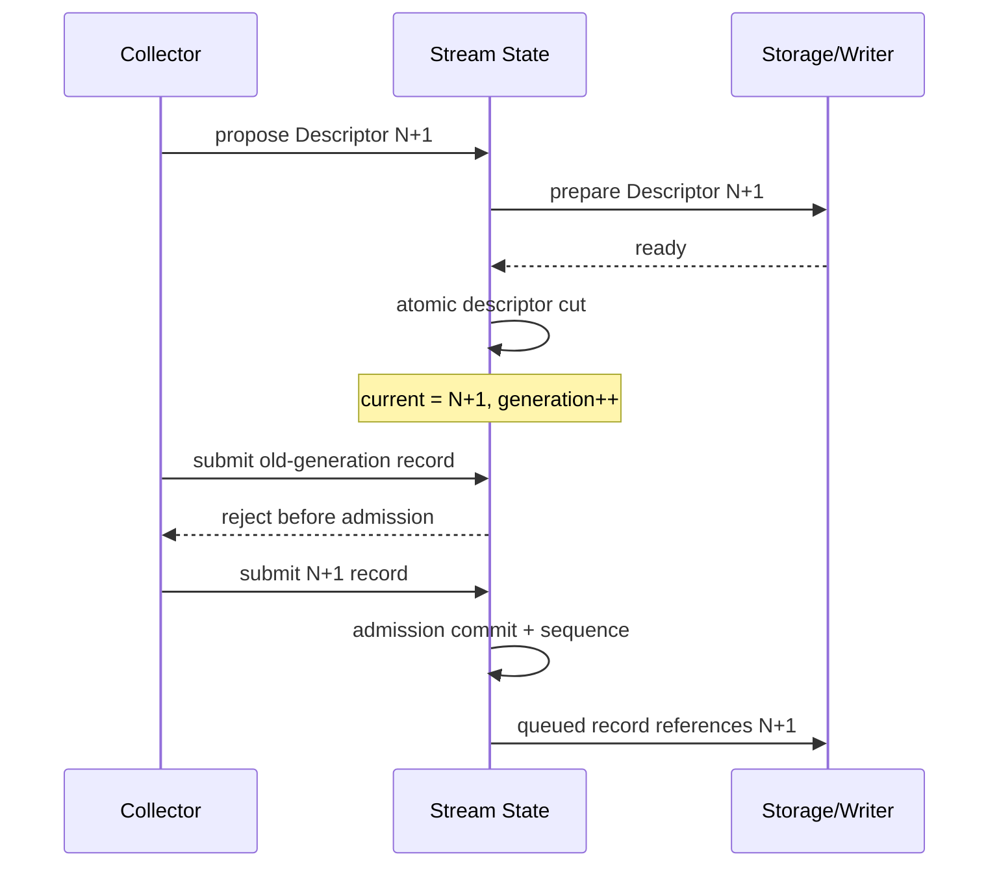

图中最重要的边界不是“准备”动作本身，而是 **Descriptor Cut 与接纳提交之间存在唯一顺序**：切点之前已经接纳的旧 Descriptor 记录继续排空，切点之后尚未接纳的旧代次提交必须失败。

实现可以用紧凑的数据流状态和计数完成上述规则，不要求为描述切换增加独立的中间对象或额外生命周期框架。正确性要求是：任何正常写入记录引用 Descriptor X 时，存储器已经具备解释 X 的必要信息，并且 Descriptor 切换与并发接纳具有唯一排序。

#### 4.2.3 载荷持有与物理内存计费

V1 架构定义三种载荷持有语义，具体采集器只能使用其显式声明且通过链路生效约束允许的方式：

| 持有方式 | 持有规则 |
| --- | --- |
| 复制持有 | 采集器只在提交调用期间借出输入；`rodaq` 在接纳前取得物理缓冲并复制。复制完成后不再依赖采集器原始内存。这是所有 V1 采集器必须可用的基线方式 |
| 所有权转移 | 采集器提供唯一缓冲及释放能力。只有 `rodaq` 明确取得所有权后才由宿主负责 exactly-once 释放；在取得前失败或拒绝仍由采集器负责 |
| 共享持有 | 采集器提供独立于回调栈和原始临时对象的稳定持有能力。`rodaq` 在接纳前取得独立生命周期引用，终态后 exactly-once 释放；`quiesce` 不得使已接纳载荷失效 |

不能证明稳定生命周期的来源必须使用复制持有。非复制方式不能绕过资源预算、单记录上限、Stop 静止条件或插件 ABI 的释放规则。是否在 V1 发布构建中启用所有权转移或共享持有由真实 ROS 2 → MCAP 性能资格决定；如果复制持有不能达到 V1 声明的性能画像，则满足性能所需的非复制方式成为 V1 发布条件，而不是顺延到后续版本。

内存同时按**逻辑载荷字节**和**实际占用字节**计费。实现允许使用多个固定容量大小档或等价的有界分配机制处理小记录和大图像，避免只按逻辑字节统计而低估块内浪费、对齐和持有开销。每个大小档至少暴露块数、在用块、物理字节高水位和耗尽计数。队列额度、载荷物理占用、存储器内部缓冲和等待释放的载荷均计入录制实例资源。

#### 4.2.4 写入、封口与持久进度

V1 Storage 的必选数据接口采用**同步有界批次**。一次批次调用的返回值只描述这次格式写入的已确认连续前缀以及剩余部分是确定未写入还是结果未知；它不等同于分片已经完成持久提交。链路分别维护：

```text
接纳进度
→ Writer 交付进度
→ 格式写入进度
→ 分片封口进度
→ 持久提交进度
```

同步批次返回后，只有存储器不再访问相应载荷时才可以释放本次借用。插件资源计划必须覆盖其同步调用内部可能持有的额外缓冲。写入调用若超过插件操作时限，入口关闭但相关载荷、实例和执行容量继续归原调用所有，直到迟返、局部清理成功或整进程恢复终止所有访问可能性。

同步批次是否足以满足 V1 性能目标由真实 ROS 2 → MCAP、目标文件系统和目标磁盘资格验证决定。若同步模型在声明负载下无法保持有界积压、CPU 和尾延迟，则必须在 V1 发布前引入经过独立审查的异步批次能力，把“宿主可以释放载荷”和“持久结果已确定”分别建模；不能通过扩大无界队列掩盖同步路径性能不足。异步能力通过可选 ABI 扩展加入，不改变同步批次的既有语义。

超载默认拒绝新增记录，避免录制反向拖慢机器人控制。若来源支持明确的流控且已验证对控制无影响，可在该插件的配置规则中单独配置。采集回调和接纳路径不等待网络 I/O、磁盘同步或控制服务。录制保存采集器交付的原始序列化应用载荷，连同编码、Schema、时间、来源和 Required 扩展信息；字段解析和格式转换留在读回或导出阶段。格式支持的无损压缩须通过解压后的载荷逐字节对账验证。

### 4.3 时间与顺序

| 口径 | 依据 | 用途 |
| --- | --- | --- |
| 接收时间 | 采集主机在入口记录的壁钟，并关联当前 Clock Epoch | 默认查询和标准格式时间轴 |
| 接收单调时间 | 采集主机单调时钟 | 超时、数据年龄、频率和同进程进展判断 |
| 来源时间 | 来源提供的时间值，必须同时标明时间角色、来源时钟和可用质量 | 离线对齐和来源事件时间解释 |
| 运行计时 | 主机单调时钟 | 插件操作、清理、控制等待等期限 |
| 录制时间 | 任务至少有一条链路开放接纳时累计的单调时长 | 计算滚动录制的保留窗口 |
| 接纳序号 | 每条数据流在接纳提交点独立分配的单调序号 | 构成记录身份并保证同一数据流的接纳顺序 |
| Writer 顺序 | 链路队列和实际批次交付形成的运行期顺序 | 复现写入行为和诊断，不作为跨数据流业务全局顺序 |

一条记录可以携带多个有界时间值。每个来源时间值都包含时间角色、时钟标识、读数和质量/存在性；没有可靠来源时间时保持缺失，不用 `0` 或接收时间冒充。来源重启、来源时钟域变化或同步质量发生不可连续解释的变化时，建立新的来源时钟边界；能够稳定识别实际生产者时，同时更新来源标识。

`SourceSequence` 只有在其 **sequence scope** 可确定时才拥有顺序/缺口语义。若协议能够把序号明确绑定到 `SourceId`、连接会话或其它稳定且被记录的生产者域，则 Coverage 可以在该域内解释 gap、duplicate 或 reset；如果只拿到一个 native sequence 而无法确认它属于哪个 Source/Session，则该值只能作为 opaque diagnostic fact 保存，不能据此声称“0 loss”、重复或缺口。多 Publisher 的 ROS 2 Topic 尤其不得把不同生产者的本地序号拼成单一 SourceSequence。

守护进程启动时取得持久可记录的 `system_boot_id`，所有 monotonic 时间、Clock Epoch 和 realtime↔monotonic correlation 都属于该 boot。主机重启后即使新的 monotonic 数值或 `clock_epoch_id` 从相同初值开始，也与旧 boot 不可直接比较。采集主机在同一 `system_boot_id` 内持续采样 realtime 与 monotonic 的相关性；当相邻样本的 `Δrealtime - Δmonotonic` 超过部署允许误差时，无论向前跳变还是向后回拨，都建立新的 Clock Epoch，并保存跳变量、检测时刻和相关性质量。Segment Manifest 至少记录 `system_boot_id`、`clock_epoch_id` 及相关性证据。跨 boot、跨链路和跨主机对齐只能依据已声明的同步来源、Clock Epoch/Boot 关系与误差预算，不从壁钟数值相近推断同步关系。

同一任务的各链路共享录制时间。至少一条链路开放接纳时，以单调时钟累计经过的时间，全部关闭后停止累计。暂停、停止和应用停机期间不计入。分片清单持久保存其录制时间范围，正常收尾保存累计边界。异常退出后，从已核验的提交与持久边界恢复累计值，无法证实的尾部时长不用于推进保留窗口。主机壁钟的正向或反向跳变都不改变录制时间。

Clock Epoch 变化不自动建立 Pipeline-wide Admission Cut，也不强制 Segment rotation。多个 Stream callback 可能在 Epoch 边界附近迟返；如果仅以 Writer 看到的第一条新 Epoch Record 作为切点，无法证明之后不会再到达此前已取得旧 Epoch snapshot 的合法 RecordAttempt。V1 因而允许一个 Segment 合法包含多个 Clock Epoch：每条 Record 固定自己的 `system_boot_id / clock_epoch_id`，Segment Manifest 列出本 Segment 实际出现的全部 Epoch、correlation quality 和 jump evidence，查询与回放不得假设一个 Segment 只有一个 Epoch。若未来要求“一 Segment 一 Epoch”，必须引入显式 Pipeline-wide cut/barrier 并重新冻结并发语义，而不能依赖隐式 Writer rotation。按壁钟范围查询仍返回所有重叠分片，同一链路的录制先后通过实例、分片及接纳顺序表达。

MCAP 的 `log_time` 使用接收壁钟时间。能够提供适用于格式的发布时间时写入 `publish_time`。无法提供时按 MCAP 规则回填 `log_time`，并保留原始来源时间证据的可用性与质量，便于区分实际来源时间与格式回填值。[MCAP 消息时间字段](https://mcap.dev/spec#message-op0x05)

## 5. 产物提交、恢复、保留与重置

本章定义数据从“已经写入格式对象”到“可作为已保存产物公开”的持久化边界。RoDAQ 不以文件存在、rename 成功或索引可见中的任意一个单独事件代表持久提交；final Segment 目录可以在 Ledger 登记前以 `RegistrationPending` 形式存在，但只有满足完整提交协议或经过恢复重新证明并补齐 committed fact 的分片，才能进入正常产物视图和 Catalog 查询。

### 5.1 分片生命周期与提交协议

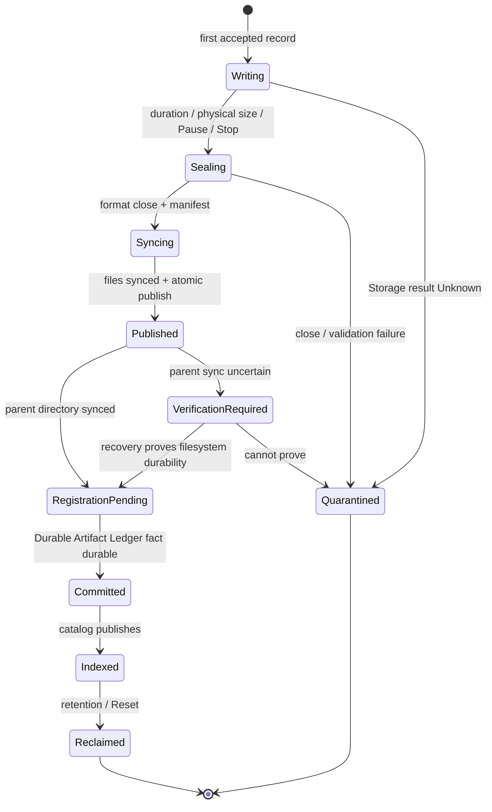

图中的状态用于说明**证据强度**而非要求实现一个同名状态机。`RegistrationPending` 表示 Segment 文件系统提交已经可证明，但独立的 Durable Artifact Ledger 尚未持久登记；它不得进入正常查询。正常查询只能公开 `Committed/Indexed` 所代表的事实；`Quarantined` 和 `VerificationRequired` 对应隔离或待核验路径，不能因为目录已经存在就被当作正常产物。


每个分片拥有唯一标识，并在录制实例内按顺序分配分片序号。封口后的分片清单保存下列信息。

| 信息 | 清单内容 |
| --- | --- |
| 归属与顺序 | 分片标识和序号、任务标识、控制代次、配置版本、录制链路与实例 |
| 运行契约 | `effective_config_id`、Deployment Generation、采集器和存储器精确标识及版本、资源档位、关键链路生效约束和本次启用的载荷持有方式 |
| 格式与校验 | 格式版本、文件名、物理大小及校验信息 |
| 数据描述 | 逻辑数据流、来源标识可用性、Stream Descriptor、载荷编码、Schema 及 Required 扩展信息 |
| 时间与覆盖 | 接收时间和录制时间范围、`system_boot_id`、Clock Epoch、来源时间角色/sequence scope、时钟质量及覆盖摘要 |

初始本地存储方案采用同卷临时目录和最终目录。验收覆盖文件格式、RoDAQ 提交行为及独立读回结果。[Linux 文件与目录同步](https://man7.org/linux/man-pages/man2/fsync.2.html) · [Linux 原子重命名及防覆盖](https://man7.org/linux/man-pages/man2/rename.2.html)

分片在第一条待写记录到达写入器时创建。按分片配置的时长或大小滚动，任一达到目标即在记录边界切分。时长从开段起用单调时钟计算，静默时也封口已打开的分片，下一条记录到来时再开段。大小是滚动目标而不是硬上限，允许完成已开始的有界写入批次，单条记录完整归入一个分片。

通用 Storage ABI 必须为活跃分片提供宿主可读取的大小度量，至少区分逻辑载荷字节与当前物理产物字节；若封口会产生显著额外索引、元数据、压缩尾部或数据库开销，还需提供经过资格验证的保守封口上界或由资源档位声明该上界。Core 的 size-based rotation 以 Storage 声明的物理大小口径加允许的批次 overshoot 判断，不能用输入 Payload 字节数假定等于最终文件大小。无法提供可靠物理大小规则的后端只能声明不支持按物理大小滚动。单记录上限和卷容量预算独立生效，容量估算同时计入批次、存储器内部缓冲和封口余量。分片滚动只改变写入产物的边界。

#### 5.1.1 Writer 与 Commit Lane

为了避免把 `fsync/rename/parent fsync` 的尾延迟直接串到数据 Writer 上，V1 将“格式写入/切段”和“已封口分片的持久提交”分为两个逻辑执行域：

```text
Writer lane:
write Segment N
→ finish format close/seal metadata
→ hand sealed Segment N to bounded commit queue
→ open Segment N+1
→ continue writes

Commit lane:
Segment N
→ fsync files/manifest
→ atomic publish
→ fsync parent
→ persist Durable Artifact Ledger fact
→ publish committed fact
```

两者仍属于同一 Pipeline 的所有权域。Commit queue 的 segment 数、待提交物理字节和执行槽位必须有硬上限；默认只允许极小 backlog，具体值由目标磁盘的 seal/fsync 尾延迟和峰值数据率推导。Writer 不能因为 Commit 落后而无界创建新分片：达到 commit backlog 上限时，先关闭或保护该 Pipeline 的 Admission Gate，再在有界资源内完成已接纳记录和待提交 Segment 的结算。

Pause/Stop 成功必须同时等待 Writer accepted set 结算和该实例的 Commit backlog 归零；如果某 sealed Segment 提交失败或结果未知，则按对应 Data Outcome 结算，不能因为 Writer 已经打开/关闭新 Segment 就报告操作成功。不同 Pipeline 可以使用独立或严格分区的 Commit 容量；同卷还要受卷级 commit/fsync 并发上限约束，避免多个 Pipeline 同时同步造成 I/O 风暴。


1. 按卷取得写入和封口额度。首次使用产物命名空间前，持久登记其所属任务、卷身份与位置。随后在目标父目录内创建临时分片，封口后生成真实文件清单。
2. 同步所有必需文件及清单，按目录层次同步临时目录元数据。用目标文件系统支持的防覆盖原子重命名发布完整目录。挂载点变化、目录不可信和不支持提交原语均在准入或提交时显式失败。
3. 同步最终目录的父目录。成功只证明 Segment 文件集合在声明的文件系统故障模型内已经持久，状态进入 `RegistrationPending`；此时仍不得向普通查询报告 Committed。若重命名后父目录同步失败或结果未知，标记 `VerificationRequired`、停止该链路继续发布并禁止复用标识。
4. Core 在独立于 Segment 目录和 Catalog 的 **Durable Artifact Ledger** 中登记最小 committed fact，至少包含 `segment_id`、Task/Pipeline/Instance 归属、卷身份与受管相对位置、Manifest digest、提交代次/格式版本以及核对所需的最小范围信息。该事实完成自身持久发布后才形成 RoDAQ 的正常 `Committed` 事实并允许 Catalog 公开。Ledger 的具体存储实现可以是分片事实文件、分区 Journal 或其它经过资格验证的有界实现，但不得依赖 Segment 自身才能证明“该 Segment 曾经成功提交”。
5. Catalog 是可重建查询索引，从 Durable Artifact Ledger、文件系统和恢复证据核对后发布分片。合法 retention/Reset 删除必须先持久登记删除意图并阻止新读取；只有文件删除已核对完成后才允许删除或压缩对应 Ledger committed fact。因而 Ledger 中存在 committed fact 而文件无对应删除意图却缺失时，可以确定报告 `HistoricalArtifactLostOrCorrupt`，而不是把缺失误认为“从未提交”。

ROS 2 的每个已提交 MCAP 分片都携带独立解码所需的 Channel、Schema、消息定义及其依赖。格式验收分别覆盖两条路径。独立读取工具依据分片内嵌定义解码，包括含嵌套自定义类型的记录。在已安装相应 ROS 2 消息包的参考环境，标准 `ros2 bag play` 可直接播放单个分片的 MCAP 文件，由独立订阅端核对消息数、Topic 与字段。验证覆盖滚动后的分片。[MCAP ROS 2 格式约定](https://mcap.dev/spec/registry#ros2) · [Humble MCAP 回放用法](https://github.com/ros2/rosbag2/blob/humble/rosbag2_storage_mcap/README.md#usage)

MQTT JSON 分片按配置的 Topic 写入 Channel，载荷编码声明为 `json`。源消息的应用字节原样保存，配置提供的可用 Schema 随分片保存。保留样本标记通过分片内的记录写入顺序关联到对应记录，作为录制元数据与数据文件一同提交。用独立读回工具核对 Topic、接收时间、记录数、原始字节及保留标记，并验证 JSON 样本可解码。[MCAP JSON 编码](https://mcap.dev/spec/registry#json) · [MCAP 消息字段](https://mcap.dev/spec#message-op0x05)

rosbag2 SQLite3 存储器采用同一分片提交协议。每个已发布分片按参考发行版的 rosbag2 SQLite3 约定组织 `.db3` 和 `metadata.yaml`，以分片目录作为读回和回放入口。标准布局无法表达的录制元数据随分片保存，并与对应记录保持可核对的关联。若启用 WAL，封口需生成不依赖临时 WAL 的发布副本，或在产物清单中包含所有读取所需文件，并以只读方式验证整份产物可以从发布目录独立读取。[rosbag2 SQLite3 存储器](https://github.com/ros2/rosbag2/blob/jazzy/rosbag2_storage_sqlite3/README.md) · [SQLite WAL 持久状态](https://www.sqlite.org/wal.html#the_wal_file)

### 5.2 恢复与数据承诺

| 恢复看到的事实 | 处理 |
| --- | --- |
| 仅有临时分片 | 临时文件缺少完整写入和提交的证据。V1 隔离该分片，保留原标识和中断证据，将未证实覆盖标为未知。隔离文件仍计入卷使用量 |
| 最终分片存在，但 Durable Artifact Ledger 无 committed fact | 视为 `RegistrationPending/VerificationRequired`，先确认原写入所有权已结束，再验证 Manifest、格式、控制代次、写入结果和文件系统持久证据；能够证明完整且未被 Unknown 污染时补齐 Ledger committed fact 后再进入正常 Catalog，否则保持隔离 |
| Durable Artifact Ledger 有 committed fact，最终分片存在 | 按 Ledger 中的卷身份、受管路径和 Manifest digest 核对，验证通过后重建 Catalog；Catalog 丢失不影响 committed authority |
| Durable Artifact Ledger 有 committed fact，但最终分片缺失/损坏，且无对应合法删除意图 | 标记 `HistoricalArtifactLostOrCorrupt` 并告警；该判断不依赖目录扫描猜测，因为 Ledger 独立证明该 Segment 曾经成功提交 |
| 存在 retention/Reset 删除意图 | 按删除意图和进度继续隐藏、删除和核对；文件已经删除但 Ledger committed fact 尚未压缩属于可恢复中间态，不误报历史丢失。只有删除完成并持久确认后才移除对应 committed fact |
| 录制实例中断 | 只有存在 Open Authorization 才把实例视为可能曾经接纳数据；依据授权边界、最后可证实覆盖和故障后的首次可证实覆盖计算缺口。尚未恢复且仍有 Run intent 时保留开放区间，随后结束时按意图边界截断。仅有 Prepared facts 的实例不产生录制覆盖；已授权但无已提交分片时以授权边界标注不确定范围 |
| 发现未结束的回收意图 | 恢复删除或核对删除已完成。索引重建不重新公开处于回收中的分片 |
| 发现未结束的任务重置 | 继续核对并清理对应任务的各卷产物。该任务保持重置中。索引重建和自动恢复遵守Reset 代次边界 |
| 启动时受管目录缺失或未完成初始化 | 进入诊断模式，保留既有配置和产物 |
| 单个任务的配置文件或必要恢复记录无法校验 | 暂停该任务的控制和清理，标记无法核验的历史范围 |

录制以分片提交作为恢复点，内存接纳和未提交分片可能在异常退出后失去。未来通过获准的格式修复流程提取的数据，以独立的恢复产物保存并关联原分片标识。限制分片目标时长、在途数据量和停止阈值以约束暴露窗口，并在目标磁盘负载和注入故障下测量实际 RPO 和 RTO。滚动周期无法单独确定 RPO，封口、同步、积压和设备超时也会影响窗口。要求确认后重放或要求每条记录单独耐久的场景，需要额外的源端重放或本地预写日志协议。

### 5.3 容量保护与回收

按实际文件系统和设备建立容量域。每卷设置活跃写入额度、封口余量及停止、低、恢复三个水位。以可用空间计，恢复水位高于低水位，低水位高于停止水位。封口余量覆盖同卷所有活跃写入器的保守封口上界，并留出检测和停止期间的增长空间。每个录制实例执行预先分配的额度和本地紧急停止阈值，控制请求积压时仍生效。写入并发及读回负载都计入 I/O 预算。共享卷的生产配置需要声明外部写入范围并验证配额或等效物理隔离。

自动回收由任务显式启用。选择滚动录制并配置保留窗口时，即启用该任务的窗口回收。窗口右边界为同一任务各链路已核验提交中最大的录制时间，左边界为右边界减去保留时长，最小为零。这个定义采用 **Task 时间轴语义**：某条 Pipeline 长时间失败或静默时，其他 Pipeline 的新提交仍会推进整个任务的窗口，因此失败 Pipeline 较早的历史可以被正常回收；系统不保证每条 Pipeline 都独立保留“自身最近 N 分钟成功数据”。若部署需要后者，必须使用独立 Task 或未来的 per-Pipeline retention 策略。只有分片的最晚录制时间早于左边界，且符合保护标记和读租约约束时，才可回收。触及或跨越左边界的分片整片保留。恢复证据尚不足以判断的分片继续保留。

同一任务从连续录制切换到滚动录制时，可以选择此前的连续录制产物是否参与窗口回收，默认保留。配置变更沿用任务停止且录制实例静止的条件。显式选择纳入后，应用可在停止态用该任务已有的最新提交进度初始化窗口，并回收可以证实整片位于窗口外的已提交历史。这样，即使磁盘低水位暂时阻止 Start，仍可释放已选范围内的空间。录制参数供下一次 Start 使用，窗口此后随新提交推进。

任务在停止态主动缩短保留时长时，可按已有提交进度重新计算窗口左边界，并对已经纳入回收范围的历史应用新规则。窗口右边界保持原位。保留配置与删除意图在同一任务控制域排序，登记删除意图前复核当前规则。已持久受理的删除继续按其记录结算。

保留窗口所需空间按持续落盘字节率乘以保留时长估算，另计跨界分片、在途写入、封口余量、等待回收的占用和同卷其他数据。硬容量预算和卷水位基于实际空间。低水位拒绝该卷新增录制并推进符合条件的回收。回收仍不足以保障安全写入时，在停止水位关闭受影响链路的接纳并尽力封口。空间可用性未知时按同一保护路径处置。保留窗口内的分片继续保留。

磁盘保护停录记录为执行状态，保留任务的 `Run` 意图。实际可用空间持续达到恢复水位、受影响实例已静止且资源重新获准时，按有界退避自动恢复对应链路。开放入口前复核新鲜的容量样本、控制代次及 `Run` 意图。Pause 或 Stop 与恢复在同一任务控制域排序，已受理的暂停或停止使旧恢复请求失效。空间观测过期、卷不可用或未能通过准入时，任务保持保护状态并报告原因。

回收在阻止新读取并等待有界读租约结束后，先持久记录删除意图，再移出可见命名空间、清理并核对实际释放空间。只有删除结果已经持久确认后，才允许删除或压缩对应 Durable Artifact Ledger committed fact，并最终结算删除意图；若进程在文件删除后、Ledger 清理前退出，恢复依据仍存在的删除意图继续结算，不把该 Segment 误报为历史丢失。回收记录保留产物标识和删除原因。

### 5.4 按任务重置

Reset 清空 RoDAQ 管理的、归属于该 `task_id` 的全部录制产物。范围包括当前及旧配置产生的已提交分片、临时、隔离和恢复产物，以及归属该任务的服务端导出文件。重置后清空可重建的运行观测计数、频率、故障/重试状态、累计录制时间、提交进度及产物覆盖视图，但 **不得回退或复用 Stream Identity State 中的 `acceptance_sequence` 持久高水位**。任务配置、Task/Stream 标识和当前仍需保证身份连续性的 Identity State 保留；不再被任何配置/产物/恢复事实引用的退役身份状态按有界 GC 规则回收。操作审计只按部署声明的有界保留策略保存。

1. 任务期望状态为 Stopped 且录制实例静止后，控制面首先在 **Task Control Record** 中原子发布新的 `reset_generation`、Reset `operation_id`、目标控制代次和固定范围描述；该持久发布是 Reset 的唯一受理/线性化点。此后重置中的任务关闭 Start/Resume、自动恢复及新产物读写入场。已获准读取使用有界读租约；服务端在租约期限内完成传输或主动取消连接并释放引用。无法在期限内证明读引用释放时，Reset 保持 Pending，而不是强行删除仍被访问的文件。
2. Recovery Record 不再拥有新的 Reset 代次，只保存当前 `reset_generation` 对应的逐卷执行进度、待删除对象范围和最近错误。根据 Task 已登记的卷身份、命名空间和 Durable Artifact Ledger committed facts 固定目标集合，逐卷阻止新读取、删除文件并持久确认；只有对应文件删除已核对完成后，才移除/压缩该目标的 Ledger committed fact。卷离线、身份不符或删除失败时报告未完成及原因。相同操作重试或守护进程重启时从 Task Control Record 的权威 Reset intent 加载 Recovery Progress，继续剩余工作；文件已删但 Ledger fact 尚在是合法可恢复中间态。
3. 完成任务产物目录、Durable Artifact Ledger 目标事实和 Catalog 清理，清零可重建运行状态、累计录制时间与提交进度但保持 Stream sequence 高水位单调后，在 Task Control Record 中结算 Reset 操作终态，并把任务投影为 `Stopped + Idle`。索引更新和恢复扫描以权威 `reset_generation` 为界，Reset 前实例的迟返及残留记录无法重新公开已清空的产物。

## 6. 控制接口、安全与运维

本章定义应用边界的权威数据来源、安全约束和运行观测。HTTP/Web 只是 `rodaq` 核心接口契约的一个适配层：它们不能拥有第二套任务状态、配置事实或产物索引，也不能通过网络请求生命周期改变已经持久受理的控制操作。

### 6.1 配置与持久事实权威

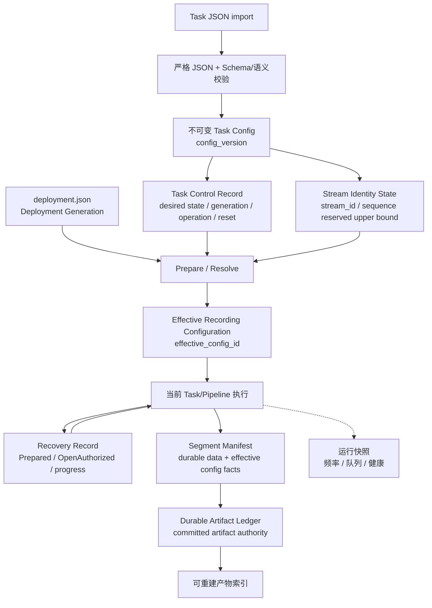

权威关系遵循五个原则：**配置不可变、控制意图单一权威、Stream 身份单调不复用、已提交产物存在事实独立持久、运行快照与 Catalog 可重建**。Task Control Record 决定当前活动配置、持久期望状态和 Reset authority；Stream Identity State 决定稳定 Stream 身份及已预留的序号空间；Recovery Record 只记录实例执行与恢复进度；Segment Manifest 证明数据内容和运行契约；Durable Artifact Ledger 独立证明仍受 RoDAQ 管理的 Segment 已经完成正常提交；运行快照和 Catalog 不能反向覆盖任何持久事实。


| 配置或事实 | 权威和变更入口 |
| --- | --- |
| 部署配置 | 运维维护的严格 JSON 配置文件，服务装配时读取。定义本机监听端口、允许的插件目录与标识、输出根、全局资源上限、链路资源档位、分级恢复时限和频率观测参数 |
| 任务配置 | `rodaq` 模块把已生效配置保存为 `tasks/<task_id>/configs/<config_version>.json` 不可变 JSON 快照。导入和导出只处理可移植配置内容，不携带运行控制元数据 |
| Stream Identity State | `identity/<task_id>.json` 保存各稳定 `stream_id` 的接纳序号持久预留上界及必要身份状态；它不描述当前运行实例，不由 Segment 反推 |
| 运行状态 | 任务和链路的即时执行条件、统计、来源活动和重试快照由当前守护进程持有，可在重启后重建 |
| Task Control Record | `control/<task_id>.json` 保存活动配置版本、期望状态、控制代次、Reset 代次及有界操作账本，是生命周期控制和跨重启幂等对账的唯一权威 |
| Recovery Record | `recovery/<task_id>.json` 保存实例执行、Open Authorization、结束边界、待清理和 Reset/回收进度；只承担生命周期恢复 checkpoint，不承担正常 Segment 提交历史 |
| Segment Manifest | 随 Segment 保存该产物的数据内容、文件、Descriptor、覆盖、运行契约和校验事实；Manifest 不能单独证明一个已经消失的 Segment 曾经存在 |
| Durable Artifact Ledger | 独立于 Segment 目录和 Catalog 保存仍受 RoDAQ 管理的 committed Segment 最小事实，是“产物曾成功提交且尚未合法删除”的持久权威；实现必须有界并支持恢复核对与安全压缩 |
| Catalog | 从 Ledger、Segment 和 Recovery evidence 重建的查询索引，不作为持久提交历史权威 |

RoDAQ 自己拥有的外部配置和结构化持久事实统一使用**严格 JSON 数据模型**：包括部署配置、任务配置及导入导出文件、插件参数对象、Stream Identity State、Task Control Record、Recovery Record、Durable Artifact Ledger entry 和 RoDAQ Segment Manifest。Ledger 的物理容器可以采用分片事实文件、分区 Journal 或其它有界实现，但其中的结构化 entry 仍遵守版本化严格 JSON 语义或等价的稳定编码契约。严格 JSON 不接受注释、尾随逗号、NaN/Infinity 或重复对象键；解析入口同时限制文档字节数、嵌套深度、字符串长度、数组/对象成员数等资源。第三方交付格式不受此规则改写，例如 rosbag2 SQLite3 仍按其标准布局保留 `metadata.yaml`。

每类结构化持久事实保持独立的领域模型、格式版本和校验规则；“统一 JSON 数据模型”只统一边界表示，不把部署配置、任务配置、控制记录、恢复记录、Artifact Ledger 和分片清单合并成一个通用对象。JSON 解析与结构校验完成后立即转换为 RoDAQ 强类型对象，`nlohmann::json` 或其它解析库类型不得进入 `rodaq` 公共接口、数据热路径或插件 C ABI。插件专有参数作为 JSON Object 嵌入任务配置，由插件配置描述完成结构校验，再由插件执行协议相关语义校验。

#### 6.1.1 Deployment Generation 与 Effective Recording Configuration

`deployment.json` 每次成功加载并通过语义校验后形成不可变的 **Deployment Generation**，由规范化部署配置及发布环境中需要参与运行语义的稳定引用生成标识。运行中的 Recording Instance 永远绑定启动时的 Deployment Generation；后续修改部署文件不会原地改变已经开放的实例。

Task Config 只保存可移植的逻辑引用，例如插件逻辑标识、输出根名称、资源档位名称和凭据引用。Start、Resume 或自动恢复在 Prepare 阶段把以下事实一次性解析并冻结为本次实例的 **Effective Recording Configuration**：

```text
Task config_version
+ Deployment Generation
+ collector/storage exact plugin identity + version
+ resolved output volume identity
+ resolved non-secret plugin/deployment parameters
+ effective QoS / capability limits
+ Plugin Resource Plans
+ Effective Pipeline Limits
+ credential reference version/fingerprint（不含 secret）
= effective_config_id
```

同一个 `config_version` 在不同 Deployment Generation 下可以得到不同 `effective_config_id`，不得把两者视为相同运行契约。Recovery Record 为每个实例保存 `effective_config_id`；Segment Manifest 同样记录它及必要的可审计组成事实。重启恢复必须重新解析当前 Deployment Generation，并按明确兼容规则判断能否继续原 Run intent；解析不到同一输出卷、插件/能力不兼容或关键安全引用发生不允许的变化时，进入 Protected/诊断而不是静默使用新环境续录。

#### 6.1.2 资源分类与长期基数上限

资源治理分三层，避免把 Core 无法精确控制的共享资源错误承诺为“已预留”：

| 资源层 | 责任与典型对象 |
| --- | --- |
| Core 硬计费资源 | 队列槽位、Record 数、逻辑字节、Payload 物理块、Core 执行槽位、Core 打开的 FD、维护作业、读租约；必须在代码中严格有界并支持原子准入/归还 |
| Plugin 声明资源 | 插件内部缓冲、内部线程/执行者、FD、压缩工作区、协议暂存等；通过 Plugin Resource Plan 声明上界并由资格测试验证声明可信 |
| 共享/外部资源 | DDS/RMW history、内核 socket buffer、文件系统 page cache、设备队列、内存带宽、CPU 调度与磁盘服务时间；由部署限制、cgroup/系统配置和生产资格共同约束，不能伪装成 Core 精确 reservation |

除热路径字节资源外，长期对象数量也必须显式有界。Deployment 至少冻结 `max_pipelines_per_task`、`max_streams_per_pipeline`、`max_sources_per_pipeline`、`max_descriptors_per_stream`、单个及累计 Schema/Descriptor/扩展字节、Clock Epoch 产生速率/保留数量、同时存在的实例/隔离 Segment/待提交 Segment、Durable Artifact Ledger 活跃事实数量与字节预算、指标标签和诊断条目上限。达到上限时拒绝新身份/描述或进入保护状态并保留原因，不通过无界 map、vector、日志或指标 cardinality 吸收异常来源行为。

任务配置只引用部署允许的插件和输出根，并按名称引用链路资源档位。档位定义一条链路可以申请的记录数、逻辑字节、物理载荷内存、插件内部缓冲、执行槽位、线程和文件描述符等硬上限，而不是手工重复填写插件当前配置的预计占用。Start、Resume 和自动恢复先解析插件参数并得到采集器、存储器各自的资源计划，再与资源档位、Core 全局限制和卷容量共同执行准入。档位缺失、资源计划超限、插件能力不满足或无法形成链路生效约束时，按链路报告准备失败；不得靠运行后动态超分来满足启动。

首次安装显式初始化受管任务配置和恢复目录。安装流程使用与守护进程相同的排他约束，检查状态目录及所有配置输出根中的 RoDAQ 管理命名空间。确认新部署后创建目录，并在初始化持久完成后报告成功。重复初始化保留有效部署。发现既有部署痕迹但受管目录缺失或不可核验时，报告原因并保留现有文件。

任务配置快照携带格式版本、录制模式、启动策略、分片和保留规则、恢复策略、录制链路及其 Required/Optional 属性、来源就绪要求、插件逻辑标识、数据流、输出根引用和资源档位名称。配置在结构和语义校验完成后生成唯一的规范化 JSON 表示，`config_version` 由该规范化内容的稳定摘要标识；对象键顺序、输入空白和其它不改变语义的文本差异不得产生新的配置版本。规范化规则在 V1 冻结前锁定并形成跨版本测试，优先采用标准 JSON canonicalization 规则而不是项目自行发明排序和数值格式。导出文件只携带可移植配置，数据源凭据由目标部署提供。导入与任务创建共用同一严格 JSON 解析、配置校验和目标部署引用解析路径。

Create 或 Configure 先在任务配置目录写入新的不可变配置版本，完成文件与目录同步后，再原子发布 Task Control Record，使其引用该 `config_version` 并包含对应操作账本项；Task Control Record 的父目录同步完成才是配置生效和操作 Accepted 的线性化点。此前崩溃只会留下未被引用的准备配置，不得自动成为活动配置，可在恢复完成后由有界维护作业清理。旧配置版本只要仍被已提交/隔离产物、恢复事实或保留期内审计引用就继续保留，其余版本可按维护策略回收。任务创建只有在初始配置与 `Stopped` Task Control Record 都完成后才对查询可见。

Stream Identity State、Recovery Record 和 Task Control Record 均通过各自同目录临时文件写入、文件同步、原子发布和父目录同步完成更新；不可变配置版本只创建不覆盖。Durable Artifact Ledger 使用其物理容器对应的资格化持久协议，必须保证单个 committed/delete fact 在对 Core 返回成功前已达到声明的 durable boundary，并能在崩溃后区分“未登记”“已登记”和“合法删除进行中”；Ledger 不要求与 Segment 目录做跨文件系统事务。新的 AcceptanceSequence 区间只有在 Stream Identity State 新上界完成父目录同步后才可投入分配。启动时先读取 Task Control Record 和 Stream Identity State，再加载其引用的配置版本并核对 Recovery Record、Durable Artifact Ledger 和受管 Segment。任何引用缺失、内容校验失败或控制代次冲突都进入诊断状态，不猜测哪个文件更新得“更晚”。[Linux 原子替换](https://man7.org/linux/man-pages/man2/rename.2.html) · [Linux 文件与目录同步](https://man7.org/linux/man-pages/man2/fsync.2.html)

部署配置必须给出 `max_tasks`、持久操作恢复窗口、审计保留上限、隔离产物容量/数量告警线和维护作业上限。状态目录单独设置容量监控与紧急写入余量，至少覆盖所有活跃任务完成一次 Pause/Stop 控制记录更新、必要 Stream Sequence 区间预留、Recovery Record、已完成文件系统提交的 Segment 登记必要 Durable Artifact Ledger fact，以及守护进程关停事实；日志、审计、Catalog 缓存和普通操作历史不得消费这部分余量。操作账本接近上限时先压缩或淘汰超过恢复窗口的终态条目，再拒绝 Create、Configure、Start、Resume 等新工作，并为 Pause、Stop 与系统关停保留控制和持久化容量。若状态目录已经无法完成必需的持久写入，则相应 API 不得虚假返回 Accepted，并立即报告控制持久化故障；系统级关停仍可关闭接纳并进入外部监督的进程恢复路径。隔离产物和恢复证据达到上限时进入对应卷的保护状态并要求人工处置，不为腾出空间而静默删除尚无法解释的数据证据。

### 6.2 版本化 HTTP API 与 Web

HTTP 接口设计在 [`rodaq` 模块实现验收](#71-v1-实施顺序)通过后启动，届时按已验证的 `rodaq` 模块接口定义具体路由、请求响应和错误映射。`rodaq` 模块的任务操作、状态查询与产物读取先通过开发验收程序验证。

本机 HTTP API 使用稳定根路径 `/api/`，路径本身不编码发布版本。Web 静态页面与 API 同源部署，本机浏览器和自动化调用同一控制语义。协议兼容版本作为请求/响应元数据中的数值事实管理，具体字段在 HTTP 详细设计时冻结；已发布协议主版本内保持字段与状态语义兼容，破坏性变化通过协议版本协商处理，而不是增加 `/v1/`、`/v2/` 等新路径。下表记录应用需要从 `rodaq` 模块获取的能力，供后续接口设计使用。

| 所需能力 | 返回或变更的事实 |
| --- | --- |
| 健康与就绪 | 守护进程健康、控制服务就绪、恢复进度，以及诊断模式的原因 |
| 任务 | 创建、查询和更新配置，导入及导出任务配置文件，返回对应的任务及配置事实 |
| 控制操作 | 提交 Start、Pause、Resume、Stop 和 Reset，返回拒绝或已经越过持久受理点的 `operation_id` |
| 操作查询 | 按 `operation_id` 查询排队、执行、部分成功、完成、失败、待清理、由 Stop 接管或重启恢复后的结果 |
| 数据流和产物 | 查询入口就绪、来源连接、实际收数、接纳、提交及覆盖，分页查询已提交产物并按产物标识读取 |

修改请求在本机入口校验格式、幂等键和预期控制代次。新的操作只有在第 3.2 节定义的持久受理点完成后才返回 `202 Accepted` 和 `operation_id`；网络断开或 HTTP 等待超时不会撤销已受理操作。客户端在操作账本恢复窗口内可携带原幂等键和同一规范化请求重试，即使守护进程已经重启，也应返回原操作或其恢复后的结果；同键不同请求返回冲突。超过恢复窗口时 API 明确返回操作历史已过期，调用方依据当前控制代次、期望状态和产物事实确认效果。[HTTP 202 语义](https://www.rfc-editor.org/rfc/rfc9110.html#name-202-accepted)

服务端限制请求体、并发、分页、排队与下载速率。HTTP 执行域只做有限的校验、提交和查询。慢客户端和产物读取使用受限容量，为健康查询及停止操作保留资源。读取返回已发布的任务快照和产物索引，并标注快照更新时间和索引恢复范围。

### 6.3 本机访问边界

RoDAQ 按本地应用交付，管理入口默认仅绑定本机回环地址，例如 `127.0.0.1` 和系统支持时的 `::1`。回环监听只用于减少远程攻击面，不视为身份认证：同机其他用户、进程、容器和浏览器页面仍可能访问 localhost。服务端必须校验允许的 Host 与 Origin，对浏览器修改请求采用不可被第三方站点构造的本机认证凭据并提供 CSRF 防护；自动化客户端使用权限受限的本机凭据。凭据不得写入可导出的任务配置、URL 查询参数或普通日志。若未来开放非回环监听，必须另行设计网络认证、传输保护和授权模型，不能直接复用 V1 的本机信任假设。采集器按部署配置访问获准的本地或网络数据源。

Reset 是高影响本机控制操作。执行时除状态和静止条件外还要求通过修改请求认证、控制代次和幂等检查，并记录任务、操作标识、控制代次、时间及结果。本机操作记录用于故障对账与追溯。

守护进程只打开部署允许的设备与卷。产物读取按产物标识解析到该任务的已发布文件，取得有界读租约，再按 Reset、保留回收与读取预算的约束提供文件。

### 6.4 运维与可观测性

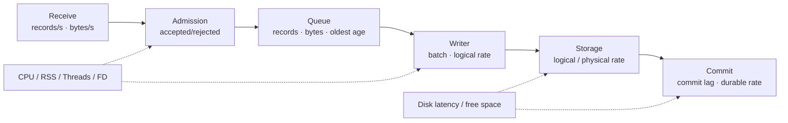

观测体系围绕“**来源是否在产出、RoDAQ 是否在接纳、下游是否在持续推进、资源是否接近预算**”四个问题组织。每个阶段使用自己的事实和单位，避免用一个模糊的 `recording_rate` 或单个健康枚举代替端到端诊断。

- **可观测性。** 分开报告存活、控制就绪、期望控制状态、执行条件、采集入口就绪、来源状态、来源活动、接纳进度、Writer 进度、存储写入、分片封口和持久提交。记录来源可见丢失、接纳前拒绝原因、接纳后已知失败/未知、污染或隔离分片、Clock Epoch 变化和覆盖未知区间。按任务、链路、实例、数据流、分片和操作关联事实；指标标签基数、日志速率、操作历史和审计空间均有上限。
- **数据流速率。** 对每条数据流至少累计实际接收记录/字节与已接纳记录/字节，由周期快照计算窗口速率；`0 Hz` 只表示窗口内没有实际接收记录。来源连接或会话状态、最近接收时间和快照新鲜度独立展示。热路径更新单调计数和必要时间戳，不逐条计算滑动窗口。
- **录制链路流量。** 链路至少暴露接收、接纳、Writer 消费、Storage 逻辑写入和持久提交的 records/s 与 logical bytes/s。Storage 另报告实际物理产物增长或设备写入字节率。压缩场景下逻辑 500 MB/s、物理 180 MB/s 可以是正常结果，不能把物理速率直接与来源逻辑速率比较判断是否丢数。
- **积压与进展。** 仅看队列字节数不足以判断是否持续落后。必须同时报告队列记录/字节当前值与高水位、最老待写记录年龄、最近 Writer 进展时间，以及“最新已接纳录制时间 - 最新已持久提交录制时间”的提交滞后。存在工作时这些值持续增长才构成明确的下游跟不上证据。
- **延迟。** 以低开销直方图分别统计接纳等待、提交调用、Storage 批次、分片封口、文件/目录同步、持久提交和 Pause/Stop 收敛延迟，发布至少包含 count、min/max、p50、p95、p99 和 p99.9。统计快照不是跨所有计数器的原子切片时必须在接口说明中声明。
- **资源。** 周期采样守护进程 CPU core-equivalents、RSS、线程、FD、卷空间与 I/O 延迟；实现能够可靠归属时，再分别报告采集执行、Writer/存储和维护执行的 CPU 时间。载荷池同时报告逻辑字节、物理占用、高水位和耗尽次数。CPU 不以固定百分比作为插件硬配额，生产画像必须记录 CPU 型号、核心拓扑、频率策略和隔离方式。
- **故障定位。** 接收速率下降且队列为空、采集执行 CPU 升高时优先诊断采集侧；接纳正常但队列年龄增长、Writer CPU 高而磁盘负载低时优先诊断编码/压缩；CPU 尚有余量但磁盘尾延迟和同步耗时升高时优先诊断 I/O；Writer 正常而提交滞后增长时诊断封口、同步或提交路径。监控用于提供证据，不自动把任何单一指标映射为唯一根因。
- **发布与升级。** 部署包交付服务、已验证的适配器和后端、配置样例、服务管理配置及读回工具。保存不可变任务配置版本、Task Control Record 和恢复记录的备份与恢复流程，版本化配置、控制记录、恢复记录、清单与产物格式。升级前排空受影响录制，按整进程重启安排维护窗口，验证历史数据可读及旧版本持久状态能够按声明的升级路径加载或迁移。

## 7. 实施门槛与生产资格

V1 采用逐级门禁，而不是“代码完成后一次性测试”。后一阶段只能复用已经通过的前一阶段契约；发现核心不变量、真实负载或长期运行问题时必须回到对应设计/实现阶段修正，不能通过降低验收口径关闭问题。


### 7.1 V1 实施顺序

| 阶段 | 可验收结果 |
| --- | --- |
| A. 核心契约冻结 | 冻结标识域与 Stream Sequence 持久唯一性、Boot Reconciliation、Reset authority、Pipeline Admission Gate、`Required/Optional × AllRequired/BestEffort` 投影矩阵、Process Shutdown Drain≠Stop、Deployment Generation/Effective Configuration、Durable Artifact Ledger、三层资源与 metadata cardinality、模块依赖 DAG、插件并发/重入、System Boot/SourceSequence scope、Writer/Commit lane 和统一失败模型；同时冻结 Descriptor、Payload 与 Storage 基础契约。形成并发/崩溃/故障不变量测试矩阵后才进入正式数据路径实现 |
| B. 核心录制 | 通过采集和存储插件录制 ROS 2 相机与关节数据到 MCAP，按时长和物理大小分片。暂停后切点前已接纳记录可读回，恢复后继续写入新分片。用独立工具解码并执行标准 ROS 2 回放 |
| C. `rodaq` 模块实现验收 | 通过开发验收程序验证显式初始化、持久控制、配置导入导出、多任务、连续与滚动录制、历史查询、产物读取、Durable Artifact Ledger/Catalog 重建、资源计划准入和完整运行快照。覆盖 Descriptor 切换、资源耗尽、Unknown 写入、Segment filesystem durability→Ledger 登记各 crash window、磁盘保护、进程重启、正常 Shutdown Drain 和 Reset |
| D. 本机应用 | 阶段 C 通过后设计 HTTP 接口，再接入 Web 和 `/api/`。从安装包启动应用，通过本机操作验证阶段 C 的任务控制、流量/积压/资源展示、历史查询和产物获取 |
| E. 后端与互操作 | MQTT → MCAP 样本核对原始 JSON 字节、Topic 和保留标记，验证 3.1.1、QoS 0/1 及重新订阅。ROS 2 → rosbag2 SQLite3 从发布目录独立读回并标准回放。用 PlotJuggler 样本核对 ROS 2 → MCAP 的字段和时间轴，并在源码树外编译、装载插件示例 |

#### 7.1.1 首个录制闭环

用一个连续录制任务、一条 ROS 2 → MCAP 链路和两条数据流贯通开发闭环。相机与关节发布端提供可逐条核对的测试输入。阶段 B 和 C 通过开发验收程序调用 `rodaq` 模块的正式控制和查询接口。阶段 D 由本机服务端调用同一套接口，复用已验证的录制路径。

| 步骤 | 预期行为与验收证据 |
| --- | --- |
| 创建任务 | 配置相机和关节的 Topic、类型与 QoS，选择资源档位、输出根及分片时长和大小，记录返回的 `task_id` |
| 启动并观察 | 先启动相机发布端，延后关节发布。链路开放接纳后 Start 成功。相机持续录制，关节显示 `0 Hz`。关节发布后，频率更新且记录进入同一链路 |
| 验证分片 | 分别触发按时长和大小滚动。查询按 `task_id` 返回已提交分片。逐个读回滚动后的 MCAP，核对 Topic、记录数和原始载荷 |
| 暂停与恢复 | 在两条流持续输入时暂停，记录入口关闭时的接纳边界。Pause 完成后，关闭前已接纳记录均可从已提交产物读回，暂停期间的输入不进入产物。Resume 使用同一 `task_id`，新收到的数据从新分片开始保存 |
| 停止与回放 | Stop 完成后，最后一个非空分片已提交，录制资源已归还。使用标准 ROS 2 回放和独立订阅端核对 Topic、消息数和字段值 |

以 RoDAQ 实际接纳的记录为基准，与独立读回结果逐条对账。用发布端的测试标识核对各流的载荷和字段；同一数据流按 `acceptance_sequence` 对账，不同数据流保留实际 Writer/格式交付顺序但不声明业务全局序列。接收、接纳、Writer、格式写入和持久提交分别计数。验收保存运行配置、插件版本、链路生效约束、分片清单和读回结果。完成该场景后进入多任务和两种录制模式的 `rodaq` 模块验收。

### 7.2 V1 基础保护验收

核心流程打通后，以代表性故障验证应用的资源和数据边界。

| 场景 | 可验收结果 |
| --- | --- |
| 单链路超额输入或确定写入失败 | 缓冲使用保持在预算内，报告拒绝或写入错误。资源独立的链路和本机控制面仍可用 |
| Storage 返回未知写入后缀 | 立即关闭链路接纳，当前分片进入污染/隔离状态，不重复写入未知记录且不得作为正常提交产物公开；覆盖报告能区分已知前缀和未知区间 |
| Required Pipeline 准备失败 | `AllRequired` 下全部 Required 保持 Gate Closed，任一 Prepare 失败时不得已有 Required 业务 Record 被接纳；已准备实例安全回收。`BestEffort` 只有 Barrier 完成后开放成功 Pipeline；即使失败的是 Required，只要仍有合法运行集合，Task 必须为 Degraded 而不是 Failed；不存在运行集合时再按可恢复性验证 Protected/Failed |
| Start/Resume/Pause/Stop 受理后立即崩溃 | 重启从持久操作账本区分未完成 Start/Resume 与此前 Active 实例恢复；Accepted Run 操作即使尚无新 Recovery instance 也能继续 Prepare。Pause/Stop 不得恢复旧 Run 许可；原幂等键返回原操作或恢复终态 |
| 插件并发与 quiesce | 以多线程 callback、并发只读查询、控制调用迟返和非法重入压力验证声明的线程安全边界；`quiesce` 永久阻塞时 Writer 仍可排空已接纳数据，其他资源独立链路和控制查询继续推进，局部清理期限耗尽后触发整进程恢复 |
| 磁盘空间降至停止水位 | 阈值可配置，受影响卷按容量保护规则停录和恢复。已提交且仍在保留范围内的分片可读 |
| 守护进程异常退出 | 外部服务管理器重启应用，已提交历史恢复查询，显示录制中断区间。启用自动恢复的连续或滚动任务按持久 Run 意图创建新实例，旧未提交和无法证明完整的分片保持隔离，滚动窗口不因重启倒退 |
| 正常 Process Shutdown Drain | Running Task 在关停时关闭 Gate 并排空实例，但 `desired_state`、用户 `control_generation` 和 Run intent 不改变；重启后按原策略自动恢复。验证关停不生成伪造 Stop operation，Drain 迟返只结算原 work/resource |
| Segment filesystem durability / Ledger crash window | 分别在 final rename、parent fsync、Ledger entry 写入/同步/发布及 Catalog publish 前后终止进程。filesystem durable 但 Ledger 缺失只能进入 RegistrationPending/VerificationRequired；恢复补齐 Ledger 后才能 Committed。Ledger 已有 fact 而 Segment 被外部删除时必须报告 HistoricalArtifactLostOrCorrupt；存在合法 retention/Reset 删除意图时不得误报 |
| 更新配置、Stream Identity State、持久控制或恢复记录时中断 | 在写临时文件、文件同步、原子发布和父目录同步各点注入终止；Stream sequence 新区间只有持久上界发布后可使用，崩溃后废弃未用尾部而不复用；未完成回收或 Reset 按各自权威事实续办 |
| Deployment 在停止/重启之间变化 | 同一 `config_version` 在新 Deployment Generation 下重新形成 `effective_config_id`；兼容变化产生新实例并保留两代运行契约，不兼容插件/卷/能力变化进入 Protected/诊断而不是静默续录 |
| System reboot 与时钟正向/反向跳变 | reboot 产生新的 `system_boot_id`；同一 boot 内跳变建立新 Clock Epoch。跨 boot monotonic/epoch 不直接比较，录制时间与查询保留 boot/epoch/correlation 证据 |
| SourceSequence 作用域变化/缺失 | 有稳定 Source/Session scope 时可验证 gap/duplicate/reset；作用域缺失、多 Publisher 混合或重连后 scope 变化时，只保留诊断值，不错误报告来源 `0 loss` |
| Reset 受理后崩溃或遇到慢读取 | `reset_generation` 只从 Task Control Record 恢复，Recovery Record 只恢复逐卷进度；新读取被阻止，旧读租约在期限内完成或取消，引用未释放时保持 Pending，不删除仍被访问文件 |
| Descriptor 在高并发提交期间变化 | 新 Descriptor 先完成存储准备再形成切点；切点前已接纳记录继续使用旧 Descriptor，切点后迟到的旧描述提交被拒绝，产物可以独立解码两代记录 |
| 插件资源计划超过资源档位 | 在创建插件实例和开放接纳前失败，已取得的其它链路资源按启动策略安全回收，不以运行中 OOM/线程耗尽作为正常准入手段 |
| 载荷持有异常 | 覆盖复制、所有权转移和共享持有启用组合的拒绝、Stop、存储失败及迟返，验证无提前释放、double release、资源泄漏和预算绕过 |
| 持续下游变慢或 Commit lane 落后 | Queue、最老记录年龄、pending Segment/physical bytes 和提交滞后按预期增长；达到 Writer/Commit 任一硬预算前进入保护，Admission Gate 关闭且不无界创建 Segment。Pause/Stop 等待 backlog 结算或返回带 Data Impact 的失败 |
| 统一失败映射 | 对资源耗尽、超时、插件不可用、Unknown、权限、状态冲突和内部异常核对 Status Code、Retryability、Failure Domain、Data Impact 及 HTTP/C ABI 映射；任何恢复逻辑不解析错误字符串 |

### 7.3 现场生产资格

V1 参考压力画像用于验证 Core 和首个 ROS 2 → MCAP 真实链路的容量上限，不能只使用 Fake Storage 结果替代真实发布资格。MB 使用十进制，负载至少包含：

| 场景 | 记录率 | 逻辑载荷率 |
| --- | ---: | ---: |
| 10 × 1280×720 RGB8 × 30 FPS 原始相机 | 300/s | 829.44 MB/s |
| 100 个关节 × 100 个 double × 1 kHz，聚合记录 | 1,000/s | 80.00 MB/s |
| 同等关节数据按 100 条数据流分别 1 kHz 提交 | 100,000/s | 80.00 MB/s |
| 原始相机 + 逐关节混合压力 | 100,300/s | 909.44 MB/s |

聚合和逐关节负载分别用于区分每条记录固定开销与字节吞吐开销。正式资格必须记录使用的 ROS 2 发行版、RMW、MCAP 压缩/Chunk 配置、CPU、内存、内核、文件系统和磁盘；如果某一发布配置明确不支持上述某种源数据形态，必须在支持矩阵中显式缩小能力声明，而不能用较轻负载代表该能力已经通过。

性能通过条件不只看平均吞吐。声明负载下必须证明接收和接纳能够持续跟随输入，没有内部容量型拒绝，队列和提交滞后达到有界稳态；同时测出系统饱和点并为生产画像声明吞吐余量。必须归档接纳、Storage 批次、封口、filesystem durability、Artifact Ledger 登记和完整提交的 p99/p99.9，队列记录/字节高水位、最老记录年龄、pending Segment/Ledger backlog、CPU core-equivalents、RSS、载荷物理高水位、线程/FD、物理写入速率、I/O 与同步尾延迟，以及 Pause/Stop 收敛时间。生产画像的余量阈值由目标硬件和控制预算给出，但不得只证明系统“刚好能跟上”标称输入。

在目标设备、磁盘和真实控制负载下验证长时录制、控制周期与抖动、资源上限、恢复时限、安全边界及声明的故障模型。工程预资格的连续 soak 基线不少于 72 小时；正式生产画像默认不少于连续 7×24 小时的代表性负载，并在期间持续执行分片滚动、查询、Pause/Resume/Stop、磁盘回收和至少一次受控进程重启。现场标准更严格时以现场标准为准。保留窗口较长时，不要求仅靠自然时间等待全部窗口，可另外用受控时间轴或缩短的资格配置重复验证回收算法，但真实负载长时试验仍必须独立完成。

长时资格不只检查进程是否存活。热身完成后必须验证 RSS、线程、FD、队列、任务/操作元数据、Recovery Record、Durable Artifact Ledger 活跃事实/字节、Catalog、隔离产物数量和日志/审计占用不存在未解释的单调增长；检查 CPU、I/O 尾延迟和控制周期影响保持在画像阈值内。每次 Start/Pause/Resume/Stop、故障恢复和滚动之后核对资源回到预期基线或留下有明确所有者的 PendingCleanup 占用。

从故障注入时刻分别测量历史查询恢复和录制接纳恢复。历史查询以指定任务与时段的已提交产物可查询为准，录制以验收指定的链路重新开放接纳为准。对持续提供数据的验收流，另测从重新开放接纳到首个包含恢复后数据的分片完成持久提交的时间。故障矩阵至少覆盖进程终止、插件阻塞、确定/未知写入失败、磁盘低水位与 I/O 错误、配置/控制/恢复文件各提交阶段终止、Clock Epoch 跳变、慢读取与 Reset、Required Pipeline 准备失败以及多个独立故障在恢复窗口内相继发生。记录每项恢复范围、RPO/RTO 和未恢复原因。

本机控制安全作为发布门禁：验证未认证 localhost 请求、非法 Host/Origin、跨站修改请求、过期或错误本机凭据、路径穿越以及旧控制代次重放均不能执行修改或读取越权产物。凭据、配置和日志检查不得泄露认证材料。

每个生产部署画像必须列出来源与设备数量、持续与峰值的记录率和字节率、单记录上限、现场控制周期与抖动限值、磁盘与文件系统、保留天数、队列预算、任务与长期元数据上限、故障允许缺口、RPO、历史查询与录制接纳的独立 RTO，以及连续运行验收时长。队列估算同时使用记录率和字节率，按峰值输入与可吸收停顿估算。用实际压缩、写入、封口、维护读取及写入恢复速度核对余量。生产资格以该画像内的端到端实测为准。

## 8. V1 定稿项与后续扩展

V1 的核心设计不能把正确性或性能相关契约留到“实现时再决定”。实现阶段只允许根据目标部署确定数值参数、具体数据结构和内部类组织；以下语义在进入正式核心编码前必须冻结，并通过对应测试保持稳定。

| V1 必须定稿 | 冻结内容 |
| --- | --- |
| `rodaq` 公共接口 | 期望控制状态、执行条件、操作结果、逐链路状态、数据流和产物查询；公共接口不暴露状态机、HTTP 或插件框架私有类型 |
| 标识、记录与时间 | 冻结全部 ID scope；`stream_id / acceptance_sequence` 通过持久区间预留跨重启唯一，明确 SourceSequence scope、`system_boot_id`、Clock Epoch、时间角色/时钟域及 Descriptor identity |
| 录制链路与控制恢复 | 一采集器一存储器拓扑、Pipeline Admission Gate、Descriptor Cut、Pause/Stop/failure cutoff、`Required/Optional × AllRequired/BestEffort` 运行集合与状态投影、Process Shutdown Drain≠Stop、Prepare Barrier、Boot Reconciliation、已知失败/Unknown 终态及迟返规则 |
| 载荷 | 复制、所有权转移和共享持有的所有权/释放语义，实际启用集合由插件能力与性能资格决定；所有模式都纳入物理资源预算 |
| 插件边界 | 入口符号、结构布局、版本、配置描述、能力、资源计划、链路生效约束、控制调用串行规则、callback 最大并发、Storage 单 lane、重入限制、可选扩展和依赖共存资格 |
| Storage 与 Segment Commit | 同步有界批次、前缀/未写入/Unknown 结果、物理大小、封口余量、Writer/Commit 双 lane、pending Segment/bytes 上限；明确 parent fsync 的 filesystem durability point 与 Durable Artifact Ledger fact 的 normal Committed linearization point；若同步写入性能不合格则在 V1 发布前补齐异步能力 |
| 持久状态 | 严格 JSON 数据模型、不可变 Task Config、Stream Identity State、Task Control Record、Recovery Record、Durable Artifact Ledger、Segment Manifest 各有单一职责；冻结 `config_version`、Deployment Generation、`effective_config_id`、Reset authority、操作恢复窗口、Recovery Record 写放大/大小预算、Ledger 有界压缩、原子发布、紧急余量和 Boot Reconciliation |
| 模块与执行域 | 冻结 `common` 的最小职责、核心模块单向依赖 DAG、per-Task Control Strand、Admission/Writer/Commit/Plugin control/Maintenance 的阻塞边界，禁止通过私有类型或共享可写状态形成反向耦合 |
| 资源、错误与观测 | 区分 Core 硬计费、Plugin 声明、共享外部资源；冻结对象 cardinality、记录/字节/物理内存、线程、FD、卷、Recovery/Ledger 元数据和 commit backlog 上限，并统一 Status Code + Retryability + Failure Domain + Data Impact；观测覆盖 Receive→Admission→Writer→Storage→FilesystemDurability→Ledger→Commit |
| 生产资格 | 真实 ROS 2 → MCAP 性能、故障注入、72 小时工程预资格、连续 7×24 小时生产画像、控制周期影响和产物独立读回 |

以下能力可以在不降低 V1 录制核心承诺的前提下后续扩展：

- 多个采集器合并到同一录制链路或同一物理产物；
- 单条链路同时写多个存储后端；
- 插件进程隔离、节点级高可用和跨节点自动接管；
- 在线 Transform、数据分析和通用数据处理图；
- 未提交或污染分片的自动格式级修复、跨设备复制与灾难恢复；
- 更完整的远程管理、分布式查询和跨主机时间融合。

实现和部署仍需确定水位、队列容量、大小档、超时、重试、频率窗口等数值。所有数值都必须来自目标负载、故障预算和生产画像，不得用无依据的通用常数代替资格验证。[技术选型稿](technology_selection.md)记录实现候选与依赖。

V1 的连续录制和滚动录制都遵守本文的持久 Run 意图与进程重启自动恢复规则；是否允许自动恢复由任务恢复策略显式配置。超出 V1 故障矩阵的复杂灾难恢复可以后续扩展，但任何 V1 已声明故障的结果必须保持可解释、资源有界且不能伪装成成功。
