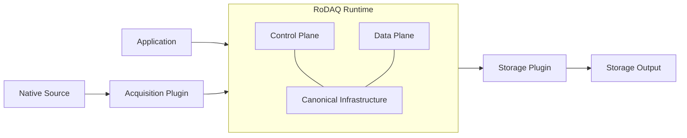
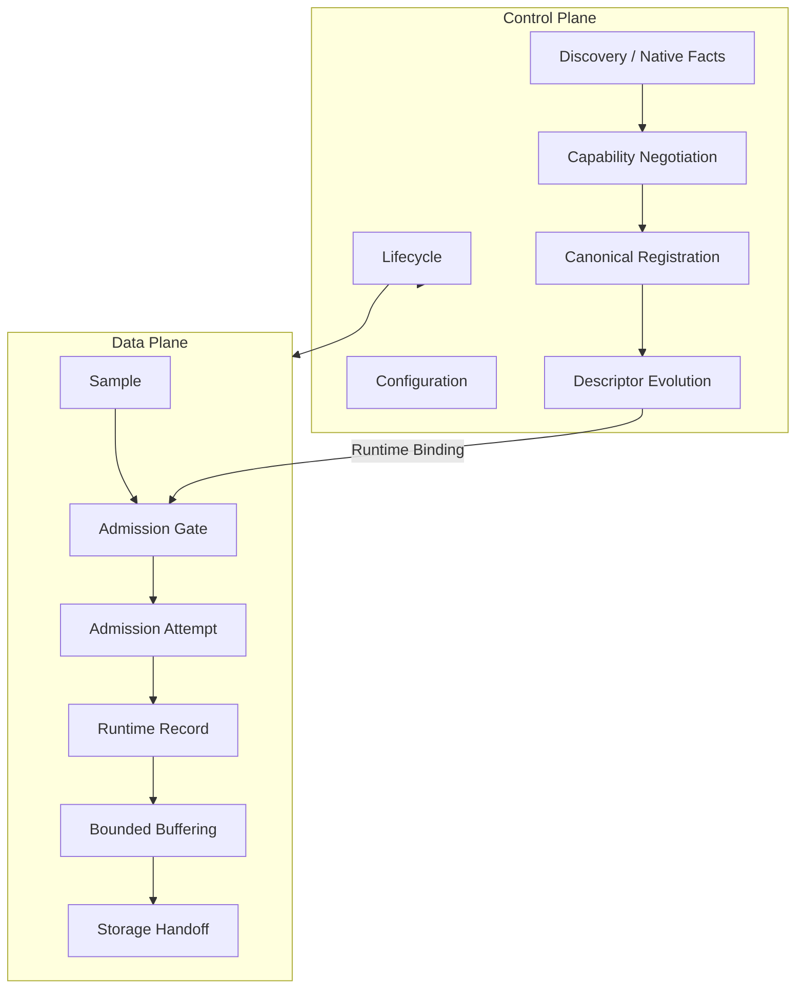
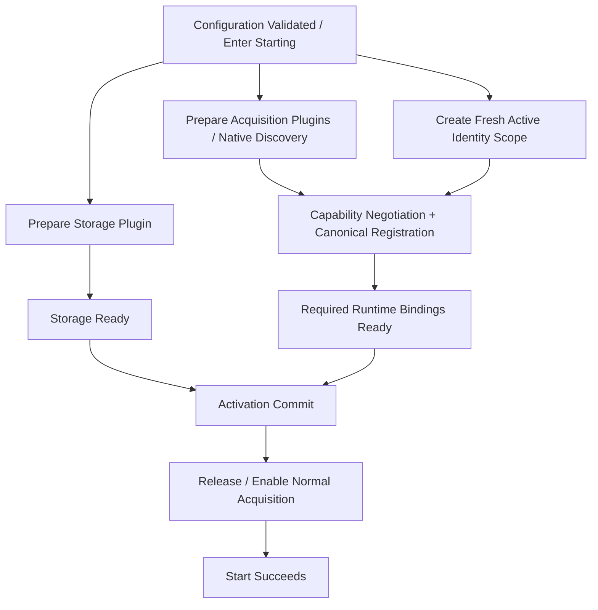
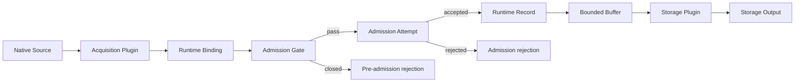
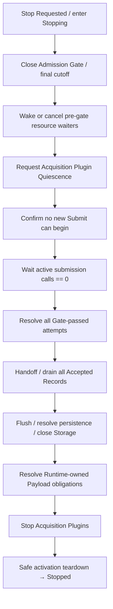
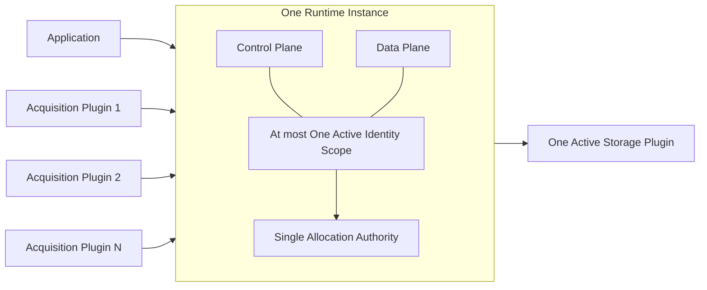

# RoDAQ System Architecture Design Specification

**Version:** v0.5
**Status:** Design Specification  
**Scope:** Plugin-independent System Architecture  

**Normative Dependencies:**

- RoDAQ Canonical Data Model Design Specification v0.9
- RoDAQ V1 Canonical Profile v0.5

---

# 1. 系统目标与架构边界

## 1.1 系统目标

RoDAQ（Robot Data Acquisition）用于从异构数据源持续采集数据，并通过统一的数据语义、运行时管理和存储接口，将数据可靠地持久化到不同 Storage Backend。

RoDAQ 的核心数据路径为：

```text
Native Source
    ↓
Acquisition Plugin
    ↓
RoDAQ Runtime
    ↓
Storage Plugin
    ↓
Persistent Output
```

系统必须在不依赖具体 Middleware 或 Storage Backend 的前提下建立统一的数据采集架构，使：

```text
ROS2
DDS
SocketCAN
...
```

可以作为 Acquisition Plugin 接入，同时使：

```text
MCAP
SQLite3
...
```

其中当前 V1 design/mapping validation scope 只包括：

```text
Acquisition: ROS2 / DDS (Fast DDS baseline)
Storage: MCAP / SQLite3
```

首个 functional implementation 只实现 `ROS2 Acquisition + MCAP Storage`。SocketCAN 等其它 backend 属于后续扩展，不参与当前 V1 Profile freeze gate。

可以作为 Storage Plugin 接入。

所有具体 Plugin 必须服从统一的 Runtime、Canonical State、Lifecycle、Ownership 和 Failure Contract，不允许具体 Middleware 或 Storage Backend 的实现模型反向决定 RoDAQ Core 的系统结构。

RoDAQ 的系统目标包括：

- 建立插件无关的数据采集和持久化架构；
- 保持 Acquisition 与 Storage 解耦；
- 由 Runtime 统一管理 Canonical identity 和 Descriptor Graph；
- 为高频数据路径提供可预测、可约束的资源模型；
- 明确 Control Plane 与 Data Plane 的职责边界；
- 明确数据从 source ingress 到 persistent output 的生命周期；
- 保证 Descriptor、Record、Payload 和 Storage Output 的生命周期关系正确；
- 在正常运行、资源不足、Plugin failure 和 Storage failure 下保持确定的系统行为；
- 在不牺牲 Canonical correctness 的前提下允许后续进行高性能 Runtime 实现。

---

## 1.2 架构范围

本文定义 RoDAQ 的插件无关系统架构，包括：

```text
Application
Runtime
Acquisition Plugin
Storage Plugin
Storage Output / Artifact
```

以及这些组件之间的：

```text
responsibility
dependency
lifecycle
ownership
control flow
data flow
failure boundary
```

本文同时定义：

- Runtime 的系统级职责；
- Control Plane 与 Data Plane；
- Canonical Infrastructure 的归属；
- Runtime Binding 的架构定位；
- Admission Gate；
- Descriptor-before-Record；
- Runtime activation；
- steady-state Record path；
- Descriptor evolution；
- stop / quiesce / drain / close；
- Payload lifetime 的系统边界；
- Storage completion 的不同阶段；
- V1 Runtime topology；
- Failure 和 Backpressure 的系统级处理原则。

---

## 1.3 不属于本文的设计内容

本文不定义以下实现细节：

```text
C++ public API
C++ class hierarchy
C ABI
Plugin ABI
dynamic loading mechanism
shared-library boundary

allocator
executor
thread count
lock model
queue implementation
queue capacity

RuntimeRecord physical layout
SourceHandle physical type
DescriptorHandle physical type
RoleHandle physical type
Timestamp slot physical representation

PayloadLease physical type
BorrowedInput / Copy / Adopt / Retain API
inline payload threshold
scatter/gather implementation

backpressure algorithm
drop policy implementation
batch size

MCAP physical format
SQLite3 schema
Artifact directory layout
recovery journal
fsync policy
crash recovery algorithm

CLI
HTTP / SSE
network server
configuration serialization
logging framework
metrics backend
```

这些内容由后续 Runtime、Payload、Admission、Plugin、Storage 或 Persistence 设计负责。

本文也不重新定义：

```text
Stream
Source
SourceId
Schema
Clock
TimestampKeySet
TimestampStateMap
AcceptanceSequence
Canonical Payload
Descriptor equality
Canonical round-trip
Identity Scope semantics
```

这些语义由 RoDAQ Canonical Data Model 和 V1 Canonical Profile 定义。

---

## 1.4 架构原则

### 1.4.1 Runtime 是 Acquisition 与 Storage 的唯一系统级中介

Acquisition Plugin 与 Storage Plugin 不得直接耦合。

系统关系必须保持：

```text
Acquisition Plugin
        ↓
      Runtime
        ↓
Storage Plugin
```

因此不允许形成：

```text
ROS2 Plugin
    ↓
MCAP-specific API
```

或：

```text
DDS Plugin
    ↓
SQLite transaction
```

这样的跨 Plugin 依赖。

Runtime 负责把 Acquisition 侧提供的 source-native facts 和 samples 建立为统一 Runtime / Canonical representation，再交给 Storage Plugin。

---

### 1.4.2 Canonical Model 是数据语义权威

Runtime 和 Plugin 不得重新定义 Canonical semantics。

例如：

```text
Stream
Source
Descriptor
TimestampKey
AcceptanceSequence
Payload
```

的含义只能来自 Canonical Model。

Runtime 可以把 Canonical State 编译为高效运行时表示，例如：

```text
SourceId
    ↓
SourceHandle

StreamDescriptor
    ↓
DescriptorHandle

TimestampKeySet
    ↓
compiled timestamp slots
```

但：

> Runtime representation 只能优化表示方式，不能改变 Canonical semantics。

---

### 1.4.3 Control Plane 与 Data Plane 分离

RoDAQ 将低频结构性操作与高频 Record path 分离。

Control Plane 负责：

```text
configuration
Plugin lifecycle
native discovery
capability negotiation
Canonical registration
Descriptor construction
Descriptor evolution
Storage preparation
start / stop coordination
```

Data Plane 负责：

```text
sample ingress
Admission Gate
admission attempt
AcceptanceSequence
rodaq/acquisition_ingress
Runtime Record
bounded buffering
Storage handoff
Payload completion
```

能够在 Control Plane 完成的工作，不应在每条 Record 的 Data Plane 中重复执行。

特别是 steady-state path 不应反复：

```text
解析 Schema
解析 Role 字符串
创建 Descriptor
规范化 native identity
推断 Clock semantics
决定 Storage physical representation
```

---

### 1.4.4 Source-specific knowledge 归 Acquisition Plugin

Acquisition Plugin 负责解释只有对应 source 才能正确理解的事实，包括：

```text
native stream identity
native Source identity
native Schema
native timestamp semantics
native Clock semantics
counter wrap
Clock restart
native Payload representation
```

Runtime 不得包含：

```text
DDS GUID interpretation
ROS2 GID interpretation
SocketCAN flag interpretation
vendor clock rules
device counter modulus
```

等 source-specific knowledge。

---

### 1.4.5 Storage-specific knowledge 归 Storage Plugin

Runtime 不得依赖：

```text
MCAP Channel
MCAP Chunk
SQLite row
SQLite transaction
```

等 backend-specific physical representation。

Storage Plugin 负责：

```text
Runtime / Canonical State
        ↓
Storage Projection
        ↓
Backend Representation
```

Backend limitation 不得反向改变 Canonical semantics。

---

### 1.4.6 Data Plane 必须使用有界资源

RoDAQ 是持续运行系统。

Runtime 不得依赖：

> 无限增长的 queue、Payload retention 或 in-flight work

维持系统正确性。

Data Plane 必须具有明确资源边界。

资源不足必须通过：

```text
admission
backpressure
rejection
failure
```

处理。

不得通过无界内存增长隐藏 overload。

---

### 1.4.7 Canonical correctness 优先于继续运行

系统不得为了保持 Running 状态而：

```text
暴露 unresolved Record
引用不存在的 Descriptor
复用 Canonical ID
伪造 SourceId
截断 TimestampKeySet
修改 Payload semantics
静默降低 Storage fidelity
```

如果无法继续满足已声明的 contract：

> Runtime 必须拒绝新的工作，或者进入明确的 Stopping / Failed lifecycle。

---

### 1.4.8 设计责任与实现对象分离

本文中的：

```text
Control Plane
Canonical Registration
Admission
Dispatch
Storage Coordination
```

表示系统职责。

它们不要求实现中分别存在：

```text
ControlPlane
CanonicalRegistryManager
AdmissionManager
DispatchManager
StorageCoordinator
```

等对象。

实现应根据实际需要保持简洁。

但实现上的简洁不能消除设计责任边界。

---

### 1.4.9 Normative Authority Boundaries

RoDAQ V1 使用分层的规范权威关系，避免多个文档重复定义同一语义后发生 drift。

| 文档 | Normative authority |
|---|---|
| Canonical Data Model | Canonical State 与 Canonical semantic authority |
| V1 Canonical Profile | V1 capability subset、value domain 与 cardinality authority |
| System Architecture | system topology、responsibility、dependency 与 lifecycle phase authority |
| Runtime | Runtime state、coordination、handle、Binding、dispatch/completion integration authority |
| Payload | Payload ownership、lifetime、release 与 access authority |
| Admission | Gate、resource reservation、AcceptanceSequence、accept/reject linearization authority |
| Acquisition Plugin | source-side discovery、normalization、quiescence、source lifecycle authority |
| Storage Plugin | descriptor readiness、handoff、persistence、finalization authority |

下游文档可以重复描述端到端流程以保持可读性，但重复内容必须：

> **服从上表中对应 authority，不得建立与 authority 文档不同的第二套 normative semantics。**

如果出现冲突：

1. 先检查是否只是下游文档 stale；
2. 如果确实需要改变上游 contract，必须显式修改上游 authority；
3. 不允许实现自行选择“更方便的一份文档”。

---

## 1.5 术语

### Application

Application 是创建、配置和控制 RoDAQ Runtime 的调用方。

可能形式包括：

```text
robot application
daemon
CLI
test harness
library consumer
```

Application 的具体形态不属于本文。

---

### Runtime

Runtime 是具有独立生命周期、Canonical Infrastructure、active Identity Scope ownership 和 Data Plane execution responsibility 的 RoDAQ 运行实例。

本文中：

```text
Core / Runtime
```

统一称为：

> **Runtime**

不额外定义独立的 Core 组件。

---

### Acquisition Plugin

Acquisition Plugin 是：

> 将某类 native data source 接入通用 RoDAQ Runtime 的架构扩展边界。

Plugin 是架构角色，不意味着必须使用动态库。

V1 不在系统架构层规定：

```text
dlopen
shared object
stable ABI
runtime discovery
```

---

### Storage Plugin

Storage Plugin 是：

> 将 Runtime 提供的数据投影并持久化到具体 Storage Backend 的架构扩展边界。

Storage Plugin 同样不自动等于 dynamic plugin。

---

### Runtime Binding

Runtime Binding 是：

> Control Plane 在 capability negotiation 和 Canonical registration 完成后，为 Data Plane 建立的当前有效运行时关系。

Runtime Binding 可以隐含：

```text
StreamDescriptor
DescriptorHandle
SourceHandle mapping
timestamp slot mapping
PayloadEncoding contract
capability configuration
```

其作用是将：

```text
Canonical / Plugin facts
```

预编译为：

```text
Data Plane 可直接使用的紧凑关系
```

Runtime Binding：

- 不是 Canonical object；
- 不属于 persisted Canonical State；
- 不要求存在公开的 `RuntimeBinding` C++ 类型；
- 不冻结内存布局；
- 不冻结 ownership implementation。

---

### Admission Gate

Admission Gate 是：

> submission 进入 admission-attempt domain 之前的 Runtime lifecycle / resource boundary。

如果 Admission Gate closed：

```text
submission
    ↓
pre-admission rejection / block
    ↓
no admission attempt
    ↓
no AcceptanceSequence
```

如果 submission 成功通过 Admission Gate：

```text
submission
    ↓
admission attempt exists
    ↓
Canonical admission semantics apply
```

Admission Gate 不是 Canonical object，也不要求实现一个独立 Gate class。

---

### Storage Output / Artifact

Storage Output / Artifact 是：

> Storage Plugin 在一个 active write lifecycle 中产生的持久化输出。

它可以是：

```text
single file
directory
file set
database
```

Artifact：

- 不是 Canonical object；
- 不自动定义 Identity Scope；
- 不冻结 ArtifactId；
- 不冻结 Artifact 与 Scope 的 cardinality。

---

# 2. 系统组成与职责

## 2.1 系统结构



RoDAQ 的基本依赖方向为：

```text
Application
    ↓
Runtime

Native Source
    ↓
Acquisition Plugin
    ↓
Runtime
    ↓
Storage Plugin
    ↓
Storage Output
```

---

## 2.2 Application

Application 负责：

```text
Runtime configuration
Acquisition Plugin selection
Storage Plugin selection
Plugin-specific configuration
Runtime activation
Runtime stop request
state / failure observation
final Storage Output result
```

V1 中：

> Acquisition Plugin instance 集合和唯一的 Storage Plugin instance 都必须在 Runtime 进入 Running 前确定。

Running 状态下不支持：

```text
Acquisition Plugin hot-add
Acquisition Plugin hot-remove
Acquisition Plugin replacement

Storage Plugin replacement
Storage Plugin hot-switch
```

如需改变 Plugin instance topology：

```text
Running
    ↓
stop
    ↓
reconfigure
    ↓
new activation
```

Application 不负责：

```text
Canonical ID allocation
Descriptor construction
AcceptanceSequence allocation
SourceId normalization
Record dispatch
Payload ownership handoff
Descriptor-before-Record synchronization
```

---

## 2.3 Runtime

Runtime 是系统核心。

Runtime 负责以下系统级职责。

### Lifecycle Coordination

Runtime 统一协调：

```text
configuration
activation
Running
Stopping
drain
Storage flush
Storage close
failure transition
```

所有会改变：

```text
是否允许新 Record 被 accepted
是否允许 Plugin 继续 submit
是否允许 Storage 继续 write
```

的 lifecycle transition，都必须由 Runtime 统一控制。

---

### Canonical Infrastructure

Runtime 拥有：

```text
active Identity Scope
Canonical identity allocation authority
Descriptor registries
Stream canonical state
Source registration / interning
Schema canonical state
Clock canonical state
TimestampKeySet canonical state
Descriptor evolution state
```

Runtime 负责：

```text
StreamId
StreamDescriptorId
SchemaId
ClockId
TimestampKeySetId
```

等 Canonical IDs 的分配。

SourceId 的 source-specific canonicalization 由 Acquisition Plugin / Contract 负责。

---

### Control Plane Coordination

Runtime 接受 Acquisition Plugin 提供的：

```text
native facts
capabilities
fact changes
Schema changes
Clock changes
restart / reset events
```

并建立：

```text
Canonical State
        +
Runtime Binding
```

---

### Data Plane Coordination

Runtime 负责：

```text
sample ingress
Admission Gate
admission attempt
AcceptanceSequence
rodaq/acquisition_ingress
Runtime Record
bounded buffering
Storage dispatch
completion coordination
```

---

### Storage Coordination

Runtime 必须保证：

```text
Descriptor visible before dependent Record
no Record written after Storage close
Payload valid until Storage consumption completion
flush / close coordinated with Runtime shutdown
Storage failure propagated into Runtime lifecycle
```

Runtime 不负责 backend-specific encoding。

---

## 2.4 Acquisition Plugin

Acquisition Plugin 负责：

```text
native Source lifecycle
native stream discovery
native Source discovery
native identity interpretation
SourceId canonicalization
Schema extraction
Clock interpretation
timestamp interpretation
counter wrap / reset handling
native Payload acquisition
capability declaration
native fact change notification
```

Acquisition Plugin 不负责：

```text
Canonical ID allocation
Descriptor registry
AcceptanceSequence
Storage Projection
Storage writing
```

steady-state sample 必须通过已建立的 Runtime Binding 提交。

---

## 2.5 Storage Plugin

Storage Plugin 负责：

```text
backend initialization
Storage Projection
Descriptor persistence
Record persistence
batching
flush
close / finalization
backend failure reporting
```

Storage Plugin 不得改变：

```text
Canonical ID
AcceptanceSequence
SourceId bytes
Timestamp semantics
Schema bytes
Payload logical bytes
unknown valid RoleIdentifier
```

如果 backend 无法满足 full-fidelity contract：

> 必须显式失败。

---

## 2.6 Storage Output / Artifact

Storage Output 是 Storage Plugin 的持久化结果。

active write lifecycle 中：

> backend resource 由 Storage Plugin 管理。

正常 close 成功后：

> Storage Output 成为独立于 Runtime 内存生命周期的持久化 Artifact。

本文不规定：

```text
single file / directory
segmentation
Manifest
ArtifactId
Artifact ↔ Scope cardinality
```

---

## 2.7 依赖规则

Acquisition Plugin 不得依赖具体 Storage Plugin。

Storage Plugin 不得依赖具体 Acquisition Plugin。

Runtime 通用边界不得使用：

```text
rclcpp::SerializedMessage
DDS SampleInfo
can_frame
MCAP ChannelId
SQLite rowid
```

等 source/backend-specific 类型作为通用数据模型。

所有跨 Plugin 数据必须先进入：

> plugin-neutral Runtime / Canonical contract。

---

# 3. Runtime Control Plane 与 Data Plane

## 3.1 总体划分



---

## 3.2 Control Plane

Control Plane 负责改变系统结构或解释关系的操作。

包括：

```text
configuration
Plugin attachment
native discovery
capability negotiation
Canonical registration
Descriptor construction
Descriptor evolution
Storage preparation
lifecycle transition
```

Control Plane 可以执行较重的：

```text
string processing
registry lookup
allocation
Descriptor dedup
Schema handling
validation
```

这些工作不得无必要地进入 steady-state Data Plane。

---

## 3.3 Runtime Binding

Acquisition Plugin 提供：

```text
source-native facts
+
capabilities
```

Runtime 根据：

```text
Canonical Model
V1 Canonical Profile
Runtime limits
Acquisition Plugin Contract
```

完成：

```text
capability negotiation
        ↓
Canonical registration
        ↓
Runtime Binding
```

Runtime Binding 用于把已经确定的：

```text
Stream
Source
Descriptor
Timestamp mapping
PayloadEncoding
```

转换为 Data Plane 可直接使用的状态。

steady-state Record 不应重新执行这些解释过程。

---

## 3.4 Admission Gate 与 Admission Domain

Admission Gate 位于：

```text
Runtime Binding
    ↓
Admission Gate
    ↓
Admission Attempt
```

本文冻结：

> **submission 成功通过 Admission Gate 的时刻，即该 submission 进入 admission-attempt domain 的逻辑判定点。**

Gate pass 之前：

```text
no admission attempt
no AcceptanceSequence
no accepted count
```

Gate pass 之后：

```text
admission attempt exists
Canonical admission semantics apply
```

具体 sequence allocation 可以在物理实现上发生在 gate pass 之后。

但 gate pass 一旦完成：

> Runtime 不得因为后续 lifecycle transition 而把该 attempt 重新解释成“从未进入 admission domain”。

---

## 3.5 Runtime Record

Runtime Record 是：

> Runtime Data Plane 中承载 accepted Canonical Record 语义的高频运行时表示。

Runtime Record：

- 不是新的 Canonical primitive；
- 不属于 persisted Canonical State；
- 不冻结具体字段布局；
- 不冻结具体 C++ 类型。

其详细设计属于 `runtime.md`。

---

## 3.6 Descriptor-before-Record

任何 dependent Record 在进入 Storage path 前：

> required Descriptor 必须已经可解析。

系统顺序为：

```text
Canonical registration
        ↓
Descriptor visible
        ↓
dependent Record visible
```

禁止：

```text
Record first
    ↓
unresolved Descriptor
    ↓
later repair
```

具体同步方式属于 Runtime / Storage Contract。

---

## 3.7 Operational State 与 Canonical State

以下状态默认属于 operational state：

```text
queue depth
drop count
latency
throughput
Plugin health
Storage health
diagnostic message
```

它们不得自动成为 Record metadata。

如果需要把某项 operational observation 长期保存，应把它建模为独立的数据 Source / Stream。

例如 Storage write latency 应通过：

```text
diagnostic Source
    ↓
diagnostic Stream
    ↓
normal admission
    ↓
Canonical Record
```

进入系统，而不是修改现有 Record。

---

# 4. 端到端运行流程

## 4.1 Runtime Activation

Runtime activation 发生在明确的：

```text
Configured
    ↓
Starting
```

阶段。每次进入 `Starting`：

> **V1 必须建立新的 logical Identity Scope。**

Runtime activation 的依赖关系为：



该图表示依赖关系，不要求 Scope establishment、Storage prepare 和 Acquisition prepare 严格串行。

Runtime configuration 完成后：

```text
Identity Scope establishment
Storage preparation
Acquisition Plugin preparation / native discovery
```

可以根据实现并行或交错进行。

其中：

### Storage Preparation

Storage preparation 本身不依赖 active Identity Scope。

例如：

```text
open destination
validate backend configuration
allocate backend resources
initialize writer
```

可以在 Scope 建立之前或与 Scope 建立并行进行。

### Acquisition Preparation / Discovery

Acquisition preparation 和 source-native discovery 本身也不依赖 active Identity Scope。

例如：

```text
connect middleware
discover Topic
discover native Source
read source capabilities
obtain Schema facts
```

可以在 Scope 建立之前或并行进行。

### Canonical Registration

真正依赖 active Identity Scope 的是：

> **Canonical registration**

因为：

```text
StreamId
SchemaId
ClockId
TimestampKeySetId
StreamDescriptorId
```

等 canonical identities 必须在 active Scope 中建立。

因此强依赖关系是：

```text
native facts ready
+
active Identity Scope ready
        ↓
Canonical registration
```

而不是：

```text
Identity Scope
    ↓
Storage preparation
```

或：

```text
Identity Scope
    ↓
native discovery
```

同时：

> Canonical registration 与 Storage ready 之间不存在硬性先后关系。

真正决定 Data Plane 是否能够开放的是：

```text
Storage ready
+
required Runtime Binding ready
+
all activation prerequisites satisfied
        ↓
Activation Commit
```

### Activation Commit

V1 必须存在一个唯一的 logical Activation Commit boundary。

该 boundary 保证：

```text
normal Plugin callback may call Runtime::Submit
    ⇒
Runtime is logically Running
AND
Global Admission Gate is Open
```

因此 normal acquisition routing：

> **不得在 Runtime 仍逻辑处于 Starting 时提前对 Plugin 可见。**

一个实现可以在 Activation Commit 内先发布：

```text
Runtime logical state = Running
Gate = Open
```

再释放 Plugin 的 normal submission permission；也可以使用等价的 barrier / generation publication。

本文不冻结 CPU-level 原子实现，但禁止出现：

```text
Plugin Enabled and able to Submit
+
Runtime still rejects because state == Starting
```

的正常可观察窗口。

`Start()` 只有在 required Acquisition Plugins 已完成 enable/release，并且 activation commit 已成功后才返回 success。

### Activation Abort

如果 `Starting` 中发生：

```text
Stop request
required Plugin preparation failure
required Descriptor / Binding failure
Storage preparation failure
activation prerequisite failure
```

且 Activation Commit 尚未成功，Runtime 必须执行 activation-abort path。

Activation abort 至少保证：

```text
Admission Gate remains Closed
no normal Plugin Submit becomes eligible
settle / cancel pending control operations
stop every successfully prepared Acquisition Plugin
abort / close incomplete Storage output without NormalComplete publication
safely release activation-local Scope / registries / handles
```

如果上述 cleanup 全部安全完成：

> Runtime 可以结束为非运行状态，并由 Runtime Contract 决定返回 `Stopped` 或可重新配置状态。

如果 cleanup 本身无法安全完成或 contract progress failure：

> Runtime terminal disposition 必须为 `Failed`。

Activation abort 不能把一个尚未成功 activation 的空/部分 Artifact 标记为正常完成的 conformant Artifact。

---

### Storage Ready 之前

Storage Plugin 未 ready 时：

```text
Admission Gate = closed
```

此时到达的 submission：

> 不属于 admission attempt。

因此不得：

```text
allocate AcceptanceSequence
create accepted Record
increase accepted count
capture canonical acquisition_ingress for accepted Record
buffer accepted Record waiting for Storage
```

具体行为可以是：

```text
block
return lifecycle error
Plugin refrains from submission
```

但不得被伪装成正常 admission rejection。

---

## 4.2 Stream 与 Capability 建立

新 native Stream 的建立过程为：

```text
native Stream discovered
        ↓
identity evidence
        ↓
Schema / PayloadEncoding / Clock / Timestamp capabilities
        ↓
V1 Profile validation
        ↓
Canonical ID allocation
        ↓
Descriptor Graph registration
        ↓
Runtime Binding
```

如果新 configuration registration 失败：

- 已存在 Descriptor 不得修改；
- 新 semantics 不得使用旧 Descriptor；
- 未成功建立的 configuration 不得进入 Data Plane。

---

## 4.3 Steady-state Record Path



必须区分：

```text
Pre-admission rejection
```

和：

```text
Admission rejection
```

前者没有进入 admission domain，因此不消耗 AcceptanceSequence。

后者已经进入 admission domain，因此按照 Canonical admission-attempt semantics 处理。

---

## 4.4 Descriptor Evolution

当以下 source-native facts 发生变化：

```text
Schema
PayloadEncoding
Clock identity
Clock restart
Timestamp capability
StreamName
```

Acquisition Plugin 必须通知 Control Plane。

正确演化关系：

```text
old Runtime Binding
        ↓
fact change
        ↓
new Canonical validation
        ↓
new Descriptor
        ↓
Descriptor visible
        ↓
new Runtime Binding
        ↓
future Records
```

旧 Record 永远保持旧 Descriptor identity。

不能修改 immutable Descriptor。

不能让新 semantics 继续挂在旧 Descriptor 上。

---

## 4.5 Normal Stop

正常停止必须建立唯一的：

> **final admission cutoff**

并同时收敛两种不同的 Runtime activity：

```text
active submission call
    = 已进入 Runtime::Submit、但可能尚未 Gate-pass 的 API execution lifetime

admission in-flight attempt
    = 已 Gate-pass、尚未达到 terminal admission outcome 的 Canonical attempt lifetime
```

二者不得混为一个 counter/barrier。

V1 正常停止的逻辑顺序为：



具体步骤可以在不破坏依赖关系的前提下并行，但以下 barrier 必须成立。

### Post-cutoff Submission

如果 submission 在 cutoff 前没有成功通过 Admission Gate：

```text
cutoff
    ↓
Gate closed
    ↓
submission remains outside admission domain
    ↓
PreAdmissionRejected / lifecycle termination
    ↓
no AcceptanceSequence
```

已经进入 `Runtime::Submit` 的 pre-gate call 仍必须安全返回；因此仅等待 `admission_in_flight == 0` 不足以允许 teardown。

### Pre-cutoff Gate-passed Attempt

如果 submission 已经在 cutoff 前 Gate-pass：

```text
Gate pass
    ↓
admission attempt exists
    ↓
cutoff happens
```

则必须服从 `admission.md` 的 terminalization semantics。

在 V1 healthy Admission commit path 中：

> **Gate-passed attempt MUST complete Accepted。**

不得因为 normal Stop、ordinary queue pressure、Payload pressure 或 Storage backpressure 把 healthy Gate-passed attempt force-reject。

只有 Admission / Runtime commit path 自身已经不可信时，才允许：

```text
AdmissionRejected
+
Runtime failure disposition
```

无论结果如何，已经分配的 AcceptanceSequence 均不 rollback / reuse。

### Acquisition Plugin Stop

Plugin quiescence 与 Plugin Stop 是两个不同阶段：

```text
Quiesce
    → no future normal Submit can begin

Stop
    → close / release native acquisition resources
```

Normal Stop 必须最终调用并等待每个 required Acquisition Plugin 达到 `Stopped` 或等价 terminal state。

Plugin Stop 必须具有 bounded progress / failure semantics。

如果 Plugin Stop failure / timeout 使 Runtime 无法证明 safe shutdown：

> normal Stop 必须升级为 `Failed`。

Runtime 在停止 Plugin native resources 前，必须确保不会因此使仍由 Runtime 持有的 Payload anchor / release capability 失效；具体 anchor-stop safety 由 Payload 与 Acquisition Plugin Contract 定义。

---

## 4.6 Runtime Reuse

Runtime instance 可以经历：

```text
activation
    ↓
stop
    ↓
new activation
```

V1 中每次新 activation：

> **必须使用新的 logical Identity Scope。**

因此：

```text
Scope A
    ↓
stop

Scope B
```

则 Scope A 中的：

```text
StreamId
SchemaId
ClockId
DescriptorId
```

不能因为 Runtime instance 相同，就直接作为 Scope B 的 identity 使用。

跨 Scope identity transfer 必须符合 Cross-scope Import semantics。

V1 当前不支持 generic Cross-scope Import。

因此 V1 不提供：

```text
activation A Scope
    ↓ reuse
activation B
```

的 identity continuity。

---

# 5. Lifecycle 与 Ownership

## 5.1 Runtime Lifecycle

系统级生命周期阶段为：

```text
Constructed
    ↓
Configured
    ↓
Starting
    ↓
Running
    ↓
Stopping
    ↓
Stopped
```

异常可以进入：

```text
Failed
```

这些是架构阶段，不要求实现存在完全相同的 enum。

---

## 5.2 Runtime Ownership

active lifecycle 内 Runtime 对以下状态承担 lifecycle authority：

```text
Identity Scope
Canonical allocator
Canonical registries
Stream runtime state
Descriptor state
AcceptanceSequence state
Plugin attachment state
Data Plane resources
Storage coordination state
```

“负责拥有”表示 correctness responsibility，不限定 C++ ownership primitive。

---

## 5.3 Acquisition Plugin Ownership

Acquisition Plugin 管理：

```text
middleware subscription
reader
socket
device handle
native callback
native discovery state
source-specific normalization state
```

Runtime 不直接操作这些 native resources。

---

## 5.4 Storage Plugin Ownership

Storage Plugin 管理：

```text
backend writer
database connection
transaction / batch state
compression state
backend cache
physical output handle
```

Runtime 只通过 Storage Contract 操作：

```text
Descriptor
Record
flush
close
failure
completion
```

---

## 5.5 Payload Ownership

Canonical Payload 是：

> immutable logical bytes。

系统进一步要求：

> accepted Record 的 Payload 在所有 contract-defined consumers 完成消费之前必须保持有效。

submission 之前：

> native Payload ownership 属于 Acquisition Plugin / native API。

进入 Runtime 后：

> Payload Ownership Contract 决定 Runtime 如何维持 lifetime。

V1 ownership ingress 由 Payload Contract 冻结为：

```text
BorrowedInput used only for synchronous Copy
Copy
Adopt
Retain
```

raw borrow 不得跨越 synchronous input lifetime。本文不冻结其具体 C++ API / anchor representation。

---

### Payload Consumption Completion

Storage Plugin 必须明确：

> 何时不再访问某个 Payload。

不能假设：

```text
write() returned
```

一定等于：

```text
Payload no longer referenced
```

因为 Storage 可以使用：

```text
async writer
batch queue
compression worker
background transaction
```

Storage Handoff 的访问边界由 Payload / Storage Contract 进一步冻结为：

```text
Handoff call entry
    → call-scoped read-only Payload access

HandoffAccepted
    → Storage record responsibility
    → asynchronous Payload Access Lease may begin

PayloadConsumed
    → all Storage access permanently ends
```

因此 `HandoffAccepted` 前的同步读取不等于 Storage 已取得异步 retention 权；而 Handoff timeout 也不能被 Runtime 直接解释为 no-future-access。

Storage Contract 必须定义明确的：

> **payload consumption completion**

例如：

```text
synchronous return
completion callback
completion token
batch completion
```

Runtime 只有在达到：

> **contract-defined payload consumption completion**

之后，才可以释放最后一个保证该 Payload 有效的 ownership anchor。

---

### 三种不同的 Completion

必须严格区分：

```text
Payload consumption completion
```

```text
Record persistence completion
```

```text
Crash durability completion
```

例如：

```text
Payload copied into Storage private buffer
    ↓
Payload consumption complete
    ↓
original Payload release
    ↓
backend write
    ↓
Record persistence success
```

而：

```text
Record persistence success
```

仍不一定表示：

```text
survives sudden power loss
```

---

## 5.6 Descriptor 与 Runtime Binding Lifecycle

Descriptor 是 immutable Canonical State。

因此 Descriptor lifetime 不等于当前 Runtime Binding lifetime。

例如：

```text
Descriptor A
    ↓
accepted Records still in queue

Stream switched to Descriptor B
```

此时 Descriptor A 仍然必须保持可解析。

Runtime Binding 可以被替换。

Descriptor identity 不因 Binding replacement 而失效。

具体管理机制：

```text
reference count
epoch
registry lifetime
handle generation
```

由 `runtime.md` 决定。

---

## 5.7 Storage Output Lifecycle

Storage Output lifecycle 为：

```text
prepare / open
    ↓
write
    ↓
flush
    ↓
finalize / close
```

---

### Normal Close Success

V1 conformant Storage 的 close success 表示：

> Storage Plugin 已完成正常 finalization。

同时必须保证：

> 对所有被 Storage Contract 确认成功持久化的 Canonical State，Artifact 是完整、可解码并满足 V1 full-fidelity round-trip 要求的正常关闭输出。

因此 close success 不能仅表示：

```text
writer stopped accepting writes
```

正常路径必须完成：

```text
pending persistence resolved
        ↓
final metadata / index completed
        ↓
Artifact structurally complete
        ↓
full-fidelity decode possible
        ↓
close success
```

---

### Close Failure

如果：

```text
flush
finalization
close
```

过程中出现无法完成正常 finalization 的错误：

> close 必须返回 failure。

close failure 时：

> 当前 Storage Output 不得被标记为完整 V1 conformant Artifact。

Runtime 必须把 finalization failure 显式报告给 Application。

Artifact 在物理上仍可能：

```text
partially exist
partially decode
contain valid Records
be backend-recoverable
```

Storage / Persistence Contract 可以进一步定义：

```text
partial
recoverable
incomplete
invalid
unknown
```

等状态。

但是：

> close failure 不能伪装成 complete Artifact。

---

### Per-Record Success 与 Artifact Success

需要区分：

```text
Record persistence result
```

与：

```text
Artifact finalization result
```

例如：

```text
Record A → persistence success
Record B → persistence success
Record C → pending
        ↓
close failure
```

A 和 B 的已经确认 persistence success 不会因为 close failure 自动被撤销。

但整个 Artifact：

> 不得被标记为完整 conformant Artifact。

Record C 如果没有获得明确 persistence success：

> 不得因为 backend 中可能已经存在部分 bytes 而被标记成功。

在 close failure 场景中：

> **未获得明确 persistence success 的 Record 按 §6.6 中 fatal Storage failure 的 B 类状态处理。**

其最终状态可以由 Storage Contract 定义为：

```text
failed
partial
unknown
not persisted
recoverable but unconfirmed
```

具体状态表示和错误类型属于 Storage Contract。

因此：

> close failure 与运行期 fatal Storage failure 对“未确认 persistence success 的 Record”使用同一基本语义：**uncertainty 不得提升为 success**。

---

### Normal Close 与 Crash Durability

必须区分：

```text
normal close completeness
```

和：

```text
crash durability
```

正常 close success 要求：

> 正常结束后 Artifact 完整可用。

crash durability 解决：

```text
process crash
power loss
kernel failure
unexpected termination
```

情况下能够恢复多少数据。

后者属于 Persistence / Recovery Contract。

---

# 6. Failure、Backpressure 与资源边界

## 6.1 Failure Domain

系统至少区分：

```text
configuration / capability failure
Acquisition Plugin / Source failure
Canonical registration failure
admission / resource exhaustion
Storage / backend failure
Runtime invariant failure
shutdown / finalization failure
```

不同 failure 对 Runtime lifecycle 的影响不同。

不得统一成模糊的：

```text
record failed
```

---

## 6.2 Configuration 与 Registration Failure

以下错误属于 Control Plane failure：

```text
invalid configuration
unsupported capability
TimestampKeySet capacity exceeded
invalid SourceId
Descriptor conflict
```

失败 operation 不得产生半注册 Canonical State。

如果已有合法旧 Descriptor：

> 新 registration failure 不得修改旧 Descriptor。

---

## 6.3 Admission 与 Resource Exhaustion

资源不足包括：

```text
buffer capacity exhausted
Payload retention exhausted
in-flight Record limit reached
Storage backlog limit reached
```

资源不足首先属于：

> admission / backpressure problem。

它不自动等价于 Runtime corruption。

必须区分：

```text
before Admission Gate
```

与：

```text
after Admission Gate
```

Gate pass 前发生：

```text
block / lifecycle reject / resource precheck
```

时：

> 没有 admission attempt。

Gate pass 后：

> Canonical admission-attempt semantics 已经生效。

具体 policy 属于 `admission.md`。

---

## 6.4 Storage Backpressure

Storage 吞吐低于 acquisition ingress 时：

> backpressure 必须通过 Runtime 统一传播。

禁止：

```text
Storage Plugin → directly pause Acquisition Plugin
```

正确控制关系为：

```text
Storage pressure
    ↓
Runtime
    ↓
Admission / optional source control
```

---

## 6.5 Acquisition Failure

Acquisition Plugin 或 Native Source failure：

> 不自动意味着整个 Runtime failure。

如果其他 Plugin、Runtime 和 Storage 仍然健康：

> Runtime 可以继续采集其他健康 Source。

### V1 默认行为

V1 中，当某个 Acquisition Plugin 进入无法继续可靠提交数据的 failed state 时：

> Runtime 默认将该 Plugin 管理的所有当前 Stream 标记为 operationally unavailable，并关闭这些 Stream 对应的新数据提交路径。

这些 Stream：

```text
must not accept new Records
```

直到：

```text
Plugin recovers according to an explicit Runtime / Acquisition Contract policy
```

或者：

```text
Runtime stops / reconfigures
```

不得在 Plugin failure 后继续使用已经失效或语义不再可靠的 Runtime Binding。

---

### Retry 与 Recovery

是否允许：

```text
retry native connection
restart reader
re-establish subscription
re-discover Source
recover existing Plugin instance
```

由：

```text
Runtime Contract
Acquisition Plugin Contract
Application policy
```

共同定义。

但是 V1 不把：

> transparent retry

作为默认保证。

即：

> Runtime 不能假定所有 Acquisition Plugin failure 都可以自动恢复。

同样，V1 不支持：

```text
Plugin A failed
    ↓
create new Plugin A2
    ↓
transparently replace A during same Running lifecycle
```

这种 Plugin instance replacement。

如果某个 existing Plugin instance 的 Contract 明确定义了内部可恢复状态机，可以在不改变 Plugin instance topology 的前提下恢复 native Source。

但：

> recovery 成功之前，对应 Stream 不得接受新的 Record。

---

## 6.6 Fatal Storage Failure

V1 对 fatal Storage failure 使用：

> **terminate semantics**

流程为：

```text
fatal Storage failure
        ↓
terminal disposition = Failure
        ↓
failure admission cutoff / Gate closed
        ↓
wake pre-gate submissions
        ↓
quiesce Acquisition Plugins
        ↓
active submission calls → 0
        ↓
terminalize Gate-passed attempts
        ↓
classify Runtime queued vs HandoffAccepted Records
        ↓
resolve Storage / Payload state as far as safely possible
        ↓
Plugin Stop / failure cleanup where safe
        ↓
Runtime → Failed
```

Runtime 不得保持：

```text
Running
+
Storage permanently failed
+
all future samples repeatedly rejected
```

这样的伪正常状态。

---

### Fatal Failure 后的 Record 状态

需要区分：

```text
A. persistence success already confirmed

B. Admission Accepted,
   but Runtime can prove HandoffAccepted never happened

C. HandoffAccepted by Storage,
   but persistence result unconfirmed

D. handoff responsibility boundary itself uncertain

E. not admitted
```

A：

> 已确认 persistence success，不因后续 fatal failure 自动撤销。

B：

> Storage responsibility 从未建立，Runtime 将其 persistence outcome 归类为 Failed；不得改写 Admission Accepted history。

C：

> Storage 已承担 record-specific responsibility，必须根据 Storage Contract 尽可能收敛为 Succeeded / Failed / Unknown；没有明确 success 时不得提升为 success。

D：

> 如果 Runtime 自身无法证明 `HandoffAccepted` 是否发生，使用保守 `PersistenceUnknown`。

E：

> failure cutoff 后不进入 admission domain。

Storage uncertainty 不得被报告为 persistence success。

---

## 6.7 Runtime Invariant Failure

以下情况属于 Runtime correctness failure：

```text
DescriptorId content conflict
invalid runtime handle
missing required Descriptor
Canonical ID collision
ownership corruption
```

Runtime 不得继续暴露可能错误的 Canonical State。

具体 fail-fast 策略属于 Runtime Contract。

---

## 6.8 Operational Error

Runtime / Plugin / Storage error 默认属于 operational state。

不得自动：

```text
append to Payload
inject generic metadata
alter Schema
```

如果需要长期保存：

> 应显式建模为 diagnostic Stream。

---

## 6.9 Terminal Disposition

Runtime 的 `Stopping` 是 cleanup / convergence phase，不等价于最终成功结果。

Runtime 必须 latch 本次 shutdown 的 terminal disposition：

```text
Normal Stop requested
    → Success disposition

Fatal Storage failure
Runtime invariant failure
policy-selected fatal Acquisition failure
activation/shutdown correctness failure
    → Failure disposition
```

最终状态必须满足：

```text
Success disposition
+ all shutdown barriers succeed
    → Stopped

Failure disposition
    → Failed
```

即使 failure cleanup、Storage close 或 Plugin cleanup 后续执行成功：

> **也不得把已经 latched 的 fatal failure 洗成正常 `Stopped`。**

如果原本是 Success disposition，但 shutdown / finalization / progress 过程中发生 fatal failure：

```text
Success → Failure
```

该升级不可逆。

---

# 7. V1 架构基线

## 7.1 V1 Runtime Topology



V1 规定：

```text
one Runtime instance
at most one active Identity Scope
one Canonical allocation authority

one or more Acquisition Plugin instances
one active acquisition path per Stream
one active Storage Plugin
```

---

## 7.2 Acquisition Plugin Topology

V1 不支持 Running 状态下：

```text
add Plugin instance
remove Plugin instance
replace Plugin instance
```

Plugin instance 集合在进入 Running 前确定。

同时，V1 对每个 Stream 只允许：

```text
one owning Acquisition Plugin
one active acquisition path
one current Runtime Binding
```

同一个 Stream 可以有多个 Source，但不允许多个 Plugin / path 同时向该 Stream 供数。Runtime 不做跨 Plugin native Stream 自动合并。

如需改变：

```text
stop
    ↓
reconfigure
    ↓
new activation
```

但是现有 Acquisition Plugin 可以动态：

```text
discover Stream
discover Source
observe Source loss
observe Schema evolution
observe Clock restart
```

因此：

```text
Plugin instance topology
```

是静态的，

而：

```text
native Source / Stream topology
```

可以动态变化。

---

## 7.3 Storage Topology

V1 同一 Runtime lifecycle 只使用：

> **one active Storage Plugin instance**

Storage Plugin instance 必须在进入 Running 前确定。

Running 状态下不支持：

```text
MCAP → SQLite3 hot switch
Storage Plugin replacement
second Storage Plugin attachment
```

V1 不支持：

```text
same Record
    ↓
MCAP + SQLite3 simultaneous fan-out
```

原因是 multi-sink 会引入：

```text
multi-sink Payload lifetime
per-sink completion
partial sink failure
per-sink backpressure
cross-sink consistency
```

这些能力不属于 V1 baseline。

---

## 7.4 Architecture Baseline

### System

```text
Application
    ↓
Runtime

Native Source
    ↓
Acquisition Plugin
    ↓
Runtime
    ↓
Storage Plugin
    ↓
Artifact
```

### Canonical Authority

```text
Runtime owns active Scope
Runtime owns Canonical allocator
Runtime owns Descriptor registration
Plugin supplies source-native facts
```

### Activation

```text
Storage preparation
Acquisition preparation / discovery
Identity Scope establishment

may overlap

Identity Scope
+
native facts
    ↓
Canonical registration

Storage ready
+
Runtime Binding ready
    ↓
Admission Gate open
```

### Control / Data

```text
Control Plane
    → discovery / negotiation / registration / lifecycle

Data Plane
    → ingress / admission / Record / dispatch
```

### Admission

```text
Gate not passed
    → no admission attempt
    → no sequence

Gate passed
    → admission attempt
    → Canonical admission semantics
```

### Descriptor

```text
Descriptor visible
    before
dependent Record visible
```

### Ownership

```text
Acquisition Plugin owns native resources
Runtime owns canonical/runtime coordination
Storage Plugin owns backend resources

Payload remains valid until
contract-defined payload consumption completion
```

其中：

```text
payload consumption completion
    !=
Record persistence completion
    !=
crash durability
```

### Normal Close

```text
close success
    → complete conformant Artifact

close failure
    → explicit failure
    → Artifact not marked complete conformant
```

close failure 时：

```text
unconfirmed Record persistence
    → B-class failure/unknown semantics
    → never promoted to success without evidence
```

### Acquisition Failure

```text
failed Plugin
    ↓
its Streams become operationally unavailable
    ↓
no new Record accepted for those Streams

retry / recovery
    → explicit policy
    → not a V1 default guarantee
```

### Storage Failure

```text
fatal Storage failure
    ↓
terminate normal Runtime operation
    ↓
failure admission cutoff
```

### V1 Topology

```text
one Runtime
one active Scope
one allocation authority

fixed Acquisition Plugin instance set
one fixed Storage Plugin instance

no Plugin hot-plug
no Storage hot-switch
no multi-Storage fan-out
```

---

## 7.5 下游设计文档

System Architecture 之下分别设计：

### `runtime.md`

定义：

```text
Runtime lifecycle
Canonical registries
ID allocation
runtime handles
Stream runtime state
Runtime Binding
RuntimeRecord
Descriptor handoff
Control/Data synchronization
thread-safety contract
```

### `payload.md`

定义：

```text
Payload ownership model
borrow / copy / adopt / retain
Payload lifetime
rejection cleanup
Storage consumption completion
inline / external Payload
scatter/gather
shutdown cleanup
```

### `admission.md`

定义：

```text
Admission Gate
admission-domain entry
AcceptanceSequence linearization
acquisition_ingress sampling
resource reservation
backpressure
queue-full behavior
rejection
accepted count
normal cutoff
failure cutoff
```

### `acquisition_plugin.md`

定义：

```text
Plugin lifecycle
source discovery
native facts
SourceId canonicalization
Schema / Clock / Timestamp capabilities
negotiation
Runtime Binding
steady-state submission
quiesce
failure
recovery policy boundary
```

### `storage_plugin.md`

定义：

```text
Storage lifecycle
ready boundary
Descriptor handoff
Record handoff
Payload completion
persistence completion
batching
flush
normal close
close failure
full-fidelity contract
```

### `acquisition_plugin/ros2.md`

定义 ROS2 V1 native-to-RoDAQ Mapping：

```text
Topic / type / schema
RMW serialized PayloadEncoding
publisher SourceId / SourceSequence
clock / timestamp capability
discovery / Binding evolution
ROS2 lifecycle / failure / quiescence
```

属于首个 functional implementation 的直接实现依据。

### `acquisition_plugin/dds.md`

定义 DDS V1 native-to-RoDAQ Mapping：

```text
Topic / type / XTypes
Writer Source identity / sequence
valid_data / lifecycle boundary
reader / writer timestamp capability
serialized DDS Payload
DDS discovery / failure / quiescence
```

属于 V1 design / mapping validation target；实现延后，但具体 Mapping 必须参与 Profile freeze。

### `storage_plugin/mcap.md`

定义 MCAP full-fidelity Storage projection：

```text
rodaq/v1 MCAP profile
native Payload Channel / Schema projection
DescriptorBatch Attachment
RecordMetadataBatch Attachment
Descriptor-before-Record
Handoff / PayloadConsumed
metadata-batch persistence completion
checked sink
NormalComplete finalization
```

属于首个 functional implementation 的直接实现依据。

### `storage_plugin/sqlite3.md`

定义 SQLite3 full-fidelity Storage projection：

```text
relational Descriptor graph
U64BE scalar representation
Record table / Timestamp presence
Payload binding lifetime
transaction persistence completion
Artifact state / finalization
```

属于 V1 design / mapping validation target；实现延后，但具体 Mapping 必须参与 Profile freeze。

### `persistence.md`

在以下问题证明形成独立设计边界时建立：

```text
Artifact model
crash durability
recovery
partial Artifact
manifest
lineage
common persistence extensions
```

---

## 7.6 具体 Plugin Mapping 的前置条件

当前 V1 的 ROS2、DDS（Fast DDS baseline）、MCAP、SQLite3 四份具体 Plugin 设计必须建立在插件无关 Contract 已经稳定之后；SocketCAN 等后续 backend 不参与当前 V1 freeze gate。

Contract 达到 Mapping-ready 至少要求：

```text
完整设计文档已形成
完成至少一轮完整 review
职责边界明确
lifecycle 明确
ownership 明确
success / failure boundary 明确
不存在已知结构性缺口
```

允许存在：

```text
implementation detail OPEN
performance parameter OPEN
需要 Mapping evidence 的 Profile parameter OPEN
```

但不允许：

> 先实现具体 Plugin，再反向定义通用 Contract。

具体 Plugin 设计与 Mapping 的作用是：

> 验证通用设计是否能表达真实 Middleware / Backend semantics。

如果 Mapping 发现问题，应依次检查：

```text
Plugin / Runtime Contract
        ↓
V1 Canonical Profile
        ↓
Canonical Data Model
```

只有证明 Canonical Model 本身表达能力不足时，才重新打开 Canonical Model。

---

## 7.7 Architecture 层不冻结的实现选择

System Architecture 不冻结：

```text
exact RuntimeState enum
C++ public API
Result type
Error code
RuntimeRecord physical layout

SourceHandle width
DescriptorHandle width
timestamp slot representation

queue implementation
queue capacity
lock-free / locked

thread model
executor

Payload refcount
inline Payload size

Storage batch size
transaction size
fsync strategy

dynamic Plugin loading
Plugin ABI

logging
metrics
configuration serialization
```

这些选择必须由对应下游设计根据系统约束决定。

---

# 8. 系统架构总结

RoDAQ V1 的插件无关系统架构为：

```text
Native Source
    ↓
Acquisition Plugin
    ↓
RoDAQ Runtime
    ├── Control Plane
    ├── Canonical Infrastructure
    ├── Admission Gate
    └── Data Plane
    ↓
Storage Plugin
    ↓
Persistent Artifact
```

Runtime 是整个系统的中心协调者。

Acquisition Plugin 只负责 source-specific knowledge。

Storage Plugin 只负责 backend-specific persistence。

Canonical identity、Descriptor Graph 和 Runtime data path 均由 Runtime 统一协调。

Control Plane 负责：

```text
discovery
capability
Canonical registration
Descriptor evolution
lifecycle
```

Data Plane 负责：

```text
sample
Admission Gate
admission attempt
Runtime Record
bounded buffering
Storage handoff
```

V1 使用：

```text
one Runtime
one active Identity Scope
one fresh Scope per activation
one Canonical allocation authority
multiple preconfigured Acquisition Plugins
one active acquisition path / owning Plugin / current Binding per Stream
one preconfigured active Storage Plugin
```

Storage preparation、Acquisition preparation/native discovery 和 Identity Scope establishment 不存在不必要的串行依赖。

真正需要 active Identity Scope 的阶段是 Canonical registration。

Storage ready、有效 Runtime Binding 和 activation-wide effective limits 是 Activation Commit 的前提。

Activation Commit 必须先建立 Runtime logically Running + Gate Open，再释放 Plugin normal Submit permission。

Admission Gate pass 是进入 admission-attempt domain 的逻辑边界。

Runtime 分别追踪 active Submit-call lifetime 与 Gate-passed Admission Attempt lifetime；二者都是 teardown 前必要 barrier。

normal stop 和 fatal Storage failure 均通过 admission cutoff 关闭新的 admission。Normal Stop 还必须最终完成 Acquisition Plugin Stop；fatal failure 一旦 latched，cleanup 成功也不能把最终状态降为 `Stopped`。

Plugin instance topology 在 Running 前确定。

Storage Plugin instance 同样在 Running 前确定，Running 状态不支持 Storage hot-switch。

native Stream / Source topology 可以在现有 Acquisition Plugin 内动态变化。

Acquisition Plugin failure 默认使该 Plugin 对应 Stream operationally unavailable；自动 retry/recovery 不是 V1 默认保证。

Payload 必须保持有效直到：

> **contract-defined payload consumption completion**

该边界不同于：

```text
Record persistence completion
Crash durability completion
```

正常 Storage close 成功必须产生完整 conformant Artifact。

close failure 必须显式报告，且对应 Output 不得被标记为完整 conformant Artifact。

close failure 和 fatal Storage failure 中，没有获得确定 persistence-success completion 的 Record 都不得被提升为成功状态。

System Architecture 只冻结系统责任、依赖关系和生命周期 invariant，不冻结具体 C++ 类型、线程模型、queue implementation、Payload representation 或 Plugin ABI。

Runtime、Payload、Admission、Acquisition Plugin 和 Storage Plugin 的详细契约分别由下游设计文档定义。