# RoDAQ Canonical Data Model Design Specification

**Version:** v0.9  
**Status:** Engineering Freeze Candidate  
**Scope:** Canonical Data Model  
**Project:** RoDAQ — Robot Data Acquisition

---

# 1. 目标、范围与设计原则

## 1.1 背景

RoDAQ 面向机器人与多传感器系统的数据采集。

它需要处理的数据来源可能包括：

```text
ROS 2
DDS
SocketCAN
camera SDK
IMU / LiDAR / radar
DAQ / ADC
audio
shared memory
Zenoh
eCAL
vendor-specific protocols
```

这些 Source 在数据模型上存在明显差异：

- 有些提供强类型 Schema；
- 有些只有 opaque binary；
- 有些提供多个时间戳；
- 有些只有本地接收时间；
- 有些数据来自单一 Publisher；
- 有些 Stream 同时存在多个实际 Source；
- 有些数据天然是一条 Message；
- 有些数据天然是一个 batch；
- 有些 Payload 已经序列化；
- 有些底层 Buffer 由 Middleware 或设备 SDK 持有；
- 有些 Source 的 Clock 连续稳定；
- 有些设备 Clock 可能发生 counter wrap、reset 或 power cycle；
- 有些协议拥有 Source-scoped sequence；
- 有些 Middleware 还存在 reader-side、transport-side 或 connection-local sequence；
- 有些 Source 能提供 sequence，却不能提供可靠且稳定的 Source identity；
- 有些 Source 完全没有可靠的 producer identity；
- 有些 Schema representation 只描述一个类型；
- 有些 Schema representation 可以同时描述多个类型。

与此同时，RoDAQ 需要允许同一套采集数据写入不同 Storage：

```text
MCAP
SQLite3
HDF5
Parquet
其他后续格式
```

这些 Storage 的物理数据模型完全不同。

MCAP 更接近：

```text
Schema
Channel
Message
Chunk
```

SQLite3 更接近：

```text
table
row
transaction
index
```

HDF5 和 Parquet 又分别偏向：

```text
dataset / chunk
```

和：

```text
column / row group / page
```

如果 RoDAQ 直接采用某个 Acquisition Middleware 或 Storage Format 的对象模型作为内部公共数据模型，后续扩展很容易退化为：

```text
ROS2-shaped Core
DDS-shaped Core
MCAP-shaped Core
```

随后其他 Plugin 被迫围绕这些早期选择进行适配。

因此 RoDAQ 需要一层独立的：

> **Canonical Data Model**

Canonical Data Model 只描述：

- 数据属于哪个逻辑流；
- 数据具体由谁产生；
- 数据如何唯一标识；
- 数据应该如何解释；
- 数据携带哪些 canonical 时间信息；
- 时间值来自哪个 Clock；
- Payload 是什么；
- Descriptor 之间如何引用；
- Opaque 数据如何保持 fidelity；
- 数据如何在 Storage round-trip 后保持不变；
- 跨 Identity Scope 导入时哪些 identity 可以重映射、哪些 canonical state 必须保持。

Canonical Data Model 定义的是：

> **最终有效 Canonical State 及其语义约束。**

它不是：

> Acquisition Plugin、Runtime 或 Storage Plugin 的 Construction API。

例如 Canonical Model 中存在：

```text
ClockDescriptor
TimestampKeySet
StreamDescriptor
```

并不意味着 Acquisition Plugin 必须直接调用：

```text
CreateClockDescriptor()
CreateTimestampKeySet()
CreateStreamDescriptor()
```

也不意味着 Plugin 必须自行：

```text
allocate DescriptorId
deduplicate Descriptor
maintain descriptor registry
guarantee graph closure
```

Canonical Data Model 描述：

> **什么状态是合法的。**

而不是：

> **哪个组件必须通过什么 API 构造这些状态。**

合理的工程责任关系为：

```text
Acquisition Plugin
        │
        │ source-native facts / capabilities
        ▼
RoDAQ Core / Runtime
        │
        │ canonicalization / registration / identity management
        ▼
Canonical State
        │
        ▼
Persistence / Storage Projection
```

这可以避免每一个 Acquisition Plugin 重复实现一套 Canonical infrastructure。

同样，Canonical Model 对 Storage 的 fidelity 要求，并不意味着：

> 每一个 Storage Plugin 都必须从零实现 Canonical serialization、extension encoding 和 validation。

具体 persistence mechanism 属于 Storage Plugin Contract 和 Implementation Profile。

Canonical Model 只负责定义：

> 哪些信息必须被保留，以及 Decode 后必须恢复什么 Canonical semantics。

### 图 1-1 Canonical Model 的责任边界

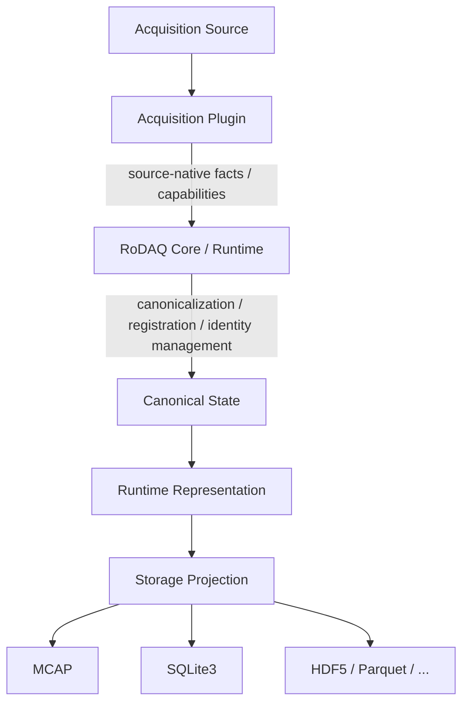

图 1-1 表示 RoDAQ 在线主数据路径。Storage Projection 的语义输入仍然是 Canonical State；在线实现通常通过 Runtime Representation 承载和交付这些 state，因此图中将 Runtime Representation 放在 Canonical State 与 Storage Projection 之间，避免把二者误解为两个并列的 semantic layer。离线工具可以从重建的 Canonical State 直接执行等价的 Storage Projection，这不改变 Storage Projection 的 canonical 语义定义。

其中：

```text
Acquisition Plugin
    ≠ Canonical Descriptor manager

Storage Plugin
    ≠ Canonical Model

Runtime Representation
    ≠ Canonical Semantics
```

---

## 1.2 目标

Canonical Data Model 的目标，是建立一套长期稳定、与 Acquisition Source、Runtime 实现和 Storage Format 解耦的公共语义。

语义依赖方向为：

```text
Acquisition Implementation
        │
        ▼
Canonical Data Model
        │
        ▼
Runtime / Queue / Admission
        │
        ▼
Storage Projection
```

这并不表示 Acquisition Plugin 必须直接构造 Canonical Graph。

实际实现可以是：

```text
Acquisition Plugin
        │
        │ native facts
        ▼
RoDAQ Core / Runtime
        │
        │ canonicalize / register / compile
        ▼
Canonical State
        │
        ▼
Runtime Representation
        │
        ▼
Storage Projection
```

Canonical Data Model 需要回答以下问题：

1. 一条被 RoDAQ 接受的数据如何唯一标识；
2. 数据属于哪个长期逻辑 Stream；
3. 数据具体由哪个 Source 产生；
4. Source identity 在 Canonical State 中如何表示与比较；
5. 某条 Record 应按照哪一版 StreamDescriptor 解释；
6. Payload 使用什么 Encoding；
7. 是否存在 Schema，以及 Schema 如何表达；
8. 一份 Schema 中哪个具体类型用于解释 Payload；
9. Schema 如何在 round-trip 中无损保持；
10. 一个 Timestamp 表示什么事件；
11. Timestamp 来自哪个具体 Clock；
12. Clock 什么时候可以直接比较；
13. ClockId 的 canonical identity 如何建立；
14. Clock reset/restart 后 identity 应如何变化；
15. Payload 在 canonical 语义上是什么；
16. scatter/gather 等 Runtime representation 如何与 logical bytes 区分；
17. Payload 内部子样本时间与 canonical Record-level time 的边界在哪里；
18. Unknown Timestamp Role 如何 forward-compatible；
19. Source 有 native sequence 但没有 SourceId 时如何处理；
20. 不同 Storage Format 如何无损恢复同一个 Canonical State；
21. distributed / merge / import 场景下 ID 如何重映射；
22. ordinary import 与 transform/merge 的边界是什么；
23. 哪些信息是真正 canonical，哪些只是 Runtime、Plugin 或 Storage-specific representation；
24. Acquisition Plugin 应提供哪些 source-native facts，而哪些 canonical infrastructure 不应由 Plugin 自行管理；
25. Canonical State Space 与某一具体 RoDAQ release 的 Implementation Profile 如何分离；
26. Storage full-fidelity contract 与具体 persistence codec responsibility 如何分离；
27. Native identity 为空、无效或不可靠时 SourceId 应如何处理；
28. Native identity 如何在进入 Canonical Model 之前归一化成稳定的 SourceId canonical bytes；
29. Cross-scope import 的 identity remapping 是否要求跨独立 import operation 幂等；
30. Storage physical compression 在 full-fidelity 模式下必须满足什么条件。

---

## 1.3 非目标

本文不是完整的 RoDAQ Architecture。

Canonical Data Model 不负责定义：

```text
Queue
Admission
Backpressure
Executor
Thread
Rolling
Retention
Journal
Recovery state machine
Server
Client
HTTP
SSE
```

也不定义具体 Acquisition API：

```text
ROS 2 Node / Subscription / QoS
DDS Participant / Reader / Writer
SocketCAN socket
camera SDK callback
```

也不定义具体 Storage 物理结构：

```text
MCAP Channel / Message / Chunk
SQLite table / row
HDF5 Dataset
Parquet RowGroup
```

也不定义：

```text
Plugin loading
Plugin ABI
memory allocator
Buffer ownership implementation
ClockId allocation algorithm
Host identity system
clock synchronization algorithm
schema parser
signal decoding
dataset annotation
training pipeline
transform pipeline
```

以下内容同样不属于 Canonical Data Model：

```text
Acquisition Plugin construction API
Storage Plugin API
Runtime Registry API
Runtime Handle representation
Descriptor registration API
Descriptor dedup algorithm
Canonical object interning API
Common persistence codec implementation
Storage extension block format
Plugin-specific native capability API
Conformance test executable layout
Hot-path performance thresholds
```

Canonical Model 中存在某个 Descriptor，不意味着 Plugin API 必须暴露对应的 Create/Register 方法。

例如：

```text
Canonical:
    TimestampKeySet
```

不意味着：

```text
Plugin API:
    CreateTimestampKeySet(...)
```

Canonical Model 定义的是：

> 最终 Canonical State 的合法形状、identity、interpretation 和 fidelity。

Construction responsibility 属于 Runtime 和 Plugin Contract。

---

## 1.4 核心设计原则

### 1.4.1 Source-native

RoDAQ 默认保留 Acquisition Source 提供的原始编码 Payload。

例如：

```text
ROS 2      → serialized CDR
DDS        → CDR / XCDR
SocketCAN  → raw CAN / CAN-FD logical frame representation
Camera SDK → source-native encoded frame
```

Canonical Core 不要求：

```text
deserialize
    ↓
转换为 RoDAQ 自定义领域对象
    ↓
serialize
```

否则：

- ROS2 Message 要 decode；
- DDS CDR 要 decode；
- Camera frame 可能被迫重新编码；
- CAN 要先转换成 signal；
- Storage 端又要重新 serialize。

这会增加：

```text
CPU
copy
latency
dependency
semantic loss
```

并让 Canonical Core 逐渐变成通用数据解析框架。

RoDAQ 的核心职责是数据采集，而不是把所有数据转换成统一业务对象。

---

### 1.4.2 Storage-neutral

Canonical Data Model 不包含：

```text
MCAP ChannelId
MCAP logTime
MCAP publishTime
SQLite row id
SQLite timestamp_ext
HDF5 dataset id
Parquet row group
```

正确方向始终是：

```text
Canonical Semantics
        │
        ├── MCAP Projection
        ├── SQLite3 Projection
        ├── HDF5 Projection
        └── ...
```

而不是：

```text
MCAP-shaped Core
        ↓
SQLite adapter
```

Storage Format 的限制不能反向成为 Canonical Model 的限制。

例如 MCAP 标准 Message 只有有限 Timestamp 字段，这不意味着 RoDAQ Canonical Timestamp 也只能有两个。

---

### 1.4.3 描述与高频数据分离

稳定或低频变化的信息应通过 immutable Descriptor 表达。

冻结核心中的 Descriptor 包括：

```text
StreamDescriptor
SchemaDescriptor
ClockDescriptor
TimestampKeySet
```

高频 Record 只携带：

```text
identity
sequence
timestamp states
payload
```

Source identity 当前通过 `SourceId` 直接表达。

`SourceDescriptor` 尚未证明具有足够稳定的跨 Source 最小语义，因此不属于冻结核心模型。

如果每条高频 Record 都重复携带：

```text
topic name
schema
clock description
role identifier
encoding identifier
```

会产生大量不必要的空间、CPU 和动态内存开销。

但是：

> Descriptor 是 Canonical State 的表达方式，不等于 Plugin 必须直接构造和维护 Descriptor object。

Runtime 可以把 Plugin 提供的 source-native facts 转换成这些 Descriptor。

Canonical Model 不要求 Runtime 使用某一种性能实现。

Runtime 可以通过：

```text
precompilation
interning
fixed slots
inline storage
runtime handles
```

避免 hot path 中的：

```text
string operation
descriptor graph traversal
dynamic allocation
```

这些属于 Runtime Implementation Profile，而不是 Canonical semantics。

---

### 1.4.4 语义与物理表示分离

Canonical Model 严格区分：

```text
Canonical Semantics
        │
        ▼
Runtime Representation
        │
        ▼
Persistence Projection
```

例如 Payload 的 canonical 语义是：

> immutable opaque encoded logical byte string

Runtime 可以使用：

```text
inline buffer
single external buffer
scatter/gather
shared memory
middleware-owned buffer
```

TimestampKeySet 的 canonical 语义是：

> TimestampKey 的无序集合。

Runtime 可以将其编译成：

```text
slot 0
slot 1
slot 2
...
```

并让 Runtime Record 使用紧凑数组。

但是：

> Runtime slot index 和 slot order 不属于 Canonical semantics。

SourceId 也遵守同样原则。

Canonical SourceId 是：

> non-empty opaque byte sequence

Runtime 可以将其：

```text
register
intern
map to SourceHandle
```

高频 Record 可以保存紧凑 Handle。

只要最终能够无损恢复 canonical SourceId bytes 即可。

Storage 也可以将 Timestamp、SourceId、Descriptor 等投影成自己的物理表示。

这些物理形式不能反向污染 Canonical semantics。

### 图 1-2 Canonical Semantics 与 Runtime Representation

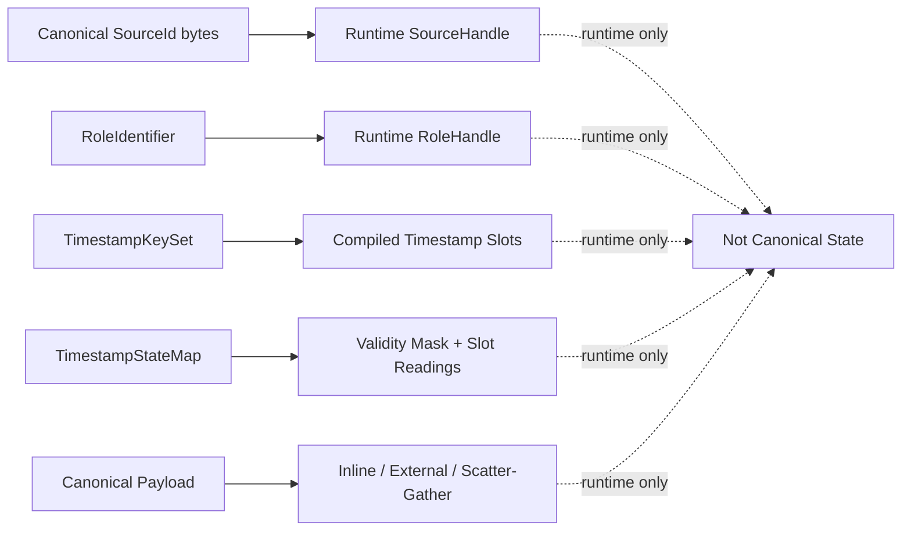

---

### 1.4.5 Unknown 必须保持 Unknown

如果信息不存在或无法可靠获取，必须明确表达为：

```text
Absent
Unknown
Unavailable
```

不能使用：

```text
timestamp == 0
SourceId == 0
empty fake schema
fake publisher
default clock
```

代替。

零本身可能是合法值。

例如：

```text
device tick = 0
```

完全可能是设备刚启动后的真实时间。

对于 TimestampState：

> `Present(0)` 是合法状态，其中 `0` 是有效的 ClockReading；`Absent` 是独立的显式状态，不能使用 `0` 代替。

如果 Source identity 不可靠：

```text
SourceId = absent
```

必须保留为 absent。

不能为了保存某个 native sequence 创建 fake SourceId。

对于 native identity：

```text
empty
invalid
unavailable
ambiguous
```

也不能默认提升为一个存在的 SourceId。

Canonical SourceId 永远满足：

```text
present SourceId
    ⇒
non-empty canonical byte sequence
```

因此：

```text
present(empty)
```

不是合法 Canonical State。

如果 native protocol 中某个 empty value 本身具有合法 Source identity 语义，也不能把 empty value 原样作为 Canonical SourceId。

Acquisition Plugin 必须按照对应 Acquisition Contract，将该 native identity 转换为稳定、非空的 canonical SourceId bytes。

如果无法建立这样的 canonical representation：

```text
SourceId = absent
```

---

### 1.4.6 历史数据必须唯一可解释

任何已经进入 Canonical State 的 Record，都必须能够绑定到完整且不可变的解释契约。

不能出现：

```text
Record 存在

但是不知道：
- 当时使用哪个 Schema
- 当时使用哪个 PayloadEncoding
- 当时使用哪个 TimestampKeySet
```

因此 Descriptor identity、immutability 和 referential integrity 是 Canonical Model 的核心。

保证这一 invariant 的责任属于：

> RoDAQ Core / Runtime canonical infrastructure。

普通 Acquisition Plugin 不应自行管理整个 Descriptor Graph 的闭合性。

---

### 1.4.7 Identity 与描述分离

逻辑 identity 和某一时刻的 description 不是一回事。

例如同一个：

```text
camera/color
```

Stream 可以先使用：

```text
rgb8
```

后来改成：

```text
h264
```

逻辑上仍然可以是同一个 Stream。

因此必须区分：

```text
StreamId
```

与：

```text
StreamDescriptorId
```

同理，SourceId 表示 Source identity，而不是 Source 的所有 descriptive metadata。

---

### 1.4.8 Opaque 数据使用 Canonical Representation

对于 Canonical Core 不解析的内容，例如：

```text
SchemaDescriptor.representation
Payload
SourceId
未知 RoleIdentifier
```

Core 不尝试判断：

> 两段不同 bytes 是否“语义等价”。

Canonical Model 定义明确的 canonical representation，并要求 lossless round-trip 保留该 representation。

因此：

```text
Opaque Canonical State
→ Storage
→ Decode
```

必须恢复相同：

```text
canonical bytes
canonical identifiers
canonical field values
```

而不是要求 Storage 理解业务语义。

对于 SourceId：

> Core 不执行 source-specific identity normalization。

任何需要：

```text
padding removal
endianness normalization
case normalization
text/binary conversion
UUID/GUID formatting normalization
vendor-specific field extraction
```

的处理，都必须在 native identity 进入 Canonical Model 之前完成。

---

### 1.4.9 Canonical Identifier 与 Opaque Canonical Identity

Canonical Model 中存在两类语义不同的值。

第一类是：

> **Canonical Identifier**

用于表达可扩展语义名称，例如：

```text
RoleIdentifier
SchemaFormat
PayloadEncoding
ClockOrigin
TypeIdentifier
```

公共规则：

- 使用有效 UTF-8 byte string；
- equality 采用 byte-exact comparison；
- 大小写敏感；
- Canonical Core 不执行 Unicode normalization；
- 不执行 case folding；
- Storage round-trip 必须恢复相同 identifier bytes。

因此：

```text
rodaq/capture
```

与：

```text
RoDAQ/Capture
```

不是同一个 identifier。

第二类是：

> **Opaque Canonical Identity**

用于表达 scope-local 对象 identity，例如：

```text
StreamId
StreamDescriptorId
SchemaId
ClockId
TimestampKeySetId
SourceId
```

这些 ID 的 Runtime/ABI 物理形式并不统一。

其中 SourceId 的 canonical value representation 明确为：

> **non-empty opaque byte sequence**

SourceId：

- 不要求 UTF-8；
- 不要求 namespace-qualified；
- 不要求可读；
- 可以保存 DDS GUID、ROS GID 或其他 native binary identity 的 canonicalized representation；
- 可以在 Runtime 中被 intern 为 SourceHandle。

其他 ID 的具体位宽和物理表示留给 Runtime/API/ABI 设计。

### 表 1-1 Canonical Identifier 与 Opaque Canonical Identity

| 分类 | 回答的问题 | Canonical 约束 | 示例 |
|---|---|---|---|
| Canonical Identifier | “这个语义叫什么？” | UTF-8、byte-exact、case-sensitive | `RoleIdentifier`、`SchemaFormat`、`PayloadEncoding`、`ClockOrigin` |
| Opaque Canonical Identity | “在当前 Identity Scope 中，它是谁？” | scope-local identity；物理表示未统一冻结 | `StreamId`、`ClockId`、`SchemaId`、`SourceId` |

需要特别注意：

> Opaque Canonical Identity 不意味着所有 `XxxId` 都使用 byte string。

当前只有 SourceId 的 canonical representation 被额外冻结为：

```text
non-empty opaque byte sequence
```

---

### 1.4.10 Canonical Model 不是 Construction API

Canonical Data Model 定义：

```text
valid state
identity
interpretation
fidelity
evolution invariants
```

但不定义：

```text
谁调用 CreateXxx()
谁直接分配 Canonical ID
哪个 Plugin 管理 Registry
哪个组件执行 dedup
哪个 API 返回 DescriptorHandle
```

因此：

```text
Canonical Object
≠
Construction API Object
```

例如：

```text
Canonical:
    ClockDescriptor
```

不意味着 Acquisition Plugin 必须：

```text
allocate ClockId
register ClockDescriptor
```

Canonical：

```text
TimestampKeySet
```

也不意味着 Plugin 必须：

```text
construct key-set object
allocate TimestampKeySetId
manage key-set evolution
```

同理：

```text
StreamDescriptor
```

不意味着 Plugin 必须维护：

```text
descriptor registry
descriptor lifetime
referential closure
```

这些属于 Runtime / Plugin Contract。

---

### 1.4.11 Canonicalization Responsibility

Canonicalization 表示：

> 将 source-native facts 转换、关联或注册成合法 Canonical State 的过程。

这里的 Canonicalization 专指：

```text
source-native facts
    ↓
valid RoDAQ Canonical State
```

它与 Unicode canonical normalization 无关。

责任原则：

```text
Acquisition Plugin
        │
        │ source-native facts
        ▼
RoDAQ Core / Runtime
        │
        │ canonical identity / registration / graph construction
        ▼
Canonical State
```

Acquisition Plugin 负责只有它能够可靠知道的信息，例如：

```text
native stream identity evidence
native Source identity
native Schema representation
native PayloadEncoding
native sequence semantics
native timestamp semantic meaning
native Clock properties
native Clock restart/reset evidence
```

对于 Source identity：

> Plugin 负责将 source-specific native identity 转换为对应 Acquisition Contract 定义的稳定 canonical byte representation，再提交给 Core。

RoDAQ Core / Runtime 负责：

```text
StreamId allocation
DescriptorId allocation
SchemaId allocation
ClockId allocation
TimestampKeySetId allocation

Descriptor registration
Descriptor lifetime
Descriptor graph closure
Descriptor evolution mechanics

Runtime interning
Runtime handles
Runtime binding
```

这里的 Core / Runtime 表示责任归属。

Canonical Model 不要求存在一个具体名为：

```text
Canonicalizer
```

的类或 subsystem。

### 图 1-3 Canonicalization 责任分工

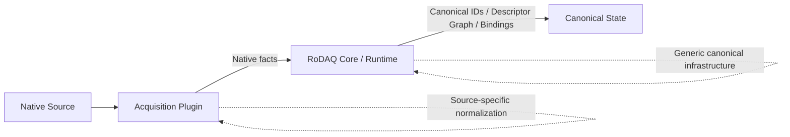

---

### 1.4.12 Implementation Profile 与 Canonical State Space 分离

Canonical Data Model 定义：

> **完整合法 Canonical State Space。**

具体 RoDAQ release 可以定义：

> **Implementation Profile**

只实现其中严格子集。

Implementation Profile 表示：

> 一组明确声明的 implementation capability subset。

例如 Canonical Model 可以允许：

```text
arbitrary legal TimestampKeySet
arbitrary namespace-qualified Role
cross-scope import semantics
arbitrary valid ClockDescriptor
```

V1 Profile 可以限制：

```text
small fixed number of timestamp slots
only validated Clock capability set
no generic cross-scope importer
no ClockCorrelation
```

两者不冲突。

因此：

> **Canonical-valid 不等于当前 Implementation Profile 必须支持。**

Implementation Profile 不得：

- 修改已支持 canonical state 的语义；
- 把同一 canonical field 重新解释成不同含义；
- 静默丢弃它声称支持的 canonical state。

Profile 可以：

```text
Reject unsupported canonical state
```

但不能：

```text
Accept and silently degrade it
```

例如 Profile 限制：

```text
max_timestamp_keys_per_set = N
```

那么超过 N 的 TimestampKeySet 应在 registration/canonicalization 边界被明确拒绝。

不得：

```text
truncate keys
silently discard timestamps
change semantic role
```

任何 fallback 都不能改变最终被接受 Canonical State 的语义。

---

### 1.4.13 不过度抽象

Canonical Model 不为了未来可能存在的需求提前引入：

```text
PropertyBag
AnyValue
generic metadata
Source hierarchy
RecordKind hierarchy
DescriptorVersion framework
Generic Event
GlobalSequence
Host object
Session object
BatchDescriptor
TransformRecord
Canonicalizer object
NativeSample canonical object
PluginDescriptor canonical object
PersistenceDescriptor
RuntimeBinding canonical object
```

只有当多个真实 Acquisition / Storage 场景都证明一个概念具有稳定共同语义时，才将其提升为 canonical primitive。

外部生态 interoperability 所需、但不属于长期公共数据语义的低频信息，例如 ROS2 `offered_qos_profiles`，通过 Runtime-owned、versioned typed InteropProjection 传递。InteropProjection 明确 **不是 Canonical State**，不得参与 Canonical identity / equality / round-trip definition；它也不能反向成为 Generic Metadata / PropertyBag 的入口。

---

## 1.5 概念与专业术语

本节统一本文及后续 Runtime、Acquisition Plugin、Storage Plugin 文档中的术语。

术语定义负责回答：

> **这个概念是什么？**

后续章节负责定义：

> **它有哪些 invariant、如何演进、由谁负责、与其他概念如何交互？**

---

### 1.5.1 Canonical、State 与 Identity

#### Canonical

Canonical 表示：

> RoDAQ 内部与具体通信协议、设备 SDK 和 Storage Format 无关的公共数据语义。

Canonical 不表示：

```text
所有 Source 数据转换成同一个 binary format
```

也不表示：

```text
所有 ROS/DDS/CAN 数据转换成统一 typed object
```

它描述共同语义，而不是统一物理格式。

---

#### Canonical Representation

Canonical Representation 表示某个 canonical field 在语义层规定的稳定表示。

对于 Core 能理解的结构，例如 Clock resolution：

```text
1 / 1,000,000,000
```

需要满足明确 normalization rule。

对于 Core opaque 的内容，例如 Schema representation：

> canonical representation 就是进入 Canonical Model 时注册的 opaque bytes。

对于 SourceId：

> canonical representation 是经过对应 Acquisition Contract 归一化后进入 Canonical Model 的 non-empty opaque byte sequence。

Storage round-trip 必须恢复 canonical representation，而不是自行判断“语义近似”。

---

#### Canonical Object Graph

Canonical Object Graph 强调：

> Canonical Descriptor 以及 Record 对这些 Descriptor 的引用关系。

例如：

```text
Record
    ↓
StreamDescriptor
    ↓
TimestampKeySet
    ↓
ClockDescriptor
```

---

#### Canonical State

Canonical State 表示：

> 某一个具体 logical Identity Scope 中实际存在的一组 canonical identities、descriptors 和 records。

---

#### Canonical State Space

Canonical State Space 表示：

> 所有满足 Canonical Model invariant 的合法 Canonical State 的集合。

因此：

```text
Canonical Object Graph
Canonical State
Canonical State Space
```

含义不同：

```text
Object Graph
    → 强调对象和引用结构

State
    → 强调某个具体有效状态

State Space
    → 强调全部合法状态集合
```

---

#### Canonical Identifier

Canonical Identifier 是用于稳定标识某种可扩展语义的 UTF-8 byte string。

equality：

```text
byte-exact
case-sensitive
no Unicode normalization
```

Canonical Identifier 不等同于某种 C++ 字符串类型。

Runtime 可以将其：

```text
register
intern
map to integer handle
```

只要能够无损恢复 canonical identifier。

---

#### Identity Scope

Identity Scope 表示：

> 一组 Canonical ID 保证唯一和可解析的 namespace。

例如：

```text
StreamId
StreamDescriptorId
SourceId
SchemaId
ClockId
TimestampKeySetId
```

都只保证在所属 Identity Scope 内唯一。

不同 Scope：

```text
Scope A: StreamId = 7
Scope B: StreamId = 7
```

完全合法。

Identity Scope 不等同于：

```text
Session
Artifact
Host
Device
process
programming-language scope
```

它们之间的关系由后续 Runtime、Artifact 和 Distributed Acquisition 设计决定。

---

### 1.5.2 Stream 与 Source

核心对象的命名与结构不追求形式上的完全对称。

Stream 明确分离：

```text
StreamId
StreamName
StreamDescriptor
```

因为 Stream 同时需要稳定 logical identity、独立的 human-readable logical name，以及 immutable interpretation contract。

Schema 与 Clock 使用：

```text
SchemaId / SchemaDescriptor
ClockId / ClockDescriptor
```

TimestampKeySet 使用：

```text
TimestampKeySetId / TimestampKeySet
```

其中 TimestampKeySet 本身承担 Descriptor 语义。Source 当前只冻结 `SourceId`；`SourceDescriptor` 仍然保持 OPEN。也就是说，这种不对称是有意的：Canonical Model 不为了命名形式统一而增加没有稳定语义的 Name 或 Descriptor primitive。

#### Stream

Stream 表示：

> 长期稳定的逻辑数据流 identity。

例如：

```text
/joint_states
camera/color
RobotState
can0/raw
```

Stream 不等于：

```text
ROS Topic
DDS Topic
CAN ID
MCAP Channel
```

Stream 回答：

> **数据属于哪个长期逻辑流？**

---

#### StreamDescriptor

StreamDescriptor 表示某个 Stream 在特定阶段使用的：

> immutable stream description and interpretation contract

它回答：

```text
这条 Record 当时：
- 使用什么 StreamName
- 使用什么 Schema
- 使用什么 PayloadEncoding
- 使用什么 TimestampKeySet
```

StreamDescriptor 变化不会自动修改 StreamId。

---

#### StreamName

StreamName 是 canonical logical name。

用于：

```text
human readability
filtering
configuration
inspection
```

但不是 identity。

例如：

```text
StreamId = 42
StreamName = /joint_states
```

之后 rename：

```text
StreamName = robot/joints
```

仍可属于：

```text
StreamId = 42
```

但必须创建新的 StreamDescriptor。

StreamName 的 round-trip fidelity 使用原始 UTF-8 bytes。

Canonical Model 不使用 StreamName 判断 Stream identity。

---

#### Source

Source 表示：

> 具体产生某条 Record 的 producer entity。

例如：

```text
DDS DataWriter
ROS publisher
camera device
ECU
```

Stream 回答：

> 数据属于哪个逻辑流。

Source 回答：

> 谁产生了这条数据。

因此：

```text
Stream
≠
Source
```

二者是正交概念。

### 图 1-4 Stream 与 Source

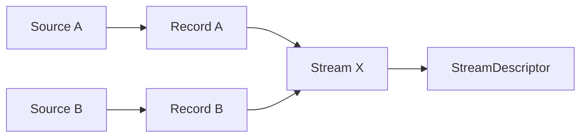

多个 Source 可以产生同一个 Stream 的 Record。

每条 Record 仍可以通过：

```text
optional SourceId
```

标识具体 producer。

---

#### SourceId

SourceId 是：

> 一个 Identity Scope 内稳定区分 Source 的 opaque canonical identity。

Canonical representation：

> **non-empty opaque byte sequence**

equality：

> **byte-for-byte comparison within the same Identity Scope**

SourceId：

- 不要求 UTF-8；
- 不要求 namespace-qualified；
- 不要求具有 human-readable form；
- 不属于 Canonical Identifier；
- 可以由 Runtime intern 为 SourceHandle；
- Runtime Handle 不属于 Canonical State。

同一 Identity Scope 内：

```text
same SourceId bytes
→ same canonical Source identity
```

不同 SourceId bytes：

```text
→ different canonical Source identity
```

跨 Identity Scope，即使 bytes 相同，也不能自动认为是同一个 Source。

Acquisition Plugin 负责将 source-specific native identity 转换成对应 Acquisition Contract 定义的稳定 canonical identity bytes。

RoDAQ Core / Runtime 负责：

```text
registration
interning
runtime association
lifetime management
```

---

#### SourceDescriptor

SourceDescriptor 当前状态为：

> **OPEN — not part of the v0.9 frozen core model**

目前尚未找到同时适用于：

```text
ROS publisher GID
DDS writer GUID
camera serial
ECU identity
generic socket producer
```

且足够稳定、足够小的共同 descriptive contract。

因此不为了对象模型对称性冻结内容空洞的 SourceDescriptor。

---

### 1.5.3 Schema 与 Payload

#### Schema

Schema 是：

> 解释 Payload 类型或结构所需的可选描述这一概念。

例如：

```text
ROS message description
DDS IDL / TypeObject
FlatBuffers BFBS
Protobuf FileDescriptorSet
DBC
```

Schema 是 optional。

不是所有数据都必须有 Schema。

需要区分：

```text
Schema
```

与：

```text
SchemaDescriptor
```

Schema 是概念。

SchemaDescriptor 是 Canonical State 中对某个 immutable Schema representation 的具体描述对象。

---

#### SchemaFormat

SchemaFormat 描述 Schema representation 本身采用什么格式，例如：

```text
ros2/msg
omg/idl
flatbuffers/bfbs
protobuf/file-descriptor-set
```

SchemaFormat 与 PayloadEncoding 是独立概念。

SchemaFormat 使用 namespace-qualified Canonical Identifier。

---

#### TypeIdentifier

TypeIdentifier 表示：

> 在 Schema representation 中用于解释当前 Stream Payload 的具体类型 identity。

例如：

```text
ROS2:
    sensor_msgs/msg/Image

DDS:
    RobotState

Protobuf:
    company.robot.RobotState

FlatBuffers:
    RobotState
```

Schema representation 可能包含一个或多个类型。

如果 Schema representation 本身不能唯一确定解释 Payload 的具体类型：

> TypeIdentifier 必须存在。

TypeIdentifier 的具体命名语义由 SchemaFormat 定义。

Canonical Core 不解析其业务语义，只进行 byte-exact preservation。

---

#### PayloadEncoding

PayloadEncoding 描述：

> Payload logical bytes 使用的 serialization / encoded representation。

例如：

```text
cdr
xcdr2
flatbuffer
protobuf
raw-can-frame
```

可以理解为：

```text
Schema:
    数据是什么

TypeIdentifier:
    Schema 中具体使用哪个类型

PayloadEncoding:
    bytes 怎么编码
```

PayloadEncoding 使用独立于 SchemaFormat 的 identifier namespace。

这里的 Encoding 不特指字符编码。

它可以描述：

```text
serialization format
binary encoded representation
wire-compatible representation
source-native logical byte encoding
```

---

#### Payload

Payload 是：

> immutable opaque encoded logical byte string

它是有序 logical byte sequence。

Runtime 中是否连续不属于 Canonical semantics。

---

### 1.5.4 Record 与 Sequence

#### Record

Record 是 Canonical Data Model 中最小的：

```text
独立标识
per-stream 排序
数据交付
```

单元。

当前 Record 只表示：

> data-bearing acquisition unit

一个 Record 可以对应：

```text
1 ROS message
1 DDS sample
1 CAN frame
1 image
128 IMU samples
4096 audio samples
```

Record 不等于一个物理 sensor sample。

也不等于：

```text
MCAP physical record
SQLite row
Storage block
```

---

#### AcceptanceSequence

AcceptanceSequence 是：

> RoDAQ Runtime 为某个 Stream 中每一次 admission attempt 分配的 stream-local sequence；只有 final admission outcome 为 accepted 的 attempt 才产生 canonical Record，并由该 Record 携带已经分配的 AcceptanceSequence。

其语义：

```text
stream-local
strictly increasing
stable
never reused
```

因此，某次 admission attempt 即使最终被拒绝，也可以消耗一个 AcceptanceSequence value；该 value 不属于任何 canonical Record，也不会被复用。这也是 accepted canonical Records 之间允许出现 sequence gap 的原因之一。

对于实际存在的 canonical Record，AcceptanceSequence 明确表示：

> 该 Record 在 RoDAQ stream-local admission / acceptance ordering domain 中的位置，并保持 accepted Records 的相对 acceptance order。

而不是：

> Source-side physical acquisition order。

---

#### SourceSequence

SourceSequence 是：

> 由 Source 自身产生，并明确以 SourceId 为作用域的 sequence counter。

例如：

```text
DDS DataWriter publication sequence
camera source frame counter
```

以下值不能因为实现方便就映射为 SourceSequence：

```text
reader reception sequence
transport connection sequence
stream-level packet counter
session-wide counter
```

除非其真实语义明确：

```text
source-originated
+
SourceId-scoped
```

### 表 1-2 AcceptanceSequence 与 SourceSequence

| 属性 | AcceptanceSequence | SourceSequence |
|---|---|---|
| 产生者 | RoDAQ Runtime | Source |
| Scope | Stream | SourceId |
| 是否 mandatory | 是 | 否 |
| 语义 | RoDAQ stream-local admission / acceptance ordering | Source-originated sequence |
| 是否持久化 | 是 | 存在时是 |
| 是否要求连续 | 否 | 由 Source semantics 决定 |
| 能否互相代替 | 否 | 否 |

---

### 1.5.5 Clock 与 Timestamp

#### Clock

Clock 是：

> 一个具体时间基准 instance。

不是：

```text
MONOTONIC
DEVICE
SYSTEM
```

这样的类别。

例如：

```text
host-A monotonic clock instance
camera-0 device clock instance
can0 PHC instance
```

都是不同 Clock。

同一 Identity Scope 中，不同实际 Clock instance 必须具有不同 ClockId。

Clock、ClockDescriptor 和 ClockId 的关系：

```text
Clock
    = 概念上的具体时间基准 instance

ClockDescriptor
    = 该 Clock 的 immutable canonical description

ClockId
    = 该 Clock 在 Identity Scope 内的 canonical identity
```

---

#### ClockOwner

ClockOwner 当前不是 mandatory canonical field。

它可能未来用于描述：

```text
host-A
camera-0
can-controller-0
```

但当前：

- 不参与 Clock equality；
- 不决定 comparability；
- 不建立 correlation；
- 没有成熟 Host/Device identity model。

因此不属于冻结核心 ClockDescriptor。

---

#### ClockReading

ClockReading 是：

> 某一个 Clock 上的整数 tick value。

例如：

```text
0
123
-100
8273619283
```

它本身没有完整意义，必须结合 ClockDescriptor 解释。

---

#### ClockOrigin

ClockOrigin 描述：

> ClockReading = 0 所对应的时间参考起点语义。

这里的 Origin 指 time-coordinate origin。

ClockOrigin 使用 Canonical Identifier。

例如：

```text
rodaq/monotonic_unspecified
rodaq/unix_epoch
rodaq/tai_epoch
rodaq/device_power_on
vendor/device_epoch
```

完整标准 Origin vocabulary 尚未冻结。

Unknown ClockOrigin 必须能够被 lossless Storage 无损保留。

---

#### Timestamp Role

Timestamp Role 描述：

> 某个 ClockReading 对应什么事件。

Role 回答：

> 发生了什么？

Clock 回答：

> 使用哪个时间基准表示？

两者正交。

---

#### RoleIdentifier

每一个 Timestamp Role 使用稳定、namespace-qualified Canonical Identifier：

```text
RoleIdentifier
```

RoDAQ 标准 Role 使用：

```text
rodaq/*
```

当前正式冻结的标准 Role 只有：

```text
rodaq/acquisition_ingress
```

其他：

```text
rodaq/capture
rodaq/publish
rodaq/transport_receive
rodaq/hardware_receive
```

目前仍是 candidate/example。

第三方 Plugin 必须使用自己的 namespace：

```text
com.vendor/hardware_latch
org.project/sensor_trigger
```

---

#### TimestampKey

TimestampKey 定义为：

```text
(RoleIdentifier, ClockId)
```

例如：

```text
(rodaq/acquisition_ingress, ClockId=3)
(com.vendor/hardware_latch, ClockId=7)
```

TimestampKey 是 Record-level timestamp 的 canonical semantic key。

也是 TimestampStateMap 的 key。

---

#### TimestampKeySet

TimestampKeySet 是：

> 某个 StreamDescriptor 允许出现的唯一 TimestampKey 的无序集合。

例如：

```text
{
    (rodaq/acquisition_ingress, ClockA),
    (com.vendor/hardware_latch, ClockB)
}
```

Canonical Model 不定义：

```text
slot 0
slot 1
slot 2
```

slot index 和 slot order 属于 Runtime/Persistence representation。

---

#### TimestampState

TimestampState 为：

```text
Absent
```

或者：

```text
Present(ClockReading)
```

---

#### TimestampStateMap

TimestampStateMap 表示：

> 一个 Record 对 TimestampKeySet 中每一个 TimestampKey 给出的 timestamp state。

Canonical 语义：

```text
TimestampKey
    ↓
TimestampState
```

即：

```text
TimestampKey
    →
Absent
or
Present(ClockReading)
```

TimestampStateMap 不是 positional array。

`Map` 描述的是数学映射语义，不要求 C++ 使用 `std::map`。

### 图 1-5 Canonical Timestamp Model

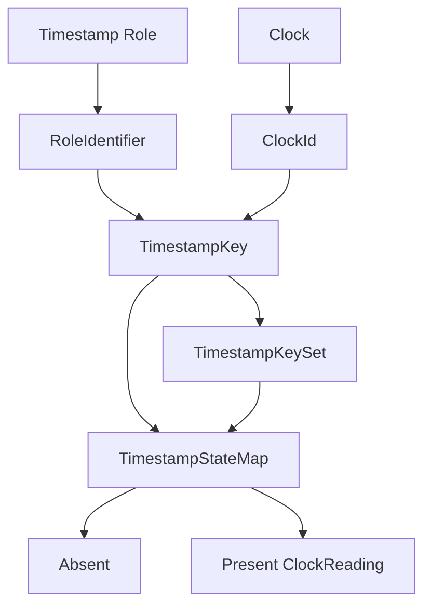

---

### 1.5.6 Descriptor、Storage Projection、Canonicalization 与 Implementation Profile

#### Descriptor

Descriptor 是：

> 可被 Record 或其他 Descriptor 引用的 immutable 低频 canonical object。

冻结核心包括：

```text
StreamDescriptor
SchemaDescriptor
ClockDescriptor
TimestampKeySet
```

TimestampKeySet 是 Descriptor Graph 的正式成员，尽管名称中没有 `Descriptor` 后缀。保留 `TimestampKeySet` 是因为该名称已经精确表达其 canonical 内容——TimestampKey 的无序集合；改为 `TimestampKeySetDescriptor` 只会增加冗余，并容易削弱它与 Runtime slot/layout representation 的区分。

变化通过创建新的 Descriptor identity 表达。

---

#### Storage Projection

Storage Projection 表示：

```text
Canonical Semantics
        ↓
Storage-specific representation
```

例如：

```text
Canonical → MCAP
Canonical → SQLite3
```

Storage Projection 不是 Canonical Model。

---

#### Canonicalization

Canonicalization 表示：

> 根据 source-native facts 和 RoDAQ contract，建立合法 canonical identity、Descriptor relationship 和 Record interpretation state 的过程。

Canonicalization 不意味着：

```text
decode payload
convert payload format
normalize business data
```

它主要包括：

```text
identity establishment
descriptor registration
canonical reference construction
timestamp semantic binding
```

Source-specific native identity normalization 是特殊边界：

> 它发生在 native identity 进入 canonical SourceId 之前，由 Acquisition Plugin / Acquisition Contract 负责。

Canonical SourceId 一旦进入 Core：

> Core 只进行 canonical validation、registration、interning 和 byte-exact identity comparison。

---

#### Implementation Profile

Implementation Profile 表示：

> 某一具体 RoDAQ release 对完整 Canonical State Space 所支持的严格子集。

例如 Canonical Model 允许：

```text
arbitrary legal TimestampKeySet
```

某个 V1 Profile 可以规定：

```text
runtime supports at most N timestamp keys
```

这种限制不改变 Canonical semantics。

---

#### Round-trip

Round-trip 指：

```text
Canonical
    ↓ Encode
Storage
    ↓ Decode
Canonical
```

Round-trip 本身不自动意味着 identity preserved。

只有确认 Decode 结果重新进入原 logical Identity Scope 时，才属于：

> identity-preserving round-trip

无法确认原 Identity Scope 时，应按 Cross-scope Import 处理。

---

#### Cross-scope Import

Cross-scope Import 指：

```text
Canonical Scope A
        ↓
import
        ↓
Canonical Scope B
```

Canonical IDs 可以重映射。

Ordinary Cross-scope Import 不等于：

```text
merge Streams
re-sequence Records
rewrite Payload
change ordering
```

这些属于 explicit Transform / Merge。

同一个 Source Scope 被多次独立导入时，Canonical Model 不要求不同 import operation 产生完全相同 Target ID mapping。

每一次 import operation 内只要求：

```text
mapping consistent
referentially closed
identity-distinction preserving
```

---

#### Transform / Merge

Transform / Merge 表示：

> 有意产生新的 Canonical State，而不是保持原 canonical identity 的操作。

Transform 通常强调：

```text
Payload rewrite
timestamp rewrite
encoding change
resequencing
```

Merge 通常强调：

```text
multiple inputs
    ↓
new combined output structure
```

Transform / Merge 输出如果继续作为 RoDAQ canonical data 使用，仍必须满足全部 Canonical Model invariant。

但是：

```text
Transform / Merge
≠ identity-preserving round-trip
≠ ordinary lossless cross-scope import
```

---

#### Descriptor Identity 与 Descriptor Content

同一个 DescriptorId 在一个 Identity Scope 内必须始终解析到唯一 immutable Descriptor。

因此：

```text
same DescriptorId
    ⇒
same immutable canonical descriptor
```

但是：

```text
same descriptor content
    ⇏
same DescriptorId
```

不同 DescriptorId 可以拥有完全相同的 canonical content。

---

# 2. Canonical Model、Identity 与 Descriptor

## 2.1 模型总览

核心模型为：

```text
Canonical Identity Scope
│
├── Descriptor Graph
│   ├── StreamDescriptor
│   ├── SchemaDescriptor
│   ├── ClockDescriptor
│   └── TimestampKeySet
│
└── Records
    ├── StreamDescriptorId
    ├── AcceptanceSequence
    ├── optional SourceId
    ├── optional SourceSequence
    ├── TimestampStateMap
    └── Payload
```

以下概念当前不属于冻结核心：

```text
SourceDescriptor
ClockOwner
```

这是有意的范围控制。

Canonical Object Graph 是：

> 有效状态模型。

不是：

> Plugin API 对象层次。

Runtime 可以将：

```text
StreamDescriptor
TimestampKeySet
ClockDescriptor
```

编译成紧凑内部 binding/handle。

这些 Runtime objects 不属于 Canonical State。

### 图 2-1 Canonical Object Graph

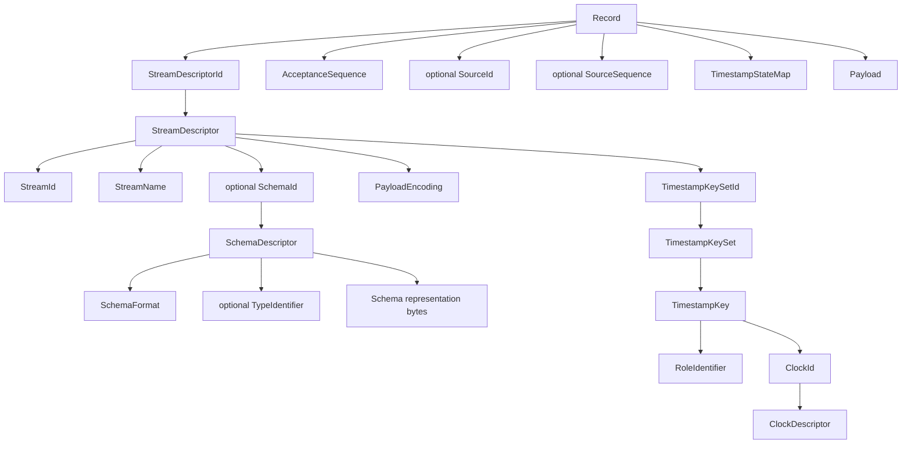

---

## 2.2 Identity Scope

所有 Canonical ID 都属于明确 Identity Scope。

规则：

> Canonical ID 只在所属 Identity Scope 内唯一。

跨 Scope：

```text
same numeric ID
```

不具有 identity 等价意义。

例如：

```text
Scope A:
    StreamId = 7
    ClockId  = 3

Scope B:
    StreamId = 7
    ClockId  = 3
```

不能推出：

```text
A.StreamId == B.StreamId
A.ClockId  == B.ClockId
```

Canonical Model 不冻结：

```text
Scope 最终叫什么
Scope 是否显式拥有 ScopeId
Scope 与 Session 的关系
Scope 与 Artifact 的关系
Runtime restart 是否新建 Scope
多个 Host 是否共享 Scope
```

这些由 Runtime、Artifact Model 和 Distributed Acquisition 设计决定。

Implementation Profile 可以进一步限制：

```text
one active Identity Scope per Runtime
```

但这种限制不属于 Canonical semantics。

---

## 2.3 Identity-preserving Decode

如果：

```text
Canonical Scope S
    ↓ Encode
Artifact
    ↓ Decode
```

需要声明 Decode 后仍处于：

```text
Scope S
```

则 Runtime / Artifact 层必须能够确认：

> Decode 结果重新进入原有 logical Identity Scope。

Canonical Model 不冻结这种确认机制如何持久化。

未来可能涉及：

```text
ScopeId
Artifact metadata
Runtime context
```

如果无法确认原 Scope identity：

> 必须按 Cross-scope Import 处理。

不能仅因为：

```text
decoded StreamId = 7
```

和原来相同，就推导：

```text
same canonical Stream identity
```

Implementation Profile 可以明确：

```text
generic cross-scope importer = unsupported
```

不影响 Canonical semantics。

### 图 2-2 Identity-preserving Decode 与 Cross-scope Import

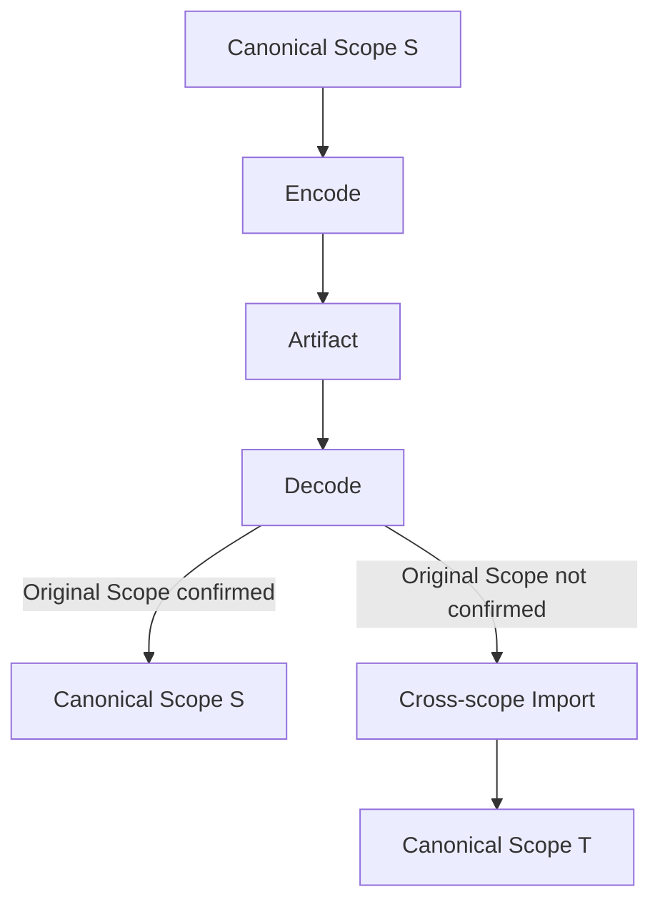

---

## 2.4 Stream Identity

StreamId 表示：

> 长期逻辑 Stream identity。

Stream 不是：

```text
ROS Topic
DDS Topic
CAN ID
MCAP Channel
```

这些概念可以映射到 Stream，但不定义 Stream 本身。

Acquisition Plugin 负责提供：

> 识别 source-native logical stream 所需的稳定事实。

RoDAQ Core / Runtime 根据：

```text
Acquisition Contract
configuration
existing Canonical State
```

建立 Canonical Stream identity，并负责 StreamId allocation。

普通 Plugin 不应该直接分配：

```text
StreamId = 17
```

例如 Plugin 可以提供：

```text
ROS2:
    native topic/type context

DDS:
    native topic/type/context

SocketCAN:
    interface/raw stream context
```

Core 根据对应 Acquisition Contract 建立 Canonical Stream。

一旦某个 StreamId 已经分配：

> StreamDescriptor evolution 不得自动修改该 StreamId。

因此：

```text
StreamName change
Schema change
Schema absent ↔ present
PayloadEncoding change
TimestampKeySet change
```

都不会自动改变 StreamId。

只有 Runtime / Acquisition Contract 显式建立新的 logical Stream 时，才分配新 StreamId。

Record identity：

```text
(StreamId, AcceptanceSequence)
```

因此不会因 Descriptor evolution 自动失去稳定基础。

---

## 2.5 StreamDescriptor

StreamDescriptor 表示：

> immutable stream description and interpretation contract

概念上：

```text
StreamDescriptor
├── StreamDescriptorId
├── StreamId
├── StreamName
├── optional SchemaId
├── PayloadEncoding
└── TimestampKeySetId
```

它同时承担两类职责：

```text
Description
    StreamName

Interpretation Contract
    Schema
    PayloadEncoding
    TimestampKeySet
```

Record 不需要重复保存这些信息，只需要绑定：

```text
StreamDescriptorId
```

Acquisition Plugin 可以报告描述事实发生变化，但不负责管理 StreamDescriptor identity/lifecycle。

例如 Plugin 报告：

```text
Schema now available
```

或者：

```text
source clock restarted
```

Core / Runtime 负责：

```text
register new canonical Descriptor
build required TimestampKeySet
create new StreamDescriptor
publish new runtime binding
```

---

## 2.6 StreamDescriptor Evolution

一旦 StreamDescriptor 被任何 Record 引用：

> 该 Descriptor 必须 immutable。

以下变化：

```text
StreamName
Schema
PayloadEncoding
TimestampKeySet
```

都必须创建新的：

```text
StreamDescriptorId
```

不引入：

```text
DescriptorRevision
DescriptorVersion
```

因为 immutable descriptor identity 已经表达历史版本。

例如：

```text
StreamId = 42

Descriptor 10
├── StreamName = camera/color
├── Schema      = Schema A
├── Encoding    = rgb8
└── TimestampKeySet = KeySet A
```

之后：

```text
Descriptor 11
├── StreamName = camera/color
├── Schema      = Schema B
├── Encoding    = h264
└── TimestampKeySet = KeySet B
```

两者仍可属于：

```text
StreamId = 42
```

旧 Record 永远引用 Descriptor 10。

新 Record 可以引用 Descriptor 11。

Descriptor evolution mechanism 属于 Core / Runtime。

Plugin 只负责报告 source-native fact 已变化。

---

### 2.6.1 StreamName Change

StreamName 属于 StreamDescriptor，因此 immutable。

Rename：

```text
/foo
    ↓
robot/foo
```

必须创建新的 StreamDescriptorId。

已有 Record 继续引用旧 Descriptor。

新的 Record 可以引用新 Descriptor。

StreamId 保持不变，除非 Runtime 显式创建新的 logical Stream。

---

## 2.7 Record 与 Record Identity

Record 是：

> Canonical Data Model 中最小的独立标识、per-stream 排序和数据交付单元。

当前 Record 只表示：

```text
data-bearing acquisition unit
```

以下内容暂不进入 Canonical Record：

```text
DDS dispose
DDS unregister
transport connection event
plugin lifecycle event
control event
end-of-stream
```

这是有意的范围限制。

RoDAQ 当前定位是 Robot Data Acquisition，不是 generic middleware event capture framework。

如果未来 full-fidelity replay 证明这些事件在多个 Source 中都是必要 primitive，再重新打开 Canonical Model。

---

### 2.7.1 Record Identity

Record 的 logical identity：

```text
(StreamId, AcceptanceSequence)
```

Record 不直接保存 StreamId，而是：

```text
Record
  ↓
StreamDescriptorId
  ↓
StreamDescriptor
  ↓
StreamId
```

这样同时恢复：

```text
logical Stream identity
+
exact Descriptor identity
```

Acquisition Plugin steady-state 不应自行生成这个 Record identity。

Runtime/Core 负责：

```text
Stream binding
AcceptanceSequence
StreamDescriptor association
```

Plugin 提供：

```text
native sample
native source facts
native timestamps
payload
```

---

## 2.8 AcceptanceSequence

AcceptanceSequence 的分配语义为：

> Runtime 在某个 Stream 的每一次 admission attempt 进入 stream-local acceptance ordering domain 时分配下一个 AcceptanceSequence。该分配发生在最终 admission outcome 确定之前；一旦分配，无论该 attempt 最终 accepted 还是 rejected，该 sequence value 都不得回滚或复用。只有 accepted attempt 才产生 canonical Record，并由该 Record 携带已分配的 AcceptanceSequence。

因此，AcceptanceSequence 的 allocation domain 包含 admission attempts，而 persisted Canonical State 只包含 accepted canonical Records 实际携带的 sequence values。

AcceptanceSequence allocation 满足：

```text
stream-local
strictly increasing
stable
never reused
```

即：

```text
seq[n + 1] > seq[n]
```

不要求：

```text
seq[n + 1] == seq[n] + 1
```

因此：

```text
10, 11, 15
```

不能自动解释为：

```text
12~14 丢失
```

Sequence gap 可能由不同阶段产生：

- **运行时原因**：admission rejection。Runtime 可以先为一次 admission attempt 分配 AcceptanceSequence，随后该 attempt 被拒绝；该 sequence value 被消耗，但不会产生 canonical Record。
- **后续操作原因**：filter / subset / export / import。
- **恢复原因**：recovery。
- **有意原因**：intentional omission。

因此：

> Sequence gap 是 observation，不是 data loss proof。

真正的 data loss 判断需要结合：

```text
Runtime admission
Journal
drop accounting
artifact terminal state
```

---

### 2.8.1 Acceptance Order

AcceptanceSequence 表示：

> RoDAQ stream-local admission / acceptance ordering domain 中的 sequence；对于实际存在的 canonical Record，它保持 accepted Records 的 acceptance order。

不是：

```text
Source causal order
physical acquisition order
physical-world total order
distributed total order
```

多个 Source 同时向一个 Stream 发送数据时：

```text
Source A
Source B
```

谁先获得 AcceptanceSequence，是 Runtime acceptance linearization 的结果。

不能从 AcceptanceSequence 推断两个真实物理事件的严格先后。

如果一个 Stream 有多个 Source：

> 所有 Source 共享同一个 Stream-local AcceptanceSequence domain。

### 图 2-3 多 Source 的 Stream-local Acceptance Ordering

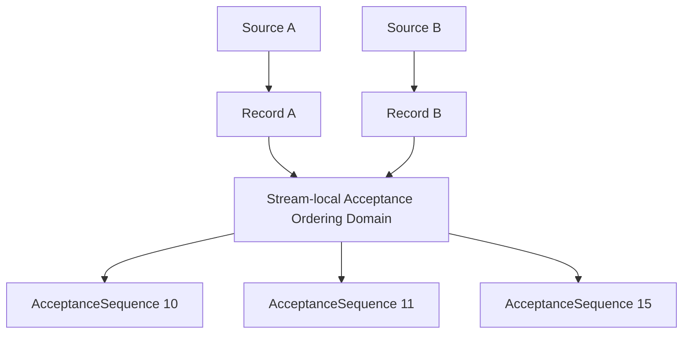

---

### 2.8.2 Persisted Canonical State

AcceptanceSequence 一旦属于 accepted canonical Record：

```text
AcceptanceSequence = 12345
```

就是 Canonical State。

Storage 必须保存。

Decode 后不能重新生成：

```text
next_sequence++
```

必须满足：

```text
decoded.AcceptanceSequence
==
encoded.AcceptanceSequence
```

不同独立 Runtime 对相同外部 Source data 分配不同 AcceptanceSequence 是允许的。

Round-trip equality 只要求：

> 同一个 Canonical Record 经 Storage 后 identity 被保持。

---

## 2.9 SourceId 与 SourceSequence

### 2.9.1 Source 与 Stream 分离

Stream：

> 数据属于哪个逻辑流。

Source：

> 具体是谁产生这条数据。

例如：

```text
Stream:
    /joint_states

Source:
    publisher-A
```

和：

```text
Stream:
    /joint_states

Source:
    publisher-B
```

仍然可以属于同一个 Stream。

DDS 多 DataWriter 也类似：

```text
Stream:
    RobotState

Source:
    Writer GUID A
    Writer GUID B
```

因此 Source 与 Stream 必须分离。

---

### 2.9.2 SourceId Optional

不是所有 Acquisition Source 都能可靠提供 Source identity。

例如某些 socket source 可能只知道：

```text
data arrived on stream X
```

无法确认具体 producer。

此时：

```text
SourceId = absent
```

是合法状态。

禁止：

```text
用 StreamId 代替 SourceId
构造 fake Source
根据 sequence 人工制造 SourceId
```

---

### 2.9.3 SourceId Canonical Representation

SourceId 的 canonical representation：

> **non-empty opaque byte sequence**

equality：

> **byte-for-byte equality within the same Identity Scope**

因此：

```text
same scope
+
same SourceId bytes
    ⇒ same Source identity
```

而：

```text
same bytes
+
different Identity Scope
```

不能自动推出 identity 相同。

SourceId：

- 不要求 UTF-8；
- 不要求 printable；
- 不要求 namespace；
- 不属于 Canonical Identifier；
- 可以承载 DDS GUID、ROS GID 或其他 native binary identity 的稳定 canonicalized representation；
- Storage round-trip 必须恢复相同 canonical bytes；
- Runtime 可以将 canonical bytes intern 为 SourceHandle；
- Runtime SourceHandle 不属于 Canonical State。

SourceId 必须 non-empty。

没有可靠 Source identity 时：

```text
SourceId = absent
```

而不是 empty byte sequence。

因此：

```text
present(empty)
```

永远不是合法 Canonical SourceId state。

即使 native protocol 把：

```text
empty native identity value
```

定义成合法、稳定且唯一的 Source identity，也不能直接把 empty bytes 作为 Canonical SourceId。

Acquisition Plugin 必须根据对应 Acquisition Contract：

```text
native identity
    ↓ source-specific canonicalization
non-empty canonical SourceId bytes
```

建立稳定 canonical representation。

如果无法建立：

```text
SourceId = absent
```

---

### 2.9.3.1 Empty、Invalid 或 Unreliable Native Identity

Acquisition Source 提供的 native identity 可能：

```text
empty
invalid
uninitialized
ambiguous
not stable
not actually producer-scoped
```

不能直接解释为：

```text
present SourceId
```

规则：

> 如果 Acquisition Plugin 无法可靠证明某个 native identity 表示具体、稳定、可区分的 Source identity，则 Canonical SourceId 必须为 absent。

默认情况下，如果 Plugin 看到：

```text
empty native identity
```

但对应 Acquisition Contract 没有明确规定其具有 Source identity 语义：

```text
SourceId = absent
```

不得：

```text
将 empty byte sequence 注册为 present SourceId
```

不得：

```text
生成临时、随机或无法稳定复现的 fake SourceId
```

不得使用：

```text
StreamId
AcceptanceSequence
temporary connection id
reader-local sequence
memory address
callback object address
```

伪装成 Source identity。

如果某个协议或 SDK 明确定义：

> empty native identity value 本身是合法、稳定且唯一的 Source identity

那么 Canonical SourceId 仍然必须 non-empty。

Acquisition Contract 必须定义从 native identity 到 non-empty Canonical SourceId 的稳定编码。

如果对应 Acquisition Contract 没有定义这种稳定编码，Plugin 必须报告：

```text
SourceId = absent
```

不得由 Plugin 自行发明临时或私有编码方式来创建 present SourceId。

概念上可以采用：

```text
NativeIdentityDomainTag || EncodedNativeIdentity
```

但 Canonical Model 不冻结具体编码格式。

该映射至少必须满足：

```text
same native Source
    → same canonical SourceId bytes

different native Source
    → different canonical SourceId bytes
```

并且在 Contract 声称覆盖的 identity domain 内满足：

```text
deterministic
stable
unambiguous
identity-distinction preserving (collision-free)
```

无法保证这些条件时：

```text
SourceId = absent
```

---

### 2.9.4 SourceId Canonicalization Responsibility

SourceId 的责任边界与：

```text
StreamId
ClockId
DescriptorId
```

不同。

后者通常由 RoDAQ Core / Runtime 在当前 Identity Scope 中分配。

SourceId 的 identity evidence 通常来自 Acquisition Source。

因此：

```text
Acquisition Plugin / Acquisition Contract
        │
        │ native Source identity
        │ source-specific normalization
        ▼
stable non-empty canonical SourceId bytes
        │
        ▼
RoDAQ Core / Runtime
        │
        │ validate / register / intern
        ▼
Canonical SourceId / Runtime SourceHandle
```

#### Acquisition Plugin 的责任

Plugin 必须在 Source identity 进入 Canonical Model **之前**完成 source-specific normalization。

可能包括：

```text
padding removal
native struct field extraction
endianness conversion
case normalization
separator normalization
UUID/GUID textual form normalization
text ↔ binary conversion
vendor-specific wrapper removal
source-specific canonical encoding
```

具体哪些处理正确，由对应 Acquisition Contract 定义。

例如：

```text
DDS GUID
ROS GID
camera serial
ECU native identity
```

可以具有不同 canonicalization policy。

Canonical Model 不规定所有 Source 共用一种 identity encoding。

但 Acquisition Contract 必须保证：

> 同一个 native Source 在其 identity domain 内始终产生同一组 Canonical SourceId bytes。

并保证：

> 不同 native Source 不因 normalization 被错误折叠为同一个 SourceId。

#### Core / Runtime 的责任

RoDAQ Core / Runtime 接收到的 SourceId bytes 必须已经是 canonical representation。

Core 可以执行：

```text
basic validity validation
non-empty validation
registration
interning
scope association
SourceHandle allocation
byte-exact lookup
lifetime management
```

但 Core 不得执行 source-specific normalization。

Core 不应猜测：

```text
哪些 bytes 是 padding
哪个字段需要 endian swap
文本 GUID 是否应该转小写
'-' 是否应该删除
binary GUID 是否等价于 textual GUID
某 vendor ID 的前几个 bytes 是否只是 header
```

Core 对 SourceId 的 equality 始终是：

```text
byte-for-byte
within the same Identity Scope
```

#### 无法稳定归一化时

如果 Plugin 无法保证：

```text
same native Source
    → stable same canonical bytes
```

或者：

```text
different native Sources
    → distinct canonical bytes
```

就不应提交看似存在但实际上不可靠的 SourceId。

正确状态：

```text
SourceId = absent
```

这延续 Canonical Model 的基本原则：

> Unknown / unavailable identity 必须保持 absent，而不是通过猜测制造 identity。

### 图 2-4 SourceId Canonicalization Pipeline

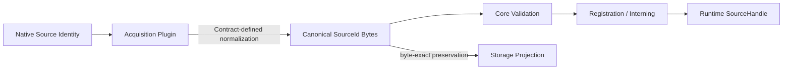

---

### 2.9.5 SourceSequence

SourceSequence 被严格定义为：

> Source 自身产生，并明确以 SourceId 为作用域的 sequence counter。

合法例子：

```text
DDS DataWriter publication sequence
camera source frame counter
```

不能自动映射的例子：

```text
ROS/DDS reader reception sequence
transport receive sequence
connection-local sequence
stream-global packet counter
session-global counter
```

只有：

```text
source-originated
+
SourceId-scoped
```

的 sequence 才属于 SourceSequence。

---

### 2.9.6 SourceId Absent 时的 Native Sequence

可能存在：

```text
native sequence available
SourceId unavailable
```

例如某个 transport 或 device SDK 提供 packet/frame counter，但 RoDAQ 无法建立可靠 Source identity。

这种情况下：

```text
native sequence
≠ SourceSequence
≠ AcceptanceSequence
```

Acquisition Plugin 不得：

- 为保存 native sequence 创建 fake SourceId；
- 把 native sequence 填入 AcceptanceSequence；
- 把 reader-side 或 connection-side sequence 当成 source-originated sequence。

如果 native sequence 已编码在 source-native Payload 中：

```text
Payload bytes
    └── protocol counter
```

它自然随 Payload 保存。

如果 sequence 只存在于 Acquisition Source metadata 中，而 Canonical Model 没有对应 Record-level primitive：

> 它不会自动成为 Canonical State。

Plugin 可以在 source-specific pipeline 中使用该 metadata，但不能声称 Canonical Record 已保存该值。

只有未来多个 Source 共同证明：

> 某类 non-SourceId-scoped sequence 必须成为跨 Source 稳定 Record-level primitive

时，才重新打开 Canonical Model。

---

### 2.9.7 SourceSequence Presence

SourceSequence 必须满足：

```text
SourceSequence present
    ⇒
SourceId present
```

因为没有 Source identity，就无法完整解释 source-scoped sequence。

但：

```text
SourceId present
    ⇏
SourceSequence present
```

Source 可以没有 sequence capability。

---

### 2.9.8 Presence 属于 Canonical State

以下状态不同：

```text
SourceSequence = absent
```

与：

```text
SourceSequence = 0
```

Storage round-trip 必须同时保存：

```text
presence
value
```

不能用零代替 absent。

---

## 2.10 SourceDescriptor 的边界

早期设计可以很自然地形成：

```text
SourceId
    ↓
SourceDescriptor
```

但经过 ROS2、DDS、SocketCAN 和直接 Sensor 场景反推后，目前没有得到足够稳定的最小 SourceDescriptor contract。

以下内容并不天然同构：

```text
ROS publisher GID
DDS writer GUID
camera serial
ECU identity
generic socket peer
```

如果强行定义：

```text
source_type
native_id_blob
transport
endpoint
metadata
```

很容易演变成：

```text
Generic Source PropertyBag
```

因此：

> **SourceId 保留为 canonical primitive；SourceDescriptor 不属于当前冻结核心模型。**

这不是删除 Source 概念，而是避免冻结一个没有稳定共同语义的抽象对象。

是否加入 SourceDescriptor，需要等待：

```text
ROS2 Acquisition Plugin Contract
DDS Acquisition Plugin Contract
SocketCAN Acquisition Plugin Contract
```

进一步验证。

---

## 2.11 SchemaDescriptor

SchemaDescriptor 表示：

> 可选、不可变的类型描述。

概念上：

```text
SchemaDescriptor
├── SchemaId
├── SchemaFormat
├── optional TypeIdentifier
└── representation
```

其中：

```text
representation
```

对 Canonical Core 是 opaque bytes。

Acquisition Plugin 可以负责提取：

```text
SchemaFormat
TypeIdentifier
representation bytes
```

因为这些属于 source-native facts。

Plugin 不应负责：

```text
allocate SchemaId
deduplicate SchemaDescriptor
manage Schema registry
```

这些属于 Core / Runtime canonical infrastructure。

---

## 2.12 TypeIdentifier

TypeIdentifier 表示：

> 在当前 Schema representation 中选择用于解释 Payload 的具体类型。

例如一份：

```text
Protobuf FileDescriptorSet
```

可能定义：

```text
MessageA
MessageB
MessageC
```

只靠：

```text
SchemaFormat
+
representation bytes
```

无法知道 Payload 使用哪个 Message。

因此需要：

```text
TypeIdentifier = company.robot.MessageB
```

同理：

```text
ROS2:
    sensor_msgs/msg/Image

DDS:
    RobotState

FlatBuffers:
    RobotState
```

TypeIdentifier 可以 absent，但必须满足：

> 如果 Schema representation 无法唯一确定用于解释 Payload 的具体类型，则 TypeIdentifier 必须存在。

该约束由 Acquisition Plugin 保证。

Canonical Core 不解析 Schema representation 来验证该条件。

Core 负责：

```text
Schema registration
SchemaId
descriptor association
```

---

## 2.13 Schema Evolution 与 Late Schema

### 2.13.1 Schema Change

如果最初：

```text
Descriptor 10
    SchemaId = absent
```

后来 Schema 可用：

```text
Schema A
```

必须创建：

```text
Descriptor 11
    SchemaId = Schema A
```

不能原地修改 Descriptor 10。

同样：

```text
Schema A → Schema B
Schema A → absent
```

都必须创建新 StreamDescriptorId。

Plugin 负责报告：

```text
schema fact changed
```

Core / Runtime 负责 actual descriptor evolution。

---

### 2.13.2 Late Schema

某些 Source 可能出现：

```text
data arrives
    ↓
schema later available
```

例如 Dynamic DDS type discovery。

允许两种策略。

#### 策略 A：暂存 Source Sample

```text
sample arrives
    ↓
Acquisition Plugin 暂存
    ↓
schema arrives
    ↓
Core registers SchemaDescriptor
    ↓
Core registers StreamDescriptor
    ↓
emit canonical Record
```

#### 策略 B：允许 Schema Absent

如果 PayloadEncoding 本身足够让数据保持有效：

```text
Descriptor 10
    SchemaId = absent
```

可以先 emit Record。

Schema 后续可用：

```text
Schema A

Descriptor 11
    SchemaId = Schema A
```

后续 Record 引用 Descriptor 11。

历史 Record 永远继续引用 Descriptor 10。

这些历史 Record 不是“不完整 Record”。

它们的 canonical truth 是：

> 当时的 interpretation contract 明确记录 Schema 为 absent。

Schema 后来可用，不 retroactively 修改历史 Canonical State。

如果需要重新生成带 Schema 的历史数据：

> 属于 explicit Transform，而不是原地修补。

---

## 2.14 Schema Fidelity

### 2.14.1 Schema Representation 是 Canonical Opaque Bytes

Canonical Core 不解析 Schema representation，因此 Canonical Model 不定义：

> 两份不同 Schema bytes 是否“语义等价”。

Schema representation 进入 Canonical Model 后即成为：

> canonical opaque bytes。

如果 Acquisition Plugin 希望对 IDL：

```text
normalize whitespace
canonicalize ordering
convert format
```

必须在提交 Schema facts 前完成。

SchemaDescriptor 注册后：

```text
representation bytes
```

就是 Canonical State。

Lossless Storage round-trip 必须：

```text
byte-for-byte identical
```

恢复 representation。

Storage 不得：

```text
normalize
rewrite
reformat
translate
```

之后仅返回“语义等价”的 Schema。

---

### 2.14.2 SchemaDescriptor Equality

Identity-preserving round-trip 中，SchemaDescriptor equality 至少要求：

```text
SchemaId identical
SchemaFormat identical
TypeIdentifier presence/value identical
representation bytes byte-for-byte identical
```

TypeIdentifier absent 与任何 non-empty identifier 不相等。

Storage 可以压缩 Schema bytes。

但 full-fidelity mode 必须满足：

```text
Decode(Compress(X)) == X
```

不能只保持“语义近似”。

---

### 2.14.3 SchemaFormat 与 PayloadEncoding

例如 ROS2：

```text
SchemaFormat:
    ros2/msg

PayloadEncoding:
    cdr
```

DDS：

```text
SchemaFormat:
    omg/idl

PayloadEncoding:
    xcdr2
```

FlatBuffers：

```text
SchemaFormat:
    flatbuffers/bfbs

PayloadEncoding:
    flatbuffer
```

因此两者使用独立 identifier namespace。

当前不建立中央 registry。

Identifier 必须满足 Canonical Identifier equality 规则。

---

## 2.15 Descriptor Graph 与 Referential Integrity

冻结核心 Descriptor Graph：

```text
Record
 │
 └── StreamDescriptorId
            │
            ▼
     StreamDescriptor
        ├── StreamId
        ├── StreamName
        ├── SchemaId? ───────────────→ SchemaDescriptor
        ├── PayloadEncoding
        └── TimestampKeySetId ───────→ TimestampKeySet
                                            │
                                            └── ClockId[]
                                                    │
                                                    ▼
                                             ClockDescriptor[]
```

Record 的：

```text
SourceId
```

是 scope-local opaque identity，不要求解析到 Descriptor。

### 图 2-5 Descriptor Referential Closure

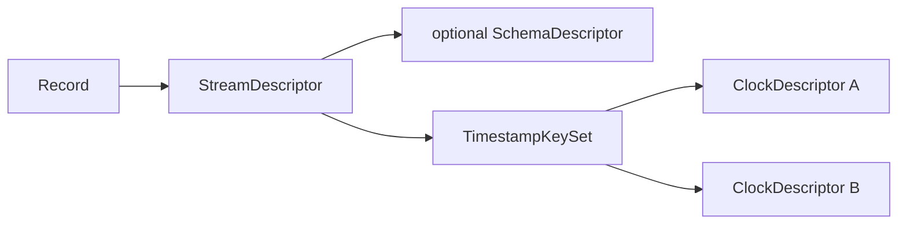

---

### 2.15.1 Referential Integrity

Canonical Descriptor Graph 必须 referentially closed。

对于任何有效 Record 所直接或间接引用的 required Descriptor：

1. DescriptorId 必须存在；
2. 每个 DescriptorId 必须解析到且只能解析到一个 immutable Descriptor；
3. 被引用 Descriptor 必须属于同一 Identity Scope；
4. 所有进一步 required references 必须递归满足相同规则。

非法例子：

```text
Record → missing StreamDescriptor
StreamDescriptor → missing TimestampKeySet
TimestampKeySet → missing ClockDescriptor
```

SchemaId absent 是合法状态。

但如果 SchemaId present，则对应 SchemaDescriptor 必须存在。

SourceId 当前没有 Descriptor reference，因此不参与 Descriptor Graph referential-integrity 检查。

“唯一”明确指：

> 一个 DescriptorId 只能解析到一个 immutable Descriptor。

而不是：

> Descriptor content 在 Scope 中只能出现一次。

因此：

```text
SchemaId 10 → content X
SchemaId 20 → content X
```

合法。

但是：

```text
SchemaId 10 → content X
SchemaId 10 → content Y
```

非法。

即：

```text
descriptor identity uniqueness
≠ descriptor content uniqueness
```

保证 referential closure 是 Core / Runtime 的责任。

Acquisition Plugin 只提供 source-native facts。

---

### 2.15.2 Descriptor Identity 与 Content

在同一 Identity Scope 中：

```text
same DescriptorId
    ⇒
same immutable descriptor
```

但是：

```text
same descriptor content
    ⇏
same DescriptorId
```

例如：

```text
SchemaId 10
representation = X
```

和：

```text
SchemaId 20
representation = X
```

可以同时存在。

Consumer 不能使用：

```text
content equality
```

推导：

```text
identity equality
```

同样不能假设：

```text
相同 ClockDescriptor 内容
```

一定代表同一个 Clock instance。

该规则适用于：

```text
StreamDescriptor
SchemaDescriptor
ClockDescriptor
TimestampKeySet
```

---

## 2.16 Runtime Descriptor Handoff 边界

Canonical invariant：

> Record 所引用的 Descriptor Graph 必须能够唯一解析。

至于：

```text
Descriptor 什么时候 publish
Record 什么时候 expose
是否先 buffer
```

属于 Runtime Contract。

在 dependent Record 对 consumer 可见前，其实际引用的 required Descriptor 必须已经注册并可见。

例如：

```text
Record
  ↓
Descriptor 10
  ├── SchemaId = absent
  └── TimestampKeySet 3
       ↓
     Clock 2
```

在 Record 对外可见前，只要求：

```text
Descriptor 10
TimestampKeySet 3
Clock 2
```

已经存在。

不要求未来可能出现的：

```text
Schema A
Descriptor 11
```

提前存在。

因此 descriptor-before-use 与 late-schema 策略 B 不冲突。

Canonical Model 不承担：

```text
先接受 unresolved Record
未来再补 Descriptor
```

这种全局 pending mechanism。

Runtime 合法行为：

```text
descriptor ready
    → expose Record

descriptor not ready
    → delay/buffer Record

cannot become ready / resource limit
    → reject/drop according to Runtime policy
```

不能：

```text
先公开 unresolved canonical Record
    ↓
未来再补 Descriptor
```

---

### 2.16.1 Descriptor Lifecycle Responsibility

Descriptor identity allocation、registration、lifetime、referential closure 和 evolution mechanics 属于：

> RoDAQ Core / Runtime

普通 Acquisition Plugin 不应负责：

```text
StreamDescriptorId allocation
SchemaId allocation
ClockId allocation
TimestampKeySetId allocation

Descriptor registry
Descriptor dedup
Descriptor publication
Descriptor lifetime
Graph closure
```

Plugin 的职责是：

```text
report source-native facts
report source-native fact changes
```

例如：

```text
schema became available
source clock restarted
payload encoding changed
native stream renamed
```

Core 负责 canonical descriptor evolution。

---

# 3. 时间模型与 Payload

## 3.1 Clock Model

ClockDescriptor 表示：

> 一个具体 Clock instance。

不是 clock type。

最小形式：

```text
ClockDescriptor
├── ClockId
├── resolution
└── ClockOrigin
```

不包含 mandatory ClockOwner。

---

### 3.1.1 ClockOwner 不进入冻结核心

ClockOwner 可以用于描述：

```text
host-A
camera-0
can-controller-0
```

但目前：

- 不参与 Clock equality；
- 不决定 Clock comparability；
- 不建立 Clock correlation；
- 不决定 ClockOrigin；
- 缺乏成熟 Host/Device identity model。

如果现在冻结 ClockOwner，会进一步引出：

```text
HostId
DeviceId
ComponentId
Owner hierarchy
```

这些不是 Canonical Data Model 当前所必需。

因此只要求：

> 同一 Identity Scope 内，每一个实际不同的 Clock instance 都必须拥有不同 ClockId。

例如：

```text
Host A monotonic
Host B monotonic
```

如果属于同一个 Identity Scope：

```text
ClockId A != ClockId B
```

必须成立。

---

### 3.1.2 ClockId Allocation 属于 Core / Runtime

Canonical Model 只定义：

> 不同实际 Clock instance 在同一 Identity Scope 内不得共享同一个 ClockId。

Acquisition Plugin 提供：

```text
native Clock identity facts
resolution
origin semantics
restart/reset evidence
```

RoDAQ Core / Runtime 负责：

```text
establish canonical Clock identity
allocate ClockId
register ClockDescriptor
manage Clock evolution
```

Plugin 不应直接分配：

```text
ClockId = 7
```

在 distributed / multi-host 场景中，Runtime 必须确保：

```text
Host A CLOCK_MONOTONIC
Host B CLOCK_MONOTONIC
```

如果属于同一 Identity Scope：

```text
ClockId A != ClockId B
```

Runtime 可以使用：

```text
host identity
runtime identity
device identity
local registry
distributed allocator
```

等机制。

这些机制不属于 Canonical Data Model。

V1 是否允许多个独立 Runtime/Host 同时向一个 active Identity Scope 分配 ClockId，属于 Implementation Profile。

---

## 3.2 Resolution 与 ClockOrigin

### 3.2.1 Resolution

Clock resolution 定义为：

> seconds per tick

采用正有理数：

```text
numerator / denominator
```

Canonical form 必须满足：

```text
numerator > 0
denominator > 0
gcd(numerator, denominator) = 1
```

必须约分到最简形式。

例如：

```text
1000 / 1,000,000,000,000
```

不是 canonical form。

必须归一化为：

```text
1 / 1,000,000,000
```

因此：

```text
1 ns/tick
```

只有一个 canonical representation。

---

### 3.2.2 Resolution 示例

```text
1 ns
=
1 / 1,000,000,000 s per tick
```

```text
90 kHz
=
1 / 90,000 s per tick
```

```text
48 MHz
=
1 / 48,000,000 s per tick
```

不使用 floating point 作为 canonical semantics，以避免：

```text
rounding
equality ambiguity
round-trip drift
```

---

### 3.2.3 ClockOrigin

ClockOrigin 描述：

> ClockReading = 0 对应的时间参考起点语义。

ClockOrigin 是 Canonical Identifier。

例如：

```text
rodaq/monotonic_unspecified
rodaq/unix_epoch
rodaq/tai_epoch
rodaq/device_power_on
vendor/device_epoch
```

完整标准 Origin vocabulary 尚未冻结。

ClockOrigin 相同：

```text
≠ Clock identity 相同
≠ Clock 可直接比较
```

Unknown ClockOrigin 必须在 lossless round-trip 中无损保留。

---

## 3.3 ClockReading、Wrap 与 Restart

### 3.3.1 ClockReading

ClockReading 是：

> signed integer tick value

允许：

```text
negative
zero
positive
```

Canonical Model 不把 ClockReading 固定为纳秒。

设备可能提供：

```text
90 kHz
48 MHz
device tick
FPGA cycle
```

V1 implementation 至少需要验证 signed 64-bit 是否足够，但 Canonical Model 不冻结最终 ABI 位宽。

---

### 3.3.2 Counter Wrap

设备可能提供：

```text
32-bit counter
48-bit counter
```

例如：

```text
0xfffffffe
0xffffffff
0x00000000
0x00000001
```

Natural counter wrap 与 Clock restart 是不同问题。

Counter wrap 可能仍属于：

> 同一个 Clock instance 的连续时间基准

只需要 Source-specific unwrap/normalization。

Canonical Model 不引入：

```text
modulus
wrap epoch
unwrap state
```

体系。

source-specific unwrap/normalization 的语义责任属于：

> Acquisition Plugin / Acquisition Contract

Core 不应该猜：

```text
counter width
modulus
wrap threshold
device reboot behavior
sentinel values
```

Core / Runtime 可以提供 generic helper implementation，但：

```text
helper implementation
≠ semantic responsibility
```

---

### 3.3.3 Clock Restart / Reset

如果 Clock 的连续解释关系被破坏，例如：

```text
device power cycle
hardware clock reset
PTP clock recreation
Runtime-created epoch reset
```

必须认为原 Clock instance 已结束。

例如：

```text
ClockId = 10

100001
100002
100003

--- device restart ---

0
1
2
```

不能继续使用：

```text
ClockId = 10
```

否则：

```text
same ClockId
→ directly comparable
```

的 invariant 会失效。

因此：

> **任何破坏 ClockReading 连续解释关系的 Clock restart/reset 都必须创建新的 ClockId。**

Plugin 负责报告：

```text
native clock restart/reset detected
```

Core / Runtime 负责：

```text
allocate new ClockId
register new ClockDescriptor
update TimestampKeySet
update StreamDescriptor
```

---

### 3.3.4 Clock Restart 对 Descriptor 的影响

如果：

```text
TimestampKeySet A
    (RoleX, ClockId 10)
```

Clock reset 后：

```text
ClockId = 11
```

必须创建：

```text
TimestampKeySet B
    (RoleX, ClockId 11)
```

进一步产生新的：

```text
StreamDescriptorId
```

旧 Record 继续引用旧 KeySet / Clock。

新 Record 使用新 KeySet / Clock。

Clock restart 因此自然纳入 immutable Descriptor Graph。

### 图 3-1 Clock Restart 引发的 Descriptor Evolution

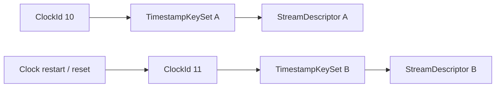

---

## 3.4 Clock Comparability

默认 comparability rule：

```text
same Identity Scope
+
same ClockId
        ↓
directly comparable
```

而：

```text
ClockId A != ClockId B
        ↓
not directly comparable by default
```

即使：

```text
resolution 相同
ClockOrigin 相同
```

也不能自动比较。

未来只有明确：

```text
ClockCorrelation
```

才能建立不同 Clock 之间的映射。

---

### 3.4.1 跨 Scope Clock

跨 Identity Scope 的 Clock 默认不可比较。

即使两个 Clock 在现实系统中可能来自：

```text
同一个 Linux CLOCK_MONOTONIC
```

Canonical Model 也不自动推断这种关系。

如果需要跨 Scope preserve Clock identity 或建立 correlation，应由 Artifact / Import / ClockCorrelation 显式表达。

---

## 3.5 Timestamp Role 与 RoleIdentifier

### 3.5.1 Role 与 Clock 分离

Timestamp Role 回答：

> 这个时间表示什么事件？

Clock 回答：

> 使用哪个时间基准表示？

不能定义：

```text
DeviceRaw
SystemClock
DDSClock
```

作为 Timestamp Role。

例如：

```text
capture @ camera.device.clock
capture @ host.monotonic
```

可以描述同一 Capture event 在不同 Clock 上的 Reading。

因此 Role 与 Clock 必须正交。

---

### 3.5.2 Standard Role 与 Candidate Role

正式冻结的 RoDAQ standard Role：

```text
rodaq/acquisition_ingress
```

其语义：

> RoDAQ Runtime 在 Record acceptance path 建立的 canonical local-monotonic ingress timestamp。

这里使用 `ingress` 而不是 `receive` 是有意的。

它表示：

> 数据进入 RoDAQ acceptance path 的 canonical ingress event。

不等于：

```text
middleware receive
transport receive
hardware receive
socket receive
```

以下目前仍只是 candidate/example：

```text
rodaq/capture
rodaq/publish
rodaq/transport_receive
rodaq/hardware_receive
```

在 ROS2/DDS/SocketCAN/Camera/DAQ Plugin Contract 完成前，不冻结为永久 standard vocabulary。

---

### 3.5.3 Role Namespace

RoleIdentifier 使用 namespace-qualified Canonical Identifier。

RoDAQ standard Role：

```text
rodaq/*
```

第三方：

```text
com.vendor/hardware_latch
org.project/trigger
```

这避免多个 Plugin 使用：

```text
Capture
```

却赋予不同语义。

如果第三方概念语义与已有 standard Role 完全一致，应使用 standard Role，而不是创建重复 vendor Role。

具体 native timestamp 应映射到：

```text
standard role
plugin-contract role
vendor-specific role
```

属于 Acquisition Plugin Contract。

---

### 3.5.4 Runtime Role Handle

Canonical RoleIdentifier 是 UTF-8 identifier。

高频 Runtime 不要求每条 Timestamp 保存字符串。

可以：

```text
"rodaq/acquisition_ingress"
        ↓ intern
RoleHandle = 1
```

只要：

```text
RoleHandle ↔ Canonical RoleIdentifier
```

可恢复即可。

Runtime RoleHandle 不属于 Canonical State。

---

### 3.5.5 Plugin Timestamp Responsibility

Acquisition Plugin 负责：

> native timestamp observation 的真实 semantic meaning 和 native Clock information。

Core / Runtime 负责：

```text
RoleIdentifier
ClockDescriptor
TimestampKey
TimestampKeySet
runtime slot binding
```

Plugin 可以在 registration/discovery 阶段报告：

```text
source publish timestamp
hardware receive timestamp
device capture timestamp
```

具体 API 由 Plugin Contract 定义。

steady-state Plugin 不应每条 Record 传递：

```text
Role string
ClockId
TimestampKeySetId
```

这些由 runtime binding 处理。

---

### 3.5.6 Unknown Role

未来 Plugin 可以写入旧 Reader 不认识的：

```text
com.vendor/hardware_latch
```

旧 Reader 不理解含义。

仍然必须保留：

```text
RoleIdentifier
ClockId
presence
ClockReading when present
```

不能：

```text
drop
mark invalid
replace with generic unknown timestamp
```

因此：

> Unknown Role ≠ invalid data。

Consumer 可以拒绝执行依赖该 Role 的算法，但 read→write 不能丢失其 Canonical State。

---

## 3.6 TimestampKey 与 TimestampKeySet

### 3.6.1 TimestampKey

TimestampKey：

```text
(RoleIdentifier, ClockId)
```

例如：

```text
(rodaq/acquisition_ingress, ClockId 3)
(com.vendor/hardware_latch, ClockId 8)
```

TimestampKey 是 Record-level Timestamp 的 canonical semantic key。

也是 TimestampStateMap 的 key。

---

### 3.6.2 TimestampKeySet

TimestampKeySet 的 canonical 语义：

> 唯一 TimestampKey 的无序集合。

例如：

```text
{
    (rodaq/acquisition_ingress, ClockId 3),
    (com.vendor/hardware_latch, ClockId 8)
}
```

Canonical TimestampKeySet 不定义：

```text
slot 0
slot 1
slot 2
```

也不规定 iteration order。

---

### 3.6.3 TimestampKey 唯一性

一个 TimestampKeySet 中：

```text
(RoleIdentifier, ClockId)
```

必须唯一。

合法：

```text
RoleA @ Clock1
RoleA @ Clock2
```

非法：

```text
RoleA @ Clock1
RoleA @ Clock1
```

重复出现。

---

### 3.6.4 TimestampKeySet Equality

TimestampKeySet 是无序集合。

因此：

```text
{A, B}
```

与：

```text
{B, A}
```

canonical semantic content 相同。

但仍可能拥有不同：

```text
TimestampKeySetId
```

因为：

```text
same descriptor content
⇏
same DescriptorId
```

Runtime / Import 可以 dedup，也可以不 dedup。

---

### 3.6.5 TimestampKeySet Immutability

TimestampKeySet 一旦被 StreamDescriptor 引用：

> immutable。

发生：

```text
new Role
new Clock
removed Role
ClockId changed
```

必须创建新的 TimestampKeySetId。

随后创建新的 StreamDescriptorId。

不需要：

```text
TimestampKeySetRevision
TimestampKeySetVersion
```

---

### 3.6.6 TimestampKeySet Construction Responsibility

TimestampKeySet 是 Canonical State，不是 Plugin construction responsibility。

Acquisition Plugin 提供：

```text
timestamp capabilities
semantic meaning
native clock facts
```

RoDAQ Core / Runtime 负责：

```text
Clock identity
TimestampKey construction
TimestampKeySet registration
TimestampKeySetId allocation
key-set evolution
```

Runtime 可以将 TimestampKeySet 编译成 slot。

slot 不属于 Canonical State。

---

## 3.7 TimestampStateMap

TimestampStateMap：

```text
TimestampKey
    ↓
TimestampState
```

TimestampState：

```text
Absent
```

或者：

```text
Present(ClockReading)
```

因此 TimestampStateMap 不是 canonical positional array。

---

### 3.7.1 TimestampStateMap 必须覆盖整个 TimestampKeySet

TimestampKeySet 与 TimestampStateMap 位于不同层次：

> TimestampKeySet 是低频 immutable Descriptor，被 StreamDescriptor 引用；TimestampStateMap 是高频 Record field，每个 Record 都有一份。前者定义允许出现哪些 TimestampKey，后者给出当前 Record 对这些 key 的实际状态。

对于 Record 所引用 StreamDescriptor 的 TimestampKeySet：

> 每一个 TimestampKey 都必须有明确状态。

语义上：

```text
TimestampStateMap.keys
==
TimestampKeySet.keys
```

区别只在于：

```text
Present
```

或：

```text
Absent
```

因此 absent Timestamp 不是：

```text
这个 key 没有出现在 Record 中
```

而是：

```text
key 存在
state = Absent
```

这避免 omission 产生语义歧义。

---

### 3.7.2 Runtime Slot Representation

为了高性能，Runtime 可以注册 TimestampKeySet 后建立：

```text
TimestampKey A → slot 0
TimestampKey B → slot 1
TimestampKey C → slot 2
```

Runtime Record 可以使用：

```text
slot_values[0]
slot_values[1]
slot_values[2]
```

但：

```text
slot index
slot ordering
array layout
```

属于 Runtime representation。

它们：

- 不参与 canonical equality；
- 不属于 TimestampKeySet canonical identity；
- Storage round-trip 不需要恢复相同 slot numbering。

只需要恢复：

```text
TimestampKey
→ TimestampState
```

映射。

Canonical Model 不限制 maximum slot count。

Implementation Profile 可以限定小上限。

如果合法 TimestampKeySet 超过当前 Profile 上限，必须根据发生阶段明确拒绝：

- 如果 Plugin 在 capability 声明阶段已经表明所需 TimestampKey 数量超过 Profile 上限，应在 capability 声明阶段明确拒绝该 capability，使 Plugin 不会误认为该 capability 已被当前 Profile 接受。
- 如果 Plugin 在运行过程中请求注册新的 TimestampKeySet，而新的 key set 超过 Profile 上限，应在 registration 阶段拒绝该注册请求；原有已生效 Descriptor 保持有效，新的 Record 不得使用未注册成功的 TimestampKeySet。

无论在哪个阶段被拒绝，都不得：

```text
truncate
silently omit TimestampKey
改变 Role
把 Present 改成 Absent
```

### 图 3-2 TimestampStateMap 与 Runtime Slots

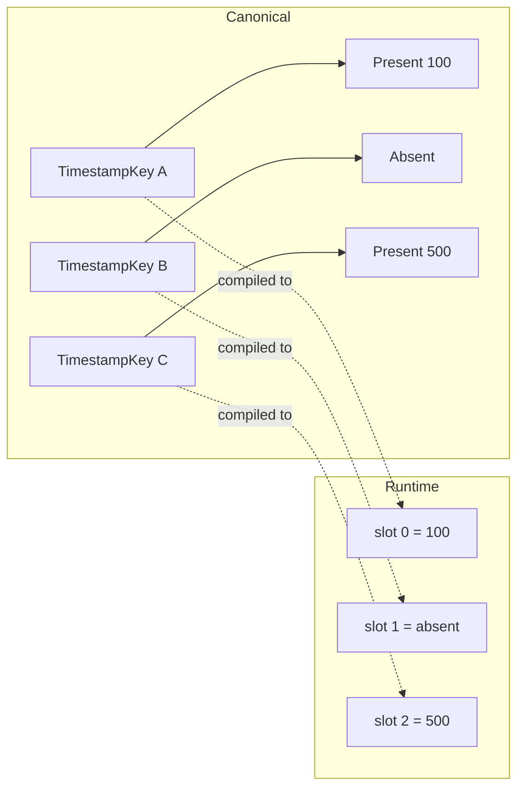

---

## 3.8 Acquisition Ingress Role

`rodaq/acquisition_ingress` 是 mandatory canonical Role。

每个有效 Record 必须具有：

```text
TimestampKey:
    (rodaq/acquisition_ingress,
     Runtime designated local monotonic ClockId)
```

对应 TimestampState 必须：

```text
Present
```

不能 Absent。

Runtime Contract 负责指定哪个 ClockId 是当前 Runtime 的 canonical local-monotonic ingress Clock。

Canonical Core 不需要通过 ClockDescriptor 字段重新推断其 monotonic 属性。

---

### 3.8.1 Runtime Acceptance Semantics

`rodaq/acquisition_ingress` 表示：

> RoDAQ Runtime 在 Record acceptance path 内建立的 local-monotonic timestamp。

Canonical Model 不规定：

```text
callback entry
validation
admission
sequence allocation
enqueue CAS
```

哪条 CPU instruction 是 timestamp sampling point。

Runtime 必须定义明确 admission/acceptance contract，并保证以下三者的语义一致：

```text
AcceptanceSequence
rodaq/acquisition_ingress
accepted count
```

其中：

- `AcceptanceSequence` 在 stream-local admission attempt 上分配。某次 attempt 最终被拒绝时，已经分配的 sequence value 被消耗且不得复用，但不会产生 canonical Record。
- `rodaq/acquisition_ingress` 是 accepted canonical Record 的 mandatory timestamp；被拒绝的 attempt 不会留下 canonical `rodaq/acquisition_ingress` state。
- `accepted count` 表示 final admission outcome 为 accepted、并因此形成 canonical Record 的 attempt 数量。它统计 accepted Records，而不是 sequence allocation 次数，因此不要求等于已分配 AcceptanceSequence value 的数量，也不能仅由最大 AcceptanceSequence 推导。

因此，sequence allocation、ingress timestamp capture、final admission outcome 和 accepted-count increment 的具体线性化顺序由 Runtime Contract 定义，但必须满足上述逻辑关系。

`per-stream serialized ingress` 是一种可行的 Runtime 实现策略。

它属于 Runtime Implementation Profile，不属于 Canonical Model，也不构成 Canonical semantics 的要求。

如果一个 Stream 有多个 Source：

> AcceptanceSequence 仍以 Stream 为 scope。

所有进入同一 Stream 的 accepted Records 必须形成统一 per-stream acceptance order。

具体串行化或线性化机制属于 Runtime Contract。

---

## 3.9 Multi-sensor 与 Payload-internal Time

### 3.9.1 多 Sensor 共用 Clock

TimestampKey uniqueness 只在：

```text
同一个 TimestampKeySet
```

内成立。

例如 Camera A 与 Camera B 共用 PTP Clock：

```text
Stream A
    KeySet A
        CaptureCandidateRole @ SharedClock

Stream B
    KeySet B
        CaptureCandidateRole @ SharedClock
```

完全合法。

---

### 3.9.2 Payload 内多个子事件

如果一个 Record Payload 是 stereo bundle：

```text
Stereo Record
└── Payload
    ├── Camera A image @ T1
    └── Camera B image @ T2
```

这些属于：

> Payload 内部多个子样本的时间语义。

Canonical TimestampKeySet 不因为 Payload 内部结构增加：

```text
SourceInstance
sensor index
subsample index
```

等维度。

---

### 3.9.3 Payload 内部时间与 Canonical Alignment

如果某个 Payload 内部时间只存在于 opaque Payload：

> Canonical Runtime 不承诺理解、索引或使用这些内部时间进行跨 Stream 对齐。

例如：

```text
Payload
├── Camera A Capture = T1
└── Camera B Capture = T2
```

如果 T1/T2 只存在 Payload 内，Canonical 系统不会自动用它们与：

```text
IMU Stream
LiDAR Stream
```

进行 alignment。

如果 Plugin 需要某个时间参与：

```text
ordering
alignment
indexing
latency analysis
```

就必须把对应对象提升到 Record level。

例如：

```text
Camera A Stream
    Record A
        Capture = T1

Camera B Stream
    Record B
        Capture = T2
```

因此：

> **需要参与 canonical identity、ordering、alignment 或 indexing 的对象，应成为独立 Record 或独立 Stream；仅存在于 Payload 内的信息对 Canonical Core 不可见。**

Acquisition Plugin 必须报告所有需要 canonical 可见性的 native time semantics。

Core / Runtime 将其映射成 Record-level TimestampKey/Binding。

如果：

```text
Payload {
    hidden_capture_time = ...
}
```

Plugin 没有把该时间作为 canonical-capable timestamp observation 报告，则 Canonical Model：

```text
不会解析
不会发现
不会验证
不会使用
```

该时间。

---

## 3.10 Payload Semantics

Canonical Payload 是：

> immutable opaque encoded logical byte string

“logical” 很重要。

它不等于：

```text
one contiguous memory allocation
```

Canonical Payload 只规定：

1. logical bytes 有稳定顺序；
2. logical content 在 Record 生命周期内不可变；
3. PayloadEncoding 能定义这些 bytes 的解释方式；
4. Runtime representation 不影响 canonical equality。

---

### 3.10.1 Payload 不是通用 In-memory Object Graph

Canonical Data Model 面向：

> 可持久化的数据采集单元

而不是任意 in-memory object graph。

因此不会为了：

```text
Arrow
camera planes
tensor
audio buffers
```

提前引入：

```text
BufferGraph
TensorDescriptor
PlaneDescriptor
Array hierarchy
```

如果某个 Source 数据由多个物理 buffer 组成，PayloadEncoding 应定义 deterministic logical encoded byte representation。

Runtime 可以通过 scatter/gather 避免 copy。

Implementation Profile 是否支持 scatter/gather 属于 Runtime/Profile，不属于 Canonical semantics。

---

## 3.11 Runtime Scatter/Gather

Runtime 可以使用：

```text
segment0
segment1
segment2
```

表示 Payload。

Canonical logical bytes：

```text
segment0 || segment1 || segment2
```

segment 顺序必须确定。

例如：

```text
Payload A:
    [abcdef]
```

和：

```text
Payload B:
    [abc] [def]
```

如果 logical concatenation 都是：

```text
abcdef
```

则 canonical equal。

Canonical equality 不比较：

```text
segment count
segment boundary
memory address
allocator
ownership model
```

这些属于 Runtime representation。

V1 Implementation Profile 可以只支持：

```text
contiguous external buffer
small inline buffer
```

而不实现通用 scatter/gather。

---

## 3.12 Payload Immutability 与 Fidelity

### 3.12.1 Immutability

Record 被 RoDAQ 接受后：

> Payload logical bytes 必须 immutable。

Acquisition Plugin 不得在：

```text
Queue
Storage
Runtime
```

仍可能读取 Buffer 时修改内容。

具体：

```text
anchor/release
shared ownership
custom deleter
buffer adoption
```

属于 Plugin ABI。

---

### 3.12.2 Fidelity

如果 Source 提供原始 serialized bytes：

```text
ROS CDR
DDS CDR
camera encoded frame
raw CAN representation
```

默认 lossless Storage 必须恢复：

> byte-for-byte identical logical bytes。

Storage 不能隐式：

```text
CDR → JSON
JPEG → RGB
CAN frame → decoded signals
```

然后声称得到同一个 Canonical Payload。

如果提供 Transform mode，必须明确区分 transformed output 和 canonical source truth。

Storage 可以使用：

```text
physical compression
chunk compression
container compression
```

但 full-fidelity mode 必须保证 Decode 后 Payload logical bytes 与原 canonical Payload：

```text
byte-for-byte identical
```

以下属于 lossy transformation：

```text
JPEG quality change
audio lossy transcode
sensor value quantization
semantic decode/re-encode with non-identical bytes
```

不能声明为 full-fidelity Storage Projection。

---

# 4. Ordering、Storage Projection、Round-trip 与验证

## 4.1 Ordering Semantics

### 4.1.1 Per-stream Ordering

Canonical Model 提供：

```text
per-stream AcceptanceSequence order
```

例如：

```text
Stream A:
10
11
15
```

具有明确 acceptance order。

---

### 4.1.2 不提供 Global Total Order

例如：

```text
Stream A seq = 100
Stream B seq = 50
```

不能直接比较。

AcceptanceSequence 只在同一个 Stream 内有 ordering 语义。

---

### 4.1.3 Clock-based Cross-stream Ordering

如果两个 Record 都具有：

```text
same ClockId
```

下的 Present ClockReading，可以直接比较。

如果：

```text
ClockId A != ClockId B
```

默认不可比较。

因此 distributed acquisition 不天然产生 global time order。

---

## 4.2 Storage Projection

Storage Projection 负责：

```text
Canonical Semantics
        ↓
Storage-specific Projection
        ↓
Physical Representation
```

例如 MCAP：

```text
message
chunk
sidecar
```

SQLite：

```text
row
transaction
```

Parquet：

```text
row group
column chunk
```

Canonical Model 不要求这些物理结构一致。

### 图 4-1 Canonical State 到不同 Storage 的 Projection

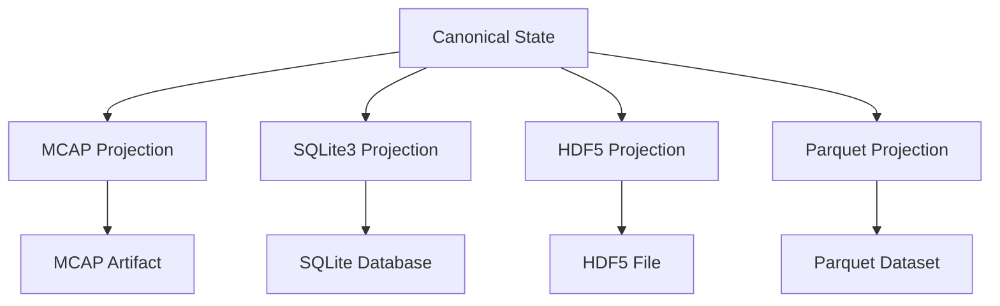

---

### 4.2.1 One Record 不等于 One Physical Record

Storage 可以：

```text
batch
chunk
compress
group
columnarize
```

只要能 losslessly 恢复 Canonical semantics。

例如：

```text
256 Canonical Records
    ↓
1 SQLite transaction
```

合法。

```text
256 Records
    ↓
1 Parquet RowGroup
```

也合法。

Record 是 canonical identity / delivery unit，不是 Storage transaction unit。

因此：

```text
Canonical Record
≠
MCAP physical record
≠
SQLite row
≠
Parquet row
```

---

### 4.2.2 Storage Fidelity 不等于 Per-plugin Codec Responsibility

Canonical Model 规定：

> 声明 full-fidelity 的 Storage 必须能够恢复全部 Canonical State。

但不要求：

> 每个 Storage Plugin 独立实现完整 Canonical serialization codec。

工程实现可以提供：

```text
Canonical State
        │
        ▼
RoDAQ common persistence support
        │
        ├── common descriptor encoding
        ├── common source extension
        ├── common timestamp extension
        ├── unknown identifier preservation
        └── validation
        │
        ▼
Storage Plugin
        │
        └── format-specific projection
```

Canonical Model 不冻结：

```text
CommonPersistenceLayer
CanonicalCodec
ExtensionBlock
SidecarFormat
```

等具体实现组件。

Canonical Model 只定义：

> 必须保存什么。

---

## 4.3 Lossless Storage Contract

Storage Plugin 如果声明：

```text
lossless
full-fidelity
```

必须保存全部 Canonical State，而不能只保存自己理解的部分。

包括：

```text
known fields
unknown forward-compatible identifiers
opaque bytes
presence/absence state
descriptor identities
SourceId bytes
```

如果 Storage Format 无法原生表达某项 Canonical State：

- 通过 extension representation 保存；
- 或拒绝声明 full-fidelity；
- 或显式进入 lossy mode。

不能静默丢弃。

---

### 4.3.1 Full-fidelity Physical Compression

Storage Projection 可以对 canonical bytes 使用 physical compression：

```text
chunk compression
block compression
dictionary compression
container compression
```

前提是 full-fidelity / lossless mode 完全可逆。

规则：

> 对任意 canonical byte sequence X，Decode(Encode(X)) 必须恢复 byte-for-byte identical 的 X。

即：

```text
Decode(Compress(X)) == X
```

适用于：

```text
Schema representation bytes
Payload logical bytes
SourceId bytes
Canonical Identifier bytes
opaque extension state
```

Storage 可以改变：

```text
physical layout
physical compression
block boundary
dictionary representation
internal ID
```

但不能改变 Decode 后的 Canonical Representation。

以下行为不能声明 full-fidelity：

```text
lossy image transcoding
lossy audio compression
quantization
semantic normalize-and-rewrite that changes opaque bytes
schema reformatting that changes representation bytes
```

即使结果：

```text
看起来相同
业务上近似
语义上可能等价
```

也不能等同于 canonical lossless preservation。

---

## 4.4 Identity-preserving Round-trip

只有 Runtime / Artifact 层能够确认 Decode 结果重新进入原 logical Identity Scope 时：

```text
Canonical X
    ↓
Encode
    ↓
Storage
    ↓
Decode
    ↓
Canonical X'
```

才属于：

> identity-preserving round-trip

此时：

```text
X' == X
```

必须成立。

如果原 Identity Scope 无法恢复或确认：

> 必须按 Cross-scope Import 处理。

### 图 4-2 Round-trip 与 Cross-scope Import


---

### 4.4.1 Round-trip Equality

Identity-preserving round-trip 至少包括：

```text
StreamId
StreamDescriptorId
StreamName

SourceId presence
SourceId bytes when present
SourceSequence presence/value

SchemaId
SchemaFormat
TypeIdentifier presence/value
Schema representation bytes

PayloadEncoding

TimestampKeySet semantic set
RoleIdentifier
ClockId
ClockDescriptor canonical field values
TimestampKey → TimestampState mapping
Timestamp presence
Timestamp readings

AcceptanceSequence

Payload logical bytes
```

SourceId equality：

```text
presence identical
+
when present:
    SourceId bytes byte-for-byte identical
```

以下不参与 canonical equality：

```text
Runtime slot order
Runtime SourceHandle
Storage-specific physical representation
```

---

## 4.5 Descriptor、Schema 与 Unknown-Identifier Fidelity

### 4.5.1 Descriptor Equality

Round-trip 不仅要求：

```text
same Descriptor ID
```

也要求 canonical descriptor field values 不变。

Descriptor equality：

> field-wise canonical comparison

而不是：

```text
memcmp(Runtime struct)
```

不要求：

```text
Runtime object padding
field memory order
allocator state
binary struct layout
```

相同。

例如 ClockDescriptor：

```text
ClockDescriptor
├── ClockId
├── resolution
└── ClockOrigin
```

equality：

```text
A.ClockId == B.ClockId

AND

A.resolution.numerator
==
B.resolution.numerator

AND

A.resolution.denominator
==
B.resolution.denominator

AND

A.ClockOrigin bytes
==
B.ClockOrigin bytes
```

Resolution 已经是 reduced positive rational，因此可逐字段比较。

例如：

```text
ClockId = 3
resolution = 1 / 1,000,000,000
```

Decode 后不能变成：

```text
ClockId = 3
resolution = 1000 / 1,000,000,000,000
```

即使数学值相同，因为后者不是 canonical reduced form。

---

### 4.5.2 Schema Fidelity

Schema representation 对 Core opaque。

因此 Schema round-trip 不使用：

```text
semantic equivalence
```

而要求：

```text
representation bytes
```

byte-for-byte identical。

例如 Storage 不可以：

```text
原 IDL
    ↓
格式化 whitespace
    ↓
输出新 IDL
```

然后声称 full-fidelity。

如果需要 canonicalize Schema：

> 必须在 Schema facts 进入 Canonical Model 前完成。

---

### 4.5.3 SourceId Fidelity

SourceId 是 opaque canonical identity。

Identity-preserving round-trip 中：

```text
SourceId bytes
```

必须 byte-for-byte identical。

Storage 可以内部：

```text
dictionary encode
compress
intern
normalize physical layout
```

但 Decode 后必须恢复原始 Canonical SourceId bytes。

必须区分：

```text
Acquisition-time source-specific normalization
```

与：

```text
Storage-time canonical preservation
```

Acquisition-time normalization 发生在 SourceId 进入 Canonical Model 之前。

SourceId 一旦成为 Canonical State：

> Storage 不得再次执行 source-specific normalization。

---

### 4.5.4 Unknown Identifier Fidelity

任何 full-fidelity Storage Plugin 必须保存未来未知但合法的 Canonical Identifier。

至少包括：

```text
RoleIdentifier
ClockOrigin
SchemaFormat
PayloadEncoding
TypeIdentifier
```

Storage 不需要理解这些 identifier 的语义，但必须无损保存。

---

### 4.5.5 Unknown Timestamp Role

如果 Storage 不认识：

```text
com.vendor/hardware_latch
```

仍必须保存：

```text
RoleIdentifier
ClockId
Timestamp presence
ClockReading when present
```

不能因为 physical schema 只认识：

```text
capture_time
publish_time
receive_time
```

就丢弃其他 Role。

Storage 可以使用：

```text
timestamp table
key/value representation
extension BLOB
sidecar
common persistence extension
```

具体实现不属于 Canonical Model。

---

## 4.6 Cross-scope Import

Cross-scope Import：

```text
Scope A
    ↓
Scope B
```

允许 Canonical ID remap。

例如：

```text
SchemaId 3 → SchemaId 14
ClockId 2  → ClockId 7
StreamDescriptorId 10 → StreamDescriptorId 51
SourceId A → SourceId B
```

但 canonical identity distinction 和 canonical data value 必须保持。

Cross-scope Import 本质上是：

> 对 identity reference graph 做一致的 renaming/remapping，而不是重新解释 canonical data。

Implementation Profile 可以不实现 generic import engine。

Canonical Model 仍保留该语义，因为它涉及长期 distributed/artifact identity correctness。

---

### 4.6.1 Stream Mapping 必须保持 Identity Distinction

Lossless Cross-scope Import 不允许把两个不同 Source Stream identity 合并为一个 Target StreamId。

例如：

```text
Source:
StreamId 10
StreamId 20
```

导入 Target Scope：

```text
10 → 100
20 → 101
```

合法。

但：

```text
10 ┐
   ├→ 100
20 ┘
```

不能作为 ordinary lossless import。

否则：

```text
(StreamId, AcceptanceSequence)
```

可能发生 identity collision，并破坏 per-stream strict ordering。

---

### 4.6.2 Transform / Merge 与 Ordinary Import

如果需要：

```text
merge streams
re-sequence
re-order
rewrite Payload
recompute timestamps
change Stream identity
```

属于：

> explicit Transform / Merge

而不是 ordinary lossless import。

Transform / Merge 输出如果继续作为 RoDAQ canonical data 使用，必须重新满足全部 Canonical invariant，例如：

```text
valid Record identity
referentially closed Descriptor Graph
valid StreamDescriptor
valid TimestampKeySet
mandatory rodaq/acquisition_ingress
unique DescriptorId resolution
valid SourceSequence implication
```

Transform 可以有意产生：

```text
new StreamId
new AcceptanceSequence
new DescriptorId
new TimestampKeySet
new Payload
new ordering
```

因此：

```text
Transform / Merge
≠ identity-preserving round-trip
≠ ordinary lossless cross-scope import
```

例如：

```text
Stream A seq 1,2,3
Stream B seq 1,2,3
        ↓ merge
Stream C seq 1,2,3,4,5,6
```

可以成为新的合法 Canonical State。

但不能声称原 Record identity 被保持。

---

### 4.6.3 Import Operation 不要求跨 Operation 幂等

每一次独立 Cross-scope Import operation 内：

> identity remapping 必须 consistent、referentially closed，并保持 identity distinction。

但是 Canonical Model 不要求：

> 同一个 Source Scope 被多次独立导入同一个 Target Scope 时，每次 import 必须产生相同 Target IDs。

例如第一次：

```text
Source StreamId 10
    → Target StreamId 100

Source SourceId A
    → Target SourceId B
```

第二次：

```text
Source StreamId 10
    → Target StreamId 200

Source SourceId A
    → Target SourceId C
```

仍然合法，前提是第二次 operation 内始终一致。

如果应用需要：

```text
repeat import
→ deterministic same Target identity
```

或者：

```text
second import detects first import
→ no duplicate canonical objects
```

由：

```text
Import policy
Artifact lineage
persistent mapping registry
dedup policy
```

显式实现。

---

## 4.7 Self-contained Target Graph

Import 之后，Target Scope 必须拥有完整 Descriptor Graph。

禁止：

```text
Target Record
    ↓
reference Source Scope descriptor
```

所有 required Descriptor 必须：

```text
copy
deduplicate
or rebuild
```

到 Target Scope。

Target Scope 内所有引用必须重新闭合。

---

### 4.7.1 Canonical Preservation

Cross-scope Import 允许以下 identity field remap：

```text
StreamId
StreamDescriptorId
SchemaId
ClockId
TimestampKeySetId
SourceId
```

mapping 必须：

```text
consistent
scope-local
referentially closed
identity-distinction preserving
```

SourceId remap 不要求源和目标 representation 同构。

例如：

```text
Source Scope:
    SourceId = bytes A

Target Scope:
    SourceId = bytes B
```

合法。

不要求：

```text
size(A) == size(B)
encoding(A) == encoding(B)
```

只要求同一次 import：

```text
A → B
```

稳定一致。

ordinary lossless import 中以下 canonical data 不能被重新生成：

```text
AcceptanceSequence
SourceSequence
Timestamp presence
ClockReading
Payload logical bytes
Schema representation bytes
StreamName
PayloadEncoding identifier
SchemaFormat identifier
TypeIdentifier
RoleIdentifier
ClockOrigin
```

如果这些内容发生业务性重写：

> 已经是 Transform，而不是 ordinary import。

---

### 4.7.2 TimestampKeySet Remap

因为：

```text
TimestampKey =
    (RoleIdentifier, ClockId)
```

Cross-scope Import 允许 ClockId remap，因此 TimestampKeySet 在 Target Scope 中必须执行结构保持的 identity substitution。

例如 Source Scope：

```text
TimestampKeySet K1 = {
    (RoleA, ClockId 3),
    (RoleB, ClockId 7)
}
```

mapping：

```text
ClockId 3 → ClockId 20
ClockId 7 → ClockId 25
TimestampKeySetId K1 → TimestampKeySetId K9
```

Target Scope：

```text
TimestampKeySet K9 = {
    (RoleA, ClockId 20),
    (RoleB, ClockId 25)
}
```

其中 RoleIdentifier byte-exact 不变。

TimestampStateMap 同样跟随 key remap。

例如：

```text
Source:
(RoleA, ClockId 3)
    → Present(100)
```

导入后：

```text
Target:
(RoleA, ClockId 20)
    → Present(100)
```

ClockReading 不变。

因此正确语义不是：

> 保持原数值 TimestampKey 不变。

而是：

> 保持 Role semantic relationship，并一致 remap Clock identity reference。

---

## 4.8 Import Deduplication

Descriptor deduplication 是 optimization/import policy，不是 canonical requirement。

因此：

```text
Descriptor A content == Descriptor B content
```

不要求：

```text
DescriptorId A == DescriptorId B
```

例如：

```text
SchemaId 10
representation = X

SchemaId 20
representation = X
```

合法。

Consumer 不能假设：

```text
content equality
    ⇒
identity equality
```

但是：

```text
same ID
    ⇒
same immutable content
```

必须成立。

Import deduplication 不意味着整个 import operation 跨执行幂等。

---

## 4.9 ROS2 验证

ROS2 当前主要验证：

```text
Stream
Schema
TypeIdentifier
PayloadEncoding
serialized CDR
Source optional
SourceSequence optional
middleware timestamps
rodaq/acquisition_ingress
```

Canonical Core 不依赖：

```text
rclcpp
Node
Subscription
QoS object
```

说明 Source/Canonical 边界成立。

ROS：

```text
reception_sequence_number
```

不能因为存在于 RMW metadata 中就自动映射为 SourceSequence。

它不是 source-originated、SourceId-scoped counter。

同样：

```text
header.stamp
```

可能代表 sensor capture time，也可能表示应用自定义语义。

Canonical Core 不应自动解析所有消息的 `header.stamp`。

如果 Acquisition Plugin 能可靠识别并映射某个跨 Source 稳定的 Timestamp Role，可以通过 Plugin Contract 报告该 capability。

ROS publisher GID 如果作为 Source identity，必须按照 ROS2 Acquisition Contract 转换成稳定 Canonical SourceId bytes。

如果底层 API 返回：

```text
empty GID
invalid GID
unreliable publisher identity
```

则不能作为 present SourceId。

如果某个 empty native GID 在对应 Contract 中具有真实合法 identity 语义，也必须先转换成 non-empty canonical representation。

ROS2 Plugin 不负责：

```text
StreamId
SchemaId
ClockId
TimestampKeySetId
StreamDescriptorId
```

allocation。

Plugin 提供：

```text
topic/type facts
publisher GID
schema representation
serialization format
native timestamps
serialized payload
```

Core 负责 canonical infrastructure。

---

## 4.10 DDS 验证

DDS 当前验证：

```text
Stream
Source identity
source-originated writer sequence
DynamicType
TypeIdentifier
CDR/XCDR
source timestamp
receive timestamp
rodaq/acquisition_ingress
```

DDS Writer GUID 可以作为 Source identity evidence。

但 Acquisition Plugin 必须根据 DDS Acquisition Contract 将 native GUID representation 归一化为稳定 Canonical SourceId bytes。

不能假设：

```text
native GUID struct memory image
```

就是 Canonical SourceId。

例如：

```text
padding
ABI layout
host-endian representation
wrapper fields
```

不能进入 canonical identity。

DDS writer publication sequence 可以在：

```text
SourceId present
```

时映射为 SourceSequence。

如果 DDS API 返回 Writer identity：

```text
empty
invalid
unknown
```

且不能可靠识别具体 DataWriter：

```text
SourceId = absent
```

不能为了保存 writer sequence 构造 fake SourceId。

DDS 仍存在：

```text
instance identity
partition
sample lifecycle
```

未完全解决。

因此当前状态是：

> **partial validation**

而不是 DDS 已完整覆盖。

这些 unresolved concepts 不足以成为新增 generic canonical primitive 的理由。

DDS Acquisition Plugin Contract 后续必须判断：

- 哪些是 DDS-specific metadata；
- 哪些可以进入 PayloadEncoding；
- 哪些确实构成跨 Source canonical concern。

DDS Plugin 报告：

```text
DynamicType
Writer GUID
writer sequence
source timestamp
```

等 native facts。

Core 负责 Schema/Clock/KeySet/StreamDescriptor canonical lifecycle。

---

## 4.11 SocketCAN 验证

SocketCAN 证明：

```text
Schema 可以 absent
Publish timestamp 不是 mandatory
Payload 可以非常小
hardware/kernel receive timestamp 合法
```

它也是 native sequence 与 SourceId 边界的重要反例。

如果 CAN application counter 已编码在 CAN payload 中：

> 已经随 Canonical Payload 保存，不需要 SourceSequence。

如果 SocketCAN / driver metadata 提供额外 counter，但没有可靠 SourceId：

> 不自动成为 SourceSequence，也不能借用 AcceptanceSequence。

仍存在：

```text
CAN ID
EFF
RTR
ERR
DLC
interface identity
```

到底属于：

```text
Stream
Source
PayloadEncoding
per-record extension
```

的问题。

因此当前状态也是：

> **partial validation**

当前不因为 SocketCAN 的这些字段立即增加：

```text
generic metadata
AttributeSet
CAN-specific canonical Record
```

这些问题继续由 SocketCAN Acquisition Plugin Contract 验证。

---

## 4.12 MCAP 验证

MCAP 证明：

> 即使 Storage Format 只能原生表达有限 Timestamp，也不能反向限制 Canonical Model。

MCAP：

```text
logTime
publishTime
sidecar block
channel id
```

都属于 Storage Projection。

不进入 Canonical Data Model。

TimestampKeySet 是无序集合，不要求 MCAP 使用相同 physical representation。

MCAP Storage implementation 可以建立：

```text
key-set-local slot
column index
timestamp block
```

或者使用 RoDAQ common persistence support。

只要 round-trip 后恢复：

```text
TimestampKey
→ TimestampState
```

即可。

MCAP `Message.sequence` 不定义 Canonical AcceptanceSequence。

必要时 Storage Projection 可以使用辅助结构保存完整 sequence。

SourceId 同样不能因为 MCAP 没有原生字段而被丢弃。

full-fidelity MCAP Projection 必须通过辅助结构保存 Canonical SourceId bytes。

MCAP chunk compression 可以作为 physical optimization。

但 full-fidelity mode 必须确保所有 Canonical bytes Decode 后完全恢复。

---

## 4.13 SQLite3 验证

SQLite3 证明：

> 同一个 Canonical Record 可以使用完全不同于 MCAP 的物理布局保存。

SQLite 可以把：

```text
Payload
Timestamp states
AcceptanceSequence
descriptor references
SourceId
```

放在 transaction/row 体系中。

不需要模仿 MCAP sidecar。

SourceId 可以保存为：

```text
BLOB
```

不需要转成 TEXT。

同时 lossless SQLite implementation 不能只建立固定：

```text
capture_time
publish_time
receive_time
```

列而无法保留未来 unknown Role。

SQLite relational schema 必须是 Canonical Model 的 Projection，而不是 Canonical Model 本身。

公共 persistence support 可以帮助避免 SQLite Plugin 和 MCAP Plugin 各自重新定义 canonical extension semantics。

---

## 4.14 Future-pressure Validation

模型应能够扩展到：

```text
Zenoh
eCAL
camera SDK
audio
DAQ / ADC
shared memory
HDF5
Parquet
```

而不新增：

```text
ZenohRecord
CameraRecord
ParquetRecord
```

这种 Source/Storage-specific canonical type。

---

### 4.14.1 Payload Byte-string 不是 V1 偏见

表面看：

```text
Payload = opaque logical bytes
```

很适合：

```text
ROS serialized message
DDS CDR
CAN frame
```

但当前设计不要求 Runtime 是单一 contiguous buffer。

未来：

```text
Zenoh ZBytes
camera multi-plane data
audio block
DAQ block
```

都可以由 PayloadEncoding 定义 deterministic logical encoded byte representation。

Runtime 使用 scatter/gather 避免不必要 copy。

Canonical Data Model 面向：

> **可持久化的数据采集单元**

而不是任意 in-memory object graph。

因此当前不引入：

```text
BufferGraph
TensorDescriptor
PlaneDescriptor
Array hierarchy
```

---

# 5. 设计基线、Implementation Profile 与开放问题

## 5.1 Engineering Freeze Candidate 设计基线

以下原则构成 v0.9 的设计基线。基线编号在各主题之间连续，作为规范引用编号；主题分组只用于提高可读性，不改变任何基线的语义或编号。

### 5.1.1 Canonical Model 与责任边界（1–14）

1. Canonical Model 与 Acquisition、Runtime、Storage implementation 解耦。
2. Canonical Semantics、Runtime Representation、Persistence Projection 是不同层次。
3. Canonical Model 定义 valid canonical state，而不是 Plugin construction API。
4. Canonical object graph 不要求 Plugin API 暴露同样的对象层次。
5. Acquisition Plugin 负责 source-native facts。
6. RoDAQ Core / Runtime 负责 canonical infrastructure。
7. Core / Runtime 负责 scope-local canonical ID allocation，除 SourceId identity evidence 由 Plugin 提供。
8. SourceId 的 source-specific canonicalization 在进入 Core 前由 Acquisition Plugin / Contract 完成。
9. Core 不执行 SourceId 的 source-specific normalization。
10. Core / Runtime 负责 Descriptor registration、lifetime、referential closure 和 evolution mechanics。
11. Storage fidelity requirement 不等于每个 Storage Plugin 必须独立实现完整 canonical codec。
12. Canonical State Space 与具体 release 的 Implementation Profile 分离。
13. Canonical-valid 不等于某个 Implementation Profile 必须支持。
14. Profile 可以拒绝 unsupported canonical state，但不能静默重新解释或丢弃已声明支持的 state。

### 5.1.2 Identity Scope 与 Stream（15–23）

15. Canonical ID 只在所属 Identity Scope 内唯一。
16. Identity Scope 是 Canonical ID namespace，不自动等同于 Session、Artifact 或 Host。
17. 如果无法恢复原逻辑 Identity Scope，Decode 必须按 Cross-scope Import 处理。
18. StreamId 表示长期逻辑 Stream identity。
19. Acquisition Plugin 提供 native stream identity evidence。
20. RoDAQ Core / Runtime 建立 Canonical Stream identity 并分配 StreamId。
21. 一旦 StreamId 已分配，Descriptor evolution 不改变该 StreamId。
22. StreamName 是 Descriptor 内容而不是 identity。
23. StreamName rename 创建新 StreamDescriptorId。

### 5.1.3 SourceId 与 SourceSequence（24–41）

24. Stream identity 与 Source identity 分离。
25. SourceId 是 scope-local opaque canonical identity。
26. SourceId canonical representation 是 non-empty opaque byte sequence。
27. `present(empty)` 永远不是合法 Canonical SourceId state。
28. SourceId equality 在同一 Identity Scope 内采用 byte-for-byte comparison。
29. SourceId 不要求 UTF-8。
30. SourceId 不属于 Canonical Identifier。
31. Acquisition Plugin 提供 native Source identity evidence。
32. Acquisition Plugin 根据对应 Acquisition Contract 将 native identity 归一化为稳定 non-empty Canonical SourceId bytes。
33. SourceId canonicalization 必须 deterministic、stable、unambiguous，并在 Contract 声称覆盖的 identity domain 内保持 identity distinction（即 collision-free）。
34. Core / Runtime 负责 SourceId validation、registration、interning、runtime association。
35. Core 不执行 padding removal、endianness normalization、case normalization、text/binary conversion 或其他 source-specific SourceId normalization。
36. Native Source identity 如果 empty、invalid、ambiguous 或不可靠，且无法稳定 canonicalize，则 SourceId 必须 absent。
37. 不得为了满足 SourceId non-empty 约束构造 fake SourceId。
38. 如果 native empty identity 本身在源协议中具有真实合法 identity 语义，也必须编码成 non-empty Canonical SourceId。
39. SourceId 可以被 Runtime intern 为 SourceHandle，但 SourceHandle 不属于 Canonical State。
40. SourceDescriptor 不属于 v0.9 冻结核心模型。
41. SourceDescriptor 保持 OPEN，等待 Acquisition Plugin Contract 提供共同证据。

### 5.1.4 Descriptor 与 Referential Integrity（42–52）

42. Record 绑定精确 immutable StreamDescriptorId。
43. Record identity 为 `(StreamId, AcceptanceSequence)`。
44. Descriptor Graph 必须 referentially closed。
45. 每个 DescriptorId 必须解析到且只能解析到一个 immutable Descriptor。
46. Descriptor content 不要求在 Scope 中唯一。
47. Descriptor-before-use 的 publication/exposure 顺序属于 Runtime Contract。
48. Descriptor 一旦被引用即 immutable。
49. v0.9 冻结 Descriptor 包括 StreamDescriptor、SchemaDescriptor、ClockDescriptor、TimestampKeySet。
50. Acquisition Plugin 不负责 DescriptorId allocation。
51. Acquisition Plugin 不负责 Descriptor registry。
52. Acquisition Plugin 不负责 referential closure。

### 5.1.5 Schema 与 Payload（53–72）

53. Schema 是 optional。
54. Schema absent → present、present → absent、Schema A → B 都创建新 StreamDescriptorId。
55. Late-schema 的旧 Record 永远保持原 Descriptor，不 retroactively 修改。
56. Plugin 报告 Schema facts；Core 管理 SchemaDescriptor lifecycle。
57. Schema representation 对 Core opaque。
58. Schema representation bytes 是 Canonical State。
59. Lossless Schema round-trip 要求 representation byte-for-byte identical。
60. SchemaDescriptor 使用明确 TypeIdentifier，而不使用模糊 type/name identity。
61. TypeIdentifier 用于选择 Schema representation 中解释 Payload 的具体类型。
62. 当 Schema representation 无法唯一确定 Payload type 时，TypeIdentifier 必须存在。
63. TypeIdentifier 的具体命名语义由 SchemaFormat 定义。
64. SchemaFormat 与 PayloadEncoding 是独立 identifier namespace。
65. Canonical Identifier 使用有效 UTF-8 byte string。
66. Canonical Identifier 使用 byte-exact、case-sensitive equality。
67. Canonical Core 不执行 Unicode normalization 或 case folding。
68. Unknown Canonical Identifier 必须能够无损 round-trip。
69. Canonical Payload 保留 source-native encoded data。
70. Payload 是 immutable opaque logical byte string。
71. Payload canonical equality 基于 logical bytes。
72. Runtime segment boundary 不属于 Canonical State。

### 5.1.6 Sequence（73–87）

73. AcceptanceSequence 与 SourceSequence 分离。
74. AcceptanceSequence 在每个 Stream 的 admission attempt 上分配，并且 stream-local、strictly increasing、stable、never reused；被拒绝的 attempt 已分配 value 时不得回滚或复用。
75. AcceptanceSequence 不要求连续。
76. Sequence gap 本身不能证明 data loss。
77. 对实际存在的 canonical Record，AcceptanceSequence 保持 RoDAQ accepted Records 的相对 acceptance order，而非 source causal order。
78. 只有被 accepted canonical Record 携带的 AcceptanceSequence value 属于 persisted Canonical State；被拒绝 attempt 消耗但未被 Record 携带的 value 不构成 canonical Record state。
79. SourceSequence 只表示 SourceId-scoped、source-originated sequence。
80. Reader-side、transport-side 或 stream-wide counter 不自动属于 SourceSequence。
81. SourceSequence 存在时 SourceId 必须存在。
82. SourceSequence 的 presence 与 value 均属于 Canonical State。
83. SourceId absent 时，native sequence 不属于 SourceSequence。
84. Native sequence 不能借用 AcceptanceSequence。
85. Native sequence 不能通过 fake SourceId 强行变成 SourceSequence。
86. 如果 native sequence 已在 Payload 中，则随 Payload 保留。
87. 如果 native sequence 仅存在于 source metadata 且无对应 canonical primitive，则它不自动成为 Canonical State。

### 5.1.7 Timestamp Role 与 Clock（88–118）

88. Timestamp Role 与 Clock identity 分离。
89. Timestamp Role 使用 namespace-qualified RoleIdentifier。
90. `rodaq/*` 命名空间保留给 RoDAQ standard Role。
91. `rodaq/acquisition_ingress` 是 v0.9 唯一正式冻结的 mandatory standard Role。
92. 其他 Capture/Publish/Receive Role 当前仍只是 candidate/example。
93. Plugin 负责 timestamp native semantics。
94. Core / Runtime 负责 Role/Clock/KeySet canonical infrastructure。
95. Runtime 可以把 RoleIdentifier intern 成紧凑 Handle。
96. Runtime RoleHandle 不属于 Canonical State。
97. Unknown RoleIdentifier 必须无损保留。
98. ClockId 表示具体 Clock instance，而不是 Clock category。
99. ClockOwner 不属于 v0.9 mandatory canonical field。
100. 不同实际 Clock instance 在同一 Identity Scope 中必须使用不同 ClockId。
101. Plugin 提供 native Clock facts 和 restart/reset evidence。
102. ClockId allocation 和 ClockDescriptor lifecycle 属于 Core / Runtime。
103. Multi-host Runtime 必须保证不同 Host 的实际 Clock instance 不发生 ClockId collision。
104. Clock resolution 使用 reduced positive rational seconds-per-tick。
105. Resolution 必须满足 numerator > 0、denominator > 0、gcd = 1。
106. ClockOrigin 使用 Canonical Identifier。
107. ClockOrigin 描述 ClockReading=0 的时间参考起点语义。
108. ClockOrigin 相同不意味着 Clock identity 相同。
109. ClockReading 使用 signed integer tick 语义。
110. Canonical Model 不把 ClockReading 固定为 nanoseconds。
111. Natural counter wrap 与 clock restart 是不同问题。
112. Clock restart/reset 必须创建新 ClockId。
113. ClockId 变化导致新的 TimestampKeySetId。
114. TimestampKeySet 变化导致新的 StreamDescriptorId。
115. Descriptor evolution orchestration 属于 Core / Runtime。
116. 同 Scope 内 same ClockId 的 Reading 可直接比较。
117. Different ClockId 默认不可直接比较。
118. 跨 Identity Scope Clock 默认不可比较。

### 5.1.8 TimestampKeySet 与 TimestampStateMap（119–143）

119. TimestampKey 定义为 `(RoleIdentifier, ClockId)`。
120. TimestampKey 在同一 TimestampKeySet 中唯一。
121. Canonical TimestampKeySet 是 TimestampKey 的无序集合。
122. Canonical TimestampKeySet 不包含 slot index 或 slot order。
123. TimestampKeySet immutable。
124. Plugin 不负责 TimestampKeySetId allocation。
125. Plugin 不负责 TimestampKeySet lifecycle。
126. TimestampStateMap 是 TimestampKey → TimestampState 的完整映射。
127. TimestampState 为 Present(ClockReading) 或 Absent。
128. TimestampKeySet 中每一个 TimestampKey 在 Record 中必须有明确状态。
129. Runtime 可以把 TimestampKeySet 编译为 positional slots。
130. Runtime slot index/order 不属于 Canonical State。
131. Storage round-trip 不需要恢复相同 Runtime slot numbering。
132. Profile 可以限制 Runtime TimestampKeySet capacity。
133. 超过 Profile capacity 的 Timestamp capability 或 TimestampKeySet registration 必须在对应阶段明确拒绝；registration 失败时保持旧 Descriptor 生效，且不得静默截断 canonical TimestampKeys。
134. 每个 Canonical Record 必须有 Present `rodaq/acquisition_ingress`。
135. Mandatory `rodaq/acquisition_ingress` 使用 Runtime-designated local-monotonic Clock。
136. `rodaq/acquisition_ingress` exact admission sampling point 由 Runtime Contract 定义。
137. Runtime 必须保证 AcceptanceSequence、`rodaq/acquisition_ingress`、accepted count 与 acceptance semantics 一致：sequence 按 admission attempt 分配，只有 accepted Record 保留 mandatory ingress state 并计入 accepted count。
138. Timestamp absence 与 reading=0 严格区分。
139. Record-level Timestamp 不展开 batched Payload 内部时间。
140. Payload-internal timestamp 不自动参与 canonical ordering/alignment/indexing。
141. Acquisition Plugin 负责报告需要 canonical 可见性的 native time semantics。
142. Core / Runtime 负责将这些 semantics 建立为 canonical TimestampKey/TimestampKeySet。
143. Canonical Core 不解析 Payload 发现隐藏时间。

### 5.1.9 Ordering 与 Record（144–146）

144. Canonical Record 当前只表示 data-bearing acquisition unit。
145. Canonical ordering 默认只保证 per-stream acceptance order。
146. Canonical Model 不提供天然 global total order。

### 5.1.10 Storage Projection 与 Fidelity（147–164）

147. Storage Format 只是 Canonical Storage Projection。
148. One Canonical Record 不等于 One Physical Storage Record。
149. Lossless Storage 必须保留所有 Canonical State，包括未知 forward-compatible identifier。
150. Lossless Storage 必须保留 SourceId opaque bytes。
151. Full-fidelity physical compression 必须可逆。
152. Full-fidelity Decode 后必须恢复 byte-for-byte identical canonical bytes。
153. 有损 physical conversion 不能声明为 full-fidelity Projection。
154. Lossless identity-preserving round-trip 必须恢复完整 Canonical Representation。
155. Descriptor equality 使用 canonical field-wise comparison，而不是 Runtime struct binary comparison。
156. ClockDescriptor equality 为 ClockId、reduced resolution 和 ClockOrigin 的逐字段 canonical equality。
157. Descriptor ID 和 Descriptor canonical content 都属于 identity-preserving round-trip fidelity。
158. Same descriptor content 不要求 same DescriptorId。
159. Same DescriptorId 必须始终解析到同一个 immutable descriptor。
160. Schema fidelity 使用 byte-for-byte representation equality，而不是 semantic equivalence。
161. Payload fidelity 使用 logical-byte equality，而不是 Runtime buffer-layout equality。
162. SourceId fidelity 使用 byte-for-byte equality。
163. Storage full-fidelity 不要求每个 Storage Plugin 独立重写 canonical codec。
164. Canonical Model 不冻结 common persistence codec 的实现形式。

### 5.1.11 Cross-scope Import（165–182）

165. Cross-scope Import 可以 remap canonical IDs。
166. Cross-scope Import 本质上是 identity reference graph 的一致 renaming/remapping。
167. Lossless Cross-scope Import 不得合并两个不同 Source Stream identity。
168. Stream merge/resequence/reorder 属于 explicit Transform / Merge，而不是 ordinary Import。
169. Transform / Merge 输出仍必须满足全部 Canonical Model invariant。
170. Transform / Merge 不属于 identity-preserving round-trip。
171. Transform / Merge 不属于 ordinary lossless Cross-scope Import。
172. Cross-scope Import 后 Target Scope 必须 self-contained。
173. Target Scope 中所有 Descriptor reference 必须重新闭合。
174. Import deduplication 是优化，不是语义要求。
175. Ordinary lossless Import 必须保持非 remapped canonical data value。
176. SourceId remap 不要求源和目标 byte representation 同构，只要求 mapping 一致。
177. TimestampKeySet Import 必须保持 RoleIdentifier，并按 ClockId mapping 重建 TimestampKey。
178. TimestampStateMap 必须跟随 TimestampKey remap，并保持 TimestampState/ClockReading。
179. Same descriptor content 不意味着 identity equality。
180. Cross-scope Import 只要求每次 operation 内 mapping 一致。
181. Canonical Model 不要求不同独立 import operation 之间的 Target ID remapping 幂等。
182. Stable/idempotent import identity 属于 Import / Artifact policy。

### 5.1.12 Implementation Profile 与范围控制（183–197）

183. Implementation Profile 可以支持 Canonical State Space 的严格子集。
184. Profile 对 unsupported state 应拒绝，而不是静默降级。
185. Profile restriction 不改变 Canonical semantics。
186. 当前不引入 generic metadata / PropertyBag / AttributeSet。
187. 当前不引入通用 RecordKind / Event hierarchy。
188. 当前不引入 Descriptor revision/version framework。
189. 当前不引入 GlobalSequence。
190. 当前不引入 HostId / Device hierarchy 作为 Canonical Data Model 必需 primitive。
191. 当前不引入 BufferGraph / Tensor / Plane hierarchy。
192. 当前不引入 TransformRecord / TransformDescriptor。
193. 当前不引入 Canonicalizer canonical object。
194. 当前不引入 NativeSample canonical object。
195. 当前不引入 PersistenceDescriptor canonical object。
196. 当前不引入 RuntimeBinding canonical object。
197. 当前不因为 MCAP、SQLite3、DDS、ROS2 或 SocketCAN 的单独便利增加 canonical 字段。

---

## 5.2 Implementation Profile Boundary

Canonical Data Model 定义：

> **所有合法 Canonical State 的语义空间。**

具体 RoDAQ release 可以定义：

> **Implementation Profile**

用于明确当前真正实现的能力。

Implementation Profile 可以限制：

```text
Identity Scope 数量
TimestampKeySet 最大尺寸
支持的标准 Role
支持的 Clock 能力
Payload Runtime Representation
Acquisition Plugin 集合
Storage Plugin 集合
是否实现 Cross-scope Import
是否实现 Transform
```

例如当前 V1 Profile 可以规定：

```text
one active Identity Scope per Runtime

required Acquisition = ROS2 / FastDDS
future mapping validation = Generic DDS / SocketCAN / ...

required Storage = MCAP
future mapping validation = SQLite3 / other backends

small fixed timestamp slot limit

local monotonic clock
+
Plugin-declared source clocks

no ClockCorrelation

no SourceDescriptor

no generic cross-scope importer

no Transform Pipeline

no generic per-record metadata
```

这些限制不属于 Canonical Model 本身。

Canonical Model 不应为了 V1 implementation scope 删除长期正确的 semantics。

Profile 也不能：

```text
reinterpret canonical fields
silently discard supported state
change equality semantics
change identity semantics
```

如果 Profile 不支持某个 Canonical State：

> 必须明确拒绝。

---

### 5.2.1 V1 Profile 的强制基线与待冻结边界

以下约束作为 V1 Profile 的强制基线：

> **V1-1 — Single Canonical Identity Allocation Authority:** 一个 active Identity Scope 在任一时刻必须只有一个 canonical identity allocation authority。V1 不支持多个彼此独立的 allocator authority 并发向同一个 active Identity Scope 分配 Canonical ID。

该约束属于 V1 Implementation Profile，而不是 Canonical Model 的普遍语义规则。它用于保证 V1 在尚未引入 distributed allocation protocol 的情况下不会产生 Canonical ID collision。

V1-1 同时明确多 Runtime / 多 Host 场景的 allocation 语义：

> 如果多个 Runtime/Host 参与同一个 active Identity Scope，它们必须通过同一个 canonical identity allocation authority 协调，例如由一个 Runtime 承担 allocation authority，或通过一个明确的 allocation coordinator 建立等价的单一 authority。V1 不支持多个无协调、彼此独立的 allocator authority 并发向同一个 active Scope 分配 Canonical ID。

因此，多 Runtime/Host 是否参与同一个 active Scope 不再是 allocation semantics 上的开放问题。V1 Profile 仍需要决定的是：

```text
是否实际提供由单一 allocation authority 协调的 multi-Runtime / multi-Host participation mechanism
TimestampKeySet runtime capacity
超过 runtime capacity 时的 error behavior
Payload runtime representation
是否实现 generic import
```

如果 V1 不提供上述 coordinated multi-Runtime / multi-Host mechanism，则对应拓扑必须被明确拒绝，而不能退化为多个 independent allocators。

同时需要避免过早把：

```text
Runtime process
Session
Artifact
Identity Scope
```

绑定成固定一一关系。

例如：

```text
一个进程内多个 Session
```

是否共享一个 Identity Scope，Canonical Model 不做决定。

该关系由 Runtime / Artifact lifecycle 设计共同决定。

因此 Canonical Model 仍不冻结：

```text
all Sessions share one Scope
one Session owns one Scope
one process owns exactly one Scope
```

等 lifecycle cardinality。

---

## 5.3 暂不冻结的 C++ API 与 ABI

本文中的：

```text
Record
StreamDescriptor
SchemaDescriptor
ClockDescriptor
TimestampKeySet
TimestampStateMap
Payload
SourceId
SourceSequence
AcceptanceSequence
```

是领域概念，不是最终 C++ 类型定义。

当前不冻结：

```text
struct/class 形式
StreamId 位宽
DescriptorId 位宽
ClockId 位宽
UUID vs integer
vector vs array
std::map vs flat representation
allocator
ownership type
C ABI
segment representation
Runtime RoleHandle 类型
Runtime Timestamp slot layout
Runtime SourceHandle 类型
Plugin construction API
Descriptor registration API
Common persistence codec API
```

SourceId 是特殊情况：

> Canonical semantics 已冻结为 opaque byte sequence，但 Runtime/API 不要求每条 Record 直接持有动态 byte vector。

Runtime 可以：

```text
SourceId bytes
    ↓ intern
SourceHandle
```

只要 Storage / export / round-trip 能恢复 Canonical SourceId bytes。

同样：

```text
TimestampStateMap
```

中的 `Map` 仅表达：

```text
TimestampKey → TimestampState
```

这一数学映射语义。

不要求 Runtime 使用：

```cpp
std::map
```

Runtime 可以使用：

```text
fixed array
inline slots
validity bitmap
compiled bindings
```

等高效表示。

因此后续 Runtime 和 Plugin ABI 可以围绕：

```text
zero-copy
small-buffer optimization
scatter/gather
cache locality
interning
C ABI stability
```

进行优化，而不改变 Canonical semantics。

---

## 5.4 Canonical-related OPEN

这一组 OPEN 项只有在出现新的跨 Source / 跨 Storage 结构性反例时，才应该重新打开 Canonical Data Model。

不能因为某一个 Plugin implementation 不方便就自动升级为新的 canonical primitive。

---

### 5.4.1 SourceDescriptor

Source identity 已经证明必要。

但最小 SourceDescriptor 字段尚未被多个 Plugin 充分验证。

需要结合：

```text
ROS publisher GID
DDS writer GUID
camera serial
ECU identity
```

继续研究。

当前不提前加入：

```text
native_id_blob
SourceType enum
Endpoint hierarchy
Transport descriptor
generic metadata
```

只有多个 Acquisition Plugin 证明某个最小 SourceDescriptor 确实重复表达稳定共同语义时，才重新评估。

---

### 5.4.2 Per-record Source Metadata

不同 Source 可能需要：

```text
DDS partition
DDS instance identity
ROS publisher metadata
CAN ID / flags
Zenoh source info
non-source-scoped native sequence
```

这些是否存在跨 Source 的稳定共同模式，目前证据不足。

应先完成：

```text
ROS2 Acquisition Plugin Contract
DDS Acquisition Plugin Contract
SocketCAN Acquisition Plugin Contract
```

再决定是否需要：

```text
per-record extension primitive
```

而不是提前设计：

```text
AttributeSet
PropertyBag
AnyValue
```

某个 Source metadata 当前无法进入 Canonical Record，不自动证明 Generic Metadata primitive 是必要的。

---

### 5.4.3 Standard Timestamp Role Vocabulary

当前正式冻结：

```text
rodaq/acquisition_ingress
```

并冻结：

```text
Role ≠ Clock
RoleIdentifier namespace-qualified
Unknown Role forward-compatible
```

其他：

```text
capture
publish
transport_receive
hardware_receive
```

尚未进入 standard vocabulary。

需要结合：

```text
ROS2
DDS
SocketCAN
camera
DAQ
```

继续验证其跨 Source 稳定性。

具体 Role mapping guideline 应进入 Acquisition Plugin Contract，而不是继续扩大 Canonical Role 集合。

---

### 5.4.4 DDS / SocketCAN 剩余语义

DDS：

```text
partition
instance identity
sample lifecycle
```

SocketCAN：

```text
CAN ID
EFF/RTR/ERR
DLC
interface identity
```

仍然是重要结构性反例测试。

如果它们证明当前模型无法无损表达必要 acquisition semantics，才重新打开 Canonical Model。

否则应留在：

```text
Plugin Contract
PayloadEncoding
Source-specific state
```

---

## 5.5 Runtime / Plugin / Artifact OPEN

以下 OPEN 项属于下游设计。

除非它们证明当前 Canonical semantics 本身无法实现，否则不阻塞 Canonical Model Freeze。

---

### 5.5.1 Plugin Construction API

后续需要设计：

```text
Plugin 如何声明 native stream
Plugin 如何提交 Schema facts
Plugin 如何提交 Source identity
Plugin 如何声明 timestamp capability
Plugin 如何报告 Clock restart
```

这些属于：

```text
Acquisition Plugin Contract
```

不能回填成 Canonical primitive。

---

### 5.5.2 Canonicalization Runtime Mechanism

Canonical responsibility 已明确：

```text
Plugin supplies native facts
Core owns canonical infrastructure
```

具体：

```text
registry
interning
dedup
binding
descriptor publish
handle allocation
```

属于 Runtime Architecture。

SourceId 特殊边界：

```text
native identity normalization
```

属于 Plugin / Acquisition Contract。

而：

```text
canonical SourceId registration / interning
```

属于 Core。

---

### 5.5.3 Payload Runtime Ownership

Canonical 只要求：

```text
immutable logical bytes
well-defined lifetime
```

具体：

```text
borrow
copy
adopt
anchor/release
host allocator
intrusive refcount
SBO
scatter/gather
```

由 Runtime / Plugin ABI 定义。

需要结合：

```text
ROS2 SerializedMessage
DDS PayloadPool
SocketCAN tiny frame
camera buffers
```

共同验证。

---

### 5.5.4 SourceId Runtime Representation

Canonical SourceId：

```text
non-empty opaque byte sequence
```

Runtime 可以采用：

```text
Canonical SourceId bytes
    ↓ registry
SourceHandle
```

后续 Runtime 需要定义：

```text
SourceId registration
SourceHandle lifetime
SourceId lookup
thread safety
import/export
storage handoff
```

但不能改变 canonical SourceId semantics。

Core 不重新执行 source-specific normalization。

---

### 5.5.5 ClockId Allocation Mechanism

Canonical Model 已要求：

```text
different actual Clock instance
→ different ClockId
```

并明确：

```text
Plugin supplies native clock facts
Core / Runtime allocates ClockId
```

具体机制属于 Runtime。

后续需要解决：

```text
single-process registry
multi-host allocation
Runtime restart
distributed Runtime
device lifecycle
Clock reset
```

这些问题不能通过重新加入 ClockOwner 规避。

---

### 5.5.6 Clock Correlation

当前只定义单个 Clock 的 identity 和 Reading。

尚未定义：

```text
Clock A ↔ Clock B
offset
drift
uncertainty
correlation interval
PTP / UTC mapping
```

未来如果需要不同 Clock 直接比较，应独立设计：

```text
ClockCorrelation
```

而不是继续向 Timestamp 结构增加字段。

---

### 5.5.7 Counter Wrap / Normalization

设备原始 Counter 可能：

```text
32-bit
48-bit
```

Canonical Model 不冻结：

```text
modulus
wrap epoch
unwrap algorithm
```

需要结合 Camera、CAN hardware timestamp、DAQ 等真实 Source 验证。

Clock restart/reset 已有明确规则：

> 新 ClockId。

Natural wrap 的 source-specific normalization responsibility 属于：

> Acquisition Plugin / Acquisition Contract

Core 可以提供 helper，但不猜测 native counter semantics。

---

### 5.5.8 Identity Scope 的物理表示

已经冻结：

```text
ID scope-local
identity-preserving decode 需要确认原 logical Scope
Cross-scope Import requires remap
Target Scope must be self-contained
```

尚未决定：

```text
是否显式保存 ScopeId
Scope 与 Session 的关系
Scope 与 Artifact 的关系
Runtime restart 是否新建 Scope
多个 Host 是否共享 Scope
distributed merge policy
```

这些应与：

```text
Runtime
Artifact Model
Distributed Acquisition
```

一起设计。

Implementation Profile 可以明确：

```text
V1 不实现 generic cross-scope importer
```

而不影响 Canonical semantics。

---

### 5.5.9 Runtime Acceptance Linearization

Canonical Model 已冻结：

```text
AcceptanceSequence
rodaq/acquisition_ingress
```

二者围绕 Runtime acceptance semantics 建立。

具体：

```text
validation
admission
sequence assignment
timestamp capture
queue insertion
```

的实现线性化顺序属于 Runtime Contract，但必须保持 Canonical Model 已冻结的逻辑关系：AcceptanceSequence 按 stream-local admission attempt 分配，分配后的 value 在 rejection 时不回滚、不复用；只有 accepted attempt 形成 canonical Record，并保留 mandatory `rodaq/acquisition_ingress` state、计入 accepted count。

```text
per-stream serialized ingress
```

是一种可行的 V1 Runtime 实现策略。

它属于 V1 Runtime Profile，而不是 Canonical Model，也不构成 Canonical semantics 的要求。

同一 Stream 存在多个 Source 时，它们仍然共享同一：

```text
Stream-local AcceptanceSequence domain
```

Runtime 必须确保最终形成一致 per-stream acceptance order。

---

### 5.5.10 Descriptor Handoff

Canonical Model 只要求：

> Record 引用的 Descriptor Graph 在 Record 对 consumer 可见时可解析。

Runtime 负责：

```text
Descriptor registration
publication
consumer visibility
Record visibility
```

时序。

推荐约束：

```text
Descriptor visible
    ↓
dependent Record visible
```

具体同步机制、线程模型、缓存和生命周期不属于 Canonical Model。

---

### 5.5.11 Common Persistence Support

Canonical Model 已明确：

```text
full-fidelity contract
≠
every Storage Plugin implements everything independently
```

后续需要决定是否提供：

```text
common descriptor encoding
common timestamp extension
common SourceId extension
common validation
```

这些属于：

```text
Storage Plugin Contract
V1 Storage Architecture
```

Storage extension wire format、primary/extension pairing、MCAP compatibility 等也属于该层。

---

### 5.5.12 Transform Pipeline

Canonical Model 已区分：

```text
ordinary lossless Import
```

与：

```text
Transform / Merge
```

但完整 Transform Contract 不属于 Canonical Data Model。

Transform Pipeline 需要定义：

```text
input identity mapping
new Stream creation
resequence policy
timestamp rewriting
payload transformation
provenance
failure semantics
artifact lineage
```

Canonical Model 只要求：

> Transform 输出如果继续作为 canonical data 使用，必须重新满足完整 Canonical Model invariant。

---

### 5.5.13 Import / Artifact Mapping Policy

Canonical Model 不要求不同 independent import operation 之间的 Target ID mapping 幂等。

实际 Import / Artifact 层可以提供：

```text
stable mapping
deduplication
repeat-import detection
artifact lineage
deterministic Target IDs
```

可能涉及：

```text
persistent source-scope identity
artifact identity
mapping registry
import transaction identity
```

这些不是 Canonical Model 必需 primitive。

---

### 5.5.14 Conformance Testing Strategy

Canonical Model 不规定：

```text
test executable
directory layout
CI workflow
number of E2E cases
```

但后续应建立独立：

> **RoDAQ Conformance & Validation Plan**

建议至少包含：

```text
Acquisition Plugin conformance
        ↓
验证 Plugin-native facts → Canonical State

Canonical corpus
        ↓
覆盖关键合法 / 非法 Canonical State

Storage Plugin conformance
        ↓
Canonical → Storage → Canonical round-trip

V1 required E2E integration
        ↓
ROS2 / FastDDS
×
MCAP

future architecture-validation mapping
        ↓
Generic DDS / SocketCAN / SQLite3 / ...
```

Canonical corpus 应覆盖：

```text
Schema absent/present
Descriptor evolution
opaque SourceId
SourceId absent
empty native identity
native identity normalization
same native Source → stable Canonical SourceId
different native Source → distinct Canonical SourceId
SourceSequence absent/present
unknown RoleIdentifier
Clock restart
TimestampKeySet evolution
AcceptanceSequence gap
AcceptanceSequence > uint32
opaque Schema bytes
Payload bytes
cross-scope remap
non-idempotent independent import
```

Canonical corpus 应是：

```text
plugin-neutral
storage-neutral
```

的规范资产。

### 图 5-1 Conformance 分层

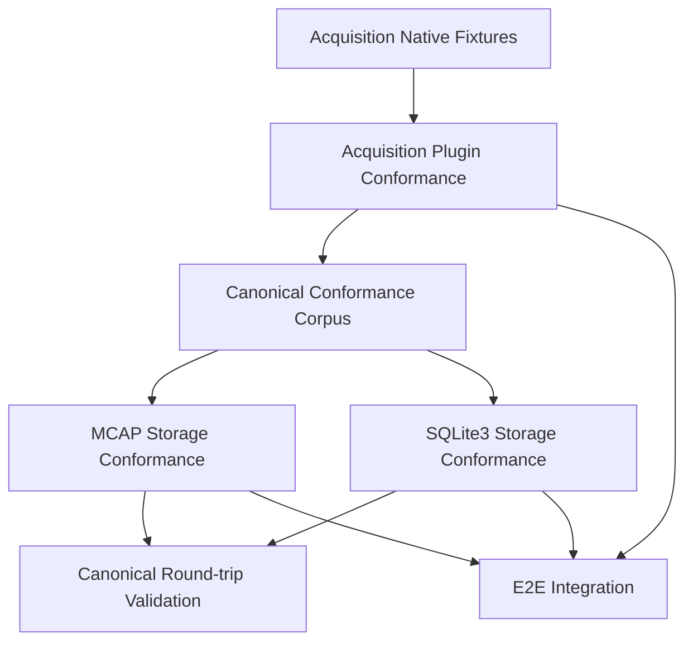

---

# 6. Canonical Model 总结

RoDAQ Canonical Data Model 的核心结构为：

```text
Canonical Identity Scope
│
├── Immutable Descriptor Graph
│   │
│   ├── SchemaDescriptor
│   │   ├── SchemaFormat
│   │   ├── optional TypeIdentifier
│   │   └── opaque canonical representation bytes
│   │
│   ├── ClockDescriptor
│   │   ├── concrete ClockId
│   │   ├── reduced rational resolution
│   │   └── ClockOrigin
│   │
│   ├── TimestampKeySet
│   │   └── unordered set of unique TimestampKey
│   │       └── (RoleIdentifier, ClockId)
│   │
│   └── StreamDescriptor
│       ├── stable StreamId
│       ├── immutable StreamName
│       ├── exact optional Schema
│       ├── exact PayloadEncoding
│       └── exact TimestampKeySet
│
└── Record
    ├── exact StreamDescriptorId
    ├── persisted AcceptanceSequence
    ├── optional opaque-byte SourceId
    ├── optional SourceId-scoped SourceSequence
    ├── TimestampKey → TimestampState mapping
    └── immutable source-native Payload
```

### 图 6-1 Canonical Model 总览

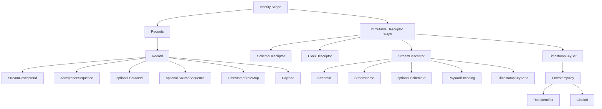

工程责任关系为：

```text
Native Source
    ↓
Acquisition Plugin
    ↓
source-native facts
    ↓
RoDAQ Core / Runtime
    ↓
Canonicalization
    ↓
Canonical State
    ↓
Runtime Representation
    ↓
Storage Projection
    ↓
MCAP / SQLite3 / ...
```

其中：

```text
Acquisition Plugin
    负责 source-specific knowledge

RoDAQ Core / Runtime
    负责 canonical infrastructure

Canonical Model
    负责 semantic correctness

Implementation Profile
    负责 capability boundary

Runtime
    负责 efficient representation / admission

Storage
    负责 projection / persistence fidelity
```

核心概念的职责可以概括为：

| 概念 | 核心语义 |
|---|---|
| Stream | 长期 logical data flow identity |
| Source | 具体 producer identity |
| StreamDescriptor | immutable description and interpretation contract |
| SchemaDescriptor | immutable Schema representation |
| SchemaFormat | Schema representation 的格式 |
| PayloadEncoding | Payload logical bytes 的编码 |
| ClockDescriptor | concrete Clock instance 的 canonical description |
| Timestamp Role | Timestamp 表示什么事件 |
| RoleIdentifier | Timestamp Role 的 canonical semantic identifier |
| TimestampKey | `(RoleIdentifier, ClockId)` |
| TimestampKeySet | TimestampKey 的无序集合 |
| TimestampStateMap | `TimestampKey → TimestampState` 完整映射 |
| AcceptanceSequence | Stream-local RoDAQ admission / acceptance ordering sequence |
| SourceSequence | SourceId-scoped source-originated sequence |
| Payload | immutable source-native logical byte sequence |

Canonical Model 当前明确不引入：

```text
SourceDescriptor
Generic Metadata
PropertyBag
AnyValue
HostId
Session
GlobalSequence
Clock reliability state
Universal cross-middleware Source identity
Generic Event hierarchy
BufferGraph
Tensor hierarchy
TransformRecord
RuntimeBinding canonical object
```

并且不冻结：

```text
Session ↔ Scope
Artifact ↔ Scope
process ↔ Scope
Host ↔ Scope
```

等 lifecycle cardinality。

当前文档的下一阶段验证重点是：

```text
V1 Canonical Profile
        ↓
ROS2 / FastDDS required Mapping Review
        ↓
MCAP required projection / unsupported-boundary Review
        ↓
Generic DDS / SocketCAN / SQLite3 future architecture-validation Review
        ↓
Canonical Conformance Corpus
        ↓
若不存在新的结构性反例
        ↓
Canonical Data Model v1.0 FROZEN
```

只有真实 Acquisition / Storage mapping 证明当前 Canonical semantics 无法表达必要数据时，才重新打开 Canonical Model。