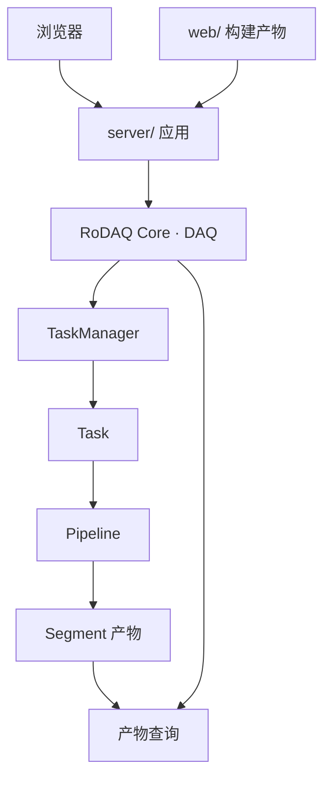

# RoDAQ 系统设计说明书

| 项目 | 内容 |
| --- | --- |
| 文档状态 | 设计评审稿 |
| 日期 | 2026-11-08 |
| 适用对象 | RoDAQ 完整应用 |
| 产品形态 | 单机部署的 C++ 单进程数采守护服务与配套浏览器界面 |
| 读者 | 架构评审、开发、测试与部署运维人员 |

## 1. 产品定义与系统边界

RoDAQ 安装在机器人主机或采集主机上。部署人员配置数据来源、任务、输出目录和资源预算。用户在浏览器中操作录制任务，查询任务状态、录制覆盖和产物。其他应用也可以调用 HTTP API。运维人员根据同一组事实处理磁盘压力、故障和升级。守护服务在零任务时保持可用，录制任务的启停不改变系统生命周期。

典型工作流程是**安装 → 校验配置 → 启动守护服务 → 创建任务 → 并行录制和滚动 → 查询并获取产物 → 停录或继续运行 → 重启后核对历史**。完整应用交付包括服务端可执行程序、随服务部署的 Web 静态产物、所需插件、示例配置、启动与停机说明、数据读取说明、故障诊断和升级指南。

| 项目 | 系统边界 |
| --- | --- |
| 控制与访问 | 提供 Web 操作界面和 HTTP 控制、健康、状态、操作结果及产物查询。产物通过部署声明的受控路径获取。上层业务编排由调用方提供 |
| 数据与存储 | 支持多来源、多个录制任务、按规则分片、历史查询、容量准入、保留回收和重启对账 |
| 插件 | Acquisition 和 Storage 通过 C ABI 扩展。插件在同一进程内运行，允许多个实例 |
| 工程基线 | C++17，参考 GCC 11.x、Clang 14.x。Ubuntu 22.04 / 24.04、amd64 / arm64 按资格矩阵声明。Core 保持对平台相关装载、文件操作和进程指标的隔离 |
| 部署范围 | 单机单进程。共享磁盘、操作系统和进程形成共同故障域。外部服务管理器可启动或重启整个守护服务 |

### 1.1 需求和验收映射

| 编号 | 要求 | 主要验收 |
| --- | --- | --- |
| SYS-01 | 可部署、可运维 | 从发布包安装到空白目标机，执行配置、启动、状态查询、计划停机和升级 |
| CTL-01 | 多任务独立控制 | 并行录制两个任务，暂停、恢复和停止其中一个，另一个在声明资源条件下持续推进 |
| DAT-01 | 有界采集和顺序写入 | 验证入队顺序、队列满行为、Payload 生命周期及多个生产者并发接纳 |
| STO-01 | 连续滚动与可用产物 | 每个已接纳 Record 的结果可对账，正常提交的分片可独立验证和回放 |
| STO-02 | 容量和保留治理 | 同盘多 Writer、低水位、封口余量、读写并发及回收验证 |
| REC-01 | 重启可解释 | 任务配置、在途控制请求和产物可核对，未确认覆盖明确标记 |
| OBS-01 | 可定位录制滞后 | 区分来源静默、入队受限、写入滞后、封口阻塞和存储失败 |
| PERF-01 | 目标负载下长期稳定 | 达到部署 Profile 的吞吐、尾延迟和运行时长，资源趋势符合预算 |

## 2. 总体架构与职责



| 组件 | 拥有的状态与操作 |
| --- | --- |
| `server/` | 负责守护服务入口、应用配置、Core 装配、HTTP API 和静态页面服务。管理就绪和整体关停顺序 |
| `web/` | 前端源码及独立构建入口。浏览器通过同源 HTTP API 控制任务及展示快照 |
| DAQ | 系统生命周期、全局资源策略、共享执行资源和健康快照。发布系统级入场关闭 |
| TaskManager | Task 注册和查找、任务准入和共享资源配额。锁内只做短事务，长操作由对应 Task 执行 |
| Task | 当前配置、控制状态、操作记录、Pipeline 集合和录制区间。提供任务级控制入口 |
| Pipeline | 一对采集和存储实例、入口、队列、串行 Writer 权限、当前 Segment 与链路统计 |
| 产物与保留 | 已发布 Segment 的发现、验证、查询、读取保护和回收。发布结果来自产物提交事实 |
| 插件 | 采集插件负责来源接入。存储插件负责格式写入和封口。平台负责资源预算、控制编排与最终发布 |

每个已配置的 Task 至少包含一条 Pipeline。每条 Pipeline 使用一个 Acquisition 实例和一个 Storage 实例。一个 Acquisition 实例可提供多个 Stream。不同 Pipeline 独立计费、排序和写入。选择相同设备、同一输出目标或共享磁盘时，通过实际资源身份和预算协调共用。

代码依赖由 `server/` 指向 RoDAQ Core 的公开控制与查询接口，Core 的构建独立于 HTTP 和前端工具链。浏览器端 `web/` 通过 HTTP 接口契约与 `server/` 交互。Core 内部由 DAQ 管理 Task，Pipeline 通过插件 C ABI 接入采集和存储。数据热路径只有 **采集入口 → 接纳 → 有界队列 → 串行 Writer → Segment**。Task 注册、控制历史、目录扫描、网络响应和磁盘回收均在该路径之外。

## 3. 领域对象与状态事实

| 对象或标识 | 语义 |
| --- | --- |
| `task_id` | 任务的稳定业务标识，跨暂停、停止后重启和进程重启保留 |
| `pipeline_id` | Task 内稳定的录制链路标识 |
| Stream | Pipeline 内的数据流，包含来源、编码、Schema 和可用时间信息 |
| Record | 一条被提交的带时间信息的 Payload。成功接纳后获得 Pipeline 内的录制顺序 |
| `segment_id` | 已发布产物的稳定标识。单条 Pipeline 的 Segment 有独立的严格递增序号，允许留空号 |
| `operation_id` | 一次控制请求的标识，用于查询、去重和重启对账 |
| Catalog | 按 Task、Pipeline、时间范围和格式查询已发布产物的索引，可从权威事实重建 |

任务控制状态、数据进展和产物状态各有独立来源。例如 Task 可以处于 `Running`，其中一条 Pipeline 已失败，另一条仍在提交 Segment。查询应同时返回这些事实。

每个活跃插件实例有专属回调入口和所有权凭据。停止录制时撤销入口，等待在途访问退出，再释放实例及承载库。Resume 创建新的实例入口，旧入口的迟返结果仍归原调用。这一隔离机制通过对象生命周期实现，公开模型使用稳定的 Task 与 Pipeline 身份。

## 4. Task 控制与关停规则

### 4.1 状态与合法操作

稳定状态为 `Created`、`Configured`、`Running`、`Paused`、`Stopped`、`Failed`。耗时转换显示正在执行的操作及其进度，同一 Task 同时只有一个修改生命周期的操作。不同 Task 可并行。任务持有一份当前生效配置，拓扑和插件参数在停止并达到静止条件后更新。

| 操作 | 合法入口 | 成功语义 |
| --- | --- | --- |
| Create | 任务标识可分配 | 创建 `Created` 任务，可查询 |
| Configure | Created、Configured、Stopped 或已经静止的 Failed | 校验整份配置并持久化，进入 `Configured` |
| Start | Configured、Stopped | 取得全部所需资源，准备所选 Pipeline，开放准入后进入 `Running` |
| Pause | Running | 保存需要恢复的 Pipeline 集合，关闭本次准入、排空并封口，确认静止后进入 `Paused` |
| Resume | Paused | 对保存的 Pipeline 集合重新准入，开启新 Segment，恢复为 `Running` |
| Stop | Running、Paused、Failed | 结束录制意图并收尾，静止后进入 `Stopped`。任务和各链路的失败结果仍可查询 |
| Remove | Created、Configured、Stopped 或已经静止的 Failed | 注销任务控制入口。已有产物按保留策略管理 |

Start 采用整组准备。插件或 Writer 的准备调用可先完成外部初始化，期间 Task 准入仍关闭。整组就绪后才统一开放。失败按已取得的资源逆序释放。运行中单条 Pipeline 写入失败时，关闭该链路准入并报告结果。健康链路可以继续，任务查询显示活跃数量和各 Pipeline 状态。无链路可以推进且存在失败时，Task 进入 `Failed`。

Pause 与 Stop 复用收尾路径。各 Pipeline 的准入关闭分别确定本链路的排空截止点，Task 在所有所需链路达到静止条件后结算整组操作。Pause 成功才发布 `Paused`。收尾失败时发布 `Failed` 和已有产物结果，并继续保护仍在访问的资源。Start 或 Resume 在准备阶段失败且完成清理时，保留操作前的稳定状态。Resume 因资源暂不可用失败时保留原恢复集合。停止期间的采集间隙在覆盖信息中可见。

### 4.2 控制请求、期限和系统关停

- **请求与结果。** 长操作先登记 `operation_id`，然后执行并发布结果。完整应用持久记录需跨重启查询的意图及结果。客户端重试可按幂等键和请求内容查回同一操作，冲突请求有明确结果。
- **等待与完成。** HTTP 请求等待超时可返回操作引用。Task 状态仍依据真实结果推进。清理超时不构成回调退出、Writer 静止或产物已封口的证据。
- **系统关停。** 先关闭 Create、Start 和 Resume 的入场，协调现有控制操作达到可安全收尾的阶段，然后对所有运行任务关闭入口、排空和封口。任务与系统关停各使用显式期限。期限耗尽时，发布未完成事实并保留仍可能被访问的资源，交由进程退出策略处理。

## 5. 数据通路、资源模型与插件边界

### 5.1 接纳与写入

1. **提交。** Acquisition 提供 Stream、来源时间、接收时间和 Payload。Core 校验记录边界，拒绝超限 Payload，并尝试获得队列及全局资源。
2. **接纳。** 在同一个短同步域内检查入口、占用预算并完成入队。成功入队是接纳点，确定 Pipeline 内的录制序号。关闭准入与接纳在该同步域排序，便于确定 Pause、Stop 或 Failure 的排空范围。
3. **写入。** Writer 按接纳顺序从队列获取受控所有权，按有界批次写入。插件返回批次实际处理结果。出现部分写入时，已知处理范围和失败范围分别记录，无法确定的范围报告未知。
4. **封口与发布。** Writer 结算当前 Segment，发布产物后才统计已提交记录。写入当前段、Payload 已释放、产物已提交分别记录。

保留来源时间和主机接收时间，附带可用的时钟或质量信息。调度、等待和超时使用单调时钟。跨 Pipeline 查询以时间范围和时钟质量解释，录制顺序仍由各 Pipeline 各自的接纳序列确定。

过载策略按来源能力选择显式拒绝或有限等待。有限等待在接纳点之前生效，预算用尽或控制关闭时立即得到明确结果。队列满、入口已关闭、Payload 超限和后端写入失败分别计数。接纳后发生的失败归入写入或产物结算。

### 5.2 线程、队列与资源预算

控制执行保有独立容量。每条 Pipeline 同一时间最多占用一个串行 Writer 执行权。Writer 使用固定规模的共享池，执行有界批次后重新参加调度。录制、滚动和封口通过同一 Writer 顺序执行。共享池遇到阻塞调用时，活跃执行容量会下降，健康和诊断暴露受影响的执行域。采集插件自身的线程、队列及缓冲也纳入预算。

| 预算 | 记账规则 |
| --- | --- |
| Task / Pipeline | 启动前取得槽位。准备失败时回退，真实静止后归还 |
| 队列记录数及字节数 | 每 Pipeline 设置上限，接纳时同时检查。记录数和字节数任一耗尽即触发过载策略 |
| 内存 | 覆盖队列、在途 Payload、Writer 批次及分片暂存。出队可以释放队列槽，Payload 总预算到真实释放时归还 |
| 线程与 FD | 将控制、HTTP、插件和 Writer 用量纳入总额。共享池和单次作业规模均有界 |
| 磁盘 | 按设备汇总写入速率、尚未消费的空间预约和封口余量。已写入的字节通过实际剩余空间体现，预算只扣除未消费预约及保留余量。同一设备上的不同路径共同计费 |
| 请求与观测 | 限制 HTTP 并发、请求大小、控制队列及历史分页。保留系统停机和健康查询的执行能力 |

初始队列字节容量可按 `峰值输入字节率 × 可吸收停顿时长 + 已有积压与余量` 估算。记录容量按对应记录率独立估算。在途 Payload 与实际内存由全局预算覆盖。实际滚动、磁盘写入及积压恢复结果决定最终配置。

TaskManager 在短事务内登记资源配额，释放锁后调用插件或等待 I/O。采集回调避免获取任务注册锁和执行文件操作。状态快照从各状态所有者发布，诊断请求通过快照读取。

### 5.3 C ABI 接口契约

| 类别 | 约定事项 |
| --- | --- |
| ABI 识别 | 提供协议版本与结构大小。装载时验证必需接口和已声明的可选能力，拒绝不兼容实例 |
| 句柄与内存 | 使用不透明实例句柄及固定表示的参数。缓冲区明确长度、拥有者、借用期限和释放入口 |
| Acquisition | 配置、启动、停止、提交 Record。规定回调并发性、阻塞范围、停止后回调静止条件 |
| Storage | 配置、开段、批量写入、封口、关闭。定义错误、部分写入、格式封口事实和产物清单 |
| 能力与诊断 | 能力查询提供扩展入口。错误转为 C ABI 结果，异常在各自边界捕获 |
| 装载生命周期 | 承载库在实例、回调、Payload 和能力借用实际静止后卸载。宿主限制插件资源，验证声明与实测一致 |

采集接口收到的借用 Payload 可以在借用期内复制，也可以通过明确授权延长持有期。两种方式都按实际占用纳入预算。插件不得在生命周期规则之外回调宿主。发现不满足静止条件的实例时，关闭受影响入口并保留资源，交给系统停机策略处理。

## 6. Segment 提交、目录与恢复

### 6.1 权威信息与目录

| 权威或派生数据 | 内容和用途 |
| --- | --- |
| Task 持久配置与操作记录 | 当前配置、稳定身份、需跨重启查询的操作意图和结果 |
| Segment 产物 | 完整文件清单、格式与编码、Task/Pipeline 身份、序号、记录数、字节数、覆盖区间和校验信息 |
| 保留记录 | 以产物标识关联回收意图、进度及结果 |
| Catalog 和导出 Manifest | 由已发布产物和保留记录构建，用于查询、导出及恢复核对 |

逻辑目录按部署配置选择数据卷。每条 Pipeline 可指定存储根。下例表示各类文件的归属。

```text
state/
  tasks/<task_id>/task.json
  operations/
  retention/
  catalog/
<volume>/rodaq/tasks/<task_id>/pipelines/<pipeline_id>/segments/
  .pending-<segment_id>/
  <segment_id>/
    segment.json
    data.<format>
```

同一 Pipeline 对已发布标识保持唯一，序号分配记录可重启恢复。保留删除后仍保留必要的序号分配信息。Segment 目录可以包含格式读取必需的多个文件，描述清单覆盖整个产物。历史查询使用稳定标识和有界分页，输出位置由平台在部署允许的根目录内分配。

### 6.2 滚动和提交顺序

1. **开段。** 获得磁盘租约和唯一 Segment 标识，在目标文件系统上的临时目录创建产物。
2. **切点。** 达到配置的时长、大小或手动滚动条件后，在 Pipeline 录制顺序上选定边界。边界前后的 Record 分别归入旧段和新段。
3. **封口。** 完成格式写入及必要索引，关闭格式 Writer，生成包含实际文件和统计的描述。按部署耐久性规则同步数据文件、描述文件及必要的临时目录元数据。
4. **提交。** 以同文件系统内的完整目录发布作为产物提交边界，拒绝覆盖已有标识。完成部署耐久性要求规定的父目录同步后，返回提交结果。
5. **可见。** Catalog 接收提交事实并更新查询。索引可能滞后，重新扫描已发布产物可以补齐。

串行滚动时由队列吸收切换停顿。旧段封口失败时，记录对应产物状态并按 Task 规定结束或关闭该 Pipeline。Pause 结束当前段，Resume 从新段继续。正常滚动保留 Task 和 Pipeline 身份。

### 6.3 重启与回收

| 扫描或持久记录看到的事实 | 处理 |
| --- | --- |
| 仅有临时目录 | 标记中断，按部署策略隔离、核验或清理 |
| 最终目录存在，发布结果未返回 | 验证清单及实际文件。达到部署耐久性要求后恢复产物查询，原控制请求单独对账 |
| 已发布目录通过验证 | 恢复可见性，并补齐 Catalog |
| 产物缺失、校验不符或格式不完整 | 标记损坏或待核验，保留证据并告警 |
| 回收意图已记录，文件仍存在 | 继续删除与结果核对。未真正释放的空间继续计费 |
| Task 有未完成操作 | 核对操作、Writer 排他和产物。根据恢复策略结束、等待人工处理或重新开始录制 |

启动时先核对控制数据和 Writer 排他，再开放相关任务。索引重建可分批执行，查询明确显示尚未完成的范围。重新录制时记录中断覆盖。崩溃时尚处于内存或未提交 Segment 的数据，按部署 Profile 的恢复点目标处理。

磁盘低水位先限制新任务。继续恶化时，按策略释放满足保留规则的产物或结束受影响的录制。回收以持久意图驱动，仅处理已发布且无 Writer、读取租约或恢复保护的产物。删除后核对目录和实际可用空间，再归还预算。

## 7. 应用接口与配置

`server/` 中的 HTTP 层调用 DAQ 的控制与查询接口。请求在接受前校验大小、字段、目标状态和访问范围。耗时请求以操作标识返回。读取端通过 Task、Pipeline 或 Segment 标识查询。服务端设置并发、排队、分页和等待期限。

| 接口组 | 能力及返回事实 |
| --- | --- |
| 健康与就绪 | 守护服务存活、恢复进度、是否接受新任务、关键执行域是否推进 |
| Task 管理 | 创建、配置、枚举、查询及移除，返回当前状态和合法操作 |
| Task 控制 | 启动、暂停、恢复和停止，返回操作标识与受理结果 |
| 操作查询 | 排队、执行中、成功、失败、重启后待核对，以及可关联的任务和产物事实 |
| 产物查询 | 按 Task、Pipeline、时间与格式分页查询。由受控访问路径提供产物读取 |

控制请求的重复提交由请求键和请求内容共同识别。查询失败、操作拒绝和录制失败各有明确错误归属。配置分为应用配置与任务配置。应用配置决定监听、插件目录、存储根、资源与观测策略。任务配置决定 Pipeline 拓扑、来源、目标后端、滚动和背压。配置错误在资源入场前给出字段和原因。远程访问经部署层授权，服务运行账号只持有所需的数据和设备权限。

### 7.1 Web 构建与同部署

`web/` 的浏览器静态资源在打包时与 `server/` 的可执行程序、Core 和所需插件一起发布。HTTP 框架和前端技术见[技术选型说明书](technology_selection.md#5-http配置与运维)。运行时由同一服务监听地址提供页面和 API，页面入口使用 `/`，控制与查询 API 使用 `/api/` 前缀。前端用相对路径发起同源请求，生产包可直接打开页面，构建工具只参与开发和打包。

前端路由回退仅处理浏览器页面导航，API 和静态文件缺失返回各自的错误结果。静态资源目录和录制产物目录分开配置，产物访问经过受控查询或读取入口。发布验收覆盖页面及资源加载、页面导航、录制控制、状态查询和 API 错误响应。

## 8. 监控、故障和部署

### 8.1 观测

| 层级 | 最低观测内容 |
| --- | --- |
| 系统 | CPU、RSS、线程、FD、任务数、设备可用空间、保留空间、就绪及关停状态 |
| Task | 控制状态、在途操作、活跃 Pipeline 数量、最新失败原因、录制覆盖 |
| Pipeline | 输入、接纳、拒绝与失败计数，队列高水位、最老记录年龄、写入速率及最近进展时间 |
| Segment | 大小、记录数、覆盖范围、滚动原因、封口耗时及发布结果 |

数据热路径更新轻量计数与必要时间戳，HTTP 和运维接口读周期快照。正常停止后核对 `已提供 = 接纳前拒绝 + 已接纳`，以及 `已接纳 = 已提交 + 已知失败 + 结果未知`。运行中额外显示在途量。重启后的对账以可恢复证据为限，缺少逐条证据的部分用未知覆盖区间表达。采集入口以外的来源损失通过设备或中间件可提供的证据单独报告。

### 8.2 常见故障行为

| 事件 | 处理及对外事实 |
| --- | --- |
| 来源静默或断开 | 按来源策略继续等待或停止链路，记录覆盖间隙。预期低频和暂停状态使用各自的告警条件 |
| 队列满 | 应用显式拒绝或有限等待策略，按原因计数 |
| 滚动或写盘失败 | 关闭受影响链路的准入，结算已接纳数据和产物。资源独立的链路仍可推进 |
| 共享磁盘低水位 | 限制该设备的新启动，保护封口余量，按保留和停录策略处理 |
| 关停超时 | 报告未完成操作和仍占用资源，保护尚在访问的对象。外部管理器按部署策略重启整个进程 |
| 进程异常退出 | 重启时重新建立进程内状态，核对控制意图、产物、Writer 排他和录制间隙 |

### 8.3 部署和维护

- **启动顺序。** 读取配置并校验插件、目录和权限，建立资源预算与产物扫描，装配 DAQ 和 HTTP。达到可安全入场的条件后报告就绪。
- **停机顺序。** 关闭新的控制入场，收尾现有 Task，提交可完成产物，释放共享执行资源，最后停止查询和诊断。
- **发布与升级。** 交付守护服务、配套 Web 构建产物、经验证的插件、样例配置和运维说明。发布记录包含支持平台、插件兼容范围、持久格式与升级步骤。升级流程验证旧产物可查询、可读取，迁移前确认配置和持久数据备份。
- **运行维护。** 记录磁盘容量、留存期限和存储格式。配置监控与告警，提供从任务标识到操作、链路和产物的诊断路径。

## 9. 性能模型与基准

### 9.1 参考负载

以下为标称输入，MB 使用十进制。Core 基准使用受控数据源和测试存储后端，固定输入节奏及 Payload 规格。部署容量通过真实采集、存储格式和目标磁盘单独验证。

| 场景 | 规模 | 记录率 | Payload 速率 |
| --- | --- | ---: | ---: |
| 编码相机 | 10 路 720p30，每帧 200 KiB | 300/s | 61.44 MB/s |
| 原始相机 | 10 路 1280×720 RGB8，30 FPS | 300/s | 829.44 MB/s |
| 聚合关节 | 100 个关节，每关节 100 个 double，聚合后 1 kHz | 1,000/s | 80.00 MB/s |
| 逐关节 | 同等数据量，100 路各自 1 kHz | 100,000/s | 80.00 MB/s |
| 编码相机与聚合关节 | 编码相机 + 聚合关节 | 1,300/s | 141.44 MB/s |
| 原始相机与逐关节 | 原始相机 + 逐关节 | 100,300/s | 909.44 MB/s |
| 编码相机与逐关节 | 编码相机 + 逐关节 | 100,300/s | 141.44 MB/s |

聚合关节和逐关节的字节量相同，记录率相差 100 倍。相机负载与两种关节表示需分别保留，便于区分每条记录的固定成本和字节处理成本。混合测试分别覆盖同 Task 多 Pipeline 和两个 Task 并行。

### 9.2 测量与容量判据

| 测试 | 必测项 |
| --- | --- |
| Core 对照 | 固定输入节奏、记录数和 Payload。测接纳吞吐、回调 p99/p99.9、队列高水位、CPU 和内存 |
| 真实录制 | 使用代表性消息、目标格式和目标磁盘。测持续写入、滚动耗时、积压恢复、实际空间增长和读回对账 |
| 多任务 | 记录各任务吞吐和尾延迟。对其中一条执行滚动、暂停和停止，核对其他链路的录制进展 |
| 长时运行 | 热身后观察 RSS、线程、FD、队列、历史索引和保留趋势，包含持续滚动及多次任务启停 |
| 常见故障 | 限制来源、填满队列、注入写盘失败及触发磁盘低水位，验证故障范围和所有数据结果可解释 |

每项部署 Profile 发布前须给出具体硬件、磁盘和文件系统、后端及压缩配置、输入分布、持续运行时间、拒绝上限、入队尾延迟、滚动阻塞、关停期限以及恢复点和恢复时间目标。指标阈值由目标部署确定。原始相机场景作为容量压力参考，是否成为部署门槛取决于所声明的录制能力。

## 10. 完整应用发布验收

| 验收项 | 最低交付证据 | 需求 |
| --- | --- | --- |
| 应用交付 | 在空白目标机完成安装、配置验证、启动、浏览器访问、计划停机、重启和升级 | SYS-01 |
| 数据链路 | 真实采集、写入、滚动、暂停恢复和回放可重复。已接纳数据与产物能够对账 | CTL-01、DAT-01、STO-01 |
| 资源与隔离 | 多任务在声明负载下持续推进，共享资源限额、低水位和保留回收按策略生效 | CTL-01、STO-02、PERF-01 |
| 重启与历史 | 验证控制操作重启对账、历史查询恢复、中断段辨认、回收继续及产物读取 | REC-01 |
| 运维与性能 | 健康、进展、错误和数据结果可定位。归档目标负载性能、长时趋势和部署覆盖 | OBS-01、PERF-01 |
| 兼容与耐久 | 按平台及插件矩阵记录结果。分别验证进程异常退出、整机重启和所声明的掉电耐久边界 | SYS-01、REC-01 |

发布通过以目标部署上的端到端证据为准。基准 Writer 可用于回归 Core 开销，实际录制与产物可用性由真实后端及独立读回验证。任何支持声明须标明对应版本、环境和负载。

## 11. V1 阶段范围与验收

本阶段交付可在参考环境运行的**核心录制应用**。设计采用前述组件和数据语义，实施优先覆盖正常链路及最常见的资源和写入故障。

| 类别 | V1 交付 |
| --- | --- |
| 环境与后端 | Ubuntu 22.04 参考环境，ROS 2 采集和 MCAP 分片，独立读回与回放，提供可复现的构建和启动方法 |
| 控制与并行 | 创建、配置、启动、暂停、恢复、停止和查询。支持多 Pipeline、多 Task。Task 整组准备后开放准入 |
| 数据通路 | 借用输入后由宿主取得有界副本。队列满时显式拒绝。按时长或大小串行滚动 |
| Web、HTTP 与观测 | 本机 HTTP 控制、操作结果、健康及已封口产物查询。最小 Web 页面与服务一起打包，能展示任务与录制进展 |
| 容量和重启 | 验证低水位停录、写盘失败、正常关停、配置加载及产物扫描。重启后由操作者重新启动任务 |

持久操作历史和策略化恢复、自动保留、外部告警集成、发行安装与升级流程，以及完整平台资格，在后续发布阶段按正文设计规则实施。

| 顺序 | 实现门槛 | 通过条件 |
| --- | --- | --- |
| A. 真实单任务闭环 | 一个 Task、一条 ROS 2 → MCAP Pipeline | 配置、启动、滚动、暂停、恢复、停止和回放均可验证。记录对账，同时归档回调尾延迟、队列峰值和封口耗时 |
| B. 并行与最小控制面 | 多 Pipeline、多 Task、HTTP、最小 Web 界面与基础快照 | 暂停、恢复或停止其中一个 Task，其他资源独立的任务持续写入。通过同一服务地址打开 Web 页面和调用 API，查询共享预算和基本错误结果 |
| C. 负载与常见故障 | 运行相机、关节、混合基准及真实存储试验 | 选定负载下写入长期跟得上输入，积压可解释。覆盖过载、低水位、写盘失败、关停和重启产物识别 |
| D. 长时验证 | 从 24 小时真实负载试验起步 | 归档任务启停、滚动、查询和资源趋势。热身后 RSS、线程、FD 和队列符合预算，产物可读且记录可对账 |

阶段 A 是第一轮开发范围。后续门槛沿同一数据路径验证并扩展能力。V1 归档各项实测值和测试环境，供完整应用的发布验收继续使用。

## 参考资料

- [Linux 文件与目录同步语义](https://man7.org/linux/man-pages/man2/fsync.2.html)
- [MCAP 文件格式规范](https://mcap.dev/spec)
