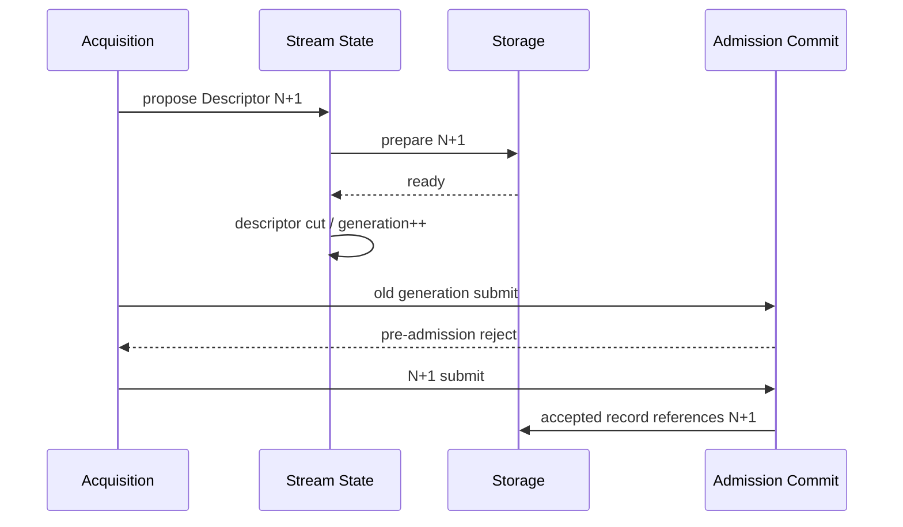
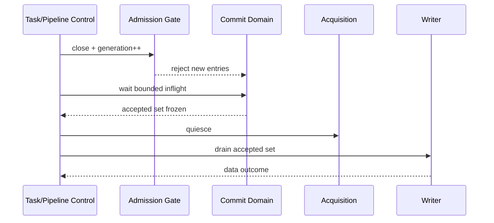
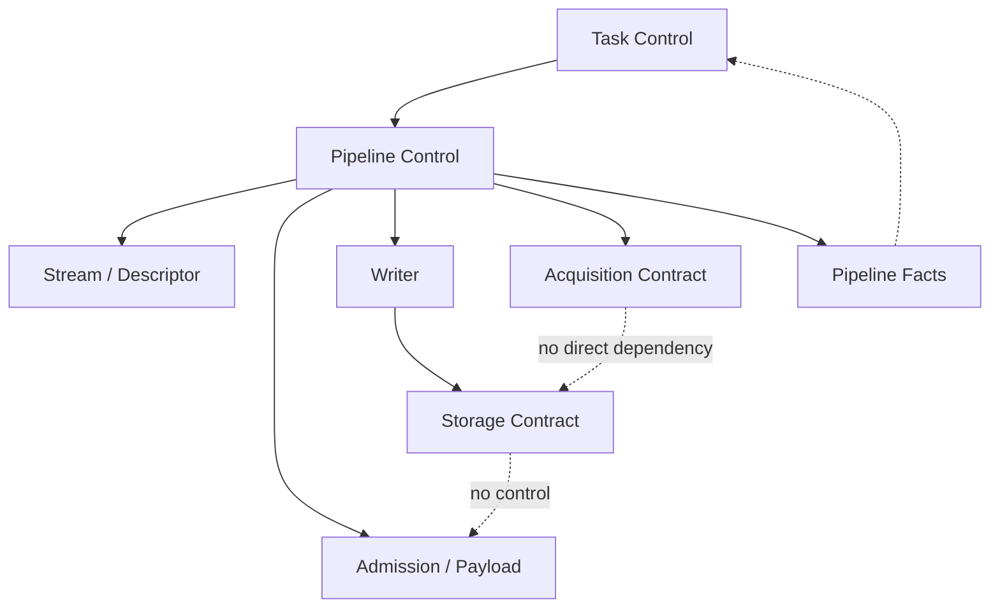

# RoDAQ Pipeline 模块设计

| 文档属性 | 内容 |
| --- | --- |
| 文档类型 | 模块详细设计 |
| 状态 | V1 详细设计基线 |
| 适用范围 | RoDAQ Pipeline 数据面、Recording Instance、Stream、Admission、Payload、Writer 与收尾 |
| 上位设计 | [系统架构设计](architecture.md) |
| 关联设计 | [Task](task.md) · [Plugin](plugin.md) · [Acquisition](acquisition.md) · [Storage](storage.md) · [术语表](../../GLOSSARY.md) |

## 1. 目标与职责边界

Pipeline 是 Task 内从 Acquisition 到 Storage 的一条独立录制路径。V1 每条 Pipeline 恰好包含一个 Acquisition Plugin 和一个 Storage Plugin，可以承载多条 Data Stream。

Pipeline 模块负责：

- Recording Instance 生命周期和资源所有权；
- Stream / Stream Descriptor / Record 的运行期状态；
- Stream Identity State 与 AcceptanceSequence 分配；
- Pipeline Admission Gate 和 Admission Commit；
- Payload Holding；
- 有界 Record Queue；
- Writer 顺序与 Storage batch 调用；
- Descriptor Cut、Clock/Source 边界与记录解释事实；
- Pause/Stop/failure cutoff；
- accepted set 的结算和资源归还；
- 向 Task 输出结构化 Pipeline Facts。

Pipeline 模块不负责：

- 决定 Task Desired State；
- 持有 HTTP 状态；
- 定义具体 ROS 2、MQTT、MCAP、SQLite3 实现；
- 直接发布最终产物目录；
- 重新定义 Plugin ABI。

## 2. Pipeline、Stream 与描述模型

### 2.1 Pipeline 与 Recording Instance

**Pipeline 组成。**


Pipeline 内至少存在下列运行对象：

| 对象 | 生命周期 | 主要所有者 |
| --- | --- | --- |
| Pipeline Definition | Task Configuration | Task/Pipeline |
| Recording Instance | 一次 Start/Resume/恢复运行 | Pipeline |
| Stream State | Task 逻辑流长期身份 + 实例运行状态 | Pipeline |
| Stream Descriptor | immutable、按解释版本演化 | Pipeline |
| Admission Gate | Recording Instance | Pipeline |
| Payload Budget | Recording Instance | Pipeline/Capacity |
| Record Queue | Recording Instance | Pipeline |
| Writer State | Recording Instance | Pipeline |
| Storage Session | Recording Instance | Storage Plugin |
| Segment State | Recording Instance 内多次创建 | Storage/Segment subsystem |

**Recording Instance。**

每次 Pipeline 真正开始新的执行都分配新的 `instance_id`。

以下情况必须创建新实例：

- Start；
- Resume；
- 守护进程重启后的自动恢复；
- 旧实例故障且经过重新准入；
- 任何需要重新形成 `effective_config_id` 的恢复。

Recording Instance 绑定：

```text
task_id
pipeline_id
instance_id
control_generation
config_version
effective_config_id
Deployment Generation
Effective Pipeline Limits
Plugin instances
Admission Gate generation
```

旧实例达到 quiescence 前，新实例不能复用它仍占用的资源、插件对象或输出命名空间。

### 2.2 Stream Identity 与 AcceptanceSequence

**Stream Identity 与 AcceptanceSequence。**

**稳定 Stream。**

`stream_id` 是 Task 内逻辑数据流的稳定身份。

Pause/Resume、Recording Instance 变化和守护进程重启不改变同一逻辑流的 `stream_id`。

Configure：

- 保留原逻辑流：保留 `stream_id`；
- 删除原流：该 ID 永不分配给其它逻辑流；
- 新增流：产生新 ID；
- 名称、Topic 或地址相同不能自动证明“仍是同一个 Stream”。

**Stream Identity State。**

Pipeline 使用独立持久事实：

```text
identity/<task_id>.json
```

保存至少：

- `stream_id`；
- AcceptanceSequence reserved upper bound；
- 必要的 ID/version/checksum；
- 退役但仍被引用的 Stream identity facts。

它不保存当前 Recording Instance 状态。

字段级 JSON 合同至少包括：

| 字段 | 类型 | 规则 |
| --- | --- | --- |
| `format_version` | string | Identity State 格式版本 |
| `task_id` | string | 所属 Task |
| `streams` | bounded array | 数量不超过 Deployment 上限 |
| `content_digest` | string | 对规范化 payload 的完整性摘要 |

每个 `streams[]` entry 至少包含：

| 字段 | 类型 | 规则 |
| --- | --- | --- |
| `stream_id` | string | 稳定逻辑流身份 |
| `reserved_end_exclusive` | decimal string | 已 durable 预留区间的独占上界 |
| `retired` | bool | 当前活动配置是否已不再引用 |
| `retired_at_config_version` | string/null | 用于有界 GC 对账，不参与 Record Identity |

`acceptance_sequence` 在 Core 中固定为 `uint64_t`。V1 规定：

- `0` 为无效/未分配值；
- 第一个有效 sequence 为 `1`；
- 持久区间使用 `[begin, end_exclusive)`；
- `end_exclusive` 最大为 `UINT64_MAX`，因此最大可分配 sequence 为 `UINT64_MAX - 1`；
- 达到上限前必须永久停止该 Stream 的新接纳并报告 `ResourceExhausted/DataLoss-risk`，绝不 wrap；
- JSON 中序号和区间边界用十进制字符串编码。

**持久区间预留。**

每个 Stream 使用持久序号区间：

```text
durably reserve [N, N + K)
then allocate in memory
```

规则：

1. 新区间上界必须先按状态文件原子提交合同 durable；
2. durable 前不得分配该区间序号；
3. crash 后未使用尾部废弃；
4. gap 合法；
5. 已经预留过的 sequence 永不复用；
6. Reset 不回退 high-water；
7. 不能从最后一个 committed Segment 反推下一 sequence。

Record Identity：

```text
(stream_id, acceptance_sequence)
```

不包含 `instance_id`，也不声明跨 Stream 全局顺序。

### 2.3 Stream Descriptor

Stream Descriptor 是记录解释语义的不可变对象，至少包含：

- `descriptor_id`；
- payload encoding；
- schema/type information；
- source clock/time role；
- bounded namespaced extensions；
- Storage 需要的 Required extension facts。

以下变化必须创建新 Descriptor：

- encoding；
- schema；
- source clock interpretation；
- time role；
- Required extension 的解释语义。

**Descriptor Cut。**

Descriptor 更新采用：



Descriptor Cut 与该 Stream 的 Admission Commit 在同一短同步域排序。

切点前已接纳的旧 Descriptor Record 正常结算；切点后尚未接纳的旧代次提交必须拒绝。

**Descriptor Prepare 期间的数据。**

V1 不提供通用无界 staging。

若新 Descriptor 尚未由 Storage prepare 完成：

- 对新解释语义的 Record 不得用旧 Descriptor 接纳；
- Acquisition 可使用自己已经纳入 Resource Plan 的有界短暂缓存；
- 否则进行 PreAdmission Reject；
- Coverage/诊断记录拒绝原因。

## 3. 接纳与写入路径

### 3.1 Admission Gate 与控制切点

**Pipeline Admission Gate。**

每个 Recording Instance 有一个轻量 Admission Gate：

```text
state: Open / Closed
gate_generation
bounded commit_inflight
```

Gate 只用于建立 Pipeline-wide cut，不替代 per-Stream Descriptor/Sequence 同步。

**Record Submit 阶段。**

Acquisition submit 只是一次接纳尝试。

接纳前依次完成：

1. 检查实例、control generation 和 Gate；
2. 验证 Record 结构、大小和 Descriptor generation；
3. 取得 Record count quota；
4. 取得 logical bytes quota；
5. 取得 physical payload quota；
6. 预留一个 queue **capacity token**，此时不提前决定物理 enqueue position；
7. 建立稳定 Payload Holding；
8. 进入 commit domain。

任何一步失败都属于 PreAdmission Reject，不产生 AcceptanceSequence。

**Admission Commit。**

在 commit domain：

1. 再次检查 Gate 为 Open 且 generation 未变化；
2. 进入目标 Stream 的短同步域；
3. 复核 Descriptor / Clock Epoch；
4. 分配下一 `acceptance_sequence`；
5. 使用已预留的 queue capacity token 分配实际 enqueue position 并发布完整构造的 Record；同一 Stream 的 position 分配发生在该 Stream 短同步域内；
6. 记录 accepted counters；
7. 离开 commit domain。

Admission Commit 是记录从“可拒绝”变成“必须结算”的唯一边界。

越过 Commit 后：

- 不能因为 queue full 或普通内存不足失败；
- sequence 不回滚；
- 不能重新解释为“未接纳”；
- 后续结果只能是 durable、known failure 或 Unknown。

**Pause / Stop / Failure Cut。**

Pipeline-wide cut：



Gate close：

- 不等待插件；
- 不等待 Storage；
- 不执行磁盘 I/O；
- 只等待已进入 Core commit domain 的有限 in-flight 提交。

当 commit_inflight 归零时，accepted set 唯一确定。

**Pause。**

Pause 要求 cut 前 accepted set 全部完成正常 durable commit 才能成功。

**Stop。**

Stop 也必须结算 cut 前 accepted set，但可以在 Task 最终进入 Stopped+Idle 的同时返回带 Data Impact 的失败结果。

**Failure Cut。**

Storage Unknown、严重容量保护或其它需要立即阻止新接纳的故障使用同一 Gate close 机制，不再定义第二套数据停止边界。

### 3.2 Payload、Queue 与 Backpressure

**Payload Holding。**

Pipeline 支持三种通用语义。

**Copy。**

Acquisition 只在 submit 调用期间借用输入字节。Pipeline 在 Admission Commit 前复制到受管有界内存。

Copy 是所有 V1 Acquisition 必须支持的基线。

**Ownership Transfer。**

Acquisition 提供唯一所有权载荷及释放函数。

只有 Pipeline 明确成功 acquire 后所有权才转移。PreAdmission Reject 前若未 acquire，仍由 Acquisition 负责。

**Shared Retain。**

Acquisition 提供可稳定持有的共享载荷引用。

Pipeline 在 Admission Commit 前 acquire retain；所有合法消费者结束后 exactly-once release。

**所有模式共同合同。**

- payload immutable；
- exactly-once release；
- actual physical bytes 计费；
- Stop/quiesce 不能使 accepted payload 失效；
- Storage timeout 后只要调用仍可能访问 payload，资源不得提前归还；
- 不允许“zero-copy = zero resource”。

**有界 Queue 与 Backpressure。**

Pipeline queue 同时受：

- records；
- logical bytes；
- physical payload bytes；
- max record size；
- oldest record age；
- execution slots；

约束。

容量耗尽时：

```text
before Admission Commit
→ explicit PreAdmission Reject
```

不得：

- 动态扩容为无界容器；
- 在 Admission Commit 后因普通容量不足丢弃；
- 通过无限延长 callback 阻塞隐藏 backpressure。

Record/byte quota 只有在对应资源实际释放后归还。

### 3.3 Writer 与 Storage Batch

**Writer。**

每条 Pipeline V1 只有一个逻辑 Writer 顺序。

Writer：

1. 从有界队列取 Record；
2. 保留每 Stream 的 AcceptanceSequence 顺序；
3. 形成有界 batch；
4. 调用 Storage；
5. 记录 confirmed prefix / unwritten / Unknown；
6. 在 Storage 不再访问 payload 后归还 Payload；
7. 把 Segment seal/commit 工作交给 Storage/Commit 子系统。

不同 Stream 的物理交付顺序只是运行事实，不形成业务全局序列。

**Storage Batch 结果在 Pipeline 的解释。**

对于 batch `[0, N)`，Storage 返回：

```text
confirmed_prefix = K

remainder:
  DefinitelyUnwritten
  OR
  Unknown
```

Pipeline 校验：

- `0 <= K <= N`；
- 成功时 `K == N`；
- Unknown 后缀不得自动重试；
- 不合法结果整体提升为 Unknown；
- Unknown 立即触发 Admission Gate failure cut；
- 当前 Segment 进入 contaminated/quarantine 路径。

confirmed format write 不等于 durable Segment commit。

## 4. 时间、恢复与资源边界

### 4.1 时间、来源与顺序

每条 accepted Record 可以包含：

- host receive realtime；
- host receive monotonic；
- `host_boot_id`；
- `clock_epoch_id`；
- optional source timestamps；
- optional SourceId；
- optional SourceSequence + sequence scope；
- AcceptanceSequence。

**Host Boot。**

monotonic 与 Clock Epoch 只能在同一 `host_boot_id` 内直接比较。

Linux V1 的 platform layer 优先读取内核提供的 boot identity（例如 `/proc/sys/kernel/random/boot_id`）并转换为项目 `HostBootId`；**守护进程重启但 OS 未重启时必须得到同一 Host Boot ID**。只有真正的 OS boot 变化才产生新的 Host Boot。读取/解析失败时不能随机生成一个看似有效但破坏跨进程相关性的值；系统进入时间证据降级/诊断，具体启动策略由 Deployment 决定。

`clock_epoch_id` 在一个 Host Boot 内使用 `uint64_t`，`0` 无效，首个有效值为 `1`，只增不回退、不 wrap。

主机重启后新的 epoch/monotonic 与旧 boot 无直接连续性。

**Clock Epoch Snapshot。**

进程级 `ClockCorrelationService` 维护 immutable snapshot：

```text
host_boot_id
clock_epoch_id
sample_monotonic_ns
sample_realtime_ns
correlation quality/error bound
jump evidence（若为新 Epoch）
```

Acquisition submit 入口采集 receive monotonic/realtime 时读取一次当前 snapshot，并把 `host_boot_id + clock_epoch_id` 固定到本次 RecordAttempt。Admission Commit 只验证该时间事实结构有效，不把后续更新的新 Epoch 反向写入旧 attempt。

V1 **不要求 Clock Epoch 变化自动执行 Pipeline-wide Admission Cut，也不要求强制 Segment rotation**。原因是多个 Stream callback 可以在 Epoch 边界附近迟返，强制以“第一条新 Epoch Record”作为 Segment cut 无法在不增加额外全链路 barrier 的情况下证明没有旧 Epoch Record 后到。

因此：

- 一个 Segment 可以合法包含多个 Clock Epoch；
- 每条 Record 保留自己的 epoch identity；
- Segment Manifest 列出实际出现的全部 Epoch/correlation evidence；
- 查询/回放不假设一个 Segment 只有一个 Epoch；
- 若未来产品要求“一个 Segment 恰好一个 Clock Epoch”，必须使用显式 Pipeline-wide cut 协议重新设计，而不能只在 Writer 看到新 epoch 时 rotate。

**SourceSequence。**

只有能绑定到明确：

- SourceId；
- source session；
- 协议定义的其它稳定 producer scope；

时，SourceSequence 才能用于 gap/duplicate/reset 推断。

scope 不明时只保存诊断值。

### 4.2 Recovery 与 Effective Limits

**Recording Instance Recovery Facts。**

Pipeline 向 Recovery Record 输出以下证据：

```text
Prepared
OpenAuthorized
OpenedObserved
Ended
PendingCleanup
```

语义：

- Prepared：资源/插件/Descriptor/Storage 已准备，但尚无开放授权；
- OpenAuthorized：Task 已持久批准本实例可能开放；
- OpenedObserved：运行期观察到 Gate 已执行 Open，非权威授权；
- Ended：实例按已知边界结束；
- PendingCleanup：仍有资源/调用未证明静止。

OpenAuthorized 但没有 OpenedObserved 的实例恢复时必须按“可能已经开放”处理。

仅 Prepared 的实例不产生录制 Coverage。

**Effective Pipeline Limits。**

Pipeline 在 Open 前固定：

- max record size；
- max inflight records；
- max logical bytes；
- max physical payload bytes；
- queue capacity；
- supported payload holding modes；
- batch size；
- stream/descriptor limits；
- plugin callback concurrency；
- Storage physical/seal limits；
- execution slots；
- plugin resource ownership。

运行中不能因为压力临时放宽这些限制。

### 4.3 资源、事实与模块依赖

**资源所有权与归还。**

资源必须始终有唯一 owner。

典型转移：

```text
Capacity Reservation
  ↓
Prepared Instance
  ↓
Open Instance
  ↓
Accepted Record / Plugin Call / Segment
  ↓
Drain / Commit / Quiesce
  ↓
Released
```

超时不是释放事件。

如果插件调用超时但仍可能迟返：

- plugin instance 保留；
- payload 保留；
- execution slot 保留；
- library handle 保留；
- 迟返仍归旧 `instance_id`。

只有 quiescence 被证明后才能归还对应资源。

**Pipeline Facts。**

Pipeline 向 Task/Observability 发布有界快照，包括：

- instance id / generation；
- Prepared/OpenAuthorized/Opened/Ended；
- Gate state/generation；
- Required/Optional；
- Effective Limits；
- receive/accepted/rejected；
- queue records/bytes/HWM/oldest age；
- Writer progress；
- Storage progress；
- pending commit segments/bytes；
- Data Impact；
- cleanup/quiescence 状态；
- last bounded failure。

Pipeline Facts 是 Task Execution Condition 的输入，不直接改变 Desired State。

**模块依赖边界。**



明确禁止：

- Acquisition 直接调用 Storage；
- Storage 修改 Task Desired State；
- Artifact/Catalog 直接打开 Admission Gate；
- Observability 参与热路径线性化；
- Task 直接访问 Queue 或 Payload Pool。

## 5. 开发实现设计

### 5.1 内部组成与接口

**内部组成。**

Pipeline 建议拆成以下责任对象：

| 对象 | 主要职责 |
| --- | --- |
| `PipelineController` | prepare/open/close/quiesce/cleanup 编排，发布 Pipeline Facts |
| `RecordingInstanceState` | 当前 instance identity、generation、effective limits、资源 owner |
| `StreamTable` | 固定上限 Stream 状态、Descriptor generation、Source/Time facts |
| `SequenceAllocator` | Stream AcceptanceSequence 持久区间获取和内存分配 |
| `AdmissionGate` | Pipeline-wide open/closed、generation、commit in-flight |
| `AdmissionBudget` | record/logical bytes/physical bytes/queue slot 的原子准入 |
| `PayloadPool` | Copy 模式的有界物理内存和 size-class 统计 |
| `RecordQueue` | 固定容量 accepted Record 队列 |
| `PipelineWriter` | batch 构造、Storage 调用、结果结算 |
| `PipelineSnapshotPublisher` | 无阻塞或短临界区发布只读快照 |

`PipelineController` 是编排者，不得吸收 StreamTable、PayloadPool、Writer 的内部数据结构。

**控制接口。**

Task 到 Pipeline 的内部接口建议保持窄：

```cpp
class PipelineControl {
public:
    Result<PreparedPipeline> prepare(const PipelinePrepareRequest& request);
    OpenResult open_admission(const OpenAuthorization& authorization);
    Result<CloseToken> close_admission(ControlGeneration generation);
    Result<void> quiesce(const QuiesceRequest& request);
    Result<void> cleanup(const CleanupRequest& request);
    PipelineSnapshot snapshot() const;
};
```

语义：

- `prepare()` 可以失败和阻塞在明确 deadline 内，但返回前不得开放 Gate；
- `open_admission()` 不执行插件/I/O/普通分配，只可能返回 `Opened` 或 `Obsolete` 等代次结果；
- `close_admission()` 的线性化点是 Gate generation 推进；
- `quiesce()` 负责实例静止证明；
- destructor 不代替 `quiesce()`。

**Record Submission 接口。**

Acquisition 到 Pipeline 的热路径使用专用接口：

```cpp
SubmitResult submit_record(const RecordAttempt& attempt);
```

`RecordAttempt` 是借用输入，只在调用期间有效，除非 Payload mode 明确提供 transfer/retain。

`SubmitResult` 至少区分：

```text
Accepted
GateClosed
ObsoleteInstance
StaleDescriptor
DescriptorNotReady
InvalidRecord
RecordTooLarge
ResourceExhausted
PayloadAcquireFailed
Internal
```

Accepted 之外的结果均为 PreAdmission Reject，不分配 sequence。

### 5.2 并发、Admission 与资源预留

**同步域。**

V1 明确三个同步域：

1. **Pipeline control domain**：prepare/open/close/quiesce/cleanup；
2. **Admission Gate domain**：Gate generation + commit in-flight；
3. **Per-Stream commit domain**：Descriptor generation + AcceptanceSequence。

禁止使用一个大 mutex 同时覆盖控制、所有 Stream 和 Writer。

推荐顺序：

```text
reserve ordinary resources
→ enter Admission Gate commit domain
→ acquire target Stream short lock
→ sequence + descriptor commit
→ publish reserved queue slot
→ release Stream lock
→ leave Gate commit domain
```

禁止反向顺序：

```text
Stream lock → wait Gate
Writer lock → Stream lock
plugin call while holding Stream lock
fsync while holding Pipeline control lock
```

执行域与线程不是一一对应关系：

| 逻辑执行域 | 顺序要求 | 线程实现要求 |
| --- | --- | --- |
| Pipeline control lane | 同一 instance 控制事件串行 | 可由共享有界 control executor 承载 |
| Acquisition callback domain | 按插件声明的最大并发 | 插件线程或受控 callback executor |
| Sequence persistence lane | 同一 Task Identity State 更新串行 | 可由共享持久化 executor 承载 |
| Writer lane | 同一 Pipeline Storage mutation 串行 | 可由共享 worker pool 上的 per-Pipeline serial queue 承载 |
| Commit lane | 同一 Segment 单 owner；同卷并发有上限 | 卷级有界 commit executor |
| Cleanup lane | 不破坏 owner 的前提下有界并行 | 共享维护 executor |

V1 不要求“一个 Pipeline 一个线程”。任何线程池实现都必须证明：不会因为某个插件永久阻塞而耗尽所有控制/停止/诊断容量。

**AdmissionReservation。**

所有普通容量在 commit 前通过私有 RAII reservation 获取：

```cpp
struct AdmissionReservation {
    RecordQuotaToken record;
    ByteQuotaToken logical_bytes;
    PayloadQuotaToken payload;
    QueueCapacityToken queue_capacity;
};
```

这是实现概念，不进入公共 API。

行为：

- 任一 reserve 失败：已取得 token 自动回滚；
- payload acquire 失败：全部回滚；
- commit 前 cancellation/gate close：全部回滚；
- Admission Commit 时 queue capacity token 被消费为一个实际 queue entry，其它资源 token 转移给 Accepted Record；
- Record/Storage/Commit 最终结算后逐项归还。

不允许在 commit 后再次执行可能失败的普通 quota acquisition。

**AdmissionGate 实现语义。**

Gate 至少拥有：

```text
state
generation
commit_inflight
```

提交线程：

```text
enter:
  observe Open + generation
  increment commit_inflight
  recheck Open + generation
  otherwise decrement and reject
```

关闭线程：

```text
advance generation + Closed
wait commit_inflight == 0
accepted set frozen
```

具体可以用 mutex/condition_variable 或经过验证的原子组合；V1 优先简单可证明实现，不以 lock-free 为目标。

等待 `commit_inflight == 0` 只等待 Core 临界区，不允许临界区内执行 Storage/plugin I/O，因此其时间必须有明确上界。

### 5.3 Stream、Sequence、Descriptor 与 Record

**StreamState。**

每个 Stream 的运行状态建议至少包含：

```text
stream_id
current_descriptor_id
descriptor_generation
next_sequence_in_reserved_range
reserved_sequence_end
source/time interpretation state
bounded counters
```

StreamState 不保存完整历史 Descriptor 列表；不可变 Descriptor 由独立有界 registry/record owner 保存到仍被 accepted Record/Segment 引用为止。

**SequenceAllocator。**

SequenceAllocator 的慢路径：

```text
remaining range below threshold
→ request new range [old_end, new_end)
→ persist Stream Identity State new_end
→ parent fsync complete
→ publish new in-memory range
```

不能在持有 per-Stream commit lock 时执行持久 I/O。

因此实现需要在区间耗尽前提前 refill。推荐保留：

```text
active range
next prepared range
```

prepared range 只有 durable 后才能切换。

如果 refill 失败并且 active range 用尽：

```text
close/reject affected Stream admission
→ Resource/Persistence failure
```

不能复用旧序号。

持久更新由独立 `StreamIdentityStore` 串行化同一 Task 的文件更新：

```cpp
class StreamIdentityStore {
public:
    Result<void> initialize(TaskId task_id,
                            const StreamIdentityInit& initial);
    Result<void> apply_config_change(TaskId task_id,
                                     ConfigVersion config_version,
                                     const StreamIdentityChange& change);
    Result<SequenceRange> reserve(TaskId task_id,
                                  StreamId stream_id,
                                  uint32_t requested_count);
    Result<StreamIdentityState> load(TaskId task_id);
};
```

`reserve()` 的成功返回点必须晚于新 `reserved_end_exclusive` 的 file fsync、atomic publish 和 parent fsync。多个 Stream 同时 refill 时由 Store 解决 read-modify-write 丢更新，调用方不得各自读文件再覆盖写。

同一 Stream 同时最多一个 refill work in flight；其它 submit 继续消费 active range，不等待持久 I/O。只有 active range 耗尽且 prepared range 尚不可用时才显式拒绝新 attempt。

**Descriptor Registry。**

Descriptor 对象 immutable。

Registry 需要：

- 以 `descriptor_id` 查找；
- 按 Stream 限制总数量；
- 引用计数或等价生命周期证明；
- accepted Record 持有稳定 descriptor reference/identity；
- Segment seal 前保证独立解码所需 descriptor 可读取。

Descriptor prepare 的 Storage 调用在 Stream lock 外完成；只有 prepare success 后进入短临界区执行 Descriptor Cut。

**Payload 表示。**

Core Record 不暴露 Acquisition 原始对象。内部统一为项目 Payload 表示：

```text
mode
data pointer / buffer identity
logical_size
physical_charge
release token
```

release token 必须能表达 Copy、Transfer、Retain 三种 exactly-once 释放。

推荐用 move-only 私有 owner 类型承载 release，不依赖 destructor 执行业务阻塞；析构只做内存安全的非阻塞释放。

**Record 表示。**

Accepted Record 至少包含：

```text
task_id
pipeline_id
instance_id
stream_id
acceptance_sequence
descriptor_id
receive timestamps + host_boot/clock_epoch
optional source facts
payload owner
bounded diagnostics flags
```

Accepted Record 在构造完成后才允许发布到 queue。Queue 中不存在“半构造 Record”。

### 5.4 Queue 与 Writer 执行

**RecordQueue。**

Queue 必须固定容量，容量在 instance Prepare 时创建/预留。

V1 不要求 lock-free。实现选择依据真实 benchmark。

Queue 的**容量预留**和**物理位置分配**必须分离：AdmissionReservation 先取得一个 capacity token，保证后续有一个位置可用；真正的 enqueue position 只在 Admission Commit 时分配。对于同一 Stream，position 分配与 AcceptanceSequence 分配在同一短同步域中，因此 sequence 较小的 Record 不会因为提前取得了不同 ring slot 而排到 sequence 较大的 Record 之后。不同 Stream 之间的 enqueue order 没有业务全局语义。

必须提供：

- capacity-token-backed non-failing publish；
- bounded pop batch；
- close/stop producer admission 与 consumer drain 分离；
- records/bytes/HWM；
- oldest record age；
- no dynamic capacity growth。

**Writer Loop。**

Writer 的基本循环：

```text
while instance has accepted work:
    pop bounded batch
    preserve per-stream sequence order
    call storage.write_batch
    validate result
    settle confirmed prefix
    settle definitely-unwritten suffix
    on Unknown:
        close admission
        mark segment contaminated
        stop normal writes
    release payload only after Storage access ends
    publish progress snapshot
```

Writer 不读取 Task Desired State 来决定 Record 是否丢弃；是否继续接纳由 Gate 决定，已经 accepted 的 Record 必须结算。

**Writer 与控制并发。**

Pipeline control 可以关闭 Gate 和请求 drain，但不得直接操作 Writer 当前 batch。

推荐通过：

```text
atomic/control flag + condition_variable/event
```

通知 Writer。

Writer 只在：

- queue empty；
- no Storage call in flight；
- current Segment 已完成对应 seal/handoff；

后报告 drain complete。

### 5.5 Timeout、Shutdown 与开发约束

**Timeout 与迟返。**

需要区分：

| Timeout | 语义 |
| --- | --- |
| submit path budget | 热路径本地资源取得上限，失败为 PreAdmission Reject |
| plugin call deadline | 操作 deadline，超时后调用可能仍迟返 |
| control caller wait | 调用方等待，不改变 Pipeline 工作 |
| cleanup deadline | 静止证明期限，到期升级进程恢复 |

任何 plugin timeout 都不允许销毁仍可能被访问的 Payload 或 instance。

**Pipeline Shutdown。**

显式 shutdown/cleanup 顺序：

```text
close Admission Gate
→ wait commit-domain in-flight
→ acquisition quiesce
→ drain RecordQueue
→ settle Writer/Storage
→ settle Commit backlog
→ prove plugin quiescence
→ release reservations
→ publish Ended/PendingCleanup
```

若某步超时，后续只能执行不破坏仍在途 owner 的动作，不得为了“完成析构”提前释放。

**Test Seam。**

Pipeline 必须可以在不加载真实后端时注入：

- Fake Acquisition callback source；
- Fake Storage；
- fault-injectable SequenceStore；
- fixed Capacity implementation；
- test clock；
- deterministic Writer executor；
- allocation-failure hooks。

Admission/sequence/payload 单元测试不应依赖文件系统或 ROS 2。

**代码组织约束。**

推荐按真实责任组织：

```text
pipeline/
  pipeline_control.*
  recording_instance.*
  admission_gate.*
  admission_budget.*
  stream_state.*
  sequence_allocator.*
  descriptor_registry.*
  payload.*
  record_queue.*
  pipeline_writer.*
  pipeline_snapshot.*
```

禁止建立一个宽泛 `runtime/` 或 `detail/` 目录承载全部实现。

## 6. 不变量与验收

### 6.1 核心不变量

1. 同一 `stream_id` 的 AcceptanceSequence 跨实例/重启不复用。
2. PreAdmission Reject 不分配 AcceptanceSequence。
3. Gate close 与 commit-domain in-flight 收敛后 accepted set 唯一确定。
4. Admission Commit 后普通容量失败不能撤销 Record。
5. Descriptor Cut 与同 Stream Commit 有明确顺序。
6. accepted payload 在最后一个合法访问者结束前保持有效。
7. Payload 资源 exactly-once 释放。
8. Writer 保持每 Stream AcceptanceSequence 顺序。
9. Unknown 不自动重写、不进入正常 committed artifact。
10. 仅 Prepared 的实例不产生 Coverage；OpenAuthorized 的实例按可能已开放恢复。
11. 超时不释放仍可能被旧执行访问的资源。
12. Pipeline 不拥有 Task Desired State。

### 6.2 验收矩阵

**Identity。**

- sequence 区间持久化每一步 crash；
- 区间尾部废弃；
- Reset 后继续分配；
- Configure 删除/重建同 Topic；
- 退役 Stream identity GC 后新 Stream 不复用 ID。

**Admission。**

- 多 Stream 并发 submit + Pause；
- 多 Stream 并发 submit + Stop；
- Gate generation 变化；
- queue slot 预留后 Gate close；
- sequence 分配与 publish 竞争；
- Descriptor Cut 与提交竞争。

**Payload。**

- Copy / Transfer / Retain；
- PreAdmission Reject；
- Storage success / known failure / Unknown；
- timeout 和迟返；
- Stop/quiesce；
- exactly-once release 和 physical-byte HWM。

**Writer / Storage。**

- batch success；
- partial known prefix；
- Unknown；
- malformed plugin result；
- sustained slow storage；
- commit backlog saturation；
- segment rotation 与 Stop/Pause。

**Recovery。**

- crash at Prepared；
- crash after Open Authorization；
- crash during first accepted Record；
- crash with queued Records；
- crash during Storage call；
- crash with PendingCleanup；
- restart creates new instance and old results cannot affect new state。

Pipeline 通过验收的判据是：所有边界都能证明记录身份、accepted set、Payload owner、资源 owner、迟返归属和数据结果，没有“无法判断属于接纳前还是接纳后”的灰色状态。