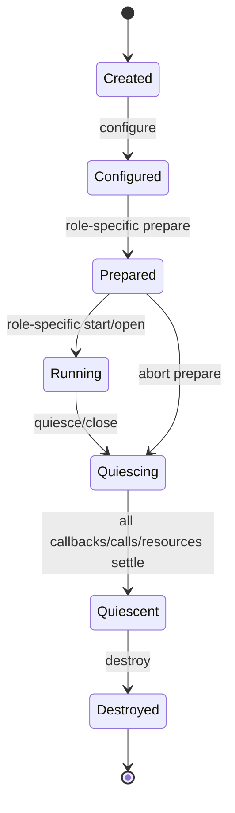

# RoDAQ Plugin 公共框架设计

| 文档属性 | 内容 |
| --- | --- |
| 文档类型 | 模块详细设计 |
| 状态 | V1 详细设计基线 |
| 适用范围 | RoDAQ 动态插件公共 ABI、装载、配置、能力、资源、生命周期与兼容性 |
| 上位设计 | [系统架构设计](architecture.md) |
| 关联设计 | [Pipeline](pipeline.md) · [Acquisition](acquisition.md) · [Storage](storage.md) · [技术选型](technology_selection.md) |

## 1. 目标与边界

Plugin 框架负责让 Acquisition 和 Storage 后端能够以稳定、可验证、资源有界的方式装载到 RoDAQ 守护进程中。

Plugin 公共框架负责：

- 动态库发现与装载；
- 版本化 C ABI；
- 插件元数据与角色识别；
- Configuration Schema；
- Capability；
- Resource Plan；
- Extension Query；
- Host Services；
- 结构大小、所有权、错误码和字符串/缓冲区规则；
- 线程安全和重入基础规则；
- 插件实例公共生命周期；
- ABI conformance 与依赖共存资格。

Plugin 公共框架不负责：

- Acquisition 的 Source/Stream/Record 语义；
- Storage 的 Batch/Segment/Commit 语义；
- Task 状态机；
- Pipeline Admission；
- HTTP 或 Web；
- 把所有后端业务参数统一成一个大配置结构。

## 2. 插件接口契约与实例生命周期

### 2.1 模型、版本与配置

**设计原则。**

**ABI 保持稳定，业务语义分层。**

公共边界采用 C ABI，插件内部可以使用 C++17。

ABI 只表达稳定跨库事实：

- fixed-width scalar；
- 明确大小的 POD struct；
- opaque handle；
- borrowed buffer/string view；
- host-provided output buffer；
- function table；
- explicit result code。

禁止稳定 C ABI 暴露：

- STL；
- exceptions；
- RTTI；
- `std::string` / `std::vector`；
- `nlohmann::json`；
- ROS 2 / MQTT / MCAP 等后端 C++ 类型；
- 编译器相关对象布局。

**公共 ABI 小而稳定。**

核心 ABI 只放所有 Acquisition/Storage 都必须具备的能力。

可选能力使用版本化 Extension Query。

不能为了避免扩展机制而持续把未来字段塞入核心 operation table。

**所有权必须显式。**

任何跨 ABI 的对象必须声明：

- owner；
- borrow duration；
- acquire/release；
- callback validity；
- destroy 前静止条件。

“调用返回后通常还有效”不能作为可依赖的接口契约。

**动态库模型。**

每个插件独立构建为动态库：

```text
plugins/
  acquisition_ros2.so
  acquisition_mqtt.so
  storage_mcap.so
  storage_sqlite3.so
```

实际文件名属于打包实现；Task Configuration 只保存逻辑 plugin id，不保存任意磁盘路径。

Deployment Configuration 定义：

- 允许的 plugin directories；
- 允许的 plugin ids；
- 可选 exact artifact/version allow-list；
- 依赖共存支持矩阵。

RoDAQ 不从 Task JSON 加载任意路径动态库。

**Plugin Descriptor。**

每个动态库导出一个稳定入口，返回 Plugin Descriptor。

Descriptor 至少包含：

| 字段 | 语义 |
| --- | --- |
| ABI major/minor | 公共 ABI 版本 |
| struct size | 结构尾扩展保护 |
| plugin id | 稳定逻辑标识 |
| plugin version | 发布版本 |
| plugin role | Acquisition / Storage |
| build identity | 可审计构建身份 |
| config schema identity | 参数结构版本 |
| capability entry | 能力查询 |
| resource-plan entry | 资源计划生成 |
| create/destroy entry | 实例生命周期 |
| extension-query entry | 可选扩展 |

Plugin Descriptor 的字符串由插件在 library lifetime 内保持稳定，或按 ABI 明确复制到 host-owned buffer。

**版本与兼容。**

**ABI Major / Minor。**

- Major：破坏布局、所有权或语义的变更；
- Minor：向后兼容新增；
- struct size：允许旧宿主忽略尾部字段、新宿主识别旧结构长度。

宿主必须：

1. 校验 ABI major；
2. 校验最低结构大小；
3. 只读取 `struct_size` 覆盖的字段；
4. 校验 role；
5. 校验必需 operation pointer；
6. 校验扩展版本。

**配置版本与 ABI 分离。**

Plugin Configuration Schema version 与 ABI version 独立。

配置字段变化不应被迫提升 ABI。

Task 保存：

```text
plugin_id
plugin_config_schema_version
plugin_params
```

Start 时当前插件必须声明仍能解释该配置版本，否则 Prepare 失败。

**配置输入。**

Plugin-specific 参数在 Task Configuration 中以 JSON Object 保存，但 JSON 库类型不得跨 ABI。

边界流程：

```text
Strict JSON
  ↓
Core schema validation
  ↓
RoDAQ typed/config view representation
  ↓
Plugin semantic validation
```

Plugin Configuration Schema 负责：

- required fields；
- type；
- ranges；
- enum；
- size；
- unknown-field policy；
- schema version。

插件自身仍是协议语义校验最终权威，例如：

- ROS 2 Topic/type/QoS 组合；
- MQTT Broker/Topic/QoS；
- MCAP compression/chunk；
- SQLite3 backend-specific options。

### 2.2 能力、资源与实例生命周期

**Capability。**

Capability 描述“插件能做什么”，不能由 Core 从配置字段反推。

公共 Capability header 至少包含：

- capability struct version；
- struct size；
- role；
- max record size；
- supported extension ids；
- concurrency declaration；
- role-specific capability view。

Acquisition 和 Storage 的具体 capability 在各自文档定义。

Capability 在一个实例生命周期内必须稳定。若配置会改变 capability，必须在 instance 创建前完成计算并冻结到本次 Effective Recording Configuration。

**Plugin Resource Plan。**

在创建实际运行实例前，插件根据已验证配置生成 Resource Plan。

Resource Plan 至少可表达：

- host-facing buffers；
- plugin-private buffers；
- max in-flight records/bytes；
- threads；
- internal executors；
- file descriptors；
- blocking control slots；
- max callback concurrency；
- max record；
- role-specific reserve；
- other bounded resources。

Resource Plan 是插件对当前配置的**资源申请**，不是性能保证。

不得把以下内容伪装成可精确预留值：

- CPU percentage；
- disk throughput；
- memory bandwidth；
- scheduler latency。

这些由 production qualification 验证。

**Resource Plan 的可信度。**

插件属于同进程可信组件，但 Host 不能盲信声明。

必须通过：

- conformance test；
- stress test；
- long-run RSS/thread/FD observation；
- backend-specific qualification；

验证实际资源不突破声明或定义的合理 envelope。

突破声明说明插件违反资源声明规则。

**Instance Lifecycle。**

公共生命周期：



具体 Acquisition/Storage 可以使用更窄状态集，但必须满足以下公共事实：

- create 失败不得泄漏 partial instance；
- destroy 只能在实例 quiescent 后调用；
- timeout 不等于 quiescent；
- destroy 返回后插件不得再访问 host instance context；
- library handle 生命周期长于所有实例、callback 和 function pointer。

**Host Services。**

插件只能通过明确的 Host Services 使用宿主能力。

Host Services 可包括：

- bounded allocator/buffer services；
- clock reading；
- structured diagnostics；
- callback/submission entry；
- cancellation/stop observation；
- extension discovery。

Host Services 不应暴露：

- Task state machine；
- Pipeline private object；
- HTTP；
- arbitrary filesystem service；
- global singleton；
- mutable Core container。

每个 service 必须有：

- version；
- struct size；
- ownership；
- threading；
- lifetime；
- failure semantics。

## 3. ABI 行为与并发

### 3.1 Result、Buffer 与 Extension

**Result Model。**

C ABI 使用稳定的 plugin result code，不直接暴露 C++ Status。

Result 至少可以映射到 Core：

- Ok；
- InvalidArgument；
- InvalidState；
- Unsupported；
- ResourceExhausted；
- DeadlineExceeded；
- Unavailable；
- PermissionDenied；
- DataLoss/PersistenceUnknown；
- Internal。

每次失败还可以提供有界 diagnostic detail，但：

- diagnostic text 不参与恢复逻辑；
- 不跨 ABI 抛异常；
- exception 必须在插件内部捕获；
- unknown exception 映射为 Internal。

Role-specific result 通过结构化扩展字段表达，例如 Storage Unknown，不塞进 message string。

**Buffer 与字符串规则。**

跨 ABI buffer/string 使用：

```text
pointer + size
```

必须明确：

- null + zero 是否合法；
- max size；
- encoding；
- 是否 NUL-terminated；
- input borrow duration；
- output capacity；
- truncation rule；
- required size reporting。

稳定 ABI 不返回由另一侧用 `free()` 释放的隐式堆内存。

优先：

- caller-owned output buffer；
- host allocator + explicit release；
- plugin-owned immutable lifetime-defined view。

**Extension Query。**

可选能力通过：

```text
query_extension(extension_id, requested_version)
```

返回对应 versioned operation table/view。

扩展规则：

- ID 稳定；
- major 语义不兼容则使用新版本；
- struct-size 允许兼容尾扩展；
- 未知扩展返回 Unsupported；
- Core 不因为扩展不存在而读取未定义 pointer；
- Required extension 在 Prepare 阶段缺失即失败。

扩展不能绕过公共生命周期、资源和所有权规则。

### 3.2 Thread Safety、Reentrancy 与 Quiescence

**Thread Safety。**

V1 公共默认：

| 调用类型 | 默认调用规则 |
| --- | --- |
| instance create/destroy | Host 串行 |
| mutable control calls | 同一实例 Host 串行 |
| role-specific data callbacks | 由 capability 明确声明最大并发 |
| Storage mutable operations | 默认单逻辑 lane |
| diagnostics/query | 只有显式 thread-safe 声明后才能并发 |
| extension query | instance 创建前或声明可并发 |

若插件未声明 thread-safe，Host 必须串行调用。

**Reentrancy。**

禁止隐式重入。

插件在执行 Host→Plugin 调用时，如果调用 Host callback，必须遵守该 callback 的明确重入规则。

默认禁止：

```text
Host -> Plugin control call
Plugin -> Host callback
Host -> same Plugin control call
```

尤其禁止插件持有内部全局锁时调用可能导致同步反入插件的 Host service。

需要重入的未来扩展必须单独设计。

**Quiescence。**

Quiescence 是销毁安全条件，不是“调用了 stop”。

需要分别证明：

- 没有未返回的 Host→Plugin call；
- 没有未返回的 Plugin→Host callback；
- 没有插件后台任务仍可能访问 instance context；
- 没有 Payload/Buffer 仍被插件访问；
- role-specific I/O ownership 已终止或转入明确 PendingCleanup。

`quiesce` timeout：

- instance 仍存在；
- library 不卸载；
- buffer 不提前释放；
- execution capacity 不提前归还；
- 迟返仍归旧 instance。

## 4. 装载、故障与角色边界

### 4.1 装载、依赖与打包

**Library Lifetime。**

V1 已装载的插件动态库句柄保留到 RoDAQ 守护进程退出。

不支持进程内热卸载/热升级。

原因：

- function pointer lifetime；
- third-party static/global state；
- TLS；
- background threads；
- allocator/runtime dependency；
- C++ runtime interaction。

插件升级通过整进程重启生效。

**依赖共存。**

C ABI 稳定不等于进程内依赖一定兼容。

发布资格必须记录：

- critical SONAME；
- exact versions；
- symbol visibility；
- C++ runtime；
- allocator；
- OpenSSL；
- compression libs；
- ROS 2 / DDS closure；
- protobuf/gRPC 等共享依赖。

未通过联合验证的插件组合必须在部署配置中禁止。

### 4.2 异常与进程级故障

同进程插件只能隔离**合作式故障**：

- error result；
- bounded blocking；
- timeout；
- declared resource exhaustion。

不能承诺隔离：

- segmentation fault；
- UB；
- heap corruption；
- global deadlock；
- unbounded allocation；
- process-wide signal misuse。

此类故障进入进程级恢复，由外部服务管理器重启。

**插件打包。**

V1 插件 SDK/交付至少包含：

- versioned C ABI headers；
- role-specific headers；
- config schema convention；
- minimal Acquisition example；
- minimal Storage example；
- host-side conformance harness；
- packaging/manifest documentation；
- version/compatibility matrix。

公共头必须能用 C 编译器独立包含。

### 4.3 ABI Conformance Test

**Header / Layout。**

- C compiler；
- C++17 compiler；
- sizeof / align / offsetof；
- old/new struct size；
- null pointer；
- min size；
- unknown enum；
- tail canary。

**Lifecycle。**

- create fail；
- configure fail；
- prepare fail；
- quiesce；
- timeout；
- late return；
- destroy；
- process shutdown。

**Threading。**

- declared callback concurrency；
- illegal concurrent control；
- query concurrency；
- callback/quiesce race；
- forbidden reentrancy。

**Resource。**

- plan over profile；
- actual buffer/thread/FD HWM；
- allocation failure；
- repeated create/destroy；
- long-run leak detection。

**Error Boundary。**

- normal errors；
- unknown result code；
- malformed output；
- plugin internal exception；
- diagnostic truncation；
- unsupported extension。

### 4.4 与角色文档的分工

| 职责项 | Plugin 公共文档 | Acquisition 文档 | Storage 文档 |
| --- | --- | --- | --- |
| ABI version/layout | 权威 | 引用 | 引用 |
| loader/library lifetime | 权威 | 引用 | 引用 |
| config schema mechanism | 权威 | 定义采集参数语义 | 定义存储参数语义 |
| capability mechanism | 权威 | 定义 Acquisition capability | 定义 Storage capability |
| resource plan mechanism | 权威 | 采集侧字段 | 存储侧字段 |
| thread/reentrancy baseline | 权威 | callback/quiesce 细化 | write/seal lane 细化 |
| Source/Stream/Record | 不定义 | 权威 | 消费 Descriptor/Record |
| Batch/Unknown/Segment | 不定义 | 不定义 | 权威 |

## 5. 开发实现设计

### 5.1 ABI 入口、布局与基础类型

**ABI 头文件分层。**

V1 插件 SDK 建议拆为三个稳定 C 头文件层次：

```text
plugin/
  abi.h
  acquisition_abi.h
  storage_abi.h
```

`abi.h` 只包含角色无关的：

- ABI version；
- result code；
- string/buffer；
- config reader；
- plugin descriptor；
- capability/resource common header；
- host services；
- extension query；
- opaque instance type。

角色 operation table 分别在 Acquisition/Storage ABI 头中定义。

公共 C 头必须：

- 可由 C11/C17 编译器独立包含；
- 不依赖 C++ header；
- 不依赖第三方库 header；
- 不要求 packing pragma 才能得到正确布局；
- 所有 ABI scalar 使用明确宽度类型。

**唯一导出入口。**

每个插件动态库只要求一个稳定公共入口：

```c
RODAQ_PLUGIN_EXPORT rodaq_result_code_t
rodaq_plugin_get_descriptor(uint32_t host_abi_major,
                            uint32_t host_abi_minor,
                            rodaq_plugin_descriptor_t* out_descriptor);
```

其它 operation 通过 descriptor/function table 获取，不要求导出大量全局符号。

宿主装载流程：

```text
dlopen
→ dlsym(rodaq_plugin_get_descriptor)
→ call descriptor entry
→ validate common header
→ validate ABI major/minor
→ validate role
→ validate required operation table
→ register plugin id
```

任何校验失败都在创建实例前结束。

**ABI 公共结构头。**

所有可扩展 struct 以公共 header 开头：

```c
typedef struct rodaq_abi_header {
    uint32_t struct_size;
    uint16_t version_major;
    uint16_t version_minor;
} rodaq_abi_header_t;
```

规则：

- `struct_size` 是该内存对象实际可访问的字节数；
- 对 **caller-owned output struct**：caller 先清零整个缓冲，写入自己的 `struct_size` 和请求的 version；callee 只写 caller 提供范围与自身已知字段的交集；
- 对 **callee-owned static table/descriptor**：callee 填写自己实际结构的 `struct_size/version`，caller 只读取自己理解且在该 size 内的字段；
- 接收方只读到 `min(struct_size, known_size)`；
- 小于当前版本 required prefix 时返回 Unsupported/InvalidArgument；
- 未知 tail 必须忽略并保持 caller 预置的零值；
- callee 不得覆盖 caller buffer 的 canary/tail；
- 不允许通过 `sizeof(new_struct)` 直接拒绝旧兼容结构。

所有 output pointer 在函数返回非 OK 时也必须遵守“**只写已声明有效的输出**”规则；role 文档逐函数说明哪些输出在错误返回时仍有效。未特别声明时，非 OK 返回只保证 error buffer，有效业务 output 不得被 caller 使用。

V1 目标平台要求 C/C++ 的 `double` 为 IEEE-754 binary64；ABI conformance 在 amd64/arm64 构建时静态/运行期验证该前提。

**基础 ABI 类型。**

字符串：

```c
typedef struct rodaq_string {
    const char* data;
    uint64_t size;
} rodaq_string_t;
```

字节：

```c
typedef struct rodaq_bytes {
    const uint8_t* data;
    uint64_t size;
} rodaq_bytes_t;
```

二者都是 borrowed input，除非具体字段另有 lifetime 声明。

稳定实体标识统一使用 128-bit 二进制表示；sequence/generation 使用 `uint64_t`；内容/环境摘要使用固定 256-bit 表示。公共 ABI 定义基础布局：

```c
typedef struct rodaq_id128 {
    uint64_t high;
    uint64_t low;
} rodaq_id128_t;

typedef struct rodaq_digest256 {
    uint8_t bytes[32];
} rodaq_digest256_t;
```

正式头文件为 `task_id / pipeline_id / stream_id / descriptor_id / instance_id / segment_id / operation_id / host_boot_id / source_id / source_session_id` 定义**语义上独立的 struct 类型**，字段布局均为两个 `uint64_t`，避免在 C/C++ 调用点把不同 ID 误传。不能只用一个 `typedef rodaq_id128_t rodaq_stream_id_t` 把所有 ID 退化为同一 C 类型。

持久 JSON 中 128-bit ID 使用固定 32 个小写十六进制字符（high 后 low、无前缀）；256-bit digest 使用 64 个小写十六进制字符。全零实体 ID 作为 invalid/sentinel，不分配给正常对象。ID 的生成/来源由领域决定：Task/Pipeline/Stream/Instance/Segment/Operation 使用项目的碰撞不可接受生成器，Host Boot 和 Source identity 可以来自经过验证的系统/协议事实。

Deadline 使用 Host monotonic clock 的绝对值：

```c
typedef struct rodaq_deadline {
    uint64_t monotonic_ns;
} rodaq_deadline_t;
```

`monotonic_ns` 与 Host Services 提供的 monotonic 样本属于同一进程/boot 时间域。插件不能把它解释为 realtime，也不能在内部为每个子步骤重新计算新的完整 timeout。

V1 插件 ABI 支持目标为 64-bit Linux amd64/arm64。ABI 的**字段语义和布局规则**在两种架构保持一致，但动态库本身仍是架构专用产物；不承诺同一个 `.so` 跨架构加载。所有持久/协议数值仍使用固定宽度类型，不依赖 LP64 的 `long` 或 `size_t`。

**Result Code。**

公共 ABI 结果码使用固定枚举值：

```c
typedef uint32_t rodaq_result_code_t;

enum {
    RODAQ_RESULT_OK = 0,
    RODAQ_RESULT_INVALID_ARGUMENT = 1,
    RODAQ_RESULT_INVALID_STATE = 2,
    RODAQ_RESULT_CONFLICT = 3,
    RODAQ_RESULT_UNSUPPORTED = 4,
    RODAQ_RESULT_RESOURCE_EXHAUSTED = 5,
    RODAQ_RESULT_DEADLINE_EXCEEDED = 6,
    RODAQ_RESULT_UNAVAILABLE = 7,
    RODAQ_RESULT_PERMISSION_DENIED = 8,
    RODAQ_RESULT_DATA_LOSS = 9,
    RODAQ_RESULT_INTERNAL = 10
};
```

结果字段始终使用固定宽度 `rodaq_result_code_t`；上面的匿名枚举只提供编译期常量，避免把 C enum 的实现相关宽度变成 ABI。数值发布后不重排。

角色级 Unknown/PersistenceUnknown 不靠新增随意字符串表达，而由 Storage role result struct 显式编码。

**Diagnostic 输出。**

失败诊断采用 caller-owned buffer：

```c
typedef struct rodaq_error_buffer {
    char* data;
    uint64_t capacity;
    uint64_t required_size;
    uint8_t truncated;
    uint8_t reserved[7];
} rodaq_error_buffer_t;
```

约束：

- plugin 不返回要求 host `free()` 的字符串；
- `capacity` 包含结尾 NUL 的空间；
- `required_size` 是完整 UTF-8 diagnostic 的字节数，不含结尾 NUL；
- `capacity > 0` 时输出始终 NUL-terminated；
- 实际复制字节数为 `min(required_size, capacity - 1)`；
- 未完整复制时 `truncated = 1`；
- `data == NULL && capacity == 0` 合法，可只查询 required size；
- diagnostic 不参与程序控制逻辑。

### 5.2 配置、Descriptor、Host Services 与实例

**只读配置 ABI。**

插件不直接接收 JSON library type，也不要求每个插件重复解析 JSON 文本。V1 建议使用 Host 提供的只读 Config API：

```c
typedef struct rodaq_config_node* rodaq_config_node_t;
typedef uint32_t rodaq_config_type_t;

enum {
    RODAQ_CONFIG_NULL = 0,
    RODAQ_CONFIG_OBJECT = 1,
    RODAQ_CONFIG_ARRAY = 2,
    RODAQ_CONFIG_BOOL = 3,
    RODAQ_CONFIG_I64 = 4,
    RODAQ_CONFIG_U64 = 5,
    RODAQ_CONFIG_F64 = 6,
    RODAQ_CONFIG_STRING = 7
};

typedef struct rodaq_config_api {
    rodaq_abi_header_t header;

    rodaq_result_code_t (*get_type)(
        rodaq_config_node_t node,
        rodaq_config_type_t* out_type);

    rodaq_result_code_t (*object_get)(
        rodaq_config_node_t object,
        rodaq_string_t key,
        uint8_t* out_present,
        rodaq_config_node_t* out_node);

    rodaq_result_code_t (*array_size)(
        rodaq_config_node_t array,
        uint32_t* out_size);

    rodaq_result_code_t (*array_get)(
        rodaq_config_node_t array,
        uint32_t index,
        rodaq_config_node_t* out_node);

    rodaq_result_code_t (*get_bool)(
        rodaq_config_node_t node,
        uint8_t* out_value);

    rodaq_result_code_t (*get_i64)(
        rodaq_config_node_t node,
        int64_t* out_value);

    rodaq_result_code_t (*get_u64)(
        rodaq_config_node_t node,
        uint64_t* out_value);

    rodaq_result_code_t (*get_f64)(
        rodaq_config_node_t node,
        double* out_value);

    rodaq_result_code_t (*get_string)(
        rodaq_config_node_t node,
        rodaq_string_t* out_value);
} rodaq_config_api_t;
```

Config API 的行为也属于 ABI：

- `rodaq_config_node_t` 只在**当前接收该 config node 的 ABI 调用期间**有效，包括 validate/capability/resource-plan/create；
- plugin 不跨调用保存 node handle；
- `get_string()` 返回的 string value 同样只在当前 ABI 调用期间 borrowed；
- JSON null/类型不匹配返回明确结果；
- schema validation 已由 Host 执行，plugin 再做语义校验。

这样可以保持严格 JSON 作为外部格式，同时不把 JSON 库和 parser 复制进每个插件 ABI。

**Plugin Descriptor 结构。**

建议：

```c
typedef struct rodaq_plugin_descriptor {
    rodaq_abi_header_t header;

    rodaq_string_t plugin_id;
    rodaq_string_t plugin_version;
    rodaq_string_t build_id;

    uint32_t role;

    rodaq_string_t config_schema_id;
    rodaq_string_t config_schema_version;
    rodaq_bytes_t config_schema_json;

    const void* role_operations;

    rodaq_result_code_t (*query_extension)(
        rodaq_string_t extension_id,
        uint16_t requested_major,
        uint16_t requested_minor,
        const void** out_operations,
        uint32_t* out_operations_size,
        rodaq_error_buffer_t* error);
} rodaq_plugin_descriptor_t;
```

Descriptor 及其静态字符串/schema bytes 的 lifetime 至少覆盖 library lifetime。

`role_operations` 根据 role 解释为 Acquisition/Storage operation table，并通过各自 table header 校验。

**Host Services。**

Host Services 只提供插件真正需要且边界清晰的能力：

```c
typedef struct rodaq_host_services {
    rodaq_abi_header_t header;
    void* host_context;

    const rodaq_config_api_t* config;

    rodaq_result_code_t (*get_clock_sample)(
        void* host_context,
        rodaq_clock_sample_t* out_sample);

    void (*report_diagnostic)(
        void* host_context,
        const rodaq_diagnostic_t* diagnostic);

    const void* role_host_services;
} rodaq_host_services_t;
```

公共 clock/diagnostic 类型必须是固定宽度、无动态所有权的 ABI 结构。例如：

```c
typedef struct rodaq_clock_sample {
    rodaq_abi_header_t header;
    uint64_t monotonic_ns;
    int64_t realtime_ns;
    uint64_t host_boot_id_hi;
    uint64_t host_boot_id_lo;
    uint64_t clock_epoch_id;
} rodaq_clock_sample_t;

typedef uint32_t rodaq_diagnostic_severity_t;

typedef struct rodaq_diagnostic {
    rodaq_abi_header_t header;
    rodaq_diagnostic_severity_t severity;
    uint32_t code;
    rodaq_string_t message;
} rodaq_diagnostic_t;
```

`message` 只在 `report_diagnostic()` 调用期间 borrowed；Host 需要保留时自行复制到有界诊断存储。诊断 code/文本都不能代替正式 result code 和 Data Impact。

Acquisition 的 Record submission callback 放在 role host services 中，不放公共层。

V1 不向插件提供任意 filesystem、Task controller 或 global registry。

**Plugin Instance。**

ABI 只使用不透明实例：

```c
typedef struct rodaq_plugin_instance* rodaq_plugin_instance_t;
```

create：

```text
validated config
+ host services
+ effective limits/resource grant
→ instance
```

destroy：

- 只允许在 role-specific quiescence 完成后；
- 不返回业务 flush 成功；
- `destroy` 必须 noexcept-equivalent，不让异常越界；
- 如果内部析构遇到异常，转换为诊断并保持 C ABI 安全。

### 5.3 Capability、Resource Plan 与 Extension

**Capability 调用。**

Capability 必须在**创建运行实例之前**完成，作为 Prepare 资源准入输入。角色 operation table 提供以已验证配置为输入的 configured-capability 查询，不依赖 `rodaq_plugin_instance_t`：

```text
plugin static facts
+ validated config
+ plugin-observed runtime environment facts
→ configured capability
```

configured capability 与 Resource Plan 一起参与 Effective Pipeline Limits 计算；只有准入成功后才调用 create 创建实际运行实例。任何会改变 capability/resource plan 的插件运行环境事实（例如实际 RMW、backend feature set、系统库能力）必须进入 capability/plan 的稳定 fingerprint/identity 输出，并最终参与 `effective_config_id`，不能作为未记录的隐藏输入。

角色 capability 与 resource-plan 结构都必须包含同一 `environment_fingerprint`。V1 将其定义为固定 32 字节的不透明摘要：

```c
typedef struct rodaq_environment_fingerprint {
    uint8_t bytes[32];
} rodaq_environment_fingerprint_t;
```

它与 `rodaq_digest256_t` 字节宽度相同但语义不同，正式 ABI 使用独立 struct，防止内容摘要和环境摘要误传。同一插件版本、同一规范化配置和等价运行环境必须产生相同 fingerprint；影响资源或能力语义的环境变化必须改变 fingerprint。摘要算法及输入规范在插件 ABI V1 冻结时固定并进入 conformance golden test。

Capability struct 中的 variable-length 列表使用 caller-owned bounded output 或“两次调用：query count/required bytes → fill”，不返回插件堆容器。

**Resource Plan 调用。**

Resource Plan 的输入必须是已经通过 schema + semantic validation 的配置，并且**不得要求运行实例已经创建**。接口语义：

```text
same validated config
→ deterministic resource plan
```

相同 plugin version + 相同规范化配置应得到语义相同的 plan；若依赖 Deployment 运行环境值，必须把这些值作为明确输入并进入 `effective_config_id`。

Resource Plan 不允许通过“先创建完整后台线程再测实际占用”生成。标准顺序固定为：

```text
schema validation
→ plugin semantic validation
→ configured capability
→ resource plan
→ Core/Profile admission
→ create runtime instance
→ role prepare
```

任何角色 ABI 都必须保持这一顺序。

**Extension ABI。**

建议 Extension ID 使用稳定字符串或定长标识，例如：

```text
rodaq.acquisition.payload_retain
rodaq.storage.verification
```

query 返回：

```text
extension header
+ versioned operation table
```

调用方必须在实例或 library 对应 lifetime 内使用，不缓存超过声明范围。

### 5.4 Loader、异常边界与线程安全规则

**装载器内部组成。**

Plugin loader 建议拆为：

| 对象 | 职责 |
| --- | --- |
| `PluginCatalog` | 保存经过验证的 plugin id → loaded descriptor |
| `SharedLibrary` | 平台装载句柄 RAII，只处理 dlopen/dlsym/close |
| `PluginValidator` | ABI/version/role/table/schema 静态验证 |
| `PluginFactory` | 用 Host Services + config 创建 role instance |
| `PluginCompatibility` | 检查部署支持矩阵和依赖共存 |

不要让 `SharedLibrary` 解释业务 capability，也不要让 `PluginCatalog` 创建 Task。

**dlopen 策略。**

Linux V1 需要固定：

- 使用绝对解析后的受管路径；
- 禁止 Task 提供任意 path；
- 明确 `RTLD_LOCAL` / `RTLD_NOW` 等 loader policy；
- 装载失败记录 bounded diagnostic；
- 成功装载后本进程不主动卸载；
- 同 plugin id 的多版本并存是否允许必须由 Deployment policy 决定，V1 默认禁止同逻辑 id 同时装载多个未验证版本。

具体 loader flag 在实现探针后写入技术选型和代码常量。

**符号可见性。**

插件编译默认隐藏符号，只导出稳定入口及确有需要的 ABI symbol。

CI 使用：

```text
nm/readelf
```

核对导出集合，防止第三方 C++ symbol 或内部类意外成为 ABI。

**Exception Boundary。**

每个 C ABI entry 都采用统一 wrapper：

```cpp
try {
    return implementation_call(...);
} catch (const std::bad_alloc&) {
    return RODAQ_RESULT_RESOURCE_EXHAUSTED;
} catch (const std::exception& e) {
    write_bounded_diagnostic(e.what());
    return RODAQ_RESULT_INTERNAL;
} catch (...) {
    write_bounded_diagnostic("unknown exception");
    return RODAQ_RESULT_INTERNAL;
}
```

异常分类可以按项目策略更细，但任何 C++ exception 都不得穿越 C ABI。

**Threading 声明。**

Operation table 文档必须逐函数标记：

```text
Host serialized
May run concurrently with callback
May block
Operation deadline
Borrowed inputs lifetime
Late-return ownership
```

不能只在总说明写一句“thread-safe”。

**ABI Static Assertions。**

C++ host wrapper 和插件 SDK test 对关键 ABI 类型执行：

```cpp
static_assert(std::is_standard_layout<T>::value, ...);
static_assert(std::is_trivially_copyable<T>::value, ...);
```

并验证：

- field offset；
- min prefix size；
- enum width strategy；
- pointer/null behavior；
- canary tail 不被越界写。

C compiler test 负责证明头文件不偷偷依赖 C++。

**Role Wrapper。**

Core C++ 不应在业务代码到处直接调用 function pointer。

分别提供内部 wrapper：

```text
AcquisitionPlugin
StoragePlugin
```

wrapper 负责：

- C ABI → `Status/Result` 映射；
- struct-size 初始化；
- error buffer；
- deadline instrumentation；
- exception-safe host side；
- metrics；
- owner token。

Pipeline 只依赖这些项目 wrapper 的窄接口，而不是原始 C table。

**Test Seam。**

Plugin framework 的测试必须提供可程序化构造的测试动态库：

- old ABI minor；
- short struct；
- unknown tail；
- missing required function；
- wrong role；
- duplicate plugin id；
- exception throwing C++ implementation；
- delayed callback；
- illegal callback after quiesce；
- malformed result；
- resource plan overflow。

测试真实 `dlopen/dlsym`，不能只在进程内模拟 function table。

**代码组织约束。**

推荐逻辑文件组：

```text
plugin/
  abi/
    abi.h
    acquisition_abi.h
    storage_abi.h
  plugin_catalog.*
  shared_library.*
  plugin_validator.*
  plugin_factory.*
  plugin_compatibility.*
  acquisition_plugin.*
  storage_plugin.*
```

ABI public headers 与 C++ host wrapper 分离。不得使用 `detail/` 收纳所有 ABI 私有实现，也不把具体 ROS 2/MCAP 头引入公共 plugin 目录。

### 5.5 Secret Handoff

可移植 Task/Plugin 配置只保存 credential reference，不保存 secret material。Host 在形成 Effective Recording Configuration 时解析引用并得到：

```text
credential logical name
credential version/fingerprint
secret items
```

公共 ABI 使用只读、调用期借用结构：

```c
typedef struct rodaq_secret_item {
    rodaq_string_t name;
    rodaq_bytes_t value;
} rodaq_secret_item_t;

typedef struct rodaq_credential_fingerprint {
    uint8_t bytes[32];
} rodaq_credential_fingerprint_t;

typedef struct rodaq_secret_bundle {
    rodaq_abi_header_t header;
    const rodaq_secret_item_t* items;
    uint32_t item_count;
    rodaq_credential_fingerprint_t credential_fingerprint;
} rodaq_secret_bundle_t;
```

规则：

- `items/value` 只在 create 调用期间有效；
- plugin 若运行期/reconnect 仍需要凭据，必须在 create 内复制到自己的受控内存或交给已验证的 backend credential object；
- secret bytes 不进入普通日志、diagnostic、Task export、Recovery Record、Segment Manifest、environment fingerprint；
- `effective_config_id` 只包含 credential reference 的稳定 version/fingerprint，不包含 secret plaintext；
- destroy/quiescent cleanup 对 plugin 自己保存的敏感缓冲执行能力范围内的 best-effort zeroization；不能宣称第三方库内部复制一定已被擦除，相关行为进入 backend qualification；
- secret item 数量和单项/总字节数由 Deployment 设置硬上限；
- V1 不允许插件自行根据 Task 参数打开任意 secret file path；文件/密钥库访问由 Host/Deployment 层完成。

Acquisition/Storage role 的 create args 都包含可空的 `const rodaq_secret_bundle_t*`。不需要凭据时传空；需要但引用无法解析时在实例创建前 Prepare 失败。

## 6. 不变量与完成条件

### 6.1 核心不变量

1. 稳定 ABI 不暴露 STL/JSON/backend C++ 类型。
2. 插件业务配置与 ABI version 分离。
3. Capability 与 Resource Plan 在 Open 前冻结。
4. 未声明能力不能由 Host 猜测。
5. 所有跨 ABI owner/lifetime/release 显式。
6. timeout 不等于 quiescence。
7. destroy 前必须证明所有 callback/call/resource access 静止。
8. library handle 长于所有 function pointer 和 instance。
9. Plugin error text 不作为程序逻辑。
10. 未经验证的依赖组合不能因 ABI 稳定而自动视为可共存。

### 6.2 V1 完成条件

Plugin 公共框架只有在以下条件全部满足后才能视为完成：

- C ABI header 独立编译；
- Acquisition/Storage 最小示例可在源码树外构建并装载；
- struct-size forward/backward probe 通过；
- capability/resource plan 能驱动 Pipeline Prepare；
- callback/quiesce/late-return 测试通过；
- malformed plugin 不破坏 Host 内存边界；
- plugin exception 不跨 ABI；
- joint dependency qualification 至少覆盖首发 ROS 2 + MCAP 组合；
- sanitizer 和长时 create/start/stop/destroy 循环无未解释泄漏。
