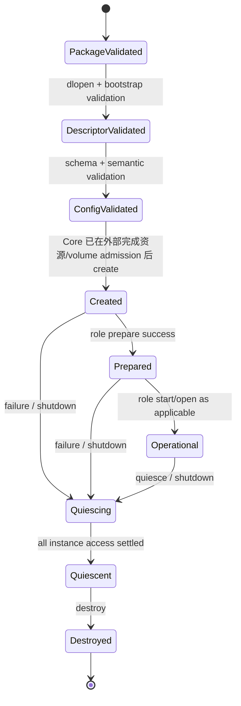

# RoDAQ Plugin 公共框架设计

| 文档属性 | 内容 |
| --- | --- |
| 文档类型 | 模块详细设计 |
| 状态 | V1 详细设计基线 |
| 适用范围 | RoDAQ 动态插件公共 ABI、装载、配置、生命周期、角色协议与兼容性 |
| 上位设计 | [系统架构设计](architecture.md) |
| 关联设计 | [Pipeline](pipeline.md) · [Acquisition](acquisition.md) · [Storage](storage.md) · [技术选型](technology_selection.md) |

## 1. 目标与边界

Plugin 框架负责让 Acquisition 和 Storage 后端能够以稳定、可验证、资源有界的方式装载到 RoDAQ 守护进程中。

Plugin 公共框架负责：

- 动态库发现、身份校验与装载；
- 具有显式 ABI/Protocol 版本字段的稳定 C ABI；
- 插件元数据与角色识别；
- Configuration Schema 与 `validate_config()`；
- Logging 最小公共 Plugin Service；
- 结构大小、所有权、错误码和字符串/缓冲区规则；
- 线程安全、重入、deadline/late-return 与 quiescence 基础规则；
- Acquisition/Storage Role Protocol 的公共版本演进规则；
- ABI conformance 与已发布后端组合的依赖资格。

Plugin 公共框架**不拥有系统运行策略**，尤其不负责：

- Task 状态机、Resource Profile、Capacity admission 或资源调度；
- Pipeline Admission、Queue/Payload/Writer/Commit 预算；
- Volume identity、磁盘水位、文件系统资格、staging/final publish、Artifact Ledger；
- Deployment 策略或后端组合选择；
- Acquisition 的 Source/Stream/Record 业务语义；
- Storage 的 Batch/Segment/Commit 业务语义；
- HTTP 或 Web；
- 把所有后端业务参数统一成一个大配置结构。

**职责闭合原则。** Plugin 是协议/格式适配层，不是第二套 Runtime。插件可以在实现内部创建完成适配所需的对象、线程、middleware handle 或格式 writer，但不能决定系统给某个 Task/Pipeline 分配多少内存、队列、磁盘、执行槽位或提交容量。系统资源策略由 Application/Deployment → Task → Core/Capacity → Pipeline 逐层收敛为 Effective Limits；插件只接收和遵守与其接口行为直接相关的限制。无法由 Core 精确控制的第三方 runtime 内部资源通过受支持配置和生产资格验证，而不是通过 Plugin Resource Plan 伪造精确 reservation。

**设计参考与取舍。** 本文借鉴成熟插件框架中已经被长期验证的机制，但不复制其业务对象模型。关键映射如下：

| 参考机制 | RoDAQ 吸收的原则 | 明确不照搬的部分 |
| --- | --- | --- |
| Vulkan Loader/Driver | manifest/pre-load discovery、独立 bootstrap/interface negotiation、协商后再解释具体 ABI | 不引入 Vulkan 式全局 proc-address API |
| OpenSSL Provider | 双向能力交换、framework services 与 plugin operations 分离、opaque state ownership | 不采用 `function_id + void(*)()` 的通用 dispatch；RoDAQ 保留 typed table |
| PipeWire SPA | Factory/Handle/Interface、support injection、低依赖 C ABI | 不采用字符串 type + `void*` 的通用 support array |
| GStreamer | Plugin → Feature/Factory → Instance 分层、统一 logging、静态注册事实不依赖瞬时环境 | 不引入 GObject/property 体系和运行期任意属性修改 |
| OBS | role descriptor 与 create/start/stop/destroy 的实例职责分离 | 不引入 module-level mutable lifecycle 或 UI settings API |
| PlotJuggler SDK | package/manifest、C ABI、CMake authoring helper、export/ABI gate | 不把其业务 plugin 类型直接映射为 RoDAQ role |
| ROS class_loader/pluginlib | C++ 插件作者体验、Factory/RAII wrapper | C++ inheritance/RTTI/STL 不作为跨 DSO 稳定 ABI |

因此 RoDAQ 的稳定边界采用 **Bootstrap Foundation + Common C ABI + Role Protocol + typed Services + C++ authoring adapter**。跨 DSO 不传 C++ 对象、STL、RTTI 或 exception，不把 GObject/SPA 对象系统引入项目。[Vulkan Loader Interface](https://vulkan.lunarg.com/doc/view/latest/windows/LoaderDriverInterface.html) · [OpenSSL Provider](https://docs.openssl.org/3.3/man7/provider/) · [PipeWire SPA Plugins](https://pipewire.pages.freedesktop.org/pipewire/page_spa_plugins.html) · [GStreamer GstPlugin](https://gstreamer.freedesktop.org/documentation/gstreamer/gstplugin.html) · [OBS Modules](https://docs.obsproject.com/reference-modules) · [PlotJuggler SDK](https://github.com/PlotJuggler/plotjuggler_sdk) · [ROS class_loader](https://github.com/ros/class_loader)

**V1 边界。** 一个受管插件 package 对应一个逻辑 `plugin_id`、一个角色和一个主 DSO；一个 DSO 不同时注册多个 RoDAQ plugin id，也不同时承担 Acquisition 与 Storage 两种角色。V1 不支持进程内热升级、热卸载或插件自行发现/加载其它 RoDAQ 插件。插件属于受信任的同进程组件，ABI 与资格测试用于约束合作式行为，不能提供恶意代码或内存破坏隔离；需要进程级隔离属于后续能力。

**双层开发接口。** Plugin SDK 同时提供 C ABI 与 C++ authoring API。C ABI 是唯一跨 DSO 的稳定二进制边界，也是 RoDAQ Loader、第三方语言绑定和 ABI conformance 的权威契约；C++ API 是插件作者的首选开发接口，用 `Status/Result`、RAII、强类型、抽象基类和自动 adapter 降低开发成本。C++ 对象、STL、RTTI 和异常**不跨 DSO**：插件内部 C++ 实现通过 SDK adapter 转换为同一套 C descriptor/function table，因此 C++ 开发效率不能削弱 C ABI 的稳定性。

**命名规则。** 文件名、导出符号名、函数名、类名和宏名不编码发布版本，例如使用 `manifest.schema.json`、`rodaq_plugin_get_descriptor`、`rodaq_bootstrap_request_t`，不使用 `*_v1`、`*V2*` 或 `*_1_1`。版本只作为 manifest/schema/ABI 字段和数值存在。公开 C ABI 采用 **project prefix + snake_case + `_t`** 的类型命名：`rodaq_string_t`、`rodaq_plugin_descriptor_t`、`rodaq_acquisition_instance_t`；对应 struct tag 使用 `struct rodaq_string` 这类无 `_t` tag，函数使用 `rodaq_xxx()`，常量/枚举值使用 `RODAQ_XXX`。callback/function-pointer typedef 使用 `*_fn_t` 或语义更明确的 `*_cb_t`。公开 C++ SDK 位于 `rodaq::plugin`，类型使用 PascalCase、函数保持项目统一的 lowercase_snake_case。这样 C/C++ 两层在调用点可立即区分，同时保持文件和符号身份与发布版本解耦。POSIX 对 `_t` 存在保留规则，但 RoDAQ 接受这一已知工程取舍，依靠唯一 `rodaq_` 前缀、受控公共头和 ABI conformance gate 避免命名冲突。

变量、字段和类型名优先表达**领域语义**，不表达数据流方向或占位角色。公共接口中禁止把裸 `in`、`out`、`args`、`context`、`info`、`data`、`value` 作为缺少领域限定的命名；应使用 `descriptor`、`instance_config`、`member`、`element`、`batch_result`、`segment_size`、`submission`、`services` 等具体名。只有当所属类型已经完全限定语义时才允许简短字段，例如 `rodaq_string_t::data`、`rodaq_bytes_t::data` 和 typed getter 的 `value`。同一规则适用于 C++ API，避免 `CreateArgs`、`Context`、`Info` 这类为了以后扩展而预留的宽泛对象。

## 2. 插件接口契约与实例生命周期

### 2.1 模型、版本与配置

**设计原则。**

**ABI 保持稳定，业务语义分层。**

公共边界采用 C ABI，插件内部可以使用 C++17。

ABI 只表达稳定跨库事实：

- fixed-width scalar；
- 明确大小的 POD struct；
- opaque handle；
- borrowed buffer/string view；
- RoDAQ-provided output buffer；
- function table；
- explicit result code。

禁止稳定 C ABI 暴露：

- STL；
- exceptions；
- RTTI；
- `std::string` / `std::vector`；
- `nlohmann::json`；
- ROS 2 / MQTT / MCAP / SQLite3 等后端 C++ 类型；
- 编译器相关对象布局。

**公共 ABI 小而稳定。**

核心 ABI 只放所有 Acquisition/Storage 都必须具备的机制。V1 不预先冻结通用 Extension Query 或 Common feature-bit registry。后端差异首先由各自的 Configuration Schema、Role Protocol 已有调用以及 Canonical Descriptor/Record/Segment facts 表达；Core 真正需要理解的新角色语义通过 Role Protocol minor + `struct_size` 尾扩展增加。只有未来出现一个已经有明确消费者、生命周期和失败语义、且无法由 Role minor 安全表达的独立可选协议时，才单独设计命名明确的 typed optional protocol。不能为了“可能以后会需要”提前冻结万能扩展入口。

**所有权必须显式。**

任何跨 ABI 的对象必须声明：

- owner；
- borrow duration；
- acquire/release；
- callback validity；
- destroy 前静止条件。

“调用返回后通常还有效”不能作为可依赖的接口契约。

**Plugin Package 与动态库模型。**

V1 插件以受管 package 交付，而不是把裸 `.so` 直接暴露给 Task：

```text
plugins/<package>/
  manifest.json
  lib/<plugin-artifact>.so
  schemas/<schema-digest>.json
  licenses/...
```

`manifest.json` 是 **pre-dlopen admission manifest**，至少包含：manifest format version、`plugin_id`、role、plugin semantic version、最低 Common ABI、role protocol version、目标 OS/architecture、build identity、主 artifact 相对路径及 SHA-256、配置 schema catalog 及各 schema digest、关键共享依赖事实。所有相对路径必须在 package 根内解析，禁止绝对路径、`..` 逃逸和远程引用。

Task Configuration 的单个插件配置对象只保存 `plugin_id + schema_version + config`，不保存磁盘路径。字段已经处于 PluginConfig 作用域，不重复 `plugin_`/`config_` 前缀。Deployment Configuration 定义受管 `plugin_roots`、`allowed_plugins`、可选 `required_plugins`、可选 exact version/artifact digest pin 以及依赖共存支持矩阵。V1 每个 plugin root **只扫描一级 package 子目录**，不做任意递归文件发现；Deployment 同时冻结 `max_plugin_roots`、`max_plugin_packages`、`max_manifest_bytes`、`max_schemas_per_plugin`、`max_schema_bytes`、`max_dependencies_per_plugin`、`max_plugin_artifact_bytes` 和扫描总字节/诊断条目上限。

Plugin package discovery/admission/DSO validation 在 daemon 初始化阶段完成，形成该进程生命周期内 immutable catalog；Task Create/Start 不触发目录重扫或新的 `dlopen()`。单个非 required plugin 校验失败时将其排除并记录有界诊断，Core 仍可启动；Deployment 声明的 `required_plugins` 任一无法完成 package+DSO validation 时，daemon 不进入 control-ready。RoDAQ 在每个 `dlopen()` 前完成 manifest、路径/权限、目标架构、allow-list 和 artifact digest 校验，因此未获准 artifact 不得先进入 daemon 地址空间再判断身份。

`plugin_id` 是 ASCII、大小写敏感、无首尾空白的稳定命名空间标识，V1 最大 128 bytes，推荐 `rodaq.<role>.<name>`，例如 `rodaq.acquisition.ros2`、`rodaq.storage.mcap`。同一扫描范围内出现多个同 `plugin_id` artifact 且 Deployment 未通过 exact version+digest 唯一选择时，Catalog 必须 fail-closed，不能依赖目录顺序、首次发现或最后发现决定胜者。

Manifest version 使用 `<major>.<minor>` 十进制形式。V1 RoDAQ 支持 `1.0`：major 必须为 1，minor 必须 `<= RoDAQ 支持的最大 minor`；较新 minor 对旧 RoDAQ 报 `Unavailable`，旧 RoDAQ 不尝试忽略未知字段实现“猜测式前向兼容”。每个支持的 manifest minor 都由 Core-owned schema 精确定义允许字段，未知顶层字段拒绝。V1 `1.0` 顶层字段固定为：

```json
{
  "manifest_version": "1.0",
  "plugin_id": "rodaq.acquisition.ros2",
  "plugin_version": "1.2.3",
  "role": "acquisition",
  "required_common_abi": { "major": 1, "min_minor": 0 },
  "role_protocol": { "major": 1, "min_minor": 0 },
  "target": { "os": "linux", "arch": "amd64" },
  "build_id": "...",
  "artifact": { "path": "lib/librodaq_acquisition_ros2.so", "sha256": "..." },
  "schemas": [
    { "schema_version": "1", "dialect": "draft-07", "path": "schemas/<schema-sha256>.json", "sha256": "..." }
  ],
  "dependencies": []
}
```

`plugin_version` 使用 SemVer 2.0.0 文本并限制 64 bytes；`build_id` 最大 128 bytes；SHA-256 使用 64 个小写十六进制字符。Manifest role 只允许 `"acquisition"` / `"storage"`，分别映射 ABI role 1/2；V1 target 只允许 `os="linux"` 且 `arch="amd64" | "arm64"`；其它合法 target 对当前 RoDAQ 视为 `Unavailable`，格式非法则为 `InvalidArgument`。Manifest 自身由 Core-owned `manifest.schema.json` 按 strict JSON + Draft 7 校验；不是由插件提供 schema 来定义“插件清单如何解释”。`dependencies[]` 只记录发布支持与装载安全真正需要核对的关键共享依赖或 package-private dependency。`rodaq_add_plugin()` 从最终 ELF 的 `DT_NEEDED/RUNPATH` 生成并交叉检查这些事实；声明但实际缺失的 package-private dependency、RUNPATH 越出 package root 或与发布支持矩阵明确冲突的共享依赖使 package gate 失败。Loader 不在现场求解任意依赖闭包兼容性，官方组合以发布支持矩阵和联合资格为权威。

`config_schema_catalog_digest` 不依赖 JSON 文本键顺序。V1 不定义独立 `schema_id`：**插件的 schema identity 就是 `plugin_id`**，一个 package 内只允许该 namespace 下的多个 `schema_version`。`schemas[]` 按数值化后的 `schema_version` 升序排序；digest 输入以 ASCII domain separator `rodaq.schema_catalog\0` 开始，随后追加 `uint16 big-endian format_revision = 1`、`plugin_id` 的 `uint32 big-endian length + raw UTF-8 bytes`，再对每项依次追加 `schema_version / dialect / normalized relative path` 的 `uint32 big-endian length + raw UTF-8 bytes`，再追加解码后的 32-byte schema SHA-256，最后对整个字节流取 SHA-256。`rodaq_add_plugin()` 生成该 digest 并嵌入 descriptor，RoDAQ 在 pre-dlopen manifest 校验后独立重算，再与 runtime descriptor 比较。重复 `schema_version`、非规范相对路径或长度超过 `uint32` 直接拒绝。Schema 文件本身仍逐项按各自 SHA-256 校验，因此 catalog digest 证明的是“该 plugin identity 下版本集合与引用元数据一致”，而不是替代 schema artifact digest。

Manifest 本身有独立最大字节数/深度/成员数限制。SHA-256 只提供 package 内部完整性，不提供对未受信任目录的身份认证；V1 的 trust root 是受管安装流程、Deployment allow-list 以及 package root 的 owner/permission。Plugin root 只能来自 Deployment 配置的受信任绝对路径；package root、manifest、artifact、schema 和 package-local dependency 必须是 regular file/directory，canonical path 位于 package root 内，且 owner 属于 daemon 配置的 trusted UID/root，group/world writable 默认拒绝。symlink 不作为 V1 package artifact/schema/dependency 载体。

Package 在 daemon 运行期间视为不可变。安装/升级必须构造完整新 package、完成 digest/permission 校验后以受管发布步骤切换，并通过 daemon 重启生效；不得原地覆盖正在加载的 DSO/schema/dependency。未来若需要第三方市场分发签名，应在 package admission 层增加签名/证书协议，不改变插件 C ABI。

**Bootstrap、Common ABI 与 Role Protocol。**

插件兼容性分为一个永久稳定的 Bootstrap Contract 与四个独立版本域：

| 版本层 | 作用 | 兼容策略 |
| --- | --- | --- |
| Bootstrap Foundation | 在不知道 Common ABI layout 的前提下协商一个 Common ABI major/minor，并返回 opaque descriptor 地址/大小 | **永久固定**；只使用 `abi/bootstrap.h` 自己的 primitive 类型，不依赖 Common ABI struct/result |
| Common Plugin ABI | 公共基础类型、Plugin Services、descriptor 公共字段 | major 不兼容；minor 只做向后兼容尾扩展 |
| Role Protocol | Acquisition/Storage operation table | 各角色独立 major/minor + minimum table size |
| Config Schema | `plugin_config` 的持久数据契约 | 与二进制 ABI 独立，多版本并存，不隐式迁移 |
| Plugin/SDK Version | 产品发布与开发工具版本 | 用于审计和支持矩阵，不直接代替 ABI 协商 |

Bootstrap 导出入口固定为：

```text
rodaq_plugin_get_descriptor
```

该符号名与函数签名属于永久稳定的 Bootstrap Foundation，后续版本**不得**通过 `_v2`、`_v3` 等新符号名演进。Bootstrap Foundation 不包含 Common ABI 的 `rodaq_result_code_t`、`rodaq_error_buffer_t`、`rodaq_plugin_descriptor_t` 或任何 Role/Service 类型；因此即使未来 Common ABI major 的 layout 完全不兼容，旧 Loader 仍能安全完成“是否支持该 major”的探测。

一次 bootstrap 调用只请求一个 `requested_common_abi_major`，并给出该 major 下 Loader 能理解的最大 minor。插件若支持该 major，返回不高于请求 minor 的最高兼容 minor及该 Common ABI descriptor 的 opaque pointer/size；若不支持则返回 bootstrap-level `UNSUPPORTED_ABI`。Bootstrap 调用必须纯、幂等、无副作用，因此支持多个 Common ABI major 的 Loader 可以按自身优先级重复探测不同 major；不得依赖第一次 probe 创建任何需要 teardown 的状态。

初始冻结值为：Common Plugin ABI `1.0`；Acquisition Role Protocol `1.0`；Storage Role Protocol `1.0`。ABI role 数值固定为 `0 = Invalid`、`1 = Acquisition`、`2 = Storage`，其它值当前为 unknown。所有 `0` major version 都是 invalid，不作为“自动协商”哨兵。

Minor 协商遵循统一规则：major 必须完全匹配；调用方声明自己支持的最大 minor 和实际 `struct_size`；接收方只能使用双方都理解且落在实际 size 内的字段。对于 Common/Role protocol，plugin descriptor/header 的 `version_minor` 表示该 artifact **支持的最大兼容 minor**，manifest 的 `min_minor` 表示它要求 RoDAQ 至少支持的 minor；RoDAQ 只有在 `rodaq_major == plugin_major && rodaq_minor >= plugin_min_minor` 时才继续，并以 `min(rodaq_minor, plugin_max_minor)` 作为 negotiated minor。新增字段不能改变旧字段语义或默认值。

**Plugin Descriptor。**

Bootstrap 返回的 descriptor 是 library-lifetime immutable table，至少包含：Common ABI version、descriptor size、`plugin_id`、plugin version、role、build identity、role protocol version/operation table、配置 schema catalog digest。运行时 descriptor 的 `plugin_id/role/version/build identity/schema catalog digest` 必须与 pre-dlopen manifest 一致。

Descriptor 中的字符串和静态表由插件保持到 library lifetime 结束；RoDAQ 若需要跨 library 生命周期保存则复制。V1 library 不热卸载，因此正常运行期可借用这些 immutable descriptor facts。

**配置 Schema 多版本。**

Task 保存：

```text
plugin_id
schema_version
config
```

V1 manifest 的 `required_common_abi` 只声明一个 Common ABI major/minor floor，因此一个 V1 package 只按该 Common ABI major 进入运行时协商；Bootstrap Foundation 的 repeated-major probe 是为未来 manifest schema 明确声明多-major alternatives 时预留，不表示 V1 package 已支持跨 major 多描述符发布。

一个插件 package 可以同时支持多个历史 schema。V1 的 schema identity **强制等于 `plugin_id`，不再单独持久化或发布 `schema_id` 字段**；`schema_version` 是十进制 `uint32` 的规范文本形式，范围 `1..4294967295`，禁止前导零和别名写法。Manifest 的 schema catalog 对每个版本只记录 `schema_version`、本地相对文件、digest 和 dialect。RoDAQ 以 Task 保存的 `plugin_id` 选择 package，再以 `schema_version` 取得**精确 schema**进行结构校验；package schema lookup 缺失返回 `NotFound`，Task Prepare 将“已安装插件无法解释所需 schema”报告为 `Unavailable`，不猜测兼容，也不自动升级 Task Config。配置迁移只允许通过显式 Configure 生成新的不可变 Task Configuration version。

V1 配置 Schema 固定采用 **JSON Schema Draft 7 validation dialect**，RoDAQ 实现基线使用 `nlohmann-json-schema-validator` 2.4.1（`9abddfa905bb4889cc4ae55f87adcaa71dd3bc23`）；Schema validator 和 `nlohmann::json` 都只存在于 Core 配置边界，不进入插件 C ABI。

V1 只开放配置所需的有限 validation subset：`$schema`、`$id`、受限 `$ref`、`type`、`properties`、`required`、`additionalProperties`、`items`、`minItems/maxItems`、`minProperties/maxProperties`、`enum`、`const`、`minimum/maximum/exclusiveMinimum/exclusiveMaximum`、`multipleOf`、`minLength/maxLength`、以及分支数受限的 `allOf/anyOf/oneOf/not`。`pattern`、`patternProperties`、`format`、`content*`、`dependencies/propertyNames/contains/if/then/else` 等 V1 不需要的关键字默认拒绝，而不是静默忽略；协议地址、Topic、QoS、URI、文件格式等复杂语义由插件 `validate_config` 检查。以后新增 Schema keyword 必须作为配置契约变更单独资格化。

`$id` 只作为逻辑 schema identity，必须使用 `urn:rodaq:plugin-schema:<plugin_id>:<schema_version>` 形式，不参与网络定位。V1 禁止 remote/network `$ref` 和任意 `file://` 引用；允许的 `$ref` 只能是同一 schema 文档内 fragment 或 package `schemas/` 根内、manifest 已列出并校验 digest 的相对资源。Schema 文档字节数、引用深度、分支数量、对象/数组成员和累计 validation error 数受 Deployment 硬上限约束。RoDAQ 不应用 schema `default` 产生的 patch 去隐式修改持久 Task 配置；默认值必须在 Configure 时显式物化或由插件语义层给出确定行为。结构 schema 是 RoDAQ 权威，协议/后端语义仍由插件 `validate_config` 最终检查。

配置边界固定为：

```text
Strict JSON Task Config
  ↓ exact schema version lookup
bounded Core schema validation
  ↓
read-only Config API
  ↓
plugin semantic validation
```

配置校验严格分两级：RoDAQ Schema validation 负责类型、required、enum、范围、结构和 `additionalProperties` 等声明性约束；插件 `validate_config()` 只负责 schema 难以表达的字段关系与 backend 语义。两级都是有界、无副作用的 pre-instance 操作，不得联网、打开设备、创建线程、写文件或改变 process-global state。需要实际外部资源才能验证的条件必须延迟到 `prepare()`。

插件不得保存 Config API node/string 超过当前 ABI 调用，也不得自行从 Task 参数打开额外配置文件来绕过 schema 和 Deployment 边界。

### 2.2 后端差异、系统资源边界与实例生命周期

**后端差异如何表达。**

RoDAQ 不要求 ROS 2、MQTT、MCAP、SQLite3 等后端具有相同内部实现，只要求它们在各自角色的稳定边界上提供一致语义。差异按以下层次表达：

1. **Configuration Schema + `validate_config()`**：表达只属于该后端的配置，例如 ROS 2 QoS、MQTT Broker/Topic/QoS 配置、MCAP chunk/compression、SQLite journal/WAL 选项；Core 不理解这些字段的业务含义。
2. **Canonical role facts**：Acquisition 把后端事实投影为 Descriptor、SourceEvent、RecordAttempt/Payload；Storage 消费 Canonical Record/Descriptor，并把后端结果投影为 BatchResult、SegmentSize、SealedFile。后端内部类型不跨 ABI。
3. **Role Protocol minor tail**：只有当 Core 必须理解一个新的 Acquisition/Storage 语义，而且现有调用无法表达时，才通过该 Role 的 minor + `struct_size` 尾扩展新增 typed 字段或 operation；旧 Core 对未知 tail 不读取。
4. **新的独立 optional protocol**：只有出现明确真实需求且 Role tail 会造成职责混乱时才设计；V1 不预留通用 Extension Query。

因此“后端不同”不等于“需要一个任意 capability map”。例如 ROS 2 与 MQTT 的 discovery/连接、QoS、载荷描述和 callback 线程模型可以完全不同，但最终都通过 Acquisition Role 提交同一种 Canonical Descriptor/Record；MCAP 可以形成单文件 Segment，SQLite3 可以形成多文件/metadata Segment，但都通过 Storage Role 的 `open_segment/write_batch/seal_segment` 和文件清单完成交接。

**系统资源边界。**

Plugin 不生成 Resource Plan，也不参与 Task/Pipeline 资源 admission。系统资源 authority 固定为：

```text
Application / Deployment policy
        ↓
Task resource_profile
        ↓
Core Capacity / Volume policy
        ↓
Effective Pipeline Limits
        ↓
Plugin Instance + Core data path
```

Core 负责能够精确控制的 queue、payload charge、accepted-record backlog、Writer/Commit backlog、segment/disk budget、execution slot 和长期对象 cardinality。插件仅接收与自己行为直接相关的 effective limit，例如最大单 Record、允许的 callback 并发、batch 上限或 Segment 文件/path 上限；达到限制时必须按 Role contract 返回 reject/failure，不能自行扩大全局预算。

插件内部实现必然可能申请 middleware/writer buffer、线程、socket/FD、compression workspace 等资源，但这些是**实现资源，不是系统资源分配权**。能够通过 backend 配置显式限制的，应由配置 Schema/语义校验约束；第三方库内部无法精确按实例控制的，通过固定版本、配置 profile、cgroup/进程级限制、stress/soak 和 RSS/thread/FD/HWM 资格验证。Plugin ABI 不承诺在 create 前预测未来数据流量，也不把 DDS history、page cache、kernel socket buffer 等伪装成精确 reservation。

**配置与运行环境。**

V1 不定义 `ConfiguredCapability`、`describe_configuration()` 或 `environment_fingerprint`。稳定的 artifact/build/dependency 事实属于 Package/发布支持矩阵；需要访问真实 Topic、DDS participant、设备、文件系统或其它运行环境才能确认的条件在 Role `prepare()` 中检查。这样避免在 pre-instance 阶段建立一套和实际运行状态重复、且容易 TOCTOU 的 capability snapshot。

**Instance Lifecycle。**

公共框架只描述真正存在的插件生命周期，不把 Core resource admission 建模成 Plugin 状态：



Core resource admission 是 `create()` 的前置条件，但不是 Plugin Framework 的状态或 API。`Operational` 只是公共占位，Acquisition 细化为 Started/callback-capable，Storage 由自己的 Segment/Writer 状态表达。**一旦 create 成功返回 instance，无论后续 prepare/start/open 等成功还是失败，在 destroy 前都必须完成 quiesce。** `quiesce()` 是幂等收敛操作：对 Created/Prepared/Operational/failed instance 均合法；已 Quiescent 再调用返回 OK。create 失败时 `instance` 必须保持 null，插件自行清理未发布 partial state，RoDAQ 不对半实例调用 destroy。

Plugin DSO/bootstrap 本体没有独立业务生命周期：`dlopen + rodaq_plugin_get_descriptor()` 只完成静态 ABI/descriptor 暴露，不联网、不打开设备、不启动线程、不创建业务资源；成功进入 Catalog 后 DSO 常驻到 daemon 退出。真正有副作用的生命周期全部属于 role instance。Task 的 Pause/Resume 也不是 Plugin lifecycle：Pause 不映射为 `quiesce()`，Resume 不映射为第二次 `start()`；暂停期间如何关闭 admission/丢弃或抑制数据由 Pipeline 与 role 详细设计决定。

**DSO-global state policy。** V1 允许 DSO 级 immutable descriptor/table、只读 lookup data 和经过资格验证的 thread-safe backend metadata；默认禁止插件拥有 mutable operational singleton、DSO-global business queue、共享业务连接/设备句柄，或任何必须依赖 plugin-level teardown 才能正确回收的业务资源。不可避免的第三方 process-global state 必须进入 backend/dependency qualification，证明线程安全、并发边界和 daemon-exit 回收行为；不得把运行期 `dlclose()` 或一个不存在的 `plugin_shutdown()` 当作恢复机制。

Quiescence 是唯一销毁前安全证明。destroy 只释放已经 Quiescent 的本地资源，不执行首次 unsubscribe、flush、seal、外部 I/O、未知线程 join 或 RoDAQ callback；不得成为 quiesce fallback。destroy 必须 noexcept-equivalent，并通过资格测试证明在已 Quiescent 前提下具有有界完成时间。destroy 返回后插件不得再访问 instance、RoDAQ service state 或借用对象；library handle 生命周期长于所有实例、callback、operation table 和 function pointer。

**Plugin Services。**

V1 公共 Plugin Services 固定为：**Logging**；read-only Config API 是 per-call 配置读取协议，不属于运行时 service directory。Acquisition 另有显式 typed role services。V1 不定义通用 Diagnostic、Reporting、Event、Metrics、Resource、Volume、Filesystem、Task/Pipeline controller 或 service discovery。未来新增公共 service 必须先证明它是所有 Role 共同需要的 framework capability，而不是某个后端/业务模块的职责。

每个 RoDAQ callback 必须逐函数冻结 `version/struct_size`、owner/lifetime、允许调用的线程域、是否可并发、是否可阻塞/分配、是否可能反调插件、失败输出和最大工作量。公共基线由 Logging 与各 Role callback 分别冻结；Role callback 的更严格规则由 Acquisition/Storage 文档定义。

Plugin Services 不暴露 Task state machine、Pipeline private object、HTTP、arbitrary filesystem service、global singleton 或 mutable system container。

## 3. ABI 行为与并发

### 3.1 Result 与 Buffer

**Result Model。**

C ABI 使用稳定的 plugin result code，不直接暴露 C++ Status。

公共 result code 与当前 Core `StatusCode` **一一同值**：Ok、InvalidArgument、InvalidState、NotFound、Conflict、ResourceExhausted、DeadlineExceeded、Unavailable、PermissionDenied、DataLoss、Internal。`PersistenceUnknown` 等角色级数据语义不扩张公共错误字符串，而由 Storage 等 role result struct 的结构化字段表达。

已发布 result 数值不重排、不复用。RoDAQ 收到当前 Common ABI 未定义的 result 数值时不得直接 cast 成 Core Status；应按 Plugin Contract Violation 记录原始数值，并对本次调用映射为 Internal/Unavailable，停止依赖该未知结果推进状态机。每次失败可通过 caller-owned ErrorBuffer 提供有界 error detail；error text 不参与恢复逻辑；C++ exception 必须在插件 ABI wrapper 内捕获，`std::bad_alloc` 映射 ResourceExhausted，其它未知异常映射 Internal，任何 exception 都不得跨越 C ABI。

**Buffer 与字符串规则。**

跨 ABI buffer/string 使用：

```text
pointer + size
```

必须明确：

- null + zero 是否合法；
- max size；
- encoding；
- 是否 NUL-terminated；
- input borrow duration；
- output capacity；
- truncation rule；
- required size reporting。

稳定 ABI 不返回由另一侧用 `free()` 释放的隐式堆内存。

V1 公共 ABI 优先使用 caller-owned output buffer 或 plugin-owned immutable lifetime-defined view；公共 Plugin Services 不提供通用跨 ABI allocator。若某个角色确实需要跨调用动态所有权，必须在对应 Role Protocol 中定义成对 acquire/release 和 Core 计费语义，不能要求另一侧调用普通 `free()`。

### 3.2 Thread Safety、Reentrancy 与 Quiescence

**Thread Safety 与多实例。**

V1 默认**不同 plugin instance 可以被 RoDAQ 并发调用**；插件不得依赖“整个 DSO 被 RoDAQ 全局串行化”这一隐含条件。descriptor、operation table、schema/manifest cross-check facts 都必须是 library-lifetime immutable 并可并发读取。实例 mutable state 必须归属该 instance；若第三方 backend 使用 process-global state，该状态必须 thread-safe、进入 dependency qualification，并接受发布支持矩阵和进程级长期资源资格验证。

同一实例公共默认：

| 调用类型 | 默认调用规则 |
| --- | --- |
| `create` | RoDAQ 可与其它 instance create 并发；同一 `instance` 只有一个 owner |
| mutable control calls | 同一实例 RoDAQ 串行；一个未返回 mutable call 存在时不启动冲突 mutable call |
| role-specific data callbacks | 不超过 Core 在 instance config 中下发的并发上限 |
| Storage mutable operations | 单逻辑 lane |
| immutable descriptor/table | library-level thread-safe，可并发 |
| `destroy` | 仅 Quiescent instance，RoDAQ 保证与该 instance 的其它调用不并发 |

插件不得把未声明的 library-global mutex/queue/thread pool 当成资源和并发语义的隐藏前提。如果确实需要 DSO-wide serialization，V1 视为不受支持的插件能力，不能要求 RoDAQ 猜测。

**Reentrancy。**

默认禁止隐式重入。插件在 RoDAQ→Plugin 调用期间调用 RoDAQ callback 时，必须遵守该 callback 的逐函数规则；RoDAQ callback 默认不得同步反调同一 instance 的 mutable operation：

```text
RoDAQ -> Plugin mutable call
Plugin -> RoDAQ callback
RoDAQ -> same Plugin mutable call   // forbidden
```

插件不得持有会与 quiesce/control 路径互斥的全局锁去调用 RoDAQ callback。需要重入的未来能力必须作为独立 protocol 明确设计和资格验证。

**Deadline、Timeout 与 Late Return。**

ABI 中的 deadline 是 operation 的绝对 RoDAQ monotonic deadline，不是“RoDAQ 到点就能取消同步函数”。必须区分：

1. plugin 自己观察 deadline 并**返回** `DEADLINE_EXCEEDED`：调用已经结束；
2. RoDAQ watchdog 到期但 plugin 函数仍未返回：状态是 `TimedOutButInFlight`，调用仍拥有 instance、输入借用/retained payload、execution slot 和其它可能被访问资源。

第二种情况下 RoDAQ 立即停止启动与该调用冲突的新 mutable operation，并关闭/保护对应 Pipeline 入场，但不得 destroy instance、释放可能仍被访问的 buffer、归还执行容量或把 timeout 当成 quiescence。迟返结果仍归原 `work_id/instance/generation`，只能按原工作结算；它不能推进已经被新控制代次接管的 Task。若迟返长期不发生，按系统定义的局部清理期限升级为进程级恢复，而不是在同进程中强行取消未知第三方代码。

**Quiescence。**

Quiescence 是 **instance 销毁安全条件**，不是“调用了 stop”。成功返回必须同时证明：没有未返回 RoDAQ→Plugin call、没有未返回 Plugin→RoDAQ instance callback、插件后台任务不再访问 instance/RoDAQ service state、**instance-owned** Payload/Buffer 不再被访问、role-specific I/O ownership 已结束。Acquisition 在 Admission Commit 前已经成功转移/retain 的 detached payload-owner object 不属于 instance quiescence domain：它可以在 instance quiesce/destroy 后继续存在，但其 `release` callback、backing 与 resource charge 必须完全脱离原 instance/PluginServices/AcquisitionServices，并一直有效到最后一次 release。`quiesce()` 必须幂等，并允许在此前 operation 已失败后、或一个 RoDAQ-watchdog 超时调用**最终迟返后**继续收敛。

如果某个 same-instance mutable ABI call 在 watchdog 到期后仍实际执行，RoDAQ 只登记 quiesce pending，不与它并发调用 quiesce；等旧调用迟返后再进入 quiesce。旧调用永久不返时无法通过同进程 quiesce 获得静止证明，达到局部清理期限后升级整进程恢复。`quiesce` 自身 timeout/RoDAQ watchdog 到期时 instance、library、buffer 和 execution capacity 均保持原 owner；只有最终证明 Quiescent 或通过整进程终止消除全部访问可能性后才能回收这些资源。

## 4. 装载、故障与角色边界

### 4.1 装载、依赖与打包

**Package Admission 与 Library Lifetime。**

Loader 的顺序固定为：

```text
scan managed package roots
→ parse bounded manifest.json
→ canonicalize package/artifact/schema paths
→ verify owner/permission + no symlink/path escape
→ verify OS/architecture + Deployment allow-list
→ verify artifact/schema digests + dependency policy
→ resolve duplicate plugin_id
→ dlopen exact artifact with RTLD_NOW | RTLD_LOCAL
→ dlsym fixed bootstrap symbol
→ verify bootstrap symbol provenance
→ call descriptor entry
→ validate Common ABI / role protocol
→ cross-check runtime descriptor against manifest
→ register immutable Catalog entry
```

`dlopen()` 可能执行 ELF constructor/C++ static initializer，因此 plugin identity、artifact digest、路径、权限和 allow-list 必须在它之前由 sidecar manifest 决定。V1 使用 `RTLD_NOW | RTLD_LOCAL`；禁止 `RTLD_GLOBAL`、`RTLD_DEEPBIND` 和 `dlmopen` namespace。成功装载后的 library handle 保留到 RoDAQ daemon 退出，不执行运行期 `dlclose()`；插件升级通过整进程重启生效。

`dlsym(handle, "rodaq_plugin_get_descriptor")` 成功还不够。RoDAQ 必须用 `dladdr()` 或等价机制验证 bootstrap function 的 defining object canonical path 就是当前候选主 DSO，不能接受从 dependency closure 偶然解析到的同名 symbol。**所有由 descriptor 返回的 Role ABI function pointer 也必须解析到同一主 DSO**；第三方依赖只能由插件内部 wrapper 调用，不能把依赖库函数直接暴露成 RoDAQ ABI operation。这样 provenance 规则单一、可测试，也避免依赖升级后无意改变 ABI owner。CI 同时用 ELF symbol table 证明主 DSO 只导出允许的 RoDAQ bootstrap/必要平台 symbol。

**Dependency Coexistence。**

C ABI 稳定不等于进程内依赖一定兼容。Manifest 与 qualification 必须区分：

- process-shared dependency：如目标系统 libstdc++、ROS 2/RMW/DDS、OpenSSL、protobuf/grpc 等可能与 RoDAQ/其它插件共享的 SONAME；
- plugin-private dependency：只为当前 package 使用且经过符号可见性/共存资格验证的依赖。

插件私有依赖使用受管 package-local RUNPATH（优先 `$ORIGIN` 相对路径）解析，不依赖当前工作目录，不要求 daemon 在运行时修改 `LD_LIBRARY_PATH`。Deployment/package root 及 DSO/schema/dependency 文件不得由非授权普通用户写入。发布支持矩阵至少记录 critical SONAME、exact version/build identity、symbol visibility、C++ runtime/allocator、TLS/OpenSSL、compression、ROS 2/DDS、protobuf/grpc 等共享依赖；未通过联合验证的组合在加载/Deployment admission 阶段 fail-closed。

**Process-global 行为限制。**

插件不得把以下进程级副作用作为正常初始化/运行机制：修改 signal handler、cwd、environment、locale、umask、process-wide terminate/new handler、RoDAQ logging backend 或全局 CPU affinity。DSO static initializer/constructor 不得启动后台线程、联网、打开业务设备、写文件或调用 RoDAQ；真正的运行对象只能在 Core 完成资源/Volume admission 后的 `create/prepare` 中建立并受实例生命周期管理。Plugin-owned mutable DSO singleton、全局业务 queue/thread/connection/device 默认禁止；无法满足这些规则的第三方库组合不得进入 V1 production support。

### 4.2 异常与进程级故障

同进程插件只能隔离**合作式故障**：结构化 error、声明范围内的 resource exhaustion、RoDAQ watchdog/late-return 所有权、可验证的 malformed value。不能承诺隔离 segmentation fault、非法指针/wild write、UB、heap corruption、process-global deadlock、无限分配或 signal misuse；这些属于 process-fatal plugin failure，由外部 supervisor 重启 daemon。Conformance 对这类破坏性样例必须使用独立子进程，不能把“RoDAQ 在同地址空间抵抗任意插件内存破坏”写成验收承诺。

**Plugin Contract Violation。**

以下事实不是普通业务失败，而是插件违反已发布契约：未知/不可能 result code、invalid enum、short/oversized contradictory struct、manifest/descriptor identity mismatch、实际 callback concurrency 超过 Core 下发上限、callback after successful quiesce、required output 未按规则初始化等。RoDAQ 必须 fail-closed：关闭受影响 Pipeline 的新入场，保留仍在途 owner，停止对该 instance 发起新的非清理 mutable work，记录 bounded contract-failure context through RoDAQ logging，并将 instance/plugin 标记 unhealthy。若违例可能已经破坏进程级不变量或无法安全收敛，则升级为整进程恢复；不得无限 retry 同一 contract violation。

**SDK 与插件作者工具。**

Plugin SDK/交付必须同时包含 self-contained C ABI headers、C++17 authoring headers、package/manifest/schema specification、C 与 C++ 两套最小 Acquisition/Storage 示例、RoDAQ-side conformance harness、compatibility matrix，以及统一 CMake authoring helper `rodaq_add_plugin()`。该 helper 负责 hidden-by-default visibility、唯一 bootstrap export/linker script、package-local RUNPATH policy、manifest/schema validation、artifact digest/build identity 生成、post-build `nm/readelf` export gate 和可复用 ABI test fixture；插件作者不应在每个 backend 中手工复制这些规则。

公共 ABI 头必须能由 C11/C17 编译器独立包含，不依赖 C++、ROS 2、DDS、MCAP、JSON 库或其它第三方头。

### 4.3 ABI / Package Conformance 与兼容门禁

Plugin ABI Freeze 不是一次 `sizeof` 测试，而是 SDK、RoDAQ、package 和真实 DSO 的持续兼容门禁。至少覆盖：

| 类别 | 必须验证 |
| --- | --- |
| Header/Layout | C11/C17 C ABI headers 与 C++17 authoring headers 分别独立编译；amd64/arm64 `sizeof/align/offsetof` baseline；min prefix；old/new struct size；unknown tail；null/zero；canary；固定 enum/result/bit 数值与 reserved-zero 规则；ROS2 QoS nested layout/enum/duration 逐项 fixture |
| ABI Evolution | old RoDAQ + compatible new plugin；new RoDAQ + old plugin；Common/Role major mismatch；minor tail compatibility；未知 tail 忽略、已知 required prefix 不足必须拒绝 |
| Bootstrap | `bootstrap.h` 可独立 C11/C17 编译且不 include Common ABI；固定 `rodaq_plugin_get_descriptor` symbol 缺失/错误；unsupported Common major；同一 DSO 多次 probe 必须纯/幂等；malformed response/descriptor size；bootstrap symbol 从 dependency 解析必须拒绝 |
| Services | Config/Plugin/Logging/Acquisition service 的 wrong version、short prefix、NULL required table/handle/function；create fail 后 callback；destroy 后 callback |
| Manifest/Package | malformed/oversized manifest；artifact/schema digest mismatch；wrong OS/arch；symlink/`..` escape；不安全可写 package；duplicate `plugin_id` 未唯一选择必须 fail-closed |
| Config Schema | `plugin_id` 作为唯一 schema identity；manifest 不接受独立 `schema_id`；多 schema version；重复 version 拒绝；旧 schema 支持/不支持；schema digest；remote/file `$ref` 拒绝；超深/超大/复杂 schema 有界失败 |
| Lifecycle | create fail 保持 null；create success + prepare/start/open fail 后必须 quiesce；repeated quiesce；Quiescent destroy；destroy 不执行首次业务清理 |
| Timeout/Late Return | instance operation 与 pre-instance validate/create 都覆盖 RoDAQ watchdog 先到、late success/failure、永久阻塞；有 Deadline 的调用另测 plugin 自返 DeadlineExceeded；input/partial-state owner 在实际返回/进程终止前不提前释放 |
| Threading | 多 instance 并发；Core 下发 callback concurrency limit；illegal same-instance concurrent mutable call；descriptor/table 并发读取；callback/quiesce race；forbidden reentrancy |
| Resource | Resource Profile/Effective Limits 由 Core 生成；插件不得扩大 Core-owned budget；真实 backend 组合持续测量 RSS/thread/FD/HWM 与泄漏；无法按实例精确归属的第三方资源只做 qualification，不进入 Plugin ABI |
| Error/Contract | unknown result/enum；malformed data profile/ROS2 QoS/type hash；`SubmitResult.disposition × payload_hold` ownership 矩阵；AcquisitionEvent scope/status/count 矩阵；contradictory struct；missing required output；exception boundary；ErrorBuffer truncation；callback after quiesce；Storage BatchResult 非法矩阵 |
| ELF/Dependency | export allow-list；RUNPATH；missing/wrong SONAME；联合加载 ROS2+MCAP 首发组合；未验证依赖组合拒绝 |
| C++ Adapter | C++ Factory/Instance → C descriptor/table 的映射与直接 C 实现语义一致；`RODAQ_EXPORT_PLUGIN` 只导出固定 C bootstrap；Result/exception/ownership/late-return 转换完整；源码树外 C++ 插件可独立构建 |
| Long Run | 多 Task/多 instance 重复 create→prepare→operate→quiesce→destroy，RSS/thread/FD/TLS/内部 registry 无未解释单调增长 |

ASan/UBSan 用于 RoDAQ-side wrapper、SDK fixture 与首发插件；并发关键 fake/plugin 使用 TSan 或等价 race qualification。会故意触发 segfault、invalid pointer、wild write、abort、constructor crash 的 hostile fixture 必须在子进程运行，只验证进程级故障分类与 supervisor 恢复，不能要求同进程 RoDAQ 保持内存安全。

发布 ABI baseline 必须版本控制。普通 minor release 只能在允许的 version/struct tail 规则内演进；CI 使用 ABI layout fixture、ELF export gate 和兼容样例阻止无意改动已冻结 prefix、数值和 symbol。

### 4.4 与角色文档的分工

| 职责项 | Plugin 公共文档 | Acquisition 文档 | Storage 文档 |
| --- | --- | --- | --- |
| ABI version/layout | 权威 | 引用 | 引用 |
| loader/library lifetime | 权威 | 引用 | 引用 |
| config schema mechanism | 权威 | 定义采集参数语义 | 定义存储参数语义 |
| backend variability / role evolution | 定义 Role minor/tail 规则 | 定义 Acquisition canonical facts 与 backend 映射 | 定义 Storage canonical facts 与 backend 映射 |
| system resource authority | 明确不属于 Plugin | 接收 Core limits，不规划资源 | 接收 Core/Segment limits，不规划 Volume/资源 |
| thread/reentrancy baseline | 权威 | callback/quiesce 细化 | write/seal lane 细化 |
| Source/Stream/Record | 不定义 | 权威 | 消费 Descriptor/Record |
| Batch/Unknown/Segment | 不定义 | 不定义 | 权威 |

## 5. 开发实现设计

### 5.1 ABI 入口、布局与基础类型

**ABI 头文件分层。**

Plugin SDK 的公开头采用**单独 ABI 子目录 + C++ 根目录**：只有需要长期二进制稳定的 C ABI 放入 `abi/`，C++ authoring headers 直接位于 `include/rodaq/plugin/`，文件名只表达领域职责。

```text
include/rodaq/plugin/
  abi/
    bootstrap.h
    types.h
    config.h
    services.h
    plugin.h
    ros2.h
    acquisition.h
    storage.h
  config.hpp
  services.hpp
  ros2.hpp
  acquisition.hpp
  storage.hpp
  export.hpp
```

`abi/` 是唯一跨 DSO 的稳定 C ABI；`include/rodaq/plugin/` 根目录是插件作者使用的 C++17 source API。各文件职责和 include 方向冻结为：

| 文件 | 只负责 | 允许 include |
| --- | --- | --- |
| `abi/bootstrap.h` | 永久稳定的 bootstrap result/request/response/error buffer 与唯一入口；不依赖 Common ABI | `<stdint.h>`、`<stddef.h>` |
| `abi/types.h` | Common ABI header、result、string/bytes、error buffer、跨插件边界所需强类型 ID/digest、Canonical data profile/delivery flags、time/sequence、deadline | `<stdint.h>`、`<stddef.h>` |
| `abi/config.h` | 只读 Config API | `types.h` |
| `abi/services.h` | Logging 与 Plugin Services | `types.h` |
| `abi/plugin.h` | Common ABI plugin descriptor 与 role metadata | `bootstrap.h`、`types.h` |
| `abi/ros2.h` | ROS 2 Canonical interoperability typed facts（当前为 QoS） | `types.h` |
| `abi/acquisition.h` | Acquisition instance/stream configuration、Descriptor/Source/Record/Payload 与 role operations/services | `plugin.h`、`config.h`、`services.h`、`ros2.h` |
| `abi/storage.h` | Storage instance configuration、Canonical Descriptor/Record、Batch/Segment role operations | `plugin.h`、`config.h`、`services.h`、`ros2.h` |

`config.hpp` 对应 `abi/config.h`，`services.hpp` 对应 `abi/services.h`，`ros2.hpp` 包装 `abi/ros2.h` 的 Canonical ROS 2 类型；根目录下的 C++ headers 只依赖所需的同级 C++ header 与 `abi/` header。禁止通过一个 umbrella header 把所有插件接口全量引入。`abi/` 是唯一额外接口层次；C++ authoring API 直接使用 `rodaq/plugin/*.hpp`，不再设置 `api/`、`sdk/` 等中间目录。

公共 C 头必须可由 C11/C17 独立包含，不依赖 C++ 或第三方 header、不依赖 packing pragma，所有跨 ABI scalar 使用明确宽度类型。

V1 公共头系统依赖只允许 `<stdint.h>` 和 `<stddef.h>`，并统一提供 C++ `extern "C"` guard。Linux export 宏固定为 default visibility，普通符号由构建系统 hidden-by-default：

```c
#if defined(__cplusplus)
extern "C" {
#endif

#define RODAQ_PLUGIN_EXPORT __attribute__((visibility("default")))

/* ABI declarations */

#if defined(__cplusplus)
}  /* extern "C" */
#endif
```

`RODAQ_PLUGIN_EXPORT` 与 bootstrap function declaration 都归 `abi/bootstrap.h`；只有该 bootstrap symbol 使用 default visibility。function-table 中的函数由普通内部符号地址填入，不要求成为 dynamic export。Windows/macOS 不属于 V1 ABI support，不在该宏中提前加入未经资格验证的分支。

**Stable Bootstrap Entry。**

公共常量先冻结为：

```c
#define RODAQ_COMMON_ABI_MAJOR 1u
#define RODAQ_COMMON_ABI_MINOR 0u
#define RODAQ_ACQUISITION_PROTOCOL_MAJOR 1u
#define RODAQ_ACQUISITION_PROTOCOL_MINOR 0u
#define RODAQ_STORAGE_PROTOCOL_MAJOR 1u
#define RODAQ_STORAGE_PROTOCOL_MINOR 0u

typedef uint32_t rodaq_plugin_role_t;
enum {
    RODAQ_PLUGIN_ROLE_INVALID = 0,
    RODAQ_PLUGIN_ROLE_ACQUISITION = 1,
    RODAQ_PLUGIN_ROLE_STORAGE = 2
};
```

`abi/bootstrap.h` 是整个插件 ABI 的永久最小根，不 include `types.h`，只依赖 `<stdint.h>` / `<stddef.h>`。Bootstrap result、error buffer、request/response 都在该头中自行定义，不能复用 Common ABI 类型：

```c
#define RODAQ_PLUGIN_BOOTSTRAP_SYMBOL "rodaq_plugin_get_descriptor"

typedef uint32_t rodaq_bootstrap_result_t;
enum {
    RODAQ_BOOTSTRAP_OK = 0,
    RODAQ_BOOTSTRAP_INVALID_ARGUMENT = 1,
    RODAQ_BOOTSTRAP_UNSUPPORTED_ABI = 2,
    RODAQ_BOOTSTRAP_INTERNAL = 3
};

typedef struct rodaq_bootstrap_error_buffer {
    char* message;
    uint32_t capacity;
    uint32_t required_size;
} rodaq_bootstrap_error_buffer_t;

typedef struct rodaq_bootstrap_request {
    uint32_t struct_size;
    uint16_t requested_common_abi_major;
    uint16_t requested_common_abi_minor;
    uint32_t reserved0;
} rodaq_bootstrap_request_t;

typedef struct rodaq_bootstrap_response {
    uint32_t struct_size;
    uint16_t common_abi_major;
    uint16_t common_abi_minor;
    const void* descriptor;
    uint32_t descriptor_size;
    uint32_t reserved0;
} rodaq_bootstrap_response_t;

typedef rodaq_bootstrap_result_t (*rodaq_plugin_get_descriptor_fn_t)(
    const rodaq_bootstrap_request_t* request,
    rodaq_bootstrap_response_t* response,
    rodaq_bootstrap_error_buffer_t* error);

RODAQ_PLUGIN_EXPORT rodaq_bootstrap_result_t
rodaq_plugin_get_descriptor(
    const rodaq_bootstrap_request_t* request,
    rodaq_bootstrap_response_t* response,
    rodaq_bootstrap_error_buffer_t* error);
```

Bootstrap Foundation 定义 `RODAQ_BOOTSTRAP_REQUEST_BASE_SIZE` 与 `RODAQ_BOOTSTRAP_RESPONSE_BASE_SIZE`，两者的 required prefix 永久固定；`request == NULL`、`response == NULL` 或 request/response 小于对应 base size 时返回 `RODAQ_BOOTSTRAP_INVALID_ARGUMENT`，且 `reserved0` 必须写 0。`request` 和 `response` 都由 Loader 提供并先清零，`response.struct_size` 由 Loader 写入自身可接受大小；插件只能写该范围内的已定义字段。`RODAQ_BOOTSTRAP_OK` 时必须满足 `response.common_abi_major == request.requested_common_abi_major`、`response.common_abi_minor <= request.requested_common_abi_minor`、`descriptor != NULL` 且 `descriptor_size` 至少覆盖所选 Common ABI 的 descriptor base prefix。`UNSUPPORTED_ABI` 时 `descriptor == NULL` 且 `descriptor_size == 0`。其它失败同样不得发布 descriptor。

Bootstrap error buffer 可为 NULL；非 NULL 时只用于有界的人类诊断。`capacity > 0` 时 `message` 必须非 NULL 且 NUL-terminated；`message == NULL && capacity == 0` 合法。`required_size` 是完整 UTF-8 消息的字节数，不含 NUL。该诊断不参与版本选择或控制逻辑。Bootstrap Foundation 只负责 Common ABI major/minor 协商，不承担 Role 能力发现或系统资源协商。

`abi/plugin.h` 才进入 Common Plugin ABI：它 include `bootstrap.h` 与 `types.h`，定义 `rodaq_plugin_descriptor_t` 与 Role metadata。Common ABI major 的 descriptor layout 只允许在 bootstrap 返回成功并确认 major 后解释。Bootstrap Foundation 允许未来经过 manifest schema 明确声明的 DSO 为不同 Common ABI major 返回不同 immutable descriptor；V1 package 只声明并实现 Common ABI `1.x`，Loader 不猜测 manifest 未声明的其它 major。

运行时装载在 pre-dlopen package admission 之后执行：

```text
dlopen(RTLD_NOW | RTLD_LOCAL)
→ dlsym(rodaq_plugin_get_descriptor)
→ verify symbol provenance
→ call bootstrap for preferred Common ABI major/minor
→ if unsupported, probe another Loader-supported major if any
→ validate bootstrap response + opaque descriptor size
→ interpret descriptor only as negotiated Common ABI
→ validate descriptor prefix
→ validate role protocol header/minimum table size
→ manifest/descriptor cross-check
→ register immutable Catalog entry
```

任何校验失败都发生在创建实例前；library handle 即使校验失败也只在不存在任何回调/实例/function pointer 使用时关闭，正常已注册插件则保持到 daemon 退出。

**ABI 公共结构头。**

所有可扩展 struct 以公共 header 开头：

```c
typedef struct rodaq_abi_header {
    uint32_t struct_size;
    uint16_t version_major;
    uint16_t version_minor;
} rodaq_abi_header_t;
```

规则：

- `struct_size` 是该内存对象实际可访问的字节数；
- 对 **caller-owned output struct**：caller 先清零整个缓冲，写入自己的 `struct_size` 和请求的 version；callee 只写 caller 提供范围与自身已知字段的交集；
- 对 **callee-owned static table/descriptor**：callee 填写自己实际结构的 `struct_size/version`，caller 只读取自己理解且在该 size 内的字段；
- 接收方只读到 `min(struct_size, known_size)`；
- caller-owned 输入/输出 struct 小于调用要求的 required prefix 时返回 `InvalidArgument`；callee-owned descriptor/table 小于 RoDAQ 所需 prefix 时由 Loader 判为 `Unavailable` 并拒绝注册；
- 未知 tail 必须忽略并保持 caller 预置的零值；
- 当前版本明确命名为 `reserved` 的输入字段/字节必须由 caller 写 0，callee-owned descriptor/table 的 reserved 也必须为 0；已知 reserved 非零视为 InvalidArgument 或 Plugin Contract Violation，不能提前私用；
- 输入 enum/token 的未知值返回 InvalidArgument；插件输出未知 enum/result 属于 Contract Violation；ABI boolean 使用 `uint8_t` 时只允许 0/1；
- callee 不得覆盖 caller buffer 的 canary/tail；
- 不允许通过 `sizeof(new_struct)` 直接拒绝旧兼容结构。

每个发布的 Common/Role protocol 都必须在头文件中提供稳定的 `MAJOR/MINOR` 常量。required prefix 常量按**语义**命名，不在标识符中编码版本，例如 `RODAQ_PLUGIN_DESCRIPTOR_BASE_SIZE`、`RODAQ_ACQUISITION_OPERATIONS_BASE_SIZE`、`RODAQ_STORAGE_OPERATIONS_BASE_SIZE`；后续新增 Role 语义若需要更长 prefix，使用对应语义名，而不是 `V2/V3` 或 `_1_1` 等版本后缀。字段可用性统一按 `struct_size >= offsetof(field)+sizeof(field)` 与 negotiated protocol minor 双重判断，不能只比较 `sizeof(current_type)`。Role operation base prefix 内的函数指针全部 required 且 non-NULL；未来可选 Role operation 只能作为明确的 tail 出现，并同时受 negotiated protocol minor 与 `struct_size` 约束。配置是否可用仍由 Schema/`validate_config()` 和 `prepare()` 的实际环境检查决定。

所有 output pointer 在函数返回非 OK 时也必须遵守“**只写已声明有效的输出**”规则；role 文档逐函数说明哪些输出在错误返回时仍有效。未特别声明时，非 OK 返回只保证 error buffer，有效业务 output 不得被 caller 使用。

**`rodaq_abi_header_t` 版本语义矩阵。** `version_major/minor` 不允许由每个结构自行解释，V1 固定为：

| 对象类别 | header version 的含义 |
| --- | --- |
| plugin-owned static `PluginDescriptor` / Role operation table | provider 对该 Common/Role protocol **支持的最大兼容版本** |
| RoDAQ-injected `ConfigApi` / `PluginServices` / Logging table | 当前实例/调用已协商的 **Common Plugin ABI version** |
| RoDAQ-injected Role Services | 当前实例已协商的 **对应 Role Protocol version** |
| call-scoped Role input/output/value struct | 当前调用已协商的 **对应 Role Protocol version** |

因此 Acquisition/Storage 的 instance config、Record/Batch/Segment、callback input/output 等带 header 的 value struct 都写 negotiated Role version，不写插件支持的最大 minor。旧 minor caller 只初始化自己理解的 prefix；新 callee 不得通过 value struct header 宣称更高 minor 后写越界 tail。

**外层 size 与内层 header 的单一权威。** Bootstrap/descriptor 等场景保留外层 byte size，是为了在安全读取对象 header 前先界定可访问范围；一旦 header 可安全读取，V1 要求：

```text
bootstrap_response.descriptor_size == descriptor.header.struct_size
descriptor.role_operations_size    == role_operations.header.struct_size
```

不相等即 Contract Violation，不定义“取较小值继续运行”的第二套语义。`descriptor.role_protocol_major/minor` 与 Role operation table header 也必须完全一致。caller-owned value/output struct 不额外再传一份重复 size；唯一 size authority 是其 `header.struct_size`。

V1 目标平台要求 C/C++ 的 `double` 为 IEEE-754 binary64；ABI conformance 在 amd64/arm64 构建时静态/运行期验证该前提。

**基础 ABI 类型。**

字符串：

```c
typedef struct rodaq_string {
    const char* data;
    uint64_t size;
} rodaq_string_t;
```

字节：

```c
typedef struct rodaq_bytes {
    const uint8_t* data;
    uint64_t size;
} rodaq_bytes_t;
```

二者都是 borrowed input/view，除非具体字段另有 lifetime 声明。公共规则固定为：`data == NULL && size == 0` 表示空值并合法；`data == NULL && size > 0` 非法；非空 `rodaq_string_t` 必须是有效 UTF-8、不要求 NUL 终止且不得包含嵌入 NUL；`rodaq_bytes_t` 可以包含任意字节。每个调用仍必须对字段施加更严格的长度/是否允许空值约束，RoDAQ/Plugin 不得用 `strlen()` 推断 ABI string 长度。

稳定实体标识统一使用 128-bit 二进制表示；sequence/generation 使用 `uint64_t`；内容摘要使用固定 256-bit 表示。`abi/types.h` 不只声明一个可互换的通用 ID，而是冻结以下**语义独立 C struct**：

```c
typedef struct rodaq_stream_id {
    uint64_t high;
    uint64_t low;
} rodaq_stream_id_t;

typedef struct rodaq_descriptor_id {
    uint64_t high;
    uint64_t low;
} rodaq_descriptor_id_t;

typedef struct rodaq_segment_id {
    uint64_t high;
    uint64_t low;
} rodaq_segment_id_t;

typedef struct rodaq_system_boot_id {
    uint64_t high;
    uint64_t low;
} rodaq_system_boot_id_t;

typedef struct rodaq_source_id {
    uint64_t high;
    uint64_t low;
} rodaq_source_id_t;

typedef struct rodaq_source_session_id {
    uint64_t high;
    uint64_t low;
} rodaq_source_session_id_t;

typedef struct rodaq_digest256 {
    uint8_t bytes[32];
} rodaq_digest256_t;

typedef uint32_t rodaq_data_profile_t;
typedef uint32_t rodaq_record_delivery_flags_t;

enum {
    RODAQ_DATA_PROFILE_INVALID = 0,
    RODAQ_DATA_PROFILE_GENERIC = 1,
    RODAQ_DATA_PROFILE_ROS2 = 2
};

enum {
    RODAQ_RECORD_DELIVERY_NONE = 0,
    RODAQ_RECORD_DELIVERY_RETAINED = 1u << 0
};

typedef uint32_t rodaq_timestamp_role_t;
typedef uint32_t rodaq_clock_domain_t;
typedef uint32_t rodaq_sequence_scope_t;

enum {
    RODAQ_TIMESTAMP_ROLE_INVALID = 0,
    RODAQ_TIMESTAMP_ROLE_SOURCE = 1
};


enum {
    RODAQ_CLOCK_DOMAIN_INVALID = 0,
    RODAQ_CLOCK_DOMAIN_SOURCE_NATIVE = 1,
    RODAQ_CLOCK_DOMAIN_UNIX_REALTIME = 2,
    RODAQ_CLOCK_DOMAIN_MONOTONIC = 3
};

enum {
    RODAQ_SEQUENCE_SCOPE_INVALID = 0,
    RODAQ_SEQUENCE_SCOPE_SOURCE = 1,
    RODAQ_SEQUENCE_SCOPE_SOURCE_SESSION = 2,
    RODAQ_SEQUENCE_SCOPE_PRODUCER_EPOCH = 3
};

typedef struct rodaq_record_timestamp {
    rodaq_timestamp_role_t role;
    rodaq_clock_domain_t clock_domain;
    int64_t value_ns;
} rodaq_record_timestamp_t;
```

**ROS 2 Canonical interoperability ABI。** ROS 2 专用事实不继续堆入 `abi/types.h`，而放在独立 `abi/ros2.h`。该头只依赖稳定基础类型，不依赖 ROS 2/RMW/C++ 第三方头；MQTT 或其它 generic backend 不需要理解这些枚举语义。

```c
typedef uint32_t rodaq_ros2_qos_history_t;
typedef uint32_t rodaq_ros2_qos_reliability_t;
typedef uint32_t rodaq_ros2_qos_durability_t;
typedef uint32_t rodaq_ros2_qos_liveliness_t;
typedef uint32_t rodaq_ros2_qos_duration_kind_t;

enum {
    RODAQ_ROS2_QOS_HISTORY_INVALID = 0,
    RODAQ_ROS2_QOS_HISTORY_SYSTEM_DEFAULT = 1,
    RODAQ_ROS2_QOS_HISTORY_KEEP_LAST = 2,
    RODAQ_ROS2_QOS_HISTORY_KEEP_ALL = 3,
    RODAQ_ROS2_QOS_HISTORY_UNKNOWN = 4
};

enum {
    RODAQ_ROS2_QOS_RELIABILITY_INVALID = 0,
    RODAQ_ROS2_QOS_RELIABILITY_SYSTEM_DEFAULT = 1,
    RODAQ_ROS2_QOS_RELIABILITY_RELIABLE = 2,
    RODAQ_ROS2_QOS_RELIABILITY_BEST_EFFORT = 3,
    RODAQ_ROS2_QOS_RELIABILITY_BEST_AVAILABLE = 4,
    RODAQ_ROS2_QOS_RELIABILITY_UNKNOWN = 5
};

enum {
    RODAQ_ROS2_QOS_DURABILITY_INVALID = 0,
    RODAQ_ROS2_QOS_DURABILITY_SYSTEM_DEFAULT = 1,
    RODAQ_ROS2_QOS_DURABILITY_TRANSIENT_LOCAL = 2,
    RODAQ_ROS2_QOS_DURABILITY_VOLATILE = 3,
    RODAQ_ROS2_QOS_DURABILITY_BEST_AVAILABLE = 4,
    RODAQ_ROS2_QOS_DURABILITY_UNKNOWN = 5
};

enum {
    RODAQ_ROS2_QOS_LIVELINESS_INVALID = 0,
    RODAQ_ROS2_QOS_LIVELINESS_SYSTEM_DEFAULT = 1,
    RODAQ_ROS2_QOS_LIVELINESS_AUTOMATIC = 2,
    RODAQ_ROS2_QOS_LIVELINESS_MANUAL_BY_NODE = 3,
    RODAQ_ROS2_QOS_LIVELINESS_MANUAL_BY_TOPIC = 4,
    RODAQ_ROS2_QOS_LIVELINESS_BEST_AVAILABLE = 5,
    RODAQ_ROS2_QOS_LIVELINESS_UNKNOWN = 6
};

enum {
    RODAQ_ROS2_QOS_DURATION_INVALID = 0,
    RODAQ_ROS2_QOS_DURATION_DEFAULT = 1,
    RODAQ_ROS2_QOS_DURATION_FINITE = 2,
    RODAQ_ROS2_QOS_DURATION_INFINITE = 3,
    RODAQ_ROS2_QOS_DURATION_BEST_AVAILABLE = 4,
    RODAQ_ROS2_QOS_DURATION_UNKNOWN = 5
};

typedef struct rodaq_ros2_qos_duration {
    uint64_t nanoseconds;
    rodaq_ros2_qos_duration_kind_t kind;
    uint32_t reserved0;
} rodaq_ros2_qos_duration_t;

typedef struct rodaq_ros2_qos_profile {
    rodaq_ros2_qos_history_t history;
    uint32_t reserved0;
    uint64_t depth;
    rodaq_ros2_qos_reliability_t reliability;
    rodaq_ros2_qos_durability_t durability;
    rodaq_ros2_qos_duration_t deadline;
    rodaq_ros2_qos_duration_t lifespan;
    rodaq_ros2_qos_liveliness_t liveliness;
    uint32_t reserved1;
    rodaq_ros2_qos_duration_t liveliness_lease_duration;
    uint8_t avoid_ros_namespace_conventions;
    uint8_t reserved[7];
} rodaq_ros2_qos_profile_t;
```

这些 Plugin ABI 中实际跨边界使用的 ID 即使 layout 相同也不是 C typedef alias，避免不同领域 ID 在调用点静默互换。Task/Pipeline/Instance/Operation/EffectiveConfiguration identity 属于 Core 控制域，不进入 Plugin Common ABI。V1 对上列 128-bit ID 冻结 `sizeof == 16`、`alignof == alignof(uint64_t)`、`offsetof(high)==0`、`offsetof(low)==8`；`rodaq_digest256_t` 冻结 `sizeof == 32`。新增实体 ID 只有在真实跨 Plugin ABI 边界时才增加独立 struct，不能为了 Core 内部便利扩大公共 ABI。

`rodaq_data_profile_t` 同样属于跨 Acquisition/Storage 的 Canonical Data Model，而不是某个 Role 私有能力枚举。V1 只发布 `GENERIC/ROS2`；新 profile 必须有真实 Acquisition producer 与 Storage/reader consumer，并通过 Common ABI minor/文档 vocabulary 明确演进，数值不重排、不复用。 `rodaq_record_delivery_flags_t` 也是跨 Role 的逐 Record canonical fact；V1 只发布 `RETAINED`，用于 MQTT 等 source protocol 明确标记的 retained/bootstrap delivery。未知 bit fail-closed，普通 ROS 2 Record 为 0。

`abi/ros2.h` 中的 `rodaq_ros2_qos_profile_t` 是 ROS2 Canonical profile 的固定 V1 nested layout，不直接复用 `rmw_qos_profile_t` 或 `rclcpp::QoS` 数值/布局。它保存 history/depth/reliability/durability/deadline/lifespan/liveliness/lease-duration/namespace-convention 这些跨 Acquisition→Storage 真正需要的语义；枚举值是 RoDAQ 自己冻结的稳定 vocabulary。duration 的 `kind != FINITE` 时 `nanoseconds` 必须为 0；`FINITE` 时使用无符号纳秒。`avoid_ros_namespace_conventions` 只允许 0/1；QoS enum 的 0/未发布值非法，`UNKNOWN` 是显式已发布语义而不是任意数值容错。`depth` 仅在 `KEEP_LAST` 时参与解释，其它 history 模式规范化为 0。所有 reserved 必须为 0。该 nested struct 不原地扩 stride；未来 ROS2 profile 需要新增字段时通过 Descriptor 的 Role/Common minor typed tail 或新的 profile struct 演进。

时间/sequence 语义类型属于 Common ABI，而不是 Acquisition/Storage 各自重新定义。V1 中 `0` 都是 invalid；`SOURCE_NATIVE` 只说明“值来自 producer/native clock domain”，**不声明与 RoDAQ monotonic/realtime 可直接比较**。`UNIX_REALTIME` 表示 Unix realtime 语义；`MONOTONIC` 只有在对应 Source/Session/producer epoch identity 同时被记录时才具有域内比较意义。V1 只发布 `RODAQ_TIMESTAMP_ROLE_SOURCE`，其它 timestamp role 数值 `2..UINT32_MAX` 保留给未来 Common ABI minor，旧实现遇到未知 role/domain/scope 必须 fail-closed，不得猜测。

持久 JSON 中 128-bit ID 使用固定 32 个小写十六进制字符（high 后 low、无前缀）；256-bit digest 使用 64 个小写十六进制字符。全零实体 ID 作为 invalid/sentinel，不分配给正常对象。Plugin ABI 中的 Stream/Descriptor/Segment identity 使用项目冻结的生成/派生规则；System Boot 和 Source identity 可以来自经过验证的系统/协议事实。Task/Pipeline/Instance/Operation identity 的持久格式由 Core 文档定义，不属于本 ABI。

Deadline 使用 Linux `CLOCK_MONOTONIC` 的绝对纳秒值：

```c
typedef struct rodaq_deadline {
    uint64_t monotonic_ns;
} rodaq_deadline_t;
```

V1 target 已限定 Linux，因此插件可直接用 `clock_gettime(CLOCK_MONOTONIC, ...)` 与该值比较，不需要 RoDAQ 注入 Clock service。Deadline 只表达控制操作的截止边界；Record 的 receive realtime/monotonic、SystemBootId 与 ClockEpoch 仍由 Core 在 Admission/Storage facts 中生成。

`monotonic_ns` 与 Linux `CLOCK_MONOTONIC` 属于同一 boot-local 时间域。插件不能把它解释为 realtime，也不能在内部为每个子步骤重新计算新的完整 timeout。

V1 插件 ABI 支持目标为 64-bit Linux amd64/arm64。ABI 的**字段语义和布局规则**在两种架构保持一致，但动态库本身仍是架构专用产物；不承诺同一个 `.so` 跨架构加载。所有持久/协议数值仍使用固定宽度类型，不依赖 LP64 的 `long` 或 `size_t`。

**Result Code。**

公共 ABI 结果码固定使用 `uint32_t`，匿名 enum 只提供常量：

```c
typedef uint32_t rodaq_result_code_t;

enum {
    RODAQ_RESULT_OK = 0,
    RODAQ_RESULT_INVALID_ARGUMENT = 1,
    RODAQ_RESULT_INVALID_STATE = 2,
    RODAQ_RESULT_NOT_FOUND = 3,
    RODAQ_RESULT_CONFLICT = 4,
    RODAQ_RESULT_RESOURCE_EXHAUSTED = 5,
    RODAQ_RESULT_DEADLINE_EXCEEDED = 6,
    RODAQ_RESULT_UNAVAILABLE = 7,
    RODAQ_RESULT_PERMISSION_DENIED = 8,
    RODAQ_RESULT_DATA_LOSS = 9,
    RODAQ_RESULT_INTERNAL = 10
};
```

结果字段始终使用固定宽度 `rodaq_result_code_t`；上面的匿名枚举只提供编译期常量，避免把 C enum 的实现相关宽度变成 ABI。数值发布后不重排。

角色级 Unknown/PersistenceUnknown 不靠新增随意字符串表达，而由 Storage role result struct 显式编码。

**Error detail 输出。**

失败诊断采用 caller-owned buffer：

```c
typedef struct rodaq_error_buffer {
    char* message;
    uint64_t capacity;
    uint64_t required_size;
    uint8_t truncated;
    uint8_t reserved[7];
} rodaq_error_buffer_t;
```

约束：

- plugin 不返回要求 RoDAQ `free()` 的字符串；
- `capacity` 包含结尾 NUL 的空间；
- `required_size` 是完整 UTF-8 error detail 的字节数，不含结尾 NUL；
- `capacity > 0` 时 `message` 始终 NUL-terminated；
- 实际复制字节数为 `min(required_size, capacity - 1)`；
- 未完整复制时 `truncated = 1`；
- `message == NULL && capacity == 0` 对纯查询/验证类调用可用于 required-size probe；对 create/prepare/start/write/seal/quiesce 等可能有副作用或不可安全重放的调用，RoDAQ 不得为了取得完整 error detail 而重试原操作，正常使用预分配有界 buffer，`required_size` 仅用于截断统计；
- error detail 不参与程序控制逻辑。

### 5.2 C++ 插件开发接口

C ABI 是稳定二进制契约，但**不是要求插件作者直接使用的主要开发接口**。SDK 在同一组 C ABI 之上提供 C++17 authoring API；官方 ROS 2、MQTT、MCAP、SQLite3 插件优先使用 C++ API 实现，同时 conformance fixture 保留直接 C ABI 插件以验证底层契约。

**公开头文件。** C++ authoring API 直接放在 `include/rodaq/plugin/`：

```text
include/rodaq/plugin/
  config.hpp
  services.hpp
  ros2.hpp
  acquisition.hpp
  storage.hpp
  export.hpp
```

`config.hpp` 只包装 C Config API；`services.hpp` 提供 Logging/Services；`acquisition.hpp`、`storage.hpp` 定义对应 Factory/Instance 与角色值类型；`export.hpp` 只提供 C++→C adapter/export glue。C++ 文件不再使用宽泛的 `plugin.hpp`。文件名不携带发布版本；协议版本只保存在常量和运行时字段中。

C++ 公共命名空间固定为：

```cpp
namespace rodaq::plugin {
// ...
}
```

C++ API 直接复用项目 `rodaq::Status` 与 `rodaq::Result<T>`；类型使用 PascalCase，函数使用项目统一的 lowercase_snake_case。C++ authoring 层可以使用 `std::string_view`、`std::unique_ptr` 和 RAII，但 adapter 负责把这些对象完全终止在插件 DSO 内，RoDAQ 永远只观察 C ABI 类型。

**公共 C++ 基础对象。**

`config.hpp` 与 `services.hpp` 至少提供以下窄包装；ROS 2 profile 的 C++ value wrapper 放在 `ros2.hpp`，不污染基础 Services：

```cpp
namespace rodaq::plugin {

class Config final {
public:
    Config() = delete;

    [[nodiscard]] Result<ConfigType> type() const;
    [[nodiscard]] Result<bool> contains(std::string_view key) const;
    [[nodiscard]] Result<Config> member(std::string_view key) const;
    [[nodiscard]] Result<Config> element(std::uint32_t index) const;
    [[nodiscard]] Result<std::uint32_t> element_count() const;

    [[nodiscard]] Result<bool> as_bool() const;
    [[nodiscard]] Result<std::int64_t> as_i64() const;
    [[nodiscard]] Result<std::uint64_t> as_u64() const;
    [[nodiscard]] Result<double> as_f64() const;
    [[nodiscard]] Result<std::string_view> as_string() const;

private:
    friend class ExportAdapter;
    Config(const rodaq_config_api_t* api, rodaq_config_node_t node) noexcept;

    const rodaq_config_api_t* api_;
    rodaq_config_node_t node_;
};

class Deadline final {
public:
    [[nodiscard]] std::uint64_t monotonic_ns() const noexcept;
    [[nodiscard]] bool expired() const noexcept;
};

enum class LogLevel : std::uint32_t {
    Trace = RODAQ_PLUGIN_LOG_TRACE,
    Debug = RODAQ_PLUGIN_LOG_DEBUG,
    Info = RODAQ_PLUGIN_LOG_INFO,
    Warning = RODAQ_PLUGIN_LOG_WARNING,
    Error = RODAQ_PLUGIN_LOG_ERROR,
    Critical = RODAQ_PLUGIN_LOG_CRITICAL,
};

struct LogSourceLocation final {
    std::string_view file;
    std::string_view function;
    std::int32_t line{0};
};

class Services final {
public:
    [[nodiscard]] bool log_enabled(LogLevel level) const noexcept;
    void log(LogLevel level, LogSourceLocation source, std::string_view message) const noexcept;
};

class AcquisitionServices final {
public:
    [[nodiscard]] Result<SubmitResult> submit(RecordAttempt record) const;
    [[nodiscard]] Result<DescriptorToken> propose_descriptor(
        DescriptorProposal proposal, Deadline deadline) const;
    [[nodiscard]] Result<void> report_source_event(SourceEvent event) const;
    [[nodiscard]] Result<void> report_acquisition_event(AcquisitionEvent event) const;
};

}  // namespace rodaq::plugin
```

这些 wrapper 是 borrowed façade，不取得 RoDAQ 侧数据所有权。`Config` 只能由 SDK `ExportAdapter` 通过 private constructor 从当前调用的 `config_api + node` 构造，插件作者不能自行制造任意 Config handle；其内部 node/string 不得跨当前配置调用保存。`Services`/`AcquisitionServices` 在 create 调用期间有效，create 失败后立即失效，create 成功后可由实例保存到 destroy 返回。wrapper 不隐藏底层错误，不通过 exception 表达正常失败。`Deadline` 保存 Linux `CLOCK_MONOTONIC` absolute deadline；SDK 的 `expired()` 直接读取同一 `CLOCK_MONOTONIC` 时间域比较，不依赖 Plugin Service，也不使用可能具有不同 epoch 表示的 `std::chrono::steady_clock::time_since_epoch()` 数值做 ABI 比较。

**Role Factory 与 Instance 分离。**

pre-instance 的配置校验与运行实例生命周期必须在 C++ API 中保持和 C ABI 相同的分离，不能为了写起来方便把所有方法塞进一个对象。Acquisition 形状固定为：

```cpp
namespace rodaq::plugin {

class Acquisition {
public:
    virtual ~Acquisition() noexcept = default;

    virtual Result<void> prepare(Deadline deadline) = 0;
    virtual Result<void> start(Deadline deadline) = 0;
    virtual Result<void> quiesce(Deadline deadline) = 0;
};

class AcquisitionFactory {
public:
    virtual ~AcquisitionFactory() noexcept = default;

    virtual Result<void> validate_config(Config config) const = 0;
    virtual Result<std::unique_ptr<Acquisition>> create(
        Config config,
        const AcquisitionInstanceConfig& instance_config,
        Services services,
        AcquisitionServices acquisition_services) const = 0;
};

}  // namespace rodaq::plugin
```

Storage 使用完全相同的分层。`write_batch()` 是一个例外：C ABI 允许“操作失败 + 有效写入进度”同时成立，因此不能用互斥 alternative 的 `Result<StorageBatchResult>` 表达，必须使用显式 outcome：

```cpp
struct StorageWriteOutcome {
    Status status;
    StorageBatchResult batch_result;
};

class Storage {
public:
    virtual ~Storage() noexcept = default;

    virtual Result<void> prepare(Deadline deadline) = 0;
    virtual Result<void> prepare_descriptor(
        const StorageDescriptor& descriptor,
        Deadline deadline) = 0;
    virtual Result<void> open_segment(
        const SegmentSpec& segment,
        Deadline deadline) = 0;
    virtual StorageWriteOutcome write_batch(
        const StorageBatch& batch,
        Deadline deadline) = 0;
    virtual Result<SegmentSize> segment_size() = 0;
    virtual Result<SegmentSealResult> seal_segment(Deadline deadline) = 0;
    virtual Result<void> quiesce(Deadline deadline) = 0;
};

class StorageFactory {
public:
    virtual ~StorageFactory() noexcept = default;

    virtual Result<void> validate_config(Config config) const = 0;
    virtual Result<std::unique_ptr<Storage>> create(
        Config config,
        const StorageInstanceConfig& instance_config,
        Services services) const = 0;
};
```

上面的类型形状是 C++ 开发接口契约；Record、Descriptor、Batch、Instance Limits 的具体字段仍分别以 Acquisition/Storage 文档为权威。C++ 层不得增加 C ABI 中不存在的生命周期状态或弱化 deadline、late-return、quiescence、Core resource authority 与 ownership 语义。`StorageWriteOutcome.status` 一一映射 C ABI 函数返回码，`batch_result` 一一映射 `rodaq_storage_batch_result_t`；当 backend write 已开始时，即使 `status` 非 OK，`batch_result` 仍必须有效。`StorageBatch` 是 call-scoped non-owning view，`const&` 只避免复制 wrapper，不改变底层 records/payload 的借用期限。

**自动 C ABI Adapter。**

插件作者实现 Factory/Instance 后，只需要一个统一导出声明：

```cpp
#include <rodaq/plugin/export.hpp>

RODAQ_EXPORT_PLUGIN(MyAcquisitionFactory)
```

`RODAQ_EXPORT_PLUGIN` 不导出 C++ class symbol；它只在插件 DSO 内实例化 SDK adapter，并生成唯一的：

```text
rodaq_plugin_get_descriptor
```

adapter 负责：

- 构造 immutable C descriptor 与 Role operation table；
- C `Config API` → C++ `Config`；
- C per-call Config API + instance configuration + typed Plugin Services → C++ typed configuration/RAII wrapper；
- 普通 `Result<T>` → C result/output struct；Storage `StorageWriteOutcome` → 函数 result code + `BatchResult` 双通道；
- C++ exception containment；
- `std::bad_alloc` → `ResourceExhausted`；
- instance pointer 与 `std::unique_ptr` ownership 转换；
- quiesce/destroy 的最终 owner 证明；
- required output 清零、`struct_size`、enum/result validation。

宏本身只负责声明导出入口和绑定 Factory 类型，不承载业务逻辑；所有转换实现由 SDK 统一提供，避免每个插件复制一套 C trampoline。V1 adapter **不保存 DSO-lifetime Factory singleton**：每次 `validate_config/create` trampoline 都在调用栈内构造一个短生命周期 Factory façade，调用一个 `const` 方法后立即销毁；`create()` 返回的运行状态只存在于新建的 Acquisition/Storage instance。Factory 必须可无参数构造，构造/析构 `noexcept`-equivalent、bounded、无 I/O、无线程、无业务资源、无跨调用 mutable state。这样 C++ authoring 模型与没有 factory handle/context 的 C ABI 完全一致，也不违反 DSO-global mutable state policy。

`plugin_id`、role、plugin version、schema catalog、build identity 等 metadata 不在 C++ Factory 中重复手写。`rodaq_add_plugin()` 以同一组 CMake 参数生成 package manifest 和供 `export.hpp` 使用的 generated metadata，adapter 再据此构造 C descriptor；这样 manifest 与 runtime descriptor 只有一个构建期事实来源，避免插件作者在 CMake、JSON 和 C++ 三处维护相同身份信息。

**C++ ABI 边界。**

C++ authoring API 是**源码接口，不是跨 DSO ABI**。RoDAQ 不能 `dynamic_cast` 插件对象，不能接收 `std::unique_ptr<Acquisition>`，也不能调用插件类虚表；这些 C++ 对象只存在于插件 DSO 内，由 adapter 从稳定 C function table 调用。由此允许官方插件使用自然的 C++17 设计，同时不把 compiler、libstdc++、STL layout、RTTI 或 exception ABI 变成 RoDAQ 的二进制兼容承诺。

SDK adapter 应尽量 header-only 或静态链接进插件 artifact，避免插件运行时再依赖一个带 C++ ABI 的 `librodaq_plugin_sdk.so`。若未来确有共享实现库，也只能暴露 C ABI 或作为与应用严格同版本部署、且不属于插件兼容承诺的内部依赖。 C++ Instance/Factory destructor 明确 `noexcept`；若实现违反该契约导致 `std::terminate()`，`catch (...)` 无法恢复，按进程级插件缺陷处理。adapter 的 exception containment 只覆盖正常 C++ 调用边界上可捕获的异常，不能宣称隔离 terminate/segfault/UB。

**两条开发路径。**

- 官方和普通第三方插件：优先使用 C++ Factory/Instance API + `RODAQ_EXPORT_PLUGIN`；
- 需要其它语言绑定、极小运行时或自定义工具链的插件：可直接实现 C ABI，但必须通过同一 package/ABI conformance gate。

两条路径最终生成完全相同的 Plugin Package、manifest、descriptor 和 Role Protocol，因此 RoDAQ 不区分插件是由 C 还是 C++ 实现。

### 5.3 配置、Descriptor、Plugin Services 与实例

**只读配置 ABI。**

插件不直接接收 JSON library type，也不要求每个插件重复解析 JSON 文本。V1 固定使用 RoDAQ 提供的只读 Config API：

```c
typedef const struct rodaq_config_node* rodaq_config_node_t;
typedef uint32_t rodaq_config_type_t;

enum {
    RODAQ_CONFIG_NULL = 0,
    RODAQ_CONFIG_OBJECT = 1,
    RODAQ_CONFIG_ARRAY = 2,
    RODAQ_CONFIG_BOOL = 3,
    RODAQ_CONFIG_I64 = 4,
    RODAQ_CONFIG_U64 = 5,
    RODAQ_CONFIG_F64 = 6,
    RODAQ_CONFIG_STRING = 7
};

typedef struct rodaq_config_api {
    rodaq_abi_header_t header;

    rodaq_result_code_t (*get_type)(
        rodaq_config_node_t node,
        rodaq_config_type_t* type);

    rodaq_result_code_t (*object_get)(
        rodaq_config_node_t object,
        rodaq_string_t key,
        uint8_t* found,
        rodaq_config_node_t* member);

    rodaq_result_code_t (*array_size)(
        rodaq_config_node_t array,
        uint32_t* element_count);

    rodaq_result_code_t (*array_get)(
        rodaq_config_node_t array,
        uint32_t index,
        rodaq_config_node_t* element);

    rodaq_result_code_t (*get_bool)(
        rodaq_config_node_t node,
        uint8_t* value);

    rodaq_result_code_t (*get_i64)(
        rodaq_config_node_t node,
        int64_t* value);

    rodaq_result_code_t (*get_u64)(
        rodaq_config_node_t node,
        uint64_t* value);

    rodaq_result_code_t (*get_f64)(
        rodaq_config_node_t node,
        double* value);

    rodaq_result_code_t (*get_string)(
        rodaq_config_node_t node,
        rodaq_string_t* value);
} rodaq_config_api_t;
```

Config API 的行为也属于 ABI：

- `rodaq_config_node_t` 只在**当前接收该 config node 的 ABI 调用期间**有效，包括 validate/create；plugin 不得把 node/string 交给后台线程或跨调用保存；
- Config API 只读、bounded，不执行网络/文件 I/O，也不反调插件；同一 ABI 调用内可重复读取；
- `object_get()` 在 key 不存在时返回 `OK + found=0 + member=NULL`，存在时返回 `OK + found=1`；非 object、非法 key 或空结果指针返回 InvalidArgument；
- `array_get()` 越界返回 InvalidArgument 并把 `element` 置空；`array_size()` 返回 `element_count`，且配置边界保证它可表示为 `uint32_t`；
- `get_bool()` 的 `value` 只允许 `0/1`；所有 `get_*` 类型不匹配返回 InvalidArgument，失败时对应结果值不可使用；
- `get_string()` 返回的 string value 同样只在当前 ABI 调用期间 borrowed；
- schema validation 已由 RoDAQ 执行，plugin 再做无副作用 semantic validation。

`rodaq_config_api_t::header.version_major/minor` 使用已协商的 Common Plugin ABI version，V1 required prefix 中所有 getter 都必须非 NULL；头文件定义 `RODAQ_CONFIG_API_BASE_SIZE`。Config API 本身不携带 instance state，也不允许插件保存其 node/string 到当前 ABI 调用之外。Role `create()` 与 validate 一样显式接收 `config_api + config`，而不是从 `PluginServices` 隐式取得配置访问能力。

这样可以保持严格 JSON 作为外部格式，同时不把 JSON 库和 parser 复制进每个插件 ABI。

**Plugin Descriptor 结构。**

V1 descriptor required prefix 固定为：

```c
struct rodaq_plugin_descriptor {
    rodaq_abi_header_t header;              /* Common Plugin ABI */

    rodaq_string_t plugin_id;
    rodaq_string_t plugin_version;          /* SemVer text */
    rodaq_string_t build_id;
    uint32_t role;
    uint32_t reserved0;

    uint16_t role_protocol_major;
    uint16_t role_protocol_minor;
    uint32_t role_operations_size;
    const void* role_operations;

    rodaq_digest256_t config_schema_catalog_digest;

};
```

Descriptor 和 Role operation table 都是 library-lifetime immutable。`role_operations` 是公共 descriptor 中**刻意保留的 discriminated opaque pointer**：唯一判别字段是 `role`，Loader 在注册阶段立即把它转换为对应 `rodaq_acquisition_operations_t` 或 `rodaq_storage_operations_t` 并完成 version/size/function validation，业务代码不得继续持有未经类型化的 `void*`。这里的类型擦除用于避免 `plugin.h` 反向依赖所有 Role headers，与被禁止的 generic `role_services/context` 不同。RoDAQ 同时检查 role protocol major/minor、`role_operations_size` 与 table 自身 header，二者矛盾视为 Contract Violation。配置 schema 内容来自已在 `dlopen` 前验证的 package schema catalog；descriptor 只携带 catalog digest 用于 cross-check，避免在 DSO 与 sidecar 两处维护两份可漂移 schema bytes。

**Plugin Services。**

RoDAQ 向插件注入的公共 runtime service 只保留 Logging。公共定义位于 `abi/services.h`；service table 使用 typed opaque handle，插件只能把 handle 原样传回对应函数，不能解引用或转换。

```c
typedef uint32_t rodaq_plugin_log_level_t;

enum {
    RODAQ_PLUGIN_LOG_TRACE = 0,
    RODAQ_PLUGIN_LOG_DEBUG = 1,
    RODAQ_PLUGIN_LOG_INFO = 2,
    RODAQ_PLUGIN_LOG_WARNING = 3,
    RODAQ_PLUGIN_LOG_ERROR = 4,
    RODAQ_PLUGIN_LOG_CRITICAL = 5
};

typedef struct rodaq_plugin_log_source {
    rodaq_string_t file;
    rodaq_string_t function;
    int32_t line;
    uint32_t reserved0;
} rodaq_plugin_log_source_t;

typedef struct rodaq_logging_services_handle* rodaq_logging_services_handle_t;

typedef struct rodaq_logging_services {
    rodaq_abi_header_t header;
    rodaq_logging_services_handle_t handle;

    uint8_t (*enabled)(
        rodaq_logging_services_handle_t handle,
        rodaq_plugin_log_level_t level);

    void (*write)(
        rodaq_logging_services_handle_t handle,
        rodaq_plugin_log_level_t level,
        const rodaq_plugin_log_source_t* source,
        rodaq_string_t message);
} rodaq_logging_services_t;

typedef struct rodaq_plugin_services {
    rodaq_abi_header_t header;
    const rodaq_logging_services_t* logging;
} rodaq_plugin_services_t;
```

`rodaq_plugin_services_t` 是不可变 runtime service directory，不携带 Config API 或 Core 控制对象。Common ABI `1.0` 的 Logging pointer、Logging handle 与 base-prefix function pointers 均 required、不得为 NULL；头文件提供 `RODAQ_PLUGIN_SERVICES_BASE_SIZE` 与 `RODAQ_LOGGING_SERVICES_BASE_SIZE`。未来确有新的跨角色公共 service 时，必须先证明其无法由 Result/ErrorBuffer、Logging 或 role-specific interface 表达，再通过 Common ABI minor tail 增加 typed table；不得预留空 service。

Logging 是插件向 RoDAQ 提供运行记录的唯一通用信息通道，面向 operator/developer，允许按预算 drop，不参与控制逻辑。正式调用结果仍必须通过 result code 与 ErrorBuffer 表达；不得要求 RoDAQ 解析日志文本判断调用成功、驱动状态或恢复动作。

Plugin logging severity 数值与现有 `rodaq::logging::Level` 的 Trace/Debug/Info/Warning/Error/Critical 一一映射，但使用 `RODAQ_PLUGIN_LOG_*` 常量避免与项目现有 `RODAQ_LOG_*` 宏族重名。V1 不增加 per-call category/logger-name：RoDAQ 在创建 Logging Services 时已经绑定 `plugin_id/role` 以及 Core 自己的 Task/Pipeline/Instance 上下文。`rodaq_plugin_log_source_t` 对应现有 `rodaq::logging::SourceLocation`；`file/function` 是当前调用 borrowed UTF-8 view，可为空，`line == 0` 表示未知，负值非法。由于 `rodaq_string_t` 不要求 NUL terminator，而现有 `SourceLocation` 使用 C string，Plugin adapter 必须在调用 `rodaq::logging::write()` 前把 file/function 复制到固定上限、NUL-terminated 的栈/inline buffer；不允许保存插件传入 view，也不允许为每条日志做无界 heap allocation。随后直接映射为 `rodaq::logging::should_log(level)` 与 `rodaq::logging::write(level, source, message)`。

公共 ABI 固定 `log message <= 4096 bytes`，有效 UTF-8 且不含嵌入 NUL；source file/function 各自最大 1024 bytes。C++ authoring wrapper 在调用前执行同样检查。超限或 malformed 的 best-effort log 由 RoDAQ 丢弃并增加有界 contract counter。插件不得创建独立的进程级 logging backend、sink、rotation、logging thread pool，也不得修改 RoDAQ logging backend。

Logging `enabled()/write()` 必须 thread-safe、bounded，允许按预算 drop，且不得反调插件。`rodaq_plugin_services_t`、Logging table/handle 以及 role-specific service table 在整个 `create()` 调用期间都有效；create 失败时插件不得保存，create 成功后可保存到该 role instance 的 `destroy()` 返回。Config API 仍是 per-call protocol，配置 node/string 必须在 create 返回前复制。

Role-specific callback 不放入公共 `PluginServices`。Acquisition 的 Record/Descriptor/Source callback 由 `rodaq_acquisition_services_t` 明确承载；Storage 当前没有必须的反向 callback，因此不创建空的 `StorageServices` 占位类型。V1 不向插件提供 Clock、filesystem、Task controller、Pipeline private object、global registry 或 mutable system container。

**Role Instance。**

Common Plugin ABI 不定义一个可在角色之间互换的 `rodaq_plugin_instance_t`。每个 Role Protocol 使用自己的 opaque instance 类型，例如：

```c
typedef struct rodaq_acquisition_instance* rodaq_acquisition_instance_t;
typedef struct rodaq_storage_instance* rodaq_storage_instance_t;
```

这样 Acquisition instance 不能误传给 Storage operation，role ownership 在 C ABI 层也保持强类型。实例布局完全私有于插件，RoDAQ 只保存 opaque pointer。create 的公共语义为：

```text
validated config + per-call Config API
+ Core-resolved instance configuration / effective limits
+ Plugin Services / role services
→ role-specific instance
```

`create()` 成功是 instance ownership 从插件局部准备态交给 RoDAQ 的唯一边界；成功时 `instance` 必须非空，失败时必须保持空且插件自行清理尚未发布的 partial state。`create()` 只建立本地 role instance 和复制普通配置/effective limits，不执行协议连接、订阅、打开业务 Segment 或其它应由 `prepare()` 承担的外部开放。

destroy：

- 只允许在公共 quiescence 已证明完成后；
- 不返回业务 flush 成功；
- 不执行首次外部 shutdown/flush/seal/join；
- 不调用 RoDAQ callback；
- 必须 noexcept-equivalent 且有界完成；
- `destroy()` 是 `void` 且没有可靠错误通道，因此所有可失败清理必须在 `quiesce()` 完成并报告；destroy 实现本身不得抛异常。SDK C++ wrapper 在最外层仍防御性 `catch (...)` 以阻止异常越过 C ABI，但该情况属于插件实现缺陷并由 conformance 判失败，不能依赖 destroy 阶段再上报业务诊断。

### 5.4 Role 扩展性与后端差异

Plugin Framework 不使用 Resource Plan、ConfiguredCapability 或通用 Extension Query 来表达后端差异。V1 扩展规则固定为：

```text
backend-specific configuration
        ↓
Configuration Schema + validate_config
        ↓
Role baseline operations
        ↓
Canonical Descriptor / Record / Batch / Segment facts
        ↓
if Core still lacks a required semantic:
Role Protocol minor + typed tail
```

**Acquisition 示例。** ROS 2 backend 通过 node/domain、QoS、Topic/type discovery 产生 `ros2` Descriptor；MQTT backend 通过 Broker/Topic/QoS/session 产生 `generic` Descriptor，并用 `Record.delivery_flags` 保存 native retained fact。两者的 callback/connection/discovery 实现可以完全不同，但提交给 Core 的必须仍是相同的 Stream/Descriptor/Source/AcquisitionEvent/Record/Payload 事实，不能把 `rclcpp::*`、MQTT client object 或任意 backend context 放进公共 ABI。Fast DDS/direct DDS 是未来扩展，不是 V1 required backend。

**Storage 示例。** MCAP backend 可以用一个主文件、Chunk/Summary/Footer 和压缩选项；SQLite3 backend 可以使用 DB + metadata、journal/WAL/checkpoint，并在 seal 时形成多文件清单。两者都只能消费同一 Canonical StorageRecord/Descriptor，并通过 `SegmentSealResult` 交回最终文件集合。文件系统 publish、Volume watermarks、fsync/rename/Artifact Ledger 仍由 Core 负责，不能因为 SQLite3 需要多个文件就把 Volume authority 下沉给 Storage Plugin。

**何时允许 Role tail。** 新字段/operation 必须同时满足：Core 必须理解其语义；现有 baseline 无法无歧义表达；至少有一个真实 backend 和 Core consumer；ownership、threading、failure、minor compatibility 已冻结。仅仅因为某个 backend 有不同内部 API、线程模型、缓存或配置项，不构成新增 ABI 的理由。

**未来 optional protocol。** 如果未来出现真正独立于 baseline Role、生命周期和版本也应独立的协议，再单独设计 typed optional protocol。它必须有明确语义名和具体消费者；不得恢复成 string-id + `void*` 的万能 Extension Registry。

pre-instance `validate_config()` 和 `create()` 虽不携带显式 Deadline，仍受 Core-side bounded-work watchdog 监管：watchdog 先到而函数未返回时仍是 `TimedOutButInFlight`，当前输入借用、DSO、execution slot 和 create partial state 在实际迟返或进程终止前都不能提前释放/重试。`validate_config()` 不得联网、打开设备或探测 Topic；这些需要真实环境的检查必须留到 `prepare()`。

### 5.5 Loader、异常边界与线程安全规则

**装载器内部组成。**

V1 loader 逻辑对象固定为：

这些对象位于 `rodaq::plugin`，类型名不再重复 `Plugin` 前缀：

| 对象 | 职责 |
| --- | --- |
| `Manifest` | 严格解析/校验 `manifest.json`、schema catalog、artifact/dependency facts，不触碰 DSO |
| `Package` | canonical package root、artifact/schema 路径、owner/permission/digest 与 target facts |
| `Compatibility` | Deployment allow-list、role protocol 与发布支持矩阵 |
| `SharedLibrary` | `dlopen/dlsym/dladdr/dlclose` 的窄 RAII；不解释业务 capability |
| `ContractValidator` | bootstrap/descriptor/table/manifest cross-check、symbol provenance、required prefix/version 验证 |
| `Catalog` | 保存唯一且已完整验证的 `plugin_id → CatalogEntry` immutable entry |
| `InstanceFactory` | config semantic validation；在 Core 已完成 resource/volume admission 后创建 role instance |
| `AcquisitionHandle` / `StorageHandle` | C ABI 到 Core `Status/Result` 的窄 role wrapper 与调用 instrumentation |

`Catalog` 不扫描文件系统、不创建 Task；`SharedLibrary` 不解析 manifest/config；`InstanceFactory` 不负责 DSO discovery。发现同 `plugin_id` 的 package 冲突必须在 Catalog 注册前解决。

**Linux Loader Policy。**

V1 固定 `RTLD_NOW | RTLD_LOCAL`，不使用 `RTLD_GLOBAL/RTLD_DEEPBIND/dlmopen`。artifact 使用 package admission 得到的 canonical absolute path；Task 不提供路径。`dlsym` 后必须验证 bootstrap symbol provenance；所有失败都记录 bounded loader failure context。通过注册的 DSO 不在进程运行期间 `dlclose()`；只允许在 descriptor 校验失败且从未创建 instance、从未发布 function/table pointer、没有 constructor 留下受管资源的加载失败路径关闭句柄。若 constructor 已导致不可证明的进程级副作用，应按 contract violation/进程恢复处理，而不是假定 `dlclose()` 能逆转。

**符号与 ELF Hardening。**

插件编译 `hidden` by default，主 DSO RoDAQ export allow-list 只包含当前 bootstrap symbol。`rodaq_add_plugin()` 生成/使用 linker version script（或等价机制），CI/post-build gate 通过 `readelf/nm` 检查 exported dynamic symbol、RUNPATH/NEEDED、target architecture 和意外 C++ symbol。Bootstrap symbol provenance 运行期用 `dladdr()` 等价验证；不把依赖库偶然暴露的同名 symbol 当作插件入口。

**Exception Boundary。**

每个 C ABI entry 都采用统一 wrapper：

```cpp
try {
    return implementation_call(...);
} catch (const std::bad_alloc&) {
    return RODAQ_RESULT_RESOURCE_EXHAUSTED;
} catch (const std::exception& e) {
    write_bounded_error_detail(e.what());
    return RODAQ_RESULT_INTERNAL;
} catch (...) {
    write_bounded_error_detail("unknown exception");
    return RODAQ_RESULT_INTERNAL;
}
```

异常分类可以按项目策略更细，但任何 C++ exception 都不得穿越 C ABI。

**Threading 声明。**

Operation table 和 RoDAQ callback 文档必须逐函数标记：

```text
same-instance serialization
cross-instance concurrency
may run concurrently with role callback
may block / bounded-work class
operation deadline / RoDAQ watchdog semantics
borrowed inputs lifetime
outputs valid on each result class
late-return ownership
allowed RoDAQ callback / reentrancy
```

不能只在总说明写一句“thread-safe”。没有逐函数声明的 mutable function 采用最保守规则：同一实例串行、不得重入；library-level immutable query 则必须明确满足多实例并发读取。

**ABI Static Assertions。**

C++ RoDAQ-side wrapper 和插件 SDK test 对关键 ABI 类型执行：

```cpp
static_assert(std::is_standard_layout<T>::value, ...);
static_assert(std::is_trivially_copyable<T>::value, ...);
```

并验证：

- field offset、`sizeof`、`alignof` 与每个 `*_BASE_SIZE`；
- amd64/arm64 各自的 golden layout，两个目标的语义字段顺序/宽度必须一致；
- enum width strategy；
- pointer/null behavior；
- canary tail 不被越界写；
- concrete C++ Factory 满足 `std::is_nothrow_default_constructible_v<Factory>` 与 `std::is_nothrow_destructible_v<Factory>`，Instance/Factory destructor 满足 noexcept 契约。

C compiler test 负责证明头文件不偷偷依赖 C++。

**Role Wrapper。**

Core C++ 不应在业务代码到处直接调用 function pointer。

分别提供内部 wrapper：

```text
AcquisitionHandle
StorageHandle
```

`Handle` 表示 Core 持有的、已经通过 Catalog/Factory 创建并绑定到一个 C ABI instance 的调用句柄，不表示插件实现类本身。wrapper 负责：

- C ABI → `Status/Result` 的白名单映射，unknown result/enum 变成 Contract Violation；
- struct-size/version 初始化与校验；
- caller-owned error buffer；
- `work_id/instance/generation` owner token；
- deadline + RoDAQ watchdog + late-return instrumentation；
- same-instance serialization guard；
- call latency、late-return 与 contract metrics；
- quiesce/destroy 前 owner proof。

Pipeline 只依赖这些项目 wrapper 的窄接口，而不是原始 C table。

**Test Seam。**

Plugin framework 测试必须生成/安装真实 package 与 DSO fixture，而不只是进程内手工 function table。Fixture 至少包括：unsupported bootstrap major、repeated bootstrap probe、malformed bootstrap response、old ABI minor、short/long struct、outer-size/header-size mismatch、descriptor/table version mismatch、NULL required service/function、wrong service/Common version、wrong role/protocol、duplicate id、manifest/artifact/schema mismatch、重复 schema version、entry symbol 位于 dependency、wrong architecture、bad RUNPATH/dependency、exception implementation、prepare/start fail、pre-instance validate/create watchdog late return、instance operation late return、permanent block、多 instance race、callback after failed create/quiesce/destroy、payload release after Acquisition destroy、unknown result/enum。Role evolution fixture 还必须验证 old/new minor tail 双向兼容。Storage fixture覆盖完整 BatchResult 合法/非法矩阵、seal output capacity 在副作用前不足、backend 违反 Core 下发 file/path limit；Volume 越权、跨 mount、fsync/rename 故障属于 Core Volume/Commit 测试，不放进 Storage Plugin conformance。破坏进程内存的 hostile fixture 单独用 subprocess 测试。

ABI Freeze gate 不是“Markdown 审查通过”即结束：必须先把 `bootstrap.h/types.h/config.h/services.h/plugin.h/acquisition.h/storage.h` 按本文生成真实 header，逐个作为 translation unit 第一个项目头在 C11/C17/C++17 `-Werror` 编译；再生成 amd64/arm64 layout snapshot（`sizeof/alignof/offsetof/BASE_SIZE`）纳入版本控制。随后用一份直接 C 插件和一份 C++ Factory/Instance 插件执行同一 conformance vector，证明 status/output/ownership/minor-tail/late-return 语义等价后，才允许标记 ABI Frozen。

**代码组织约束。**

推荐逻辑文件组：

```text
include/rodaq/plugin/
  abi/
    bootstrap.h
    types.h
    config.h
    services.h
    plugin.h
    ros2.h
    acquisition.h
    storage.h
  config.hpp
  services.hpp
  ros2.hpp
  acquisition.hpp
  storage.hpp
  export.hpp

src/plugin/
  manifest.*
  package.*
  catalog.*
  shared_library.*
  contract_validator.*
  compatibility.*
  instance_factory.*
  acquisition_handle.*
  storage_handle.*

cmake/
  RoDAQPlugin.cmake
```

目录已经表达 `plugin` 领域，因此内部文件不再重复 `plugin_` 前缀。`manifest/package/catalog/contract_validator/compatibility` 都只承担一种明确职责；`shared_library` 保留完整词组，因为它表示 DSO handle RAII，而不是泛化的 `library`；`instance_factory` 明确表示“准入后创建 role instance”，避免宽泛的 `factory`；`acquisition_handle/storage_handle` 是 Core 侧已加载 C ABI instance 的窄包装，不与插件作者实现类混淆。

C ABI headers、C++ authoring headers 与 Core-side wrapper 分层，但都归属于语义明确的 `plugin` 模块，不使用 `sdk/`、`host/`、`common/`、`detail/` 这类宽泛目录。公共 plugin 目录不得引入 ROS 2/rclcpp/RMW、MQTT client、MCAP/SQLite3 等第三方 backend 头；`abi/ros2.h` 只是 RoDAQ 自己冻结的 Canonical interoperability value types，不依赖 ROS 2 第三方头。`RoDAQPlugin.cmake` 是插件作者的统一构建入口，C/C++ 示例和源码树外 consumer test 都必须使用它。

**实现顺序。** 为避免先写 Loader 后反复改接口，开发顺序固定为：① 冻结 `abi/` 下 C headers、常量、命名规则和 layout fixture；② 落地 `include/rodaq/plugin/` 下 C++ authoring API，并用 fake Factory 验证 C++→C adapter；③ 实现 `manifest.schema.json`、Manifest/Package 与 package limits；④ 实现 SharedLibrary、ContractValidator、Compatibility、Catalog 和真实 DSO fixtures；⑤ 实现 Config/Plugin Services、AcquisitionHandle/StorageHandle、InstanceFactory 和 timeout/quiesce owner model；⑥ 完成 `rodaq_add_plugin()`、源码树外 C/C++ examples、ABI/export/package gates；⑦ 接入 ROS 2 Acquisition + MCAP Storage 首个闭环；⑧ 接入 MQTT Acquisition 和 rosbag2 SQLite3 Storage 作为 V1 backend replacement qualification，并用同一 conformance harness 验证。Fast DDS/direct DDS 后移。前一阶段的 ABI/package gate 未通过时不得提前把后端业务代码作为“事实标准”反向修改公共契约。

### 5.6 Credential / Secret 的 V1 边界

V1 **不在 Common Plugin ABI required prefix 中定义 SecretBundle、credential bytes 或 secret service**。ROS 2 以及 V1 MQTT required qualification baseline 都不要求 secret handoff；MQTT baseline 明确使用无需用户名密码/证书 secret 的 Broker 配置。因此无需为了 MQTT 的可选认证能力扩大 Common ABI 1.0。

Task/Deployment 仍可以保存不敏感的 credential reference/version，用于配置身份、审计和未来扩展，但 secret material 不进入 Plugin Common ABI、Task export、Recovery Record、Segment Manifest 或普通日志。插件也不得根据 Task 参数自行打开任意 secret file path 绕过 Deployment 边界。

如果某个 V1 发布画像要宣称 MQTT TLS/用户名密码/证书认证，则**必须在该画像进入支持矩阵前**另行冻结 threat model、rotation/reconnect lifetime、zeroization 和 bounded-size 规则，并采用命名明确的 typed credential mechanism；否则这些认证模式不属于 V1 required capability。该机制不得回填到 Common ABI 1.0 required prefix，也不得使用通用 `void*`/key-value secret bag。

## 6. 不变量与完成条件

### 6.1 核心不变量

1. Stable bootstrap 始终使用固定 `rodaq_plugin_get_descriptor`；Bootstrap Foundation 不依赖 Common ABI 类型，Common ABI major 通过纯、可重复的 bootstrap probe 协商，已发布 bootstrap required prefix 永不改变。
2. Common ABI、Role Protocol、Config Schema、Plugin SemVer 各有独立版本域，不能互相替代；V1 不冻结通用 Extension version domain。
3. 未通过 manifest/path/permission/digest/target/allow-list 校验的 artifact 不得进入 `dlopen()`。
4. Runtime descriptor 必须与 package manifest 身份一致；bootstrap symbol 必须由候选主 DSO 自身定义。
5. 稳定 ABI 不暴露 STL、JSON library、RTTI、exception 或 backend C++ 类型；所有 C 头可独立编译。
6. Role major/minor、required prefix 和 `struct_size` 共同决定字段/operation 可用性；后端内部差异不能由 Core 猜测。
7. Plugin 不拥有 Resource Plan、Volume 或 Admission authority；Task/Core 生成 Effective Limits，插件只能遵守与 Role 行为直接相关的限制。
8. 无法由 Core 精确控制的 middleware/writer 内部资源不进入 Plugin ABI，通过受支持配置、进程级限制与生产资格验证。
9. 一旦 create 成功，任何后续成功/失败路径都必须经过幂等 quiesce 后才能 destroy；create 失败不发布半实例。
10. RoDAQ watchdog timeout 不等于 ABI call 返回，更不等于 quiescence；late-return 前相关 owner/resource 不提前释放。
11. 同一 DSO 的不同 instance 默认可并发；插件不能依赖未声明的 DSO-wide serialization 或隐藏 process-global mutable state。
12. 所有跨 ABI owner/lifetime/release、逐函数 threading/reentrancy/deadline/late-return 语义显式。
13. library handle 长于所有 descriptor/table/function pointer、instance 与 callback；已注册插件 V1 不热卸载。
14. Plugin log text 与 ErrorBuffer message 不作为程序逻辑；unknown result/enum/contradictory output fail-closed 为 Contract Violation。
15. 同进程模型不承诺隔离非法指针、wild write、UB 或 process-global crash；此类故障只能通过测试子进程和外部 supervisor 恢复。
16. 未经 joint dependency qualification 的插件组合不能因 C ABI 稳定而自动视为可共存。

### 6.2 V1 完成条件

Plugin 公共框架只有在以下条件全部满足后才能进入 ABI Freeze/完整后端开发：

- `abi/bootstrap.h / abi/types.h / abi/config.h / abi/services.h / abi/plugin.h / abi/acquisition.h / abi/storage.h` 在 C11/C17 与 C++17、amd64/arm64 上独立编译，ABI baseline、数值和 required-prefix fixture 已入库；C ABI 公开 typedef 全部使用 `rodaq_*_t`，struct tag 不使用 `_t`，文件/导出符号/函数/类型均不编码发布版本；
- `config.hpp / services.hpp / acquisition.hpp / storage.hpp / export.hpp` 在源码树外以 C++17 独立消费；最小 Acquisition/Storage C++ 插件只实现 Factory/Instance 和 `RODAQ_EXPORT_PLUGIN`，不手写 C function table；
- 同一行为分别通过直接 C ABI fixture 与 C++ adapter fixture 执行，Result、生命周期、所有权、timeout/late-return 和输出结构语义一致；
- `rodaq_add_plugin()` 能在源码树外构建最小 C 与 C++ Acquisition/Storage package，并自动完成 manifest/schema/digest、visibility/export 和 RUNPATH gate；
- pre-dlopen package admission、duplicate-id fail-closed、artifact/schema digest、wrong target、path/symlink/permission 拒绝全部通过；
- Bootstrap Foundation 独立编译、unsupported/multi-major probe、old/new Common minor以及 Role Protocol minor-tail 的双向兼容测试通过；
- symbol provenance、export allow-list 与首发依赖组合的真实 `dlopen/dlsym` 测试通过；
- 多 schema version、Draft 7 bounded validation、unsupported old schema 与禁止 remote/file `$ref` 测试通过；
- create/prepare/start/open 任意失败、repeated quiesce、RoDAQ-watchdog late return、永久阻塞和 Quiescent destroy 的 owner 证明通过；
- 多 Task/多 instance 并发、callback/quiesce race、禁止重入和 callback-after-quiesce 的 contract tests 通过；
- unknown result/enum、malformed **value**、short/tail struct、ErrorBuffer truncation 和 plugin C++ exception 均 fail-closed；故意 invalid pointer/segfault/wild-write fixture 在子进程验证为 process-fatal，不宣称 RoDAQ 同进程隔离；
- ROS 2/MQTT Acquisition 与 MCAP/SQLite3 等发布支持组合按实际发布矩阵做联合依赖资格；未支持组合在 Deployment/loader admission 前拒绝；
- ASan/UBSan、关键并发 TSan，以及多实例长时 create→prepare→operate→quiesce→destroy 循环中 RSS/thread/FD/TLS/内部 registry 无未解释增长。
