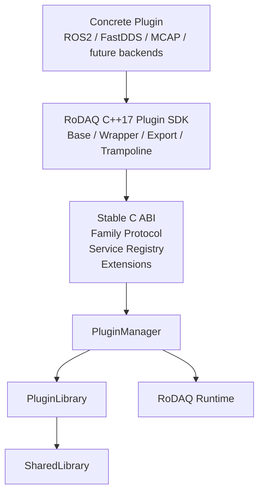
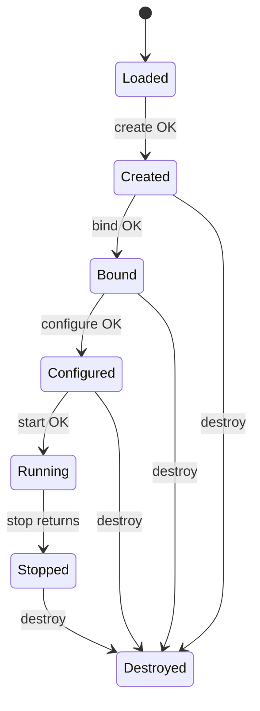
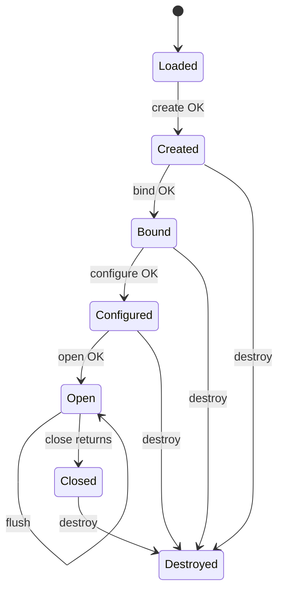
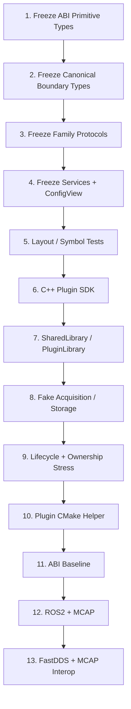

# RoDAQ V1 Plugin System Design

> **文档状态：V1 Detailed Design / Freeze Candidate**
>
> 本文定义 RoDAQ（Robot Data Acquisition）V1 动态插件系统的长期接口基线，包括 Binary ABI、C++ Plugin SDK、Acquisition / Storage Family Protocol、Runtime Service、Plugin Extension、配置接口、生命周期、并发模型、资源所有权、动态库加载与卸载、构建发布以及 ABI 兼容性验证。
>
> 本文的目标不是证明 RoDAQ 可以动态加载 `.so`，而是在 ROS2 Acquisition、FastDDS Acquisition 与 MCAP Storage 开始正式实现之前，建立一套足够稳定的插件契约，使 Runtime 后续内部重构和功能扩展尽量不会迫使已经开发的插件重新适配；SQLite3、SocketCAN、Generic DDS 等后续 Plugin 也必须能够复用同一边界。
>
> 本文中的 `V1` 指 RoDAQ 产品阶段，不等同于某一个 ABI、Service 或 Interface 的版本号。源码目录中不设置 `v1/` 层级；需要版本化的协议通过 ABI 常量、Protocol Version、Service ID 和 Interface / optional Extension ID 显式表达。

---

# 1. 设计目标、架构选择与参考实现

## 1.1 为什么 Plugin System 必须在 V1 先冻结

RoDAQ Runtime 内部的大部分实现都属于私有实现：

```text
ResourceBudget
Admission
Registry
PayloadPool
Dispatch Queue
Completion Queue
Worker
Allocator
Statistics
```

这些组件以后可以持续优化，只要 Public API 和 Plugin Contract 不变化，ROS2、FastDDS、MCAP 以及后续 SQLite3/SocketCAN/Generic DDS Plugin 就不需要感知。

Plugin System 不同。

一旦修改：

```text
Plugin entrypoint
Family vtable
Runtime service
Config ABI
Payload ownership
Storage completion
Lifecycle
Thread contract
DSO lifetime
```

影响的不是 Runtime 一个模块，而是所有已经存在的 Plugin。

因此：

> **Plugin System 是 RoDAQ V1 最应该提前稳定的边界之一。**

V1 Plugin System 的目标不是“API 永远不能增加”，而是：

```text
核心 ABI 尽量不变；

新增 Runtime 能力
    → 新 Service

新增 Plugin 可选能力
    → 新 Extension

同一协议兼容扩展
    → tail append

真正不兼容变化
    → 显式提升 Protocol / ABI major
```

而不是：

```text
每增加一个需求
    ↓
修改 rodaq_plugin_api
    ↓
所有 Plugin 重新编译 / 适配
```

---

## 1.2 核心设计原则

RoDAQ Plugin System 冻结以下原则。

### Binary Boundary 使用 C ABI

不跨动态库直接暴露：

```cpp
class Plugin {
public:
    virtual ~Plugin();
    virtual ...
};
```

原因包括：

```text
compiler ABI
libstdc++ ABI
RTTI
exception ABI
allocator ownership
STL layout
build-option differences
```

Binary Boundary 只使用：

```text
fixed-width integers
POD struct
opaque handle
pointer + size
function pointer
C-compatible calling convention
```

---

### Plugin 作者主要使用 C++17 SDK

稳定 C ABI 是机器之间的契约，不应该成为普通 Plugin 作者每天直接操作的开发接口。

因此：

```text
Stable C ABI
        ↓
C++17 Plugin SDK
        ↓
Concrete Plugin
```

C++ SDK 负责：

```text
typed wrappers
base classes
Result conversion
ConfigView wrapper
Runtime service wrapper
exception firewall
export function generation
ABI trampoline
```

---

### Acquisition 与 Storage 使用不同 Family Protocol

不采用：

```text
generic rodaq_plugin_api
plugin_kind
one giant vtable
```

而使用：

```text
Acquisition Protocol
Storage Protocol
```

两者共享 ABI primitives 和 Plugin infrastructure，但保留领域差异。

---

### 双向扩展分离

调用方向：

```text
Plugin → Runtime
    Service Registry
```

```text
Runtime → Plugin
    Family Protocol
    Plugin Interface Query
```

新增 Runtime capability 不修改 Plugin family core。

新增 Plugin optional capability 不修改 Plugin family core。

---

### Queue 不决定数据正确性

Plugin System 不允许 Storage Plugin 通过：

```text
queue full
```

让已经被 Runtime Admission 接受的 Record 静默丢失。

Storage capacity 必须与 Runtime ResourceBudget / inflight contract 配合。

---

### 生命周期和线程语义属于 ABI Contract

以下不是“实现细节”：

```text
stop 返回后还能不能 callback
submit 是否 thread-safe
close 返回后还能不能 completion
ConfigView 能保存多久
Payload release 谁负责
Extension 是否可以缓存
```

这些全部必须在 V1 明确。

---

## 1.3 总体三层架构



对应源码：

```text
include/rodaq/plugin/abi/
    Binary ABI

include/rodaq/plugin/
    C++ Plugin SDK

src/plugin/
    Runtime-side Plugin infrastructure
```

---

## 1.4 V1 Plugin Family

V1 正式支持：

```text
Acquisition
Storage
```

分别导出：

```c
RODAQ_PLUGIN_EXPORT
const rodaq_acquisition_plugin*
rodaq_get_acquisition_plugin(void) RODAQ_NOEXCEPT;
```

和：

```c
RODAQ_PLUGIN_EXPORT
const rodaq_storage_plugin*
rodaq_get_storage_plugin(void) RODAQ_NOEXCEPT;
```

Runtime 不通过：

```text
plugin_kind
```

在一个大 vtable 中做分支。

---

## 1.5 V1 DSO 模型

V1 冻结：

> **one DSO = one Plugin implementation = one Plugin family**

例如：

```text
librodaq_acquisition_ros2.so
    rodaq.acquisition.ros2

librodaq_acquisition_fastdds.so
    rodaq.acquisition.fastdds

librodaq_storage_mcap.so
    rodaq.storage.mcap

future example (not V1 release payload):
librodaq_storage_sqlite3.so
    rodaq.storage.sqlite3
```

允许：

```text
one DSO
    → N instances
```

例如：

```text
librodaq_acquisition_ros2.so

Instance A:
    robot_front

Instance B:
    robot_rear
```

V1 不支持：

```text
一个 DSO 注册多个不同 Plugin implementation

一个 DSO 同时导出 Acquisition 和 Storage
```

这是明确的 V1 减法。

未来如确有需求，可以新增 discovery mechanism，而不修改已有 family protocol。

---

## 1.6 与 PlotJuggler 的对比

PlotJuggler 当前插件体系最值得 RoDAQ 参考的不是具体业务接口，而是它从简单 C++ Plugin 演化出来的长期 ABI 纪律。

| 机制 | PlotJuggler | RoDAQ V1 |
|---|---|---|
| Stable C ABI | 采用 | 采用 |
| C++ authoring SDK | 采用 | 采用 |
| Family-specific protocol | 采用 | 采用 |
| Boot ABI marker | 采用 | 采用 |
| `struct_size` | 采用 | 采用 |
| minimum vtable floor | 采用 | 采用 |
| tail-slot gating | 采用 | 采用 |
| Service Registry | 采用 | 简化采用 |
| Plugin Interface Query | 采用 | 采用 |
| RAII DSO lifetime | 采用 | 采用 |
| hidden export surface | 采用 | 采用 |
| ABI baseline CI | 采用 | 采用 |
| GUI / Dialog | 有 | 不采用 |
| MessageParser | 有 | 不采用 |
| Playback / Plot services | 有 | 不采用 |
| 大型通用 service catalog | 有 | V1 不采用 |
| Runtime hot reload | 部分场景存在 | V1 不采用 |

RoDAQ 的原则是：

> **借鉴 PlotJuggler 的 ABI 演化机制，不复制 PlotJuggler 的产品功能复杂度。**

---

## 1.7 其他参考项目

### Gazebo `gz-plugin`

重点参考：

```text
Plugin object lifetime
shared library reference counting
dynamic interface discovery
```

### ROS `class_loader`

重点参考：

```text
managed Plugin object
live instance prevents unload
loader ownership
```

但 RoDAQ 不采用其 C++ class ABI 作为长期 Plugin Binary Contract。

### LLVM

重点参考：

```text
explicit Plugin API version
entrypoint
Status / Result discipline
ABI-conscious evolution
```

---

## 1.8 明确否决的 V1 方案

V1 不采用：

```text
C++ virtual ABI 直接跨 DSO

generic rodaq_plugin_api

plugin_kind + switch

create(runtime, config, instance)

Runtime 巨型 God API

Plugin 直接持有 Runtime private object

Plugin → Plugin direct calls

Acquisition → Storage direct calls

RTLD_GLOBAL

RTLD_DEEPBIND

RTLD_NODELETE 作为生命周期方案

Running hot reload

Plugin process sandbox

WASM Plugin runtime

一个 DSO 多 Plugin implementation
```

---

# 2. ABI 基础、数据契约与兼容性模型

## 2.1 ABI Header 组织

推荐：

```text
include/
└── rodaq/
    └── plugin/
        └── abi/
            ├── common.h
            ├── canonical.h
            ├── plugin.h
            ├── service.h
            ├── config.h
            ├── runtime.h
            ├── acquisition.h
            └── storage.h
```

职责：

```text
common.h
    最基础 ABI primitive

canonical.h
    Plugin / Runtime 边界所需 Canonical handles/views

plugin.h
    Boot ABI、Plugin Descriptor

service.h
    Service Registry

config.h
    read-only ConfigView

runtime.h
    Runtime services

acquisition.h
    Acquisition family protocol

storage.h
    Storage family protocol
```

不设置：

```text
plugin/abi/v1/
```

协议版本显式存在于：

```text
ABI constant
Protocol Version
Service ID
Interface / optional Extension ID
```

而不是目录名中。

---

## 2.2 ABI Header 必须可由 C 编译器解析

`include/rodaq/plugin/abi/*.h` 必须满足：

```text
C-compatible
C11 可包含
C++17 可包含
```

禁止：

```text
std::string
std::vector
std::span
std::function
std::shared_ptr
template
class virtual ABI
exception object
RTTI type
third-party C++ type
```

---

## 2.3 基础 ABI 定义

`common.h`：

```c
#ifndef RODAQ_PLUGIN_ABI_COMMON_H_
#define RODAQ_PLUGIN_ABI_COMMON_H_

#include <stddef.h>
#include <stdint.h>

#ifdef __cplusplus
extern "C" {
#endif

#define RODAQ_PLUGIN_ABI_VERSION UINT32_C(1)

#if defined(__cplusplus)
#define RODAQ_NOEXCEPT noexcept
#else
#define RODAQ_NOEXCEPT
#endif

#if defined(_WIN32)
#define RODAQ_PLUGIN_EXPORT __declspec(dllexport)
#elif defined(__GNUC__) || defined(__clang__)
#define RODAQ_PLUGIN_EXPORT __attribute__((visibility("default")))
#else
#define RODAQ_PLUGIN_EXPORT
#endif
```

Boolean：

```c
typedef uint32_t rodaq_bool;

#define RODAQ_FALSE UINT32_C(0)
#define RODAQ_TRUE  UINT32_C(1)
```

Status：

```c
typedef uint32_t rodaq_status_code;

#define RODAQ_STATUS_OK                  UINT32_C(0)
#define RODAQ_STATUS_INVALID_ARGUMENT    UINT32_C(1)
#define RODAQ_STATUS_INVALID_STATE       UINT32_C(2)
#define RODAQ_STATUS_NOT_FOUND           UINT32_C(3)
#define RODAQ_STATUS_CONFLICT            UINT32_C(4)
#define RODAQ_STATUS_RESOURCE_EXHAUSTED  UINT32_C(5)
#define RODAQ_STATUS_UNAVAILABLE         UINT32_C(6)
#define RODAQ_STATUS_STORAGE_ERROR       UINT32_C(7)
#define RODAQ_STATUS_TIMEOUT             UINT32_C(8)
#define RODAQ_STATUS_INTERNAL_ERROR      UINT32_C(9)
```

V1 不使用 ABI-visible C enum，以避免：

```text
-fshort-enums
```

改变 ABI layout。

---

## 2.4 String / Bytes View

```c
typedef struct rodaq_string_view {
    const char* data;
    uint64_t size;
} rodaq_string_view;

typedef struct rodaq_bytes_view {
    const uint8_t* data;
    uint64_t size;
} rodaq_bytes_view;
```

统一约束：

```text
size == 0
    data 可以为 NULL

size > 0
    data 必须非 NULL
```

`rodaq_string_view`：

```text
不要求 NUL termination
UTF-8
允许嵌入 '\0'，除非具体字段另有约束
```

对于：

```text
Plugin ID
Service ID
Interface ID
optional Extension ID
Stream Name
Schema Format
```

明确禁止嵌入 NUL，并要求合法 UTF-8。

---

## 2.5 Status ABI

Status 诊断必须在 ABI call 返回之后仍然可由 Caller 安全读取，因此 V1 不允许 `rodaq_status` 保存 callee-owned string pointer。

V1 冻结 caller-owned inline representation：

```c
#define RODAQ_STATUS_DOMAIN_CAPACITY  UINT32_C(32)
#define RODAQ_STATUS_MESSAGE_CAPACITY UINT32_C(256)

#define RODAQ_STATUS_FLAG_MESSAGE_TRUNCATED UINT32_C(1)

typedef struct rodaq_status {
    rodaq_status_code status_code;
    uint32_t flags;

    int64_t error_code;

    uint32_t domain_size;
    uint32_t message_size;

    char domain[RODAQ_STATUS_DOMAIN_CAPACITY];
    char message[RODAQ_STATUS_MESSAGE_CAPACITY];

    uint64_t reserved[2];
} rodaq_status;
```

该 struct 属于：

```text
ABI-FROZEN
```

语义：

```text
code
    RoDAQ stable status

error_code
    backend-specific native error
    no native code → 0

domain_size
    valid bytes in domain[]
    MUST be <= RODAQ_STATUS_DOMAIN_CAPACITY

message_size
    valid bytes in message[]
    MUST be <= RODAQ_STATUS_MESSAGE_CAPACITY

domain
    stable short error domain
    e.g. rodaq / ros2 / dds / mcap / sqlite3

message
    UTF-8 human-readable diagnostic
    may be truncated
```

`domain` / `message`：

```text
need not be NUL-terminated
caller reads exactly *_size bytes
```

Callee MUST ensure：

```text
domain is never silently truncated
message truncation sets RODAQ_STATUS_FLAG_MESSAGE_TRUNCATED
reserved[] == 0
all undocumented flags == 0
```

如果 domain 无法放入固定 capacity：

```text
use "rodaq" as the safe domain
preserve backend/native detail in error_code/message where possible
```

### Status Diagnostic Lifetime

`rodaq_status` storage 由 Caller 提供，Callee 只写入该 struct。

因此：

> **所有 Status diagnostic bytes 在 ABI call 返回后仍属于 Caller-owned storage，并一直有效直到 Caller 覆写/销毁该 struct。**

不存在：

```text
e.what() pointer escaping the call
thread_local diagnostic pointer lifetime
callee scratch string lifetime
```

### 诊断结构与返回状态码

所有 fallible operation：

```c
rodaq_status_code operation(
    ...,
    rodaq_status* out_error);
```

规则：

```text
return == OK
    out_error content is not required for semantics
    Callee MAY zero it

return != OK
    if out_error != NULL
        Callee fills a self-contained rodaq_status
```

`out_error == NULL` 合法。

C++ SDK trampoline 必须把：

```text
std::exception::what()
unknown exception diagnostic
```

复制进 caller-owned `rodaq_status.message[]`，不能暴露异常对象内部 pointer。

## 2.6 Generic Interface Fat Pointer

```c
typedef struct rodaq_interface {
    void* context;
    const void* vtable;
} rodaq_interface;
```

用于：

```text
Runtime Service
Plugin Interface
```

成功返回 Interface 时：

```text
context != NULL
vtable != NULL
```

除非某个具体 Service 明确允许无 context 的 static service。

---

## 2.7 Opaque Runtime Handles

`canonical.h`：

```c
typedef struct rodaq_source_handle {
    uint64_t value;
} rodaq_source_handle;

typedef struct rodaq_clock_handle {
    uint64_t value;
} rodaq_clock_handle;

typedef struct rodaq_schema_handle {
    uint64_t value;
} rodaq_schema_handle;

typedef struct rodaq_stream_handle {
    uint64_t value;
} rodaq_stream_handle;

typedef struct rodaq_stream_descriptor_handle {
    uint64_t value;
} rodaq_stream_descriptor_handle;

```

`rodaq_storage_operation` belongs to the Storage family contract in
`storage.h`; it is not a Canonical identity.

统一：

```text
value == 0
    invalid handle

value != 0
    valid handle
```

Runtime Handle：

```text
activation lifetime 内不复用
```

Plugin 不允许：

```text
解析 handle bit layout
自行构造 handle
跨 Runtime process 持久化 handle
```

---

## 2.8 ABI-FROZEN 与 ABI-APPENDABLE

所有 ABI-visible struct 必须在源码注释中标注：

```text
ABI-FROZEN
```

或：

```text
ABI-APPENDABLE
```

### ABI-FROZEN

例如：

```text
rodaq_string_view
rodaq_bytes_view
rodaq_status
rodaq_interface
all opaque handle structs
rodaq_timestamp_key
rodaq_timestamp_value
rodaq_payload_input
rodaq_runtime_lifecycle_snapshot
rodaq_binding_transition
```

发布后禁止：

```text
字段重排
插入字段
删除字段
修改类型
修改 layout
```

FROZEN small value type 可以安全：

```text
by-value embedded
passed by value
copied byte-for-byte within one ABI major
```

### ABI-APPENDABLE

例如：

```text
Plugin Descriptor
Family VTable
Service VTable
Plugin Interface / Extension VTable
Config VTable

Registration Request
Record Submission
Storage Request
Storage Submit Result
Canonical View
Capability / Readiness result
```

只允许：

```text
tail append
```

APPENDABLE struct MUST NOT：

```text
be embedded by value inside another ABI-visible struct
be passed by value across the DSO boundary
be memcpy-assumed to have identical sizeof across releases
```

只能通过：

```text
pointer
const pointer
provider-owned stable table pointer
```

跨 ABI boundary。

如果某个 nested value 必须按值嵌入：

> 该 nested value 必须先被明确分类为 ABI-FROZEN。

这就是 `rodaq_payload_input` 在 V1 中被固定为 FROZEN 的原因。

---

## 2.9 `struct_size` 的三种角色

`struct_size` 只用于 ABI-APPENDABLE struct。

必须区分：

```text
A. caller-owned input
B. caller-owned output
C. provider-owned table/view
```

### A. Caller-owned input

Caller：

```text
zero-initialize full caller-known struct
struct_size = sizeof(caller-known type)
set documented fields
reserved bytes/fields remain zero
```

Callee：

```text
require struct_size >= MIN_STRUCT_SIZE
read only fields fully covered by struct_size
ignore unknown tail
reject non-zero reserved / unknown mandatory flags
```

Callee 不修改 input `struct_size`。

### B. Caller-owned output

Caller：

```text
zero-initialize output buffer
struct_size = sizeof(caller-known type)
```

这里 entry `struct_size` 表示：

```text
output capacity offered by Caller
```

Callee 必须：

```text
snapshot caller capacity
require capacity >= MIN_STRUCT_SIZE
write at most min(caller capacity, callee-known struct size)
never write beyond caller capacity
zero every callee-owned field in the written prefix before populating it
on return set struct_size = initialized prefix size
```

因此返回后的 `struct_size` 表示：

```text
number of bytes initialized by Callee
```

Caller 只读取：

```text
field fully covered by returned struct_size
```

新 Caller + 旧 Callee：

```text
old Callee writes its known prefix
returns smaller struct_size
new Caller gates new fields
```

旧 Caller + 新 Callee：

```text
new Callee honors old caller capacity
never writes new tail beyond capacity
```

### C. Provider-owned table/view

例如：

```text
family vtable
service vtable
extension vtable
plugin descriptor
entrypoint-returned family protocol object
```

Provider：

```text
owns storage
sets struct_size = full provider-known initialized extent
keeps object immutable while documented lifetime holds
```

Consumer：

```text
requires >= MIN_STRUCT_SIZE
reads only reachable fields
never writes provider-owned object
```

---

## 2.10 Minimum Struct Size

每个 APPENDABLE type 必须冻结：

```text
TYPE_MIN_STRUCT_SIZE
```

例如：

```c
#define RODAQ_ACQUISITION_PLUGIN_MIN_STRUCT_SIZE \
    (offsetof(rodaq_acquisition_plugin, query_interface) + \
     RODAQ_ABI_FIELD_SIZE(rodaq_acquisition_plugin, query_interface))
```

冻结规则：

> **同一个 Protocol Major 内，既有 MIN_STRUCT_SIZE 永远不能提高。**

本次 M0-B pre-freeze convergence deliberately changes the unfinalized
Descriptor-readiness layout. After the converged ABI requalification passes,
the resulting minimum floors become frozen for the remainder of V1.

所有 minimum macro 使用完整类型名：

```text
RODAQ_<UPPER_SNAKE_TYPE>_MIN_STRUCT_SIZE
```

不提供简称别名。

未来追加 tail field / slot 可以增大 provider/current `sizeof(type)`，但不得让旧合法对象突然低于 minimum floor。

对 caller-owned output：

```text
caller capacity < MIN_STRUCT_SIZE
    → INVALID_ARGUMENT
    → no partial semantic success
```

---

### V1 Normative Minimum-Prefix Table

V1 当前每个 ABI-APPENDABLE type 的 minimum prefix 按“最后一个必须存在的字段/slot”冻结如下；实现必须据此生成对应 `*_MIN_STRUCT_SIZE`，而不是各自猜测 `sizeof`。

| Type | V1 minimum ends at | Additional required validation |
|---|---|---|
| `rodaq_plugin_descriptor` | `description` | `id/name/version` valid; reserved zero |
| `rodaq_service_registry_vtable` | `query` | `query != NULL` |
| `rodaq_runtime_common` | `report_diagnostic` | `log`, `monotonic_time_ns`, `get_lifecycle_snapshot`, `report_diagnostic` all non-NULL |
| `rodaq_unix_epoch_clock_anchor` | `unix_anchor_ns` | ingress ClockId/reading valid; reserved zero |
| `rodaq_runtime_clock_correlation` | `get_unix_epoch_anchor` | lookup slot non-NULL |
| `rodaq_source_registration` | `source_id` | source_id non-empty |
| `rodaq_clock_registration` | `origin` | native_id non-empty; rational resolution valid |
| `rodaq_schema_registration` | `representation` | presence/format contract valid |
| `rodaq_stream_registration` | `native_id` | native_id non-empty |
| `rodaq_stream_descriptor_registration` | `timestamp_key_count` | pointer/count pair valid; reserved fields zero |
| `rodaq_record_submission` | `payload` | all presence/count relationships valid |
| `rodaq_acquisition_submit_result` | `payload_disposition` | reserved tail zero when present |
| `rodaq_runtime_acquisition` | `submit` | all V1 registration/report/submit slots non-NULL |
| `rodaq_source_view` | `source_id` | output prefix fully initialized |
| `rodaq_clock_view` | `origin` | exact rational/origin fields available |
| `rodaq_schema_view` | `representation` | exact representation available |
| `rodaq_timestamp_key_set_view` | `key_count` | pointer/count valid |
| `rodaq_stream_view` | `stream_id` | exact Canonical id available |
| `rodaq_stream_descriptor_view` | `transport_timestamp_key_count` | complete descriptor projection available |
| `rodaq_runtime_canonical` | `get_stream_descriptor` | all V1 lookup slots non-NULL |
| `rodaq_projection_registration` | `payload` | descriptor/id/payload relationships valid; reserved zero |
| `rodaq_projection_view` | `payload` | immutable projection bytes available |
| `rodaq_runtime_projection` | `get_projection` | register/get slots non-NULL for the caller role |
| `rodaq_config_vtable` | `as_string` | all V1 ConfigView slots non-NULL |
| `rodaq_acquisition_control` | `quiesce_plugin` | all V1 control slots non-NULL |
| `rodaq_storage_capabilities` | `close_progress_timeout_ns` | all bounded-capability fields initialized |
| `rodaq_descriptor_readiness_result` | `failure` | state/failure combination valid |
| `rodaq_storage_control` | `ensure_descriptor_ready` | both V1 control slots non-NULL |
| `rodaq_acquisition_plugin` | `query_interface` | all core lifecycle slots non-NULL |
| `rodaq_storage_plugin` | `query_interface` | all core lifecycle slots non-NULL |
| `rodaq_storage_open_request` | `target_uri` | flags/reserved validation |
| `rodaq_storage_close_request` | `disposition` | disposition recognized; reserved tail zero when present |
| `rodaq_storage_submission` | `payload` | operation/descriptor/count/presence relationships valid |
| `rodaq_storage_submit_result` | `persistence_error` | payload/persistence state combination valid |
| `rodaq_runtime_storage` | `report_failure` | all completion/failure slots non-NULL |

规则：

```text
minimum 只冻结 V1 必需 prefix
future same-major tail append 不得提高现有 minimum
reserved-only tail field 不因为存在而自动成为 minimum end
```

构建系统必须用 `offsetof(type, minimum_last_field) + sizeof(field)` 生成/验证常量，并在 C11/C++17 layout tests 中逐项覆盖本表。

---

## 2.11 Tail-field / Tail-slot Gating

统一：

```c
#define RODAQ_HAS_FIELD(type, ptr, field)     ((ptr) != NULL &&      (ptr)->struct_size >=          offsetof(type, field) + sizeof((ptr)->field))
```

适用于：

```text
provider-owned table/view
caller-owned input
caller-owned output after return
```

新增 function slot：

```c
if (RODAQ_HAS_FIELD(
        rodaq_acquisition_plugin,
        plugin,
        new_operation) &&
    plugin->new_operation != NULL) {
    ...
}
```

`struct_size` 是兼容机制，不是鼓励无限增加 core vtable 的理由。

可选能力优先使用 Extension。

### Flags / reserved 通用规则

除非具体 struct 另有定义：

```text
input flags
    V1 caller sets 0
    unknown non-zero bit → INVALID_ARGUMENT

output flags
    Callee sets only documented bits

reserved scalar/array bytes
    input MUST be zero
    output MUST be zero
    non-zero input reserved → INVALID_ARGUMENT
```

这条规则适用于所有 ABI-visible V1 request/result/view。

### C declaration-order rule

所有在 function pointer signature 中出现的 struct tag 必须：

```text
在 file scope 先 forward-declare
再定义引用它的 vtable / function pointer typedef
```

不得依赖 C++ 接受而 C 编译器拒绝的 declaration ordering。


## 2.12 Boot ABI Marker

每个 Plugin DSO 必须导出：

```c
extern RODAQ_PLUGIN_EXPORT
const uint32_t rodaq_plugin_abi_version;
```

值：

```c
RODAQ_PLUGIN_ABI_VERSION
```

C++ linkage 要求：

> **不能只写一个没有 prior external declaration 的 namespace-scope `const` definition，然后假定 `extern "C"` 会自动避免 internal linkage。**

V1 SDK / CMake helper 必须生成唯一一个 export translation unit，先包含 ABI header 中的 external C declaration，再定义：

```cpp
extern "C" RODAQ_PLUGIN_EXPORT
const uint32_t rodaq_plugin_abi_version = RODAQ_PLUGIN_ABI_VERSION;
```

因为同一名字已经有 external declaration，该 definition 必须形成真正可被 `dlsym()` 找到的 external C symbol。

同一个 generated TU 还负责 family entrypoint definition；Plugin 作者不得手写重复 marker definition。

CI 必须使用：

```text
nm -D
readelf --dyn-syms
dlsym smoke
```

同时证明：

```text
marker exists exactly once
marker has expected value
marker belongs to candidate DSO
```

加载：

```text
dlopen
    ↓
dlsym(rodaq_plugin_abi_version)
    ↓
Boot ABI validation
    ↓
Family entrypoint
```

Boot ABI mismatch：

```text
立即拒绝
不读取 Family VTable
```

---

## 2.13 Boot ABI 与 Family Protocol 独立

例如：

```text
RODAQ_PLUGIN_ABI_VERSION = 1

RODAQ_ACQUISITION_PROTOCOL_VERSION = 1

RODAQ_STORAGE_PROTOCOL_VERSION = 1
```

三者语义不同。

未来可能：

```text
Plugin ABI 1
Acquisition Protocol 1
Storage Protocol 2
```

不必无条件一起提升。

---

## 2.14 ABI Layout Sentinel

V1 建立：

```text
tests/abi/layout_sentinels.cpp
```

例如：

```cpp
static_assert(sizeof(void*) == 8);

static_assert(sizeof(rodaq_string_view) == 16);
static_assert(alignof(rodaq_string_view) == 8);

static_assert(
    offsetof(rodaq_string_view, data) == 0);

static_assert(
    offsetof(rodaq_string_view, size) == 8);
```

所有 ABI struct 检查：

```text
sizeof
alignof
offsetof
```

分别在：

```text
Ubuntu 22.04 amd64
Ubuntu 22.04 arm64
```

构建验证。

---

## 2.15 Exception Firewall

任何 C ABI function pointer 必须：

```text
RODAQ_NOEXCEPT
```

C++ SDK trampoline：

```cpp
try {
    ...
}
catch (const std::exception& e) {
    ...
}
catch (...) {
    ...
}
```

必须把 exception 转换成：

```text
rodaq_status_code
+
rodaq_status
```

禁止 exception 穿越 ABI boundary。

---

# 3. Plugin / Runtime 双向接口

这一章定义真正会被 ROS2、FastDDS、MCAP 及后续 Plugin 直接依赖的长期接口。

---

## 3.1 Plugin Descriptor

`plugin.h`：

```c
typedef struct rodaq_plugin_descriptor {
    uint32_t struct_size;
    uint32_t reserved;

    rodaq_string_view id;
    rodaq_string_view name;
    rodaq_string_view version;
    rodaq_string_view description;
} rodaq_plugin_descriptor;
```

V1：

```text
reserved == 0
```

### Plugin ID

例如：

```text
rodaq.acquisition.ros2
rodaq.acquisition.fastdds
rodaq.storage.mcap
rodaq.storage.sqlite3
```

要求：

```text
ASCII lowercase
'.' 分段
不允许空格
不允许路径字符
全局稳定
```

V1 机械语法进一步冻结为：

```text
at least two non-empty dot-separated segments
each segment characters: a-z 0-9 _ -
```

空段、空白、斜杠、反斜杠、大写字母和其他字符均拒绝。

### Plugin Version

Semantic Version：

```text
1.0.0
1.2.3
```

V1 使用完整 SemVer 2.0 语法：

```text
MAJOR.MINOR.PATCH
optional -prerelease
optional +build
```

Core 与 numeric prerelease identifier 禁止 leading zero；numeric build
identifier 允许 leading zero。

它表示：

```text
Plugin implementation version
```

不是 RoDAQ ABI version。

### Descriptor / Entrypoint Object Lifetime

Family entrypoint：

```text
rodaq_get_acquisition_plugin()
rodaq_get_storage_plugin()
```

返回的 family protocol object 必须：

```text
provider-owned
static / DSO-lifetime storage
immutable after DSO initialization
valid while the DSO remains mapped
```

`plugin->descriptor` 以及 descriptor 中所有 `rodaq_string_view` backing bytes 同样必须至少保持到：

```text
PluginLibraryLease released
and DSO may be unmapped
```

Runtime/Loader：

> 任何保存 family protocol pointer、Plugin Descriptor pointer 或 descriptor string view 的对象，都必须持有对应 `PluginLibraryLease`。

不得返回：

```text
stack object
temporary std::string view
instance-owned descriptor that dies before PluginLibrary
lazy-mutated metadata table
```

这样 entrypoint/provider-owned metadata lifetime 不依赖 Plugin instance create/destroy。

---

## 3.2 Plugin ID 与 Instance ID

严格区分：

```text
Plugin ID
    rodaq.acquisition.ros2

Instance ID
    front_ros2
```

一个 Plugin Library 可以创建多个 Instance。

Plugin ID：

```text
来自 Plugin Descriptor
```

Instance ID：

```text
来自 Runtime configuration
```

---

## 3.3 Service Registry

Plugin → Runtime 使用 Service Registry。

```c
#define RODAQ_SERVICE_REGISTRY_PROTOCOL_VERSION UINT32_C(1)

typedef struct rodaq_service_registry_vtable {
    uint32_t protocol_version;
    uint32_t struct_size;

    rodaq_status_code (*query)(
        void* context,
        rodaq_string_view service_id,
        rodaq_interface* out_service,
        rodaq_status* out_error) RODAQ_NOEXCEPT;

} rodaq_service_registry_vtable;

typedef struct rodaq_service_registry {
    void* context;
    const rodaq_service_registry_vtable* vtable;
} rodaq_service_registry;
```

---

## 3.4 Service Query 规则

Service Query：

> **只允许在 Plugin `bind()` 阶段执行。**

Plugin 在 Bind：

```text
query
    ↓
validate protocol_version / struct_size
    ↓
保存 typed interface
```

Running Data Plane 不执行 Service Registry string lookup。

### Query Success

返回：

```text
RODAQ_STATUS_OK
```

且：

```text
out_service.context != NULL
out_service.vtable != NULL
```

### Unknown Service

返回：

```text
RODAQ_STATUS_NOT_FOUND
```

并清空：

```text
out_service.context = NULL
out_service.vtable = NULL
```

### 同一个 Service ID

同一个 Plugin instance 在同一次 Bind 中重复 Query 相同 ID：

```text
必须返回同一个 logical service
```

Runtime 不允许一个 Service ID 同时注册多个 implementation。

---

## 3.5 Required / Optional Service

Service Registry 不在 ABI 中增加：

```text
required flag
```

Required / Optional 属于 Plugin policy。

C++ SDK：

```cpp
auto acquisition = services.query(RODAQ_RUNTIME_ACQUISITION_SERVICE_ID);
// The Plugin handles a missing required or optional service according to policy.
```

如果 required Service 不存在：

```text
bind() 失败
```

Optional 不存在：

```text
Plugin graceful degradation
```

---

## 3.6 Service Lifetime

成功 Bind 获得的 Runtime Service：

```text
context
vtable
```

从：

```text
bind success
```

直到：

```text
Plugin destroy
```

地址保持有效。

但是操作是否允许，仍由 lifecycle 决定。

例如：

```text
Acquisition submit()
```

只有 Running 阶段合法。

Runtime 不会在 Instance 生命周期内替换一个已绑定 Service。

因此 Plugin 可以安全缓存 Service interface。

---

## 3.7 Service Naming

稳定 Service：

```text
rodaq.runtime.common
rodaq.runtime.canonical
rodaq.runtime.projection
rodaq.runtime.clock_correlation
rodaq.runtime.acquisition
rodaq.runtime.storage
```

V1 Stable C ABI 同时提供 exact literal 常量：

```c
#define RODAQ_RUNTIME_COMMON_SERVICE_ID             "rodaq.runtime.common"
#define RODAQ_RUNTIME_CANONICAL_SERVICE_ID          "rodaq.runtime.canonical"
#define RODAQ_RUNTIME_PROJECTION_SERVICE_ID         "rodaq.runtime.projection"
#define RODAQ_RUNTIME_CLOCK_CORRELATION_SERVICE_ID  "rodaq.runtime.clock_correlation"
#define RODAQ_RUNTIME_ACQUISITION_SERVICE_ID        "rodaq.runtime.acquisition"
#define RODAQ_RUNTIME_STORAGE_SERVICE_ID            "rodaq.runtime.storage"
```

命名：

```text
rodaq.<domain>.<service>.v<major>
```

例如：

```text
rodaq.runtime.metrics
rodaq.runtime.memory
```

实验：

```text
rodaq.experimental.<name>.draft-<N>
```

Experimental Service 不提供长期兼容保证。

正式 Plugin 不应将实验 Service 作为 production-required dependency。

---

## 3.8 Runtime Common Service

V1 冻结公共日志/诊断数值域：

```c
typedef uint32_t rodaq_log_level;
#define RODAQ_LOG_TRACE     UINT32_C(1)
#define RODAQ_LOG_DEBUG     UINT32_C(2)
#define RODAQ_LOG_INFO      UINT32_C(3)
#define RODAQ_LOG_WARN      UINT32_C(4)
#define RODAQ_LOG_ERROR     UINT32_C(5)
#define RODAQ_LOG_CRITICAL  UINT32_C(6)
#define RODAQ_LOG_OFF       UINT32_C(7)

typedef uint32_t rodaq_diagnostic_severity;
#define RODAQ_DIAGNOSTIC_INFO      UINT32_C(1)
#define RODAQ_DIAGNOSTIC_WARNING   UINT32_C(2)
#define RODAQ_DIAGNOSTIC_ERROR     UINT32_C(3)
#define RODAQ_DIAGNOSTIC_FATAL     UINT32_C(4)
```

未知 level/severity 值不得 reinterpret；Runtime 必须忽略该事件或按安全默认级别记录 internal diagnostic，不能把未知值映射成更低严重度。

Recovery permission 使用最小 lifecycle snapshot：

```c
typedef uint32_t rodaq_runtime_lifecycle_state;
#define RODAQ_RUNTIME_CONFIGURED  UINT32_C(1)
#define RODAQ_RUNTIME_STARTING    UINT32_C(2)
#define RODAQ_RUNTIME_RUNNING     UINT32_C(3)
#define RODAQ_RUNTIME_STOPPING    UINT32_C(4)
#define RODAQ_RUNTIME_STOPPED     UINT32_C(5)
#define RODAQ_RUNTIME_FAILED      UINT32_C(6)

typedef struct rodaq_runtime_lifecycle_snapshot {
    rodaq_runtime_lifecycle_state state;
    rodaq_bool normal_acquisition_allowed;
    uint64_t generation;
} rodaq_runtime_lifecycle_snapshot;
```

该 snapshot 是 ABI-FROZEN value type。`generation` 在 lifecycle/admission permission 发生变化时单调变化，用于诊断 stale observation；它不是持续有效的 capability token。

Service ID：

```text
rodaq.runtime.common
```

定义：

```c
#define RODAQ_RUNTIME_COMMON_PROTOCOL_VERSION UINT32_C(1)

typedef struct rodaq_runtime_common {
    uint32_t protocol_version;
    uint32_t struct_size;

    void (*log)(
        void* context,
        rodaq_log_level level,
        rodaq_string_view category,
        rodaq_string_view message) RODAQ_NOEXCEPT;

    uint64_t (*monotonic_time_ns)(
        void* context) RODAQ_NOEXCEPT;

    rodaq_status_code (*get_lifecycle_snapshot)(
        void* context,
        rodaq_runtime_lifecycle_snapshot* out_snapshot,
        rodaq_status* out_error) RODAQ_NOEXCEPT;

    void (*report_diagnostic)(
        void* context,
        rodaq_diagnostic_severity severity,
        rodaq_string_view code,
        rodaq_string_view message) RODAQ_NOEXCEPT;

} rodaq_runtime_common;
```

用途：

```text
logging
Runtime-local monotonic clock
structured diagnostics
```

这些函数：

```text
thread-safe
non-throwing across ABI
```

`get_lifecycle_snapshot()` 必须 bounded/non-blocking，不等待 Plugin 或 Storage。Recovery worker 在每次 recovery attempt 开始前读取一次 snapshot；只有 `state == RUNNING && normal_acquisition_allowed == true` 才允许开始 normal recovery。

该 snapshot 不是长期 permission：查询后 Runtime 仍可能进入 Stop/Failed；后续 registration/report/submit 继续由 Runtime 当前状态最终裁决并拒绝 stale recovery work。Plugin 不持续轮询该接口。

---

### 3.8.1 Runtime Clock Correlation Service

Some Storage formats require an epoch-based replay timestamp, while Canonical `rodaq/acquisition_ingress` intentionally remains a local monotonic Clock. V1 exposes the immutable activation correlation through a dedicated read-only Runtime service instead of letting each Storage Plugin sample wall time independently.

Service ID：

```text
rodaq.runtime.clock_correlation
```

```c
typedef struct rodaq_unix_epoch_clock_anchor {
    uint32_t struct_size;
    uint32_t reserved;

    rodaq_clock_handle clock;
    int64_t clock_reading;
    uint64_t unix_anchor_ns;
} rodaq_unix_epoch_clock_anchor;

#define RODAQ_RUNTIME_CLOCK_CORRELATION_PROTOCOL_VERSION UINT32_C(1)

typedef struct rodaq_runtime_clock_correlation {
    uint32_t protocol_version;
    uint32_t struct_size;

    rodaq_status_code (*get_unix_epoch_anchor)(
        void* context,
        rodaq_clock_handle clock,
        rodaq_unix_epoch_clock_anchor* out_anchor,
        rodaq_status* out_error) RODAQ_NOEXCEPT;
} rodaq_runtime_clock_correlation;
```

V1 guarantees a correlation for the Runtime-owned `rodaq/acquisition_ingress` Clock. That Clock has：

```text
resolution = 1 / 1,000,000,000 second per tick
ClockReading = int64 monotonic nanoseconds
```

so a Storage Plugin computes：

```text
delta = record_ingress_reading - anchor.clock_reading
unix_ns = anchor.unix_anchor_ns + delta
```

using checked signed arithmetic and range validation before converting to a backend `uint64` timestamp.

Rules：

```text
anchor captured once per activation
immutable for activation lifetime
read-only to Plugin
no per-Record system_clock sampling
NOT Canonical clock equivalence
NOT a claim that ingress Clock origin is Unix epoch
NOT_FOUND for ClockHandle without a proven correlation
```

Storage may cache the returned value for the activation lifetime. The service is Control Plane/read-mostly and is not a per-Record hot-path requirement.

---

## 3.9 Canonical Runtime Service

Storage Plugin 不能依赖 Runtime private C++ Canonical objects。

因此提供只读：

```text
rodaq.runtime.canonical
```

### Canonical Handle Lifetime

所有 descriptor：

```text
immutable
activation-lifetime
```

Runtime Handle 在当前 activation 中不会复用。

---

## 3.10 Source Registration

Source registration 接受的不是 Plugin-local native ID，而是已经由 Acquisition Mapping canonicalize 完成的 V1 Canonical SourceId bytes。

```c
typedef struct rodaq_source_registration {
    uint32_t struct_size;
    uint32_t reserved;

    rodaq_bytes_view source_id;
} rodaq_source_registration;
```

规则：

```text
source_id.size > 0

source_id
    = Canonical SourceId bytes
    = opaque
    = not required to be UTF-8
```

SourceId canonicalization：

```text
native identity
    ↓
Acquisition Plugin / Mapping
    deterministic canonicalization
    domain disjointness
    ↓
non-empty Canonical SourceId bytes
    ↓
Runtime registration / interning
```

Runtime 不执行：

```text
GUID normalization
endianness normalization
padding removal
text/binary conversion
source-specific domain tagging
```

这些必须在调用 `register_source()` 前完成。

### Scope-wide interning

SourceId equality domain 是：

```text
current active Identity Scope
```

不是：

```text
Plugin instance
```

因此：

```text
same SourceId bytes in same active Scope
    → same Canonical Source identity
    → Runtime returns the same SourceHandle

different SourceId bytes
    → different Source identity
```

多个 Acquisition Plugin 如果可能在同一个 active Scope 共存，其 SourceId canonical byte domains 必须按 Canonical Profile 保持 disjoint。

`SourceHandle` 只是 Runtime activation-lifetime lookup handle：

```text
not Canonical State
not persisted
zero remains invalid handle
```

Plugin 可以维护：

```text
native producer identity
    → cached SourceHandle
```

映射，但这个 Plugin-local cache 不改变 Scope-wide Canonical equality。

### Source absent

如果 native Source identity：

```text
unknown
invalid
unstable
ambiguous
or not reliably available
```

则：

```text
SourceId = absent
```

这种 Record 不需要 Source registration。

但如果 native Source identity 已经可靠存在，只是对应 SourceHandle 尚未完成注册：

> **不得把 registration-pending 的 known Source 降级成 Source absent。**

该 sample 必须在进入 Admission 前：

```text
register first
or
boundedly buffer
or
apply native backpressure
or
drop / pre-admission reject according to Acquisition policy
```

---

## 3.11 Clock Registration

Clock registration 必须能够无损表达 Canonical Profile 的：

```text
ClockId allocation input facts
positive reduced rational resolution
ClockOrigin Canonical Identifier
```

ClockOrigin 不是冻结 enum；unknown/future identifier 必须可以 lossless 保存。

```c
typedef struct rodaq_clock_registration {
    uint32_t struct_size;
    uint32_t reserved;

    rodaq_bytes_view native_id;

    uint64_t resolution_numerator;
    uint64_t resolution_denominator;

    rodaq_string_view origin;
} rodaq_clock_registration;
```

`native_id`：

```text
size > 0
Plugin-provided stable evidence for one concrete native Clock instance

not Canonical State
not persisted
```

Runtime 负责：

```text
establish Clock identity
allocate Canonical ClockId
register immutable ClockDescriptor
```

Plugin 不直接分配 Canonical ClockId。

### Clock native registration key / idempotence

Clock registration key 冻结为：

```text
(PluginInstance, native_id bytes)
```

不同 Plugin instance 的相同 `native_id` 永不自动合并。

同一 activation 内：

```text
same key + identical origin/resolution + same continuity generation
    → idempotent
    → return same ClockHandle

same key + conflicting origin/resolution
    → CONFLICT
```

Clock continuity reset/restart 后，Plugin **必须生成新的 native_id generation evidence**；不得用旧 `(PluginInstance, native_id)` 重新注册为新 Clock。Runtime 也不得仅凭 origin/resolution 内容相等合并不同 concrete Clock instance。

Resolution：

```text
seconds per tick
=
resolution_numerator / resolution_denominator
```

必须满足：

```text
numerator > 0
denominator > 0
gcd(numerator, denominator) == 1
```

例如 Fast DDS RTPS fraction clock 可以精确表示为：

```text
1 / 4294967296 second per tick
```

不得为了 ABI 简化强制转成整数纳秒。

`origin`：

```text
valid Canonical Identifier
UTF-8 byte string
byte-exact
case-sensitive
```

例如：

```text
rodaq/monotonic_unspecified
rodaq/unix_epoch
rodaq/tai_epoch
rodaq/device_power_on
vendor/device_epoch
```

不同 ClockHandle 默认不可比较；Clock comparability 仍由 Canonical/Runtime contract 决定。

---

## 3.12 Schema Registration

Schema registration 必须完整表达：

```text
SchemaFormat
optional TypeIdentifier
opaque representation bytes
```

```c
typedef struct rodaq_schema_registration {
    uint32_t struct_size;

    rodaq_bool type_identifier_present;
    uint32_t reserved;

    rodaq_string_view format;
    rodaq_string_view type_identifier;
    rodaq_bytes_view representation;
} rodaq_schema_registration;
```

规则：

```text
format
    = Canonical SchemaFormat

type_identifier_present == RODAQ_FALSE
    → type_identifier ignored / empty

type_identifier_present == RODAQ_TRUE
    → type_identifier is Canonical TypeIdentifier

representation
    = exact opaque Schema representation bytes
```

如果 representation 本身不能唯一确定 Payload type：

> Acquisition Mapping 必须提供 TypeIdentifier。

Runtime/Core 不解析 representation 来推断 TypeIdentifier。

Runtime 负责：

```text
allocate SchemaId
register immutable SchemaDescriptor
optional dedup policy
```

Plugin 不依赖：

```text
same content
    ⇒ same SchemaId
```

因为 Canonical descriptor content equality 不等于 identity equality。

---

## 3.13 Stream Registration

Stream identity 与 producer Source identity 分离。

一个 Stream：

```text
may receive Records from multiple Sources
```

因此 Stream registration **不得固定绑定一个 SourceHandle**。

```c
typedef struct rodaq_stream_registration {
    uint32_t struct_size;
    uint32_t reserved;

    rodaq_bytes_view native_id;
} rodaq_stream_registration;
```

`native_id`：

```text
size > 0
Plugin-provided stable logical-stream identity evidence

not Canonical State
not persisted
```

例如：

```text
ROS2 topic identity
DDS topic/logical stream identity
```

Runtime/Core 负责建立并分配 Canonical StreamId。

### Stream native registration key / idempotence

Stream registration key 冻结为：

```text
(PluginInstance, native_id bytes)
```

同一 activation 内重复注册相同 key：

```text
→ idempotent
→ return same StreamHandle / StreamId
```

不同 Plugin instance 的相同 native bytes 不会被 Runtime 自动合并。若 Plugin 判断 native logical Stream identity 已经改变，则必须使用新的 `native_id` evidence 并创建新 Stream；rename / Schema / PayloadEncoding / TimestampKeySet evolution 不改变 Stream native key，只产生新的 StreamDescriptor。

Producer Source identity 只在每条 Record submission 上表达。

Stream rename：

```text
StreamHandle / StreamId unchanged
StreamDescriptor changes
```

---

## 3.14 Timestamp Key / State ABI

Canonical timestamp semantics 是：

```text
TimestampKey
    = (RoleIdentifier, ClockId)

TimestampKeySet
    = unordered set of TimestampKey

TimestampStateMap
    = complete map:
        TimestampKey → Absent | Present(ClockReading)
```

ClockReading 使用：

```text
signed int64 ticks
```

不强制纳秒。

### Timestamp Key

```c
typedef struct rodaq_timestamp_key {
    rodaq_string_view role;
    rodaq_clock_handle clock;
} rodaq_timestamp_key;
```

该 value struct 在 V1 ABI 中属于 FROZEN small value type。

`role` 是 Canonical RoleIdentifier。

### Timestamp Value

```c
typedef struct rodaq_timestamp_value {
    rodaq_bool present;
    uint32_t reserved;

    int64_t reading;
} rodaq_timestamp_value;
```

规则：

```text
present == RODAQ_FALSE
    → TimestampState = Absent
    → reading ignored

present == RODAQ_TRUE
    → TimestampState = Present(reading)
```

因此：

```text
Absent
!=
Present(0)
```

### ABI transport order

Canonical TimestampKeySet 是 unordered set；数组顺序不属于 Canonical State。

ABI 允许使用稳定的 transport slot order 提升 hot-path 效率：

```text
timestamp_keys[i]
    ↔
timestamp_values[i]
```

但：

> **slot index / array order 只属于当前 ABI binding/descriptor 的 transport layout，不得持久化成 Canonical ordering semantics。**

Storage full-fidelity 必须保存：

```text
TimestampKeySetId
+
TimestampKey content
+
per-Record TimestampState
```

而不是只保存 slot index。

---

## 3.15 Stream Descriptor Publication

```c
typedef struct rodaq_stream_descriptor_registration {
    uint32_t struct_size;

    rodaq_bool schema_present;
    uint32_t reserved;

    rodaq_stream_handle stream;

    rodaq_string_view name;

    rodaq_schema_handle schema;

    rodaq_string_view payload_encoding;

    const rodaq_timestamp_key* timestamp_keys;
    uint32_t timestamp_key_count;
    uint32_t reserved2;
} rodaq_stream_descriptor_registration;
```

### Schema reference

`schema_present == RODAQ_FALSE`：

```text
Canonical SchemaId = absent
schema handle ignored
```

`schema_present == RODAQ_TRUE`：

```text
schema must be a valid registered SchemaHandle
```

这样可以正确区分：

```text
SchemaId absent
```

与合法的：

```text
SchemaId present(0)
```

因为 Canonical ID value `0` 本身是合法值，而 Runtime Handle `0` 仍然只是 invalid handle。

### Timestamp KeySet establishment

`timestamp_keys` 描述 Acquisition/native 能提供的 timestamp keys。

Runtime/Core 负责：

```text
validate key set
inject mandatory rodaq/acquisition_ingress key
allocate / establish Canonical TimestampKeySetId
allocate StreamDescriptorId
compile stable ABI transport slot mapping
```

Plugin 不得提供：

```text
rodaq/acquisition_ingress
```

这个 Runtime-owned timestamp key。

总的 Canonical TimestampKeySet 必须满足 active V1 Profile capacity。

`timestamp_keys[]` 的输入数组顺序只定义：

```text
Acquisition submission transport slot order
```

不定义 Canonical set order。

### Descriptor evolution

以下变化必须形成新的 StreamDescriptor identity：

```text
StreamName
Schema presence/reference
PayloadEncoding
TimestampKeySet identity/content
```

但是：

```text
StreamHandle / StreamId unchanged
```

Runtime/Core 仍是：

```text
StreamDescriptorId
TimestampKeySetId
```

的唯一 Canonical allocation authority。

---

## 3.16 Payload ABI

Acquisition submission 支持：

```text
Copy
Adopt
Retain
```

定义：

```c
typedef uint32_t rodaq_payload_mode;

#define RODAQ_PAYLOAD_COPY    UINT32_C(1)
#define RODAQ_PAYLOAD_ADOPT   UINT32_C(2)
#define RODAQ_PAYLOAD_RETAIN  UINT32_C(3)
```

```c
typedef struct rodaq_payload_input {
    rodaq_payload_mode mode;
    uint32_t reserved;

    const uint8_t* data;
    uint64_t size;

    void* owner_context;

    void (*release)(
        void* owner_context) RODAQ_NOEXCEPT;

} rodaq_payload_input;
```

该结构只描述一次 Submission 的 Payload 输入和 lifetime anchor，不把 Runtime 内部 `Payload` C++ 对象暴露到 ABI。

---

## 3.17 Payload Mode、Transfer Point 与 Disposition

Payload ownership 必须与 `docs/design/payload.md` 和 `docs/design/admission.md` 使用同一语义，不能因为 C ABI 简化而改变 Runtime correctness contract。

### COPY

```text
data
    只需要在 submit() 调用期间有效

release
    必须 NULL

owner_context
    必须 NULL
```

Runtime 只有在需要进入 Accepted path 时才 materialize 自己的 immutable Payload backing。

Plugin 原始 buffer ownership 永远不转移。

### ADOPT

`ADOPT` 表示 Plugin 希望把 backing 的 release responsibility 单向转移给 Runtime。

但是：

> **调用 `submit()` 本身不等于 ownership 已经转移。**

Runtime 必须按 Payload Contract：

```text
structural validation
        ↓
reserve Payload bytes / object capacity
        ↓
Adopt Transfer Point
        ↓
RuntimeResponsible
```

在 Adopt Transfer Point 之前失败：

```text
CallerResponsible
```

越过 Transfer Point 以后：

```text
RuntimeResponsible
```

并且 ownership 不再回滚，即使最终 Submission 是：

```text
PreAdmissionRejected
AdmissionRejected
Runtime failure
```

### RETAIN

`RETAIN` 表示 Plugin 为本次 Submission 提供一个独立 lifetime anchor；原 native owner 可以继续存在。

Runtime 必须先：

```text
validate retained anchor
reserve Payload bytes / object capacity
```

之后才能取得本次 Submission anchor 的 release responsibility。

因此 RETAIN 同样存在：

```text
CallerResponsible
RuntimeResponsible
```

但这里的 disposition 只描述：

> **本次 Submission 的 retained anchor 谁负责 release。**

它不表示 Plugin 已失去原 native object 的 ownership。

### Payload Disposition ABI

```c
typedef uint32_t rodaq_payload_disposition;

#define RODAQ_PAYLOAD_DISPOSITION_NOT_APPLICABLE       UINT32_C(0)
#define RODAQ_PAYLOAD_DISPOSITION_CALLER_RESPONSIBLE   UINT32_C(1)
#define RODAQ_PAYLOAD_DISPOSITION_RUNTIME_RESPONSIBLE  UINT32_C(2)
```

规则：

```text
COPY
    NOT_APPLICABLE

ADOPT / RETAIN
    CALLER_RESPONSIBLE
    or
    RUNTIME_RESPONSIBLE
```

Plugin **不得**从 RejectionReason 推断 ownership。

---

## 3.18 Record Submission 与 Admission Result

Record Submission：

```c
typedef struct rodaq_record_submission {
    uint32_t struct_size;
    uint32_t flags;

    rodaq_stream_handle stream;
    rodaq_stream_descriptor_handle descriptor;

    rodaq_bool source_present;
    rodaq_bool source_sequence_present;

    rodaq_source_handle source;
    uint64_t source_sequence;

    const rodaq_timestamp_value* timestamp_values;
    uint32_t timestamp_value_count;
    uint32_t reserved;

    rodaq_payload_input payload;
} rodaq_record_submission;
```

### Stream / Descriptor

`stream` 与 `descriptor` 必须引用同一 current Binding 的 logical Stream / interpretation contract。

Runtime 负责验证：

```text
descriptor belongs to stream
Binding is current
Binding is Active
```

Plugin 不分配 Canonical：

```text
StreamId
StreamDescriptorId
AcceptanceSequence
TimestampKeySetId
```

### Per-Record Source

Source identity 是 Record-level optional state，不是 Stream identity。

`source_present == RODAQ_FALSE`：

```text
Canonical SourceId = absent
source handle ignored
source_sequence_present MUST be false
```

`source_present == RODAQ_TRUE`：

```text
source must be a valid registered SourceHandle
Runtime resolves it to Canonical SourceId bytes
```

同一 Stream 的不同 Record 可以引用不同 SourceHandle。

因此：

> **一个 Stream 可以由多个 producer Source 供数，而不创建多个 Stream。**

### SourceSequence

`source_sequence_present == RODAQ_TRUE` 时：

```text
source_present MUST be true
source_sequence is the exact V1 uint64 SourceSequence value
```

`0` 是合法 SourceSequence。

`source_sequence_present == RODAQ_FALSE` 时：

```text
source_sequence ignored
```

Plugin 不得把：

```text
reader-local sequence
arrival order
AcceptanceSequence
temporary counter
```

伪装成 SourceSequence。

### Timestamp values

`timestamp_values[]` 使用 §3.14 的：

```text
Absent | Present(int64 ClockReading ticks)
```

语义。

对于 Acquisition submission：

```text
timestamp_value_count
    ==
descriptor registration 时 Plugin 提供的 timestamp_key_count
```

并且：

```text
timestamp_values[i]
    ↔
that descriptor's Acquisition transport timestamp_keys[i]
```

这个 positional mapping 只属于当前 ABI transport layout。

Runtime 必须：

```text
1. validate every submitted timestamp value
2. map transport slots to Canonical TimestampKey
3. inject mandatory rodaq/acquisition_ingress
4. construct complete Canonical TimestampStateMap
```

Plugin 不得提交或覆盖：

```text
rodaq/acquisition_ingress
```

对应值。

### Runtime-owned Record identity / ingress state

Runtime 自己维护：

```text
AcceptanceSequence
Canonical Record identity = (StreamId, AcceptanceSequence)
rodaq/acquisition_ingress
```

V1 不存在独立的 Runtime-generated `AcquisitionSequence`。

Plugin 不允许伪造 Runtime-owned AcceptanceSequence。


### Admission Outcome

```c
typedef uint32_t rodaq_admission_outcome;

#define RODAQ_ADMISSION_PRE_REJECTED  UINT32_C(1)
#define RODAQ_ADMISSION_REJECTED      UINT32_C(2)
#define RODAQ_ADMISSION_ACCEPTED      UINT32_C(3)
```

语义与 Admission Specification 一致：

```text
PRE_REJECTED
    Gate pass never happened
    AcceptanceSequence not consumed
    AcceptedRecord not Accepted

REJECTED
    Gate pass happened
    AcceptanceSequence consumed
    Runtime commit path could not safely publish Accepted
    abnormal/failure-path outcome

ACCEPTED
    Gate pass happened
    AcceptanceSequence consumed
    AcceptedRecord ordered publication completed
```

### Rejection Reason

```c
typedef uint32_t rodaq_admission_rejection_reason;

#define RODAQ_REJECTION_NONE                   UINT32_C(0)
#define RODAQ_REJECTION_INVALID_INPUT          UINT32_C(1)
#define RODAQ_REJECTION_RUNTIME_NOT_RUNNING    UINT32_C(2)
#define RODAQ_REJECTION_GATE_CLOSED            UINT32_C(3)
#define RODAQ_REJECTION_STALE_HANDLE           UINT32_C(4)
#define RODAQ_REJECTION_BINDING_NOT_ACTIVE     UINT32_C(5)
#define RODAQ_REJECTION_BINDING_NOT_CURRENT    UINT32_C(6)
#define RODAQ_REJECTION_STREAM_UNAVAILABLE     UINT32_C(7)
#define RODAQ_REJECTION_SOURCE_UNAVAILABLE     UINT32_C(8)
#define RODAQ_REJECTION_SEQUENCE_EXHAUSTED     UINT32_C(9)
#define RODAQ_REJECTION_PAYLOAD_INVALID        UINT32_C(10)
#define RODAQ_REJECTION_PAYLOAD_TOO_LARGE      UINT32_C(11)
#define RODAQ_REJECTION_RESOURCE_UNAVAILABLE   UINT32_C(12)
#define RODAQ_REJECTION_WAIT_TIMEOUT           UINT32_C(13)
#define RODAQ_REJECTION_RUNTIME_FAILURE        UINT32_C(14)
```

### Submit Result

```c
typedef struct rodaq_acquisition_submit_result {
    uint32_t struct_size;
    rodaq_admission_outcome outcome;

    rodaq_admission_rejection_reason rejection_reason;
    rodaq_payload_disposition payload_disposition;

    uint64_t reserved[2];
} rodaq_acquisition_submit_result;
```

约束：

```text
ACCEPTED
    rejection_reason == NONE

PRE_REJECTED / REJECTED
    rejection_reason != NONE
```

对于 ADOPT / RETAIN：

> 每一个 Runtime 能正常把控制权返回给 Plugin 的 Submit 调用，都必须给出确定的 `payload_disposition`。

不得存在：

```text
UnknownOwnership
MaybeTransferred
```

如果 Runtime 内部在 transfer/acquisition point 之后发生 correctness failure：

```text
payload_disposition = RUNTIME_RESPONSIBLE
```

并进入 fail-closed path。

### `rodaq_status_code` 与 AdmissionOutcome 分工

`submit()` 的函数返回值不是 AdmissionOutcome。

```text
rodaq_status_code == OK
    ABI call 本身成功完成
    out_result 包含 terminal AdmissionOutcome

rodaq_status_code != OK
    ABI/API contract 或 Runtime boundary 本身发生错误
```

普通：

```text
GateClosed
ResourceUnavailable
WaitTimeout
```

都应该通过：

```text
OK + PRE_REJECTED + rejection_reason
```

表达，而不是滥用函数级错误。

对于 ADOPT / RETAIN，即使函数级返回 non-OK，只要 Runtime 可能已经越过 ownership/lifetime acquisition point：

> `out_result.payload_disposition` 仍必须被写成 `RUNTIME_RESPONSIBLE`，使 Plugin 不会双重 release。

C++ SDK 应把函数级 non-OK 视为 Runtime boundary failure，而不是普通 Admission rejection。

---

## 3.19 Acquisition Runtime Service

Acquisition Runtime Service 同时承载：

```text
Canonical registration
Record submission
Source / Stream availability reporting
Plugin-wide failure / recovery reporting
```

### Acquisition Operational State Reporting

Acquisition Plugin 的 operational availability / failure 不是普通 diagnostic，必须能改变 Runtime Control Plane state。

V1 定义：

```c
typedef uint32_t rodaq_availability_state;

#define RODAQ_AVAILABILITY_AVAILABLE    UINT32_C(1)
#define RODAQ_AVAILABILITY_UNAVAILABLE  UINT32_C(2)

typedef uint32_t rodaq_acquisition_plugin_state;

#define RODAQ_ACQUISITION_PLUGIN_AVAILABLE            UINT32_C(1)
#define RODAQ_ACQUISITION_PLUGIN_RECOVERABLE_FAILURE  UINT32_C(2)
#define RODAQ_ACQUISITION_PLUGIN_TERMINAL_FAILURE     UINT32_C(3)
```

Runtime Acquisition Service 增加：

```c
rodaq_status_code (*report_source_availability)(
    void* context,
    rodaq_source_handle source,
    rodaq_availability_state state,
    const rodaq_status* diagnostic,
    rodaq_status* out_error) RODAQ_NOEXCEPT;

rodaq_status_code (*report_stream_availability)(
    void* context,
    rodaq_stream_handle stream,
    rodaq_availability_state state,
    const rodaq_status* diagnostic,
    rodaq_status* out_error) RODAQ_NOEXCEPT;

rodaq_status_code (*report_plugin_state)(
    void* context,
    rodaq_acquisition_plugin_state state,
    const rodaq_status* diagnostic,
    rodaq_status* out_error) RODAQ_NOEXCEPT;
```

`diagnostic == NULL` 合法。

如果 state 表示：

```text
AVAILABLE
```

diagnostic 通常为空。

如果 state 表示：

```text
UNAVAILABLE
RECOVERABLE_FAILURE
TERMINAL_FAILURE
```

Plugin SHOULD 提供 self-contained `rodaq_status` diagnostic。

语义：

```text
report_source_availability()
    Source-local operational state
    Source unavailable does not automatically mean Stream unavailable

report_stream_availability()
    Stream-local condition not reducible to one Source state
    e.g. routing/native stream path unavailable

report_plugin_state(RECOVERABLE_FAILURE)
    shared Plugin path unavailable
    normal Submit stops
    Runtime may allow bounded recovery

report_plugin_state(AVAILABLE)
    shared Plugin path restored
    does not silently restore changed Descriptor/Clock/Source semantics

report_plugin_state(TERMINAL_FAILURE)
    Plugin cannot resume normal acquisition
    remains failed until teardown
```

如果 recovery 后 semantics 改变：

```text
register new facts / Descriptor
perform Binding transition
then report availability according to new current state
```

不得：

```text
report AVAILABLE
and silently reuse an invalid old Binding
```

这些 service calls 是：

```text
thread-safe
Control Plane operations
bounded
stop-aware
```

实现可以把 report 转成 Runtime-owned bounded control event，再由 single logical Control Plane writer 执行实际 state mutation。

如果 control-event capacity 暂时不可用：

```text
return RESOURCE_EXHAUSTED / UNAVAILABLE
```

不得 silently drop critical availability/failure state change。Plugin 必须根据 failure policy retry boundedly 或升级 failure/quiescence。

```c
#define RODAQ_RUNTIME_ACQUISITION_PROTOCOL_VERSION UINT32_C(1)

typedef struct rodaq_runtime_acquisition {
    uint32_t protocol_version;
    uint32_t struct_size;

    rodaq_status_code (*register_source)(
        void* context,
        const rodaq_source_registration* request,
        rodaq_source_handle* out_handle,
        rodaq_status* out_error) RODAQ_NOEXCEPT;

    rodaq_status_code (*register_clock)(
        void* context,
        const rodaq_clock_registration* request,
        rodaq_clock_handle* out_handle,
        rodaq_status* out_error) RODAQ_NOEXCEPT;

    rodaq_status_code (*register_schema)(
        void* context,
        const rodaq_schema_registration* request,
        rodaq_schema_handle* out_handle,
        rodaq_status* out_error) RODAQ_NOEXCEPT;

    rodaq_status_code (*register_stream)(
        void* context,
        const rodaq_stream_registration* request,
        rodaq_stream_handle* out_handle,
        rodaq_status* out_error) RODAQ_NOEXCEPT;

    rodaq_status_code (*publish_stream_descriptor)(
        void* context,
        const rodaq_stream_descriptor_registration* request,
        rodaq_stream_descriptor_handle* out_handle,
        rodaq_status* out_error) RODAQ_NOEXCEPT;

    rodaq_status_code (*report_source_availability)(
        void* context,
        rodaq_source_handle source,
        rodaq_availability_state state,
        const rodaq_status* diagnostic,
        rodaq_status* out_error) RODAQ_NOEXCEPT;

    rodaq_status_code (*report_stream_availability)(
        void* context,
        rodaq_stream_handle stream,
        rodaq_availability_state state,
        const rodaq_status* diagnostic,
        rodaq_status* out_error) RODAQ_NOEXCEPT;

    rodaq_status_code (*report_plugin_state)(
        void* context,
        rodaq_acquisition_plugin_state state,
        const rodaq_status* diagnostic,
        rodaq_status* out_error) RODAQ_NOEXCEPT;

    rodaq_status_code (*submit)(
        void* context,
        const rodaq_record_submission* submission,
        rodaq_acquisition_submit_result* out_result,
        rodaq_status* out_error) RODAQ_NOEXCEPT;

} rodaq_runtime_acquisition;
```

---

## 3.20 Acquisition Runtime Thread Contract

所有 registration function：

```text
thread-safe
```

但属于 Control / Discovery path，不应在每条 Record 热路径重复调用。

Plugin 应：

```text
discover/register once
cache Handle
submit by Handle
```

`submit()`：

> **必须 thread-safe。**

允许：

```text
ROS callback thread A
ROS callback thread B
DDS receive thread C
```

并发调用。

Runtime 内部负责：

```text
Admission
Sequence
Payload ownership
Dispatch
```


## 3.21 Registration Lifetime

V1 不提供：

```text
unregister_source
unregister_stream
unregister_schema
```

所有 Handle 在当前 Plugin Instance / Runtime activation 内保持有效。

Topic 暂时消失时：

```text
Plugin 停止 submit
```

不删除 Stream Identity。

这样避免：

```text
concurrent handle reclamation
generation reuse
dangling descriptor
```

V1 不需要 hazard pointer / epoch reclamation。

---

## 3.22 Canonical Read-only Views

Storage 与其他 read-only consumer 通过：

```text
rodaq.runtime.canonical
```

查询完整 Canonical Descriptor Graph。

原则：

```text
Runtime Handle
    = activation-lifetime lookup token

Canonical ID
    = V1 Canonical State
    = uint64 value where defined by Profile
    = 0 is valid
```

两者不得混淆。

因此 read-only View 必须同时让 consumer 获得：

```text
lookup Handle
+
Canonical identity/content
```

而不是只返回 opaque Handle。

### Source View

Source 当前没有冻结 SourceDescriptor；Canonical Source State 只有 optional non-empty opaque SourceId bytes。

```c
typedef struct rodaq_source_view {
    uint32_t struct_size;
    uint32_t reserved;

    rodaq_source_handle handle;

    rodaq_bytes_view source_id;
} rodaq_source_view;
```

规则：

```text
source_id
    = exact Canonical SourceId bytes
    = non-empty
    = opaque
    = not required UTF-8
```

`SourceHandle` 不属于 Canonical State，不得持久化。

### Clock View

```c
typedef struct rodaq_clock_view {
    uint32_t struct_size;
    uint32_t reserved;

    rodaq_clock_handle handle;

    uint64_t clock_id;

    uint64_t resolution_numerator;
    uint64_t resolution_denominator;

    rodaq_string_view origin;
} rodaq_clock_view;
```

其中：

```text
clock_id
    = Canonical ClockId
    = full uint64 domain
    = 0 valid

resolution
    = positive reduced rational seconds per tick

origin
    = exact Canonical ClockOrigin Identifier
```

View 不暴露 Plugin-local `native_id`，因为它不是 Canonical State。

### Schema View

```c
typedef struct rodaq_schema_view {
    uint32_t struct_size;

    rodaq_bool type_identifier_present;
    uint32_t reserved;

    rodaq_schema_handle handle;

    uint64_t schema_id;

    rodaq_string_view format;
    rodaq_string_view type_identifier;
    rodaq_bytes_view representation;
} rodaq_schema_view;
```

规则：

```text
schema_id
    = Canonical SchemaId
    = 0 valid

format
    = exact SchemaFormat

type_identifier_present
    preserves absent vs present

representation
    = exact opaque bytes
```

### TimestampKeySet View

```c
typedef struct rodaq_timestamp_key_set_view {
    uint32_t struct_size;
    uint32_t reserved;

    uint64_t timestamp_key_set_id;

    const rodaq_timestamp_key* keys;
    uint32_t key_count;
    uint32_t reserved2;
} rodaq_timestamp_key_set_view;
```

`keys[]` 的顺序：

> 只是 View transport order，不属于 Canonical unordered-set semantics。

Consumer 做 full-fidelity persistence 时必须保存：

```text
timestamp_key_set_id
+
every TimestampKey content
```

不能只保存 array index。

### Stream View

Canonical Stream 当前冻结的独立 State 只有 identity；StreamName 属于 StreamDescriptor interpretation contract。

```c
typedef struct rodaq_stream_view {
    uint32_t struct_size;
    uint32_t reserved;

    rodaq_stream_handle handle;

    uint64_t stream_id;
} rodaq_stream_view;
```

`stream_id`：

```text
Canonical StreamId
0 is valid
```

Runtime Handle `0` 仍然只是 invalid Handle。

### StreamDescriptor View

```c
typedef struct rodaq_stream_descriptor_view {
    uint32_t struct_size;

    rodaq_bool schema_present;
    uint32_t reserved;

    rodaq_stream_descriptor_handle handle;
    rodaq_stream_handle stream;
    rodaq_schema_handle schema;

    uint64_t stream_descriptor_id;
    uint64_t stream_id;

    rodaq_string_view name;

    uint64_t schema_id;

    rodaq_string_view payload_encoding;

    uint64_t timestamp_key_set_id;

    const rodaq_timestamp_key* transport_timestamp_keys;
    uint32_t transport_timestamp_key_count;
    uint32_t reserved2;
} rodaq_stream_descriptor_view;
```

说明：

```text
stream_descriptor_id
    = Canonical StreamDescriptorId

stream_id
    = Canonical StreamId

schema_present == false
    → Canonical SchemaId absent
    → schema handle invalid / ignored
    → schema_id ignored

schema_present == true
    → schema is the Runtime lookup handle for this SchemaDescriptor
    → schema_id is exact Canonical SchemaId
    → Canonical value 0 is legal even though Runtime handle 0 is invalid

timestamp_key_set_id
    = exact Canonical TimestampKeySetId
```

`transport_timestamp_keys[]`：

```text
contains the complete TimestampKeySet,
including Runtime-owned rodaq/acquisition_ingress

order is ABI transport layout only,
not Canonical set order
```

Storage submission 的 `timestamp_values[]` 必须与这个 transport order 对齐。

这样 Storage 可以：

```text
descriptor handle
    ↓
get StreamDescriptor
    ↓
obtain StreamDescriptorId / StreamId / optional SchemaId /
TimestampKeySetId / PayloadEncoding / StreamName
    ↓
query Schema / TimestampKeySet / Clock / Source as needed
```

完整恢复 Canonical graph，而不依赖 Runtime private C++ object。

---

## 3.23 Canonical Runtime VTable

```c
#define RODAQ_RUNTIME_CANONICAL_PROTOCOL_VERSION UINT32_C(1)

typedef struct rodaq_runtime_canonical {
    uint32_t protocol_version;
    uint32_t struct_size;

    rodaq_status_code (*get_source)(
        void* context,
        rodaq_source_handle handle,
        rodaq_source_view* out_view,
        rodaq_status* out_error) RODAQ_NOEXCEPT;

    rodaq_status_code (*get_clock)(
        void* context,
        rodaq_clock_handle handle,
        rodaq_clock_view* out_view,
        rodaq_status* out_error) RODAQ_NOEXCEPT;

    rodaq_status_code (*get_schema)(
        void* context,
        rodaq_schema_handle handle,
        rodaq_schema_view* out_view,
        rodaq_status* out_error) RODAQ_NOEXCEPT;

    rodaq_status_code (*get_timestamp_key_set)(
        void* context,
        uint64_t timestamp_key_set_id,
        rodaq_timestamp_key_set_view* out_view,
        rodaq_status* out_error) RODAQ_NOEXCEPT;

    rodaq_status_code (*get_stream)(
        void* context,
        rodaq_stream_handle handle,
        rodaq_stream_view* out_view,
        rodaq_status* out_error) RODAQ_NOEXCEPT;

    rodaq_status_code (*get_stream_descriptor)(
        void* context,
        rodaq_stream_descriptor_handle handle,
        rodaq_stream_descriptor_view* out_view,
        rodaq_status* out_error) RODAQ_NOEXCEPT;

} rodaq_runtime_canonical;
```

Returned View：

```text
immutable
borrowed
valid according to the Runtime Canonical Service lifetime contract
```

长期保存时：

```text
Plugin / SDK copies the required canonical scalar/string/byte content
```

不得持久化：

```text
Runtime Handle
raw View pointer
transport slot index as Canonical identity
```

## 3.23.1 Typed Interoperability Projection Service

Canonical read-only views intentionally do not carry ROS2 QoS、MCAP profile、CAN database hints or other external-ecosystem metadata. V1 uses a separate Runtime-owned projection registry so Acquisition and Storage remain decoupled while a Storage Backend can still generate a standards-compatible artifact.

Service ID：

```text
rodaq.runtime.projection
```

A projection is identified by a versioned UTF-8 identifier, for example：

```text
rodaq.projection.ros2
```

Projection bytes are **not Canonical State**. They are an immutable, bounded, projection-specific representation whose format is defined by the corresponding mapping specification.

```c
typedef struct rodaq_projection_registration {
    uint32_t struct_size;
    uint32_t reserved;

    rodaq_stream_descriptor_handle descriptor;
    rodaq_string_view projection_id;
    rodaq_bytes_view payload;
} rodaq_projection_registration;

typedef struct rodaq_projection_view {
    uint32_t struct_size;
    uint32_t reserved;

    rodaq_stream_descriptor_handle descriptor;
    rodaq_string_view projection_id;
    rodaq_bytes_view payload;
} rodaq_projection_view;

#define RODAQ_RUNTIME_PROJECTION_PROTOCOL_VERSION UINT32_C(1)

typedef struct rodaq_runtime_projection {
    uint32_t protocol_version;
    uint32_t struct_size;

    rodaq_status_code (*register_projection)(
        void* context,
        const rodaq_projection_registration* request,
        rodaq_status* out_error) RODAQ_NOEXCEPT;

    rodaq_status_code (*get_projection)(
        void* context,
        rodaq_stream_descriptor_handle descriptor,
        rodaq_string_view projection_id,
        rodaq_projection_view* out_view,
        rodaq_status* out_error) RODAQ_NOEXCEPT;
} rodaq_runtime_projection;
```

### Registration ordering

Acquisition Control Plane uses：

```text
publish_stream_descriptor
        ↓
register required InteropProjection(s)
        ↓
Storage descriptor readiness
        ↓
Binding Active
```

Therefore a required projection is never lazily created from the first Record. `register_projection()` is illegal from the Record hot path.

### Ownership and lifetime

Runtime copies the registered projection identifier and payload into Runtime-owned activation-lifetime storage. The caller may release its source buffer after `register_projection()` returns successfully.

Returned `rodaq_projection_view` is：

```text
immutable
borrowed
activation-lifetime stable for the registered descriptor
```

Plugin code must not persist raw view pointers outside the documented Runtime service lifetime.

### Idempotence and conflict

For the same：

```text
(StreamDescriptorHandle, projection_id)
```

registration is immutable：

```text
same bytes
    → idempotent success permitted

different bytes
    → CONFLICT / contract failure
```

Projection mutation requires a new StreamDescriptor / Binding evolution when the changed projection affects external interpretation.

### Bounds

Runtime configuration must enforce finite：

```text
max_projection_bytes_per_descriptor
max_projection_bytes_per_activation
max_projection_count_per_descriptor
```

A projection that exceeds these bounds fails before Binding Active. Projection storage is Control Plane memory and is not charged as per-Record Payload.

### Caller role

The service context is role-scoped：

```text
Acquisition Plugin
    register + get own projection when needed

Storage Plugin
    read-only get
```

Storage cannot modify projection state, and Acquisition cannot obtain a direct Storage pointer. This preserves the invariant：

```text
Acquisition → Runtime → Storage
```

### Not a Generic Property Bag

The registry does not provide arbitrary key/value lookup. Every accepted `projection_id` used by a release contract must have：

```text
a versioned identifier
a separate mapping specification
a deterministic payload encoding
explicit size bounds
validation rules
```

Unknown projection identifiers may be ignored by consumers that do not require them. A Storage Backend that declares a projection as required must return Descriptor Unsupported when it is absent or invalid.

For V1 ROS2 interoperability, `rodaq.projection.ros2` is required by the MCAP Storage mapping. Its payload encoding and semantic fields are frozen by `acquisition_plugin/ros2.md` and `acquisition_plugin/fastdds.md`; both producers must generate semantically equivalent projections.

---

## 3.24 ConfigView

Runtime 配置 frontend：

```text
YAML
JSON
programmatic config
```

不能直接泄露到 Plugin ABI。

V1 使用 Runtime-owned read-only ConfigView。

---

## 3.25 Config Kind

```c
typedef uint32_t rodaq_config_kind;

#define RODAQ_CONFIG_NULL    UINT32_C(0)
#define RODAQ_CONFIG_BOOL    UINT32_C(1)
#define RODAQ_CONFIG_INT64   UINT32_C(2)
#define RODAQ_CONFIG_DOUBLE  UINT32_C(3)
#define RODAQ_CONFIG_STRING  UINT32_C(4)
#define RODAQ_CONFIG_MAP     UINT32_C(5)
#define RODAQ_CONFIG_LIST    UINT32_C(6)
```

---

## 3.26 Config ABI

```c
#define RODAQ_CONFIG_PROTOCOL_VERSION UINT32_C(1)

typedef struct rodaq_config_view rodaq_config_view;

typedef struct rodaq_config_vtable {
    uint32_t protocol_version;
    uint32_t struct_size;

    rodaq_config_kind (*kind)(
        void* context) RODAQ_NOEXCEPT;

    uint64_t (*size)(
        void* context) RODAQ_NOEXCEPT;

    rodaq_status_code (*find)(
        void* context,
        rodaq_string_view key,
        rodaq_config_view* out_child,
        rodaq_status* out_error) RODAQ_NOEXCEPT;

    rodaq_status_code (*at)(
        void* context,
        uint64_t index,
        rodaq_config_view* out_child,
        rodaq_status* out_error) RODAQ_NOEXCEPT;

    rodaq_status_code (*key_at)(
        void* context,
        uint64_t index,
        rodaq_string_view* out_key,
        rodaq_status* out_error) RODAQ_NOEXCEPT;

    rodaq_status_code (*as_bool)(
        void* context,
        rodaq_bool* out_value,
        rodaq_status* out_error) RODAQ_NOEXCEPT;

    rodaq_status_code (*as_int64)(
        void* context,
        int64_t* out_value,
        rodaq_status* out_error) RODAQ_NOEXCEPT;

    rodaq_status_code (*as_double)(
        void* context,
        double* out_value,
        rodaq_status* out_error) RODAQ_NOEXCEPT;

    rodaq_status_code (*as_string)(
        void* context,
        rodaq_string_view* out_value,
        rodaq_status* out_error) RODAQ_NOEXCEPT;

} rodaq_config_vtable;

struct rodaq_config_view {
    void* context;
    const rodaq_config_vtable* vtable;
};
```

---

## 3.27 Config 操作语义

`kind()`：

```text
任何合法 ConfigView 均可调用
```

`size()`：

```text
MAP
    number of entries

LIST
    number of elements

其他 kind
    返回 0
```

`find()`：

```text
只允许 MAP
不存在
    NOT_FOUND

当前节点不是 MAP
    INVALID_STATE
```

`at()`：

```text
只允许 LIST / MAP

LIST
    index < size() → 对应 element
    index >= size() → NOT_FOUND

MAP
    index < size() → 对应 implementation-defined stable iteration order entry
    index >= size() → NOT_FOUND

其他 kind
    INVALID_STATE
```

`key_at()`：

```text
只允许 MAP

index < size()
    → 返回与 at(index) 对应的 key

index >= size()
    → NOT_FOUND

其他 kind
    → INVALID_STATE
```

V1 不要求 MAP order 与 YAML 原始顺序一致，只要求：

```text
单次 configure() 调用期间稳定
```

---

## 3.28 Config Scalar Conversion

V1 不做隐式 conversion。

例如：

```text
INT64 → as_double
```

不自动允许。

必须：

```text
kind == expected type
```

否则：

```text
INVALID_STATE
```

这样避免：

```text
"1"
1
1.0
true
```

之间隐式转换造成 Plugin 配置行为不一致。

---

## 3.29 Config Lifetime

所有 ConfigView：

> **只在当前 `configure()` 调用期间有效。**

Plugin 禁止保存：

```text
ConfigView
Config context
Config string pointer
```

到 Configure 返回之后。

长期配置必须复制到 Plugin instance state。

---

## 3.30 Plugin Interface Query

Runtime → Plugin 的 capability discovery 统一通过：

```c
rodaq_status_code (*query_interface)(
    void* instance,
    rodaq_string_view interface_id,
    rodaq_interface* out_interface,
    rodaq_status* out_error) RODAQ_NOEXCEPT;
```

V1 Plugin Interface 查询分两类：

```text
required family control interface
    → V1 conforming family Plugin MUST expose

optional feature extension
    → Plugin MAY expose
```

这两类都使用同一个 `query_interface()` 机制，但 required interface 缺失是：

```text
protocol incompatibility
```

而不是普通 optional feature absence。

---

## 3.31 Required Acquisition Control Interface

V1 Acquisition Plugin 必须暴露：

```text
rodaq.acquisition.control
```

ABI constant：

```c
#define RODAQ_ACQUISITION_CONTROL_INTERFACE_ID "rodaq.acquisition.control"
```

该 interface 负责 core lifecycle 之外但 Runtime correctness 所必需的 Binding transition / quiescence coordination。

### Transition token

```c
typedef struct rodaq_binding_transition {
    uint64_t value;
} rodaq_binding_transition;
```

规则：

```text
0 = invalid

non-zero
    Runtime-owned activation-lifetime transition token

never persisted
never interpreted by Plugin
```

### Abort disposition

```c
typedef uint32_t rodaq_binding_abort_disposition;

#define RODAQ_BINDING_ABORT_KEEP_PAUSED  UINT32_C(1)
#define RODAQ_BINDING_ABORT_RESUME_OLD   UINT32_C(2)
```

`RESUME_OLD` 只允许 Runtime 已经证明 old Binding 仍 semantically valid 时使用。对于 initial Binding（`old_descriptor.value == 0`），abort disposition 必须是 `KEEP_PAUSED`；`RESUME_OLD` 返回 `INVALID_ARGUMENT`。

### Acquisition control vtable

```c
#define RODAQ_ACQUISITION_CONTROL_PROTOCOL_VERSION UINT32_C(1)

typedef struct rodaq_acquisition_control {
    uint32_t protocol_version;
    uint32_t struct_size;

    rodaq_status_code (*prepare_binding_switch)(
        void* context,
        rodaq_binding_transition transition,
        rodaq_stream_handle stream,
        rodaq_stream_descriptor_handle old_descriptor,
        rodaq_stream_descriptor_handle new_descriptor,
        rodaq_status* out_error) RODAQ_NOEXCEPT;

    rodaq_status_code (*commit_binding_switch)(
        void* context,
        rodaq_binding_transition transition,
        rodaq_status* out_error) RODAQ_NOEXCEPT;

    rodaq_status_code (*abort_binding_switch)(
        void* context,
        rodaq_binding_transition transition,
        rodaq_binding_abort_disposition disposition,
        rodaq_status* out_error) RODAQ_NOEXCEPT;

    rodaq_status_code (*quiesce_stream)(
        void* context,
        rodaq_stream_handle stream,
        rodaq_status* out_error) RODAQ_NOEXCEPT;

    rodaq_status_code (*quiesce_plugin)(
        void* context,
        rodaq_status* out_error) RODAQ_NOEXCEPT;

} rodaq_acquisition_control;
```

### prepare_binding_switch()

该 operation 同时覆盖：

```text
initial Binding activation
existing Binding → new Binding switch
```

初始 Binding：

```text
old_descriptor.value == 0
new_descriptor.value != 0
```

`old_descriptor == invalid` 在这个 operation 中是唯一合法表示“没有旧 Binding”的方式；其他 Handle 规则不变。

Success 等价于领域协议中的：

```text
ReadyToCommit
```

成功返回前 Plugin 必须保证：

```text
no new Plugin execution context can start Submit
using old_descriptor / old Binding for that Stream

no new Submit using new_descriptor has begun

affected Stream submission is paused
```

已经在调用前进入 Runtime Submit 的 attempt 由 Runtime 自己按 Admission contract 收敛。

该 operation 必须由 Runtime Control Plane 以 bounded deadline supervision 执行；ABI method 本身不携带 timeout 参数。

### commit_binding_switch()

Runtime 已经完成：

```text
old Binding → Draining
new Binding → Active/current
```

之后调用。

Success 等价于：

```text
CommitComplete
```

Plugin 才允许：

```text
publish new routing state
resume new-Binding Submit
```

### abort_binding_switch()

只允许在 Runtime 尚未 commit new Binding 时调用。

Runtime 必须显式传入：

```text
RODAQ_BINDING_ABORT_KEEP_PAUSED
or
RODAQ_BINDING_ABORT_RESUME_OLD
```

Plugin 必须丢弃 transition-local prepared state，并严格执行 disposition：

```text
KEEP_PAUSED
    affected Stream remains paused
    no old/new normal Submit resumes

RESUME_OLD
    restore old routing only
    allowed only when Runtime has proven old Binding remains semantically valid
```

Plugin 不得自行推断或改变 disposition。

同一 transition token 的 abort/commit 只能 terminalize 一次；terminal 后重复调用返回 `INVALID_STATE`。如果 abort call timeout，其 transition 状态保持 unresolved，Runtime 不得并发发起与该 transition 重叠的 commit/abort，直到原调用完成或 instance 被隔离/quarantine。

### quiesce_stream()

Success 是 stream-local quiescence barrier：

```text
return 后
    no future Submit for this Stream
    no Plugin-owned deferred task can later Submit this Stream
```

它不停止其他健康 Stream。

### quiesce_plugin()

`quiesce_plugin()` 是 **instance-wide、non-destructive quiescence barrier**。

成功返回后必须保证：

```text
no current Stream can start a new Runtime Submit
no newly discovered Stream can become submission-enabled
no deferred task / worker / callback can later start Runtime Submit
no new registration path can publish a submission-capable Binding
```

但它不得执行 destructive native shutdown。Plugin 必须保留已经转移给 Runtime 的 ADOPT/RETAIN Payload anchor 在 release 时所需的 native capability / owner object，直到 Runtime 后续调用 destructive `stop()`。

正常 Stop 顺序因此固定为：

```text
Runtime Gate close / wake waiters
    → quiesce_plugin()
    → active Submit convergence
    → Runtime/Storage drain
    → Plugin-origin Payload anchors terminalize/release safely
    → destructive stop()
    → destroy / unload
```

`quiesce_plugin()` 覆盖调用时已经存在以及随后被 native discovery 观察到的所有 submission routing；在成功 quiesce 后，新发现对象可以做 cleanup bookkeeping，但不得建立 normal Submit path。

该 barrier 对当前 activation **单向且不可恢复**：成功 `quiesce_plugin()` 后没有 `resume_plugin()`，Plugin 不得再次进入 normal acquisition。Runtime 必须继续走 Stop/failure convergence。临时 pause 属于 optional pause capability，不使用 `quiesce_plugin()`。

如果 `quiesce_plugin()` 返回错误或 timeout，normal Stop 不能把它当作已经 quiesced，也不能直接进入 destructive `stop()`。Runtime 转入 failure disposition；只有在独立证明 no-future-submit 且所有 native-dependent Payload anchor 已安全终止时才可继续 destructive Stop，否则必须 retain/quarantine instance/DSO。

### Required-extension rule

Runtime 在 Acquisition `bind()` 成功后必须查询该 extension。

缺失：

```text
NOT_FOUND
```

对 V1 conforming Acquisition Plugin 属于：

```text
protocol incompatibility
→ activation cannot proceed
```

不是 optional capability absence。

---

## 3.32 Required Storage Control Interface

V1 Storage Plugin 必须暴露：

```text
rodaq.storage.control
```

ABI constant：

```c
#define RODAQ_STORAGE_CONTROL_INTERFACE_ID "rodaq.storage.control"
```

它负责：

```text
effective capability negotiation
Descriptor readiness
representation support
progress guarantees
```

### Capability snapshot

```c
typedef struct rodaq_storage_capabilities {
    uint32_t struct_size;
    uint32_t flags;

    rodaq_bool full_fidelity;
    uint32_t reserved;

    uint64_t maximum_payload_bytes;

    uint64_t maximum_inflight_records;
    uint64_t maximum_inflight_bytes;

    uint64_t handoff_progress_timeout_ns;
    uint64_t descriptor_progress_timeout_ns;
    uint64_t flush_progress_timeout_ns;
    uint64_t close_progress_timeout_ns;

} rodaq_storage_capabilities;
```

V1 规则：

```text
full_fidelity MUST be true

maximum_payload_bytes
    0 means no backend-specific stricter limit
    otherwise exact maximum accepted Record Payload bytes

maximum_inflight_records / bytes
    bounded backend capacity contract
    0 is not "unbounded"; 0 is invalid for a conforming bounded backend

*_timeout_ns
    finite progress upper-bound policy in monotonic nanoseconds
    0 means Runtime-configured control deadline governs
```

如果 backend 需要不能由该基础 snapshot 表达的额外 representation limit：

```text
ensure_descriptor_ready()
```

必须在 Binding Active 前给出 Unsupported，而不是等到 Accepted Record handoff 后失败。

### Descriptor readiness result

```c
typedef uint32_t rodaq_descriptor_readiness;

#define RODAQ_DESCRIPTOR_READY        UINT32_C(1)
#define RODAQ_DESCRIPTOR_UNSUPPORTED  UINT32_C(2)
#define RODAQ_DESCRIPTOR_FAILED       UINT32_C(3)

typedef struct rodaq_descriptor_readiness_result {
    uint32_t struct_size;
    rodaq_descriptor_readiness state;

    rodaq_status failure;
} rodaq_descriptor_readiness_result;
```

`READY` and `UNSUPPORTED` require `failure.code == RODAQ_STATUS_OK`.
`FAILED` requires a non-OK `failure` value carrying the complete domain, native
code and message diagnostic. Function-level `out_error` remains reserved for
ABI/control-call failure.

### Storage control vtable

```c
#define RODAQ_STORAGE_CONTROL_PROTOCOL_VERSION UINT32_C(1)

typedef struct rodaq_storage_control {
    uint32_t protocol_version;
    uint32_t struct_size;

    rodaq_status_code (*get_capabilities)(
        void* context,
        rodaq_storage_capabilities* out_capabilities,
        rodaq_status* out_error) RODAQ_NOEXCEPT;

    rodaq_status_code (*ensure_descriptor_ready)(
        void* context,
        rodaq_stream_descriptor_handle descriptor,
        rodaq_descriptor_readiness_result* out_result,
        rodaq_status* out_error) RODAQ_NOEXCEPT;

} rodaq_storage_control;
```

`get_capabilities()` 在 Storage `configure()` 成功后、`open()` / Runtime activation commit 前调用。

该 snapshot 对当前 Storage instance activation：

> **成功建立后冻结；不得变得更严格。**

如果 backend 后续无法继续满足已冻结 capability：

```text
Storage enters failure path
```

不得动态缩小 limit 并把已合法 Accepted Record 拒掉。

`ensure_descriptor_ready()`：

```text
READY
    backend projection complete
    Binding may continue toward Active

UNSUPPORTED
    Canonical Descriptor valid
    backend cannot full-fidelity represent it
    this Binding must not become Active
    Storage instance itself need not fail

FAILED
    backend/correctness failure
    Storage failure path
```

函数级 `rodaq_status_code != OK` 表示 ABI/control boundary failure，不代替 readiness domain result。

Runtime 对该 call 应使用 bounded Control Plane supervision；超时无法证明只是 Descriptor-specific unsupported 时，按 fatal Storage failure 处理。

---

## 3.33 Optional Extension IDs

稳定 optional Extension 示例：

```text
rodaq.acquisition.discovery
rodaq.acquisition.pause

rodaq.storage.rotation
rodaq.storage.durability
```

Experimental：

```text
rodaq.experimental.<name>.draft-<N>
```

Required control interface：

```text
rodaq.acquisition.control
rodaq.storage.control
```

不得被实现为 optional。

---

## 3.34 Plugin Interface Availability Freeze

V1 规定：

> **Plugin interface set（包括 optional extension interfaces）在成功 `bind()` 后冻结，直到 `destroy()` 不得改变。**

因此 Runtime 在 Bound 之后：

```text
可以缓存 interface presence
可以缓存 interface absence
```

禁止 Plugin：

```text
Configure 前 NOT_FOUND
Configure 后突然出现
```

如果某 optional 能力取决于 Config：

```text
Interface 仍然应该存在
```

但 Interface operation 可以根据当前 Config 返回：

```text
INVALID_STATE
UNAVAILABLE
```

Required control interface 在 bind 后缺失直接导致 protocol incompatibility。

---

## 3.35 Plugin Interface 与 Optional Extension Lifetime

成功返回：

```text
rodaq_interface
```

其：

```text
context
vtable
```

为 instance-scoped borrowed interface。

Runtime：

```text
在 Plugin instance destroy 前停止调用
```

C++ SDK wrapper 如果允许 extension object 跨普通调用保存：

> 必须持有对应 PluginInstanceLease。

Extension 本身不能让 Runtime Service fat pointer 反向拥有 Plugin，从而形成 ownership cycle。

## 3.36 Plugin Interface VTable

每个 Plugin Interface / Extension VTable 必须：

```text
protocol_version
struct_size
```

并遵循：

```text
ABI-APPENDABLE
tail append
MIN_STRUCT_SIZE
```

---

# 4. Family Protocol、生命周期、并发与资源所有权

## 4.1 Acquisition Protocol

```c
#define RODAQ_ACQUISITION_PROTOCOL_VERSION UINT32_C(1)

typedef struct rodaq_acquisition_plugin {
    uint32_t protocol_version;
    uint32_t struct_size;

    const rodaq_plugin_descriptor* descriptor;

    rodaq_status_code (*create)(
        void** out_instance,
        rodaq_status* out_error) RODAQ_NOEXCEPT;

    void (*destroy)(
        void* instance) RODAQ_NOEXCEPT;

    rodaq_status_code (*bind)(
        void* instance,
        const rodaq_service_registry* services,
        rodaq_status* out_error) RODAQ_NOEXCEPT;

    rodaq_status_code (*configure)(
        void* instance,
        rodaq_config_view config,
        rodaq_status* out_error) RODAQ_NOEXCEPT;

    rodaq_status_code (*start)(
        void* instance,
        rodaq_status* out_error) RODAQ_NOEXCEPT;

    rodaq_status_code (*stop)(
        void* instance,
        rodaq_status* out_error) RODAQ_NOEXCEPT;

    rodaq_status_code (*query_interface)(
        void* instance,
        rodaq_string_view interface_id,
        rodaq_interface* out_interface,
        rodaq_status* out_error) RODAQ_NOEXCEPT;

} rodaq_acquisition_plugin;
```

Entrypoint：

```c
RODAQ_PLUGIN_EXPORT
const rodaq_acquisition_plugin*
rodaq_get_acquisition_plugin(void) RODAQ_NOEXCEPT;
```

---

## 4.2 Acquisition State Machine



失败保持：

```text
create failure
    Loaded

bind failure
    Created

configure failure
    Bound

start failure
    Configured
```

要求 Plugin 对失败路径执行 rollback。

---

## 4.3 Acquisition Transition Matrix

| Current State | Operation | Success | Failure |
|---|---|---|---|
| Loaded | `create` | Created | Loaded |
| Created | `bind` | Bound | Created |
| Bound | `configure` | Configured | Bound |
| Configured | `start` | Running | Configured |
| Running | `stop` | Stopped | Stopped + diagnostic |
| Created | `destroy` | Destroyed | 不允许失败 |
| Bound | `destroy` | Destroyed | 不允许失败 |
| Configured | `destroy` | Destroyed | 不允许失败 |
| Stopped | `destroy` | Destroyed | 不允许失败 |

其他组合：

```text
INVALID_STATE
```

---

## 4.4 为什么 Stop 即使报告 Error 也进入 Stopped

`stop()` 最重要的 contract 是：

```text
quiescence
```

而不是“设备关闭过程完全没有错误”。

因此：

> `stop()` 返回时，无论返回 OK 还是 Error，都必须完成 callback quiescence。

例如：

```text
device shutdown command failed
```

Plugin 可以返回：

```text
UNAVAILABLE
```

但仍必须：

```text
停止 worker
停止 callback
停止 submit
```

Runtime 可以记录 shutdown error，但随后可以安全 drain 和 destroy。

否则 Plugin 会进入无法安全卸载的半死状态。

---

## 4.5 Acquisition `create()`

只允许：

```text
allocate Plugin instance
construct local state
initialize mutex / container
```

禁止：

```text
访问 Runtime
启动线程
创建 ROS subscription
打开 DDS participant
提交 Record
打开真实设备
```

---

## 4.6 Acquisition `bind()`

只负责：

```text
Service Registry negotiation
Service validation
保存 typed Runtime interface
```

不开始采集。

Plugin 可 Require：

```text
rodaq.runtime.common
rodaq.runtime.acquisition
```

通常也会 Require：

```text
rodaq.runtime.canonical
```

如果确实需要读取已发布 Canonical descriptors。

---

## 4.7 Acquisition `configure()`

解析：

```text
namespace
topic filters
QoS
device configuration
plugin options
```

不开始：

```text
subscription
receive worker
record submission
```

Configure failure 后：

```text
仍保持 Bound
```

允许 Runtime 修正配置并再次调用 Configure。

一旦 Configure Success：

```text
V1 不允许再次 Configure
```

重新配置需要：

```text
destroy old instance
create new instance
```

保持生命周期简单。

---

## 4.8 Acquisition `start()`

成功之后允许建立：

```text
middleware connection
subscription / reader
discovery thread
worker
Plugin-local routing state
```

但 `start()` 成功本身**不授予 normal Record Submit permission**。

首次 Stream/Binding 必须继续经过：

```text
registration / descriptor readiness
        ↓
rodaq.acquisition.control::prepare_binding_switch()
    with old_descriptor = invalid handle
        ↓
ReadyToCommit
        ↓
Runtime Binding / Activation Commit
        ↓
commit_binding_switch()
        ↓
CommitComplete
        ↓
normal Submit allowed
```

在 CommitComplete 前，native callback 可以存在，但必须由 Plugin-local routing gate 保证不会进入 normal Runtime Submit。

start failure：

> Plugin 必须回滚本次 start 创建的所有运行时资源，使实例重新处于 Configured。

Runtime 可以：

```text
destroy
```

或根据 policy 再次：

```text
start
```

V1 是否自动 retry 属于 Runtime policy，不属于 ABI。

---

## 4.9 Acquisition `stop()`

`stop()` 是 **destructive native shutdown barrier**，不是 pre-drain Plugin-wide quiescence primitive。

Runtime 只有在 required `quiesce_plugin()` 已成功、Data Plane 已收敛，并且所有 Plugin-origin Payload anchor 不再需要 native release capability 后，才能调用 `stop()`。

返回之后必须保证：

```text
no future middleware callback
no future Runtime submit()
no future stream/schema/descriptor registration
no Plugin worker 使用 Acquisition Runtime Service
native acquisition resources closed/released or safely retained by explicit failure policy
```

Runtime 正常 Stop：

```text
Close Admission Gate / Wake waiters
        ↓
quiesce_plugin()  // non-destructive, instance-wide
        ↓
active Submit + Admission convergence
        ↓
Drain accepted Runtime records / Storage obligations
        ↓
Release Plugin-origin Payload anchors while native release capability is valid
        ↓
Call destructive Acquisition stop()
        ↓
Destroy Acquisition Instance / unload when leases permit
```

---

## 4.10 Storage Protocol

```c
#define RODAQ_STORAGE_PROTOCOL_VERSION UINT32_C(1)

typedef struct rodaq_storage_plugin {
    uint32_t protocol_version;
    uint32_t struct_size;

    const rodaq_plugin_descriptor* descriptor;

    rodaq_status_code (*create)(
        void** out_instance,
        rodaq_status* out_error) RODAQ_NOEXCEPT;

    void (*destroy)(
        void* instance) RODAQ_NOEXCEPT;

    rodaq_status_code (*bind)(
        void* instance,
        const struct rodaq_service_registry* services,
        rodaq_status* out_error) RODAQ_NOEXCEPT;

    rodaq_status_code (*configure)(
        void* instance,
        struct rodaq_config_view config,
        rodaq_status* out_error) RODAQ_NOEXCEPT;

    rodaq_status_code (*open)(
        void* instance,
        const struct rodaq_storage_open_request* request,
        rodaq_status* out_error) RODAQ_NOEXCEPT;

    rodaq_status_code (*submit)(
        void* instance,
        const struct rodaq_storage_submission* submission,
        struct rodaq_storage_submit_result* out_result,
        rodaq_status* out_error) RODAQ_NOEXCEPT;

    rodaq_status_code (*flush)(
        void* instance,
        rodaq_status* out_error) RODAQ_NOEXCEPT;

    rodaq_status_code (*close)(
        void* instance,
        const struct rodaq_storage_close_request* request,
        rodaq_status* out_error) RODAQ_NOEXCEPT;

    rodaq_status_code (*query_interface)(
        void* instance,
        rodaq_string_view interface_id,
        rodaq_interface* out_interface,
        rodaq_status* out_error) RODAQ_NOEXCEPT;

} rodaq_storage_plugin;
```

Storage ABI 使用：

```text
function return
    表达 Handoff 是否成立

submit result / async callbacks
    分别表达 Payload axis 与 Persistence axis
```

不能把 Payload lifetime 和 Persistence completion 合并成一个 `COMPLETED/PENDING` 状态。

---

## 4.11 Storage Open Request

```c
typedef struct rodaq_storage_open_request {
    uint32_t struct_size;
    uint32_t flags;

    rodaq_string_view session_id;
    rodaq_string_view target_uri;
} rodaq_storage_open_request;
```

`target_uri` 例如：

```text
file:///data/run_001
```

Plugin-specific：

```text
compression
chunk size
SQLite pragma
MCAP options
```

通过 Configure 提供，不向核心 Open Request 不断增加后端专用字段。

### 4.11.1 Storage Close Request

Storage close 必须显式区分为什么关闭：

```c
typedef uint32_t rodaq_storage_close_disposition;

#define RODAQ_STORAGE_CLOSE_NORMAL            UINT32_C(1)
#define RODAQ_STORAGE_CLOSE_ACTIVATION_ABORT  UINT32_C(2)
#define RODAQ_STORAGE_CLOSE_FAILURE           UINT32_C(3)

typedef struct rodaq_storage_close_request {
    uint32_t struct_size;
    rodaq_storage_close_disposition disposition;
    uint64_t reserved[2];
} rodaq_storage_close_request;
```

语义：

```text
NORMAL
    successful normal shutdown path
    Plugin may publish NormalComplete only if all backend-specific finalization conditions succeed

ACTIVATION_ABORT
    Storage was opened/prepared but Runtime activation never committed successfully
    MUST NOT publish NormalComplete

FAILURE
    Runtime/Plugin is terminating because of fatal operational/correctness failure
    MUST NOT publish NormalComplete unless a backend-specific contract explicitly proves that
    the artifact had already become NormalComplete before the failure
```

`close()` 无论最终返回 OK 或错误都必须满足 quiescence contract；disposition 只决定 Artifact/finalization semantics，不削弱 no-future-callback guarantee。

---

## 4.12 Storage Record View

Storage submission 必须携带完整 Canonical Record State 的高频部分；低频 Descriptor Graph 通过 `rodaq.runtime.canonical` 查询。

```c
typedef struct rodaq_storage_submission {
    uint32_t struct_size;
    uint32_t flags;

    rodaq_storage_operation operation;

    rodaq_stream_handle stream;
    rodaq_stream_descriptor_handle descriptor;

    uint64_t acceptance_sequence;

    rodaq_bool source_present;
    rodaq_bool source_sequence_present;

    rodaq_source_handle source;
    uint64_t source_sequence;

    const rodaq_timestamp_value* timestamp_values;
    uint32_t timestamp_value_count;
    uint32_t reserved;

    rodaq_bytes_view payload;
} rodaq_storage_submission;
```

### Canonical Record identity

`acceptance_sequence` 是：

```text
Canonical AcceptanceSequence
full V1 uint64 domain
0 is valid
```

因此 Storage 必须持久化：

```text
(StreamId, AcceptanceSequence)
```

作为 Record logical identity。

V1 不存在独立的 `acquisition_sequence` 字段。

`stream` / `descriptor` 是 Runtime lookup Handle，不属于 Canonical State；Storage 通过 Canonical Service 查询对应：

```text
StreamId
StreamDescriptorId
```

后进行持久化。

### Per-Record Source

`source_present == false`：

```text
Canonical SourceId = absent
source handle ignored
source_sequence_present MUST be false
```

`source_present == true`：

```text
source is a valid Runtime SourceHandle
Storage may query exact Canonical SourceId bytes
through rodaq.runtime.canonical
```

同一 Stream 的不同 Record 可以具有不同 Source。

### SourceSequence

`source_sequence_present == true`：

```text
source_present MUST be true
source_sequence is exact Canonical SourceSequence
0 is valid
```

Storage full-fidelity projection 必须严格区分：

```text
SourceSequence absent
SourceSequence present(0)
```

### TimestampStateMap

`timestamp_values[]`：

```text
contains the complete Canonical TimestampStateMap
for the Record's StreamDescriptor
```

其 transport order 与：

```text
rodaq_stream_descriptor_view.transport_timestamp_keys[]
```

完全一致。

因此：

```text
timestamp_value_count
    ==
transport_timestamp_key_count
```

其中已经包含 Runtime-owned：

```text
rodaq/acquisition_ingress
```

timestamp state。

每个 value 都显式表达：

```text
Absent
or
Present(int64 ClockReading ticks)
```

不得使用：

```text
0
INT64_MIN
array omission
```

作为 absent sentinel。

Storage full-fidelity persistence 必须结合：

```text
StreamDescriptorId
TimestampKeySetId
TimestampKey content
TimestampStateMap
ClockDescriptor
```

恢复原 Canonical timestamp semantics。

### Descriptor Graph lookup

Storage 可以通过：

```text
rodaq.runtime.canonical
```

从 submission 中的 Handle 查询：

```text
SourceId bytes

ClockId
Clock resolution numerator/denominator
ClockOrigin

SchemaId
SchemaFormat
optional TypeIdentifier
Schema representation

TimestampKeySetId
TimestampKey content

StreamId

StreamDescriptorId
StreamName
optional SchemaId
PayloadEncoding
TimestampKeySetId
```

避免每条 Record 重复传递低频 metadata，同时保证 Storage 不依赖 Runtime private C++ Canonical objects。

`rodaq_storage_submission` struct 本身：

```text
只在 submit() 调用期间有效
```

Payload bytes 的长期访问权由下面的 Payload axis 单独决定。

Timestamp/source scalar values 在 `submit()` return 之后如果 Storage 仍需使用：

> 必须由 Storage 自己复制到 bounded Storage-owned bookkeeping；Runtime 不因 PersistencePending 自动延长 submission struct lifetime。


## 4.13 Storage Handoff 与双轴 Completion

Storage 对一个 Accepted AcceptedRecord 必须分别解决两个正交问题：

```text
Payload axis
    Storage 还会不会读取 Runtime-owned Payload bytes？

Persistence axis
    该 Record 的 Storage persistence outcome 是什么？
```

这两个轴不能合并。

典型合法状态：

```text
PayloadConsumed
+
PersistencePending
```

例如：

```text
SQLite statement 已 reset/clear bindings
    → 不再访问 Runtime Payload
    → PayloadConsumed

但 transaction 尚未 COMMIT
    → PersistencePending
```

同样，MCAP writer 可以在 `write()` 返回后不再访问 caller Payload，但后续 chunk/finalization/persistence obligation 仍未结束。

---

## 4.14 Storage Submit Result

Payload axis：

```c
typedef uint32_t rodaq_storage_payload_state;

#define RODAQ_STORAGE_PAYLOAD_PENDING   UINT32_C(1)
#define RODAQ_STORAGE_PAYLOAD_CONSUMED  UINT32_C(2)
```

Persistence axis：

```c
typedef uint32_t rodaq_storage_persistence_state;

#define RODAQ_STORAGE_PERSISTENCE_PENDING    UINT32_C(1)
#define RODAQ_STORAGE_PERSISTENCE_SUCCEEDED  UINT32_C(2)
#define RODAQ_STORAGE_PERSISTENCE_FAILED     UINT32_C(3)
#define RODAQ_STORAGE_PERSISTENCE_UNKNOWN    UINT32_C(4)
```

```c
typedef struct rodaq_storage_operation {
    uint64_t value;
} rodaq_storage_operation;
```

`rodaq_storage_operation` is the FROZEN Storage handoff/completion handle.
`value == 0` is invalid.

Submit result：

```c
typedef struct rodaq_storage_submit_result {
    uint32_t struct_size;
    uint32_t reserved;

    rodaq_storage_payload_state payload_state;
    rodaq_storage_persistence_state persistence_state;

    rodaq_status persistence_error;
} rodaq_storage_submit_result;
```

`persistence_error` 是 ABI-FROZEN caller-owned inline value，因此同步 persistence outcome 返回后不存在 diagnostic string lifetime 问题。

规则：

```text
PERSISTENCE_PENDING
    persistence_error.code == OK

PERSISTENCE_SUCCEEDED
    persistence_error.code == OK

PERSISTENCE_FAILED / UNKNOWN
    persistence_error.code MUST be non-OK
    domain/error_code/message MUST provide self-contained diagnostic
```

`persistence_error.reserved[]` 必须为 0；message truncation 使用统一 Status flag。

---

## 4.15 Storage Submit Contract

### Function Return 非 OK

表示：

> **HandoffAccepted 从未成立。**

因此 Storage：

```text
不得在 submit() return 后保留 Runtime PayloadView
不得为该 operation 发送 PayloadConsumed callback
不得为该 operation 发送 persistence completion callback
```

Runtime：

```text
进入 Storage failure path
```

因为 Record 在 Runtime 中已经是 Accepted，不能重新解释为普通 Admission rejection。

如果返回：

```text
RESOURCE_EXHAUSTED
```

而 Runtime 已按 negotiated Storage capacity 预留了 inflight resource：

> 这是 Plugin/capacity contract violation，而不是普通 backpressure。

### Function Return OK

表示：

> **ABI confirms HandoffAccepted。**

对于 Pending axis，Plugin 允许在 return 前发布 async worker 的唯一前提是它已经不可逆决定本调用必然返回 `OK + matching PENDING`。本文把该 Plugin-internal、不可对外观察的时点称为 **HandoffCommit**。

`HandoffCommit` 只授权异步发布并建立 Runtime 的 provisional operation/lease responsibility；**HandoffAccepted 仍然只在 `submit()` function return == OK 时对 Runtime/Plugin ABI 成立。** Runtime 在 return/reconcile 前不得据 early completion 提前释放当前调用仍可能访问的资源。

从该 confirmed handoff 开始 Storage 必须最终分别 terminalize：

```text
Payload axis
Persistence axis
```

`out_result` 给出两个轴在 submit return 时的状态。

### Immediate PayloadConsumed

如果：

```text
payload_state == PAYLOAD_CONSUMED
```

则：

```text
submit return 后 Storage 不得再次读取 Runtime Payload
不得发送 payload_consumed callback
Runtime 可以释放 Payload backing
```

### PayloadPending

如果：

```text
payload_state == PAYLOAD_PENDING
```

则 Storage 获得异步 Payload Access Lease。

Runtime 保证 payload bytes 有效直到：

```text
exactly one payload_consumed(operation)
```

被观察到，或者 failure-quiescence 建立 no-future-access guarantee。

### Immediate Persistence Terminal

如果 submit result 返回：

```text
PERSISTENCE_SUCCEEDED
PERSISTENCE_FAILED
PERSISTENCE_UNKNOWN
```

则该 axis 已经同步 terminal，不得再发送对应 persistence callback。

### PersistencePending

如果：

```text
persistence_state == PERSISTENCE_PENDING
```

则 Storage 必须最终：

```text
exactly one persistence_completed(operation, terminal_state, ...)
```

其中 terminal state 只能是：

```text
SUCCEEDED
FAILED
UNKNOWN
```

---

## 4.16 Submit Completion Concurrency Contract

V1 只禁止：

> **same-stack synchronous reentrant callback。**

也就是说，Storage Plugin 不得在当前 `submit()` 调用栈内直接同步调用：

```text
payload_consumed()
persistence_completed()
```

如果某个 axis 在当前 call 内已经 terminal，必须直接通过 `rodaq_storage_submit_result` 返回 terminal state。

但是多线程 Plugin 中，异步 worker completion 可以与 `submit()` return 发生真实 race；ABI 不要求 Plugin 证明“callback 一定晚于 caller 观察到 return”。

因此 Runtime 必须在调用 Storage `submit()` **之前**：

```text
allocate/register operation state
mark submit-in-progress
make completion target discoverable
```

异步 callback 到达时：

```text
never recursively release resources from submit stack
record a bounded completion event / axis terminal state
```

`submit()` 返回后 Runtime reconcile：

```text
function return
+
synchronous submit result
+
any completion event that raced with return
```

并验证 contract。

Plugin 只有在已经到达内部 **HandoffCommit**：

```text
submit() will return OK
and corresponding axis will be PENDING
```

之后，才允许把 operation 发布给可能立即完成的 async worker。HandoffCommit 本身不是 ABI-visible HandoffAccepted；后者仍由 function return OK 建立。

以下属于 contract violation：

```text
async callback observed
then submit returns non-OK

async callback for axis
but submit result says that axis was synchronously terminal

duplicate async terminalization
unknown operation
callback after close/quiescence
```

两个 axis 的异步 callback 彼此独立，允许任意 cross-thread ordering，例如：

```text
PayloadConsumed before PersistenceSucceeded
```

或：

```text
Persistence terminal before PayloadConsumed
```

只要各自 exactly-once 且满足 lifetime contract。

该设计不需要额外 per-record `completion_arm()` round trip，同时能够正确处理真实多线程 race。

---

## 4.17 Storage Runtime Service

Service ID：

```text
rodaq.runtime.storage
```

```c
#define RODAQ_RUNTIME_STORAGE_PROTOCOL_VERSION UINT32_C(1)

typedef struct rodaq_runtime_storage {
    uint32_t protocol_version;
    uint32_t struct_size;

    void (*payload_consumed)(
        void* context,
        rodaq_storage_operation operation) RODAQ_NOEXCEPT;

    void (*persistence_completed)(
        void* context,
        rodaq_storage_operation operation,
        rodaq_storage_persistence_state terminal_state,
        const rodaq_status* error) RODAQ_NOEXCEPT;

    void (*report_failure)(
        void* context,
        const rodaq_status* error) RODAQ_NOEXCEPT;

} rodaq_runtime_storage;
```

`payload_consumed()`：

```text
thread-safe
只允许对应 submit result 为 PAYLOAD_PENDING 的 operation
exactly once
```

`persistence_completed()`：

```text
thread-safe
只允许对应 submit result 为 PERSISTENCE_PENDING 的 operation
exactly once
terminal_state != PENDING

PERSISTENCE_SUCCEEDED
    error == NULL

PERSISTENCE_FAILED / PERSISTENCE_UNKNOWN
    error != NULL
    error->code != RODAQ_STATUS_OK
```

`error` is borrowed for the callback duration. Runtime must copy the
self-contained `rodaq_status` value before retaining it.

`report_failure()`：

```text
报告不对应单一 Record outcome 的后台/systemic Storage failure
error != NULL
error->code != RODAQ_STATUS_OK
```

The diagnostic pointer is borrowed for the callback duration.

例如：

```text
disk disconnected
background writer fatal
backend finalizer fatal
```

`report_failure()`：

> **不自动替代 outstanding Record 的 PayloadConsumed / Persistence terminal semantics。**

发生 fatal failure 后：

```text
PayloadPending
    必须通过 payload_consumed
    或 failure quiescence 证明 no future access

PersistencePending
    必须通过 persistence completion
    或在 failure classification 中成为 Unknown
```

Runtime 只有在 Storage failure quiescence 建立之后，才能对仍 unresolved 的 axis 做最终 failure reconciliation。


## 4.18 Storage State Machine



---

## 4.19 Storage Transition Matrix

| Current State | Operation | Success | Failure |
|---|---|---|---|
| Loaded | `create` | Created | Loaded |
| Created | `bind` | Bound | Created |
| Bound | `configure` | Configured | Bound |
| Configured | `open` | Open | Configured |
| Open | `submit` | Open | Open |
| Open | `flush` | Open | Open |
| Open | `close` | Closed | Closed + diagnostic |
| Created | `destroy` | Destroyed | 不允许失败 |
| Bound | `destroy` | Destroyed | 不允许失败 |
| Configured | `destroy` | Destroyed | 不允许失败 |
| Closed | `destroy` | Destroyed | 不允许失败 |

---

## 4.20 `flush()`

`flush()` 定义：

> **Operational Persistence Barrier**

成功返回至少保证：

```text
所有 flush-set HandoffAccepted Record
    的 persistence outcome
    已在 Storage 内部确定
```

但不要求：

```text
所有 asynchronous persistence completion notification
已经被 Runtime Completion Domain 处理
```

Payload axis 与 Persistence axis 仍然独立。正常 final Stop path 必须继续等待：

```text
outstanding Payload Access Lease
    boundedly terminalize
```

或者在 failure path 建立明确的 no-future-access quiescence guarantee。

`flush()` 不自动表示：

```text
fsync
media persistence
crash durability
```

强 durability 通过：

```text
rodaq.storage.durability
```

等 Extension 表达。

---

## 4.21 `close()`

无论返回 OK 还是错误：

> **close 返回后必须完成 quiescence。**

即：

```text
no future payload_consumed()

no future persistence_completed()

no future report_failure()

no Plugin worker 使用 Runtime Storage Service
```

Storage shutdown error：

```text
可以通过返回值报告
```

但不能留下“以后还会 callback”的半关闭状态。

---

## 4.22 Storage `destroy()`

只能从：

```text
Created
Bound
Configured
Closed
```

调用。

禁止：

```text
Open → destroy
```

Runtime 必须先：

```text
close
```

---

## 4.23 Plugin Thread Contract

### Lifecycle

以下均：

```text
Control Plane serialized
```

```text
create
bind
configure
query_interface
destroy
```

Runtime 不会并发调用同一 instance 的这些 operation。

---

### Acquisition

```text
start
stop
    Control Plane serialized

Runtime submit
    thread-safe

Runtime logging
    thread-safe

Runtime diagnostics
    thread-safe

registration APIs
    thread-safe
```

---

### Storage

V1：

```text
single logical Storage Dispatch Lane
```

因此：

```text
submit()
    Runtime 不会从多个 caller 并发调用同一 Storage Instance
```

Plugin 内部可以：

```text
worker
batching
async I/O
```

Completion：

```text
thread-safe
```

---

## 4.24 Control-call Supervision and Timeout

Potentially blocking Control Plane ABI calls such as:

```text
start
stop
prepare_binding_switch
commit_binding_switch
abort_binding_switch
quiesce_stream
get_capabilities
ensure_descriptor_ready
open
flush
close
```

must execute under Runtime-owned bounded supervision.

The ABI does not require every method to carry a deadline parameter. Runtime instead owns the control-operation deadline and execution context.

A timeout means only:

```text
caller deadline expired
```

It does NOT prove:

```text
Plugin code stopped executing
native callback stopped
worker thread exited
Payload access ended
completion callback can no longer occur
```

Therefore Runtime MUST NOT respond to timeout by:

```text
force-killing a C++ thread
calling destroy() while timed-out Plugin code may still execute
dlclose() while Plugin/native callbacks may still execute
releasing Payload backing while future access is still possible
```

Timeout classification follows operation scope rather than one global rule.

```text
stream-local operations
    prepare_binding_switch
    commit_binding_switch
    abort_binding_switch
    quiesce_stream

    default timeout effect:
        isolate/pause the affected Stream
        mark transition unresolved
        keep other healthy Streams running

instance-wide / destructive operations
    quiesce_plugin
    start / stop
    storage open / flush / close
    storage capability/readiness when activation-wide correctness is affected

    timeout may escalate to Plugin/Runtime failure disposition
```

A stream-local timeout escalates to instance-wide failure only if Runtime can no longer trust shared routing/synchronization integrity, memory safety, or shared native infrastructure.

A timed-out call is still logically **in flight** until it actually returns or the instance is quarantined. Runtime must not issue overlapping control operations that mutate the same transition/instance state while the timed-out call may still execute.

If no-future-execution / no-future-access cannot be proven for an unsafe instance-wide failure, the Plugin instance/library is quarantined:

```text
instance not destroyed
DSO kept mapped
owned state retained as necessary for memory safety
process exit remains the final reclamation boundary
```

A deployment may choose process termination for an unrecoverable stuck Plugin, but V1 Core never uses unsafe asynchronous thread termination as a cleanup primitive.

Control-call timeout is therefore a progress/failure classification point, not a lifetime proof and not an automatic Runtime-wide failure for stream-local operations.

---

## 4.25 Cross-boundary Ownership Rule

总规则：

> **Allocator owns deallocation.**

禁止：

```text
Plugin malloc
Runtime free
```

禁止：

```text
Runtime new
Plugin delete
```

View 默认：

```text
borrowed
```

Long-lived object 必须有显式：

```text
owner
token
handle
release
```

---

## 4.26 Acquisition Payload 与 Instance Lifetime

这是 V1 必须明确的一个重要 unload barrier。

如果 Acquisition Plugin 使用：

```text
ADOPT
RETAIN
```

并提供：

```text
release(owner_context)
```

那么 `release()` 代码可能位于 Plugin DSO。

更重要的是：

```text
owner_context
```

还可能依赖 Plugin instance-owned state。

因此，仅仅保持：

```text
DSO mapped
```

还不一定足够。

RoDAQ 内部必须保证：

> **所有来源于某 Acquisition Instance 的 retained/adopted Payload owner token 完全释放之前，不调用该 Instance 的 `destroy()`。**

正确顺序：

```text
stop Acquisition
    ↓
no new submissions
    ↓
drain accepted Runtime records
    ↓
release all Plugin-origin Payload
    ↓
originated_payload_count == 0
    ↓
destroy Acquisition Instance
```

---

## 4.27 Plugin Instance Lease

Runtime 内部应维护：

```text
PluginLibraryLease
PluginInstanceLease
```

概念：

```text
PluginLibraryLease
    保证 DSO mapped

PluginInstanceLease
    保证 instance 未 destroy
```

对于依赖 Plugin Instance 的 Payload release token：

```text
Payload Anchor
    → PluginInstanceLease
    → PluginLibraryLease
```

这样不仅防止：

```text
use-after-dlclose
```

也防止：

```text
release callback context 指向已销毁 instance
```

---

## 4.28 Storage Outstanding Axis Lifetime

Storage `submit()` 返回 OK 后，一个 operation 可能仍拥有：

```text
PayloadPending
PersistencePending
```

二者独立计数。

Runtime 必须分别追踪：

```text
payload_lease_count
persistence_pending_count
```

如果：

```text
PayloadConsumed
+
PersistencePending
```

则 Runtime 可以立即释放大 Payload backing，同时只保留轻量 operation/completion bookkeeping。

这对于：

```text
camera
LiDAR
large binary payload
```

非常重要。

Storage Instance 在：

```text
仍可能访问 Runtime Payload
仍可能发送 completion
```

时都不能 destroy。

正常 Close/Stop 最终必须使：

```text
payload_lease_count == 0
persistence_pending_count == 0
```

或者在 failure path 建立显式 failure-quiescence 与 Unknown reconciliation。

---

## 4.29 Plugin Interface 与 Instance Lifetime

Extension 是：

```text
instance-scoped borrowed interface
```

所以：

```text
Extension
```

不单独拥有 Instance。

Runtime 必须保证：

```text
destroy instance 前
不再调用 Extension
```

C++ Runtime wrapper 可以让：

```text
ExtensionView
```

内部持有：

```text
PluginInstanceLease
```

从类型层面防止误用。

---

## 4.30 避免 Ownership Cycle

Runtime ownership 推荐：

```text
PluginManager
    owns PluginLibrary

Runtime
    owns PluginInstance

PluginInstance
    owns Runtime Service fat pointers
    但不拥有 Runtime

Payload
    may lease PluginInstance

PluginLibrary
    owns SharedLibrary
```

Runtime Service context：

```text
borrowed pointer to Runtime-owned service object
```

不反向拥有 PluginInstance。

这样不会形成：

```text
Runtime
  ↔
Plugin
```

强引用环。

---

# 5. Loader、C++ SDK、构建与部署

## 5.1 Runtime-side 类结构

推荐：

```text
SharedLibrary
    ↓
PluginLibrary
    ↓
AcquisitionPluginInstance / StoragePluginInstance
    ↓
PluginManager
```

---

## 5.2 `SharedLibrary`

只做 native DSO primitive：

```cpp
class SharedLibrary {
public:
    static Result<SharedLibrary> open(
        const std::filesystem::path& path);

    Result<void*> find_symbol(
        std::string_view name) const;

private:
    void* handle_;
};
```

Linux：

```text
dlopen
dlsym
dlclose
dlerror
```

V1 不引入 Boost.DLL production dependency。

---

## 5.3 `PluginLibrary`

一个 `PluginLibrary` 代表：

> **已经被 RoDAQ 验证且可以创建 Plugin Instance 的 DSO。**

保存：

```text
canonical path
family
Plugin Descriptor
Family VTable
Boot ABI
SharedLibrary ownership
```

它不是运行实例。

---

## 5.4 `AcquisitionPluginInstance`

保存：

```text
void* Plugin instance
Acquisition vtable
PluginLibraryLease
lifecycle state
originated Payload accounting
bound Runtime Services
```

---

## 5.5 `StoragePluginInstance`

保存：

```text
void* Plugin instance
Storage vtable
PluginLibraryLease
lifecycle state
pending operation accounting
bound Runtime Services
```

---

## 5.6 Search Path

推荐：

```text
1. Config explicit library path

2. Config plugin search paths

3. RODAQ_PLUGIN_PATH

4. Installed:
   <prefix>/lib/rodaq/plugins

5. AppImage:
   $APPDIR/usr/lib/rodaq/plugins
```

显式配置优先于自动扫描。

---

## 5.7 File Naming

建议：

```text
librodaq_acquisition_*.so
librodaq_storage_*.so
```

例如：

```text
librodaq_acquisition_ros2.so
librodaq_storage_mcap.so
```

文件名不是 Plugin Identity。

真正 identity：

```text
Plugin Descriptor ID
```

---

## 5.8 Loader Policy

Linux：

```text
RTLD_NOW | RTLD_LOCAL
```

不使用：

```text
RTLD_GLOBAL
RTLD_DEEPBIND
RTLD_NODELETE
dlmopen
```

---

## 5.9 为什么不用 `RTLD_DEEPBIND`

它会增加：

```text
ASan
allocator interposition
symbol resolution
debugging
```

的不确定性。

Plugin symbol isolation 应通过：

```text
-fvisibility=hidden
version script
explicit export allowlist
```

完成。

---

## 5.10 Symbol Provenance

Loader 不应只：

```text
dlsym
```

然后相信结果。

必须验证：

```text
rodaq_plugin_abi_version

family entrypoint
```

确实由当前 candidate DSO 定义。

Linux 使用：

```text
dladdr()
```

并比较：

```text
defining object
candidate canonical identity
```

防止 dependency 意外导出同名 symbol。

---

## 5.11 Discovery Failure

自动扫描目录：

```text
invalid candidate
    → diagnostic
    → continue
```

显式配置要求某 Library：

```text
load failure
    → Runtime startup failure
```

---

## 5.12 Duplicate Plugin ID

不同 canonical DSO：

```text
相同 Plugin ID
```

处理：

```text
CONFLICT
```

禁止：

```text
first wins
last wins
search path order wins
```

同一个 canonical DSO path 被重复发现：

```text
合并为同一个 PluginLibrary
```

C++ 的 `StatusCode` 与 Stable C ABI 的 `rodaq_status_code` 使用对应的状态语义和数值，
包含 `Ok` 和 `UnknownError`。`Status` 可表示成功或失败，默认构造为成功；
成功时 domain、error_code 和 message 为空或零，未知状态归一化为 `UnknownError`。
`Result<T>` 是 RoDAQ 封装的值或失败状态；将 OK Status 用于失败构造会生成
`UnknownError`，状态访问为只读。无值操作返回 `Result<void>`，有值操作返回 `Result<T>`。
`Result<void>` 私有存储为 `nonstd::expected<void, Status>`，默认构造表示成功；
将 OK Status 传入失败构造同样归一化为 `UnknownError`。
C ABI 的整数状态类型为 `rodaq_status_code`，诊断结构为 `rodaq_status`，字段包括
`status_code`、`error_code`、domain 和 message。应用及插件必须迁移并重新构建；
不提供旧 Error、旧 Result 接口或旧 C 类型别名。

## 5.12.1 Loader Error Classification

Loader 不创建新的 error taxonomy，使用既有 `rodaq::StatusCode`：

```text
missing file / required symbol
    → NotFound

dlopen / loader-runtime failure
    → Unavailable

ABI / protocol / descriptor / family / symbol provenance invalid
    → InvalidArgument

duplicate Plugin ID from a different canonical DSO
    → Conflict

lifecycle misuse
    → InvalidState

internal invariant failure
    → InternalError
```

Plugin family `create()` 的非 OK status 映射到对应既有 taxonomy，并保留
caller-owned `rodaq_status` 的 domain、native code 和 message。

---

## 5.13 Plugin Metadata

每个 Plugin Source 推荐：

```text
plugin.json
```

例如：

```json
{
  "id": "rodaq.acquisition.ros2",
  "name": "ROS 2 Acquisition",
  "version": "1.0.0",
  "family": "acquisition",
  "description": "ROS 2 acquisition plugin"
}
```

---

## 5.14 Metadata Single Source

推荐：

```text
plugin.json
    ↓
CMake validation
    ↓
generated C/C++ descriptor header
    ↓
embedded ABI descriptor
    ↓
sidecar copy
```

避免：

```text
CMake
source
package
docs
```

四处重复 Plugin ID。

Runtime authoritative metadata：

```text
DSO ABI Descriptor
```

Sidecar 用于：

```text
inspection
packaging
diagnostics
SBOM
```

---

## 5.15 C++ Plugin SDK

Plugin 作者主要使用：

```text
include/rodaq/plugin/
```

而不是：

```text
include/rodaq/plugin/abi/
```

直接开发。

SDK 中不依赖模板实例化或常量求值的实现放在 `src/plugin/`，通过
`rodaq::sdk` 所依赖的静态 foundation 库链接到 Plugin；模板、`constexpr`
和必须在 Plugin 中展开的导出 / trampoline 代码保留在头文件。Plugin 不因此
依赖 Runtime C++ 共享库，Stable C ABI 的符号与布局不变。

---

## 5.16 Acquisition SDK

The C++ SDK authoring names below use `snake_case` (D-056). Existing Plugin
source written against the former PascalCase interface must be migrated and
rebuilt. The Stable C ABI, its entry points, tables and binary Plugin protocol
are unchanged; the C++ facade remains local to the Plugin binary.

`AcquisitionContext` / common-service façade 至少必须提供 typed wrapper：

```text
RegisterSource / RegisterClock / RegisterSchema / RegisterStream / PublishStreamDescriptor
Submit
ReportSourceAvailability / ReportStreamAvailability / ReportPluginState
LifecycleSnapshot   // wraps rodaq.runtime.common::get_lifecycle_snapshot()
Log / Diagnostic / MonotonicTime
```

`lifecycle_snapshot()` 返回一次性 observation，不返回持久 capability token；后续 Runtime operation 仍重新验证当前 lifecycle/admission state。

所有 public Runtime Service wrapper 提供 `valid()` 并使用统一 invalid-state
语义：`Result<T>`（包括 `Result<void>`）API 的失败状态码为 `StatusCode::InvalidState`，
`log()` / `diagnostic()` 以及 Storage completion callbacks 安全 no-op。
Monotonic time 不能假定 `0` 是 error sentinel，因此 SDK surface 为：

```cpp
Result<std::uint64_t> monotonic_time_ns() const;
```

Default-constructed 或缺失 context/vtable 的 wrapper 不得解引用 Service table。

示意：

```cpp
namespace rodaq {

class AcquisitionPlugin {
public:
    virtual ~AcquisitionPlugin() = default;

    virtual Result<void> bind(
        AcquisitionContext runtime) = 0;

    virtual Result<void> configure(
        const ConfigView& config) = 0;

    virtual Result<void> start() = 0;

    virtual Result<void> stop() = 0;

    virtual Result<void> prepare_binding_switch(
        BindingTransition transition,
        StreamHandle stream,
        StreamDescriptorHandle old_descriptor,
        StreamDescriptorHandle new_descriptor) = 0;

    virtual Result<void> commit_binding_switch(
        BindingTransition transition) = 0;

    virtual Result<void> abort_binding_switch(
        BindingTransition transition,
        BindingAbortDisposition disposition) = 0;

    virtual Result<void> quiesce_stream(
        StreamHandle stream) = 0;

    virtual Result<void> quiesce_plugin() = 0;
};

}
```

Concrete：

```cpp
class Ros2Acquisition final
    : public rodaq::AcquisitionPlugin
{
public:
    Result<void> bind(
        rodaq::AcquisitionContext runtime) override;

    Result<void> configure(
        const rodaq::ConfigView& config) override;

    Result<void> start() override;

    Result<void> stop() override;

    Result<void> prepare_binding_switch(
        rodaq::BindingTransition transition,
        rodaq::StreamHandle stream,
        rodaq::StreamDescriptorHandle old_descriptor,
        rodaq::StreamDescriptorHandle new_descriptor) override;

    Result<void> commit_binding_switch(
        rodaq::BindingTransition transition) override;

    Result<void> abort_binding_switch(
        rodaq::BindingTransition transition,
        rodaq::BindingAbortDisposition disposition) override;

    Result<void> quiesce_stream(
        rodaq::StreamHandle stream) override;

    Result<void> quiesce_plugin() override;
};
```

导出：

```cpp
RODAQ_EXPORT_ACQUISITION_PLUGIN(
    Ros2Acquisition,
    kPluginDescriptor)
```

---

## 5.17 Storage SDK

```cpp
namespace rodaq {

class StoragePlugin {
public:
    virtual ~StoragePlugin() = default;

    virtual Result<void> bind(
        StorageContext runtime) = 0;

    virtual Result<void> configure(
        const ConfigView& config) = 0;

    virtual Result<void> open(
        const StorageOpenRequest& request) = 0;

    virtual Result<StorageCapabilities> get_capabilities() = 0;

    virtual Result<DescriptorReadinessResult> ensure_descriptor_ready(
        StreamDescriptorHandle descriptor) = 0;

    virtual Result<StorageSubmitResult> submit(
        const StorageSubmission& submission) = 0;

    virtual Result<void> flush() = 0;

    virtual Result<void> close(
        StorageCloseDisposition disposition) = 0;
};

}
```

这里使用 C++ virtual 是可以的，因为：

```text
virtual 仅存在 Plugin binary 内部 SDK 层
```

不会作为跨 DSO ABI。

Storage Runtime completion wrapper 的 invalid-state 行为是安全 no-op；
有效的 `payload_consumed()`、`persistence_completed()` 和 `report_failure()`
仍保持原有 callback 顺序与 ownership 语义。

---

## 5.18 SDK Trampoline

SDK 自动生成：

```text
create
destroy
bind
configure
start / stop
open / submit / flush / close
query_interface
```

并负责：

```text
exception catch
Result → rodaq_status_code
caller-owned rodaq_status formatting
ConfigView wrapper
Service wrapper
required Acquisition control interface wrapper
required Storage control interface wrapper
Storage close-disposition wrapper
```

Plugin 作者不需要手写：

```text
void*
function table
struct_size
error out-param
```

SDK generated entrypoint 在进入 Plugin C++ implementation 前验证 ABI
structural contract：required pointer、`struct_size`、flags、reserved、
string/bytes view、pointer/count pair、presence relationship 和 caller-owned
APPENDABLE output capacity。非法输入返回 `INVALID_ARGUMENT`，不调用 Plugin
implementation。ABI 无法验证 caller 声明的 address range 是否真实可读；该
obligation 仍由 caller 承担。

---

## 5.19 Plugin Authoring CMake

提供：

```cmake
rodaq_configure_plugin(
    TARGET rodaq_acquisition_ros2
    FAMILY acquisition
    MANIFEST plugin.json
)
```

或者 convenience wrapper：

```cmake
rodaq_add_acquisition_plugin(...)
rodaq_add_storage_plugin(...)
```

---

## 5.20 CMake Helper 统一负责

```text
PIC

hidden visibility

ABI compile definitions

entrypoint export

Linux version script

-Wl,--no-undefined

RUNPATH

install destination

metadata generation

sidecar generation

post-build symbol check

ABI family validation
```

Plugin 自己的 `CMakeLists.txt` 不复制这些基础规则。

---

## 5.21 Export Surface

Acquisition 理想动态导出：

```text
rodaq_plugin_abi_version
rodaq_get_acquisition_plugin
```

Storage：

```text
rodaq_plugin_abi_version
rodaq_get_storage_plugin
```

其他符号：

```text
hidden
```

CI：

```text
nm -D
readelf --dyn-syms
```

验证。

---

## 5.22 Running Hot Reload

V1 明确不支持。

```text
Constructed
    ↓
Discover / Load
    ↓
Create / Bind / Configure
    ↓
Starting
    ↓
Running
```

进入 Running 后：

```text
Plugin topology frozen
```

Stop：

```text
Gate close
    ↓
Acquisition stop
    ↓
Runtime drain
    ↓
Storage flush / close
    ↓
Destroy instances
    ↓
Release leases
    ↓
dlclose
```

---

## 5.23 AppImage Layout

```text
AppDir/
└── usr/
    ├── bin/
    │   └── rodaq
    │
    └── lib/
        ├── librodaq.so
        ├── libtbb.so.12
        │
        └── rodaq/
            └── plugins/
                ├── librodaq_acquisition_ros2.so
                ├── librodaq_acquisition_fastdds.so
                └── librodaq_storage_mcap.so
```

Plugin RUNPATH：

```text
$ORIGIN/../..
```

---

## 5.24 Plugin Dependency Closure

因为 Plugin 通过：

```text
dlopen
```

主 executable 的：

```text
DT_NEEDED
```

无法完整反映 Plugin dependency。

Packaging 必须扫描：

```text
usr/bin/*

usr/lib/librodaq*.so*

usr/lib/rodaq/plugins/*.so
```

递归解析：

```text
DT_NEEDED
RUNPATH
RPATH
```

验证：

```text
readelf -d
readelf --version-info
objdump -p
lddtree
patchelf --print-rpath
```

---

# 6. ABI 验证、兼容性矩阵与实施基线

## 6.1 ABI 稳定不能只依靠 Review

V1 必须同时建立：

```text
layout checks
symbol checks
binary baseline
compatibility fixtures
negative tests
lifecycle tests
ownership stress
sanitizers
```

---

## 6.2 ABI Layout Tests

```text
tests/abi/layout_sentinels.cpp
```

检查：

```text
sizeof
alignof
offsetof
MIN_STRUCT_SIZE
```

覆盖：

```text
common.h
canonical.h
plugin.h
service.h
config.h
runtime.h
acquisition.h
storage.h
```

---

## 6.3 Symbol Export Test

Acquisition expected：

```text
rodaq_plugin_abi_version
rodaq_get_acquisition_plugin
```

Storage expected：

```text
rodaq_plugin_abi_version
rodaq_get_storage_plugin
```

发现额外 public symbol：

```text
CI failure
```

除非它被明确加入 ABI allowlist。

---

## 6.4 `libabigail`

Linux Release 建议保存：

```text
abidw
```

baseline。

CI：

```text
abidiff
```

比较当前 ABI 与 release baseline。

规则：

```text
incompatible change
    FAIL

compatible append-only change
    explicit ABI review

intentional major break
    increase ABI / Protocol major
```

---

## 6.5 Old Plugin / New Runtime Fixture

V1 正式发布后保留：

```text
使用真正 V1 release headers 编译的 Plugin fixture
```

以后 Runtime CI：

```text
Old V1 Acquisition Plugin
        ↓
Current Runtime
        ↓
load / bind / configure / start / stop

Old V1 Storage Plugin
        ↓
Current Runtime
        ↓
load / bind / configure / open / submit / close
```

不能每次都重新用当前 header 编译 fixture。

否则无法真正验证 binary backward compatibility。

---

## 6.6 Compatibility Matrix

| Runtime | Plugin | Expected |
|---|---|---|
| ABI 1 | ABI 1 | 继续 Family 检查 |
| ABI 1 | ABI 2 | Reject |
| ABI 2 | ABI 1 | 由 ABI 2 compatibility policy 决定 |
| Acquisition Protocol 1 | Protocol 1 | Load |
| Protocol 1 + 新 tail slot | 旧 Protocol 1 Plugin | Load，slot gated |
| 新 Runtime Service | 旧 Plugin | 不受影响 |
| Plugin requires unknown Service | 旧 Runtime | Bind Reject |
| Plugin optional Service unavailable | 旧 Runtime | Graceful degrade |
| 新 Plugin Extension | 旧 Runtime | Ignore |
| 新 Runtime queries unknown Extension | 旧 Plugin | NOT_FOUND |
| 新 Config frontend | 旧 Plugin | 不受影响 |
| Runtime internal Queue changed | Plugin | 不受影响 |
| Runtime allocator changed | Plugin | 不受影响 |

---

## 6.7 Service Compatibility Matrix

### Runtime 新增 Service

例如：

```text
rodaq.runtime.metrics
```

旧 Plugin：

```text
从不 Query
```

完全不受影响。

---

### Plugin Require 新 Service

旧 Runtime：

```text
query
    → NOT_FOUND
```

Plugin Bind：

```text
失败
```

Diagnostic 应包含：

```text
Plugin ID
required Service ID
Runtime version
```

---

### Plugin Optional 新 Service

旧 Runtime：

```text
NOT_FOUND
```

Plugin：

```text
继续运行
```

---

## 6.8 Plugin Interface Compatibility Matrix

必须区分 required family control interface 与 optional feature extension。

### Optional Extension Interface

新 Plugin + 旧 Runtime：

```text
旧 Runtime 不知道 optional Extension ID
→ 不 Query
→ Plugin core protocol 仍可运行
```

新 Runtime + 旧 Plugin：

```text
query optional Extension
→ NOT_FOUND
→ Runtime 使用已定义 fallback / feature unavailable
```

### Required V1 Control Interface

对：

```text
rodaq.acquisition.control
rodaq.storage.control
```

不存在 optional fallback。

Runtime 在 family `bind()` 成功后查询 required control interface：

```text
present + compatible
    → continue activation

NOT_FOUND
wrong protocol_version
struct_size < minimum
required slot NULL
    → protocol incompatibility
    → activation must not proceed to Running
```

因此“旧 Plugin”如果没有当前 V1 required control protocol：

> **它不是当前 V1 family-conforming Plugin。**

Backward compatibility 只能在未来明确的新 family/protocol compatibility policy 中定义，不能通过 silent fallback 绕过 correctness control surface。

---

## 6.9 Negative ABI Test Matrix

必须覆盖：

```text
missing Boot ABI marker

wrong Boot ABI

missing family entrypoint

wrong family protocol

struct_size < MIN_STRUCT_SIZE

required vtable slot NULL

malformed Plugin Descriptor

invalid UTF-8 ID

duplicate Plugin ID

entrypoint defined by dependency instead of candidate DSO

unexpected exported symbols

C++ SDK Plugin method throws std::exception
    → SDK trampoline catches and converts to rodaq_status

C++ SDK Plugin method throws unknown exception
    → SDK trampoline catches and converts to rodaq_status

raw/broken ABI callback violates RODAQ_NOEXCEPT
    → subprocess death test / std::terminate expected
    → no same-process recovery guarantee

bad ConfigView access

unknown required Service

invalid Extension interface

Storage PayloadPending/PersistencePending without required completion

duplicate Storage completion

same-stack reentrant completion during submit() call

cross-thread completion racing with submit return
    → accepted only if submit ultimately returns OK + matching PENDING axis

callback after close

callback after Acquisition stop
```

---

## 6.10 Acquisition Lifecycle Tests

覆盖：

```text
missing / incompatible rodaq.acquisition.control

initial Binding:
start → native resources ready
→ prepare_binding_switch(old = invalid)
→ Runtime Activation Commit
→ commit_binding_switch
→ normal Submit enabled

initial Binding abort before commit

existing Binding switch ReadyToCommit / CommitComplete

stream-local quiesce

Plugin-wide quiesce blocks current/newly-discovered Submit routing
Plugin-wide quiesce preserves native capability needed by Runtime-owned Payload anchors
quiesce_plugin error/timeout is not treated as successful quiescence
normal Stop ordering: quiesce_plugin → drain/anchor release → destructive stop

abort KEEP_PAUSED
abort RESUME_OLD only for Runtime-proven valid old Binding
initial Binding abort + RESUME_OLD → INVALID_ARGUMENT
repeated terminal abort/commit on same transition → INVALID_STATE

Runtime lifecycle snapshot allows one recovery attempt only while RUNNING + normal_acquisition_allowed
stale lifecycle snapshot does not override later Runtime rejection

stream-local control timeout isolates only affected Stream by default
timed-out control call remains in-flight; no overlapping mutation

Source unavailable / available reporting
Stream unavailable / available reporting
Plugin RecoverableFailure / Available reporting
Plugin TerminalFailure reporting

create failure

bind failure

configure failure

configure retry after failure

start failure rollback

normal start / stop

Stop while middleware callback active

submit blocked in Admission Wait during Stop

registration during Stop

destroy from Created

destroy from Bound

destroy from Configured

destroy from Stopped

repeated load / create / stop / destroy / unload
```

---

## 6.11 Storage Lifecycle Tests

覆盖：

```text
missing / incompatible rodaq.storage.control

capability snapshot success
capability becomes stricter after freeze → failure
Descriptor READY
Descriptor UNSUPPORTED → Binding never Active
Descriptor FAILED → Storage failure path
Descriptor readiness timeout under Runtime supervision

open failure rollback

close(NORMAL) → NormalComplete only if finalization succeeds
close(ACTIVATION_ABORT) → never NormalComplete
close(FAILURE) → never mislabel failed Session as NormalComplete

sync PayloadConsumed + PersistenceSucceeded

sync PayloadConsumed + PersistenceFailed

PayloadPending/PersistencePending async success

PersistencePending async failure

submit reject → no completion

each pending axis → exactly one matching completion

duplicate completion detection

flush with pending operations

flush failure

close with workers active

close failure but quiesced

no completion after close

destroy after close
```

---

## 6.12 Payload Ownership Tests

COPY：

```text
Plugin buffer 修改 / 释放后
Runtime Accepted Payload 不受影响
PayloadDisposition == NOT_APPLICABLE
```

ADOPT 必须至少覆盖：

```text
validation failure before transfer
    → CallerResponsible
    → Runtime does not release backing

pre-gate rejection before transfer
    → CallerResponsible

pre-gate rejection after transfer
    → RuntimeResponsible
    → Runtime exactly-once release

AdmissionRejected after transfer
    → RuntimeResponsible
    → Runtime exactly-once release

Accepted
    → RuntimeResponsible
    → Runtime exactly-once release after Payload lifetime ends
```

RETAIN 必须分别验证本次 Submission 的 independent anchor：

```text
before acquisition point
    → CallerResponsible

Runtime acquired anchor
    → RuntimeResponsible
    → Runtime exactly-once release that anchor
```

同时验证：

> RETAIN 的 `RuntimeResponsible` 不改变 Plugin 对原 native owner 的 ownership。

---

## 6.13 Instance / DSO Lifetime Tests

必须证明：

```text
live Instance prevents unload

live Plugin-origin Payload prevents Instance destroy

live Plugin-origin Payload prevents DSO unload

live ExtensionView prevents Instance destroy
    （如果 C++ wrapper 使用 InstanceLease）

pending Storage operation prevents Storage destroy

last lease release permits unload
```

---

## 6.14 Sanitizer

至少：

```text
ASan
UBSan
TSan
```

重点跑：

```text
Plugin load/unload stress

Stop under acquisition load

Storage completion races

Payload retain/release races

Service query/bind

repeated instance cycles
```

---

## 6.15 Fake Plugin

在真实 ROS2 / FastDDS / MCAP Plugin 开发之前，必须先实现：

```text
FakeAcquisitionPlugin
FakeStoragePlugin
```

Fake Acquisition 支持：

```text
single stream

multiple streams

dynamic descriptor publication

multiple callback threads

COPY

ADOPT

RETAIN

burst

Stop while submitting
```

Fake Storage 支持：

```text
Handoff reject / fatal return

PayloadConsumed + PersistenceSucceeded

PayloadConsumed + PersistencePending

PayloadPending + PersistencePending

PayloadPending -> async PayloadConsumed

PersistencePending -> async Succeeded / Failed / Unknown

independent callback ordering

duplicate / missing completion violations

Storage stall

flush

close

fatal background failure
```

---

## 6.16 Plugin Inspector

建议 V1 同时提供轻量 CLI：

```text
rodaq plugin inspect <library>
```

输出：

```text
canonical path
Boot ABI
family
protocol version
Plugin ID
Plugin version
Descriptor
exported entrypoint
load diagnostics
```

这个工具对：

```text
Plugin 开发
AppImage 打包
现场诊断
```

非常有价值。

它只做 inspection，不创建 Running instance。

---

## 6.17 Plugin System Freeze Checklist

在正式进入真实 Plugin 实现之前，以下项目必须闭合：

```text
ABI
    [ ] common.h
    [ ] canonical.h
    [ ] plugin.h
    [ ] service.h
    [ ] config.h
    [ ] runtime.h
    [ ] acquisition.h
    [ ] storage.h

Versioning
    [ ] Boot ABI
    [ ] Acquisition Protocol
    [ ] Storage Protocol
    [ ] Service ID grammar
    [ ] Interface / optional Extension ID grammar

Evolution
    [ ] ABI-FROZEN classification
    [ ] ABI-APPENDABLE classification
    [ ] MIN_STRUCT_SIZE
    [ ] tail-slot gating

Runtime Services
    [ ] runtime.common
    [ ] runtime.canonical
    [ ] runtime.acquisition
    [ ] runtime.storage

Data Contract
    [ ] Source registration
    [ ] Clock registration
    [ ] Schema registration
    [ ] Stream registration
    [ ] Stream Descriptor publication
    [ ] Record Submission
    [ ] AdmissionOutcome / RejectionReason / PayloadDisposition
    [ ] Payload COPY / ADOPT / RETAIN transfer/acquisition points
    [ ] Storage Submission / HandoffAccepted boundary
    [ ] Storage Payload / Persistence dual-axis completion
    [ ] payload_consumed() exactly-once semantics
    [ ] persistence_completed() exactly-once semantics
    [ ] no submit-stack reentrant async completion

Configuration
    [ ] ConfigView
    [ ] Config lifetime
    [ ] exact scalar conversion rules

Extensions
    [ ] query_interface()
    [ ] Extension lifetime
    [ ] Extension availability freeze

Lifecycle
    [ ] Acquisition state machine
    [ ] Storage state machine
    [ ] transition matrices
    [ ] failure rollback
    [ ] Stop quiescence
    [ ] Close quiescence

Concurrency
    [ ] Acquisition submit thread safety
    [ ] Registration thread safety
    [ ] Storage single dispatch lane
    [ ] Completion thread safety

Ownership
    [ ] String / bytes lifetime
    [ ] Error lifetime
    [ ] Payload release
    [ ] InstanceLease
    [ ] PluginLibraryLease
    [ ] no ownership cycles

Loader
    [ ] SharedLibrary
    [ ] PluginLibrary
    [ ] symbol provenance
    [ ] duplicate ID
    [ ] RTLD policy
    [ ] Search Path

SDK
    [ ] C++ Acquisition SDK
    [ ] C++ Storage SDK
    [ ] Config wrapper
    [ ] Runtime Service wrapper
    [ ] exception trampoline

Build
    [ ] Plugin CMake helper
    [ ] metadata single source
    [ ] hidden visibility
    [ ] export allowlist
    [ ] RUNPATH
    [ ] install layout

Compatibility
    [ ] layout sentinel
    [ ] symbol tests
    [ ] abidiff baseline
    [ ] old Plugin / new Runtime fixture
    [ ] negative ABI matrix

Validation
    [ ] Fake Acquisition
    [ ] Fake Storage
    [ ] ASan
    [ ] UBSan
    [ ] TSan
    [ ] lifecycle stress
```

---

## 6.18 推荐实施顺序



---

## 6.19 V1 冻结范围

真实 Plugin 开发开始后，以下应视为 FROZEN：

```text
Boot ABI symbol

Acquisition entrypoint symbol

Storage entrypoint symbol

ABI-FROZEN struct layout

core Family Protocol minimum prefix

Service Registry semantics

stable V1 Service IDs

ConfigView semantics

COPY / ADOPT / RETAIN ownership

Acquisition lifecycle

Storage lifecycle

Storage Payload / Persistence dual-axis completion contract

Stop / Close quiescence

Thread Contract

DSO lifetime rules

Plugin ID grammar

install / search path contract
```

可以继续内部优化：

```text
PluginManager implementation

SharedLibrary implementation

Registry containers

locks

queues

allocators

C++ wrapper internals

diagnostic implementation

Plugin scan implementation

Runtime ResourceBudget internals
```

只要上述冻结契约不改变。

---

## 6.20 最终架构结论

RoDAQ V1 Plugin System 最终形态：

```text
                           Concrete Plugin
                                │
                       C++17 Plugin SDK
                                │
                                ▼
┌────────────────────────────────────────────────────┐
│                  Stable C ABI                      │
│                                                    │
│  Boot ABI                                          │
│                                                    │
│  Acquisition Protocol       Storage Protocol       │
│           │                       │                │
│           └──────────┬────────────┘                │
│                      │                             │
│                Service Registry                    │
│                      │                             │
│                Plugin Extensions                   │
│                      │                             │
│                Canonical ABI Views                 │
│                      │                             │
│                ConfigView ABI                      │
└──────────────────────┼─────────────────────────────┘
                       │
                       ▼
                 PluginManager
                       │
                 PluginLibrary
                       │
                  SharedLibrary
                       │
               Instance / DSO Lease
                       │
                       ▼
                   RoDAQ Runtime
```

调用方向：

```text
Runtime → Plugin
    Family Protocol
    Plugin Interface Query
```

```text
Plugin → Runtime
    Service Registry
```

数据方向：

```text
Acquisition Plugin
    ↓
Canonical Handles
Record Submission
Payload Ownership
    ↓
Runtime
    ↓
Storage Submission
Canonical Read-only Views
    ↓
Storage Plugin
```

扩展方向：

```text
新增 Runtime capability
    → Versioned Runtime Service

新增 Plugin optional capability
    → Versioned Plugin Extension

Family 核心兼容增强
    → Tail Slot

真正破坏性变化
    → Protocol / ABI Major
```

这使 RoDAQ 后续能够在不反复破坏已有 Plugin 的前提下扩展：

```text
metrics
memory service
clock correlation

Acquisition discovery
pause / resume

Storage rotation
durability
snapshot

新的 Acquisition middleware

新的 Storage format
```

而 ROS 2、DDS、MCAP、SQLite3 等 Plugin 可以从一开始就建立在同一个稳定边界上。

---

# 结论

RoDAQ V1 不应采用一个简单的：

```text
rodaq_plugin_api
    create(runtime, config)
    start
    stop
```

作为长期 Plugin Contract。

V1 应直接建立：

```text
Stable C ABI
+
C++17 Plugin SDK
+
Family-specific Protocol
+
Boot ABI Marker
+
Minimal Service Registry
+
Canonical Runtime Service
+
Plugin Interface Query
+
Runtime-owned ConfigView
+
Explicit Data Contract
+
Explicit Lifecycle Contract
+
Explicit Thread Contract
+
Explicit Ownership Contract
+
Instance / DSO Lease
+
Unified Plugin CMake
+
Mechanical ABI CI
```

这套方案确实比“能加载一个 `.so`”复杂，但复杂度集中在一次性的 Plugin infrastructure 中。

换来的结果是：

> **Runtime 内部可以继续快速演进，而已经开发的 Acquisition / Storage Plugin 不需要随着 Runtime 内部重构反复修改。**

这正是 RoDAQ V1 在正式进入 ROS2、DDS、MCAP、SQLite3 插件开发之前，值得优先投入并冻结的基础设施。

---

## M2 Convergence Plugin Contract

All counts and scalar bounds are enforced before pointer/count arrays are
dereferenced. `UINT32_MAX`-style inputs fail without arithmetic wraparound.
APPENDABLE outputs are read only through their declared initialized prefix and
are rejected when reserved fields, states or diagnostic relationships are
invalid.

Adopt/Retain anchors carry the Plugin instance lease. Runtime retains the
instance and library while a release callback, pending operation or extension
view can still execute Plugin code. Release callbacks execute on bounded
Release Executor workers. A timed-out release or destroy transfers its worker
and retained activation state to the process-wide quarantine; implicit
destructor destroy, detach and premature `dlclose` are forbidden.

Acquisition Plugin health is operational state. Recoverable failure invalidates
the Plugin's current routing and requires fresh Descriptor/Binding activation.
Terminal failure synthesizes a failure when no diagnostic is supplied.
