# RoDAQ V1 系统设计与工程实现蓝图

> **状态：V1 Detailed System Design / Implementation Baseline**
>
> 本文是 RoDAQ V1 的总体系统设计与工程实现基线。它不是 Overview，而是用于约束实现、代码审查、插件开发、构建发布与验证的系统级规范。专项文档可以进一步展开字段和算法，但不得违反本文冻结的跨模块 Contract。
>
> 本版在 v3 基础上进行非压缩式修订：补齐 Canonical Model、Runtime ordering / failure / lifetime、Plugin System 与最新 ABI 设计的对齐、依赖选型依据、AppImage/ELF Release Qualification 和完整实施验证矩阵。

> **文档定位**
> 本文定义 RoDAQ（Robot Data Acquisition）V1 公共框架的总体架构、Runtime 核心机制、动态插件体系、仓库与构建组织、第三方依赖基线、开源参考实现、AppImage 发布方式以及开发验证路线。
> 本文面向实际工程开发，不是概念性白皮书，也不是某一个具体插件的接口说明。后续 `runtime`、`plugin system`、`ROS2 Acquisition`、`FastDDS Acquisition` 与 `MCAP Storage` 的 V1 实现，以及 SQLite3、SocketCAN、Generic DDS 等后续 Plugin 设计，都应遵循本文给出的总体边界和工程约束。

---

# 1. 系统目标、架构边界与仓库组织

RoDAQ V1 的目标不是先实现一个“能跑的 MVP”，再在后续版本补齐可靠性，而是从 V1 开始就按照工业级机器人数据采集系统的要求设计。V1 必须同时考虑功能、性能、可维护性、可部署性和长期扩展能力。

核心目标包括：

- 高吞吐；
- 稳定尾延迟；
- 所有关键资源显式有界；
- Admission 与 Backpressure 语义明确；
- Payload 生命周期确定；
- per-stream 顺序可证明；
- Runtime Stop / Failure / Quiescence 能确定收敛；
- Acquisition / Storage 均采用动态插件机制；
- Runtime 公共 API 不绑定 ROS2、DDS、MCAP、SQLite3；
- 第三方依赖可控、可冻结、可审查；
- 支持 Ubuntu 22.04 / 24.04；
- 支持 amd64 / arm64；
- 可构建独立 AppImage，在干净系统直接运行；
- 关键基础机制优先参考成熟开源项目，而不是从零设计。

RoDAQ 的核心工程原则是：

> **Reuse generic mechanisms. Own domain semantics.**
> 通用机制优先复用成熟开源组件；RoDAQ 自己拥有领域语义、资源模型、生命周期、插件契约和正确性边界。

这意味着：

```text
不应该：
    Queue 自己实现
    Logging 自己实现
    Histogram 自己实现
    通用 allocator 自己实现

应该：
    直接采用成熟组件

但同时：

不应该：
    把 Admission 语义交给 Queue
    把 Runtime 生命周期交给 oneTBB
    把 Payload 生命周期交给 MCAP
    把 Plugin ABI 交给 class_loader

应该：
    RoDAQ 自己掌握这些领域语义
```

## 1.1 V1 系统范围

V1 **实现范围**冻结为：

```text
Acquisition Plugins
    ROS2
    FastDDS

Storage Plugins
    MCAP
```

V1 必须完成两条真实采集链路，并收敛到同一个 MCAP interoperability contract：

```text
ROS2 Acquisition ─────┐
                      ├──> RoDAQ Runtime ──> MCAP Storage ──> ROS2-profile MCAP
FastDDS Acquisition ──┘
```

其中：

- `ROS2 Acquisition` 使用 ROS2 原生 `rcl/rmw` serialized path，面向已经安装 ROS2 Runtime 的部署环境；
- `FastDDS Acquisition` 直接基于 eProsima Fast DDS / Fast CDR，实现层参考 DDS-Pipe 与 DDS Record & Replay，不依赖 ROS2 Runtime，但在 Topic、Type、Schema、CDR、QoS 与时间语义上恢复 ROS2-compatible projection；
- 两条 Acquisition path 不做跨 Plugin Stream 自动 merge，但对于同一 ROS2 数据源必须通过 Cross-Acquisition Equivalence Test 证明外部 ROS2 语义等价；
- `MCAP Storage` 是 V1 唯一实现的 Storage Backend，正式输出必须能够被 `ros2 bag play`、PlotJuggler、Foxglove 直接消费，并同时保留 RoDAQ full-fidelity Canonical sidecar。

两种 Acquisition 都是 V1 required implementation，但默认是 **alternative deployment / acquisition profiles**，不是要求同一进程同时激活：

```text
Profile A
    ROS2 Acquisition + MCAP

Profile B
    FastDDS Acquisition + MCAP
```

原因是 ROS2 `rmw_fastrtps_*` 可能通过 ROS2 安装引入一套 Fast DDS/Fast CDR，而 FastDDS Acquisition 又要求 RoDAQ 自己直接 pin 的 Fast DDS/Fast CDR。V1 Plugin 仍运行在同一 process namespace；如果两套 dependency 的 SONAME / ABI / symbol set 不兼容，同时加载可能产生不可控的 dynamic-linker collision。

因此 V1 冻结：

- 必须分别支持并 qualification ROS2 + MCAP 与 FastDDS + MCAP；
- Cross-Acquisition Equivalence Test 允许在两个独立进程/运行实例中记录同一 source corpus；
- **不要求**同一 RoDAQ process 同时加载/激活 ROS2 Acquisition 与 FastDDS Acquisition；
- 只有 Release Dependency Audit 证明两者实际 Fast DDS/Fast CDR dependency closure 兼容、且 SONAME/symbol collision 测试通过时，才允许把 simultaneous activation 标记为 supported；
- 若未证明，PluginManager / packaging validation 必须拒绝或明确标记该组合 unsupported，不能依赖 loader 偶然选择某一个 DSO。

V1 **架构设计范围**仍然必须支持未来扩展，而不能被上述三个 concrete Plugin 反向塑形。至少保留以下扩展方向：

```text
Future Acquisition
    Generic DDS
    SocketCAN
    camera / LiDAR vendor SDK
    UDP / TCP / shared memory

Future Storage
    SQLite3
    HDF5
    MDF4
    other database / archival backends
```

SQLite3 设计文档继续保留，用于验证通用 Storage Contract 不依赖 MCAP container model，但 **不属于 V1 implementation / release gate**。

## 1.2 总体架构

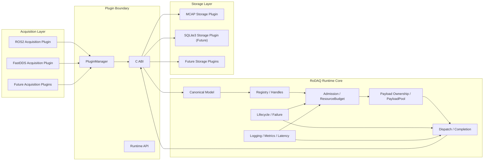

架构中最重要的约束有四个。

### Runtime 是 Acquisition 与 Storage 之间唯一的语义中介

禁止：

```text
Acquisition Plugin → Storage Plugin
Storage Plugin → Acquisition Plugin
```

必须：

```text
Acquisition Plugin
      ↓
Runtime
      ↓
Storage Plugin
```

### Canonical Model 是公共语义中心

以下都只是外部格式：

```text
ROS2 Topic
DDS Topic
MCAP Channel
SQLite table
```

它们不能成为 Runtime 的公共数据模型。

### Plugin System 负责动态加载，不负责 Runtime 正确性

PluginManager 负责：

```text
discover
load
validate
instantiate
destroy
unload
```

但不能决定：

```text
Admission
Accepted
Payload lifetime
Completion semantics
Failure cutoff
per-stream ordering
```

### 第三方基础设施的 Public Boundary

Stable C Plugin ABI 绝不暴露任何第三方类型。

Public C++ API 默认不暴露第三方类型：

```text
tbb::*
spdlog::*
fmt::*
YAML::Node
hdr_histogram*
mi_heap_t
```

D-025 明确冻结了一个例外：`rodaq::Result<T>` 直接 alias
`nonstd::expected<T, Error>`。expected-lite 因此是 Public C++ source-level header
dependency，但 RoDAQ-owned API 的 contract 仍是 `rodaq::Result<T>`；expected-lite
不得进入 Stable C Plugin ABI。


## 1.3 Canonical Model：系统语义中心

Canonical Model 不是某个 Storage 格式的中间 DTO，也不是 ROS 2 / DDS message 的统一反序列化对象。它是 Acquisition、Runtime、Storage 三者之间唯一长期稳定的语义契约。

设计目标：

```text
Source-specific transport semantics
    ↓
Acquisition Plugin
    ↓
Canonical Identity / Descriptor / Record
    ↓
Runtime
    ↓
Storage Plugin
    ↓
MCAP / SQLite3 / future formats
```

因此：

```text
ROS2 topic / DDS Topic
    不能成为 Runtime Core 类型

MCAP Channel / SQLite table
    不能成为 Canonical Model 类型
```

Runtime 只理解：

```text
Source
Clock
Schema
Stream
StreamDescriptor
Record
Payload
TimestampLayout
Sequence
```

### 1.3.1 Record Identity

V1 冻结：

```text
Record Identity
    =
(StreamId, AcceptanceSequence)
```

其中：

```text
StreamId
    logical stream identity

AcceptanceSequence
    Runtime-assigned stream-local admission / acceptance ordering sequence
```

`AcceptanceSequence`：

```text
由 Runtime 在 admission attempt 进入 stream-local acceptance ordering domain 时分配；
属于 Stream；
用于 Canonical Record Identity；
一旦分配不得 rollback / reuse；
只有 Accepted attempt 形成 Canonical Record 并持久化该值；
不得由 Acquisition Plugin 或 Storage 重写。
```

因此 rejected attempt 可以消耗一个 sequence value，但不会产生 Record；accepted Records 之间允许出现 gap。

跨 Stream：

```text
AcceptanceSequence 不可比较。
```

### 1.3.2 SourceSequence 与 AcceptanceSequence

V1 不再定义独立的 `AcquisitionSequence`。

Source-originated ordering 如果满足 Canonical Profile 的：

```text
source-originated
+
SourceId-scoped
```

则通过 optional：

```text
SourceSequence
```

表达。

两者严格分离：

```text
AcceptanceSequence
    Runtime-generated
    Stream-scoped
    mandatory for Canonical Record
    part of Record Identity

SourceSequence
    Source-generated
    SourceId-scoped
    optional
    not part of Record Identity
```

V1 冻结的 per-stream invariant：

```text
AcceptanceSequence order
    ==
accepted dispatch enqueue order
    ==
Storage logical handoff order for that Stream
```

不要求：

```text
不同 Stream 之间存在全局总序。
```

### 1.3.3 StreamId 与 StreamDescriptorId

`StreamId` 表示 logical stream。

`StreamDescriptorId` 表示某一时刻该 Stream 的 interpretation contract。

以下变化：

```text
StreamName
Schema
PayloadEncoding
TimestampLayout
```

必须：

```text
创建新的 StreamDescriptorId
```

但保持：

```text
StreamId 不变
```

例如：

```text
/camera/image
    schema A
        ↓
firmware upgrade
    schema B
```

应表现为：

```text
same StreamId
new StreamDescriptorId
```

而不是创建一个新的 logical Stream。

### 1.3.4 Stream Rename

V1 冻结：

> StreamName 属于 interpretation contract，而不是 Stream identity。

因此 rename：

```text
StreamId
    不变

StreamDescriptorId
    新建
```

这样能够同时满足：

```text
历史 identity 连续性
+
存储时准确保留名称变化
```

### 1.3.5 Schema absent → present

如果某 Stream 初始：

```text
Schema = absent
```

随后获得正式 Schema：

```text
Schema = present
```

必须发布：

```text
new StreamDescriptorId
```

不能原地修改 immutable descriptor。

### 1.3.6 Immutable Descriptor

以下对象 V1 按 activation-lifetime immutable object 处理：

```text
Source Descriptor
Clock Descriptor
Schema Descriptor
Stream Descriptor
Binding
```

创建后：

```text
不原地修改
```

变化通过：

```text
new descriptor
+
new handle/id
```

表达。

这使 Data Plane 可以使用：

```text
stable handle
immutable pointer
release/acquire publication
```

避免复杂 reclamation。

### 1.3.7 Source Identity

Source 表示 acquisition origin，而不是某个 middleware-specific object。

例如：

```text
ROS2 participant / node-side acquisition source
DDS participant-side source
SocketCAN interface source
```

Native Source identity 首先由对应 Acquisition Plugin / Mapping canonicalize 为：

```text
non-empty opaque Canonical SourceId bytes
```

Canonical SourceId equality domain 是：

```text
current active Identity Scope
```

而不是 Plugin instance。

因此所有可能在同一 active Scope 共存的 Acquisition identity scheme 必须保证：

```text
same native Source
    → same Canonical SourceId bytes

different native Source
    → different Canonical SourceId bytes

different identity domains
    → canonical byte domains remain disjoint
```

Runtime 只负责：

```text
validation
Scope-wide registration / interning
SourceId → SourceHandle association
```

`SourceHandle` 只是 activation-lifetime lookup handle，不属于 Canonical State。

如果 native Source identity unknown / invalid / unstable / ambiguous，则 Canonical SourceId 可以 absent；如果 identity 已可靠获得但 registration 尚未完成，则不得伪装成 absent，sample 必须在 Admission 前完成 registration、boundedly buffer/backpressure，或 pre-admission drop/reject。

### 1.3.8 Clock Identity

Acquisition ingress clock 是 Runtime 本地 monotonic clock。

Canonical ClockDescriptor 至少描述：

```text
ClockId
resolution = positive reduced rational seconds per tick
ClockOrigin = Canonical Identifier
```

ClockOrigin 不是冻结 enum。可以使用例如：

```text
rodaq/monotonic_unspecified
rodaq/unix_epoch
rodaq/tai_epoch
rodaq/device_power_on
vendor/device_epoch
```

未知/future ClockOrigin 必须能够 lossless 保存；Clock resolution 不得为了 ABI 简化强制近似成整数纳秒。

V1 默认 Clock comparability：

> **只有 ClockId 相同的 timestamp 才默认可比较。**

不同 ClockId：

```text
默认不可比较
```

除非未来通过：

```text
Clock Correlation
```

建立明确映射。

Clock identity 必须包含足够的 source / host identity，避免不同机器上的：

```text
monotonic_since_boot
```

被错误视为同一时间域。

### 1.3.9 TimestampKeySet 与 TimestampStateMap

Canonical 时间语义由：

```text
TimestampKey
    = (RoleIdentifier, ClockId)

TimestampKeySet
    = unordered set of TimestampKey

TimestampStateMap
    = complete map:
        TimestampKey → Absent | Present(ClockReading)
```

组成。

`ClockReading` 是 signed integer tick value，不固定为纳秒；其秒/ tick 解释来自对应 ClockDescriptor 的 reduced rational resolution。

因此：

```text
Absent
!=
Present(0)
```

任何 positional array / slot order 只允许作为 Runtime / Plugin ABI transport layout，**不属于 Canonical State**。

每个 StreamDescriptor 引用一个 TimestampKeySet；Runtime 可以为 hot path 编译稳定 slot layout，但 Storage full-fidelity projection 必须保存 TimestampKeySet identity/content 和每个 Record 的完整 TimestampStateMap。

如果多个 sensor 都声明：

```text
role = source
clock = same generic device clock
```

但实际上彼此时间域不同，则 Acquisition Mapping 必须建立不同的 Canonical Clock identity / ClockId。

不同实际 Clock instance 必须使用不同 ClockId；不能依赖：

```text
role string
```

隐式区分 clock domain。

如果未来需要跨 Clock 比较，则必须通过显式 Clock Correlation contract 建立映射，不能仅根据相同 `ClockOrigin`、相同 role 或相同 resolution 推断可比较性。

### 1.3.10 Payload 与 Schema 分离

Canonical Record 保存：

```text
raw logical payload bytes
```

并通过 StreamDescriptor 指向：

```text
Schema
PayloadEncoding
```

Runtime V1 不要求把 ROS2/DDS payload 全量反序列化成统一 object tree。

这是一个关键性能原则：

```text
preserve native payload
+
canonicalize interpretation metadata
```

因此：

```text
10 × camera × 30 FPS × 720P
```

场景不会因为“统一对象模型”产生额外全量 decode/re-encode。

### 1.3.11 Round-trip Equality

V1 的 round-trip equality 基于：

```text
logical payload bytes
```

而不是：

```text
原始 memory address
physical buffer segmentation
allocator layout
```

Scatter/gather 输入如果未来支持，比较时按：

```text
logical byte order
```

定义等价。

V1 physical Payload 仍冻结为：

```text
one contiguous immutable byte range
```

### 1.3.12 Cross-scope Import

如果未来从一个 Session / Scope 导入到另一个 Scope：

```text
不能直接复用原 Scope 的 descriptor IDs
```

必须：

```text
复制 / 重建 descriptor
显式 remap IDs
目标 Scope self-contained
```

这样 Storage Artifact 不依赖另一个 Runtime activation 的内存 identity。

### 1.3.13 Canonical Model 与 Plugin ABI 的关系

Plugin ABI 不直接暴露 Runtime private C++ Canonical object。

边界使用：

```text
opaque handles
+
read-only ABI views
```

例如：

```text
SourceHandle
ClockHandle
SchemaHandle
StreamHandle
StreamDescriptorHandle
```

Acquisition：

```text
register / publish
```

Storage：

```text
query immutable views
```

详细字段由 `docs/design/canonical_data_model.md`、`canonical_profile.md` 与 `rodaq_plugin_system.md` 共同约束；本文冻结上述跨模块语义，不允许专项实现反向修改这些规则。


### 1.3.14 Canonical State 与 InteropProjection 分离

V1 新增的 ROS2 MCAP interoperability requirement **不改变 Canonical Model**。系统明确区分：

```text
Canonical State
    Source / Clock / Schema / Stream / StreamDescriptor / Record / Payload
    → long-term semantic authority

InteropProjection
    external ecosystem compatibility facts
    → non-Canonical
```

V1 数据路径：

```text
ROS2 Acquisition ─────┐
                      ├─ Canonical Descriptor + rodaq.projection.ros2.v1
FastDDS Acquisition ──┘
                                   ↓
                         Runtime Projection Registry
                                   ↓
                         MCAP Descriptor Readiness
                                   ↓
                         ROS2-profile MCAP
```

约束：

- Acquisition 与 Storage 仍不能直接调用；
- Runtime 只管理 projection identifier/version、ownership、immutability、bounds 与 descriptor association，不解释 ROS2 QoS 业务语义；
- projection 只在 Control Plane 注册，不进入每条 Record 的 hot path；
- projection 与 Canonical Descriptor 冲突时必须拒绝，不能静默选一个；
- V1 required `rodaq.projection.ros2.v1` 由 ROS2/FastDDS 两个 Acquisition 产生同一逻辑 contract，MCAP Storage 只消费统一 projection；
- future Generic DDS、SocketCAN、MDF 等可以定义其它 typed projection，而不修改 Canonical State，也不引入 Generic PropertyBag。

这使 V1 能同时满足：

```text
strict ROS2 MCAP interoperability
+
plugin-independent Canonical/Runtime architecture
```

---

## 1.4 推荐仓库目录结构

RoDAQ V1 在正式开发前应冻结顶层目录职责。后续可以增加私有文件，但不应频繁调整这些边界。

推荐：

```text
rodaq/
├── CMakeLists.txt
├── README.md
├── LICENSE
├── .gitmodules
│
├── cmake/
│   ├── dependencies.cmake
│   ├── options.cmake
│   ├── warnings.cmake
│   ├── sanitizers.cmake
│   ├── install.cmake
│   ├── packaging.cmake
│   ├── RoDAQPlugin.cmake
│   └── RoDAQAbiCheck.cmake
│
├── include/
│   └── rodaq/
│       ├── error.hpp
│       ├── result.hpp
│       ├── types.hpp
│       │
│       ├── canonical/
│       │   ├── ids.hpp
│       │   ├── clock.hpp
│       │   ├── schema.hpp
│       │   ├── stream.hpp
│       │   └── record.hpp
│       │
│       ├── runtime/
│       │   ├── runtime.hpp
│       │   ├── config.hpp
│       │   ├── handles.hpp
│       │   └── stats.hpp
│       │
│       ├── payload/
│       │   ├── payload.hpp
│       │   └── payload_view.hpp
│       │
│       ├── plugin/
│       │   ├── abi/
│       │   │   ├── common.h
│       │   │   ├── canonical.h
│       │   │   ├── service.h
│       │   │   ├── config.h
│       │   │   ├── runtime.h
│       │   │   ├── acquisition.h
│       │   │   ├── storage.h
│       │   │   └── plugin.h
│       │   │
│       │   ├── plugin.hpp
│       │   ├── config.hpp
│       │   ├── runtime.hpp
│       │   ├── acquisition.hpp
│       │   ├── storage.hpp
│       │   ├── export.hpp
│       │   └── detail/
│       │       └── trampolines.hpp
│       │
│       └── logging/
│       │   └── logger.hpp
│       │
├── src/
│   ├── canonical/
│   │   ├── clock.cpp
│   │   ├── schema.cpp
│   │   ├── stream.cpp
│   │   └── record.cpp
│   │
│   ├── runtime/
│   │   ├── runtime.cpp
│   │   ├── runtime_state.hpp
│   │   ├── runtime_state.cpp
│   │   ├── registry.hpp
│   │   ├── registry.cpp
│   │   ├── admission.hpp
│   │   ├── admission.cpp
│   │   ├── resource_budget.hpp
│   │   ├── resource_budget.cpp
│   │   ├── dispatch_queue.hpp
│   │   ├── dispatch_queue.cpp
│   │   ├── completion.hpp
│   │   ├── completion.cpp
│   │   ├── lifecycle.hpp
│   │   ├── lifecycle.cpp
│   │   └── stats.cpp
│   │
│   ├── payload/
│   │   ├── payload.cpp
│   │   ├── payload_pool.hpp
│   │   ├── payload_pool.cpp
│   │   ├── memory_resource.hpp
│   │   └── memory_resource.cpp
│   │
│   ├── plugin/
│   │   ├── shared_library.hpp
│   │   ├── shared_library.cpp
│   │   ├── plugin_library.hpp
│   │   ├── plugin_library.cpp
│   │   ├── plugin_manager.hpp
│   │   ├── plugin_manager.cpp
│   │   ├── plugin_catalog.hpp
│   │   ├── plugin_catalog.cpp
│   │   ├── acquisition_plugin_instance.hpp
│   │   ├── acquisition_plugin_instance.cpp
│   │   ├── storage_plugin_instance.hpp
│   │   └── storage_plugin_instance.cpp
│   │
│   ├── logging/
│   │   ├── logger.cpp
│   │   ├── logging_context.hpp
│   │   └── logging_context.cpp
│   │
│   ├── metrics/
│   │   ├── runtime_stats.cpp
│   │   ├── latency_histogram.hpp
│   │   └── latency_histogram.cpp
│   │
│   └── config/
│       ├── yaml_config_loader.hpp
│       └── yaml_config_loader.cpp
│
├── plugins/
│   ├── acquisition/
│   │   ├── ros2/
│   │   │   ├── CMakeLists.txt
│   │   │   ├── include/
│   │   │   ├── src/
│   │   │   └── tests/
│   │   │
│   │   └── fastdds/
│   │       ├── CMakeLists.txt
│   │       ├── include/
│   │       ├── src/
│   │       └── tests/
│   │
│   └── storage/
│       ├── mcap/
│       │   ├── CMakeLists.txt
│       │   ├── include/
│       │   ├── src/
│       │   └── tests/
│       │
│       └── sqlite3/
│           ├── CMakeLists.txt
│           ├── include/
│           ├── src/
│           └── tests/
│
├── apps/
│   └── rodaq/
│       ├── CMakeLists.txt
│       └── main.cpp
│
├── tests/
│   ├── abi/
│   │   ├── layout_sentinels.cpp
│   │   ├── symbol_exports.cmake
│   │   ├── compatibility/
│   │   └── baseline/
│   │
│   ├── unit/
│   │   ├── canonical/
│   │   ├── runtime/
│   │   ├── payload/
│   │   └── plugin/
│   │
│   ├── integration/
│   │   ├── fake_acquisition_plugin/
│   │   ├── fake_storage_plugin/
│   │   ├── plugin_loading/
│   │   ├── lifecycle/
│   │   └── runtime_pipeline/
│   │
│   ├── stress/
│   │   ├── admission_stress.cpp
│   │   ├── dispatch_stress.cpp
│   │   ├── payload_stress.cpp
│   │   └── plugin_lifecycle_stress.cpp
│   │
│   └── fuzz/
│       ├── config_fuzz.cpp
│       ├── abi_fuzz.cpp
│       └── metadata_fuzz.cpp
│
├── benchmarks/
│   ├── queue_benchmark.cpp
│   ├── admission_benchmark.cpp
│   ├── payload_benchmark.cpp
│   ├── registry_benchmark.cpp
│   ├── runtime_pipeline_benchmark.cpp
│   └── joint_pipeline_benchmark.cpp
│
├── packaging/
│   └── appimage/
│       ├── AppRun
│       ├── build_appimage.cmake
│       └── verify_dependencies.sh
│
├── docs/
│   ├── architecture.md
│   ├── runtime.md
│   ├── admission.md
│   ├── payload.md
│   ├── rodaq_plugin_system.md
│   ├── logging.md
│   ├── packaging.md
│   ├── canonical_data_model.md
│   ├── canonical_profile.md
│   ├── acquisition_plugin.md
│   ├── storage_plugin.md
│   ├── acquisition_plugin/
│   │   ├── ros2.md
│   │   └── fastdds.md
│   └── storage_plugin/
│       ├── mcap.md
│       └── sqlite3.md
│
└── third_party/
    ├── spdlog/
    ├── fmt/
    ├── hdr_histogram/
    ├── yaml-cpp/
    ├── expected-lite/
    ├── googletest/
    └── benchmark/
```

## 1.5 目录职责与依赖规则

### `include/rodaq/`

只放 **Public C++ API**。

这里的任何头文件都应被视为未来兼容性承诺。

允许：

```text
RoDAQ 类型
RoDAQ enum
RoDAQ Result
RoDAQ Handle
Canonical Model
C++ Plugin SDK wrapper
```

禁止：

```text
tbb::*
spdlog::*
fmt::*
YAML::Node
mcap::*
rclcpp::*
Fast DDS types
sqlite3*
```

公共头文件必须能够在未安装 ROS2、DDS、MCAP、SQLite3 时独立使用。

### `src/`

放：

```text
private headers
private implementation
third-party adaptation
Runtime internals
```

推荐：

```text
include/rodaq/runtime/runtime.hpp
src/runtime/runtime.cpp
src/runtime/runtime_state.hpp
src/runtime/admission.hpp
```

而不是为了 `include/` / `src/` 机械对称，把所有 private header 都放进 `include/`。

原则：

> `include/` = installed / public
> `src/` = implementation / private

### `include/rodaq/plugin/abi/`

该目录定义 RoDAQ 动态插件的长期二进制边界，不设置 `v1/` 子目录。ABI 版本由协议本身表达，而不是由目录名表达：

```text
RODAQ_PLUGIN_ABI_VERSION
family protocol version
struct_size
service / extension version
```

文件职责：

```text
common.h
    status、error、string/bytes view、opaque handle、export/noexcept 等基础 ABI primitive

plugin.h
    Plugin descriptor、Boot ABI marker、公共 metadata

service.h
    Service Registry 与通用 fat interface

config.h
    Runtime-owned read-only ConfigView ABI

runtime.h
    Runtime 暴露给 Plugin 的稳定 services

acquisition.h
    Acquisition family protocol

storage.h
    Storage family protocol
```

该目录必须保持：

```text
纯 C-compatible
无 STL
无 C++ exception 穿越 ABI
无 RTTI dependency
无第三方类型
无跨 DSO C++ ownership object
```

同时明确两层接口：

```text
include/rodaq/plugin/abi/
    stable binary contract

include/rodaq/plugin/
    C++17 Plugin SDK
    wrappers / base classes / export helpers / exception trampolines
```

Plugin 作者通常使用 C++ SDK；SDK 负责生成和适配稳定 C ABI。

Payload 命名统一为：

```text
Payload
    owning / lifetime-bearing / move-only
    include/rodaq/payload/payload.hpp

PayloadView
    non-owning / read-only
    include/rodaq/payload/payload_view.hpp
```

不再使用 `Payload`。

### `plugins/`

Concrete Plugin 独立成 shared library。

依赖方向：

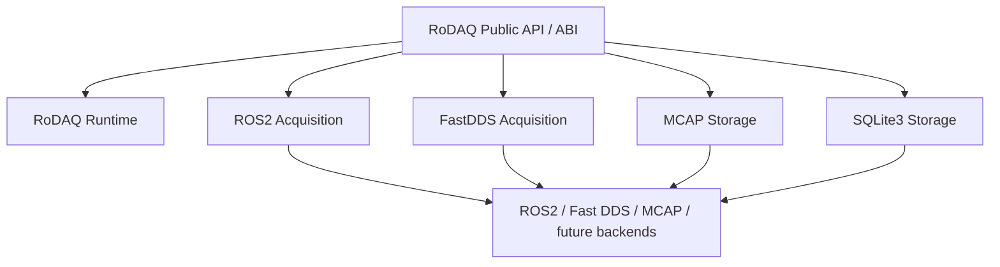

禁止：

```text
Runtime Core → ROS2
Runtime Core → Fast DDS
Runtime Core → MCAP
Runtime Core → SQLite3

Acquisition Plugin → Storage Plugin
Storage Plugin → Acquisition Plugin
```

### `apps/`

只负责进程入口：

```text
CLI
config
logger initialization
Runtime construction
Plugin loading
start / wait / stop
process exit code
```

不得实现：

```text
Admission
Payload ownership
Storage policy
ROS2 logic
Plugin ABI internals
```

### `tests/`

测试按性质组织：

```text
unit
integration
stress
fuzz
```

Fake Plugin 是核心测试资产：

```text
FakeAcquisitionPlugin
FakeStoragePlugin
```

真实 ROS2 / MCAP 插件开发之前，就应使用 Fake Plugin 完成 Runtime 和 Plugin Contract 验证。

### `benchmarks/`

用于工程决策，而不是功能正确性。

例如决定：

```text
oneTBB queue 是否满足性能要求
PayloadPool size-class
mimalloc 是否值得默认启用
Registry representation
batch size
Dispatch strategy
```

### `third_party/`

所有直接第三方源码采用 Git submodule 管理。

原因：

- 依赖版本由主仓库 commit 精确冻结；
- 可离线构建；
- CI 不依赖 configure/build 时联网；
- 便于深入源码审查；
- amd64 / arm64 共用完全相同源码；
- patch / fork 来源可追踪；
- AppImage 发布时可明确生成 SBOM / third-party notice。

原则：

> `third_party/` 是第三方源码树，不是 RoDAQ 自己的源码目录。

正常情况下禁止直接修改 submodule 工作树。

如果确实需要修改第三方代码：

优先：

```text
维护 RoDAQ fork
third_party submodule 指向 fork 的固定 commit
```

其次：

```text
third_party/patches/
```

记录可重放 patch。

不能出现：

```text
third_party/foo/
    本地手改
    无 patch
    无 fork
    无来源记录
```

## 1.6 Git Submodule 管理原则

`.gitmodules` 类似：

```ini
[submodule "third_party/onetbb"]
    path = third_party/onetbb
    url = https://github.com/uxlfoundation/oneTBB.git

[submodule "third_party/spdlog"]
    path = third_party/spdlog
    url = https://github.com/gabime/spdlog.git

[submodule "third_party/fmt"]
    path = third_party/fmt
    url = https://github.com/fmtlib/fmt.git
```

主仓库记录：

```text
dependency repo
exact commit
```

版本文档同时记录：

```text
logical release version
submodule commit
build options
```

例如：

```text
oneTBB
    release: 2022.3.0
    tag: v2022.3.0
    submodule commit: pinned
    linkage: shared
    component: TBB::tbb only
```

Clone：

```bash
git clone --recurse-submodules <repo>
```

已有仓库：

```bash
git submodule update --init --recursive
```

CI 必须显式启用：

```text
submodules: recursive
```

## 1.7 CMake target 结构

目录只是源码组织；真正的现代 C++ 工程边界由 CMake target 决定。

建议：

```text
RoDAQ::rodaq
RoDAQ::plugin_sdk
```

内部可根据依赖边界拆分：

```text
rodaq_canonical
rodaq_runtime
rodaq_plugin
```

不建议：

```text
每个目录都生成一个 library
```

只有当一个模块具有明确：

```text
dependency boundary
test boundary
link boundary
```

时，才值得成为独立 target。

Concrete Plugin target 分为当前实现与后续设计目标：

```text
V1 implemented:
    rodaq_acquisition_ros2
    rodaq_acquisition_fastdds
    rodaq_storage_mcap

future / designed:
    rodaq_storage_sqlite3
    rodaq_acquisition_socketcan
    ...
```

## 1.8 安装树

最终安装结构建议：

```text
<prefix>/
├── bin/
│   └── rodaq
│
├── lib/
│   ├── librodaq.so
│   ├── libtbb.so.12
│   │
│   ├── rodaq/
│   │   └── plugins/
│   │       ├── librodaq_acquisition_ros2.so
│   │       ├── librodaq_acquisition_fastdds.so
│   │       └── librodaq_storage_mcap.so
│   │
│   └── cmake/
│       └── RoDAQ/
│           ├── RoDAQConfig.cmake
│           ├── RoDAQConfigVersion.cmake
│           └── RoDAQTargets.cmake
│
├── include/
│   └── rodaq/
│       ├── ...
│       └── abi/
│
└── share/
    └── rodaq/
```

外部项目应能够：

```cmake
find_package(RoDAQ CONFIG REQUIRED)

target_link_libraries(my_app
    PRIVATE
        RoDAQ::rodaq
)
```

源码树、安装树和 AppDir 应能够自然映射。

---

# 2. Runtime Core 设计与实现

Runtime Core 是 RoDAQ 最关键的部分。它负责把不同通信中间件的数据统一为 Canonical Record，并保证整个数据路径在高负载、停止和故障情况下仍具有确定行为。

## 2.1 Runtime 内部结构

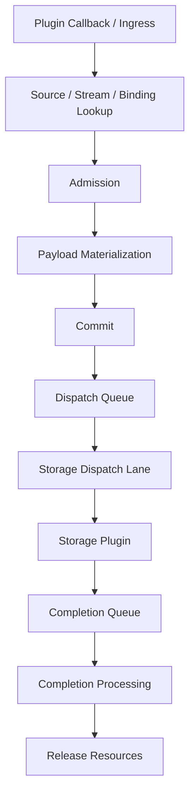

Runtime 可以拆成五类职责：

| 子系统 | 主要职责 | 正确性要求 |
|---|---|---|
| Registry | Source / Stream / Descriptor / Binding 查找 | handle 稳定，发布后只读 |
| Admission | 判断是否允许接收 Record | Accepted 前保证所需资源 |
| Payload | 管理 payload 生命周期 | 异步使用期间地址稳定 |
| Dispatch / Completion | Runtime 与 Storage 数据交接 | Accepted 不因普通压力丢弃 |
| Lifecycle | Start / Stop / Failure / Quiescence | 有限时间内确定收敛 |


## 2.2 Runtime Object Domains 与生命周期

V1 必须明确 Runtime、Plugin Instance、Binding、Record 等对象的生命周期层级。

```text
Process / Runtime lifetime
    Runtime
    PluginManager
    PluginLibrary
    Structural Arena
    Registries

Plugin Instance lifetime
    AcquisitionPluginInstance
    StoragePluginInstance
    Runtime Service bindings

Activation / Session lifetime
    Source
    Clock
    Schema
    Stream
    StreamDescriptor
    Binding

Record lifetime
    AdmissionReservation
    RuntimeRecord
    Payload
    Dispatch ownership
    Completion ownership
```

这些层级不能互相倒置。

例如：

```text
Record
    可以引用 immutable StreamDescriptor

StreamDescriptor
    不能引用某个 transient RuntimeRecord
```

Stop 时必须：

```text
先停止产生 Record
再 drain Record
最后销毁 descriptor / Plugin instance / structural state
```

### 2.2.1 Runtime 是 Control Plane single writer

V1 冻结：

> 对会改变 topology、descriptor publication、binding 和 lifecycle 的操作，由单一 logical Control Plane writer 串行化。

包括：

```text
Plugin load/unload
Instance create/bind/configure/start/stop
Source / Stream activation
Binding publication
Runtime state transitions
Failure cutoff
```

这不意味着只有一个 OS thread。

可以使用：

```text
Executor
Control Strand
serialized command queue
```

实现，但逻辑上：

```text
同一时刻只有一个 writer 修改 Control Plane state
```

避免：

```text
多个 mutex 交叉修改 topology
复杂 lock ordering
descriptor half-published
```

### 2.2.2 Data Plane

Data Plane 允许：

```text
multiple Acquisition producer threads
multiple Streams
Storage worker threads
Completion callbacks
```

但 Runtime 把并发压缩成几个明确 domain：

```text
Ingress / Admission
    concurrent

Dispatch
    single logical Storage Dispatch Lane

Completion
    single logical Completion Domain
```

这样并发设计不是“所有地方都 lock-free”，而是：

```text
并发发生在边界
核心 state mutation 尽量 domain-serialized
```

### 2.2.3 One Active Acquisition Path per Stream

V1 冻结：

> 一个 Canonical Stream 在同一时刻最多只有一条 active acquisition path。

即：

```text
Stream
    → one active Binding
    → one owning Acquisition Plugin Instance
```

这样避免：

```text
两个 Acquisition Plugin 同时竞争同一个 Stream 的
Runtime acceptance / Binding ordering domain
```

AcceptanceSequence 始终由 Runtime 分配，不由 Plugin 生成。

如果未来需要：

```text
redundant producers
failover producer
merge source
```

应作为显式新语义设计，而不是 V1 隐式允许。

### 2.2.4 Binding

Binding 表示：

```text
Acquisition Plugin Instance
+
Stream
+
current StreamDescriptor
+
Runtime admission path
```

Source 不是 Binding 的单值属性。一个 Stream 的同一 current Binding 可以接收多个已注册 Source 的 Record；具体 Source 由每条 Record 的 optional SourceHandle / SourceId 表达。

Binding：

```text
immutable
activation-lifetime
```

切换 descriptor：

```text
publish new Binding / descriptor reference
```

而不是原地修改旧 Binding。

Data Plane 获取 Binding 时：

```text
release/acquire publication
```

即可。

V1 不需要：

```text
hazard pointer
epoch reclamation
RCU reclamation
```

因为旧 Binding 不在 Running 过程中回收。

### 2.2.5 Binding Invalidation

以下事件可以使 Binding 不再接受新 Record：

```text
Stop
Plugin failure
Source failure
Stream disabled
Runtime failure cutoff
```

Binding invalidation 必须：

```text
关闭后续 admission
wake waiters
```

但已经 Gate Pass 的 Accepted Record：

```text
继续按照 Accepted contract 收敛
```

不能因为 Binding 被 invalidated 就静默丢弃。


## 2.3 Registry、Handles 与 Structural Arena

Hot path 不适合频繁使用字符串和 HashMap。

推荐：

```text
External Identity
      ↓
Control Plane resolve
      ↓
StreamHandle
      ↓
dense table lookup
      ↓
StreamRuntimeState
```

核心 Handle：

```text
SourceHandle
StreamHandle
DescriptorHandle
BindingHandle
```

Hot path 优先：

```cpp
table[handle.value()]
```

而不是：

```cpp
unordered_map<std::string, ...>
```

哈希只用于 Control Plane：

```text
topic name
external source id
DDS topic/type
plugin instance id
```

### Structural Arena

以下对象通常拥有 activation lifetime：

```text
SourceEntry
StreamEntry
SchemaDescriptor
ClockDescriptor
StreamDescriptor
Binding
Registry structural state
```

建议：

```cpp
std::pmr::monotonic_buffer_resource
```

生命周期：


注意：

> `monotonic_buffer_resource` 保证 allocation lifetime，不保证 `pmr::vector` 元素地址自动稳定。

如果发布对象地址，需要：

```text
固定容量
提前 reserve
单对象 arena allocation
发布后不扩容
```

参考：

```text
Protobuf Arena / SerialArena
LLVM BumpPtrAllocator
```

RoDAQ 不需要完整复制 Protobuf 的 ThreadSafeArena，因为结构对象创建由 Control Plane 管理。

## 2.4 Admission 与 ResourceBudget

Admission 是 Runtime 正确性的核心，不应交给 Queue 或 generic semaphore。

Record 进入 Accepted 前，必须已经获得后续正常路径需要的资源。

至少包括：

```text
Payload bytes
Payload object
RuntimeRecord
Dispatch permit
Completion bookkeeping
Storage inflight permit（如果 Storage contract 需要）
```

流程：

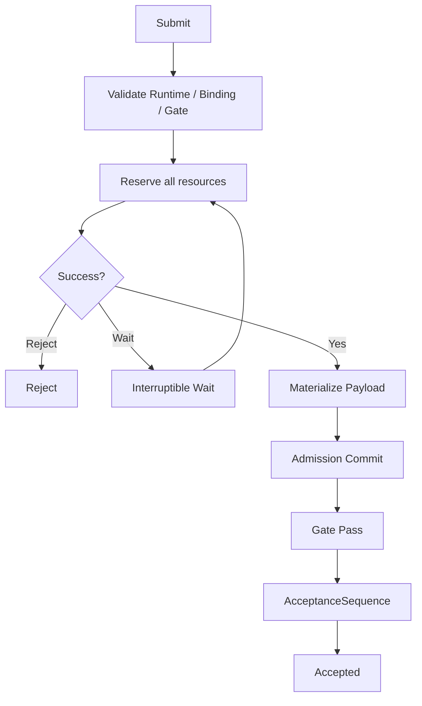

Reservation 必须满足：

```text
all-or-nothing semantics
bounded
deadlock-free
rollback cannot fail
Wait 可中断
```

Wait 必须响应：

```text
Stop
Failure cutoff
Gate close
Binding invalidation
Source unavailable
Stream unavailable
Deadline / timeout
```

### Gate

Gate 是明确的语义边界：

```text
Before Gate:
    可以 Reject
    可以 Wait
    可以 rollback尚未发生不可逆 transfer/commit 的临时 Runtime reservation

After Gate:
    Admission Attempt 已进入不可回滚 commit domain
    AcceptanceSequence 随后在同一 per-Stream commit 内分配且不可回滚
    ordered publication 成功后才成为 Accepted
    不允许因普通 queue full / allocation pressure 丢弃
```

因此：

> Queue 是 transport，不是 Admission correctness。

### ResourceBudget 实现建议

RoDAQ 自己维护一个多维 ResourceBudget：

```text
payload_bytes
payload_objects
runtime_records
dispatch_slots
completion_slots
storage_inflight
```

Reservation 可以采用：

```text
顺序 reserve + guaranteed rollback
```

只要：

```text
固定全局顺序
rollback noexcept
Wait 使用统一 generation/state wakeup
```

避免为了“原子 reservation”引入复杂 lock-free 多资源算法。

### 参考实现

重点参考：

```text
gRPC ResourceQuota
Fast DDS ResourceLimitsQosPolicy
Aeron backpressure
```

借鉴：

```text
resource ownership
quota accounting
pressure observability
deterministic rejection
```

RoDAQ 自己增加：

```text
multi-resource reservation
Gate cutoff
rollback
binding invalidation
Stop / Failure interruption
```


### 2.4.1 Admission 状态

一次 Record submission 在 Runtime 中只能处于：

```text
Unvalidated
    ↓
Eligible
    ↓
Reserving
    ↓
Materializing
    ↓
Committed
    ↓
Accepted
```

失败路径：

```text
Rejected
TimedOut
Cancelled
```

在 Accepted 之前并不意味着“所有状态都可以回滚”。

必须区分：

```text
Gate pass 前
    temporary reservations can rollback
    但已经完成的 ADOPT transfer / RETAIN acquisition 必须按 Payload contract 精确终止，不能假装从未发生

Gate pass 后
    Admission Attempt / in-flight entry 已不可回滚
    AcceptanceSequence 一旦分配不可回滚/复用
    只允许 Accepted 或异常 AdmissionRejected terminalization
```

因此只有 Gate-pass 前尚未发生不可逆 ownership/lifetime transfer 的临时 reservation 可以无条件 rollback。

Accepted 之后：

```text
普通资源压力不能再使 Record 消失
```

### 2.4.2 Reservation Commit Point

V1 将 pre-Gate reservation completion 与 Gate Pass 明确区分。

统一顺序为：

```text
Reserve resources
    ↓
Materialize Payload / establish required ownership anchor
    ↓
Commit reservation / confirm sequence capacity
    ↓
final eligibility under per-Stream commit
    ↓
Gate Pass + in-flight entry
    ↓
assign irreversible AcceptanceSequence
    ↓
ordered Accepted publication
```

`Gate Pass + in-flight entry + AcceptanceSequence allocation` 属于同一个 per-Stream logical commit domain；不得暴露“sequence 已分配但 Gate 尚未通过”的状态。

Gate Pass 前失败时：

```text
rollback temporary Runtime reservations
+
按 PayloadDisposition 精确终止已经发生的 ADOPT/RETAIN responsibility
```

不得回滚已经发生的 ownership transfer，也不得产生/回滚 AcceptanceSequence。

Gate Pass 后：

```text
Runtime 对 Record 的最终收敛负责
```

### 2.4.3 Multi-resource Reservation Order

为了避免死锁，V1 要求 ResourceBudget reservation 使用固定顺序。

推荐 logical order：

```text
1. payload object
2. payload bytes
3. RuntimeRecord
4. dispatch slot
5. completion slot
6. storage inflight
```

实际实现可以合并计数器，但必须保证：

```text
所有调用路径使用同一顺序
```

Rollback：

```text
reverse order
noexcept
cannot fail
```

### 2.4.4 Wait Model

Wait 不是裸：

```text
condition_variable.wait()
```

而是与 Runtime generation/state 绑定的 interruptible wait。

每次 wake 后重新检查：

```text
resource availability
Gate generation
Runtime state
Binding validity
deadline
failure cutoff
```

防止：

```text
lost wakeup
Stop 后再次睡眠
Binding 已失效却继续等待
```

### 2.4.5 Admission Reject vs Wait

每类资源压力必须有明确 policy：

```text
Reject
Wait
```

不能：

```text
Queue 满时临时猜一个行为
```

Reject 属于正常 Admission domain result，不是函数级 ABI failure：

```text
rodaq_status == OK
AdmissionOutcome == PRE_REJECTED
RejectionReason == RESOURCE_UNAVAILABLE
```

不得返回函数级 `RODAQ_STATUS_RESOURCE_EXHAUSTED` 来表达健康 Runtime 的普通背压；函数级 non-OK 只表示 ABI/API boundary failure。

Wait：

```text
有 deadline
可被 Stop/Failure 中断
```

无限不可中断等待禁止进入 V1。

### 2.4.6 Storage Capacity Coupling

Storage Plugin 可能内部也有：

```text
batch
queue
inflight I/O
```

Runtime 必须通过：

```text
storage_inflight budget
```

提前限制可交付量。

因此正常路径中：

```text
Accepted
    ↓
Dispatch
    ↓
Storage submit
```

不应该因为“Plugin internal queue full”再丢弃。

如果 Storage `submit()` 在预留范围内仍返回 `RESOURCE_EXHAUSTED`：

```text
这是 Storage contract / capacity negotiation violation
```

应作为：

```text
invariant violation / Plugin failure
```

处理，而不是普通 backpressure。


## 2.5 Payload Ownership 与 PayloadPool

V1 Payload 物理形式保持简单：

```text
one contiguous immutable byte range
```

逻辑接口：

```cpp
class Payload {
public:
    Payload(Payload&&) noexcept;
    Payload& operator=(Payload&&) noexcept;

    PayloadView view() const noexcept;

    const std::byte* data() const noexcept;
    std::size_t size() const noexcept;
};
```

Payload 是：

```text
move-only
ownership-bearing
read-only
stable-address
```

Ingress 支持：

| 模式 | 含义 | 用途 |
|---|---|---|
| Copy | Runtime 分配并复制 | 默认、安全 |
| Adopt | Runtime 接管 buffer | producer 可转移所有权 |
| Retain | Runtime 保留外部 lifetime anchor | loaned / zero-copy |

### PayloadPool

高频大 payload 不应长期依赖：

```text
malloc
copy
free
```

每条 Record 都走一次。

建议 size-class：

```text
4 KiB
16 KiB
64 KiB
256 KiB
1 MiB
4 MiB
large block path
```

这些只是 benchmark 初始值，不能冻结为长期协议。

参考：

```text
iceoryx MemPool
Fast DDS PayloadPool
```

借鉴：

```text
fixed-size chunks
bounded pool
deterministic exhaustion
reuse
```

### PayloadPool 与 mimalloc

两者不是替代关系：

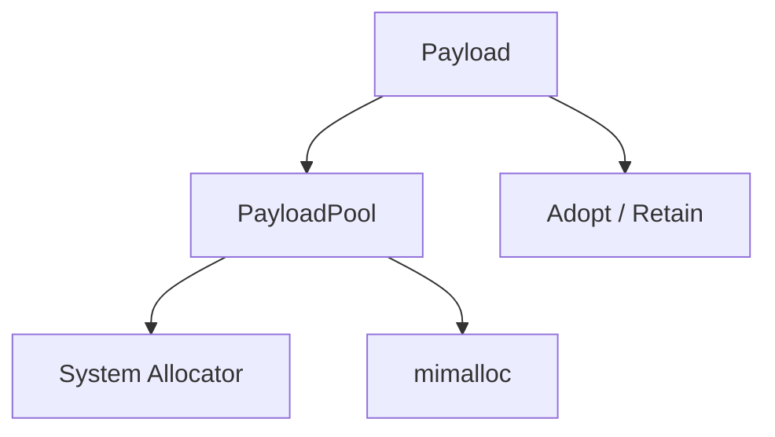

PayloadPool 负责：

```text
size-class
resource reuse
bounded capacity
payload ownership
```

mimalloc 只负责：

```text
generic allocation backend
```


### 2.5.1 Payload 预算

Payload 资源至少分成：

```text
payload_objects
payload_bytes
```

两个维度。

仅限制 bytes 不足以防止：

```text
大量 tiny payload
    → object/control-block exhaustion
```

仅限制 object count 也无法防止：

```text
少量 multi-MB image
    → memory exhaustion
```

### 2.5.2 Externally Retained Memory 也计入预算

`Retain` 并不代表“Runtime 没分配，所以免费”。

例如 loaned ROS2/DDS memory：

```text
仍然占用系统真实内存
仍然阻止 middleware buffer reuse
```

因此其：

```text
logical payload size
```

必须计入：

```text
payload_bytes budget
```

直到 release。

### 2.5.3 PayloadConsumed 与 Storage Durability 分离

Runtime 释放 Payload 的条件表示：

```text
Storage 不再需要原始 payload bytes
```

这是：

```text
PayloadConsumed
```

它不等价于：

```text
record durable
fsync complete
crash recoverable
```

Storage Plugin 如果内部已经复制 payload 到自己的 chunk/buffer：

```text
可以提前完成 payload consumption
```

但 persistence state 仍可能继续推进。

V1 不把：

```text
payload lifetime
```

和：

```text
durability
```

绑定成一个概念。

### 2.5.4 Payload Pool 不是 correctness mechanism

如果 Pool 没有空闲 chunk：

```text
Admission Wait / Reject
```

而不是：

```text
Pool 内部偷偷 fallback 到 unlimited malloc
```

除非该 fallback 本身也受统一 ResourceBudget 限制。

否则所谓 bounded Runtime 会被 allocator fallback 绕过。


## 2.6 Dispatch、Completion 与 oneTBB

V1 approved optional candidate：

```text
oneTBB 2022.3.0
```

oneTBB 保留为 concurrency reference，但 V1 Runtime Core 默认不链接，且
correctness-critical Dispatch Queue **不冻结为 `oneapi::tbb::concurrent_queue`**。

原因：Admission 的 `dispatch capacity` reservation 必须对应已经可用的 physical enqueue capacity；如果底层 queue 在 Gate pass 后仍可能为新 page/node 动态分配，则 allocation failure 会破坏 Accepted no-drop invariant。

V1 correctness baseline 优先：

```text
RoDAQ-owned fixed-capacity MPSC ring / slot queue
or
preallocated node-pool backed queue
```

只有 benchmark + allocation instrumentation 能证明某个 oneTBB queue configuration 在 reservation 后 enqueue 不再需要失败型 allocation 时，才允许替换 correctness baseline。

后续有明确 CPU parallel work 时再评估：

```text
task_arena
task_group
```

不在初始版本使用：

```text
flow_graph
parallel_pipeline
tbbmalloc
tbbmalloc_proxy
TBBBind
```

Data Plane：


关键 per-stream 不变量：

```text
AcceptanceSequence order
    ==
accepted dispatch enqueue order
```

跨 Stream 不要求全局总序。

不能依赖：

```text
MPMC queue across-producer ordering
```

来保证 per-stream semantics。

oneTBB 必须隐藏在：

```cpp
class DispatchQueue;
class CompletionQueue;
```

后面。


### 2.6.1 Dispatch Ownership

Admission Accepted 后：

```text
RuntimeRecord
+
Payload
+
dispatch permit
+
completion permit
+
storage inflight permit
```

形成一个完整 ownership bundle。

进入 Dispatch Queue 后：

```text
producer thread 不再拥有该 Record
```

所有后续释放只能由：

```text
Dispatch / Completion Domain
```

完成。

避免：

```text
producer cancellation
```

与：

```text
storage completion
```

同时释放同一资源。

### 2.6.2 Logical Storage Dispatch Lane

即使底层 Queue 是 MPMC：

```text
Storage Plugin submit()
```

V1 仍只由一个 logical Dispatch Lane 调用。

作用：

```text
简化 Storage Plugin
统一 ordering
减少 Plugin ABI thread requirements
便于 batching
```

未来如证明确需 parallel Storage dispatch：

```text
通过新 protocol / extension 显式增加
```

而不是偷偷改变 V1 thread contract。

### 2.6.3 Storage 完成模型

V1 总体系统与最新 Plugin Contract 对齐。

Storage `submit()` 首先决定 Handoff：

```text
return non-OK
    → HandoffAccepted 从未成立
    → no retained Payload access after return
    → no normal completion callback for this operation
    → Runtime enters Storage failure path

return OK
    → HandoffAccepted
```

HandoffAccepted 后独立跟踪两个 axis：

```text
Payload axis
    PAYLOAD_CONSUMED
    or
    PAYLOAD_PENDING

Persistence axis
    PERSISTENCE_PENDING
    PERSISTENCE_SUCCEEDED
    PERSISTENCE_FAILED
    PERSISTENCE_UNKNOWN
```

如果某 axis 在 `submit()` result 中已经 terminal：

```text
不得再发送对应 callback
```

如果某 axis 为 Pending：

```text
PayloadPending
    → exactly one payload_consumed(operation)

PersistencePending
    → exactly one persistence_completed(operation, terminal_state, ...)
```

禁止 same-stack synchronous reentrant callback。跨线程 completion 可以与 `submit()` return 竞态；Runtime 必须预建 operation state 并在 return 后 reconcile。

这种双轴模型允许：

```text
PayloadConsumed
+
PersistencePending
```

从而让 Runtime 在 MCAP batch / SQLite transaction 尚未 persistence terminal 时，已经可以释放大 Payload backing。

### 2.6.4 Completion Domain

Completion callback 可以来自：

```text
Storage worker
I/O completion thread
```

但 Runtime 不直接在 callback thread 上任意修改核心状态。

推荐：

```text
Storage callback
    ↓
Completion Queue
    ↓
single logical Completion Domain
```

Completion Domain 负责：

```text
operation state transition
payload release
storage inflight release
completion permit release
RuntimeRecord release
metrics
failure propagation
```

### 2.6.5 Exactly-once Completion

Runtime 对每个 HandoffAccepted operation 分别维护：

```text
Payload axis terminalization
Persistence axis terminalization
```

如果 submit result 为：

```text
PAYLOAD_PENDING
```

则必须 exactly-once 观察：

```text
payload_consumed(operation)
```

如果 submit result 为：

```text
PERSISTENCE_PENDING
```

则必须 exactly-once 观察：

```text
persistence_completed(operation, terminal_state, ...)
```

Runtime 必须检测：

```text
duplicate axis completion
callback for an already-synchronous terminal axis
unknown operation
same-stack reentrant callback
callback after close
```

这些都属于 Plugin contract violation，不能静默忽略。

### 2.6.6 Per-stream Ordering

V1 保证：

```text
same Stream:
AcceptanceSequence order
    ==
Storage submit order
```

除非某 Storage Extension 未来明确声明：

```text
out-of-order parallel submission
```

Storage Plugin 不应自行重排同一 Stream Record，除非最终格式语义明确允许且 Contract 已约定。

不同 Stream：

```text
不保证相互顺序
```


## 2.7 Lifecycle、Stop 与 Failure

Runtime 停止不能只是：

```cpp
running_ = false;
join();
```

推荐状态：

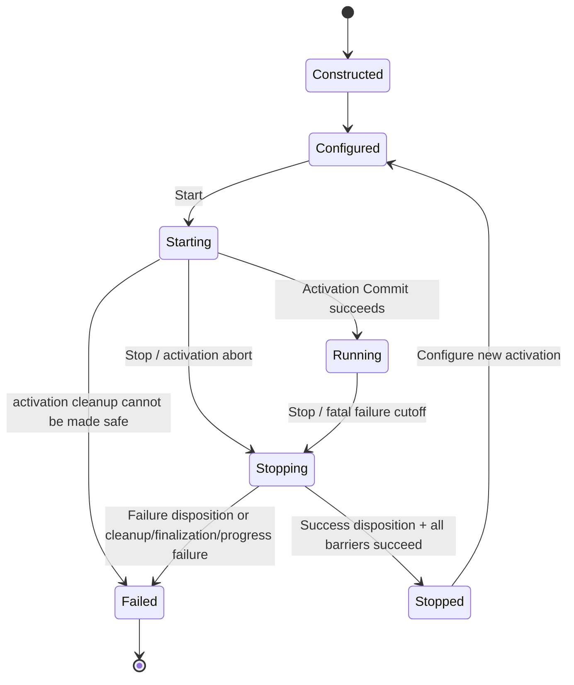

Stop 流程：

```text
1. close Admission Gate
2. wake all Admission waiters
3. reject new submissions
4. call required Acquisition `quiesce_plugin()`
   (instance-wide, non-destructive; blocks current/future Submit routing)
5. wait active Submit/admission convergence
6. drain / terminate dispatch according to policy
7. process outstanding Storage completion
8. terminalize/release Plugin-origin Payload anchors while native release capability remains valid
9. invoke destructive Acquisition `stop()`
10. verify no future Plugin/Storage callback can access Runtime state
11. destroy plugin instances
12. unload libraries
13. release structural state
```

失败必须限定在 Runtime / Task 合理 failure domain 内，不能因为一个 Storage failure 让整个进程进入不确定状态。

参考：

```text
eCAL InterruptibleThread
rosbag2 MessageCache / CacheConsumer
```

---


### 2.7.1 Stop 与 Failure Cutoff

Stop 和 Failure 都会关闭新的 Admission，但语义不同。

```text
Stop
    planned convergence

Failure
    unplanned cutoff
```

两者都必须：

```text
close Gate
wake waiters
invalidate new submissions
```

但 Failure 还需要记录：

```text
primary failure
secondary shutdown failures
```

不能让 cleanup error 覆盖真正的 primary failure。

### 2.7.2 Failure Domain

V1 原则：

> 单个 acquisition/storage task 的 failure 不应让整个 Runtime process 进入不可恢复的不确定状态。

如果当前 Session 因 Storage fatal failure 终止：

```text
当前 Session
    → Failed / Stop convergence
```

Failed Runtime instance 是 terminal：

```text
不得重新进入 Configured / Running
```

完成有限 safe cleanup 后只能销毁。Application 如果要继续服务：

```text
create a new Runtime instance
    → new Session
    → new Identity Scope
```

除非故障属于：

```text
process-wide invariant corruption
```

才需要终止整个进程。

### 2.7.3 Primary / Secondary Error

Stop/Fault convergence 中：

```text
primary_error
    首个决定任务失败的错误

secondary_errors
    清理、flush、close、join 中的后续错误
```

必须分离保存。

例如：

```text
disk write failed
    primary

close() also failed
    secondary
```

最终报告不能把：

```text
close failed
```

误当成根因。

### 2.7.4 Quiescence Definition

Runtime 进入 Stopped 前至少满足：

```text
Admission waiters == 0
active Acquisition callbacks == 0
new submission path closed
Dispatch Queue drained / resolved
Storage pending operations == 0
Completion Queue drained
Plugin-origin Payload anchors == 0
Storage callbacks quiesced
```

然后才能：

```text
destroy Plugin instances
unload DSO
release structural arena
```

### 2.7.5 Stop Timeout

任何可能等待外部系统的 Stop phase 都必须有：

```text
deadline / timeout policy
```

但是 timeout 不能意味着：

```text
直接 dlclose 仍在运行的 Plugin
```

如果 Plugin 无法 quiesce：

```text
Runtime 必须报告 fatal lifecycle failure
```

并采取明确的 process-level policy。

不能制造 use-after-dlclose。

### 2.7.6 Runtime State Transition

Public lifecycle：

```text
Constructed
Configured
Starting
Running
Stopping
Stopped
Failed
```

`quiescing / draining / finalizing / quarantine` 只属于 `Stopping` 或 `Failed` 下的 internal cleanup phase，不是 public lifecycle state。

其中 `Failed` 表示：

```text
已经确定不能继续正常 Running
```

不是：

```text
跳过 cleanup
```

`Failed` 是 public lifecycle terminal state，不再离开到 `Stopping / Quiescing`。

失败后的资源收敛是：

```text
Failed
    + internal cleanup phase:
        gate close
        quiesce attempts
        drain/reconcile where safe
        quarantine unsafe state if needed
```

这些是内部 cleanup phases，不是新的 public lifecycle state transition。完成 safe cleanup 后该 Runtime instance 只能销毁，不能重新进入 Configured/Running。

### 2.7.7 Runtime Metrics Snapshot

系统级至少暴露：

```text
accepted_records
rejected_records
admission_waits
admission_timeouts

payload_bytes_inflight
payload_objects_inflight

dispatch_depth
dispatch_high_watermark

storage_inflight
completion_depth

active_sources
active_streams

copied_payload_bytes
retained_payload_bytes

fatal_failures
```

这些 metrics：

```text
不进入 Plugin correctness path
```

但必须足以证明：

```text
boundedness
backpressure
high-water behavior
```


---

# 3. 动态插件系统设计

Plugin System 是 RoDAQ V1 最重要的长期兼容边界之一。ROS2、FastDDS、MCAP 等 V1 required Plugin 开始开发之前，应先冻结插件协议、Runtime services、生命周期、ownership 和 ABI 演化规则；SQLite3、SocketCAN、Generic DDS 等后续 Plugin 必须复用同一边界。

RoDAQ V1 的目标不是“能够 `dlopen()` 插件”，而是：

> **从 V1 开始建立可长期演化、尽量避免已有插件重新适配的稳定 Plugin ABI / SDK。**

详细规范由 `docs/design/rodaq_plugin_system.md` 维护；本章冻结系统级原则。

## 3.1 三层架构

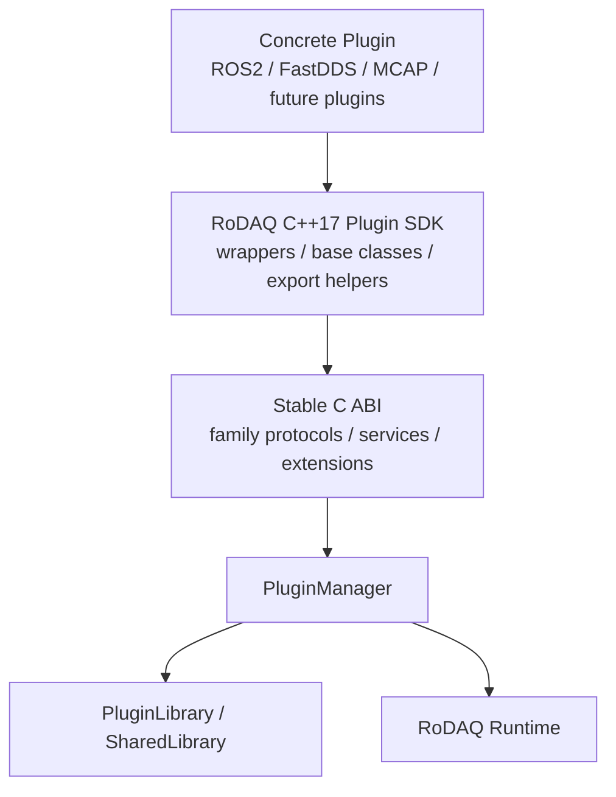

三层职责：

```text
Stable C ABI
    binary compatibility
    family protocol
    service binding
    extension negotiation

C++17 Plugin SDK
    developer ergonomics
    exception trampoline
    C ABI conversion
    typed wrappers
    export helpers

PluginManager / PluginLibrary
    discovery
    loading
    validation
    lifecycle
    DSO lifetime
    diagnostics
```

这个结构借鉴 PlotJuggler 当前插件 SDK 的：

```text
C ABI protocol
    ↓
C++ SDK
    ↓
loader / RAII handle
```

但 RoDAQ 不复制其 GUI、Parser 和大规模 service catalog，只实现 Acquisition / Storage 所需的稳定最小集合。

## 3.2 Family-specific Protocol

V1 只有两个正式 Plugin family：

```text
Acquisition
Storage
```

禁止设计成：

```text
generic rodaq_plugin_api
plugin_kind
one giant plugin vtable
```

而采用：

```c
RODAQ_PLUGIN_EXPORT
const rodaq_acquisition_plugin*
rodaq_get_acquisition_plugin(void) RODAQ_NOEXCEPT;

RODAQ_PLUGIN_EXPORT
const rodaq_storage_plugin*
rodaq_get_storage_plugin(void) RODAQ_NOEXCEPT;
```

这样 Acquisition 与 Storage 可以独立演化，也不会互相暴露不相关操作。

V1 冻结：

> **one DSO = one Plugin implementation = one Plugin family**

但同一个 DSO 可以创建多个 instance。

## 3.3 Boot ABI 与 Family Protocol 分层

每个 Plugin DSO 必须先导出：

```c
extern RODAQ_PLUGIN_EXPORT
const uint32_t rodaq_plugin_abi_version;
```

加载顺序：

```text
dlopen
  ↓
Boot ABI marker
  ↓
family entrypoint
  ↓
family protocol_version
  ↓
struct_size
  ↓
Plugin descriptor
```

版本分层：

```text
RODAQ_PLUGIN_ABI_VERSION
    整个 DSO boot ABI

RODAQ_ACQUISITION_PROTOCOL_VERSION
    Acquisition family protocol

RODAQ_STORAGE_PROTOCOL_VERSION
    Storage family protocol
```

这样某个 family 可以独立演化，而不需要每次提升整个 Plugin ABI。

## 3.4 ABI Evolution

所有 ABI-visible struct 必须分类：

```text
ABI-FROZEN
ABI-APPENDABLE
```

`ABI-FROZEN` 示例：

```text
rodaq_string_view
rodaq_bytes_view
rodaq_error
basic handles / tokens
```

发布后 layout 不允许变化。

`ABI-APPENDABLE` 示例：

```text
Plugin descriptor
family vtable
service vtable
extension vtable
ConfigView vtable
```

只能：

```text
tail append
```

每个 appendable vtable 使用：

```c
uint32_t protocol_version;
uint32_t struct_size;
```

并冻结：

```text
MIN_STRUCT_SIZE
```

同一 protocol major 内，`MIN_STRUCT_SIZE` 一旦发布不能提高。

访问新增字段必须做：

```text
struct_size gate
+
non-null slot gate
```

不能假定旧 Plugin 包含新的尾部字段。

## 3.5 Acquisition Lifecycle

Acquisition core protocol 保持小而稳定：

```text
create
bind
configure
start
stop
query_interface
destroy
```

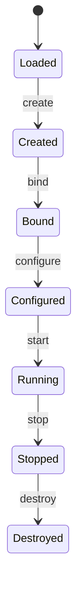

语义：

```text
create
    只创建 instance
    不接收 Runtime / Config
    不启动线程

bind
    通过 Service Registry 获取所需 Runtime services

configure
    读取 Plugin instance 配置
    不开始采集

start
    建立设备 / subscription / reader / worker 等 native resources
    不自动授予 normal Submit permission
    normal Submit 必须等待 initial Binding ReadyToCommit → Runtime Activation Commit → CommitComplete

stop
    同步 quiescence barrier

destroy
    noexcept
```

`stop()` 成功返回之后必须保证：

```text
no future acquisition callback
no future submit
no future descriptor registration
no Plugin worker 使用 Acquisition Runtime service
```

V1 还要求 Acquisition Plugin 暴露 required control interface：

```text
rodaq.acquisition.control.v1
```

用于跨 DSO 表达：

```text
ReadyToCommit
CommitComplete
pre-commit abort
stream-local quiescence
```

这些是 Runtime correctness protocol，不是 optional feature。

Acquisition data submission 还必须保持三个正交维度：

```text
AdmissionOutcome
RejectionReason
PayloadDisposition
```

其中：

```text
rodaq_status
    表达 ABI/API call 本身是否可靠完成

AdmissionOutcome
    PRE_REJECTED / REJECTED / ACCEPTED

RejectionReason
    表达 operational rejection diagnosis

PayloadDisposition
    表达本次 ADOPT / RETAIN anchor 当前由 Caller 还是 Runtime 负责
```

调用 `submit()` 本身不等于 ADOPT/RETAIN responsibility 已经转移；必须先完成 Payload structural validation 和对应 bounded resource reservation，再越过 Payload Transfer/Acquisition Point。RejectionReason 不得用于推断 ownership。

## 3.6 Storage Lifecycle

Storage 不强行复用 Acquisition 的 `start/stop`，而使用领域语义：

```text
create
bind
configure
open
submit
flush
close
query_interface
destroy
```

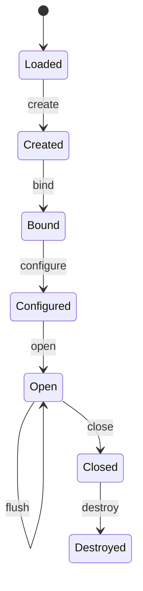

`submit()` 的核心 contract 与 `docs/design/rodaq_plugin_system.md` 保持一致：

```text
function return non-OK
    → HandoffAccepted 从未成立
    → Runtime 进入 Storage failure path

function return OK
    → HandoffAccepted
    → submit result 分别给出 Payload / Persistence 两个 axis
```

Payload axis：

```text
PAYLOAD_CONSUMED
PAYLOAD_PENDING
```

Persistence axis：

```text
PERSISTENCE_PENDING
PERSISTENCE_SUCCEEDED
PERSISTENCE_FAILED
PERSISTENCE_UNKNOWN
```

异步 callback 只用于对应 Pending axis：

```text
payload_consumed()
persistence_completed(..., const rodaq_error* error)
```

`persistence_completed()` 的 `error` 是 callback-duration borrowed、
self-contained diagnostic：成功时必须为 `NULL`，`FAILED/UNKNOWN` 时必须
非空且 code 非 OK。Storage systemic failure 的 `report_failure()` 同样携带
完整 `rodaq_error` diagnostic。

V1 禁止 same-stack synchronous reentrant callback，但允许真正的 cross-thread completion 与 `submit()` return 发生竞态。Runtime 必须在调用 `submit()` 前建立 operation tracking，并在 return 后 reconcile synchronous result 与可能已经到达的 completion event。

禁止：

```text
same-stack reentrant callback
callback observed but submit ultimately returns non-OK
callback for a synchronously terminal axis
duplicate axis completion
callback after close/quiescence
```

Storage V1 还要求 required control interface：

```text
rodaq.storage.control.v1
```

用于：

```text
get_capabilities()
ensure_descriptor_ready()
```

Capability 必须在 Running 前冻结，Descriptor 必须在 Binding Active 前 Ready；Unsupported 不能拖到 Accepted Record handoff 后才发现。

`flush()` 是 operational drain barrier，不自动等价于：

```text
fsync
crash durability
```

`close()` 接受显式 close disposition：

```text
NORMAL
ACTIVATION_ABORT
FAILURE
```

只有 NORMAL 且 backend finalization contract 全部满足时才能发布 NormalComplete；Starting activation abort 或 failure cleanup 不能伪装成正常 Artifact。

`close()` 返回后必须保证：

```text
no future completion callback
no Plugin worker 使用 Storage Runtime service
```

即使 close 返回错误，quiescence 仍是 mandatory。

## 3.7 Service Registry：Plugin → Runtime

为了避免 Runtime 每增加一个能力都修改 family protocol，V1 引入最小 Service Registry。

调用方向：

```text
Plugin → Runtime
    Service Registry
```

稳定 Service ID：

```text
rodaq.runtime.common.v1
rodaq.runtime.canonical.v1
rodaq.runtime.projection.v1
rodaq.runtime.clock_correlation.v1
rodaq.runtime.acquisition.v1
rodaq.runtime.storage.v1
```

命名规则：

```text
rodaq.<domain>.<name>.v<major>
```

Plugin 只在 `bind()` 阶段查询 service，Data Plane 不做字符串 service lookup。

### Common Runtime Service

负责：

```text
logging
monotonic clock
bounded Runtime lifecycle/admission snapshot for recovery gating
diagnostics
```

### Acquisition Runtime Service

负责：

```text
descriptor / stream registration
Record submission
```

其中 `submit()` 必须 thread-safe。Source/Stream availability 与 Plugin-wide recovery/failure state 也通过该 Service report；Runtime Common Service 的 lifecycle snapshot 是 recovery attempt 的一次性前置确认，不是持久 permission token。

### Projection Runtime Service

负责：

```text
versioned typed InteropProjection registration/query
immutable activation-lifetime projection ownership
bounded projection storage
```

V1 required projection 为 `rodaq.projection.ros2.v1`。Acquisition 在 Control Plane 注册，Storage 只读查询。

### Clock Correlation Runtime Service

负责：

```text
read-only activation-scoped ingress Clock → Unix epoch anchor
```

V1 MCAP Storage 用它构造 replay `log_time`，不得在每条 Record handoff 时重新读取 wall clock。

### Storage Runtime Service

负责：

```text
completion
asynchronous Storage failure reporting
```

未来增加：

```text
rodaq.runtime.metrics.v1
rodaq.runtime.memory.v1
```

原则上不需要修改 Acquisition / Storage core protocol。

## 3.8 Plugin Interface Query：Runtime → Plugin

Runtime 查询 Plugin Interface 与 optional extension 统一使用：

```text
query_interface()
```

调用方向：

```text
Runtime → Plugin
    Plugin Interface Query
```

V1 分为 required control interface 与 optional feature extension。

Required：

```text
rodaq.acquisition.control.v1
rodaq.storage.control.v1
```

它们是 V1 correctness contract 的组成部分；family Plugin 缺失 required control interface 属于 protocol incompatibility。

Optional：

```text
rodaq.acquisition.discovery.v1
rodaq.acquisition.pause.v1

rodaq.storage.rotation.v1
rodaq.storage.durability.v1
```

Plugin interface set（包括 optional extension interfaces）在 bind 后冻结，
Runtime 可以缓存 presence/absence。

这样：

```text
旧 Runtime
    不知道新 Interface / Extension → 不查询

新 Runtime + 旧 Plugin
    query → NOT_FOUND
```

可选能力增加不会持续膨胀 family core vtable。

## 3.9 Runtime-owned ConfigView

Plugin ABI 不暴露：

```text
YAML::Node
nlohmann::json
Runtime private config struct
```

Runtime 使用 yaml-cpp 等 frontend 解析配置后，通过稳定 read-only ConfigView ABI 提供：

```text
NULL
BOOL
INT64
DOUBLE
STRING
MAP
LIST
```

操作：

```text
find(key)
at(index)
as_bool
as_int64
as_double
as_string
```

ConfigView 仅在 `configure()` 调用期间有效。

Plugin 需要长期保存的配置必须复制到自己的 instance state。

因此未来更换配置 frontend 不会改变 Plugin ABI。

## 3.10 Ownership 与 DSO Lifetime

跨 ABI 基本规则：

> **谁分配，谁释放。**

禁止：

```text
Plugin malloc → Runtime free
Runtime new → Plugin delete
```

普通 string / bytes / config view 默认是调用期间 borrowed。

动态库生命周期使用 RAII lease：

```text
SharedLibrary
    owns dlopen handle

PluginLibrary
    owns validated descriptor / family vtable
    owns SharedLibrary

AcquisitionPluginInstance / StoragePluginInstance
    owns PluginLibrary lease

Plugin-backed Payload / callback token
    如会在 instance 销毁后调用 Plugin code
    也必须持有 PluginLibrary lease
```

只有最后一个 lease 消失后才能：

```text
dlclose
```

特别是 Acquisition `Adopt` / `Retain` Payload 如果 release/deleter 位于 Plugin `.so`，Payload lifetime 必须阻止 DSO 提前卸载。

## 3.11 Thread Contract

线程契约属于 Plugin ABI 正式 contract。

| Operation | Contract |
|---|---|
| `create` / `bind` / `configure` / `destroy` | Control Plane serialized |
| Acquisition `start` / `stop` | Control Plane |
| Acquisition Runtime `submit()` | thread-safe |
| Runtime logging / diagnostics | thread-safe |
| Storage `open` / `flush` / `close` | Control Plane |
| Storage `submit` | V1 single logical Storage Dispatch Lane |
| Storage completion callback | thread-safe，可来自 Storage worker |

V1 不要求 Storage `submit()` 支持多个并发 caller。

## 3.12 Loader 与 Discovery

查找顺序：

```text
1. 配置显式 library path
2. 配置 plugin search paths
3. RODAQ_PLUGIN_PATH
4. <prefix>/lib/rodaq/plugins
5. $APPDIR/usr/lib/rodaq/plugins
```

Linux 使用：

```text
RTLD_NOW | RTLD_LOCAL
```

不使用：

```text
RTLD_GLOBAL
RTLD_DEEPBIND
RTLD_NODELETE
dlmopen
```

Loader 还必须验证：

```text
Boot ABI symbol
family entrypoint
```

确实由当前 candidate DSO 定义，而不是 dependency 中的同名 symbol。

不同 DSO 声明同一 Plugin ID：

```text
Conflict
```

禁止 silent first-wins / last-wins。

## 3.13 Plugin Authoring CMake

V1 SDK 必须提供统一 helper，例如：

```cmake
rodaq_configure_plugin(
    TARGET rodaq_acquisition_ros2
    FAMILY acquisition
    MANIFEST plugin.json
)
```

自动完成：

```text
PIC
-fvisibility=hidden
entrypoint export
version-script allowlist
RPATH / RUNPATH
install destination
ABI compile definitions
metadata generation
post-build symbol validation
```

Acquisition DSO 正常只导出：

```text
rodaq_plugin_abi_version
rodaq_get_acquisition_plugin
```

Storage DSO：

```text
rodaq_plugin_abi_version
rodaq_get_storage_plugin
```

其余 symbol 默认 hidden。

## 3.14 Plugin Metadata

每个 Plugin 建议使用单一 metadata source：

```text
plugin.json
```

例如：

```json
{
  "id": "rodaq.acquisition.ros2",
  "name": "ROS 2 Acquisition",
  "version": "1.0.0",
  "family": "acquisition"
}
```

CMake helper 使用它：

```text
生成 descriptor constants
生成/复制 tooling sidecar
支持 package inspection
支持 release diagnostics / SBOM
```

Runtime authoritative metadata 仍来自 DSO ABI descriptor。

## 3.15 V1 不支持 Running Hot Reload

冻结：

```text
Configured / Starting
    可以 load

Running
    topology frozen

Stopping / Stopped
    quiesce → destroy → unload
```

V1 不支持：

```text
Running 状态替换 .so
Stream live migration
modified DSO in-place reload
```

Dynamic loading 与 hot reload 是两个不同概念。


## 3.16 Canonical Boundary 与 Plugin System 详细规范

总体蓝图只冻结跨模块原则；真正的 ABI 字段级定义由：

```text
docs/design/rodaq_plugin_system.md
```

维护。

该文档必须至少完整定义：

```text
common.h
canonical.h
plugin.h
service.h
config.h
runtime.h
acquisition.h
storage.h
```

并包含：

```text
Source / Clock / Schema / Stream registration
StreamDescriptor publication
RecordSubmission
Payload COPY / ADOPT / RETAIN
Canonical read-only views
StorageSubmission
Storage Payload / Persistence dual-axis completion
Service lifetime
Extension availability freeze
ConfigView exact conversion semantics
PluginInstanceLease
PluginLibraryLease
```

总体系统与专项文档的关系：

```text
本文
    冻结 system invariants

rodaq_plugin_system.md
    冻结 binary contract details

acquisition_plugin/*.md
storage_plugin/*.md
    实现各 backend mapping
```

专项 Plugin 文档不得：

```text
绕过 Runtime
重新定义 Payload ownership
改变 Storage completion contract
暴露 backend type 到 Core ABI
```


## 3.17 ABI CI 与冻结条件

Plugin interface 稳定必须由 CI 机械保证。

至少包括：

```text
compile-time layout sentinels
symbol export test
negative loader cases
old-plugin / new-runtime compatibility fixture
service / extension compatibility
lifecycle tests
DSO lifetime tests
ASan / UBSan / TSan
```

Linux 推荐保存：

```text
abidw / abidiff baseline
```

真实 Plugin 开发前至少完成：

```text
common.h / plugin.h / service.h / config.h / runtime.h
acquisition.h / storage.h

Boot ABI marker
family entrypoints

ABI-FROZEN / ABI-APPENDABLE classification
MIN_STRUCT_SIZE
tail-slot gating

Service Registry
Runtime common/acquisition/storage services
Plugin Interface Query
ConfigView

Acquisition lifecycle
Storage lifecycle
submit/completion contract
thread contract
ownership contract

SharedLibrary / PluginLibrary
RAII DSO lease
symbol provenance
search path / duplicate ID policy

Plugin authoring CMake helper
symbol export allowlist
ABI layout tests
abidiff baseline
compatibility fixtures
```

只有这套边界冻结之后，ROS2、FastDDS、MCAP 才适合进入 V1 concrete implementation；SQLite3、SocketCAN、Generic DDS 等后续 Plugin 也必须在不引入 backend-specific ABI exception 的前提下接入。

---

# 4. 开源组件与参考实现基线

RoDAQ 实现应区分：

```text
直接依赖成熟组件
```

与：

```text
参考成熟源码后由 RoDAQ 自研
```

## 4.1 直接使用的组件

| 能力 | 组件 | 使用方式 |
|---|---|---|
| Concurrency runtime / benchmark candidate | oneTBB | Runtime internal; not the default correctness-critical dispatch queue |
| Logging | spdlog | Logger backend |
| Formatting | fmt | Logging / internal formatting |
| Latency Histogram | HdrHistogram_c | LatencyHistogram backend |
| Config Parsing | yaml-cpp | ConfigLoader backend |
| Result primitive | expected-lite | Result implementation |
| Allocator | mimalloc | optional backend |
| ROS2 Acquisition native API | ROS2 rcl/rmw/rosidl | Plugin-local dependency; allowed only for ROS2 Acquisition |
| FastDDS Acquisition native API | Fast DDS + Fast CDR | Plugin-local direct pinned dependency; no ROS2 runtime dependency |
| MCAP Storage format library | mcap-cpp | Plugin-local direct pinned dependency; no `mcap_vendor` runtime dependency |
| Tests | GoogleTest / GoogleMock | test-only |
| Benchmark | Google Benchmark | benchmark-only |

这些库解决的是 generic infrastructure，不拥有 RoDAQ 领域语义。

例如：

```text
oneTBB queue
    不知道 Accepted

spdlog
    不知道 Runtime lifecycle

HdrHistogram
    不知道 Admission latency 的定义
```

## 4.2 参考后自研的模块

| RoDAQ 模块 | 主参考 | 补充参考 | RoDAQ 自己负责 |
|---|---|---|---|
| ResourceBudget / Admission | gRPC ResourceQuota | Fast DDS、Aeron | multi-resource、Gate、rollback |
| Structural Arena policy | Protobuf Arena | LLVM | activation lifetime、capacity |
| PayloadPool | iceoryx MemPool | Fast DDS | Payload integration |
| Registry / Handles | iceoryx FixedPositionContainer | LLVM | Canonical Handle model |
| Backpressure | Aeron | gRPC | Accepted semantics |
| Lifecycle / Quiescence | eCAL | rosbag2 | Runtime + Plugin convergence |
| Result/Error | LLVM Expected/Error | expected-lite | RoDAQ error taxonomy |
| Plugin ABI / SDK | PlotJuggler SDK | LLVM Plugin、gz-plugin、class_loader | family protocol、services、extensions、DSO lifetime |
| FastDDS Acquisition | eProsima DDS-Pipe | eProsima DDS Record & Replay | ROS2 wire mapping、Canonical mapping、projection、lifecycle/bounds |
| MCAP interoperability | rosbag2_storage_mcap | PlotJuggler MCAP loader、Foxglove/mcap | strict ROS2 profile + RoDAQ sidecar + qualification |

## 4.3 gRPC

重点：

```text
ResourceQuota
MemoryQuota
MemoryAllocator
MemoryOwner
```

研究：

```text
quota ownership
pressure
resource accounting
rejection
```

不照搬：

```text
HTTP/2 flow-control
gRPC allocator policy
```

## 4.4 Protobuf / LLVM

Structural allocation：

```text
Protobuf Arena
SerialArena
LLVM BumpPtrAllocator
```

研究：

```text
block growth
bump allocation
bulk release
cleanup
```

## 4.5 iceoryx

重点：

```text
MemPool
MemoryManager
FixedPositionContainer
UniqueId
```

借鉴：

```text
fixed chunks
bounded memory
deterministic exhaustion
stable position
```

## 4.6 Aeron

重点：

```text
Publication
RingBuffer
Counters
Position
BACK_PRESSURED
```

研究：

```text
explicit pressure
nonblocking hot path
counter design
high watermark
cache behavior
```

## 4.7 Fast DDS

重点：

```text
ResourceLimitsQosPolicy
PayloadPool
WriterPool
History
```

主要研究：

```text
preallocation
payload memory policy
history limits
resource configuration
```

## 4.8 eCAL / rosbag2

重点：

```text
InterruptibleThread
InterruptibleLoopThread
MessageCache
CacheConsumer
```

研究：

```text
wake
interrupt
join
flush
shutdown
```

## 4.9 LLVM

重点：

```text
Expected<T>
Error
BumpPtrAllocator
PassPlugin
```

分别作为：

```text
Result/Error
Arena
Plugin ABI
```

的核心参考。

---


## 4.10 参考原则：借鉴机制，不复制框架

RoDAQ 对开源项目的使用分三种：

```text
A. Direct dependency
    Generic infrastructure 已成熟，直接复用

B. Source-level reference
    领域语义属于 RoDAQ，但算法/数据结构参考成熟实现

C. Negative reference
    明确研究为什么某方案不符合 RoDAQ contract
```

例如：

```text
oneTBB
    Approved optional candidate
    not linked by the V1 Runtime Core default profile

gRPC ResourceQuota
    Source-level reference

rosbag2 dropping cache under pressure
    Negative reference
```

### 4.10.1 Reference-driven Implementation Audit

任何明确以开源项目为主要参考的 implementation 在对应 milestone closure 前必须
留下可审查记录，而不是只写“参考了某项目”。记录至少包括：

```text
reference project
pinned commit/tag/version
source files or public API reviewed
mechanism considered
mechanism adopted
mechanism rejected and reason
RoDAQ-specific semantic differences
relevant tests/benchmark
```

M1/M2 closure 至少覆盖：

```text
ResourceBudget / Admission
Structural Arena
PayloadPool / size classes
Registry / Handles
Lifecycle / Quiescence
Plugin ABI / loader
```

M3/M4/M5 backend closure 至少覆盖 ROS2、Fast DDS、MCAP 和 filesystem
qualification 所参考的 upstream projects。没有该 audit record 时，相关实现不能
仅以“借鉴成熟项目”为理由标记 PASS。

### rosbag2 为什么不能直接作为 Admission 语义

rosbag2 某些缓存策略允许：

```text
cache full
    → drop
```

而 RoDAQ：

```text
Gate Pass
    → Accepted
    → ordinary resource pressure cannot drop
```

因此 rosbag2 可以参考：

```text
consumer worker
shutdown
writer batching
```

但不能直接继承：

```text
Accepted semantics
```

### 为什么不直接使用通用 thread pool framework

V1 不引入：

```text
Folly
Taskflow
generic actor framework
```

原因不是这些库不好，而是当前 Runtime 的核心并发 domain 已经明确：

```text
Control Plane serialization
Admission
Storage Dispatch Lane
Completion Domain
```

额外 framework 会：

```text
增加依赖
增加调度不可见性
增加 shutdown surface
```

在没有 benchmark 证明需要前不引入。

### 为什么不引入 Abseil

当前需要的：

```text
hash map
string utility
status
```

均不是性能瓶颈或已有 RoDAQ abstraction。

引入 Abseil 会扩大：

```text
third-party ABI/build surface
```

因此暂缓。

### 为什么不引入 liburing

RoDAQ Storage Plugin 的 I/O model 属于 backend responsibility。

MCAP / SQLite3：

```text
并不因为 Runtime 使用 liburing 就自动受益
```

在真正 profile 证明某 Storage backend 需要之前：

```text
不把 liburing 放进 Core
```

### 为什么不引入 Prometheus / OpenTelemetry SDK

V1 Core metrics 首先是：

```text
bounded counters
histograms
snapshots
```

export protocol 可以未来由：

```text
Server / App
```

实现。

Core 不需要直接依赖：

```text
Prometheus client
OpenTelemetry SDK
```

从而避免让 observability framework 进入 Data Plane dependency graph。


---

# 5. 第三方依赖、构建与 AppImage 发布

V1 依赖必须满足：

```text
C++17
GCC 11
Ubuntu 22.04 build baseline
Ubuntu 22.04 / 24.04 runtime
amd64
arm64
AppImage
```

## 5.1 Dependency Baseline

| 组件 | 冻结版本 | Linkage | 默认 | 备注 |
|---|---:|---|---|---|
| spdlog | **1.17.0** | static | 是 | external fmt |
| fmt | **12.1.0** | static | 是 | 与 spdlog 配套 |
| HdrHistogram_c | **0.12.1** | core-only static | 是 | minimal core |
| yaml-cpp | **0.9.0** | static + PIC | 是 | config frontend |
| expected-lite | **0.10.0** | header-only | 是 | Public C++ `Result<T>` alias dependency |
| oneTBB | **2022.3.0** | not linked | 否 | evaluated, not selected for V1 |
| mimalloc | **3.6.1** | not linked | 否 | evaluated, not selected for V1 |
| GoogleTest | **1.18.0** | test-only | 开发 | not shipped |
| Google Benchmark | **1.10.0** | benchmark-only | 开发 | not shipped |


## 5.2 依赖冻结原则与版本选择依据

V1 Dependency Baseline 不是“当前能编译的版本集合”，而是 Release Qualification 的一部分。

每个 production dependency 必须回答：

```text
为什么需要
为什么是这个版本
为什么 shared/static
是否泄露到 Public API / Plugin ABI
amd64 / arm64 是否验证
Ubuntu22 baseline 是否验证
AppImage 中如何闭包
```

### oneTBB 2022.3.0

选择：

```text
2022.3.0
```

而不是系统 Ubuntu 22.04 默认版本，原因：

```text
统一 amd64 / arm64 源码基线
统一 Ubuntu22 / Ubuntu24 behavior
固定 bugfix level
避免不同机器系统包版本漂移
```

使用：

```text
shared
TBB::tbb only
```

原因：

```text
oneTBB scheduler/runtime 更适合作为 process-wide shared runtime
避免 Runtime / Plugin 静态携带多个 TBB runtime
AppImage 可统一 bundle libtbb.so.12
```

V1 不让 Plugin API 暴露 TBB 类型，因此以后可以替换内部 queue 实现。

### spdlog 1.17.0 + fmt 12.1.0

两者配对冻结。

原因：

```text
spdlog 1.17.0 bundled fmt baseline 与 fmt 12.1.0 对齐
避免随意混用不同 major/minor fmt ABI
```

构建：

```text
fmt static
spdlog static
SPDLOG_FMT_EXTERNAL=ON
```

这样 AppImage 不增加：

```text
libspdlog.so
libfmt.so
```

两个额外 runtime DSO。

RoDAQ Public API 和 Plugin ABI 不暴露：

```text
spdlog::logger
fmt::format_string
```

### HdrHistogram_c 0.12.1

只使用 core：

```text
HDR_HISTOGRAM_CORE_ONLY=ON
```

原因：

```text
减少 zlib / recorder / phaser / extra package dependency
保留 percentile / histogram 核心能力
```

ARM64 CI 必须检查：

```text
是否产生 libatomic runtime dependency
```

不能假设所有 atomic width 都原生。

### yaml-cpp 0.9.0

只作为：

```text
Configuration Frontend
```

Runtime 解析后进入 RoDAQ-owned Config Model / ConfigView。

这意味着未来：

```text
YAML → JSON / TOML / programmatic config
```

不改变 Plugin ABI。

### expected-lite 0.10.0

V1 当前依赖基线保留：

```text
expected-lite 0.10.0
```

V1 冻结的 Public C++ contract 是：

```text
rodaq::Result<T>
```

C++ implementation 和 alias target 直接使用：

```text
nonstd::expected<T, Error>
```

expected-lite 是显式 Public C++ header dependency，但：

```text
RoDAQ-owned API signatures 仍使用 rodaq::Result<T>
expected-lite 不得进入 Stable C Plugin ABI
```

V1 必须强制 expected-lite 使用 nonstd implementation。消费者切换 C++23 或
toolchain 不得静默切换为 `std::expected`。迁移到 `std::expected` 需要未来显式决策。

安装导出必须提供与仓库 pin 一致的 `nonstd/expected.hpp` 及其 license notice，
使 installed Public header consumer 不需要自行安装任意版本，也不需要在构建时
访问网络。

### mimalloc 3.6.1

定位：

```text
optional allocator backend
```

不是 correctness dependency。

禁止：

```text
global malloc override
MI_OVERRIDE=ON
```

推荐：

```text
explicit MemoryResource
```

这样 benchmark 如果没有收益：

```text
可以关闭 mimalloc
```

而不影响 ABI。

### GoogleTest / Google Benchmark

只属于：

```text
development dependency
```

不进入：

```text
install runtime
AppImage
Plugin SDK runtime closure
```

### Public Dependency Leakage Rule

Stable C Plugin ABI 中禁止出现：

```text
tbb::*
spdlog::*
fmt::*
YAML::Node
nonstd::expected
hdr_histogram*
mi_heap_t
```

Public C++ API 默认同样禁止这些类型。D-025 冻结的唯一例外是
`rodaq::Result<T>` 直接 alias `nonstd::expected<T, Error>`。

如果新增任何第三方类型进入：

```text
include/rodaq/
```

必须经过 Public API Review。


## 5.3 third_party Submodule 布局

```text
third_party/
├── spdlog/
├── fmt/
├── hdr_histogram/
├── yaml-cpp/
├── expected-lite/
├── googletest/
└── benchmark/
```

每个目录对应一个 Git submodule。

主仓库 commit 同时锁定所有 dependency commit。

版本升级必须作为独立变更：

```text
Update oneTBB 2022.3.0 → ...
Update submodule commit
Update dependency baseline
Run qualification
```

禁止：

```text
随手 git pull third_party/foo
```

然后连同普通功能提交一起进入主分支。

## 5.4 `cmake/dependencies.cmake`

统一管理所有 third-party build options。

示意：

```cmake
# fmt
set(FMT_DOC OFF CACHE BOOL "" FORCE)
set(FMT_TEST OFF CACHE BOOL "" FORCE)
set(FMT_INSTALL OFF CACHE BOOL "" FORCE)

add_subdirectory(
    ${PROJECT_SOURCE_DIR}/third_party/fmt
    ${PROJECT_BINARY_DIR}/third_party/fmt
    EXCLUDE_FROM_ALL
)

# spdlog
set(SPDLOG_BUILD_SHARED OFF CACHE BOOL "" FORCE)
set(SPDLOG_FMT_EXTERNAL ON CACHE BOOL "" FORCE)
set(SPDLOG_BUILD_EXAMPLE OFF CACHE BOOL "" FORCE)
set(SPDLOG_BUILD_TESTS OFF CACHE BOOL "" FORCE)

add_subdirectory(
    ${PROJECT_SOURCE_DIR}/third_party/spdlog
    ${PROJECT_BINARY_DIR}/third_party/spdlog
    EXCLUDE_FROM_ALL
)
```

规则：

```text
第三方 option 统一在 dependencies.cmake
顶层 CMakeLists.txt 不堆第三方细节
Plugin CMakeLists 不重复配置全局 dependency
```

## 5.5 oneTBB

冻结：

```text
oneTBB 2022.3.0
```

V1 Runtime Core default profile 不链接 oneTBB。该冻结值只定义未来显式引入
CPU-parallel work 时的版本、linkage 和 deployment baseline。

RoDAQ 目标：

```text
Ubuntu 22.04 / 24.04
amd64 / arm64
```

只使用：

```text
TBB::tbb
```

关闭：

```text
tbbmalloc
tbbmalloc_proxy
TBBBind
hwloc automatic
TCM
test
example
```

建议 shared：

```text
libtbb.so.12
```

原因：

```text
process-wide runtime
避免 Runtime/Plugin 静态带多份 oneTBB
AppImage 统一携带
```

## 5.6 spdlog + fmt

冻结：

```text
spdlog 1.17.0
fmt 12.1.0
```

结构：

```text
fmt static
   ↑
spdlog static
   ↑
RoDAQ Logger
```

不让 Plugin 自行链接 spdlog。

Plugin 日志：

```text
Plugin
  ↓ Runtime API
RoDAQ Logger
  ↓
spdlog
```

## 5.7 HdrHistogram_c

冻结：

```text
0.12.1
```

使用：

```text
HDR_HISTOGRAM_CORE_ONLY=ON
```

只保留：

```text
record
percentile
histogram
```

RoDAQ 封装：

```cpp
class LatencyHistogram;
```

不暴露 C library 类型。

## 5.8 yaml-cpp

冻结：

```text
0.9.0
```

只用于 Configuration Frontend。

例如：

```yaml
runtime:
  max_payload_bytes: 4294967296
  max_records: 65536

plugins:
  acquisitions:
    - library: librodaq_acquisition_ros2.so
      id: ros2_main

  storage:
    library: librodaq_storage_mcap.so
    id: mcap_main
```

解析后立即转成：

```text
RoDAQ-owned config structs
```

`YAML::Node` 不进入 Runtime。

## 5.9 expected-lite

冻结：

```text
0.10.0
```

header-only。

V1 Public C++ implementation：

```text
RoDAQ Result
      ↓
expected-lite
```

`rodaq::Result<T>` 直接 alias `nonstd::expected<T, Error>`。RoDAQ-owned API
signatures 使用 `rodaq::Result<T>`，并且 expected-lite 不得进入 Stable C Plugin
ABI。

V1 固定使用 nonstd implementation。未来迁移到：

```text
std::expected
```

必须经过新的显式架构决策，不能因为消费者切换到 C++23 自动发生。

`result.hpp` 必须机械验证 `expected_lite_MAJOR/MINOR/PATCH == 0/10/0`；错误版本
和隐式 `std::expected` selection 都必须造成编译失败。

## 5.10 mimalloc

冻结候选：

```text
3.6.1
```

默认关闭。

只作为：

```text
MemoryResource backend
PayloadPool backing allocator
```

不做：

```text
global malloc/new override
```

建议：

```text
MI_BUILD_SHARED=OFF
MI_BUILD_STATIC=ON
MI_OVERRIDE=OFF
MI_NO_OPT_ARCH=ON
```

ARM64 特别禁止默认提高 ISA baseline。

## 5.11 GoogleTest / Benchmark

GoogleTest：

```text
1.18.0
```

Google Benchmark：

```text
1.10.0
```

不进入产品 AppImage。

## 5.12 Build Matrix

统一：

```text
Build baseline:
    Ubuntu 22.04
    GCC 11
    C++17
```

输出：

```text
x86_64.AppImage
aarch64.AppImage
```

验证：

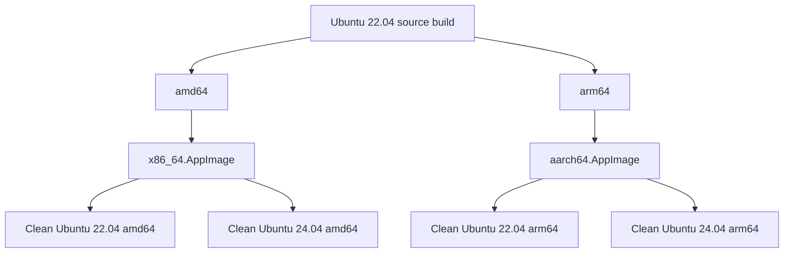

优先 native ARM64 builder。

cross toolchain 仅在确实 cross compile 时使用，不需要为了 amd64 / arm64 两个 native build 分别维护一套 toolchain file。

## 5.13 AppDir

```text
AppDir/
└── usr/
    ├── bin/
    │   └── rodaq
    │
    ├── lib/
    │   ├── librodaq.so
    │   ├── libtbb.so.12
    │   └── rodaq/
    │       └── plugins/
    │           ├── librodaq_acquisition_ros2.so
    │           ├── librodaq_acquisition_fastdds.so
    │           └── librodaq_storage_mcap.so
    │
    └── share/
        └── rodaq/
```

静态进入 RoDAQ：

```text
spdlog
fmt
HdrHistogram_c
yaml-cpp
expected-lite
mimalloc（若启用）
```

动态：

```text
librodaq.so
libtbb.so.12
plugin .so
plugin-specific shared libraries
```

不 bundle：

```text
glibc
dynamic loader
libm
libdl
pthread base runtime
```

## 5.14 Plugin Dependency Closure

因为 Plugin 通过：

```text
dlopen
```

加载，主程序 `DT_NEEDED` 不会自动覆盖插件依赖。

Packaging 必须扫描：

```text
usr/bin/*
usr/lib/librodaq*.so*
usr/lib/rodaq/plugins/*.so
```

递归处理：

```text
DT_NEEDED
RUNPATH
RPATH
```

CI 工具：

```text
readelf -d
readelf --version-info
objdump -p
lddtree
patchelf --print-rpath
```

Release Gate：

```text
no unresolved DT_NEEDED
no /home path
no build-tree RPATH
no accidental /usr/local
no too-new GLIBC
no too-new GLIBCXX
correct ELF architecture
no incompatible duplicate SONAME
```

## 5.15 ISA Baseline

禁止：

```text
-march=native
```

amd64 / arm64 都使用 generic baseline。

性能优化使用：

```text
runtime dispatch
```

或：

```text
specialized optional build
```

而不是破坏通用发行物兼容性。


## 5.16 Release Qualification

AppImage “能够在开发机运行”不等于 Release 合格。

每个 Release Artifact 必须通过：

```text
ELF qualification
dependency closure
clean-machine execution
Plugin load
functional smoke
stress subset
architecture verification
```

### 5.16.1 glibc Baseline

Release build 统一：

```text
Ubuntu 22.04
```

目的：

```text
将 GLIBC symbol requirement 压在最老支持发行版范围内
```

禁止：

```text
在 Ubuntu 24.04 构建 release
然后期望 Ubuntu 22.04 运行
```

因为：

```text
glibc backward compatibility
```

方向不是对称的。

### 5.16.2 GLIBC / GLIBCXX Gate

CI 必须提取：

```text
GLIBC_*
GLIBCXX_*
CXXABI_*
```

需求。

Release Gate：

```text
不得要求高于 Ubuntu 22.04 baseline 能提供的 symbol version
```

检查对象包括：

```text
main executable
librodaq.so
libtbb.so.12
all plugins
plugin-specific DSOs
```

### 5.16.3 Native ARM64 Qualification

QEMU 只适合：

```text
早期 smoke
```

正式 Release 优先使用：

```text
real aarch64 Linux runner
```

验证：

```text
plugin dlopen
threading
atomics
allocator
AppImage runtime
high-throughput subset
```

因为：

```text
QEMU 无法充分代表真实 memory ordering / performance / loader environment
```

### 5.16.4 System Library Exclusion

AppImage 不主动 bundle：

```text
glibc
ld-linux
libpthread base runtime
libdl
libm
```

但每个 Plugin-specific dependency 必须逐项审计。

不能简单使用：

```text
“所有 /usr/lib 都不打包”
```

因为 ROS2/DDS Plugin 可能有大量非-base shared library。

### 5.16.5 SONAME Collision

递归收集 DSO 时必须检测：

```text
same SONAME
different binary
```

例如：

```text
两个 Plugin 带入不同版本 libfoo.so.1

ROS2 Acquisition / rmw_fastrtps
    → ROS2-distributed Fast DDS / Fast CDR

FastDDS Acquisition
    → RoDAQ-pinned Fast DDS / Fast CDR
```

这可能在单 process namespace 中产生 symbol collision、ABI mismatch，或让一个 Plugin 实际绑定到另一套 dependency。

处理原则：

```text
统一版本
静态封装 Plugin-private dependency
symbol hide/localize
或拒绝该组合
```

不能只因为 AppDir 中“两个文件都存在”就认为正确。

### 5.16.6 RPATH / RUNPATH

禁止 Release Artifact 中出现：

```text
/home/*
/tmp/*
build/*
workspace/*
/usr/local/*
```

除非明确属于系统 lookup policy。

主程序：

```text
$ORIGIN/../lib
```

Plugin：

```text
$ORIGIN/../..
```

应由 CMake/packaging 自动设置和验证。

### 5.16.7 Clean-system Matrix

每个架构：

```text
Ubuntu 22.04 clean
Ubuntu 24.04 clean
```

至少验证：

```text
AppImage --version
Plugin inspection
Fake Plugin lifecycle
ROS2/MCAP smoke（对应 release flavor）
basic acquisition/storage
clean shutdown
```

### 5.16.8 Release Artifact

最终至少输出：

```text
rodaq-x86_64.AppImage
rodaq-aarch64.AppImage

THIRD_PARTY_NOTICES
SBOM
checksums
version manifest
```

推荐 manifest 记录：

```text
RoDAQ commit
dependency submodule commits
compiler
CMake
build distro
architecture
```


## 5.17 License 与 SBOM

Release 应包含：

```text
THIRD_PARTY_NOTICES
licenses/
SBOM
```

因为 third_party 全部通过 submodule 固定，生成依赖清单和 license inventory 会更简单、可追踪。

---

# 6. 开发实施与验证路线

RoDAQ V1 从本章开始只使用一套开发阶段编号：

```text
M0 — Foundation + Plugin ABI
M1 — Runtime Core Primitives
M2 — Fake End-to-End Runtime
M3 — ROS2 Acquisition + MCAP Storage Vertical Slice
M4 — FastDDS Acquisition + MCAP Interoperability
M5 — Production Hardening + Release Qualification
```

不再同时使用：

```text
Phase 1
Phase 2
...
```

作为第二套阶段编号。

`docs/development/plan.md` 必须与本章保持同一 Milestone 名称和 Gate 语义。两者职责不同：

```text
本文
    → 冻结 V1 的阶段边界、交付物和 Exit Gate

docs/development/plan.md
    → 记录当前执行状态、任务勾选和下一步
```

Milestone 只有满足 Exit Gate 后才允许切换为下一阶段。

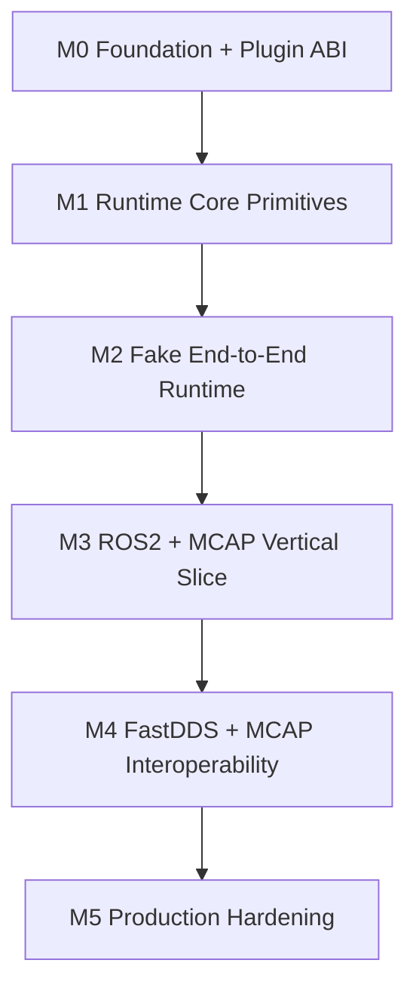

---

## 6.1 M0 — Foundation + Plugin ABI

### Goal

建立 RoDAQ 可构建、可测试、可安装的工程基础，并把后续所有真实 Plugin 都依赖的 Binary Boundary 落成代码和机械 ABI Gate。

M0 解决：

```text
项目如何构建
依赖如何冻结
Plugin 如何加载
Plugin ABI 如何演化
Runtime / Plugin 如何交换 Config、Service、Canonical handle
Plugin instance / DSO 如何安全销毁
```

M0 不实现完整 Runtime Data Plane。

### Prerequisites

进入 M0 前：

```text
V1 system design baseline 已存在
Plugin System Freeze Candidate 已完成 Contract reconciliation
Acquisition / Storage generic Plugin docs 已与 Plugin System 对齐
ROS2 / FastDDS / MCAP required mapping docs 已映射 Stable ABI；SQLite3 future mapping 已用于 architecture-validation review
AGENTS.md + docs/development/* 共享上下文机制已建立
```

依赖和目标平台基线：

```text
C++17
GCC 11.x
Ubuntu 22.04 build baseline
Ubuntu 22.04 / 24.04 runtime
amd64 / arm64
```

### Scope

工程基础：

```text
top-level CMakeLists.txt

include/
src/
apps/
tests/
benchmarks/
cmake/
third_party/

install/export/package skeleton
warning/sanitizer options
test integration
```

Dependency Qualification：

```text
required:
spdlog 1.17.0
fmt 12.1.0
HdrHistogram_c 0.12.1
yaml-cpp 0.9.0
expected-lite 0.10.0 as Public C++ Result alias dependency

evaluated, not selected:
oneTBB 2022.3.0
mimalloc 3.6.1

development:
GoogleTest 1.18.0
Google Benchmark 1.10.0
```

每个依赖必须单独记录 `PINNED / BUILT / LINKED / USED / QUALIFIED` 状态。仅存在
submodule 不能算作 build、runtime usage 或 qualification 完成。

第三方依赖必须：

```text
Git submodule pinned by commit
no build-time network fetching
no third-party types in Stable ABI
no third-party types in Public C++ API except the D-025 Result alias
```

Result / Error：

```text
finalize rodaq::Result<T>
freeze public error semantics
force expected-lite nonstd implementation
keep expected-lite out of Stable ABI
```

Stable ABI headers：

```text
common.h
canonical.h
plugin.h
service.h
config.h
runtime.h
acquisition.h
storage.h
```

Plugin infrastructure：

```text
SharedLibrary
PluginLibrary
PluginCatalog
PluginManager

AcquisitionPluginInstance
StoragePluginInstance

PluginLibraryLease
PluginInstanceLease

Service Registry
ConfigView
Plugin Interface Query

C++17 Plugin SDK
exception trampolines
Plugin authoring CMake helper
Plugin metadata generation
symbol visibility / export allowlist
```

Fake DSO skeleton：

```text
minimal Fake Acquisition Plugin
minimal Fake Storage Plugin
```

只用于：

```text
load
validate
create
bind
configure
destroy
```

不要求 M0 完成真正的数据流。

### Deliverables

M0 完成时仓库至少包含：

```text
buildable project skeleton

pinned third_party dependencies

rodaq::Result / Error

complete V1 ABI headers

ABI layout sentinels

Plugin symbol export tests

SharedLibrary / PluginLibrary / PluginManager

Service Registry

ConfigView

minimal C++ Plugin SDK

Fake Acquisition DSO

Fake Storage DSO

Plugin CMake authoring helper

initial ABI compatibility baseline
```

必须能够：

```text
configure
build
install
load valid fake Plugin
reject invalid fake Plugin
cleanly destroy/unload
```

### Verification

Dependency/platform：

```text
Ubuntu 22.04 amd64 build
Ubuntu 24.04 runtime smoke

native arm64:
    DEFERRED according to D-034
    not treated as PASS
    not replaced by x86_64 cross-compilation evidence

conditional oneTBB init/shutdown smoke when an optional target links it
dlopen/dlclose smoke
```

ABI：

```text
headers compile as C
headers compile as C++

sizeof
alignof
offsetof
MIN_STRUCT_SIZE

wrong Boot ABI rejected
wrong family protocol rejected
too-small struct_size rejected
missing mandatory symbol rejected
duplicate Plugin ID rejected
symbol provenance checked
unexpected export detected
```

Service / Config：

```text
required Service present
required Service missing
optional Service missing
service protocol mismatch

ConfigView MAP/LIST/scalar
exact-type conversion
NOT_FOUND
invalid-type access
ConfigView lifetime

required rodaq.acquisition.control.v1 present / protocol / minimum-prefix / required-slot validation
required rodaq.storage.control.v1 present / protocol / minimum-prefix / required-slot validation

Runtime lifecycle snapshot:
    bounded query
    RUNNING + normal_acquisition_allowed gates recovery
    stale snapshot does not override later Runtime state

Binding abort:
    KEEP_PAUSED
    RESUME_OLD only for Runtime-proven valid old Binding
    initial Binding + RESUME_OLD rejected

Plugin-wide quiesce:
    blocks all current/future Submit routing
    preserves native capability required by Runtime-owned Payload anchors
```

The M0 gate verifies that the Stable ABI and required interfaces can represent
these states and operations unambiguously. Proof of the corresponding ownership
transfer, Binding routing, Stop/quiesce, timeout and asynchronous completion
behavior belongs to M1/M2. Moving behavioral proof to those milestones does not
weaken or remove any M0 Exit Gate requirement below.

Acquisition ABI 必须证明可以表达：

```text
AdmissionOutcome
RejectionReason
PayloadDisposition
```

且：

```text
rejection reason never implies ownership

ADOPT / RETAIN:
    before transfer/acquisition point
        → CallerResponsible

    after transfer/acquisition point
        → RuntimeResponsible
```

Storage ABI 必须证明可以独立表达：

```text
HandoffAccepted boundary

Payload:
    Pending
    Consumed

Persistence:
    Pending
    Succeeded
    Failed
    Unknown
```

并验证：

```text
synchronous terminal axis
async pending axis
no same-stack reentrant async callback; cross-thread race with submit return is supported
async publication only after irreversible OK + matching PENDING decision
early completion buffered until submit return/reconcile
no Payload/operation reclamation before current submit call can no longer access it
```

C++ SDK：

```text
std::exception converted
unknown exception converted
no exception crosses C ABI
```

Lifetime：

```text
live Plugin instance prevents unload
live PluginLibraryLease prevents dlclose
live PluginInstanceLease prevents instance destroy
```

Sanitizer：

```text
relevant M0 ASan
relevant M0 UBSan
```

### Exit Gate

M0 只有同时满足以下条件才 PASS：

```text
[PASS] repository builds from clean checkout with pinned submodules

[PASS] ABI headers compile in C and C++

[PASS] ABI layout/symbol tests pass, including every V1 APPENDABLE minimum-prefix constant and required-slot rule

[PASS] Runtime Common log/diagnostic scalar values and lifecycle snapshot ABI are frozen/tested

[PASS] required Acquisition/Storage control interfaces pass protocol/minimum-prefix/required-slot tests

[PASS] valid Fake Acquisition lifecycle:
       load → create → bind → configure → destroy → unload

[PASS] valid Fake Storage lifecycle:
       load → create → bind → configure → destroy → unload

[PASS] invalid ABI / protocol / symbol cases fail cleanly

[PASS] Service Registry and ConfigView conformance tests pass

[PASS] Acquisition SubmitResult ABI represents the three orthogonal dimensions

[PASS] Storage dual-axis submit/completion ABI is testable without ambiguity

[PASS] Plugin exception firewall works

[PASS] DSO lease tests show no premature unload

[PASS] no unresolved P0/P1 Plugin ABI design conflict remains
```

只有 M0 PASS 后，ABI core prefix 才进入 implementation freeze。

### Out of Scope

M0 不实现：

```text
full ResourceBudget / Admission
full PayloadPool
Runtime Dispatch Pipeline
Completion Domain
real ROS2 subscription
real DDS DataReader
MCAP file writing
SQLite3 persistence
10-camera performance optimization
hot reload
```

---

## 6.2 M1 — Runtime Core Primitives

### Goal

实现 Runtime correctness 所依赖的最小、可组合、有界 primitive，并通过单元/压力测试证明：

```text
resource boundedness
stable identity
reservation rollback
Payload lifetime
Stop-interruptible waiting
```

M1 仍不要求完整 E2E Pipeline。

### Prerequisites

必须：

```text
M0 == PASS

Plugin ABI headers frozen for implementation

Result / Error available

build/test/sanitizer infrastructure available
```

### Scope

实现：

```text
Handles
Registry
Structural Arena

ResourceBudget
Reservation
Admission Gate generation

Payload
PayloadView
PayloadPool

RuntimeRecord

RuntimeStats
LatencyHistogram

Logger facade
```

M1 ResourceBudget 覆盖 RuntimeRecord slots 与 logical Payload bytes；
PayloadPool 独立约束 physical block count / bytes。Dispatch slots、
completion bookkeeping 与 Storage inflight 维度随其对应的 M2 机制一起引入，
并在引入时遵守同一 all-or-nothing reservation / reverse rollback 规则。

Reservation：

```text
all-or-nothing
fixed reservation order
reverse rollback
rollback cannot fail
```

Wait：

```text
Reject
or
interruptible Wait

deadline
Gate generation
Binding validity
Runtime state
Stop / Failure wakeup
```

Payload：

```text
Copy
Adopt
Retain

contiguous immutable V1 physical representation

external retained memory charged to budget
```

Structural state：

```text
activation-lifetime immutable objects
bounded arena
no runtime reclamation complexity
```

### Deliverables

```text
bounded Registry

stable Handle implementation

Structural Arena implementation

ResourceBudget API + implementation

Reservation object

Admission Gate primitive

Payload ownership implementation

PayloadPool

RuntimeRecord representation

metrics counters / high-water marks

latency histogram wrapper

unit tests
stress tests
sanitizer targets
```

### Verification

Handle / Registry：

```text
capacity exhaustion
invalid handle
stale/invalid lookup behavior
no accidental handle reinterpretation
```

ResourceBudget：

```text
single resource exhaustion
multi-resource partial acquisition rollback
concurrent waiters
timeout
Stop wakeup
Failure wakeup
high-water correctness
```

Reservation：

```text
all-or-nothing
fixed ordering
reverse rollback
no leaked permit after failure
```

Payload：

```text
Copy lifetime
Adopt before/after transfer point
Retain before/after acquisition point
exactly-once release
external retained byte accounting
large Payload rejection
Payload object exhaustion
```

PayloadPool：

```text
bounded chunk count
bounded bytes
no unlimited fallback bypassing ResourceBudget
size-class benchmark baseline
```

Concurrency：

```text
ASan
UBSan
TSan on concurrency-critical tests
```

### Exit Gate

M1 PASS 要求：

```text
[PASS] all configured resources are measurably bounded

[PASS] Reservation rollback cannot fail and leaks no permit

[PASS] Stop/Failure wakes all Wait paths

[PASS] no Wait path can sleep forever after Gate generation changes

[PASS] Payload Copy / Adopt / Retain lifetime tests pass

[PASS] external retained memory is accounted

[PASS] Registry/Handle tests pass

[PASS] required ASan/UBSan/TSan suite is clean

[PASS] no correctness primitive depends on ROS2/DDS/MCAP/SQLite3 type
```

### Out of Scope

M1 不实现：

```text
full Acquisition-to-Storage pipeline
Storage submit/completion processing
real Plugin data path
real backend integration
production performance tuning
```

---

## 6.3 M2 — Fake End-to-End Runtime

### Goal

把 M0 的 Plugin Boundary 与 M1 的 Runtime primitives 串成完整可运行的：

```text
Acquisition
    ↓
Admission
    ↓
Payload
    ↓
Accepted publication
    ↓
Dispatch
    ↓
Storage
    ↓
Payload / Persistence completion
    ↓
Resource release
```

并且在没有 ROS2、DDS、MCAP、SQLite3 干扰的情况下证明 Runtime 的核心 correctness invariant。

### Prerequisites

必须：

```text
M0 == PASS
M1 == PASS
```

此外：

```text
Fake Plugin ABI skeleton 可加载
ResourceBudget / Payload primitives 已完成
```

### Scope

Runtime Pipeline：

```text
Binding validation
Ingress
Admission
Payload materialization
Gate Pass
AcceptanceSequence
ordered publication
Dispatch Queue
single logical Storage Dispatch Lane
Storage operation tracking
Completion Queue
Completion Domain
Stop
Failure cutoff
quiescence
```

Fake Acquisition 必须支持：

```text
single producer
multiple producers

single Stream
multiple Streams

descriptor change

Copy
Adopt
Retain

CallerResponsible
RuntimeResponsible

burst
high-rate
out-of-order producer timing
blocked Admission Wait
Stop while submitting
```

Standard core-capacity profiles：

```text
10 cameras × 1280×720 × 30 FPS
    encoded camera profile
    raw RGB8 profile for stress baseline

100 joints × 100 parameters × 1 kHz
    production qualification: aggregated RobotState Record, 1k records/s
    small-record stress: per-joint Record, 100k records/s

mixed camera + joint telemetry profile
```

这些 Fake benchmark 不需要真实 MCAP 或 ROS2，但必须使用与正式 profile 相同的
payload bytes、Stream 数量、record rate、timestamp count 和配置容量。真实
backend + filesystem qualification 属于 M3/M4/M5。

Shared runtime foundation closure：

```text
bounded Runtime LoggingContext + spdlog/fmt backend
Plugin common log/diagnostic routed through Runtime
yaml-cpp ConfigLoader -> RoDAQ ConfigTree/ConfigView
explicit dependency lifecycle state: PINNED/BUILT/LINKED/USED/QUALIFIED
reference-driven implementation audit records
```

Fake Storage 必须支持：

```text
submit return non-OK before HandoffAccepted

PayloadConsumed synchronous
PayloadPending async

PersistenceSucceeded synchronous
PersistenceFailed synchronous
PersistenceUnknown synchronous

PersistencePending async
    → Succeeded
    → Failed
    → Unknown

independent Payload/Persistence callback ordering

delayed PayloadConsumed
delayed Persistence completion

Storage stall
background fatal failure
flush
close

duplicate callback
missing callback
same-stack reentrant callback
callback after close
```

### Deliverables

```text
Runtime pipeline implementation

Binding / activation path

Admission integration

AcceptanceSequence generation

Dispatch Queue integration

Storage Dispatch Lane

operation tracking

Completion Domain

Stop / Failure convergence

Fake Acquisition implementation

Fake Storage implementation

end-to-end correctness tests

stress tests
```

### Verification

Admission：

```text
GateClosed
ResourceUnavailable
WaitTimeout
Stop while waiting
Binding invalidation while waiting
```

必须证明：

```text
Gate Pass 前:
    reject / timeout / rollback allowed

Gate Pass 后:
    ordinary resource pressure cannot silently drop Accepted Record
```

Ordering：

```text
same Stream:
    AcceptanceSequence order
    ==
    Storage handoff order

different Streams:
    no false global-order guarantee
```

Payload：

```text
Copy exact bytes

Adopt:
    CallerResponsible before transfer
    RuntimeResponsible after transfer

Retain:
    CallerResponsible before acquisition
    RuntimeResponsible after acquisition

Plugin-origin anchor prevents premature instance destroy
```

Storage Handoff：

```text
submit non-OK
    → no HandoffAccepted
    → no retained Runtime Payload access
    → no normal callback

submit OK
    → HandoffAccepted
```

Payload axis：

```text
PAYLOAD_CONSUMED
    → no callback

PAYLOAD_PENDING
    → exactly one payload_consumed()
```

Persistence axis：

```text
terminal in result
    → no callback

PERSISTENCE_PENDING
    → exactly one persistence_completed()
```

关键组合：

```text
PayloadConsumed
+
PersistencePending
```

必须证明：

```text
large Payload backing released immediately
persistence bookkeeping remains valid
```

Contract violations：

```text
duplicate callback
callback for synchronous-terminal axis
unknown operation
same-stack reentrant callback
callback after close
```

都必须被检测。

Stop / Failure：

```text
multi-producer Stop
blocked Admission Stop
Storage stall
PayloadPending during Stop
PersistencePending during Stop
fatal Storage failure
secondary cleanup failure
```

必须证明：

```text
primary error preserved
secondary errors separately reported
no callback after destroy
no DSO unload while Plugin code can still execute
```

Standard core capacity：

```text
per-joint joint telemetry
    sustains >= 100k accepted records/s

aggregated RobotState telemetry
    sustains >= 1k accepted records/s

camera profiles
    sustain 10 × 30 FPS offered schedule for the configured payload profile

mixed profile
    accepted camera + joint offered workload
    no steady-state unbounded high-water growth
    no WaitTimeout under the declared finite capacity
    no silent Accepted Record drop
```

必须记录 acceptance throughput、payload bytes/s、copy bytes/record、allocation
count/record、Admission wait、PayloadPool class high-water、Dispatch high-water、
Completion high-water、CPU/RSS 和 P50/P95/P99/P99.9。

### Exit Gate

M2 PASS 要求：

```text
[PASS] Gate-pass Accepted no-drop invariant proven under saturation

[PASS] per-Stream ordering invariant proven

[PASS] all Reservation / Payload / Record permits converge to zero after Stop

[PASS] Payload axis exactly-once rules pass

[PASS] Persistence axis exactly-once rules pass

[PASS] PayloadConsumed + PersistencePending releases Payload early

[PASS] duplicate / inline / post-close completion violations are detected

[PASS] Stop reaches quiescence under concurrent producers and Storage stall

[PASS] failure path preserves primary/secondary error distinction

[PASS] Plugin-origin Payload/operation prevents premature instance/DSO destruction

[PASS] standard camera, joint and mixed Fake capacity profiles meet their declared
       record-rate, payload-rate and bounded high-water gates

[PASS] bounded logging flush/shutdown and Plugin logging integration pass

[PASS] YAML configuration frontend produces RoDAQ-owned ConfigView

[PASS] dependency lifecycle and reference-audit evidence are complete for all
       components claimed by the milestone

[PASS] required ASan/UBSan/TSan stress suite is clean
```

### Out of Scope

M2 不实现：

```text
ROS2
FastDDS
MCAP
SQLite3（future）

AppImage release qualification
final backend/filesystem performance tuning
```

---

## 6.4 M3 — ROS2 Acquisition + MCAP Storage Vertical Slice

### Goal

在已经通过 Fake E2E 证明的 Runtime 上实现首条真实生产链路：

```text
ROS2
    ↓
ROS2 Acquisition Plugin
    ↓
RoDAQ Runtime
    ↓
MCAP Storage Plugin
    ↓
MCAP Artifact
```

目标是验证：

```text
Canonical abstraction
Plugin ABI
Runtime contract
real middleware
real storage format
```

可以共同成立，而不是在 M3 重新设计 Runtime。

### Prerequisites

必须：

```text
M0 == PASS
M1 == PASS
M2 == PASS
```

并且：

```text
ROS2 mapping doc current ABI mapping reviewed
MCAP mapping doc current ABI mapping reviewed
direct pinned mcap-cpp version/commit identified; Humble rosbag2/mcap_vendor retained only as interoperability reference
```

### Scope

ROS2 Acquisition：

```text
Plugin create/bind/configure/start/stop

ROS graph discovery

Source mapping
Clock mapping
Schema mapping
Stream mapping
StreamDescriptor publication

QoS/config parsing through ConfigView

serialized payload acquisition

initial Copy path

Retain/loaned path only if concrete RMW capability and lifetime proof justify it

callback quiescence
failure reporting
```

MCAP Storage：

```text
Plugin create/bind/configure/open/submit/flush/close

Canonical Schema → MCAP Schema
Canonical StreamDescriptor → MCAP Channel
Record → MCAP Message

checked sink

bounded metadata batch

RecordMetadata sidecar

Payload lifetime validation

Persistence completion by batch

Artifact finalization
crash/recovery rules required by mapping document
```

首个 MCAP path 推荐：

```text
submit() == OK

payload_state
    = PAYLOAD_CONSUMED

persistence_state
    = PERSISTENCE_PENDING

later batch commit
    → persistence_completed(SUCCEEDED/FAILED/UNKNOWN)
```

### Deliverables

```text
ROS2 Acquisition Plugin .so

MCAP Storage Plugin .so

Plugin manifests

backend-specific CMake targets

ROS2 → RoDAQ → MCAP executable integration path

functional test fixtures

round-trip validation tooling

initial benchmark profile

AppImage development smoke artifact
```

### Verification

ROS2：

```text
single publisher
multiple publishers same Stream
publisher disappear/reappear
schema/type identity
source sequence sentinel
timestamp mapping
Copy exact bytes
GateClosed / ResourceUnavailable / WaitTimeout submit results
Stop while callbacks active
```

必须直接断言：

```text
Accepted Copy:
    rodaq_status == OK
    outcome == ACCEPTED
    rejection_reason == NONE
    payload_disposition == NOT_APPLICABLE
```

MCAP：

```text
Header.profile = ros2
Ros2Projection → Schema / Channel mapping
descriptor evolution
same-Stream ordering
payload exactness
metadata sidecar pairing
bounded metadata batch
flush
close
failure injection
```

Interoperability：

```text
ros2 bag info / play
PlotJuggler direct open + field decode
Foxglove direct open + field decode
RoDAQ full-fidelity decode
```

至少覆盖 `std_msgs/String`、`sensor_msgs/Imu`、`sensor_msgs/Image`、`sensor_msgs/PointCloud2`、`sensor_msgs/JointState`、`tf2_msgs/TFMessage` 与一个 nested custom message。

Payload lifetime：

```text
McapWriter::write(Message)
    returns
        ↓
submit_result.payload_state == PAYLOAD_CONSUMED
        ↓
Runtime source buffer may be immediately reused
        ↓
MCAP bytes remain exact
```

Persistence：

```text
submit_result.persistence_state == PERSISTENCE_PENDING

batch commit
    → exactly one persistence_completed()
```

Round trip：

```text
logical payload bytes equal
Canonical metadata projection verified
AcceptanceSequence preserved
timestamp roles preserved
```

### Exit Gate

M3 PASS 要求：

```text
[PASS] ROS2 → Runtime → MCAP functional vertical slice works

[PASS] no ROS2 / rclcpp / RMW type leaks into Runtime Core public contracts

[PASS] no MCAP type leaks into Runtime Core public contracts

[PASS] canonical Source/Clock/Schema/Stream/Descriptor mapping validated

[PASS] payload logical bytes round-trip exactly

[PASS] produced MCAP uses the ROS2 MCAP profile and complete ros2msg/ros2idl + cdr projection

[PASS] `ros2 bag info` and `ros2 bag play` qualification passes for the frozen ROS2 baseline

[PASS] PlotJuggler and Foxglove qualification fixtures decode expected fields/timeline

[PASS] ROS2 Stop quiescence passes under active callbacks

[PASS] MCAP PayloadConsumed lifetime test passes for frozen mcap-cpp version

[PASS] MCAP PersistencePending → batch completion exactly-once passes

[PASS] descriptor/sidecar pairing survives required failure/recovery tests

[PASS] initial throughput/CPU/RSS/latency baseline is recorded
```

### Out of Scope

M3 不实现：

```text
FastDDS Acquisition（进入 M4）
SQLite3 Storage implementation
final production tuning
final arm64/amd64 AppImage release qualification
live hot reload
```

---

## 6.5 M4 — FastDDS Acquisition + MCAP Interoperability

### Goal

在不修改已冻结 Runtime / Canonical / Plugin 基础 contract 的前提下，实现第二条 V1 Acquisition path：

```text
External ROS2 / rmw_fastrtps
        ↓ DDS / RTPS wire
FastDDS Acquisition Plugin
        ↓
RoDAQ Runtime
        ↓
MCAP Storage Plugin
        ↓
ROS2-profile MCAP
```

FastDDS Plugin 的核心目标不是依赖 ROS2 API 重做一遍 ROS2 Acquisition，而是：

```text
implementation dependency:
    Fast DDS + Fast CDR

engineering reference:
    eProsima DDS-Pipe
    eProsima DDS Record & Replay

ROS2 runtime dependency:
    none

external compatibility target:
    ROS2-compatible DDS pub/sub traffic
```

同时必须证明 ROS2 Acquisition 与 FastDDS Acquisition 对相同 ROS2 数据源产生等价的外部 ROS2 projection，并由同一个 MCAP Storage path 输出可播放 Artifact。

### Prerequisites

```text
M3 == PASS
FastDDS mapping doc reviewed against frozen Fast DDS/Fast CDR versions
DDS-Pipe / DDS Record & Replay source-reference audit complete for reused mechanisms
```

### Scope

FastDDS Acquisition：

```text
DomainParticipant / discovery / DataReader lifecycle
ROS2 DDS topic-name normalization
XTypes TypeIdentifier / TypeObject / DynamicType resolution
ROS2 type-name reconstruction
complete ros2idl / ros2msg schema projection
serialized CDR acquisition without per-sample DynamicData decode/re-encode
Writer GUID source identity
publication / reception timestamp extraction
Writer QoS → Ros2Projection offered QoS
bounded pending-type / discovery state
listener/worker quiescence
failure/recovery
```

Control Plane 与 Data Plane 必须分离：

```text
Control Plane:
    discovery + TypeObject + schema/projection construction

Data Plane:
    serialized CDR + cached handles + timestamps + SourceId
```

V1 FastDDS normal path 不接收 arbitrary Generic DDS stream。无法证明 ROS2-compatible topic/type/schema/CDR projection 的 flow 在 Descriptor readiness 阶段 Unsupported；Generic DDS 作为后续 Acquisition capability 设计。

### Cross-Acquisition Equivalence

对同一 ROS2 publisher corpus，分别通过 ROS2 Acquisition 与 FastDDS Acquisition 记录，至少比较：

```text
normalized StreamName
ROS2 TypeIdentifier
schema logical content / dependency closure
payload bytes
serialization format
QoS projection
source identity semantics
timestamp semantics
MCAP Schema / Channel semantics
playback-visible behavior
```

内部 Canonical IDs 不要求数值相同，但外部 ROS2 interpretation 必须等价。

### Interoperability Qualification

两条 Acquisition path 产生的正式 MCAP 都必须通过：

```text
MCAP structural validation
RoDAQ Canonical round-trip
ros2 bag info
ros2 bag play + subscriber verification
PlotJuggler direct open + decoded field verification
Foxglove direct open + decoded field verification
```

测试 baseline 至少覆盖 Ubuntu 22.04 / ROS2 Humble；Jazzy qualification 在依赖基线允许时纳入 release matrix。FastDDS recording host 本身必须能在没有 `/opt/ros` 的环境运行。

### Exit Gate

```text
[PASS] FastDDS Acquisition integrates without ROS2 runtime dependency
[PASS] no Fast DDS / Fast CDR type leaks into Runtime Core public contracts
[PASS] serialized CDR hot path avoids mandatory per-record deserialize/re-serialize
[PASS] DynamicTypes / TypeObject path reconstructs complete ROS2 schema for qualification corpus
[PASS] FastDDS → Runtime → MCAP passes ros2 bag play / PlotJuggler / Foxglove qualification
[PASS] ROS2 Acquisition vs FastDDS Acquisition equivalence suite passes
[PASS] FastDDS Stop/quiescence and dynamic publisher lifecycle tests pass
[PASS] clean non-ROS2 recording-host dependency audit passes
```

### Out of Scope

```text
Generic DDS recording mode
ROS2 service/action recording
SQLite3 Storage implementation
DDS routing / forwarding / replay subsystem
```

---

## 6.6 M5 — Production Hardening + Release Qualification

### Goal

把已经通过 ROS2 + FastDDS + MCAP 功能与 interoperability qualification 的系统推进到：

```text
bounded
measured
stress-tested
failure-tested
release-qualified
```

状态。任何性能优化都必须有 benchmark evidence，并且不得削弱 correctness、interoperability 或 Plugin ABI contract。

### Prerequisites

```text
M4 == PASS
```

### Scope

Correctness / stress：

```text
ASan / UBSan / TSan
repeated load/unload
Stop/failure stress
long soak
MCAP failure injection
cross-acquisition regression
```

Performance：

```text
production: 10 cameras × 30 FPS × 1280×720 encoded profile
stress: raw RGB8 10-camera profile
production: 100 joints × 100 parameters × 1 kHz aggregated RobotState telemetry
stress: 100 joints × 100 parameters × 1 kHz per-joint Records
production mixed: encoded camera + aggregated RobotState
stress mixed: raw RGB8 camera + per-joint joint Records
PayloadPool / queue / batching tuning
copy count / allocation count / CPU / RSS / tail latency
minimum 30–60 minute mixed workload soak
```

Interoperability regression：

```text
ros2 bag play
PlotJuggler
Foxglove
RoDAQ validator
```

Release：

```text
x86_64 + aarch64
Ubuntu 22.04 / 24.04 clean systems
GLIBC / GLIBCXX / CXXABI gates
RPATH / RUNPATH / recursive DT_NEEDED closure
AppImage contents and Plugin dependency closure
FastDDS-only deployment without ROS2 runtime
SBOM / licenses / checksums / release manifest
```

### Exit Gate

```text
[PASS] sanitizer and long-soak suites are clean
[PASS] all bounded-resource high-water marks are verified
[PASS] camera, joint and mixed-workload benchmarks meet their declared production
       and stress-profile gates; recording a lower baseline is not a substitute
[PASS] failure/crash matrix preserves deterministic quiescence and artifact status
[PASS] ROS2 and FastDDS interoperability qualification remains green after tuning
[PASS] x86_64 and aarch64 release qualification passes
[PASS] FastDDS recording-host package has no ROS2 runtime dependency
[PASS] SBOM/license/release manifest produced
```

### Out of Scope

```text
SQLite3 implementation
SocketCAN implementation
Generic DDS implementation
additional Storage formats
runtime hot reload
Plugin process sandboxing
```

SQLite3 / SocketCAN / additional backends remain design-validation targets for extensibility, but they do not participate in V1 release completion.

---

## 6.7 Milestone Transition Rules

### 单一 Active Milestone

任意时刻：

```text
docs/development/plan.md
```

只能有一个：

```text
ACTIVE
```

Milestone。

后续 Milestone 可以做：

```text
research
small feasibility experiment
```

但不得在前置 Exit Gate 未通过时被标记为正式实施阶段。

### Exit Gate 优先于任务勾选

Milestone 中：

```text
所有 checkbox 完成
```

不自动等于 PASS。

必须：

```text
Exit Gate evidence exists
```

例如：

```text
build log
test result
sanitizer result
benchmark result
artifact qualification result
```

### Partial Completion

如果任务实现了但没有运行验证：

```text
Implemented
```

不应写成：

```text
PASS
Done
```

`status.md` 必须区分：

```text
implemented
compiled
unit-tested
integration-tested
sanitizer-tested
release-qualified
```

### Design Conflict

实现过程中如果发现：

```text
frozen ABI 无法表达必要语义
Canonical contract self-contradictory
Accepted invariant impossible to maintain
lifetime cannot be proven
```

不得：

```text
在代码中偷偷改变 contract
```

必须回到对应 Design Specification 重新评审。

---

## 6.8 System Verification Matrix

最终系统验证不能只按模块测试，而必须按跨模块 invariant 验证。

| 场景 | 必须证明的系统性质 |
|---|---|
| Queue saturation | Gate Pass 前 Wait/Reject；Accepted 不因普通压力丢失 |
| Payload exhaustion | memory bounded；Wait 可被 Stop/Failure 中断 |
| Storage stall | pressure 通过 Storage inflight / ResourceBudget 传播到 Admission |
| Multi-producer same Stream | per-stream AcceptanceSequence / handoff order 不破坏 |
| Multi-stream | 不错误承诺 global total order |
| Plugin Stop under load | callback quiescence |
| Adopt/Retain pre-transfer reject | CallerResponsible 正确 |
| Adopt/Retain post-transfer reject | RuntimeResponsible 且 exactly-once release |
| PayloadPending | exactly-one `payload_consumed()` |
| PersistencePending | exactly-one `persistence_completed()` |
| PayloadConsumed + PersistencePending | Payload 可提前释放，persistence bookkeeping 保持 |
| Duplicate Storage completion | contract violation 被检测 |
| Same-stack reentrant completion | contract violation 被检测；cross-thread race 正确 reconcile |
| Storage fatal failure | 当前 Session 确定收敛，不污染下一 Session |
| Plugin-origin retained Payload | Instance / DSO 不提前销毁 |
| AppImage Plugin load | recursive DT_NEEDED closure 正确 |
| ARM64 | 无 accidental x86-specific ISA / unsupported atomic/runtime dependency |

---

## 6.9 Standard Camera / Joint Telemetry 性能验收

基准场景：

```text
10 cameras
× 30 FPS
× 1280×720
```

不能只写：

```text
720P
```

而必须在 benchmark profile 中记录：

```text
payload encoding
average payload bytes
timestamp count
Stream count
Storage backend
batch settings
disk model / filesystem
```

### Encoded Image Profile

Production camera profile 使用 source-native encoded Payload，例如：

```text
JPEG / compressed image
```

重点：

```text
record rate
real MB/s
allocator overhead
queue contention
Storage batching
tail latency
```

Encoded payload 的 codec、average/max bytes、timestamp count 和 batching 配置属于
deployment profile，必须在运行前固定并记录。不能只写“encoded”而不记录实际
bytes。

### Raw Image Stress Profile

RGB8：

```text
1280 × 720 × 3
≈ 2.64 MiB/frame
```

理论 Payload rate：

```text
2.64 MiB
× 30
× 10
≈ 792 MiB/s
```

该场景用于：

```text
memory pressure
copy cost
PayloadPool
disk throughput ceiling
backpressure
```

它不是对所有实际 camera deployment 的默认持续带宽假设。

### Joint Telemetry Profile

标准关节遥测配置：

```text
100 joints
× 100 parameters per joint
× 1 kHz
```

首个 benchmark baseline 使用 binary64 parameters。映射必须明确记录粒度：

```text
Production qualification — Aggregated RobotState Record
    1,000 records/s
    100 × 100 × 8 B = 80,000 B payload/record
    approximately 76 MiB/s payload

Small-record stress — Per-joint Record
    100,000 records/s
    100 × 8 B = 800 B minimum payload/record
    approximately 76 MiB/s payload
```

Parameter-level Record 不属于 V1 标准映射：

```text
10,000,000 records/s
```

该粒度会让参数编码与消息 lifecycle 主导系统，通常应保留在 source-native
JointState/RobotState Payload 或 Schema 内部。必须报告与 camera profile 相同的
throughput、copy、allocation、CPU/RSS、Admission wait、queue/payload high-water
和 tail-latency 指标。

必须报告：

```text
accepted throughput
stored throughput

CPU total
RSS

copy bytes / record
allocation count / record

P50
P95
P99
P99.9

Admission wait
Payload HWM
Dispatch HWM
Storage inflight HWM
```

### Standard Generated-Workload Gate

V1 standard profile 的固定门限：

```text
camera offered record rate
    10 × 30 = 300 records/s

joint production profile (aggregated RobotState)
    >= 1,000 accepted records/s

joint small-record stress profile (per-joint)
    >= 100,000 accepted records/s

mixed profile
    encoded camera + aggregated joint production profile

mixed small-record stress profile
    raw camera + per-joint joint profile
```

steady-state qualification 必须满足：

```text
all offered Records are Accepted
no Admission WaitTimeout or configured rejection
all Accepted Records reach terminal completion
queue/PayloadPool high-water does not grow without bound
Stop drains to quiescence within the configured deadline
```

Encoded camera 是 production qualification；Raw RGB8 是 stress qualification，
使用固定 2.64 MiB/frame value，并要求 reference filesystem/device 的持续写能力
高于实测 aggregate payload rate。未达到计算出的持续带宽时，该硬件 profile
必须 FAIL，不能以降级丢 Record 代替。

---

## 6.10 Crash / Failure Matrix

至少覆盖：

```text
Acquisition Plugin failure

Storage open failure
Storage submit failure before HandoffAccepted

PayloadPending callback failure/race
PersistencePending completion failure

Storage background fatal failure

disk full
permission error
target path disappeared

Stop during Admission Wait
Stop during PayloadPending
Stop during PersistencePending

flush failure
close failure

secondary cleanup failure
```

检查：

```text
primary error preserved
secondary errors separately reported

no double release
no callback after close/destroy
no DSO premature unload

Runtime resource counters converge

new Session remains possible
unless process-wide invariant corruption occurred
```

---

## 6.11 Mixed Workload

除纯 Camera 外，必须测试：

```text
high-rate image
+
high-rate IMU
+
joint state
+
TF-like small messages
+
CAN-like small frames
```

V1 production mixed profile：

```text
10 × 1280×720 × 30 FPS encoded camera
+
100 joints × 100 parameters × 1 kHz aggregated RobotState telemetry
```

V1 还必须运行 raw RGB8 + per-joint small-record stress 版本。必须记录 Joint
Telemetry 的实际 Record 粒度、payload bytes、Stream count、timestamp count、
Storage batching、磁盘模型和文件系统。不能只报告总 records/s 或总 payload
MB/s。

目的：

```text
防止大 Payload monopolize ResourceBudget

验证 tiny-message object pressure

验证不同 Stream workload 下的
throughput / fairness / tail latency
```

ResourceBudget 不能只针对 camera 大包调优。

---

## 6.12 Benchmark Decision Rules

Benchmark 的作用是决定实现，而不是展示数字。

适用于：

```text
oneTBB queue
alternative queue

PayloadPool size class

mimalloc on/off

dispatch capacity

batch size

Storage batching

copy / retain strategy
```

任何优化都必须有：

```text
baseline
change

same workload
same correctness settings

throughput
CPU
RSS
tail latency
resource high-water marks
```

如果收益不足：

> 保持更简单的实现。

不得为了 benchmark：

```text
取消 boundedness
放宽 Accepted no-drop
改变 Plugin ABI
改变 lifecycle quiescence
绕过 correctness checks
```

---

## 6.13 V1 Freeze Boundary

进入 M3 真实 Plugin 实现后，下列系统 contract 视为冻结：

```text
Canonical identity rules

Stream / StreamDescriptor split

Clock comparability default

Payload Copy / Adopt / Retain semantics

Admission Gate semantics

AdmissionOutcome
RejectionReason
PayloadDisposition

Accepted no-drop semantics

per-stream ordering

Storage HandoffAccepted boundary

Storage Payload / Persistence dual-axis completion

Plugin ABI core prefix

Service Registry semantics

ConfigView semantics

Plugin lifecycle

thread contract

DSO / Instance lifetime rules

Ubuntu22/24 + amd64/arm64 support matrix
```

仍允许内部演进：

```text
private data structures

queue implementation

allocator backend

lock choice

internal class layout

metrics implementation

PayloadPool size classes

benchmark parameters

Storage private batching implementation
```

Code Review 必须遵守：

> 如果一个性能优化或 backend integration 要求改变冻结 contract，先回到设计评审，而不是在实现中隐式改变系统语义。

---


## 最终结论

RoDAQ V1 的工程边界应当明确：

```text
直接采用成熟第三方组件
    spdlog
    fmt
    HdrHistogram_c
    yaml-cpp
    expected-lite
    GoogleTest
    Google Benchmark

批准的 optional candidate
    oneTBB（V1 Core 默认不链接）
    mimalloc（explicit MemoryResource only）
```

这些依赖全部通过：

```text
third_party/ Git submodule
```

固定源码版本。

RoDAQ 自己拥有：

```text
Canonical Model
ResourceBudget / Admission
Payload lifetime semantics
PayloadPool semantics
Registry / Handles
per-stream ordering
Completion semantics
Lifecycle / Failure convergence
Plugin ABI / Service Registry / Runtime Services
```

代码组织上：

```text
include/rodaq/
    = Public C++ API

include/rodaq/plugin/abi/
    = Stable C-compatible binary boundary

src/
    = Private implementation

plugins/
    = Concrete backend implementations

third_party/
    = Git submodule dependencies
```

这套结构兼顾：

```text
现代 C++ 工程规范
清晰依赖边界
开发效率
源码可审查性
可重复构建
插件长期扩展
工业级正确性
AppImage 部署
Ubuntu 22.04 / 24.04
amd64 / arm64
```

后续具体模块的实现文档应继续围绕本文已经冻结的边界展开，而不再改变顶层架构与仓库职责。

总体上，RoDAQ V1 的核心工程策略不是“最大程度自研”，也不是“最大程度依赖第三方”，而是：

```text
领域语义由 RoDAQ 拥有
Generic infrastructure 优先复用成熟组件
关键 correctness primitive 参考成熟源码后由 RoDAQ 实现
所有外部依赖封装在稳定边界之后
```

系统成功的判断标准不是代码量，而是同时满足：

```text
Canonical 语义独立
资源有界
Accepted 数据不因普通资源压力丢失
Stop / Failure 可确定收敛
Plugin ABI 可长期演化
Storage backend 可替换
Acquisition middleware 可替换
Ubuntu22/24 + amd64/arm64 可发布
10-camera 等压力场景具有可测量、可解释的性能
```

---

## V1 Convergence Amendments

The following amendments are normative for the M2 convergence baseline.

### Standard workload profiles

The standard workload is not one synthetic Record rate:

```text
production camera:
    10 × 1280×720 × 30 FPS
    source-native encoded Payload

raw camera pressure:
    10 × 1280×720 RGB8 × 30 FPS

joint production grouping:
    aggregated RobotState, 1,000 Records/s, 80,000 B/Record

joint source-native/small-Record stress:
    100 joint Streams × 1 kHz = 100,000 Records/s, >= 800 B/Record

mixed:
    encoded or raw camera profile plus each joint grouping
```

Changing native per-joint publication into an aggregated message is a
distinct production mapping, not a way to replace the source-native profile.

### Capacity contract

All capacities are derived from offered rate, downstream stall tolerance and
safety factor:

```text
record_capacity >= peak_records_per_second × tolerated_stall × safety_factor
byte_capacity   >= peak_payload_bytes_per_second × tolerated_stall × safety_factor
```

Payload size-class block counts are calculated independently. Concrete class
sizes, capacities and release-worker counts are benchmark-selected; a queue
implementation alone does not establish no-drop capacity.

### Dependency baseline

V1 Runtime Core production dependencies are expected-lite, HdrHistogram_c,
spdlog, fmt and yaml-cpp. oneTBB and mimalloc were evaluated but are not
selected for the V1 baseline. They may return only through a new durable
decision backed by a concrete workload and measured evidence.

### Delivery and qualification

The application-facing Runtime is a hidden-visibility shared library. M2
qualifies Fake Runtime capacity and install consumers. Real ROS2/FastDDS/MCAP,
storage hardware, filesystem, compression, crash recovery and long-duration
production throughput remain M3/M4/M5 gates.
