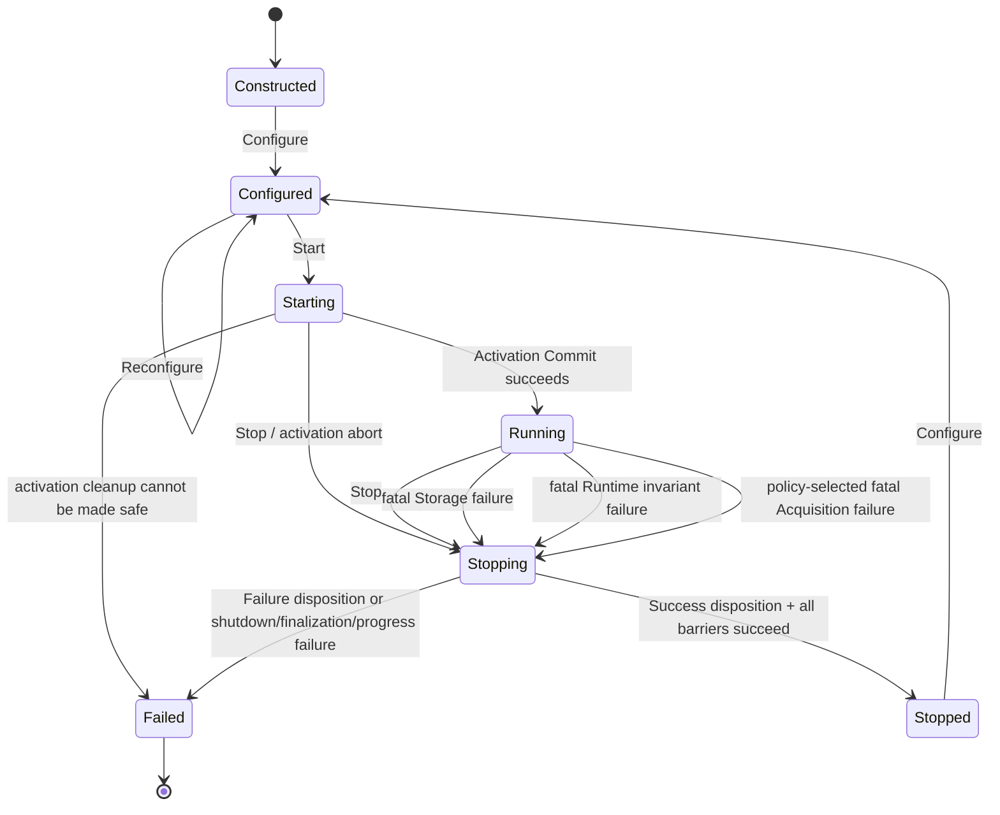

# RoDAQ Runtime Design Specification

**Version:** v0.6
**Status:** Design Specification  
**Scope:** RoDAQ V1 Runtime Architecture and Runtime Data Model

**Normative Dependencies:**

- RoDAQ Canonical Data Model Design Specification v0.9
- RoDAQ V1 Canonical Profile v0.6
- RoDAQ System Architecture Design Specification v0.6

---

# 1. Runtime 目标与设计边界

## 1.1 Runtime 职责

RoDAQ Runtime 是 Acquisition Plugin 与 Storage Plugin 之间的唯一系统级运行时中介。

Runtime 负责将 Control Plane 中建立的 Canonical State 编译为 Data Plane 可以高效使用的运行时状态，并保证：

```text
Acquisition Plugin
        ↓
Runtime Binding
        ↓
Admission
        ↓
Runtime Record
        ↓
Bounded Dispatch
        ↓
Storage Plugin
```

全过程满足 Canonical Model、V1 Canonical Profile 和 System Architecture 的语义约束。

Runtime 的核心职责包括：

- 管理 Runtime lifecycle；
- 建立和拥有 active Identity Scope；
- 提供唯一 Canonical identity allocation authority；
- 管理 Canonical registries；
- 建立 Stream runtime state；
- 建立 Source operational state；
- 建立和发布 Runtime Binding；
- 管理 Descriptor registration 和 Descriptor evolution；
- 为 Data Plane 提供稳定的 runtime handles；
- 管理 Admission Gate 与 lifecycle 的集成；
- 管理 AcceptanceSequence 可用性；
- 构造 accepted Runtime Record；
- 保证同一 Stream 的 AcceptanceSequence、dispatch enqueue 和 Storage handoff 顺序一致；
- 保证 Descriptor-before-Record；
- 提供 bounded Runtime-to-Storage dispatch；
- 协调 Storage completion；
- 管理正常停止过程中的有界进展；
- 协调正常 stop 和 failure shutdown；
- 保证 Control Plane、Data Plane 和 Storage Completion Domain 的并发安全；
- 在 V1 中提供简单、确定、可验证的 runtime lifetime model。

---

## 1.2 Runtime 不负责的内容

Runtime 不解释具体 Middleware 或设备协议。

以下知识必须保留在 Acquisition Plugin 内：

```text
ROS2 GID
DDS GUID
DDS SampleInfo
SocketCAN flags
vendor device identity
vendor clock counter
hardware-specific timestamp rules
```

Runtime 同样不解释具体 Storage Backend。

以下知识必须保留在 Storage Plugin 内：

```text
MCAP Channel
MCAP Chunk
SQLite row
SQLite transaction
backend compression format
backend index format
```

Runtime 也不重新定义 Canonical semantics。

Runtime 不定义：

```text
Stream 的语义
SourceId 的语义
SchemaDescriptor 的语义
ClockDescriptor 的语义
TimestampKeySet 的语义
AcceptanceSequence 的 Canonical 语义
Canonical Payload equality
Cross-scope Import
```

这些由上游规范定义。

---

## 1.3 V1 Runtime 实现原则

V1 Runtime 采用以下实现方向：

```text
single logical Control Plane writer

immutable published Runtime Binding
immutable Canonical Descriptor

stable activation-local runtime handles
activation-context validation for external handles

no handle reuse within one activation
no Descriptor reclamation while activation is active

bounded Data Plane resources
fixed-capacity timestamp runtime representation

per-stream sequence-ordered accepted enqueue

single logical Runtime→Storage dispatch lane
serialized Runtime Storage Completion Domain

bounded shutdown progress

one active Storage Plugin
no multi-sink fan-out
```

这些选择用于避免 V1 过早引入：

```text
RCU reclamation
ABA protection
concurrent Descriptor mutation
distributed registry
multi-sink completion graph
dynamic handle recycling
cross-activation runtime-state continuation
per-Record complex atomic state machines
```

等高复杂度机制。

---

## 1.4 Runtime 设计职责与实现对象分离

本文定义：

```text
Canonical Registry
Stream State
Source State
Runtime Binding
Admission Gate
Storage Dispatch
Storage Completion Domain
Active Runtime State
```

等逻辑责任。

这些名称不要求实现中存在完全对应的公开 C++ class。

实现可以将多个职责收敛到较少的内部对象中。

例如：

```text
Canonical Registry
Stream Table
Source Table
Binding Table
```

可以共同由一个紧凑的 Runtime internal state 实现。

设计关注：

> ownership、lifetime、invariant、publication、linearization、progress 和 concurrency。

而不是类数量。

---

## 1.5 V1 Runtime 拓扑

一个 V1 Runtime instance 在一次 activation 中拥有：

```text
one active Identity Scope
one Canonical allocation authority

one Runtime local monotonic ingress Clock

one Canonical Registry set

zero or more Stream States
zero or more Source States

one or more preconfigured Acquisition Plugin instances
one preconfigured Storage Plugin instance

one bounded Runtime-to-Storage data path
one logical Storage Completion processing domain
```

Acquisition Plugin instance 集合和 Storage Plugin instance 必须在进入 Running 前确定。

Running 状态下不支持 Plugin instance topology 变更。

已存在的 Acquisition Plugin 可以动态发现：

```text
new Stream
new Source
Schema
Clock
fact changes
```

这些动态变化必须经过 Control Plane。

---

# 2. Runtime Lifecycle

## 2.1 Runtime State

V1 Runtime 定义以下逻辑状态：

```text
Constructed
Configured
Starting
Running
Stopping
Stopped
Failed
```

状态关系为：



`Stopping` 只是收敛 / cleanup phase，不代表最终成功。Runtime 必须同时维护本次 shutdown 的 terminal disposition：

```text
Success
Failure
```

Fatal failure 一旦将 disposition 升级为 `Failure`：

> **不可因为后续 cleanup 成功而降回 Success。**

因此 fatal Storage / Runtime / policy-selected fatal Acquisition failure 最终必须进入 `Failed`。

---

## 2.2 Constructed

`Constructed` 表示 Runtime object 已创建，但尚未接受完整运行配置。

此时：

```text
no active Identity Scope
no active Canonical Registry
no Runtime Binding
Admission Gate closed
no Storage output
no active Acquisition Plugin
```

允许：

```text
Configure
destroy
```

不允许：

```text
Start without valid configuration
submit
register Stream
register Source
```

---

## 2.3 Configured

`Configured` 表示：

- Runtime configuration 已验证；
- Acquisition Plugin instance set 已确定；
- Storage Plugin instance 已确定；
- Resource limits 已确定；
- Plugin-specific configuration 已绑定到对应 Plugin instance。

此时仍然：

```text
no active Identity Scope
no activation-local Canonical IDs
no active Runtime Binding
Admission Gate closed
```

允许：

```text
Reconfigure
Start
```

V1 中 configuration 在进入 `Starting` 后不可修改。

---

## 2.4 Starting

进入 `Starting` 后，Runtime 创建一次新的 activation。

每一次 V1 activation：

> **必须建立新的 logical Identity Scope。**

因此：

```text
Start #1
    → Scope A

Stop

Start #2
    → Scope B
```

即使：

```text
same Runtime instance
same Plugin configuration
same native Topic / Source
```

也不能自动认为 Scope A 与 Scope B 中的 Canonical IDs 具有 identity continuity。

V1 不提供 activation 间 Identity Scope reuse。

---

### 2.4.1 Starting 中建立的 Runtime State

`Starting` 至少建立：

```text
Active Runtime State
Identity Scope
Canonical ID allocators
Canonical registries
Runtime ingress Clock
Storage dispatch state
Storage completion state
Admission Gate
Plugin activation state
resource accounting
effective Runtime / Storage limits
terminal disposition
```

Admission Gate 在初始化阶段保持关闭。

---

### 2.4.2 Starting 的并行性

以下操作不存在强制串行依赖：

```text
Identity Scope establishment
Storage Plugin preparation
Acquisition Plugin preparation / native discovery
```

实现可以并行，也可以顺序执行。

但是：

```text
Canonical registration
```

必须等待：

```text
active Identity Scope ready
+
required native facts ready
```

Activation Commit 必须等待：

```text
Storage ready
+
required Runtime Bindings ready
+
effective Runtime/Storage capability limits established
+
all activation prerequisites required
for normal Data Plane operation satisfied
```

### 2.4.3 Activation Commit

V1 使用唯一 logical Activation Commit boundary。

该 boundary 必须建立：

```text
Runtime logically Running
+
Global Admission Gate Open
```

之后才允许 required Acquisition Plugins 的 normal routing / callbacks 获得 `Runtime::Submit` permission。

因此必须满足：

```text
normal Plugin Submit may begin
    ⇒
Runtime state == Running
AND
Global Gate == Open
```

实现可以使用：

```text
release/acquire publication
barrier generation
serialized Control Plane commit
```

等机制，但不得存在 Plugin 已能正常 Submit、Runtime 却仍因 `Starting` 状态拒绝的窗口。

`Start()` 只有在 Activation Commit 成功且 required Acquisition Plugins 完成 enable/release 后才返回 success。

### 2.4.4 Activation Abort

如果 Activation Commit 前发生 Stop 或 activation failure：

```text
Starting
    ↓
activation abort
```

Runtime 必须：

1. 保持 Global Admission Gate closed；
2. 禁止 Plugin normal Submit permission 发布；
3. settle / cancel pending descriptor-readiness、registration 和其他 activation control work；
4. stop 所有已经成功 Prepare 的 Acquisition Plugin；
5. abort / close Storage incomplete output，且不得发布 `NormalComplete`；
6. 安全释放 activation-local Scope、registries、handles 和资源；
7. 只有在 cleanup safety 可以证明时结束 activation。

如果 activation abort cleanup 成功，并且 abort 原因不是 latched fatal failure：

> 可以进入正常非运行终态。

如果 cleanup / quiescence / Storage abort 无法安全完成：

> terminal disposition = Failure，Runtime 最终进入 `Failed`。

---

## 2.5 Running

`Running` 表示：

```text
active Identity Scope exists
Canonical Registry operational
Storage Plugin ready
normal Admission Gate may be open
Acquisition Plugins activated
Runtime accepts normal Data Plane work
```

只有 `Running` 状态允许 normal submission 进入 admission-attempt domain。

现有 Acquisition Plugin 可以在 Running 状态进行：

```text
dynamic Stream discovery
dynamic Source discovery
Source availability change
Schema availability change
Clock restart notification
Timestamp capability change
Descriptor evolution
```

这些变化必须经过 Control Plane。

---

## 2.6 Stopping

`Stopping` 表示 Runtime 不再允许新的 normal admission，并开始收敛所有 in-flight work。

进入 `Stopping` 时，Runtime 必须建立：

```text
final admission cutoff
```

或 failure path 对应的：

```text
failure admission cutoff
```

并关闭 normal Admission Gate。

随后完成：

```text
close / wake pre-gate submission work
quiesce Acquisition Plugins
wait active Runtime::Submit calls to return
resolve Gate-passed admission attempts
dispatch accepted Runtime Records
flush / finalize Storage according to Storage Contract
resolve required Storage completion state
resolve Payload lifetime obligations
stop Acquisition Plugins
release active Runtime state
```

停止路径必须具有：

> **bounded progress policy**

Runtime 不得无限等待永远不会完成的 Plugin、Storage dispatch、flush、close 或 completion。

具体停止顺序见第 12 章。

### 2.6.1 Terminal Disposition Latch

进入 `Stopping` 时 Runtime 必须保留一个不可逆升级的 terminal disposition：

```text
Success
Failure
```

规则：

```text
normal Stop request
    → Success

fatal subsystem / invariant failure
    → Failure

Success + later fatal shutdown failure
    → Failure

Failure
    → never returns to Success
```

`Stopping → Stopped` 只允许在：

```text
terminal disposition == Success
+
all shutdown barriers satisfied
```

时发生。

`terminal disposition == Failure` 时，即使 cleanup 成功，最终状态仍必须是 `Failed`。

---

## 2.7 Stopped

`Stopped` 表示一次 activation 已正常结束。

必须满足：

```text
Admission Gate closed
Acquisition Plugins stopped

active submission calls == 0
no unresolved admission attempt
no queued accepted Runtime Record

no unresolved Payload lifetime obligation
no unresolved final Storage obligation

Storage Plugin closed successfully

active Identity Scope no longer active
activation-local handles no longer valid
```

Runtime 可以随后重新 `Configure` 并创建新的 activation。

新 activation 使用新的 Identity Scope。

---

## 2.8 Failed

`Failed` 表示当前 Runtime instance 遇到无法安全继续或无法完成正常 shutdown 的 terminal failure。

典型原因：

```text
fatal Storage failure
Storage dispatch progress failure
Storage flush timeout / failure
Storage close timeout / failure
Runtime invariant violation
ownership corruption
unresolvable required Descriptor
activation failure that cannot be cleanly recovered
```

V1 中：

> **Failed Runtime instance 不重新进入 Configured 或 Running。**

Application 必须创建新的 Runtime instance。

---

### 2.8.1 Failed 状态下允许的 Cleanup

`Failed` 是 lifecycle terminal state，但不意味着立即禁止所有资源释放操作。

Failed Runtime instance 可以执行有限 cleanup：

```text
request remaining native callbacks to stop
quiesce asynchronous tasks where possible

release Acquisition Plugin native resources

cancel / close / release Storage backend
where contract allows

release Payload ownership anchors when safe

release activation-local Runtime allocations
when safe

release OS resources
```

cleanup 的目的仅是：

> **安全释放资源。**

cleanup 不得：

```text
reopen Admission Gate
resume normal submission
repair Canonical history
register new Descriptor
create new Binding
retry unfinished normal Storage write
as if Runtime were still Running
transition back to Configured
transition back to Running
```

---

### 2.8.2 Failed Cleanup 的 Quiescence Invariant

Runtime 不得释放任何仍可能被 callback、worker 或 asynchronous task 访问的 activation-local state。

因此：

```text
callback / async task may still access state
        ↓
state must remain alive
```

只有在已经建立：

```text
no remaining execution context
can access that state
```

的 quiescence guarantee 后，才允许释放：

```text
Binding
Descriptor lookup state
Source / Stream tables
Payload ownership anchors
ActiveRuntimeState
```

如果某个 broken Plugin 或 backend 无法证明 quiescence：

> Runtime 必须优先保证 memory safety，而不是强制完成资源回收。

实现可以：

```text
retain / quarantine unreachable state
until process teardown
```

或者要求 Application 终止受影响的进程。

不得为了 cleanup completeness 提前释放仍可能被访问的内存。

因此：

> **failure cleanup 中允许延迟释放优于 use-after-free。**

cleanup 中如果 backend-specific recovery/finalization 仍然有意义，只能按照 Storage/Persistence Contract 的 failure-recovery 语义执行。

不能把 cleanup 解释成 Runtime recovery。

cleanup 完成后，该 Runtime instance 只能被销毁。

---

## 2.9 Control Operation Serialization

所有改变 Runtime lifecycle 或 Canonical structural state 的操作必须进入：

> **single logical Control Plane writer domain**

包括：

```text
Configure
Start
Stop

Stream registration
Source registration
Source availability mutation

Schema registration
Clock registration

Descriptor evolution

Binding preparation
Binding activation
Binding retirement

Plugin failure / recovery state change
Storage fatal failure state change
```

“single logical writer”不要求独立控制线程。

实现可以采用：

```text
single mutex
serialized executor
control task queue
caller-thread serialization
```

但必须保证：

> 同一时刻只有一个 Control Plane mutation 正在改变 Runtime structural state。

---

# 3. Active Runtime State 与 Canonical Infrastructure

## 3.1 Active Runtime State

一次 activation 的运行时状态逻辑上组成：

```text
ActiveRuntimeState
├── IdentityScope
├── CanonicalIdAuthority
├── CanonicalRegistry
├── InteropProjectionRegistry
├── IngressClock
├── ReplayTimeCorrelation
├── StreamTable
├── SourceTable
├── BindingTable
├── SubmissionActivityState
├── AdmissionState
├── StorageDispatchState
├── StorageCompletionState
├── EffectiveLimits
├── TerminalDisposition
└── OperationalState
```

`ActiveRuntimeState` 是实现内部生命周期概念。

它：

- 不是 Canonical object；
- 不是 Session；
- 不需要公开为 API 类型；
- 不持久化。

其 lifetime：

```text
Starting
    ↓
Running
    ↓
Stopping / Failed cleanup
    ↓
safe activation teardown
```

### 3.1.1 Active Submission Call Lifetime

Runtime 必须独立追踪：

```text
active_submission_calls
```

它表示：

> 已经进入 `Runtime::Submit(...)`、但该 synchronous Submit call 尚未返回的 execution 数量。

生命周期为：

```text
Submit entry
    ↓
active_submission_calls +1
    ↓
pre-admission validation / wait / Payload materialization
    ↓
optional Gate pass / Admission commit
    ↓
terminal admission result available
    ↓
Submit return boundary
    ↓
active_submission_calls -1
```

该 counter 与：

```text
global admission in-flight
```

不同。后者只覆盖已经 Gate-pass 的 Admission Attempt。

因此可能合法存在：

```text
active_submission_calls > 0
AND
global admission in-flight == 0
```

例如一个 submission 正在 pre-gate resource wait 或 Copy materialization。

Runtime 不得在 `active_submission_calls != 0` 时销毁该 activation 的 Plugin-facing / Submit-path state。

实现不要求独立 `SubmissionManager`；一个有界 atomic counter + wait/notification primitive 即可满足该 contract。

---

## 3.2 Canonical ID Authority

每个 active Identity Scope 恰好拥有一个：

> **Canonical ID allocation authority**

Runtime 是该 authority 的唯一拥有者。

Acquisition Plugin 和 Storage Plugin 均不得直接分配：

```text
StreamId
SchemaId
ClockId
TimestampKeySetId
StreamDescriptorId
```

---

### 3.2.1 ID Allocation Requirements

Canonical ID allocation 必须满足：

```text
unique within applicable Canonical identity domain
never silently reused
never wrap
never alias
```

如果 allocator 无法再生成合法 ID：

> 对应 registration 必须失败。

不得：

```text
wrap to zero
reuse released ID
reuse failed registration ID
```

---

### 3.2.2 Failed Registration 的 ID

如果 registration 已经获得一个 Canonical ID，但后续 registration transaction 失败：

> V1 不回收该 ID。

该 ID 可以永久保持未使用状态。

因此允许：

```text
allocate ID
    ↓
later registration fails
    ↓
ID consumed but no Canonical object published
```

这样避免引入：

```text
allocator rollback
ID reuse race
ABA identity problem
```

Canonical IDs 不要求连续或无 gap。

Canonical Registry：

> **不要求为 failed registration 建立一个“consumed but unused”伪对象或占位 entry。**

allocator 只需要保证：

> 后续分配永远不复用该 ID。

如果需要诊断 failed allocation history，由 Runtime observability / diagnostics 独立记录。

不能通过创建假的 Canonical Registry entry 表示失败历史。

### 3.2.3 V1 Scalar Domains

Runtime 必须直接遵守 Canonical Profile v0.6 的 scalar domains：

```text
Runtime-allocated Canonical ID
    = uint64 value domain

AcceptanceSequence
    = uint64 value domain

SourceSequence when present
    = uint64 value domain

ClockReading
    = int64 signed tick value

Clock resolution numerator / denominator
    = positive uint64 reduced rational
```

`0` 对上述允许 zero 的 value domain 是合法值，不得作为 absent / invalid sentinel。

Runtime 必须使用独立 presence / validity state 表达 absent。

Plugin-native sentinel，例如 middleware 的 unsupported / unknown sequence value：

> 必须由 Acquisition Mapping 在进入 Runtime 前解释为 absent / invalid，不得作为普通 Canonical scalar 直接透传。

所有 scalar conversion 必须 checked：

```text
no truncation
no signedness reinterpretation
no wrap
```

---

## 3.3 Canonical Registry

Runtime 逻辑上维护：

```text
Stream Registry
Source Registry
Schema Registry
Clock Registry
TimestampKeySet Registry
StreamDescriptor Registry
```

实现可以统一为一个内部 `CanonicalRegistry`。

不要求六个独立 class。

---

## 3.4 Registry Immutability

以下对象注册后 immutable：

```text
SchemaDescriptor
ClockDescriptor
TimestampKeySet
StreamDescriptor
```

Runtime 不允许：

```text
modify registered Descriptor in place
```

任何语义变化必须：

```text
allocate new Canonical identity where required
        ↓
register new immutable object
        ↓
create new Runtime Binding
```

---

## 3.5 Registry Publication

Control Plane registration 必须是逻辑原子的。

Consumer 不允许观察：

```text
StreamDescriptor exists
but TimestampKeySet missing
```

或者：

```text
TimestampKeySet exists
but referenced ClockDescriptor unresolved
```

因此 Descriptor Graph registration 必须：

1. 完成 validation；
2. 建立所有 dependency；
3. 提交到 Registry；
4. 只有全部 dependency resolvable 后才发布。

---

## 3.6 Registry 不执行基于内容的隐式合并

Canonical Model 允许：

```text
same content
≠
same identity
```

因此 V1 Runtime 不得仅因为两个 Descriptor 内容相同，就自动合并为同一个 Canonical ID。

例如：

```text
Schema A bytes == Schema B bytes
```

不自动意味着：

```text
SchemaId A == SchemaId B
```

同样：

```text
TimestampKeySet contents equal
```

不自动意味着：

```text
TimestampKeySetId equal
```

只有 Control Plane 已经确认：

> 当前 native fact 对应同一个 logical Canonical entity

时，才可以复用 identity。

---

### 3.6.1 Interop Projection Registry

Runtime additionally owns an activation-scoped `InteropProjectionRegistry`. It is deliberately separate from `CanonicalRegistry`：

```text
CanonicalRegistry
    = Canonical State authority

InteropProjectionRegistry
    = immutable external-ecosystem projection facts
    = non-Canonical
```

Key：

```text
(StreamDescriptorHandle, projection_id)
```

V1 required projection：

```text
rodaq.projection.ros2.v1
```

The registry is mutated only on the Control Plane through `rodaq.runtime.projection.v1`. Acquisition publishes projections after the StreamDescriptor exists and before Storage descriptor readiness. Storage reads projections through the same Runtime service; there is no Acquisition → Storage pointer/call path.

Properties：

```text
activation-lifetime ownership
immutable after successful registration
idempotent same-bytes registration
conflicting second registration rejected
bounded count and bytes
no per-Record mutation
no hot-path string lookup
```

Projection registration failure does not mutate Canonical State already published. The corresponding Binding simply cannot become Active if required Storage readiness depends on the missing/invalid projection.

Descriptor publication and readiness are distinct lifecycle steps:

```text
PublishDescriptor
    → immutable Descriptor exists and handle is returned
    → Storage readiness evaluation
    → Binding transaction when READY
```

Storage may evaluate the immutable Descriptor together with its current immutable projection set.
`UNSUPPORTED` leaves the Descriptor published but non-routable; a later Projection registration
triggers a new readiness evaluation. The first missing-projection result is therefore retryable,
not permanent Descriptor failure.

All readiness and Binding transition callbacks execute outside `control_mutex_`, per-Stream
Admission serialization, Dispatch/Completion locks and Registry structural locks. Runtime takes a
snapshot under its structural lock, calls Plugin code without that lock, then re-enters the Runtime
lock to validate the Descriptor generation, Binding transition token and current routing state
before publication.

The Runtime treats projection payload bytes as opaque. Meaning, deterministic encoding and validation rules belong to the versioned mapping specification for that projection identifier.

---

## 3.7 Source Registry 与 Source State

SourceId 是 Canonical opaque bytes。

Source-specific canonicalization 在 Acquisition Plugin 中完成。

Runtime 接收到的 SourceId bytes 必须已经满足 Canonical Profile v0.6 的：

```text
Scope-wide identity-domain disjointness
```

要求。Runtime 只做 byte-exact equality / interning，无法也不得根据 Plugin type 重新补 domain tag。

如果两个本应属于不同 identity domain 的 Source 因 Mapping 错误产生相同 bytes：

> 属于 Acquisition Mapping / Contract violation；Runtime 不应通过 source-specific heuristic 猜测并拆分。

SourceId interning：

> **属于 Control Plane 操作。**

Acquisition Plugin 在发现一个新的 native Source 时，必须先经过 Control Plane：

```text
native Source discovered
        ↓
Plugin canonicalizes SourceId bytes
        ↓
Control Plane Source registration
        ↓
validate non-empty
        ↓
lookup / intern SourceId
        ↓
SourceHandle returned
        ↓
steady-state submission may use SourceHandle
```

Data Plane：

> 不执行首次 SourceId interning。

---

### 3.7.1 Source State

每个已注册 Runtime Source 具有一个最小 operational Source State。

逻辑内容至少包括：

```text
SourceHandle
Canonical SourceId
owning Acquisition Plugin
operational availability
```

V1 Source availability 至少区分：

```text
Available
Unavailable
```

这是 Runtime operational state，不是 Canonical SourceDescriptor。

V1 Canonical Profile 当前不支持 SourceDescriptor，因此不得把 Source availability 误解为新的 Canonical object。

---

### 3.7.2 Source Failure 与 Stream Failure 分离

一个 Stream 可以关联多个 concrete Source。

因此：

```text
Source A becomes Unavailable
```

不自动意味着：

```text
Stream becomes Unavailable
```

例如：

```text
Stream X
├── Source A → Unavailable
├── Source B → Available
└── Source C → Available
```

如果 B/C 仍能够在当前 Binding 下产生合法 Record：

> Stream X 可以继续保持 Available。

Stream 只有在以下情况之一发生时才需要进入 `Unavailable`：

```text
Plugin-wide failure

Stream-level native failure

required interpretation fact no longer valid

current Binding no longer semantically correct

no remaining eligible Source in the current
active acquisition path can produce valid Records

AcceptanceSequence exhausted
```

单个 Source failure 不得被无条件提升为整个 Stream failure。

---

### 3.7.3 未注册 Source 的 Sample

如果 Plugin 收到一个 sample，但其 native Source 尚未获得 SourceHandle：

> 该 sample 不得进入 admission domain。

Plugin 必须先触发或等待 Source registration。

Runtime 不允许 hot path 执行：

```text
SourceId byte hashing
registry mutation
SourceHandle allocation
```

来自动修复未注册 Source。

这保持：

```text
Control Plane mutates registry
Data Plane reads stable SourceHandle
```

的并发边界。

对于这种 sample：

```text
drop before admission
temporarily buffer in Plugin
apply native/source backpressure
```

等处理策略由 `acquisition_plugin.md` 定义。

Runtime 只保证：

> **未注册 Source 的 sample 不进入 admission domain。**

Runtime 不为这种 native sample 提供隐式 buffer。

---

### 3.7.4 SourceHandle

Data Plane 不直接携带 SourceId byte sequence。

Runtime 为已注册 Source 建立：

```text
SourceHandle
```

SourceHandle：

- 只在当前 activation 有效；
- 不是 Canonical identity；
- 不持久化；
- 不跨 Identity Scope；
- 不跨 Runtime activation；
- 不在 activation 内复用。

Data Plane 通过 SourceHandle 访问 SourceId。

---

### 3.7.5 SourceSequence

如果 submission 携带 SourceSequence：

```text
SourceHandle must be valid
```

即：

```text
SourceSequence present
    ⇒
SourceId / SourceHandle present
```

Runtime Data Plane 必须快速验证这一 invariant。

---

## 3.8 Runtime Ingress Clock

每次 activation 建立一个 Runtime-owned：

> **local monotonic ingress Clock**

Runtime 为其注册一个 ClockDescriptor。

该 Clock 用于：

```text
rodaq/acquisition_ingress
```

V1 中：

> **同一 activation 的所有 Stream 使用同一个 Runtime ingress Clock instance 和同一个对应 ClockId。**

V1 不支持一个 activation 内多个 Runtime ingress Clock instance。

---

### 3.8.1 Ingress Clock Requirements

Ingress Clock 必须：

```text
monotonic
have known positive reduced rational resolution
be stable for activation lifetime
```

V1 为了让 Storage interoperability timeline 可机械投影，进一步冻结 Runtime ingress Clock 的公开 Canonical representation：

```text
resolution = 1 / 1,000,000,000 second per tick
ClockReading = signed int64 monotonic nanoseconds
```

实现可以基于：

```text
std::chrono::steady_clock
platform monotonic clock
```

并在 capture point 转换成上述 nanosecond representation。Runtime 必须验证转换、range 和 monotonicity；不能让 platform-native tick period 泄漏为不同 activation 的随机 ABI/Storage behavior。

如果 Runtime 检测到 ingress Clock 不再满足 contract：

> 视为 Runtime correctness failure。

不得静默修改、clamp 或重新解释已经产生的 ClockReading。

---

### 3.8.2 Activation-scoped Replay-Time Correlation

The Canonical ingress Clock remains a local monotonic clock. For standard file formats that require an epoch-based replay timeline, Runtime also captures a non-Canonical activation-scoped correlation anchor：

```text
ingress_anchor
    = current Runtime ingress ClockReading

unix_anchor_ns
    = current system Unix-epoch time in nanoseconds
```

This pair is captured as closely together as practical during activation and is immutable for the activation lifetime.

For a Record with ingress reading `t`：

```text
replay_time_ns
    = unix_anchor_ns + exact_delta(t, ingress_anchor)
```

This projection：

```text
preserves acquisition-relative timing
excludes Storage queue/handoff latency
is not Canonical State
is not a ClockId equivalence claim
must check signed/unsigned overflow and resolution conversion
must not be recomputed from current wall clock per Record
```

V1 MCAP Storage uses this correlation as the default source for `Message.log_time` unless a stronger validated epoch-compatible acquisition timestamp policy is selected. A system-clock jump after activation therefore does not distort relative replay timing.

The anchor is exposed read-only through `rodaq.runtime.clock_correlation.v1`. MCAP Storage queries it during Open/descriptor preparation and caches the immutable activation anchor; it must not call a wall-clock API per Record. The service does not change `rodaq/acquisition_ingress` Canonical origin or equality semantics.

---

# 4. Runtime Handles、Stream State 与 Runtime Binding

## 4.1 Runtime Handle 原则

Data Plane 不应高频携带：

```text
SourceId bytes
RoleIdentifier string
Schema bytes
Descriptor object graph
```

Runtime 为低频注册后的对象建立 runtime handles。

典型 handle：

```text
StreamHandle
SourceHandle
SchemaHandle
ClockHandle
TimestampKeySetHandle
StreamDescriptorHandle
BindingHandle
```

这些 handle：

- 不是 Canonical ID；
- 不是 persisted state；
- 只在一个 activation 内有效；
- 必须可 O(1) 解析；
- activation 内不回收；
- activation 内不复用。

---

## 4.2 Handle Lifetime

V1 使用：

> **monotonic handle lifetime**

即：

```text
handle allocated
    ↓
remains semantically bound to same runtime entity
    ↓
activation teardown
```

即使：

```text
Binding retired
Descriptor no longer current
Source disappears
```

其 handle 也不被重新分配给另一个实体。

这避免：

```text
ABA
generation counter within activation
runtime handle reclamation
RCU
hazard pointer
```

进入 V1。

---

### 4.2.1 Cross-activation Handle Validity

Runtime handle 是：

> **activation-local capability/reference**

因此旧 activation 的 handle：

> 不得在新 activation 中 resolve 到有效对象。

所有能够跨越 Runtime internal implementation boundary，并重新进入：

```text
Runtime public API
Acquisition-facing Runtime API
Storage-facing Runtime API
asynchronous Runtime callback path
```

的 handle：

> **必须经过 activation-context validation。**

V1 必须保证：

```text
handle from activation A
    must never resolve to
live entity in activation B
```

实现不要求 raw integer value 永远不同。

例如可以使用：

```text
small integer handle
+
ActivationContext
```

进行解析。

也可以使用：

```text
activation epoch
activation namespace
generation/tag
opaque handle bound to ActiveRuntimeState
```

等方式。

如果某个 handle 完全不逃逸当前 `ActiveRuntimeState`，新旧 activation 内部可以产生相同 integer index。

但任何从外部或 Plugin 重新进入 Runtime 的 handle resolution：

> 必须同时验证 activation context。

---

## 4.3 Stream State

每个注册的 logical Stream 拥有一个 Stream State。

逻辑内容包括：

```text
StreamHandle
StreamId

owning Acquisition Plugin
current Runtime Binding
Stream availability

per-stream admission state
per-stream AcceptanceSequence state
AcceptanceSequence exhaustion state

operational counters
```

实现不要求使用独立 `StreamState` class。

这里的单值：

```text
owning Acquisition Plugin
current Runtime Binding
```

是 V1 Profile 的明确 cardinality，而不是暂时的数据结构简化。

V1 不支持同一 Stream 同时拥有多个 active acquisition path / current Binding。

一个 Stream 可以拥有多个 Source，但这些 Source 必须通过该 Stream 唯一 active acquisition path 与 current Binding 提交 Record。

Runtime 不执行跨 Plugin native logical Stream 自动合并。

---

## 4.4 Stream Availability

Stream 的 Runtime operational state 至少区分：

```text
Pending
Available
Unavailable
Closing
```

### Pending

Stream 已发现或正在建立，但尚未完成 first usable Binding 的建立。

典型情况：

```text
Canonical registration pending
Storage Descriptor readiness pending
Binding preparation pending
```

如果 Storage Contract 允许某个 readiness operation 重试：

> 首次 Binding 在 retry window 内可以保持 `Pending`。

### Available

Stream 有 current active Runtime Binding，并且 Stream-level operational conditions 允许 admission。

### Unavailable

Stream 当前不能产生新的 accepted Record。

典型原因：

```text
Plugin-wide failure

Stream-level native failure

required fact invalid

current Binding semantics no longer valid

no eligible Source remains in the current active acquisition path

AcceptanceSequence exhausted

Binding transition failed
AND
no still-valid current Active Binding remains usable
```

特别是：

> **Binding transition failure 不自动导致 Stream Unavailable。**

如果新 Binding 建立失败，但旧 current Binding：

```text
still semantically valid
+
still Storage-ready
+
still operationally usable
```

则：

```text
Stream remains Available
current Binding remains unchanged
```

继续使用旧 Binding。

### Closing

Runtime 正在停止或 Stream 已经进入终止路径。

不允许新的 normal admission。

---

## 4.5 Runtime Binding

Runtime Binding 是 Data Plane 的核心编译结果。

一个 V1 Binding 至少逻辑包含：

```text
BindingHandle

StreamHandle
StreamDescriptorHandle

optional SchemaHandle

TimestampKeySetHandle
compiled timestamp slot mapping

timestamp slot count
mandatory ingress slot index

PayloadEncoding reference

owning Plugin identity

Binding lifecycle state
```

Runtime Binding publication 后 immutable。

其 lifecycle state 可以单独维护。

---

## 4.6 Timestamp Slot Compilation

Canonical TimestampKeySet 是 unordered set。

Runtime Data Plane 不直接使用 unordered set。

V1 Profile 当前限制：

```text
1 <= TimestampKeySet.size <= 4
```

因此 V1 Runtime 编译为最多四个 runtime timestamp slots：

```text
slot[0]
slot[1]
slot[2]
slot[3]
```

---

### 4.6.1 Slot Mapping

Runtime Binding 保存：

```text
slot index
    ↔
Canonical TimestampKey
```

该顺序：

- 是 Runtime implementation detail；
- 不是 Canonical order；
- 不持久化为 Canonical semantics；
- 不要求不同 Runtime 使用相同 slot order。

---

### 4.6.2 Mandatory Ingress Slot

每个 Binding 必须标识：

```text
ingress_slot
```

其 Canonical key 为：

```text
(
    rodaq/acquisition_ingress,
    Runtime ingress ClockId
)
```

Acquisition Plugin：

> 不得写入或覆盖该 slot。

该 reading 由 Runtime Admission path 设置。

---

### 4.6.3 Plugin Timestamp Slots

除 ingress slot 以外的 timestamp slots：

> 在 Binding 建立时已经由 Control Plane 映射完成。

Acquisition Plugin steady-state submission 只需要按照当前 Binding 的 slot mapping 提供：

```text
slot presence
ClockReading
```

不需要每条 Record 提供：

```text
RoleIdentifier string
ClockId lookup
TimestampKey object
```

---

## 4.7 Binding Lifecycle State

V1 Binding 使用以下逻辑状态：

```text
Prepared
Active
Draining
Retired
```

### Prepared

Canonical State 已建立。

Runtime-side handles 和 slot mapping 已完成。

Storage Descriptor readiness 尚未完成，或者 Binding 尚未完成 switch commit。

Prepared Binding：

> 不允许 admission。

### Active

Binding 是当前允许用于 future submission 的 interpretation。

但是 `Binding == Active` 本身不保证 submission 可以 admission。

仍然要求：

```text
Runtime Running
Global Gate Open
Storage ready
Stream Available
Binding is current
Source eligibility satisfied
AcceptanceSequence capacity available
```

### Draining

Binding 已经不再作为 future submission interpretation。

新 submission 不允许通过该 Binding。

已经进入 admission domain 的 attempt 可以继续完成。

已经 accepted 的 Runtime Record 继续有效。

### Retired

Binding 不允许新的 admission。

Binding 和其引用 Descriptor 仍保持可解析。

---

## 4.8 Binding Publication

Binding 只有满足以下条件后才有资格进入 `Active`：

```text
Canonical Descriptor Graph complete
Runtime handles complete
Timestamp slots compiled
Storage Descriptor readiness satisfied
Plugin-side switch protocol ready
```

---

### 4.8.1 Storage Descriptor Readiness

`Storage Descriptor readiness` 表示：

> Storage Plugin 已明确确认：对于该 Binding 引用的 required Descriptor，后续 Record handoff 不会发生 unresolved Descriptor。

Runtime 不得仅因为：

```text
Descriptor submitted to Storage
```

就假定 readiness 已成立。

readiness 可以由 Storage Contract 定义为：

```text
synchronous success return
asynchronous callback
completion token
future/promise completion
other explicit confirmation
```

Runtime 依赖：

```text
Descriptor handoff
        ↓
explicit Storage readiness confirmation
        ↓
Binding eligible for activation
```

如果 Storage Plugin 异步处理 Descriptor：

> Binding 必须保持 `Prepared`，直到 readiness 被明确确认。

---

### 4.8.2 首次 Binding 的 Descriptor Readiness Failure

对于一个首次建立的 Stream，如果：

```text
no old usable Binding exists
```

且新 Binding 的 Storage Descriptor readiness 最终失败：

> Stream 不得进入 `Available`。

如果 Storage Contract 明确允许该 readiness operation 重试，并且 failure 尚未被判定为 terminal：

```text
Stream may remain Pending
```

直到：

```text
readiness succeeds
```

或者：

```text
retry / progress policy reaches terminal failure
```

如果 readiness 被明确判定为失败，且没有 usable Binding：

```text
Stream → Unavailable
```

如果是已有 Stream 的新 Binding readiness failure，而旧 Binding 仍然语义有效：

```text
old Binding remains current
Stream remains Available
```

---

## 4.9 Descriptor-before-Record 的 Runtime 实现

Runtime 通过：

> **Binding activation barrier**

实现 Descriptor-before-Record。

即：

```text
Binding not Active
    ↓
submission cannot enter admission domain
through that Binding
```

只有 Storage path 已确认能够解析该 Binding 所引用的 required Descriptor 后，Runtime 才允许 Binding Active。

这里的 Descriptor ready：

> 不要求 Descriptor 已经 crash-durable。

只要求后续 Record handoff 不会 unresolved。

---

# 5. Descriptor Evolution 与 Binding 切换

## 5.1 Descriptor Evolution 原则

任何影响 StreamDescriptor 的 Canonical fact 发生变化时，必须建立新 Descriptor。

典型变化：

```text
StreamName
SchemaId
PayloadEncoding
TimestampKeySetId
Clock restart causing new TimestampKeySet
```

不能修改旧 Descriptor。

---

## 5.2 Evolution 流程

一次 Descriptor evolution 的 Runtime 流程为：

```text
native fact change
        ↓
Control Plane serialized handling
        ↓
validate new facts
        ↓
register new Canonical objects
        ↓
compile new Prepared Binding
        ↓
publish required Descriptors to Storage
        ↓
Storage Descriptor readiness confirmation
        ↓
begin Stream-local Binding switch protocol
        ↓
quiesce old-Binding submission paths
        ↓
ReadyToCommit
        ↓
atomic Runtime Binding commit
        ↓
CommitComplete
        ↓
resume Plugin submission using new Binding
        ↓
old Binding drains existing admission attempts
        ↓
old Binding Retired
```

---

## 5.3 Registration Failure

如果新 Canonical state 无法注册：

```text
invalid facts
registry limit
TimestampKeySet over Profile capacity
invalid Clock
invalid Source relation
```

则新 Binding 不得进入 Active。

旧 Binding 不受修改。

如果旧 Binding：

```text
still semantically valid
+
still operationally usable
```

则：

```text
Stream remains Available
old Binding remains current
```

如果 source-native semantics 已经使旧 Binding 不再正确，并且新 Binding 又无法建立：

```text
Stream → Unavailable
```

直到合法 Binding 建立。

---

## 5.4 Storage Descriptor Failure

Canonical Descriptor 已注册后，如果 Storage 无法建立对应 Descriptor readiness：

> 新 Binding 保持非 Active。

Canonical Registry 不 rollback。

已分配 Canonical IDs 不回收。

如果：

```text
old current Binding exists
AND
old semantics still valid
```

则：

```text
old Binding remains current
Stream remains Available
```

如果：

```text
no old Binding exists
```

对于首次 Stream 建立：

- 可重试且尚未 terminal：`Pending`；
- terminal readiness failure：`Unavailable`。

如果：

```text
old Binding exists
but source-native semantics
已经使其不再正确
```

则：

```text
Stream → Unavailable
```

---

## 5.5 Binding Switch Protocol

V1 Binding switch 使用：

> **Stream-local quiescent two-phase commit**

而不是让 Plugin 在 new Binding 仍为 `Prepared` 时直接开始 submit。

---

### 5.5.1 Phase 1：Prepare

Runtime 完成：

```text
new Binding = Prepared

Canonical Descriptor ready
Runtime mapping ready
Storage Descriptor ready
```

随后 Runtime 把 new Binding 提供给 Acquisition Plugin。

但是：

> Plugin 在此阶段不得使用 new Binding 进行 normal submission。

---

### 5.5.2 Phase 2：Quiesce Old Submission Path

Runtime 请求 Plugin：

> 为该 Stream 建立 temporary switch quiescence。

Plugin 必须：

1. 阻止新的 callback/submission path 开始使用 old Binding；
2. 等待所有仍可能在未来调用 `submit(old Binding)` 的 callback execution context 越过 submission boundary 或结束；
3. 不开始使用 new Binding submit；
4. 向 Runtime 报告：

```text
ReadyToCommit
```

`ReadyToCommit` 必须保证：

> acknowledgement 之后，不会再出现新的 `submit(old Binding)` 调用。

已经在 Runtime 中：

```text
passed Admission Gate
```

的 old-Binding admission attempt 不属于 Plugin callback quiescence 的阻塞对象。

这些 attempt 可以继续在 Runtime 中完成。

---

### 5.5.3 Runtime Commit

收到 `ReadyToCommit` 后，Control Plane 执行一个逻辑原子的 Binding commit：

```text
Stream.current_binding = new Binding

new Binding:
    Prepared → Active

old Binding:
    Active → Draining
```

这三个变化必须属于同一个 serialized Control Plane mutation。

Runtime 不允许存在 consumer-visible 中间状态：

```text
old not usable
+
new not Active
```

或者：

```text
both old and new
independently selectable
```

作为普通 future submission interpretation。

---

### 5.5.4 CommitComplete

Runtime commit 完成后，向 Plugin 报告：

```text
CommitComplete
```

Plugin 只有在 `CommitComplete` 后才允许：

```text
resume future callback submission
using new Binding
```

完整 switch 为：

```text
old Active
        ↓
Plugin quiesces Stream submission
        ↓
ReadyToCommit
        ↓
Runtime atomic commit:
    old → Draining
    new → Active
        ↓
CommitComplete
        ↓
Plugin resumes with new Binding
```

---

### 5.5.5 Switch 期间的数据处理

Binding switch 允许一个短暂的：

> **Stream-local submission pause**

V1 不要求 Runtime 在该 pause 中缓存 native sample。

Acquisition Plugin 根据 source capability 可以：

```text
apply native backpressure
temporarily retain native sample
drop before admission
```

具体策略由 `acquisition_plugin.md` 定义。

如果 sample 没有进入 admission domain：

> 不分配 AcceptanceSequence。

---

### 5.5.6 Multi-threaded Plugin Requirement

如果 Plugin 有多个 callback thread：

> `ReadyToCommit` 必须覆盖所有可能提交该 Stream old Binding 的 callback execution domains。

Runtime 不负责理解 Plugin 内部线程结构。

Runtime 依赖 Acquisition Plugin Contract 对 `ReadyToCommit` 的保证。

Runtime 仍保留 safety check：

```text
old Binding state == Draining
    ↓
unexpected late submit(old Binding)
    ↓
pre-admission rejection
```

但：

> **Runtime rejection 只是 safety net，不是 Plugin 正确性的替代。**

如果 Plugin 持续依赖这一 safety net 才能避免错误 Record 被 accepted：

> Plugin 违反 Binding switch Contract。

实现和测试应将这种 late-submit 视为 Plugin correctness violation，并产生 operational diagnostic。

---

## 5.6 Old Binding Draining

进入 `Draining` 后：

```text
new submission using old Binding
    → rejected before admission domain
```

已经进入 admission domain 的 attempt：

> 必须完成。

Runtime 维护 Binding-specific in-flight admission count。

当：

```text
old Binding new admission disabled
+
in-flight admission count == 0
```

时，可以标记：

```text
Retired
```

不要求等待所有引用该 Binding 的 accepted RuntimeRecord 完成 Storage persistence，原因是 Retired Binding 仍保持可解析。

---

## 5.7 Binding Reclamation

V1 不在 activation 期间回收：

```text
Retired Binding
Descriptor
runtime handle
```

即：

```text
Retired
    ↓
remain addressable
    ↓
safe activation teardown
    ↓
free
```

Storage in-flight Record 因而始终可以解析旧 Binding。

---

# 6. Runtime Data Plane Model

## 6.1 Data Plane 主路径

V1 Runtime Data Plane 为：

```text
Acquisition callback
        ↓
Runtime Binding
        ↓
global + stream + binding admission eligibility
        ↓
Admission Gate pass
        ↓
Admission Attempt
        ↓
accepted Runtime Record
        ↓
per-stream ordered enqueue
        ↓
bounded dispatch path
        ↓
Storage Dispatch Lane
        ↓
Storage Plugin
```

---

## 6.2 Hot-path 约束

steady-state Data Plane 不应执行：

```text
Schema parsing
SourceId interning
SourceId byte hashing for first registration
RoleIdentifier string lookup
Descriptor graph traversal
Canonical Descriptor construction
Storage format selection
dynamic Plugin lookup
```

这些工作必须提前到 Control Plane。

---

## 6.3 RuntimeRecord

V1 RuntimeRecord 的逻辑结构为：

```text
RuntimeRecord
├── BindingHandle
├── AcceptanceSequence
├── optional SourceHandle
├── optional SourceSequence
├── TimestampStateSlots
└── PayloadRef
```

RuntimeRecord 是 accepted Canonical Record 的 Runtime representation。

它不是新的 Canonical object。

---

## 6.4 BindingHandle

`BindingHandle` 唯一确定：

```text
Stream
StreamDescriptor
Schema
TimestampKeySet
PayloadEncoding
timestamp slot interpretation
```

因此 RuntimeRecord 不需要重复携带：

```text
StreamId
StreamDescriptorId
SchemaId
TimestampKeySetId
RoleIdentifier strings
```

这些信息通过 BindingHandle O(1) 解析。

---

## 6.5 SourceHandle

如果 SourceId absent：

```text
SourceHandle = absent
```

如果 SourceId present：

```text
SourceHandle = valid
```

如果：

```text
SourceSequence present
```

则：

```text
SourceHandle must be valid
```

Data Plane 还必须验证：

> 当前 SourceHandle 属于当前 activation context。

如果 Source operational state 已经变为 `Unavailable`：

- 已经进入 admission domain 的 attempt 按正常 admission semantics 完成；
- 尚未进入 admission domain 的 future submission 是否允许，由 Stream/Source admission eligibility 决定。

具体 Source-level admission policy 由 `admission.md` 与 `acquisition_plugin.md` 共同定义。

---

## 6.6 TimestampStateSlots

V1 使用固定容量：

```text
MaxTimestampSlots = 4
```

RuntimeRecord 逻辑表示：

```text
present_mask
readings[4]
```

RuntimeRecord 的：

```text
present_mask bit i
readings[i]
```

与该 RuntimeRecord 所引用 Runtime Binding 的：

```text
slot i
```

一一对应。

Binding 定义：

```text
slot i
    ↔
Canonical TimestampKey
```

因此：

```text
RuntimeRecord.readings[i]
```

的 Canonical interpretation 完全由 Binding 的 slot mapping 决定。

不同 Binding 可以有不同 slot mapping。

RuntimeRecord 必须始终使用自身 BindingHandle 对应的 mapping 解释。

---

### 6.6.1 Presence

```text
present_mask bit i = 1
    → slot i Present

present_mask bit i = 0
    → slot i Absent
```

---

### 6.6.2 Present(0)

如果：

```text
present_mask bit i = 1
readings[i] = 0
```

表示：

```text
Present(0)
```

不能与 Absent 混淆。

---

### 6.6.3 Unused Physical Slots

如果当前 Binding 的 TimestampKeySet 只有：

```text
N < 4
```

个 key，则：

```text
slots [N, 4)
```

只是 physical capacity。

这些 unused slots：

- 不属于 TimestampKeySet；
- 不属于 TimestampStateMap；
- `present_mask` 对应 bit 必须为 0；
- `readings[i]` 的物理值不得被解释；
- 不得持久化为 Canonical timestamp。

为避免未初始化数据影响诊断、比较或测试：

> 实现 SHOULD 将 unused `readings[i]` 清零，但 Canonical 语义只由 `present_mask` 决定。

---

### 6.6.4 Plugin Submission

Acquisition Plugin 必须按照当前 Runtime Binding 的 slot mapping 填充 plugin-owned timestamp slots。

Plugin：

- 不传递 RoleIdentifier string；
- 不重新指定 ClockId；
- 不写 ingress slot；
- 不使用超出 Binding timestamp slot count 的 slot。

---

## 6.7 PayloadRef

RuntimeRecord 使用：

```text
PayloadRef
```

表示 immutable logical Payload。

本文只要求：

```text
PayloadRef resolves to exact logical bytes
Payload remains valid while required
Payload logical size known
```

本文不冻结：

```text
copy
borrow
adopt
reference count
inline storage
external buffer
scatter/gather
custom deleter
```

这些由 `payload.md` 定义。

---

## 6.8 RuntimeRecord Immutability

RuntimeRecord 一旦 accepted：

> Canonical-relevant Runtime fields 不再修改。

禁止：

```text
change BindingHandle
change AcceptanceSequence
change SourceHandle
change SourceSequence
change Timestamp reading
change Payload logical bytes
```

后续 Storage completion state 必须放在独立 operational tracking state 中。

---

## 6.9 Per-stream Ordering

V1 Runtime 保证：

> **同一 Stream accepted Runtime Record 向 Storage Plugin 的 handoff 顺序与 AcceptanceSequence 顺序一致。**

该保证由两段独立约束共同组成。

### 6.9.1 Admission → Dispatch Enqueue

`admission.md` 必须保证：

> **同一 Stream 的 accepted RuntimeRecord 进入 bounded dispatch path 的逻辑 enqueue 顺序与 AcceptanceSequence 顺序一致。**

即：

```text
seq N
    enqueue before
seq N+1
```

即使同一 Stream 存在：

```text
multiple callback threads
concurrent admission attempts
```

也不能使：

```text
seq N+1
    enqueue before
seq N
```

如果 Admission implementation 允许并发 admission：

> 它必须提供 per-stream ordering mechanism。

例如可以使用：

```text
per-stream serialization
ordered commit
sequence-indexed reorder barrier
```

等机制。

具体实现由 `admission.md` 定义。

Runtime 文档只冻结：

> **accepted enqueue order 必须匹配 AcceptanceSequence order。**

---

### 6.9.2 Dispatch Queue → Storage Handoff

Single Storage Dispatch Lane：

> 只负责保持已经建立的 dispatch order。

它不负责创建 per-stream sequence order。

因此保证链为：

```text
AcceptanceSequence allocation/order
        ↓
Admission Contract
creates sequence-ordered accepted enqueue
        ↓
bounded dispatch path
preserves enqueue order
        ↓
single Storage Dispatch Lane
preserves dispatch order
        ↓
Storage Plugin observes
same-Stream sequence order
```

如果未来 Admission Contract 无法保证：

```text
same-Stream enqueue order
==
AcceptanceSequence order
```

则 Runtime：

> **不得声称 per-stream Storage handoff ordering guarantee。**

---

### 6.9.3 Cross-stream Ordering

Cross-stream 不定义 global total order。

例如：

```text
Stream A seq 10
Stream B seq 7
```

之间不存在 Runtime-level global ordering guarantee。

如果未来引入 multi-worker Runtime-to-Storage dispatch：

> 必须重新设计 per-stream ordered handoff contract。

不能仅保留抽象“logical order”而允许 Storage Plugin 实际看到同 Stream 乱序。

---

# 7. Admission Gate 与 Runtime Integration

## 7.1 Admission Eligibility

V1 Runtime submission 至少需要同时满足：

```text
Runtime state == Running

Global Gate == Open

Storage ready == true

Stream state == Available

Binding state == Active

Binding == Stream.current_binding

required Source state valid
where applicable

Payload logical size
<= effective_payload_limit

AcceptanceSequence capacity available
```

其中 `effective_payload_limit` 在 Starting 阶段由 Runtime configuration 与 Storage capability negotiation 确定，并在该 activation 内保持稳定。超过该 limit 的 submission 必须在 Gate pass 前拒绝。

之后 submission 才有资格进入 admission-attempt domain。

`Global Gate == Open` 在正常实现中已经隐含：

```text
Storage ready
```

因为 Gate 只有在 Storage ready 后才能开放。

但是 Runtime admission validation：

> 可以将 Storage readiness 保留为 defensive invariant check。

如果出现：

```text
Global Gate Open
+
Storage not ready
```

属于 Runtime lifecycle invariant violation，而不是普通 Data Plane rejection。

---

## 7.2 Gate Pass

进入 admission-attempt domain 的逻辑判定点为：

> submission 成功完成所有 admission eligibility 检查，并获得 admission entry permission 的时刻。

该时刻之后：

```text
attempt exists
```

即使 AcceptanceSequence 尚未物理写入 RuntimeRecord。

但是：

> 一旦 gate pass 成功，Runtime 必须已经保证该 attempt 能获得一个不重复、不会 wrap 的 AcceptanceSequence。

因此 sequence exhaustion 不得在 gate pass 后才第一次被发现。

具体 reservation / allocation linearization 由 `admission.md` 定义。

---

## 7.3 Pre-admission Rejection

以下情况属于 pre-admission rejection：

```text
Runtime not Running
Global Gate closed

Binding Prepared
Binding Draining
Binding Retired
Binding not current for Stream

Stream Unavailable
required Source Unavailable

Storage not ready
post-cutoff submission

unregistered SourceHandle requirement

AcceptanceSequence exhausted
```

其中 `Storage not ready`：

> 正常情况下应已经通过 Global Gate closed 被挡住。

如果单独被检测到，则属于 defensive rejection / invariant protection。

这些情况：

```text
do not allocate AcceptanceSequence
do not increase accepted count
do not create RuntimeRecord
```

---

## 7.4 AcceptanceSequence Availability

每个 Stream 维护独立 AcceptanceSequence state。

AcceptanceSequence allocator 必须：

```text
never wrap
never reuse
```

如果已经不存在合法的 next AcceptanceSequence：

> 该 Stream 在当前 Identity Scope 中进入 terminal sequence-exhausted condition。

Runtime 必须：

```text
close admission eligibility for that Stream
        ↓
Stream → Unavailable
        ↓
future submissions rejected before admission domain
```

不得：

```text
wrap sequence
reset sequence
reuse sequence

allow gate pass
then discover sequence unavailable
```

AcceptanceSequence exhaustion：

> 默认是 Stream-local terminal admission condition。

它不自动导致整个 Runtime `Failed`。

其他 Stream 可以继续运行。

该 Stream 在当前 active Identity Scope 中不能通过：

```text
new Binding
Plugin recovery
Source recovery
```

重置 AcceptanceSequence。

---

## 7.5 Admission Attempt

通过 gate 后：

> Canonical admission-attempt semantics 生效。

V1 Admission v0.5 要求普通 bounded resource reservation 与 Payload materialization 已在 Gate pass 前完成。

Gate pass 后涉及：

```text
Admission in-flight entry
AcceptanceSequence assignment
RuntimeRecord finalization
ordered accepted enqueue
final Accepted / AdmissionRejected terminalization
```

的具体 linearization 由 `admission.md` 定义。

`rodaq/acquisition_ingress` capture point 同样由 Admission Contract 定义，并不因为本节列出 Gate pass 而被重新解释为 post-gate timestamp。

其中：

> **ordered accepted enqueue 是 Runtime per-stream handoff ordering guarantee 的组成部分，属于 Admission Contract 必须满足的上位要求。**

---

## 7.6 Stop Cutoff

Stop 时 Runtime：

1. 原子关闭 Global Admission Gate并建立 final cutoff；
2. wake/cancel pre-gate resource waiters；
3. call required `rodaq.acquisition.control.v1::quiesce_plugin()`，建立 instance-wide non-destructive quiescence，阻止当前/未来 routing 开始新的 Submit；
4. 等待 `active_submission_calls == 0`；
5. 等待所有已经 Gate-pass 的 admission attempts 达到 terminal outcome；
6. dispatch accepted Runtime Records；
7. 进入 Storage finalization sequence。

`active_submission_calls == 0` 与 `global admission in-flight == 0` 都是 teardown 前必要 barrier。

Gate close 与并发 gate pass 必须有唯一 linearization result。

任何 submission 必须明确属于：

```text
passed before cutoff
```

或：

```text
did not pass before cutoff
```

不存在第三种模糊状态。

---

## 7.7 Binding Cutoff

Binding evolution 使用相同原则。

当 old Binding：

```text
Active → Draining
```

之后：

> 新 submission 不再通过该 Binding。

已经在 transition 前进入 admission domain 的 attempt 继续完成。

由于 V1 使用 quiescent two-phase Binding switch：

> 正常 switch commit 后原则上不应再出现新的 Plugin-side old-Binding submit。

Runtime 的 Draining check 仍保留为 correctness safety barrier。

---

## 7.8 Admission In-flight Accounting

Runtime 必须能够知道：

```text
how many admission attempts have entered domain
but not reached terminal accept/reject outcome
```

因此 Runtime 逻辑上维护：

```text
global in-flight admission count
```

以及必要时：

```text
per-Binding in-flight admission count
per-Stream in-flight admission count
```

具体 counter 和同步实现由 `admission.md` 定义。

Runtime shutdown 和 Binding retirement 必须能够等待相应 in-flight barrier。

---

# 8. Storage Dispatch 与 Completion

## 8.1 Storage Coordination Overview

V1 将 Runtime 与 Storage Plugin 的交互分成两个方向：

```text
Runtime → Storage Plugin
    Storage Dispatch Lane

Storage Plugin → Runtime
    Storage Completion Domain
```

二者共同组成 Runtime 的：

> **Storage Coordination**

---

## 8.2 单逻辑 Storage Dispatch Lane

V1 使用：

> **one logical Storage Dispatch Lane**

所有 Runtime → Storage Plugin 的 mutation operations 通过该 logical lane 协调。

包括：

```text
Descriptor handoff
Record handoff
flush
close
failure-finalization request
```

“one logical lane”不要求固定 OS thread。

实现可以采用：

```text
dedicated thread
executor task
serialized callback domain
```

从 Storage Plugin contract 观察：

> Runtime 不会无约束地并发调用 Storage Plugin mutation operations。

---

## 8.3 Bounded Record Dispatch

accepted RuntimeRecord 进入 bounded Runtime-to-Storage dispatch path。

V1 不允许：

```text
unbounded Record queue
```

具体：

```text
queue capacity
byte budget
message budget
blocking strategy
```

由 `admission.md` 定义。

该 dispatch path 必须：

> 保持 §6.9 已建立的 same-Stream ordered enqueue relation。

并且 `queue capacity` 必须是**物理可发布 capacity**，不是单独的逻辑 counter。

Gate pass 前 reserved dispatch slot 必须保证后续 enqueue 不再依赖可能失败的普通 heap/page/node allocation。若 transport 无法证明这一点，则它不符合 V1 Accepted no-drop correctness baseline。

因此首个实现应采用 fixed-capacity/preallocated transport；oneTBB queue 只有在证明 reservation→enqueue 之间不存在新的 failure-capable allocation 后才能替代。

### 8.3.1 Mixed-Rate Dispatch Capacity

V1 继续使用 one logical Storage Dispatch Lane，但 capacity 不能只按 small
Record 数或只按 camera byte rate 配置。标准 mixed profile 必须同时满足：

```text
10 cameras × 1280×720 × 30 FPS
+
100 joints × 100 parameters × 1 kHz joint telemetry
```

Runtime 必须分别配置并观测：

```text
dispatch record slots
operation tracking slots
completion tracking slots
PayloadPool capacity per size class
maximum payload bytes
maximum inflight bytes
```

同一 Stream 仍保持 AcceptanceSequence 与 Storage handoff 顺序。跨 Stream 不要求
全局时间顺序，但标准 profile 必须证明：

```text
large camera Record does not permanently starve small joint Records
small joint Records do not exhaust large camera Payload class capacity
steady-state dispatch/operation/completion capacity does not saturate
Stop drains every Accepted Record
```

one Storage Dispatch Lane 的每次 Storage Plugin submit 仍是一个不可分割调用。
因此 profile 配置必须覆盖可观测的最长 backend submit 时间；large Record 可能造成
有限队头延迟，但不能使 small Record 在 steady-state 中持续触发 Admission Wait
或 WaitTimeout。若标准 profile 无法在该模型下满足声明门槛，必须通过新的设计决策
调整 lane/fairness 模型，不能只在实现中增加 unbounded queue。

标准 capacity 不得来自无依据的默认常数。每个 profile 至少按以下关系推导：

```text
record_capacity
    >= ceil(peak_records_per_second
             × maximum_tolerated_storage_stall
             × safety_factor)

byte_capacity
    >= peak_payload_bytes_per_second
       × maximum_tolerated_storage_stall
       × safety_factor

completion/operation capacity
    >= record_capacity

PayloadPool class object capacity
    >= peak_class_records_per_second
       × maximum_tolerated_storage_stall
       × safety_factor
```

例如 production aggregated profile 若为 1,300 records/s、要求吸收 100 ms stall、
safety factor 为 2，则 record capacity 至少为 260，实际应向上取整到 512 并
通过边界测试确认。Per-joint 100k records/s 的 small-record stress profile 在同一
100 ms 假设下需要至少 20k slots，不能继续沿用默认 64。具体 safety factor 和
容差时间必须记录在 qualification profile 中。

---

## 8.4 Descriptor Handoff

Runtime 在 Binding Active 之前必须完成：

```text
required Descriptor handoff
        ↓
Storage Descriptor readiness confirmation
```

具体 confirmation 机制由 `storage_plugin.md` 定义。

---

## 8.5 Record Handoff

Storage Plugin 接收到 RuntimeRecord 时：

> BindingHandle 所引用的所有 required Descriptor 必须已经 Storage-ready。

Storage Plugin 不需要处理正常路径上的：

```text
unknown BindingHandle
unresolved StreamDescriptor
missing TimestampKeySet
missing ClockDescriptor
```

如果发生这些情况：

> 属于 Runtime / Storage Contract invariant violation。

同一 Stream 的 Record handoff：

> 必须保持 AcceptanceSequence 顺序。

Runtime 在调用 Handoff 时：

```text
Dispatch state remains Queued
```

直到 Storage 明确返回 / 建立：

```text
HandoffAccepted
```

才转换为：

```text
Dispatch = HandoffAccepted
```

并建立 Storage record responsibility。

Payload access 边界遵循 Storage/Payload v0.3/v0.5：

- Handoff call 内仅授予 call-scoped read-only access；
- `HandoffAccepted` 后才允许 Storage 异步 retain PayloadView；
- `FatalFailure` 在 HandoffAccepted 前明确返回时，Storage return 后不得保留 Payload access；
- timeout / no-progress 若不能证明 Storage execution 已停止，Runtime 必须先建立 failure quiescence，再释放 Payload。

---

## 8.6 Payload Consumption Completion

Storage Plugin 可以同步消费 Payload，也可以内部异步复制/消费。

Runtime 必须等待 Storage Contract 明确的：

```text
payload consumption completion
```

才能释放最后一个 Runtime-side Payload lifetime guarantee。

---

## 8.7 Persistence Completion

Payload consumption completion 与：

```text
Record persistence completion
```

独立。

Runtime 必须允许 Storage Plugin 在 Payload release 后继续：

```text
backend batching
compression
transaction
write
index update
```

前提是 Storage Plugin 已经把需要的数据复制到自己拥有的状态。

---

## 8.8 Storage Completion Domain

Storage Plugin 可以拥有多个内部 worker。

这些 worker 可以从任意 Storage-owned execution context 产生：

```text
PayloadConsumed
PersistenceSucceeded
PersistenceFailed
PersistenceUnknown
fatal Storage failure
```

notification。

Runtime 不要求 Storage Plugin 把所有内部 worker 强制串行到 Runtime dispatch thread。

但是：

> Storage completion notification 不得无约束地并发修改 Runtime `StorageCompletionState`。

V1 使用：

> **single logical Storage Completion processing domain**

逻辑路径为：

```text
Storage internal worker
        ↓
completion notification entry
        ↓
Runtime completion event enqueue / handoff
        ↓
serialized Storage Completion processing
        ↓
update completion state
update in-flight accounting
release Payload ownership when allowed
```

具体可以使用：

```text
MPSC completion queue
executor serialization
mutex-protected completion dispatcher
```

等机制。

---

### 8.8.1 Completion Domain 与 Control Plane

普通：

```text
PayloadConsumed
PersistenceSucceeded
PersistenceFailed
```

completion 不需要直接成为 Control Plane structural mutation。

它们由 Storage Completion Domain 更新 operational state。

如果 completion 表示：

```text
fatal Storage failure
```

则 Storage Completion Domain 必须把 failure transition 提交到 single logical Control Plane writer。

因此：

```text
Storage worker
    ↓
Completion Domain
    ↓
fatal event
    ↓
Control Plane
    ↓
Runtime Stopping / Failed path
```

---

### 8.8.2 Payload Release

Runtime 只能在：

```text
PayloadConsumed
```

已按 Storage Contract 确认后，释放最后一个 Storage 所依赖的 Runtime-side Payload anchor。

如果多个内部 worker 仍可能访问 Runtime-owned Payload：

> Storage Plugin 不得提前报告 `PayloadConsumed`。

---

### 8.8.3 Persistence Completion Ordering

Storage Plugin 可以以不同于 Record handoff 的顺序报告 persistence completion。

例如：

```text
handoff:
    Record A
    Record B

completion:
    Record B success
    Record A success
```

可以合法存在，只要 Storage Contract 允许。

Runtime：

> 不从 completion callback arrival order 推断 Canonical Record order。

同 Stream handoff order 仍由 §6.9 保证。

---

## 8.9 Record Completion Tracking

Runtime 对已 handoff 的 Record 必须能够独立追踪至少三个维度：

```text
Dispatch State
Payload Consumption State
Persistence State
```

推荐逻辑表示：

```text
Dispatch:
    Queued
    HandoffAccepted

Payload:
    Pending
    Consumed

Persistence:
    Pending
    Succeeded
    Failed
    Unknown
```

不应强制实现为一个单一线性 enum，因为：

```text
PayloadConsumed
```

和：

```text
PersistenceSucceeded
```

不是严格的同一状态轴。

`HandoffAccepted` 与 Storage Plugin Contract 中同名 responsibility boundary 含义一致：

> Storage 只有在该 boundary 成立后才承担 record-specific Storage processing responsibility。

如果 fatal Storage failure 发生，而 Record 仍明确处于：

```text
Dispatch = Queued
```

则 Runtime 可以证明该 Record 从未 `HandoffAccepted`。该事实用于 §11.7 的 terminal persistence classification。

这些全部属于 operational tracking state：

- 不是 Canonical Record field；
- 不持久化为 Canonical metadata；
- 不改变 accepted Record。

---

## 8.10 Storage Progress Contract

正常运行和 Stop 阶段均不允许 Runtime：

> 无限等待一个永远不再取得进展的 Storage operation。

Storage Contract 必须为可能阻塞 Runtime progress 的 operation 定义：

```text
completion condition
failure condition
and/or
bounded timeout
```

至少覆盖：

```text
Descriptor readiness
Record handoff where blocking is allowed
flush
close / finalization
required Storage completion barrier
```

Runtime 不要求所有 operation 使用同一个 timeout。

不同 Storage Backend 可以拥有不同：

```text
timeout
deadline
backend failure signal
progress condition
```

但必须能够最终判定：

```text
progress succeeded
```

或：

```text
progress cannot be completed
```

---

### 8.10.1 Timeout 的职责边界

具体 timeout 数值、是否允许配置、backend-specific progress signal：

> 由 `storage_plugin.md` 定义。

Runtime 负责：

- 启动和监督对应 progress condition；
- 在 Storage Contract 判定无法继续时停止无限等待；
- 将 shutdown/finalization progress failure 升级为 Runtime failure。

Runtime 不得自行凭空猜测某个 backend 的正确超时时间。

---

## 8.11 Flush

正常 stop 中，Runtime 只有在：

```text
Admission Gate closed
all pre-cutoff admission attempts terminal
all accepted Runtime Records handed off
no more Record handoff will occur
```

以后，才进入最终 Storage flush/finalization 阶段。

Runtime：

> **不要求所有 Record persistence completion 在 flush 前已经完成。**

因为某些 Storage Backend 的 persistence completion 本身可能依赖：

```text
flush
transaction commit
batch finalization
```

Runtime 在调用 flush 前只需要满足：

> Storage Contract 明确要求的 pre-flush obligations。

---

## 8.12 Flush Completion 与 Persistence Resolution

调用 final flush 后：

> Runtime 必须等待或处理 Storage Contract 规定由 flush 推进或完成的 persistence obligations。

典型流程可以是：

```text
all Records handed off
        ↓
flush()
        ↓
backend batch / transaction committed
        ↓
PersistenceSucceeded / Failed completions
```

因此 Stop sequence 必须允许：

```text
flush
    before
all final persistence outcomes known
```

只要这是 Storage Contract 定义的正确路径。

如果 flush：

```text
fails
times out
or
ceases to make required progress
```

则 Runtime 必须进入 failure path。

---

## 8.13 Close

正常 close 只能发生在：

```text
no more Runtime Records will be handed off
```

且满足 Storage Contract 对 close 的前置条件之后。

close 可以承担：

```text
final metadata
index finalization
final persistence resolution
Artifact finalization
```

中的一部分。

close success：

> 导致完整 conformant Artifact。

如果 close：

```text
fails
times out
or
cannot satisfy terminal progress condition
```

则 Runtime 进入 `Failed`，而不是 `Stopped`。

---

## 8.14 Final Storage Obligation Barrier

Runtime 在释放 activation-local Runtime state 前，必须确保所有 Runtime 仍承担的 Storage obligations 已达到 terminal condition。

至少包括：

```text
all Runtime-owned Payload access obligations resolved

all final persistence outcomes
required by Storage Contract resolved

Storage close/finalization terminal

no future Storage completion callback
may access released Runtime state
```

这并不意味着：

> 所有 completion 都必须在 flush 之前发生。

它只要求：

> activation teardown 之前必须完整收敛，或者明确进入 Failed cleanup 语义。

---

# 9. Concurrency 与 Synchronization

## 9.1 并发模型

V1 Runtime 允许：

```text
multiple Acquisition Plugin callback threads
multiple Streams
concurrent Data Plane submissions

multiple Storage Plugin internal workers
concurrent Storage completion notifications
```

但采用：

```text
single logical Control Plane writer

per-stream admission ordering guarantee

single logical Storage Dispatch Lane

single logical Storage Completion
processing domain
```

简化结构性并发。

---

## 9.2 Control Plane Single Writer

以下 mutable structural state：

```text
Canonical Registry

Stream Table structural mutation

Source Registry mutation
Source availability mutation

Binding Table mutation
Binding lifecycle transition

Runtime lifecycle
```

只允许 Control Plane writer 修改。

Data Plane 不修改这些结构。

这包括：

> SourceId first registration / interning。

---

## 9.3 Immutable Publication

Control Plane 向 Data Plane 发布的：

```text
Descriptor
Runtime Binding
Source registry entry identity
Clock registry entry
```

在 publication 后 immutable。

Operational state 可以独立变化，例如：

```text
Source availability
Stream availability
Binding lifecycle state
```

这些状态不修改 immutable Canonical interpretation。

---

## 9.4 Publication Memory Ordering

实现必须保证：

```text
object fully initialized
        ↓
publish handle / pointer
        ↓
Data Plane may observe
```

Data Plane 不得观察 partial initialization。

C++17 实现至少需要等价于：

```text
release publication
acquire observation
```

的 happens-before 关系。

本文不强制某个具体 atomic type。

---

## 9.5 Data Plane 不使用 Global Control Lock

steady-state submission path：

> 不得为了读取 Binding、Descriptor、Source State 或 Stream State 而持有 Runtime global Control Plane mutex。

允许使用：

```text
atomic read
per-Stream synchronization
bounded queue synchronization
lightweight Admission synchronization
```

但不能让每条 Record 与低频 Control Plane mutation 竞争一个全局 coarse lock。

---

## 9.6 Per-stream Admission Ordering

同一 Stream 可以存在多个并发 callback thread。

因此 Admission implementation 必须提供：

> **per-stream sequence allocation / accept / enqueue ordering discipline**

以满足：

```text
AcceptanceSequence order
    ==
accepted dispatch enqueue order
```

这不要求：

> 整个 admission path 必须完全 per-stream 串行执行。

可以并发执行：

```text
validation
Payload preparation
timestamp preparation
```

等操作，只要最终：

```text
Accepted
+
ordered enqueue commit
```

满足 per-stream sequence order。

具体算法属于 `admission.md`。

---

## 9.7 Binding Lifetime Safety

Data Plane 获得 BindingHandle 后：

> Binding 在当前 activation 内始终保持可解析。

因此 V1 不需要：

```text
hazard pointer
epoch reclamation
reference-counted Binding destruction
```

保证 Binding lifetime。

Retired Binding 只在 safe activation teardown 时回收。

---

## 9.8 Descriptor Lifetime Safety

所有已经发布的 Canonical Descriptor：

> 在整个 activation 内保持 addressable。

即使已不再 current。

因此 queued Record 和 Storage in-flight Record 不会引用已释放 Descriptor。

---

## 9.9 SourceHandle Safety

SourceHandle：

> activation 内不回收、不复用。

Source operational state 变化不会使 SourceHandle 指向另一个 Source。

Source disappearance：

```text
Source → Unavailable
```

而不是：

```text
SourceHandle invalidated and reused
```

---

## 9.10 Storage Plugin Threading

Runtime 对 Storage Plugin 的 outbound mutation operations 使用单逻辑 Storage Dispatch Lane。

Storage Plugin 内部可以自行并行：

```text
Payload copy
compression
backend write
transaction preparation
index generation
```

Runtime 不假设 Storage Plugin 内部串行。

Storage Plugin 可以从多个 worker 产生 completion notification。

这些 notification：

> 通过 Runtime Storage Completion Domain 串行化 Runtime-side completion state mutation。

如果 Storage Plugin 内部并行：

> Storage Contract 必须定义多 worker 场景下的 payload consumption completion 和 Record persistence completion 语义。

---

## 9.11 Binding Switch Synchronization

Binding switch 由：

```text
Control Plane
+
Acquisition Plugin quiescence handshake
```

共同完成。

Runtime commit 必须是 serialized Control Plane mutation。

Plugin-side callback quiescence 由 Acquisition Plugin Contract 保证。

两者共同形成：

```text
old submission paths quiescent
        ↓
atomic Runtime binding commit
        ↓
new submission paths resume
```

---

# 10. Resource Model

## 10.1 Runtime 必须有界

V1 Runtime 必须为以下资源配置上限：

```text
Streams
Sources
Schemas
Clocks
TimestampKeySets
StreamDescriptors
Runtime Bindings

queued Runtime Records
in-flight admission attempts

in-flight Storage operations
Storage completion events

retained Payload bytes
```

### Effective Payload Limit

Starting 阶段 Runtime 必须从：

```text
runtime_payload_limit
storage_payload_limit
```

建立：

```text
effective_payload_limit
=
min(runtime_payload_limit, storage_payload_limit)
```

如果 Storage Contract 声明更严格的可接受 Payload limit，Runtime 不得只使用自身 `max_single_payload_size`。

该 effective limit 必须在 normal Gate open 前冻结到 ActiveRuntimeState / equivalent immutable configuration，并由 Admission 在 Gate pass 前检查。

Storage handoff 对 oversize Record 的 fail-closed check 只是 defensive invariant protection，不得成为正常 oversize rejection 路径。

具体默认值由 implementation/configuration 设计确定。

---

## 10.2 Registry Capacity

Control Plane registry 可以使用：

```text
pre-reserve
bounded vector
bounded map
arena
```

等实现。

当 registry capacity 达到上限：

> 新 registration 明确失败。

不得自动：

```text
evict old Descriptor
reuse old handle
reuse Canonical ID
```

---

## 10.3 Monotonic Activation Arena

V1 推荐 Runtime structural state 使用：

> **activation-lifetime monotonic allocation**

适用于：

```text
Descriptor
Binding
Stream entry
Source entry
runtime handle table
```

这些对象：

```text
allocate during activation
never individually free
free together after safe activation teardown
```

这样可以简化：

```text
concurrent lookup
reclamation
pointer stability
handle stability
```

---

## 10.4 Data Plane Allocation

RuntimeRecord metadata 是固定大小逻辑结构。

Timestamp storage 固定最多：

```text
4 slots
```

steady-state Data Plane 不应因为 timestamp 数量产生：

```text
std::vector allocation
map allocation
string allocation
```

Payload allocation 策略由 `payload.md` 定义。

Record queue node allocation策略由 `admission.md` 定义。

---

## 10.5 Dynamic Discovery 与 Capacity

现有 Plugin 可以动态发现新的 Stream / Source。

但：

> Dynamic discovery 不意味着 Runtime resource 无限增长。

如果新增对象超过 configured capacity：

```text
registration rejected
```

已有 Stream 和已有 Descriptor 保持有效。

---

## 10.6 Completion Queue Capacity

Storage Completion Domain 使用的 completion handoff 同样必须有界，或者具有能够证明不会丢失 required completion 的容量模型。

不得依赖：

```text
unbounded completion queue
```

维持 correctness。

但是 completion event 已对应 Runtime 已接受的 existing work。

因此 completion queue exhaustion：

> 不能简单按普通 pre-admission drop 处理。

Storage Contract / Runtime implementation 必须设计为：

```text
reserve completion tracking capacity
together with admitted Storage work
```

或者使用其他能够保证：

> 已经允许进入 Storage in-flight set 的工作必然拥有 completion bookkeeping capacity

的机制。

具体 reservation mechanism 属于 `admission.md` / `storage_plugin.md`。

---

# 11. Failure Handling

## 11.1 Control Plane Registration Failure

以下失败通常可以局部处理：

```text
new Stream registration fails
new Source registration fails
new Descriptor registration fails
new Binding cannot become Active
```

如果已有 Stream/Binding 仍语义有效：

> Runtime 可以继续 Running。

失败只影响对应 registration operation。

---

## 11.2 Acquisition Plugin Failure

Acquisition Plugin failure 默认：

```text
Plugin state → failed

its Sources → Unavailable

its Streams:
    evaluate stream-level availability
```

由于 V1 每个 Stream 只有一个 active acquisition path，如果该 Plugin 是该 Stream 的 owning Acquisition Plugin：

```text
Plugin failure
    ↓
Stream → Unavailable
```

Stream 不会在同一 activation 内自动 fail over 到另一个 Plugin/path。

同一 Stream 内多个 Source 的局部 Source failure 仍可按 §11.3 独立处理。

---

### 11.2.1 Binding 不因 Plugin Failure 自动进入 Draining

Plugin failure：

> **不自动使当前 Runtime Binding 进入 Draining。**

原因是：

```text
Stream Unavailable
```

本身已经足够阻止新的 admission。

因此 current Binding 可以保持：

```text
Active
```

作为当前仍然有效、但暂时不可使用的 immutable interpretation。

Gate 条件要求：

```text
Binding Active
AND
Stream Available
```

所以 Stream Unavailable 时不会 admission。

---

### 11.2.2 Same-semantics Recovery

如果同一个 Plugin instance 按显式 policy recovery，并且恢复后：

```text
Stream identity unchanged
Descriptor semantics unchanged
Clock continuity unchanged
Timestamp capability unchanged
PayloadEncoding unchanged
```

即当前 Binding 仍完全正确，则：

```text
Plugin recovered
        ↓
Source / Stream availability restored
        ↓
reuse same Active Binding
```

不需要 Descriptor evolution。

---

### 11.2.3 Changed-semantics Recovery

如果 recovery 后 Canonical facts 发生变化：

```text
Schema changed
Clock restarted
TimestampKeySet changed
PayloadEncoding changed
Stream interpretation changed
```

则必须：

```text
new Descriptor
        ↓
new Prepared Binding
        ↓
Binding switch protocol
```

旧 Binding 才进入：

```text
Draining
```

---

### 11.2.4 Permanent Plugin Loss

如果 Runtime / Application policy 确认：

> 当前 Binding 不再可能被该 Stream future submission 使用，

可以通过 Control Plane：

```text
Active → Draining
```

最终进入 Retired。

V1 不自动创建 replacement Plugin instance。

---

## 11.3 Source Failure

单个 Source failure 默认：

```text
Source → Unavailable
```

不自动：

```text
Stream → Unavailable
```

只有在该 Source failure 使当前唯一 active acquisition path 内不再存在任何能够通过 current Binding 合法供数的 Source 时，Stream 才进入 Unavailable。

Source recovery 必须经过 Control Plane 更新 operational availability。

如果 recovery 导致 Canonical facts 改变，则执行 Descriptor/Binding evolution。

---

## 11.4 Binding Transition Failure

Binding transition failure 的处理依赖旧 Binding 是否仍然有效。

### 旧 Binding 仍有效

```text
new Binding transition fails
+
old current Binding remains semantically valid
        ↓
Runtime calls abort_binding_switch(
    transition,
    RODAQ_BINDING_ABORT_RESUME_OLD)
        ↓
Plugin restores old routing exactly once
        ↓
old Binding remains current
        ↓
Stream remains Available
```

不能仅因为：

```text
new Binding failed
```

就把 Stream 置为 Unavailable。

### 旧 Binding 已无效

如果 source-native fact 已变化，使 old Binding 不能再正确解释未来 Record，同时 new Binding 建立失败：

```text
Runtime calls abort_binding_switch(
    transition,
    RODAQ_BINDING_ABORT_KEEP_PAUSED)
        ↓
Stream → Unavailable
```

Plugin 不得自行恢复 old routing；直到能够建立新的合法 Binding。

---

## 11.5 Fatal Storage Failure

fatal Storage failure 是 Runtime-wide failure。

收到该 failure 后 Runtime 必须立即：

```text
terminal disposition = Failure
```

该 disposition 不可因后续 cleanup 成功而恢复为 Success。

Runtime 必须：

```text
receive fatal failure notification
from any worker / callback
        ↓
latch failure and notify the Control Plane supervisor
        ↓
establish failure admission cutoff
close Global Admission Gate
wake pre-gate waiters
        ↓
call Acquisition `quiesce_plugin()`
(instance-wide, non-destructive)
        ↓
no current/future Submit routing can begin
active_submission_calls → 0
        ↓
terminalize all Gate-passed attempts
according to Admission failure semantics
        ↓
global admission in-flight → 0
        ↓
classify Accepted RuntimeRecords by:
Queued / HandoffAccepted / uncertain boundary
        ↓
resolve Storage state and Payload access
as far as safely possible
        ↓
stop Acquisition Plugins when Payload/native
resource safety permits
        ↓
safe cleanup / quarantine as required
        ↓
report failure
        ↓
transition to Failed
```

Runtime 不重新回到 Running。

---

## 11.6 Runtime Invariant Failure

以下错误视为 Runtime internal correctness failure：

```text
Canonical ID collision
same DescriptorId → conflicting object

invalid runtime handle resolves to live path
stale activation handle resolves successfully

required Descriptor missing
Binding references unresolved object

Payload lifetime contract violation

Storage receives unresolved Binding

Storage completion references
unknown / released Runtime work

same-Stream accepted enqueue order
violates AcceptanceSequence order
```

发生后：

> Runtime 必须 fail closed。

同时：

```text
terminal disposition = Failure
```

不得继续 normal admission，也不得在 cleanup 成功后报告正常 `Stopped`。

### 11.6.1 Common Failure Shutdown Barrier

任何 Runtime-wide fatal failure，无论起因来自 Storage、Runtime invariant 或 policy-selected Acquisition escalation，释放 activation-local state 前都必须满足或安全降级处理以下 barrier：

```text
Global Gate Closed
+
no new Plugin Submit can begin
+
active_submission_calls == 0
+
all Gate-passed attempts terminal
+
global admission in-flight == 0
```

如果 Plugin / Storage failure 使某个 barrier 无法在 contract-defined bounded condition 内证明：

> Runtime 不得通过提前释放 state 伪造 barrier success。

必须进入：

```text
Failed cleanup
+
retain / quarantine unsafe-to-release state
```

直到能够证明 no-future-access，或保留到 process teardown。

对于已经 Accepted 的 Record：

- `Queued` 且明确 never-HandoffAccepted：Runtime 归类 persistence Failed；
- `HandoffAccepted`：由 Storage Contract 收敛 outcome；
- handoff boundary uncertain：PersistenceUnknown；
- 任何分类都不得撤销 Admission Accepted history。

---

### 11.6.2 Automatic convergence and unique ownership

`RequestFailure()` records the first error as Primary Failure, retains subsequent
errors in bounded Secondary Failure History, closes Admission and failure-cuts
Dispatch, wakes waiters, and signals a coalesced one-bit mailbox. It performs no
Plugin I/O or worker Join. A Failed state alone is not completed cleanup.

Each Runtime owns at most one joinable supervisor. Activation callbacks retain
only the shared mailbox, which owns no activation or Plugin and contains no
Runtime pointer. Runtime destruction closes notification entry before joining
its supervisor; late quarantined callbacks safely discard notification.

Start, public Stop and automatic failure convergence compete for one logical
lifecycle owner. The lifecycle mutex protects ownership and observable state,
but is released across Plugin I/O, worker barriers and Join. The owner remains
exclusive while that mutex is released. The supervisor and public Stop share
the same cleanup implementation and never recursively invoke public Stop.

- Starting failures belong to Start's activation-abort owner, with
  `ACTIVATION_ABORT` close disposition; no second cleanup starts.
- Running fatal failures automatically acquire cleanup ownership without an
  application Stop, perform instance-wide Acquisition quiescence, Submission
  and Admission drain, Storage reconciliation/close, safe Payload release,
  destructive Acquisition stop, explicit Plugin destroy and Logging shutdown.
- A fatal failure racing normal Stop latches Failure on the existing owner;
  another Stop or supervisor waits for that owner. Cleanup runs exactly once.
- Final disposition is Failed even after successful cleanup. Repeated Stop
  observes the completed result and does not repeat lifecycle calls.

### 11.6.3 Dispatch cutoff, ownership and eventual quarantine recovery

Normal Stop closes Dispatch entry and drains every queued Accepted Record.
Fatal failure atomically closes future handoff entry and classifies queued
Records as PersistenceFailed, including a healthy Gate-passed attempt published
after cutoff. Classification does not change AcceptanceSequence or Admission
history. Their Payload release uses the existing pre-reserved release lane.

A call that already entered the serialized handoff boundary keeps its original
thread, Payload and activation ownership until submit returns. Watchdog timeout
proves neither failed handoff nor Payload consumption. No subsequent queued
Record can enter submit when that call eventually returns. A successful return
establishes HandoffAccepted and its independent completion axes; an unreturned
handoff has an uncertain boundary and is conservatively Unknown, with Payload
and native resources retained.

A successful Storage close establishes the no-future-access/callback barrier.
Runtime processes previously staged completion events and terminalizes any
otherwise unconfirmed pending Persistence as Unknown. Close success never
implies persistence success. No Payload is released on an unreconciled submit.

Unprovable progress transfers the activation and cleanup continuation to the
existing 32-root process-wide budget. Completed control calls are replayed from
their recorded result, never reissued. Completed destructive calls are skipped.
A single process maintenance worker claims roots under the manager mutex, then
resumes the same cleanup implementation outside it. Once all safety barriers
are proven, workers are joined and root capacity is released. An actual failed
quiescence or permanently blocked call remains quarantined with its DSO leases;
recovery never guesses safety and never restarts recording.

Completed workers are claimed once, Joined outside the manager mutex, and only
then release their retained state and capacity. Concurrent reapers cannot Join
the same thread. Completion publication is not equivalent to thread exit.
The maintenance worker itself is Joined at process teardown, with a bounded
final grace period for newly completed retained calls. Thread leak and race
checks remain enabled during qualification.

---

## 11.7 Failure 不修改 Canonical History

已经 accepted 的 Canonical Record：

> 不能因为后续 Runtime failure 被重新解释为“从未 accepted”。

如果 Storage 最终未成功持久化：

> 这是 persistence outcome failure。

不是 admission history rewrite。

必须区分：

```text
Accepted but persistence failed
```

和：

```text
Admission rejected
```

Failure cleanup 必须首先根据 Runtime 已知的 Storage responsibility boundary 分类：

```text
Accepted
+ Dispatch == Queued
+ Runtime can prove HandoffAccepted never happened
    → PersistenceFailed

Accepted
+ HandoffAccepted
    → resolve according to Storage Contract
       as Succeeded / Failed / Unknown

Accepted
+ handoff boundary itself cannot be proven
    → PersistenceUnknown
```

只有真正跨过 `HandoffAccepted` 的 Record 才由 Storage Plugin 承担 record-specific terminal completion responsibility。

对于已经 `HandoffAccepted` 但 completion 永远不到达、或 Runtime 无法证明 backend terminal result 的 Record：

```text
Failed
Unknown
Recoverable but unconfirmed
```

等最终分类由 Storage Contract 定义。

但绝不能改写为：

```text
Admission rejected
```

---

## 11.8 AcceptanceSequence Exhaustion

AcceptanceSequence exhaustion：

> 不属于 Runtime internal corruption。

它是该 Stream 在当前 Scope 中无法继续 admission 的 terminal resource condition。

默认行为：

```text
Stream → Unavailable

future submission
→ pre-admission rejection

other Streams continue
```

Runtime 不得因此修改已经分配的 sequence。

---

# 12. Normal Stop Algorithm

## 12.1 Stop Entry

当 Application 请求 Stop：

```text
Running
    ↓
Stopping
```

Runtime 建立：

```text
final admission cutoff
```

Global Admission Gate 关闭。

---

## 12.2 Stop Sequence

V1 正常停止逻辑顺序为：

```text
1. enter Stopping
   terminal disposition initially Success

2. close Global Admission Gate
   and establish final admission cutoff

3. wake / cancel all pre-gate
   resource waiters

4. call required Acquisition `quiesce_plugin()`
   as an instance-wide non-destructive barrier
   while retaining native resources required by
   Runtime-owned Payload anchor release

5. confirm no current/newly-discovered Plugin execution context
   can begin Runtime::Submit

6. wait all active Runtime::Submit calls
   to return
   active_submission_calls == 0

7. confirm every Gate-passed attempt
   reached terminal outcome

8. confirm global admission in-flight == 0

9. hand off every Accepted RuntimeRecord
   to Storage Dispatch Lane

10. confirm no more Record handoff will occur

11. resolve only Storage obligations
    explicitly required before final flush

12. invoke Storage final flush

13. process / wait for persistence completions
    produced or required by flush

14. invoke Storage close / finalization
    when Storage Contract close preconditions hold

15. resolve final Storage completion obligations
    and Runtime-owned Payload obligations

16. only after Runtime/Storage drain and all Plugin-origin
    Payload anchors no longer require native release capability:
    invoke destructive Acquisition `stop()`
    and wait Plugin Stopped / terminal result

17. verify no future Plugin / Storage callback
    may access activation-local state

18. release activation-local Runtime state

19. if terminal disposition == Success
       → Stopped
    else
       → Failed
```

任何等待阶段都必须受对应 contract-defined progress condition 约束。

---

## 12.3 Submission Barrier 与 Admission Barrier

Stop 中必须分别满足两个 barrier。

### Submission Call Barrier

```text
Acquisition `quiesce_plugin()` completed
+
active_submission_calls == 0
```

表示：

> 不再存在仍可能访问 Submit-path Runtime state 的 synchronous submission execution。

pre-gate submission 可以因为 cutoff / cancellation 返回 `PreAdmissionRejected`，并完成 reservation / Payload cleanup。

### Admission Attempt Barrier

```text
all Gate-passed attempts terminal
+
global admission in-flight == 0
```

表示：

> Canonical admission-attempt domain 已收敛。

二者都成立后，Runtime 才可以证明不再有 Data Plane producer 创建新的 Accepted RuntimeRecord。

---

## 12.4 Stop 与 Gate-passed Attempt

Admission v0.5 已冻结：

```text
ordinary resource wait
Payload materialization
queue-capacity guarantee
```

全部发生在 Gate pass 前。

因此 Gate-pass 后的 healthy Admission commit path：

> **不得因 normal Stop、ordinary queue pressure、Payload pressure 或 Storage backpressure 被强制 Rejected。**

如果 cutoff 与 attempt 并发：

```text
Gate pass before cutoff
    → attempt exists
    → healthy commit MUST Accepted

no Gate pass before cutoff
    → remains pre-admission
    → PreAdmissionRejected / lifecycle termination
```

只有 Admission / Runtime commit invariant 已经不可信时，Gate-passed attempt 才允许：

```text
AdmissionRejected
```

并且这必然意味着：

```text
terminal disposition = Failure
```

AcceptanceSequence 不 rollback / reuse。

---

## 12.5 Dispatch Barrier

Runtime 进入 final flush 之前必须保证：

```text
all accepted RuntimeRecords
have been handed off to Storage
```

即：

```text
Runtime bounded Record dispatch queue empty
+
no Data Plane producer
can create new accepted Record
```

但是：

> 不要求这些 Record 在 flush 前已经全部 PersistenceSucceeded。

---

## 12.6 Storage Dispatch Progress

如果 Stop 阶段 accepted Record 尚未完成 Storage handoff，而 Storage Dispatch Lane：

```text
blocks
stalls
or
backend handoff no longer makes progress
```

Runtime 必须依据 Storage Contract 定义的：

```text
dispatch completion condition
failure signal
timeout / deadline
```

判断该 handoff 是否还能完成。

Runtime：

> 不得无限等待。

如果 progress condition 最终失败：

```text
Runtime → Failed
```

已经 accepted 但尚未确认 persistence 的 Record：

> 按 §11.7 处理。

不得把它们改写成 admission rejection。

---

## 12.7 Pre-flush Storage Obligations

Storage Contract 可以定义少量：

```text
pre-flush obligations
```

例如：

```text
all Record handoff calls complete
all internal references safely registered
```

Runtime 必须满足这些 contract-defined obligations 后再调用 flush。

但是 Runtime 不得自行强制：

```text
all persistence outcomes terminal
before flush
```

除非 Storage Contract 明确要求。

---

## 12.8 Flush 与 Persistence Resolution

final flush 可以是导致：

```text
backend batch write
transaction commit
index write
```

发生的动作。

因此合法流程包括：

```text
Record handoff complete
        ↓
Persistence still Pending
        ↓
flush()
        ↓
PersistenceSucceeded / Failed
```

Runtime 必须处理 flush 后到达的 completion。

如果：

```text
flush blocks indefinitely
flush timeout reached
backend reports no-progress / failure
```

则：

```text
Runtime → Failed
```

Runtime 不得无限等待。

---

## 12.9 Close / Finalization

Runtime 在 Storage Contract 的 close preconditions 满足后调用 close。

close 可以进一步完成：

```text
final metadata
final index
transaction finalization
Artifact finalization
```

Runtime 必须等待 close 的 terminal result，但该等待必须满足：

> Storage Contract 定义的 bounded progress requirement。

如果：

```text
close fails
close timeout reached
close cannot establish terminal result
```

则：

```text
Runtime → Failed
```

---

## 12.10 Storage Completion Progress

如果已经 handoff 的 Record：

```text
Persistence = Pending
```

而 Storage Plugin 永远不再产生 required completion：

> Runtime 不能无限等待。

Storage Contract 必须定义：

```text
completion timeout
backend failure signal
flush/close terminal implication
or equivalent bounded progress condition
```

用于将 Pending 收敛为：

```text
Succeeded
Failed
Unknown
```

之一。

如果 Stop 无法在这些规则下达到 required terminal barrier：

```text
Runtime → Failed
```

未确认 persistence success 的 Record：

> 不得报告为 success。

---

## 12.11 Plugin Quiescence Progress

Acquisition Plugin quiescence 同样必须具有 bounded progress contract。

如果 Runtime 请求：

```text
Plugin quiesce
```

而 Plugin 在 contract-defined condition 内无法证明：

```text
no new callback can begin normal submission
```

则 normal Stop 无法完成。

Runtime 必须：

```text
Runtime → Failed
```

随后执行 §2.8 的 safe failure cleanup。

不得：

> 无限等待 Plugin quiescence。

### 12.11.1 Acquisition Plugin Stop Progress

Quiescence 只保证：

```text
no future Runtime::Submit
```

它不等于 native resource 已关闭。

在 Runtime 已满足对应 Payload-anchor safety 前置条件后，必须调用 Plugin Stop，并等待：

```text
Stopped
```

或明确 failure / timeout。

Plugin Stop failure / timeout：

```text
terminal disposition = Failure
Runtime → Failed
```

Runtime 不得因为 Plugin 已经 Quiesced 就跳过 Stop 并报告正常结束。

---

## 12.12 Stop Success

Runtime 只有在以下条件全部满足时进入 `Stopped`：

```text
Acquisition Plugins stopped

Admission Gate closed
active submission calls == 0
no in-flight admission

no queued Runtime Record
no future Record handoff

no unresolved Runtime-owned
Payload access obligation

required persistence outcomes resolved

Storage flush success
Storage close success

terminal disposition == Success

no future Plugin / Storage callback
can access activation-local state
```

---

## 12.13 Stop Failure

如果：

```text
Acquisition Plugin quiescence
cannot reach required barrier

active submission calls
cannot reach zero

Acquisition Plugin Stop
fails / times out

Storage dispatch cannot make
required progress

Storage flush fails / times out

Storage completion barrier
cannot be resolved

Storage close fails / times out

Runtime invariant fails during stop

shutdown cannot reach
required terminal barrier
```

则最终：

```text
Runtime state = Failed
```

不能报告 `Stopped` success。

所有 accepted-but-unconfirmed Record：

> 保留其 accepted history，并根据 Storage Contract 报告 persistence Failed / Unknown 等状态。

---

# 13. Runtime Observability

## 13.1 Operational State

Runtime 应允许 Application 获取只读 operational snapshot。

至少可以包含：

```text
Runtime state

active Stream count
available / unavailable Stream count

registered Source count
available / unavailable Source count

Descriptor counts
Binding counts

queue utilization
Payload bytes in flight
effective_payload_limit

active submission call count
admission attempt count
accepted count
admission rejected count
pre-admission rejected count
sequence-exhausted Stream count

Storage dispatch in-flight count
Storage completion backlog
Storage progress failures
Storage failures

Plugin health
terminal disposition
last terminal failure
```

这些数据：

> 不属于 Canonical State。

---

## 13.2 Counter Semantics

Operational counters 不得反向定义 Canonical semantics。

例如：

```text
max AcceptanceSequence
```

不能被当作：

```text
accepted count
```

因为 admitted-but-rejected attempts 也会消耗 AcceptanceSequence。

正确的：

```text
accepted count
```

定义为：

> 达到 `Accepted` terminal outcome 并形成 Canonical Record 的 admission attempt 数量。

例如：

```text
attempt seq 0 → Accepted
attempt seq 1 → Rejected
attempt seq 2 → Accepted
```

则：

```text
max allocated AcceptanceSequence = 2
allocated admission attempt count = 3
accepted count = 2
admission rejected count = 1
```

pre-admission rejection：

> 没有 AcceptanceSequence，因此不属于 sequence gap。

例如：

```text
Gate closed
    ↓
pre-admission rejected
```

不会改变：

```text
max AcceptanceSequence
accepted count
admission rejected count
```

但可以增加：

```text
pre-admission rejected count
```

因此 Runtime observability 应分别报告：

```text
accepted count
admission rejected count
pre-admission rejected count
```

不能要求用户根据 `max AcceptanceSequence` 反推这些统计量。

---

## 13.3 Diagnostics

Runtime diagnostic event 默认 operational only。

如果 Application 希望长期记录：

```text
Runtime queue depth
Storage latency
drop count
Plugin status
Source availability
```

应通过明确 diagnostic Stream 进入正常 Canonical path。

---

# 14. Runtime Interface Boundary

## 14.1 Runtime Public Control Surface

本文不冻结 C++ API，但 Runtime 至少需要支持以下逻辑 operations：

```text
Configure
Start
Stop
State
OperationalSnapshot
```

具体：

```text
method names
Result type
async/sync form
callback/future/coroutine
```

由 API implementation design 决定。

---

## 14.2 Acquisition-facing Runtime Surface

Acquisition Plugin 至少需要逻辑能力：

```text
register / discover Stream
register Source
update Source availability

register Schema facts
register Clock facts
negotiate Timestamp capability

obtain Runtime Binding

participate in Binding switch:
    quiesce old submission path
    ReadyToCommit
    receive CommitComplete

submit sample through Runtime Binding

notify fact change
notify Plugin failure / recovery

quiesce acknowledgement
```

所有进入 Runtime 的 handle-based operation：

> 必须携带或隐式绑定当前 activation context，并接受 stale-handle validation。

未注册 Source 的 native sample：

```text
drop / buffer / source-backpressure
```

策略由 Acquisition Plugin Contract 定义。

Runtime 只保证它不会在 Source registration 之前进入 admission domain。

具体 Contract 由：

```text
acquisition_plugin.md
```

定义。

---

## 14.3 Storage-facing Runtime Surface

Storage Plugin 至少需要逻辑能力：

```text
prepare

receive Descriptor
confirm Descriptor readiness

receive Runtime Record

signal Payload consumed
signal persistence result

flush
close

report recoverable failure
report fatal failure

expose / define bounded progress conditions
for blocking or asynchronous operations
```

completion notification 可以从 Storage internal worker thread 发出，但 Runtime-side mutation 必须经过 Storage Completion Domain。

具体 Contract 由：

```text
storage_plugin.md
```

定义。

---

# 15. Runtime Invariants

V1 Runtime 必须始终保持以下 invariant。

## 15.1 Identity

```text
one active Scope per Runtime activation

one Canonical allocation authority

Canonical IDs never reused within Scope
```

---

## 15.2 Descriptor

```text
registered Descriptor immutable

same DescriptorId never resolves
to conflicting content

all Canonical references resolvable
```

---

## 15.3 Handle

```text
runtime handle activation-local

handle never recycled during activation

handle always resolves
to same runtime entity

all externally returning handles
validated against activation context

stale previous-activation handle
must never resolve
to live new-activation entity
```

---

## 15.4 Source

```text
SourceId first interning
is Control Plane mutation

SourceHandle never reassigned
in activation

Source availability
is operational state

single Source failure
does not automatically fail Stream
```

---

## 15.5 Binding

```text
Binding interpretation immutable
after publication

Prepared Binding cannot admit

Active Binding may be current
but still requires Stream Available

new Binding failure
does not invalidate still-correct
old current Binding

Draining / Retired Binding
cannot accept new admission

Retired Binding remains resolvable

Binding switch uses
quiescent two-phase commit

Plugin cannot submit new Binding
before CommitComplete
```

---

## 15.6 Admission

```text
gate pass defines
admission-domain entry

gate pass only occurs when
AcceptanceSequence can be guaranteed

pre-gate rejection
consumes no AcceptanceSequence

post-gate attempt follows
Canonical admission semantics

AcceptanceSequence never wraps

sequence exhaustion prevents
future gate pass for that Stream

same-Stream accepted enqueue
preserves AcceptanceSequence order

cutoff does not rewrite
pre-cutoff attempt history
```

---

## 15.7 Record

```text
accepted RuntimeRecord immutable

BindingHandle resolvable

SourceSequence ⇒ SourceHandle valid

Timestamp slots correspond exactly
to Binding slot mapping

unused physical timestamp slots absent

mandatory ingress timestamp Present

Payload logical bytes immutable
```

---

## 15.8 Storage

```text
Descriptor readiness confirmed
before dependent Binding becomes Active

dependent Descriptor resolvable
before Record handoff

same-Stream dispatch enqueue
matches AcceptanceSequence order

same-Stream Storage handoff
preserves that order

Storage completion mutation
serialized in Completion Domain

flush may precede
final persistence completions
when Storage Contract requires

all blocking / asynchronous
Storage obligations have
bounded progress semantics

Storage close occurs
after final Record handoff

close success
→ complete conformant Artifact

close failure / timeout
→ Runtime Failed
```

---

## 15.9 Lifecycle Cleanup

```text
activation-local state
must not be freed while any callback /
worker / async task may still access it

memory safety
takes precedence over
cleanup completeness
```

---

## 15.10 Concurrency

```text
Control Plane structural
mutations serialized

Data Plane may be concurrent

same-Stream accepted enqueue
still ordered

Storage workers may be concurrent

Data Plane does not require
Runtime global Control lock

Storage completions do not mutate
Runtime tracking state concurrently;
they enter Completion Domain

published Binding / Descriptor immutable

no activation-time reclamation
of published objects
```

---

# 16. Runtime Conformance 与实现验证

## 16.1 Lifecycle

验证：

```text
Constructed → Configured
Configured → Starting
Starting → Running
Running → Stopping
Stopping → Stopped
```

以及所有非法 transition。

必须验证：

```text
Failed is terminal
```

并允许 safe failure cleanup 后销毁。

还必须分别验证：

### Activation Commit Atomicity

构造 required Plugin 在 Enable permission 发布后立即产生 callback。验证任何 normal `Runtime::Submit` 开始时：

```text
Runtime == Running
AND
Global Gate == Open
```

不得出现 Plugin 已允许 normal Submit 但 Runtime 仍处于 `Starting` 的窗口。

### Starting Activation Abort

分别在：

```text
Storage Prepared
Acquisition Prepared
partial Descriptor registration
pending Descriptor readiness
```

阶段注入 activation abort。验证：

- Gate 从未开放；
- normal Submit permission 从未发布；
- Prepared Acquisition Plugins 被 Stop；
- Storage prepared output 走 abort/cleanup，而非 NormalComplete CloseSuccess；
- activation-local state 安全回收；
- cleanup failure / timeout 时最终 `Failed`。

### Terminal Disposition Latch

触发 fatal Storage / Runtime failure后让后续 cleanup 全部成功。验证最终仍为：

```text
Failed
```

不得因为 cleanup 成功进入 `Stopped`。

---

## 16.2 Activation Scope 与 Handle Isolation

连续两次正常 activation：

```text
activation A
activation B
```

必须建立不同 logical Identity Scope。

同时验证：

```text
every externally usable handle
produced in activation A

must fail to resolve
through activation B context
```

测试不要求：

> A 与 B 的 raw integer handle value 永远不同。

测试要求：

> stale activation-A handle 不能解析到 activation-B live object。

---

## 16.3 Canonical Registry

验证：

```text
Descriptor immutable

no conflicting DescriptorId

no Canonical ID reuse

failed registration
does not create broken graph

failed registration ID
may remain consumed

no fake registry entry required
for failed ID

capacity exhaustion explicit
```

---

## 16.4 Source Registration

验证：

```text
new Source interning occurs
through Control Plane

steady-state submission
uses SourceHandle

unregistered Source sample
cannot enter admission domain

SourceHandle stable
after Source disappearance

SourceHandle not reused
in activation
```

并验证 Runtime 只执行 byte-exact SourceId interning：不同 native identity domain 的 disjointness 必须已经由 Acquisition Mapping 建立；Runtime 不通过 Plugin type 或 heuristic 改写 SourceId equality。

---

## 16.5 Source Availability

构造：

```text
Stream X
├── Source A
└── Source B
```

验证：

```text
Source A failure
    ↓
Source A Unavailable
```

但如果 Source B 仍合法：

```text
Stream X remains Available
```

只有当当前唯一 active acquisition path 内没有 eligible Source 时：

```text
Stream X → Unavailable
```

---

## 16.6 Runtime Handle

验证：

```text
stable lookup

no handle reuse in activation

Retired Binding remains resolvable

disappeared Source handle
not reassigned

stale previous-activation handle
cannot resolve
```

---

## 16.7 Descriptor-before-Record 与 Async Readiness

构造：

```text
new Stream
new Schema
Clock restart
TimestampKeySet evolution
```

验证：

> Storage 永远不会收到引用未 ready Descriptor 的 Record。

对于异步 Storage Descriptor readiness：

```text
Descriptor handed off
but readiness not confirmed
        ↓
Binding remains Prepared
        ↓
no admission through Binding
```

readiness 成功后才能进入 Binding activation。

---

## 16.8 First Binding Readiness Failure

新建一个没有旧 Binding 的 Stream。

分别测试：

### 可重试 readiness

```text
readiness temporarily unavailable
        ↓
Stream remains Pending
```

直到成功或 terminal failure。

### terminal readiness failure

```text
no old Binding
+
readiness terminal failure
        ↓
Stream → Unavailable
```

已有 Stream 新 Binding readiness failure 且旧 Binding 仍有效时：

```text
Stream remains Available
old Binding remains current
```

---

## 16.9 Timestamp Slot Mapping

至少使用两个不同 Binding：

```text
Binding A:
    key X → slot 0
    key Y → slot 1

Binding B:
    key Y → slot 0
    key X → slot 1
```

验证：

```text
RuntimeRecord interpretation
follows its own Binding

present_mask aligned
with Binding slot mapping

unused slot bits == 0

Present(0) preserved
```

---

## 16.10 Binding Evolution

并发执行：

```text
old Binding callbacks
new Binding Prepared
Storage readiness
Plugin quiescence
ReadyToCommit
Runtime commit
CommitComplete
new Binding callbacks
```

验证：

```text
no submission uses
new Binding before CommitComplete

no new old-Binding submit
after ReadyToCommit

old Binding → Draining
and
new Binding → Active
as one logical commit

pre-commit admission attempt
may finish on old Binding

post-commit old-Binding submit
rejected before admission

old Binding remains resolvable
```

---

## 16.11 Binding Safety-net Violation Detection

故意实现一个违反 Contract 的 Plugin，使其在：

```text
ReadyToCommit
```

之后继续使用 old Binding submit。

验证：

```text
Runtime rejects submission
before admission domain
```

并产生 operational diagnostic。

该测试同时证明：

> Runtime safety check 能防止错误 Record 被 accepted，但不会把 Contract violation 当成正常工作方式。

---

## 16.12 Concurrent Submission

多个 Plugin / 多个线程并发 submit。

验证：

```text
no registry corruption

no handle corruption

no Source Registry mutation
from Data Plane

no global Control lock
hot-path dependency

per-stream AcceptanceSequence
ordering preserved

cross-stream total order
not assumed
```

---

## 16.13 Same-stream Concurrent Ordering

对同一 Stream 使用多个 callback thread 并发提交。

故意制造：

```text
attempt for later sequence
finishes validation earlier
than previous sequence
```

验证：

```text
AcceptanceSequence:
    N
    N+1
    N+2

accepted dispatch enqueue:
    N
    N+1
    N+2

Storage observed handoff:
    N
    N+1
    N+2
```

不能因为 admission execution completion timing 不同而发生：

```text
N+1 enqueue before N
```

这是 per-stream handoff guarantee 的必要 conformance test。

---

## 16.14 AcceptanceSequence Exhaustion

将一个 Stream 的 sequence allocator 推到最大合法值。

验证：

```text
last valid sequence
may be allocated once

next submission
cannot pass Admission Gate

no wrap
no reuse

Stream becomes Unavailable
for sequence-exhausted condition

other Streams continue
```

---

## 16.15 Stop Cutoff 与 Submission Barrier

构造：

```text
A: Gate-passed before cutoff
B: entered Runtime::Submit but remains pre-gate during resource wait / Copy
C: races Gate pass with cutoff
D: begins after cutoff
```

验证：

```text
A
    → Admission Attempt exists
    → healthy commit MUST Accepted

B
    → no Admission Attempt
    → wake/cancel pre-gate work
    → PreAdmissionRejected
    → no AcceptanceSequence

C
    → exactly one Gate-pass/cutoff linearization result

D
    → PreAdmissionRejected
    → no AcceptanceSequence
```

同时让 B 保持在 pre-gate Copy/materialization path，并使：

```text
global admission in-flight == 0
```

验证 Runtime 仍然必须等待：

```text
active_submission_calls == 0
```

才允许释放 Submit-path activation state。

不得出现：

```text
normal Stop
→ force reject healthy Gate-passed attempt
```

---

## 16.16 Effective Payload Limit

配置：

```text
runtime_payload_limit > storage_payload_limit
```

验证 Starting 建立：

```text
effective_payload_limit = storage_payload_limit
```

并验证超限 Payload：

```text
PreAdmissionRejected before Gate pass
no RuntimeRecord Accepted
no Storage Handoff
```

Storage 不应在 normal path 第一次发现该 oversize。

---

## 16.17 HandoffAccepted Responsibility Boundary

构造三种 Handoff：

1. `HandoffAccepted`：Dispatch 从 Queued 变为 HandoffAccepted；Storage 才可跨 return retain PayloadView。
2. `FatalFailure` before HandoffAccepted：Dispatch 保持 never-handed-off classification，return 后 Storage 不再访问 Payload。
3. Runtime timeout while Storage execution may still run：handoff boundary / access quiescence 未证明前 Runtime 不释放 Payload；必要时最终 PersistenceUnknown / quarantine。

---

## 16.18 Storage Dispatch Stall During Stop

构造：

```text
accepted RuntimeRecord
        ↓
Storage handoff blocks indefinitely
```

Storage Contract 配置有限 progress deadline。

验证：

```text
Stop does not wait forever

deadline / failure condition reached
        ↓
Runtime → Failed
```

并验证：

```text
accepted Record
remains Accepted

persistence result
= Failed / Unknown
according to Storage Contract
```

不得变为 Admission Rejected。

---

## 16.19 Stop Flush Ordering

使用只有在 `flush()` 时才提交 batch transaction 的 Storage Plugin。

构造：

```text
Record handoff complete
Persistence Pending
```

验证：

```text
Runtime does not wait
for persistence success
before invoking flush

flush occurs

persistence completions arrive

close follows Contract
```

不得产生：

```text
wait persistence
    ↔
persistence waits flush
```

死锁。

---

## 16.20 Flush Timeout

构造 Storage Plugin：

```text
flush()
    never completes
```

Storage Contract 定义有限 timeout。

验证：

```text
timeout
    ↓
Runtime → Failed
```

Runtime 不无限等待。

---

## 16.21 Close Failure / Timeout

分别构造：

```text
close returns failure
```

和：

```text
close never reaches terminal result
```

验证：

```text
Stopping → Failed
```

不能进入 `Stopped`。

Artifact 不得标记为 complete conformant。

---

## 16.22 Plugin Quiescence Timeout

构造 Acquisition Plugin：

```text
Runtime requests quiescence
but Plugin never establishes
no-new-callback guarantee
```

达到 contract-defined terminal condition 后验证：

```text
Stopping → Failed
```

随后进入 safe failure cleanup。

Runtime 不无限等待。

### Plugin Stop Failure / Timeout

让 Plugin 成功 Quiesce，但 destructive Stop 返回 failure 或永不达到 terminal result。验证：

```text
terminal disposition = Failure
Runtime → Failed
```

不得因为 Plugin 已 Quiesced 就报告 `Stopped`。

---

## 16.23 Per-stream Dispatch Ordering

构造同一 Stream：

```text
seq 10
seq 11
seq 12
```

验证 Storage Plugin observed handoff order：

```text
10 → 11 → 12
```

不同 Stream 之间不要求 total order。

该测试是基础顺序测试；§16.13 是并发顺序测试。

---

## 16.24 Acquisition Failure 与 Same-semantics Recovery

Plugin A failure：

```text
Stream → Unavailable
Binding remains Active/current
```

恢复且 Canonical facts 未变化：

```text
Stream → Available
same Binding reused
```

验证：

> 不需要 `Draining → Active` 非法状态转换。

---

## 16.25 Acquisition Recovery with Changed Semantics

Plugin recovery 后 Clock / Schema 等发生变化。

验证：

```text
old Binding remains immutable

new Binding created

quiescent switch protocol used

old Binding → Draining
```

---

## 16.26 Binding Transition Failure with Valid Old Binding

构造：

```text
old Binding valid/current
new Binding registration
or Storage readiness fails
```

验证：

```text
old Binding remains current
Stream remains Available
```

不得仅因新 Binding 失败使 Stream Unavailable。

---

## 16.27 Storage Completion Concurrency

使用多 worker Storage Plugin：

```text
worker A → PayloadConsumed
worker B → PersistenceSucceeded
worker C → PersistenceFailed
```

并发产生 completion。

验证：

```text
completion entry may be concurrent

Runtime completion state mutation
is serialized

no completion tracking corruption

Payload released only
after valid PayloadConsumed

fatal event handed to Control Plane
```

---

## 16.28 Missing Storage Completion During Stop

构造：

```text
Record HandoffAccepted
Persistence Pending
Storage never reports completion
```

Storage Contract 提供 timeout/failure condition。

验证：

```text
Runtime does not wait forever

terminal progress failure
    ↓
Runtime → Failed

Record remains Accepted

Persistence is not reported Success
without confirmation
```

---

## 16.29 Failed Cleanup Safety

构造一个 Plugin failure，其中 callback 延迟退出。

验证 Runtime 进入 `Failed` 后：

> activation-local state 在 callback quiescent 前不能释放。

如果 Plugin 永远无法证明 quiescence：

> Runtime 不得产生 use-after-free。

允许测试实现 quarantine state 到 process teardown。

---

## 16.30 Storage Failure

Storage fatal failure 时验证：

```text
Global Admission Gate closes

no new AcceptanceSequence
after failure cutoff

Runtime leaves Running

unconfirmed persistence
not reported success

final state Failed

cleanup remains possible
subject to quiescence invariant
```

---

## 16.31 Resource Limit

分别耗尽：

```text
Stream capacity
Source capacity
Descriptor capacity
Binding capacity
Record queue
Payload budget
Storage completion capacity
```

验证：

> 不发生 silent eviction、ID reuse 或 unbounded growth。

对于 completion bookkeeping：

> 已经允许进入 Storage in-flight set 的工作不得因为 bookkeeping capacity exhaustion 丢失 terminal tracking。

---

# 17. 与下游设计的边界

## 17.1 `payload.md`

Runtime 已冻结：

```text
RuntimeRecord carries PayloadRef

Payload immutable

Payload valid until
contract-defined
payload consumption completion

Failed cleanup cannot release
Payload anchor while a consumer
may still access Payload
```

但以下属于 `payload.md`：

```text
PayloadRef physical type

copy / borrow / adopt / retain

refcount

inline storage
external storage
scatter/gather

deleter

rejection cleanup

quarantine / deferred cleanup
implementation
```

---

## 17.2 `admission.md`

Runtime 已冻结：

```text
Admission Gate

gate-pass domain boundary

gate pass requires
sequence capacity guarantee

per-Stream AcceptanceSequence state

AcceptanceSequence never wraps

sequence exhaustion prevents
future gate pass for Stream

same-Stream accepted enqueue
must preserve AcceptanceSequence order

bounded dispatch requirement

cutoff semantics

in-flight attempt barrier

stop requires terminal outcome
for pre-cutoff attempts
```

`admission.md` 必须建立：

```text
AcceptanceSequence order
        ↓
accepted enqueue order
```

这一明确保证链。

以下属于 `admission.md`：

```text
exact gate-pass linearization mechanism

sequence reservation /
allocation order

ingress timestamp capture point

resource reservation

per-stream ordered enqueue mechanism

queue capacity
queue algorithm

block / reject policy

backpressure policy

shutdown blocked-attempt policy

accepted count implementation

completion bookkeeping
reservation integration
```

---

## 17.3 `acquisition_plugin.md`

Runtime 已冻结：

```text
Plugin instance topology
fixed before Running

source-specific facts
remain in Plugin

SourceId first registration
occurs through Control Plane

unregistered Source sample
cannot enter admission domain

unregistered Source sample
buffer/drop/backpressure policy
belongs to Plugin Contract

Runtime Binding
used by Data Plane

Binding switch uses
quiescent two-phase protocol

Plugin reports:
    ReadyToCommit

Runtime reports:
    CommitComplete

Plugin failure does not
automatically retire Binding

same-semantics recovery
may reuse same Binding

changed semantics
require new Binding

Plugin failure updates
Source / Stream availability

Plugin quiescence must have
bounded progress semantics
```

以下属于 Acquisition Plugin Contract：

```text
Plugin lifecycle API

native discovery API

fact declaration format

Source registration API shape

first-sample-before-registration
buffer/drop policy

Binding installation mechanism

Stream-local quiescence mechanism

ReadyToCommit API

CommitComplete API

submit API

quiesce guarantee

quiesce timeout / failure semantics

failure / recovery API
```

---

## 17.4 `storage_plugin.md`

Runtime 已冻结：

```text
one Storage Plugin

single logical
Runtime→Storage dispatch lane

explicit Descriptor
readiness confirmation

Payload consumption completion

Record persistence completion

serialized Runtime
Storage Completion Domain

Storage operations
must have bounded
progress semantics

flush may be required
before final persistence outcome

close

fatal failure
```

以下属于 Storage Plugin Contract：

```text
Storage API

Descriptor readiness
handshake representation

Descriptor readiness
retry / timeout semantics

batching API

Record handoff
blocking semantics

completion notification format

multi-worker completion semantics

payload-consumption-success definition

persistence-success definition

pre-flush obligations

dispatch timeout / failure condition

flush semantics
flush timeout / failure condition

close preconditions
close result
close timeout / failure condition

backend capability declaration
```

---

# 18. Runtime 设计基线

RoDAQ V1 Runtime 的逻辑结构为：

```text
Runtime
│
├── Lifecycle
│   ├── Constructed
│   ├── Configured
│   ├── Starting
│   ├── Running
│   ├── Stopping
│   ├── Stopped
│   └── Failed
│
├── Active Runtime State
│   ├── Identity Scope
│   ├── Canonical ID Authority
│   ├── Canonical Registry
│   ├── Runtime Ingress Clock
│   ├── Stream Table
│   ├── Source Table
│   ├── Binding Table
│   ├── Submission Activity State
│   ├── Admission State
│   ├── Storage Dispatch / Completion State
│   ├── Effective Limits
│   └── Terminal Disposition
│
├── Control Plane
│   ├── Plugin facts
│   ├── Source registration / interning
│   ├── Source / Stream availability
│   ├── Canonical registration
│   ├── Descriptor evolution
│   ├── Runtime Binding compilation
│   ├── Binding switch commit
│   └── Runtime lifecycle
│
├── Data Plane
│   ├── Runtime Binding
│   ├── Admission Gate
│   ├── AcceptanceSequence availability
│   ├── Admission Attempt
│   ├── Per-stream ordered accept/enqueue
│   ├── RuntimeRecord
│   └── Bounded Dispatch
│
└── Storage Coordination
    ├── Storage Dispatch Lane
    │   ├── Descriptor handoff
    │   ├── Record handoff
    │   ├── Flush
    │   └── Close
    │
    └── Storage Completion Domain
        ├── Descriptor readiness
        ├── Payload completion
        ├── Persistence completion
        └── Failure notification
```

核心 hot path 为：

```text
Acquisition callback
        ↓
Runtime::Submit entry
        ↓
active_submission_calls +1
        ↓
BindingHandle
        ↓
Admission eligibility
        ↓
Admission Gate
        ↓
Admission
        ↓
AcceptanceSequence
        ↓
per-stream ordered enqueue
        ↓
RuntimeRecord
        ↓
bounded dispatch
        ↓
Storage Dispatch
        ↓
Submit terminal result / return
        ↓
active_submission_calls -1
```

其中不需要：

```text
Schema parse
SourceId first interning
Role string lookup
Descriptor creation
Storage-format decision
```

RuntimeRecord 逻辑结构为：

```text
RuntimeRecord
{
    BindingHandle

    AcceptanceSequence

    optional SourceHandle
    optional SourceSequence

    timestamp present mask
    ClockReading[4]

    PayloadRef
}
```

Timestamp slot 始终通过：

```text
BindingHandle
    ↓
Runtime Binding
    ↓
slot i → Canonical TimestampKey
```

解释。

Canonical interpretation 通过：

```text
BindingHandle
        ↓
Runtime Binding
        ↓
StreamDescriptor
TimestampKeySet
ClockDescriptor
SchemaDescriptor
```

恢复。

V1 Runtime 采用：

```text
single Control Plane writer

Source registration on Control Plane

explicit Source operational availability

immutable published Binding / Descriptor

quiescent two-phase Binding switch

still-valid old Binding survives
failed new Binding transition

stable activation-local handles
with activation-context validation

no activation-time reclamation

fixed 4-slot timestamps

one Runtime ingress Clock
per activation

AcceptanceSequence never wraps

sequence exhaustion
fails before gate pass

same-Stream accepted enqueue
follows AcceptanceSequence order

bounded Data Plane

single ordered Runtime→Storage
handoff lane

serialized Runtime
Storage Completion Domain

explicit Storage Descriptor readiness

bounded Storage progress semantics

flush-before-final-completion
when Storage Contract requires

fresh Identity Scope
per activation

one active acquisition path
per Stream

activation-wide effective_payload_limit
checked before Gate pass

separate active-submission
and admission-attempt barriers

HandoffAccepted as Storage
responsibility boundary

terminal disposition latch
for fatal failure

terminal Failed state
with cleanup-only allowance

quiescence before
activation-state reclamation
```

作为实现基线。

这些约束共同形成一个：

> **Control Plane 可动态演化、Data Plane 紧凑、同 Stream 顺序保证链完整、Binding 切换无 Prepared-window 竞态、Source 与 Stream failure 边界清楚、Storage dispatch/completion 具备有界进展语义、停止不会无限悬挂、Handle 与 activation lifetime 可验证、能够直接落地为 C++17 实现的 RoDAQ Runtime。**

---

## M2 Convergence Runtime Contract

### Pre-Gate commit sequence

```text
structural validation
    -> ingress timestamp capture
    -> dispatch/operation/completion/Payload/release reservation
    -> Copy materialization or external ownership acquisition
    -> final eligibility revalidation
    -> per-Stream commit and Gate Pass
    -> allocation-free ordered publication
```

Copy materialization and external ownership acquisition must not occur after
Gate Pass.

### Slot state

Dispatch, operation terminalization, Payload consumption, Plugin-origin
Payload release and Persistence are separate state dimensions. A normal slot
return is an O(1) state/generation transition. Duplicate terminal callback or
duplicate slot return is an invariant failure.

### Release ownership

Every Accepted external Payload has pre-reserved Release work. Release runs
outside Storage submit/completion callbacks on configured workers. A worker
that cannot finish before Stop deadline is moved to the bounded process-wide
worker quarantine with its worker state; the activation root and Plugin leases
remain retained. Detach, destructive unload and join on an expired deadline
are forbidden.

### Configuration and metrics

`RuntimeConfig` is split into lifecycle/plugin settings and `ResourceConfig`;
Runtime code does not accept a single ambiguous Payload block size. Current
occupancy must converge to zero after normal Stop while bounded high-water
marks remain observable.

### Lock and callback rule

No Plugin/backend callback executes while holding Canonical Registry,
StructuralArena, Admission Gate, StoragePipeline or ResourceBudget structural
locks. A caller that must re-enter Runtime observes a separate lock domain or
is rejected as a protocol violation.

### Failure disposition

| Condition | Runtime disposition |
|---|---|
| Invalid structural input or unknown/stale canonical handle | Pre-Admission rejection; Runtime stays Running |
| Pre-Gate resource exhaustion or wait deadline | Rejection/WaitTimeout; no Accepted Record |
| Gate closed during Submit | GateClosed rejection; no Accepted Record |
| Post-Gate invariant, duplicate callback or impossible release enqueue | Runtime failure; unresolved work is quarantined |
| Acquisition recoverable health failure | Invalidate affected routing; Runtime stays Running |
| Acquisition terminal health failure | Runtime failure |
| Storage submit/background fatal failure | Runtime failure; dependent work is quarantined |
| Terminal PersistenceFailed/Unknown | Persist record outcome; session policy is not inferred from the per-record axis |
| Plugin release/destroy or callback progress timeout | Bounded Stop failure with process-wide quarantine |

### Lock ownership

| Lock domain | Owns | Never held while |
|---|---|---|
| `control_mutex_` | Canonical registry publication, Binding routing, health snapshots | Calling Storage/Acquisition Plugin code |
| `admission_mutex_` | Global Gate, submission drain, admission in-flight count | Waiting for canonical metadata or Plugin work |
| per-Stream admission mutex | Stream sequence/order commit | Global optional work that is not ordered after this Stream |
| `StoragePipeline::mutex_` | Slot/queue/callback staging state | Executing Storage submit, Payload release or backend callbacks |
| PayloadPool mutex | Per-class block/free-list state | Copying a large Payload |
| ResourceBudget mutex | Counter reservation/rollback | Plugin/backend calls |
| quarantine mutex | Retained calls/workers/activation roots | Any Join, Plugin I/O, or retained-state destruction |

### Configuration trust boundary

Runtime/Plugin configuration is operator-controlled local input. RoDAQ never
accepts an unbounded or remote configuration stream in V1. YAML file size is
checked before reading; after yaml-cpp constructs its node graph, ConfigLoader
enforces node count, depth, duplicate keys, scalar conversion and the
RoDAQ-owned ConfigTree schema. `YAML::Node` never crosses the loader boundary.
