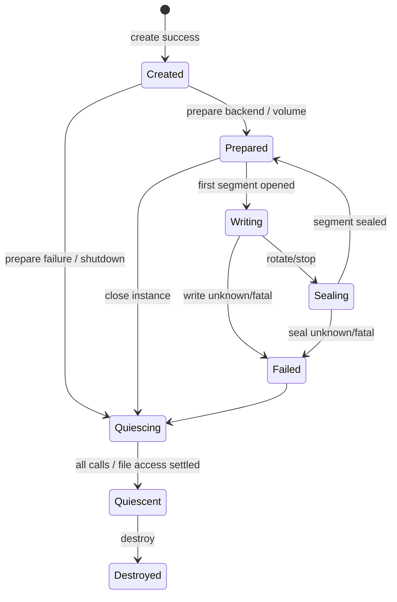

# RoDAQ Storage Plugin 设计

| 文档属性 | 内容 |
| --- | --- |
| 文档类型 | 角色模块详细设计 |
| 状态 | V1 详细设计基线 |
| 适用范围 | 所有 RoDAQ Storage Plugin 的 Descriptor Prepare、Batch Write、Segment、Seal、Durability、Size 与 Failure 规则 |
| 上位设计 | [系统架构设计](architecture.md) |
| 公共插件接口契约 | [Plugin](plugin.md) |
| 关联设计 | [Pipeline](pipeline.md) · [Task](task.md) · [Acquisition](acquisition.md) |

## 1. 目标与角色边界

### 1.1 目标与职责边界

Storage Plugin 负责把 Pipeline 已接纳的 Record 写入某种具体格式，并为 Segment 封口和独立读取提供格式级事实。

它负责：

- 声明可表示的 payload/schema；
- Descriptor/Schema prepare；
- 有界 batch write；
- confirmed prefix / unwritten / Unknown；
- 格式内部索引；
- active segment 物理大小观测；
- seal/close；
- seal reserve；
- 产物文件清单和格式级 metadata；
- Storage 内部资源与 quiescence。

它不负责：

- 决定 Record 是否被 Admission 接纳；
- 分配 AcceptanceSequence；
- 决定 Task Desired State；
- 直接发布最终 RoDAQ 产物目录可见性；
- 把 write success 等价为 durable Segment commit；
- 在 Unknown 后缀上自行重试并制造重复记录。

**Storage 与 Core 的边界。**


Storage 负责格式内部写入和封口；Core Commit Lane 负责 RoDAQ 持久提交：

```text
fsync files/manifest
→ atomic publish
→ fsync parent
→ publish durable fact
```

因此：

```text
Storage write success != Segment durable commit
```

**Storage Instance 生命周期。**



具体实现可以不使用同名状态机，但必须提供等价可证明的生命周期事实。

## 2. 配置、Descriptor 与 Batch 写入规则

### 2.1 配置与 Capability

**配置规则。**

Storage-specific 参数由插件定义，例如：

- format options；
- compression；
- chunk size；
- index options；
- file layout；
- SQLite/MCAP-specific durability options；
- max segment size；
- backend-specific buffering。

Plugin Configuration Schema 负责静态结构约束，插件负责语义校验。

必须拒绝：

- 不支持的 payload/schema；
- 不能形成可靠 size/seal contract 的配置却请求物理大小滚动；
- 资源计划超限；
- backend option 导致无法独立读回；
- 会产生未声明无界内部缓存的配置。

**Storage Capability。**

Storage Capability 至少表达：

| 能力 | 说明 |
| --- | --- |
| payload encodings | 可写入的 payload 表示 |
| schema support | 可表示的 schema/type |
| max record | 单记录上限 |
| max batch | 单批次上限 |
| descriptor prepare | 是否支持动态 Descriptor |
| physical size | 是否能报告活跃 Segment 物理大小 |
| seal reserve | 是否能给出保守封口额外空间 |
| rotation | 支持哪些滚动边界 |
| durability | flush/close/durable 能力 |
| verification | 是否提供故障后格式核验能力 |
| extension requirements | Required namespaced metadata |

不能提供物理大小可靠观测的 Storage 不得声明支持 physical-size rotation。

### 2.2 Descriptor / Schema Prepare

在任何 Record 引用新 Descriptor 前，Pipeline 必须先让 Storage 完成对应 prepare。

prepare 的目标：

- 注册 channel/topic/table/schema；
- 验证 required extension；
- 预先分配必要格式结构；
- 确认当前 Segment 可以表示该 Descriptor。

prepare success 只表示：

```text
future writes can reference this descriptor
```

不表示任何业务 Record 已写入。

**Idempotency。**

同一 `descriptor_id` 的 prepare 必须幂等。

重复调用：

- 成功后再次调用返回相同成功语义；
- 不允许产生重复冲突的格式 schema；
- 不允许改变旧 Descriptor 解释。

同 ID 不同内容必须返回 Conflict/DataLoss 类错误。

**Timeout。**

Descriptor prepare timeout 时：

- RoDAQ 不执行 Descriptor Cut；
- 新 Descriptor Record 不被接纳；
- 调用仍可能迟返时，Storage instance 和相关资源保持所有权；
- 到局部清理 deadline 后按进程恢复规则处理。

### 2.3 Batch Write 与结果语义

**Batch Write Contract。**

V1 强制支持同步有界 batch。

RoDAQ 调用：

```text
write_batch(records[0..N))
```

Storage 返回：

```text
confirmed_prefix = K

remainder =
    DefinitelyUnwritten
    OR
    Unknown
```

其中：

```text
0 <= K <= N
```

成功：

```text
K == N
remainder = none
```

**Confirmed Prefix。**

confirmed prefix 表示 Storage 能证明：

- Record 已按照当前格式顺序写入；
- 格式内部不需要 RoDAQ 再重复提交这些 Record；
- Storage 不再把这些 Record 当作“未尝试”。

confirmed prefix 不是 durable commit。

文件系统缓存、插件内部 buffer、数据库 transaction 或格式 chunk 仍可能尚未完成最终持久提交。

**Definitely Unwritten。**

Storage 只有在能够证明 Record 没有被格式写入时，才允许把后缀标记 DefinitelyUnwritten。

例如：

- 在处理第 K 条前发现参数错误；
- 在任何后缀字节写入前明确失败；
- backend transaction 能确定未执行该范围。

RoDAQ 可以把这些 Record 结算为 AcceptedKnownFailed，但默认不会把它们重新塞回当前污染上下文重试。

是否允许业务级重放属于未来扩展规则。

**Unknown。**

如果 Storage 无法证明后缀到底有没有写入：

```text
remainder = Unknown
```

典型来源：

- syscall/DB/API 返回状态不足以判断部分写入；
- timeout 后调用仍在执行；
- plugin crash；
- transaction 状态不可判定；
- malformed plugin result；
- format index/data state 失去一致性证明。

Unknown 的处理：

1. 关闭 Pipeline Admission Gate；
2. 当前 Segment 标记 contaminated；
3. 不对 Unknown Record 自动重写；
4. 不把该 Segment 正常提交；
5. 保存 confirmed prefix、Unknown 范围和故障证据；
6. 进入 quarantine；
7. Coverage 标记 PersistenceUnknown。

**Payload Consumption Boundary。**

Storage write 接收 RoDAQ 借用的 Record/Payload。

同步 V1：

- write_batch 实际返回前，RoDAQ 不释放传入 payload；
- confirmed prefix 不意味着插件已经停止访问所有输入内存，除非 ABI 明确提供更早 consume boundary；
- timeout 不允许 RoDAQ 假设调用已停止；
- pending/late call 的 payload owner 保持旧 instance。

未来异步 Storage 若加入，必须分别表达：

```text
payload_consumed
persistence_result_known
```

两个独立事件。

## 3. Segment 写入与提交协议

### 3.1 Writer 与 Segment 生命周期

**Writer Lane。**

同一 Storage instance 的所有变更调用默认由一个逻辑 Storage lane 串行：

```text
prepare_descriptor
open_segment
write_batch
seal
close
```

这样 V1 不要求 Storage 自己处理多线程写入顺序。

Storage 不得从内部线程异步修改当前 format session，除非该行为完全封装且不破坏 RoDAQ 单-lane 语义。

**Segment。**

Segment 是 RoDAQ 持久提交单元。

Storage 负责一个 Segment 内的格式文件；Core 负责最终可见性。

Segment identity 至少关联：

- `segment_id`；
- segment sequence；
- `task_id`；
- `pipeline_id`；
- `instance_id`；
- `control_generation`；
- `config_version`；
- `effective_config_id`。

`segment_id` 一旦分配即不复用，即使 Segment 最终 quarantine。

**Segment Open。**

Segment 在第一条待写 Record 到达 Writer 时创建，而不是 Start 时强制创建空文件。

Open 前 Storage 已拥有：

- output staging path；
- effective format config；
- prepared base descriptors；
- bounded resource budget；
- unique segment identity。

空 Recording Instance 不需要产生空 Segment，除非后端格式规范明确要求且通过验收。

### 3.2 Rotation、Physical Size 与 Seal

**Rotation。**

触发：

- duration；
- physical size target；
- Pause/Stop；
- Clock/format policy；
- storage/backend-specific safe boundary。

Record 不跨 Segment。

rotation target 不是严格文件最大字节数；允许完成已开始的有界 Record/Batch。

**Physical Size。**

Storage 必须区分：

- logical payload bytes；
- current physical artifact bytes；
- eventual seal overhead。

如果支持物理大小滚动：

```text
reported physical size
+ worst-case bounded batch overshoot
+ conservative seal reserve
<= volume safety budget
```

必须能测量或保守证明。

不能可靠报告 physical size 时只支持时间等其它滚动条件。

**Seal Reserve。**

seal reserve 覆盖可能发生的：

- index；
- footer；
- metadata；
- compression tail；
- database finalization；
- WAL/checkpoint；
- filesystem-level backend-specific final files。

Resource Plan/Capability 必须提供上界或明确由 Deployment Profile 提供后端资格值。

不能用“平均 seal overhead”做安全容量上界。

**Seal。**

Storage seal 负责：

- 完成格式内部结尾；
- 刷新必要 format buffers；
- 生成最终格式 metadata；
- 返回实际文件清单；
- 返回物理大小；
- 返回格式校验信息；
- 停止修改该 Segment 文件集合。

seal success 之后，该 Segment 才能交给 Core Commit Lane。

Storage seal 仍不等于 RoDAQ durable commit。

**Writer Lane 与 Commit Lane。**

V1 把数据写入和最终文件持久化分开：

```text
Writer Lane:
write N
→ seal N
→ enqueue sealed N
→ open N+1
→ continue writes

Commit Lane:
sealed N
→ sync files
→ write/sync manifest
→ atomic publish
→ parent fsync
→ durable fact
```

Commit queue 必须限制：

- max pending Segment count；
- max pending physical bytes；
- execution slots；
- volume-level fsync concurrency。

达到上限时不能继续无限创建 Segment。

Pipeline 应先关闭 Admission Gate 或进入保护，再结算已接纳数据。

### 3.3 Durable Commit 与 Recovery

**Manifest 贡献。**

Storage 向 RoDAQ Segment Manifest 提供格式级事实，例如：

- storage plugin id/version；
- format version；
- file list；
- physical size；
- checksums；
- backend metadata；
- schema/channel mapping；
- required external reader information。

Core 负责合并：

- Task/Pipeline/Instance identity；
- `effective_config_id`；
- Descriptor；
- system boot/time；
- Coverage；
- Data Impact；
- commit facts。

Storage 不拥有整个 RoDAQ Manifest 的权威。

**Durable Commit。**

正常提交：

1. Storage seal success；
2. Core 验证 file list；
3. 写 RoDAQ manifest temp；
4. fsync data/metadata files；
5. fsync manifest；
6. atomic publish temp→final；
7. fsync parent directory，证明 Segment 文件集合在声明的文件系统故障模型内持久；
8. 在独立于 Segment 目录和 Catalog 的 Durable Artifact Ledger 中持久登记 committed fact；
9. 发布内存 committed event；
10. Catalog 可见。

步骤 7 是 **Segment filesystem durability point**；步骤 8 的 Ledger fact 持久完成是 **RoDAQ normal Committed linearization point**。只有步骤 8 后普通查询才把 Segment 作为正常已保存产物。若步骤 7 已成功但步骤 8 尚未完成，Segment 为 `RegistrationPending`，恢复可核验并补齐 Ledger，而不能直接把目录存在当作 Committed。

**Commit 失败。**

**文件 sync 失败。**

- Segment 不进入正常 catalog；
- 保留 staging/quarantine 证据；
- Pipeline Data Impact 按失败范围报告；
- 不删除无法解释的文件来“清理错误”。

**rename/publish 后 parent fsync 不确定。**

恢复时不能仅凭 final path 存在就认定 durable。

进入 VerificationRequired：

- 核验文件和 manifest；
- 补齐可证明的同步；
- 若无法证明完整性则 quarantine。

**parent fsync 已成功但 Artifact Ledger 登记失败/迟返。**

Segment 保持 `RegistrationPending`，文件不得删除、覆盖或进入正常 Catalog。该 Segment 继续占用 Commit backlog 的 segment/physical-byte 预算，并由原 Commit owner 重试或交给恢复流程补齐 Ledger；不得让 Writer 通过无界创建后续 Segment 绕过该占用。Ledger 持久化故障达到预算或状态目录紧急余量不足时，关闭/保护受影响 Pipeline Admission Gate，优先保留停止、恢复和 Ledger 结算所需容量。只有 Ledger committed fact 已持久完成后，才能释放对应 commit backlog 并报告 normal Committed。

**Quarantine。**

quarantine Segment：

- 不进入正常产物查询；
- 占用卷容量；
- 保留 original segment id；
- 保存 failure reason；
- 保存 confirmed/unknown coverage；
- 不能自动删除来释放空间，除非明确人工/维护策略允许并保留审计。

V1 不承诺自动修复 contaminated format。

**Recovery。**

重启扫描只恢复可证明事实。

| 事实 | 行为 |
| --- | --- |
| temp/staging only | quarantine |
| final path + complete filesystem durable evidence + no Ledger committed fact | verify, then persist Ledger fact and catalog；无法证明则 quarantine |
| final path + uncertain parent sync | VerificationRequired；补齐/证明 filesystem durability 后再登记 Ledger |
| Ledger committed fact + valid final path/manifest | catalog |
| Ledger committed fact + segment missing/corrupt + no legal delete intent | HistoricalArtifactLostOrCorrupt / alert |
| legal retention/Reset delete intent in progress | continue cleanup；文件已删而 Ledger fact 尚在属于可恢复中间态 |
| contaminated/Unknown | quarantine |
| incomplete cleanup | continue maintenance |

Storage plugin 若提供故障后 verification extension，只能作为额外证据来源，不能绕过 Core commit contract。

**Storage Quiescence。**

Storage mutating calls 默认单 lane，因此正常 close 流程：

```text
stop new write dispatch
→ wait current call return
→ seal/abort current segment
→ settle commit handoff
→ close storage instance
→ quiescent
```

如果 write/seal call timeout：

- 该调用仍拥有传入 buffer/format state；
- Storage instance 不销毁；
- 当前 Segment 视为可能 Unknown；
- 达局部清理 deadline 后进入 process-level recovery。

**Storage Resource Plan。**

至少包括：

- internal write buffers；
- compression buffers；
- chunk cache；
- DB page/WAL related bounded resources；
- threads/executors；
- FD；
- max batch；
- max record；
- max active segment files；
- physical size observation overhead；
- seal reserve；
- verification workspace（若支持）；
- any retained input upper bound。

不能把 page cache、kernel I/O queue 或设备吞吐伪装成精确插件 reservation。

**Durability Capability。**

Storage 必须明确：

- write result 表示什么；
- flush 表示什么；
- seal 表示什么；
- 是否存在 backend durability primitive；
- Core 还需要同步哪些文件；
- 哪些文件共同构成可独立读取产物。

不同 backend 不允许用同一个模糊 `flush=true` 语义。

Durability 还依赖目标文件系统/挂载语义，而不仅是 Storage 格式。V1 只对**经过资格验证的本地文件系统与挂载配置**声明上述 commit 保证。Deployment/Volume 层至少记录并验证：稳定 volume identity、文件系统类型、staging/final 同一 mount、directory fsync 可用、同目录 rename 语义以及异常断电后的恢复测试证据。网络文件系统、FUSE 或其它未验证挂载即使 API 表面支持 `fsync/rename`，也不能自动进入生产支持矩阵。

Storage `prepare()` 对当前输出卷执行低成本 capability/identity 检查；破坏上述假设的 mount/volume 变化使 Prepare 失败或进入 Protected，不静默降低 durability。

## 4. 后端、容量与运行约束

### 4.1 Backend 特定要求

**MCAP。**

后端文档至少说明：

- Channel / Schema mapping；
- Chunk；
- compression；
- Summary/index；
- physical size；
- footer/seal reserve；
- independent reader validation；
- ROS 2 profile required extensions。

**rosbag2 SQLite3。**

至少说明：

- `.db3`；
- `metadata.yaml`；
- WAL/journal；
- checkpoint/seal；
- rosbag2 standard playback；
- directory-level atomic publication；
- all required files in manifest。

具体后端不得改变通用 Unknown、Segment commit 和 Payload consumption 语义。

### 4.2 Capacity Protection

Storage 与 Volume capacity 联动。

每卷至少有：

```text
stop watermark
low watermark
recovery watermark
seal reserve
active write budget
pending commit budget
```

关系：

```text
recovery > low > stop
```

空间不足时：

- 禁止新 Segment open；
- 关闭受影响 Pipeline Admission；
- 尽力 seal 已打开 Segment；
- 保留 Required seal reserve；
- 不通过删除 quarantine 隐藏问题。

### 4.3 Observability

Storage 需要提供：

- logical write records/s；
- logical bytes/s；
- physical bytes/s；
- batch latency histogram；
- batch size；
- confirmed prefix failures；
- Unknown count；
- current segment physical bytes；
- seal latency；
- seal overhead；
- pending commit segments/bytes；
- fsync/commit latency（Core）；
- last progress time；
- plugin resource HWM。

指标不能改变写入或提交顺序。

## 5. 开发实现设计

### 5.1 内部组成与 Role ABI

**内部组成。**

Storage 角色建议拆分：

| 对象 | 主要职责 |
| --- | --- |
| `StorageInstance` | 一个 plugin storage instance 的角色状态；Core 侧 C ABI wrapper 是 `rodaq::plugin::StorageHandle`，不属于 Storage 角色内部对象 |
| `DescriptorCatalog` | prepared Descriptor/schema 映射 |
| `SegmentWriter` | 当前 active Segment 的格式写入 |
| `SegmentSealer` | 格式封口、文件清单和 seal facts |
| `CommitQueue` | sealed Segment 的有界交接 |
| `SegmentCommitter` | fsync/manifest/publish/parent fsync，并在文件系统持久完成后通过 Core contract 登记 Durable Artifact Ledger |
| `ArtifactLedger`（Core contract） | 独立保存仍受管理的 committed Segment 最小事实；不属于 Storage plugin ABI，具体持久实现由 Core persistence/artifact 模块提供 |
| `StorageSnapshotPublisher` | write/seal/commit/resource 快照 |

具体 backend 实现只实现 role ABI；Core SegmentCommitter 不依赖 MCAP/SQLite3 类型。

**Storage ABI operation table。**

Storage V1 required role table 固定为：

```c
typedef struct rodaq_storage_capability rodaq_storage_capability_t;
typedef struct rodaq_storage_resource_plan rodaq_storage_resource_plan_t;
typedef struct rodaq_storage_instance_config rodaq_storage_instance_config_t;
typedef struct rodaq_storage_record rodaq_storage_record_t;
typedef struct rodaq_storage_descriptor rodaq_storage_descriptor_t;
typedef struct rodaq_segment_spec rodaq_segment_spec_t;
typedef struct rodaq_segment_size rodaq_segment_size_t;
typedef struct rodaq_storage_batch_result rodaq_storage_batch_result_t;
typedef struct rodaq_segment_seal_result rodaq_segment_seal_result_t;
typedef struct rodaq_storage_instance* rodaq_storage_instance_t;

typedef struct rodaq_storage_operations {
    rodaq_abi_header_t header;

    rodaq_result_code_t (*validate_config)(
        const rodaq_config_api_t* config_api,
        rodaq_config_node_t config,
        rodaq_error_buffer_t* error);

    rodaq_result_code_t (*get_configured_capability)(
        const rodaq_config_api_t* config_api,
        rodaq_config_node_t config,
        rodaq_storage_capability_t* capability,
        rodaq_error_buffer_t* error);

    rodaq_result_code_t (*get_resource_plan)(
        const rodaq_config_api_t* config_api,
        rodaq_config_node_t config,
        rodaq_storage_resource_plan_t* resource_plan,
        rodaq_error_buffer_t* error);

    rodaq_result_code_t (*create)(
        const rodaq_config_api_t* config_api,
        rodaq_config_node_t config,
        const rodaq_storage_instance_config_t* instance_config,
        const rodaq_plugin_services_t* services,
        rodaq_storage_instance_t* instance,
        rodaq_error_buffer_t* error);

    rodaq_result_code_t (*prepare)(
        rodaq_storage_instance_t instance,
        const rodaq_deadline_t* deadline,
        rodaq_error_buffer_t* error);

    rodaq_result_code_t (*prepare_descriptor)(
        rodaq_storage_instance_t instance,
        const rodaq_storage_descriptor_t* descriptor,
        const rodaq_deadline_t* deadline,
        rodaq_error_buffer_t* error);

    rodaq_result_code_t (*open_segment)(
        rodaq_storage_instance_t instance,
        const rodaq_segment_spec_t* segment,
        const rodaq_deadline_t* deadline,
        rodaq_error_buffer_t* error);

    rodaq_result_code_t (*write_batch)(
        rodaq_storage_instance_t instance,
        const rodaq_storage_record_t* records,
        uint32_t record_count,
        const rodaq_deadline_t* deadline,
        rodaq_storage_batch_result_t* batch_result,
        rodaq_error_buffer_t* error);

    rodaq_result_code_t (*get_segment_size)(
        rodaq_storage_instance_t instance,
        rodaq_segment_size_t* segment_size,
        rodaq_error_buffer_t* error);

    rodaq_result_code_t (*seal_segment)(
        rodaq_storage_instance_t instance,
        const rodaq_deadline_t* deadline,
        rodaq_segment_seal_result_t* seal_result,
        rodaq_error_buffer_t* error);

    rodaq_result_code_t (*quiesce)(
        rodaq_storage_instance_t instance,
        const rodaq_deadline_t* deadline,
        rodaq_error_buffer_t* error);

    void (*destroy)(rodaq_storage_instance_t instance);
} rodaq_storage_operations_t;
```

`header.version_major/minor` 是 **Storage Role Protocol** 版本，不是 Common ABI 版本；RoDAQ 同时校验 descriptor 的 role protocol、operation table header 与 `role_operations_size`。V1 `RODAQ_STORAGE_OPERATIONS_BASE_SIZE` 覆盖当前列出的 validate/capability/plan/create/prepare/descriptor/segment/write/seal/quiesce/destroy 全部 required operations，base prefix 内函数指针不得为 NULL。ABI Freeze 后函数顺序、required prefix 及 Batch/Seal 输出语义不得在 minor 中改变，只能尾扩展。当前 mutable operation 全部由 RoDAQ 单 lane 串行。`rodaq_storage_instance_t` 只允许传给 Storage operations；不得与 Acquisition 或未来其它 role instance 互转，C/C++ conformance 示例以 `-Werror` 验证类型误传。`role_operations_size` 必须等于 operation table `header.struct_size`，descriptor role protocol version 必须与 table header 完全一致。V1 同时冻结 `RODAQ_STORAGE_CAPABILITY_BASE_SIZE`、`RODAQ_STORAGE_RESOURCE_PLAN_BASE_SIZE`、`RODAQ_STORAGE_INSTANCE_CONFIG_BASE_SIZE`、`RODAQ_STORAGE_RECORD_BASE_SIZE`、`RODAQ_STORAGE_DESCRIPTOR_BASE_SIZE`、`RODAQ_SEGMENT_SPEC_BASE_SIZE`、`RODAQ_SEGMENT_SIZE_BASE_SIZE`、`RODAQ_STORAGE_BATCH_RESULT_BASE_SIZE` 与 `RODAQ_SEGMENT_SEAL_RESULT_BASE_SIZE`。

官方 C++ 开发路径使用 `rodaq::plugin::StorageFactory` 与 `rodaq::plugin::Storage`，由 `export.hpp` adapter 自动生成上述 C operation table。`storage.hpp` 中的 `StorageCapability`、`StorageResourcePlan`、`StorageInstanceConfig`、`StorageDescriptor`、`SegmentSpec`、`StorageBatch`、`StorageBatchResult`、`StorageWriteOutcome`、`SegmentSealResult` 与本节 C ABI 事实一一对应；`prepare()` 当前没有额外参数结构，只接收 `Deadline`。C++ 对象只存在于插件 DSO 内。MCAP、SQLite3 等官方 Storage 后端应优先实现 C++ 接口，避免重复手写 C trampoline、Result 映射和 ownership glue。

**Storage V1 value layout。** 下列结构是 Storage Role Protocol 的正式 C ABI；所有带 `rodaq_abi_header_t` 的 call-scoped value struct 都写当前 negotiated Storage Role version。V1 `*_BASE_SIZE` 固定为下列 required prefix，未来 minor 只能尾扩展。

```c
typedef struct rodaq_storage_capability {
    rodaq_abi_header_t header;
    rodaq_environment_fingerprint_t environment_fingerprint;

    uint64_t max_record_bytes;
    uint64_t max_batch_bytes;
    uint64_t seal_reserve_bytes;
    uint64_t payload_schema_bits;
    uint64_t descriptor_prepare_bits;
    uint64_t physical_size_bits;
    uint64_t rotation_bits;
    uint64_t durability_bits;
    uint64_t verification_bits;

    uint32_t max_batch_records;
    uint32_t max_segment_file_count;
    uint32_t max_relative_path_bytes;
    uint32_t reserved0;
} rodaq_storage_capability_t;

typedef struct rodaq_storage_resource_plan {
    rodaq_abi_header_t header;
    rodaq_environment_fingerprint_t environment_fingerprint;

    uint64_t plugin_buffer_bytes;
    uint64_t compression_workspace_bytes;
    uint64_t seal_workspace_bytes;
    uint64_t max_internal_inflight_bytes;
    uint64_t max_batch_bytes;

    uint32_t thread_count;
    uint32_t executor_count;
    uint32_t fd_count;
    uint32_t max_batch_records;
    uint32_t max_active_segment_files;
    uint32_t max_segment_file_count;
    uint32_t max_relative_path_bytes;
    uint32_t reserved0;
} rodaq_storage_resource_plan_t;

typedef struct rodaq_storage_instance_config {
    rodaq_abi_header_t header;

    rodaq_task_id_t task_id;
    rodaq_pipeline_id_t pipeline_id;
    rodaq_instance_id_t instance_id;
    rodaq_effective_config_id_t effective_config_id;
    uint64_t control_generation;

    rodaq_environment_fingerprint_t expected_environment_fingerprint;
    rodaq_string_t output_volume_id;

    uint64_t max_record_bytes;
    uint64_t max_batch_bytes;
    uint64_t seal_reserve_bytes;
    uint32_t max_batch_records;
    uint32_t max_segment_file_count;
    uint32_t max_relative_path_bytes;
    uint32_t max_active_segment_files;

    const rodaq_secret_bundle_t* secrets;
} rodaq_storage_instance_config_t;
```

`output_volume_id`、`secrets` 及其 nested bytes 只在 `create()` 调用期间 borrowed，插件必须复制跨调用需要的普通值/凭据。Capability 与 Resource Plan 的 `environment_fingerprint` 必须完全一致；Storage effective limits 不得超过 capability、resource plan 或 Deployment admission 的任何一侧。`max_segment_file_count` 与 `max_relative_path_bytes` 同时决定 seal output 的预分配上界，不能在 seal 时再动态询问容量。

`create()` 只建立准入后的本地实例，不打开业务 Segment、执行长时间 fsync 或等待外部设备恢复。`config_api` 与 config node 只在 create 调用期间 borrowed；`services` 在 create 失败时不得保留，成功后可由该 Storage instance 保存到 destroy 返回。创建前必须重新观察影响 capability/resource plan 的 backend 环境并与 `expected_environment_fingerprint` 比较；不一致时返回 Conflict/Unavailable、保持 `instance == NULL`，由 RoDAQ 重新执行 capability→plan→admission。

Storage 调用顺序冻结为：

| 调用 | 责任 |
| --- | --- |
| validate/capability/plan | 实例创建前完成语义与资源准入 |
| `create` | 建立本地 instance，不创建业务 Segment |
| `prepare` | 验证受管输出位置/volume identity、初始化 backend 运行资源、证明实例具备后续打开 Segment 的条件 |
| `prepare_descriptor` | 为初始/运行期 Descriptor 建立格式解释对象 |
| Prepare Barrier Ready | `prepare` 成功且所有 Required 初始 Descriptor 已成功 prepare |
| `open_segment` | 第一条实际待写 Record 到达或后续 rotation 时创建具体 Segment |

因此一个没有任何 Record 的已启动实例不需要生成空 Segment；同时路径、权限、backend 初始化等普通可预见错误必须尽量在 `prepare` 阶段暴露，而不是拖到第一条 Accepted Record。

### 5.2 Record、Batch 与 Segment ABI

**StorageRecord ABI。**

Storage 不接收 Acquisition 原始对象，而接收 Core accepted Record 的稳定 role representation。V1 采用固定容量时间戳数组：

```c
#define RODAQ_STORAGE_TIMESTAMP_CAPACITY 6u

typedef struct rodaq_storage_timestamp {
    uint32_t role;
    uint32_t clock_domain;
    int64_t value_ns;
} rodaq_storage_timestamp_t;

typedef struct rodaq_storage_record {
    rodaq_abi_header_t header;

    rodaq_stream_id_t stream_id;
    rodaq_descriptor_id_t descriptor_id;
    uint64_t acceptance_sequence;

    rodaq_system_boot_id_t system_boot_id;
    uint64_t clock_epoch_id;
    uint64_t receive_monotonic_ns;
    int64_t receive_realtime_ns;

    rodaq_source_id_t source_id;
    rodaq_source_session_id_t source_session_id;
    uint64_t source_sequence;

    rodaq_bytes_t payload;
    rodaq_storage_timestamp_t timestamps[RODAQ_STORAGE_TIMESTAMP_CAPACITY];

    uint64_t flags;
    uint32_t timestamp_count;
    uint32_t sequence_scope;
    uint8_t has_source_id;
    uint8_t has_source_session_id;
    uint8_t has_source_sequence;
    uint8_t reserved[5];
} rodaq_storage_record_t;
```

records array、payload bytes 及其 nested views 只在同步 `write_batch()` 实际返回前 borrowed；RoDAQ watchdog timeout 但 backend call 未迟返时 borrow 仍持续。`timestamp_count <= RODAQ_STORAGE_TIMESTAMP_CAPACITY`；unused slots 和 absent source fields 必须清零。Storage 只能读取这些事实，不得修改 Record identity 或 Payload。

**BatchResult ABI。**

BatchResult 必须是结构化结果：

```c
typedef uint32_t rodaq_storage_tail_state_t;

enum {
    RODAQ_STORAGE_TAIL_NONE = 0,
    RODAQ_STORAGE_TAIL_DEFINITELY_UNWRITTEN = 1,
    RODAQ_STORAGE_TAIL_UNKNOWN = 2
};

typedef struct rodaq_storage_batch_result {
    rodaq_abi_header_t header;
    uint32_t confirmed_prefix;
    rodaq_storage_tail_state_t tail_state;
} rodaq_storage_batch_result_t;
```

函数返回的 `rodaq_result_code_t` 是 write operation 的唯一状态码；BatchResult 只表达“哪些 Record 已确认写入、剩余部分的确定性”，不再包含第二个 status。

约束：

- `confirmed_prefix <= record_count`；
- full success：函数返回 `OK`，`confirmed_prefix == record_count`，`TAIL_NONE`；
- 函数返回非 OK 且尚未进入任何 backend write 时：`confirmed_prefix == 0`，`TAIL_DEFINITELY_UNWRITTEN`；
- 一旦 backend write 已经开始，任何非 OK 返回都必须给出有效 BatchResult；
- partial known failure：`confirmed_prefix < record_count` + `TAIL_DEFINITELY_UNWRITTEN`；
- 无法证明剩余部分未写入：`TAIL_UNKNOWN`；
- timeout 且 backend call 可能继续执行：必须视为 Unknown；
- ABI 参数本身无效导致无法安全解释输出时，RoDAQ 不读取 BatchResult，但这种错误只能发生在进入 backend write 之前；
- RoDAQ 对其它非法组合整体提升为 Unknown 并认为插件违反接口契约。

**Descriptor Prepare 表示。**

```c
typedef struct rodaq_storage_descriptor {
    rodaq_abi_header_t header;
    rodaq_descriptor_id_t descriptor_id;
    rodaq_stream_id_t stream_id;
    rodaq_string_t encoding;
    rodaq_string_t schema_name;
    rodaq_bytes_t schema;
    rodaq_digest256_t schema_digest;
    uint64_t source_timestamp_role_bits;
    uint64_t flags;
} rodaq_storage_descriptor_t;
```

所有 string/schema bytes 只在 `prepare_descriptor()` 调用实际返回前 borrowed。Storage prepare 返回 success 前必须完成所有会导致“这个 Descriptor 根本无法写”的验证。

允许把昂贵但可延迟的格式对象创建放到 prepare 内，但必须受 operation deadline。

**Segment Spec。**

RoDAQ 为 Storage 创建 staging location，并以正式 value struct 传入：

```c
typedef struct rodaq_segment_spec {
    rodaq_abi_header_t header;
    rodaq_segment_id_t segment_id;
    rodaq_instance_id_t instance_id;
    rodaq_string_t staging_directory;
    uint64_t target_data_bytes;
    uint64_t hard_data_bytes;
    uint64_t seal_reserve_bytes;
    uint32_t max_file_count;
    uint32_t max_relative_path_bytes;
} rodaq_segment_spec_t;

typedef struct rodaq_segment_size {
    rodaq_abi_header_t header;
    uint64_t physical_bytes;
    uint32_t file_count;
    uint32_t reserved0;
} rodaq_segment_size_t;
```

`staging_directory` 只在 `open_segment()` 调用期间 borrowed；Storage 成功 open 后必须保存自己需要的受管路径/目录句柄，不得保存该 string view。V1 不让 Storage 自行选择最终全局目录，也不允许它绕过受管 output root 写任意位置。

文件路径参数必须是受管、规范化后的 RoDAQ-provided location。

Storage 对 staging directory 的写入必须受以下路径约束：

- RoDAQ 提供的 staging root 是唯一允许写入根；
- plugin 产生的文件名/SealResult 只允许相对路径；
- 禁止绝对路径、`..`、空路径和路径规范化后逃逸 staging root；
- Core 在接收 SealResult 后重新验证每个文件仍位于该 Segment staging root；
- symlink/hard-link 是否允许由 V1 platform policy 明确，默认 **不允许插件通过链接引用 staging root 外文件**；
- 最终 publish 只移动/发布经过核验的受管目录，不采用插件返回的任意 final path。

实现优先使用目录句柄/受管 path helper 封装路径解析，避免每个 backend 自行拼接安全检查。

为保证目录 rename 的原子性和 crash consistency，V1 还规定：

- 每个 Segment staging directory 直接创建在对应 final Segment parent 下，使用不可冲突的临时名称；
- staging 与 final 必须位于同一文件系统/挂载点；Prepare 阶段发现无法保证时拒绝该输出位置；
- publish 使用同一 parent 内的 directory rename，不跨文件系统 copy；
- staging/final parent 的受管身份在 `effective_config_id` 中固定，运行中不能静默切换到另一 mount。

**Segment 文件所有权。**

active Segment 生命周期内：

- Storage 拥有格式文件的写入权；
- Core 拥有 staging namespace 和最终 publish 决策；
- seal success 后 Storage 永久放弃对 sealed files 的修改权；
- Commit Lane 取得 sealed files 的 durability/publish owner；
- Catalog 只从 Durable Artifact Ledger committed facts、Segment 核验结果和合法删除进度重建；自身不拥有 committed authority。

同一文件不能同时由 Storage 和 Committer 修改。

### 5.3 Writer、Rotation 与 Seal

**Write Batch Loop。**

Core wrapper 的单次 batch：

```text
build contiguous bounded record descriptors
→ establish payload borrow lifetime
→ call write_batch(deadline)
→ ABI validate BatchResult
→ record format progress
→ on success/known failure settle payloads
→ on Unknown close admission and contaminate Segment
```

Storage plugin 不能持有 records array pointer 超过同步 call return，除非未来异步扩展另行声明。

**Deadline。**

`prepare/open_segment/write_batch/prepare_descriptor/seal/quiesce` 的 deadline 都是 **operation deadline**。`get_segment_size()` 不允许执行可能长期阻塞的 durable I/O；它返回 Storage 在正常写路径维护的已知物理大小/保守观测值。

Storage backend 内的多子步骤共享一个 absolute monotonic deadline。

如果 backend API 不支持取消：

- RoDAQ deadline 到期后停止等待/标记 timeout；
- 实际 backend call 可能仍执行；
- instance、payload、format state 和 execution slot 继续归旧 call；
- 不得同时对同一 instance 发新的 mutable call。

因此 timeout 后该 Storage lane 进入 PendingCleanup/Failed，不是简单继续下一 batch。

**SegmentWriter。**

SegmentWriter 是 Core/Pipeline 私有编排对象，至少维护：

```text
segment_id
segment sequence
active descriptor set
logical records/bytes
reported physical bytes
rotation state
contamination state
last storage progress
```

SegmentWriter 不执行最终 fsync/publish。

**Rotation 判定。**

每次 batch 前后根据：

```text
duration target
reported physical size
max batch overshoot
seal reserve
stop/pause request
clock/format boundary
```

判断是否 seal。

必须确保：

```text
current physical
+ worst-case next accepted batch/record overshoot
+ conservative seal reserve
<= hard volume safety limit
```

如果无法保证，提前停止接纳，而不是写到硬边界后再发现无法 seal。

**SealResult ABI。**

`seal_segment()` 是有副作用且不可安全重放的操作，因此 **V1 禁止 two-pass `required-capacity → 再次 seal`**。容量必须在 Resource Plan/instance admission 阶段确定并由 RoDAQ 在单次 seal 调用前预分配：

```c
typedef struct rodaq_path_buffer {
    char* data;
    uint32_t capacity;
    uint32_t size;
} rodaq_path_buffer_t;

typedef struct rodaq_sealed_file {
    rodaq_path_buffer_t relative_path;
    uint64_t physical_size;
    rodaq_digest256_t content_digest;
    uint32_t digest_kind; /* 0 = none */
    uint32_t flags;
} rodaq_sealed_file_t;

typedef struct rodaq_segment_seal_result {
    rodaq_abi_header_t header;
    rodaq_sealed_file_t* files;
    uint32_t file_capacity;
    uint32_t file_count;
    uint64_t total_physical_bytes;
    uint64_t seal_overhead_bytes;
    uint64_t verification_bits;
} rodaq_segment_seal_result_t;
```

调用前 RoDAQ 必须令 `file_capacity >= admitted max_segment_file_count`，并为每个 `relative_path` 提供 `capacity >= admitted max_relative_path_bytes + 1` 的 caller-owned buffer，全部清零。插件在执行任何 seal side effect **之前**验证这些容量；不足则返回 `InvalidArgument`，不得开始 seal。成功或已开始 seal 后，插件绝不能需要超过已声明上界；若实际 `file_count/path bytes` 超过 admission 声明，属于 Plugin Contract Violation，当前 Segment 进入 quarantine/Unknown 处理，不能通过重调 seal 修复。

`relative_path.capacity` 包含 NUL；`size` 不含 NUL。写出的路径必须有效 UTF-8、NUL-terminated、相对且满足 staging-root 约束。`file_count <= file_capacity`，unused entries 保持全零。`digest_kind == 0` 时 `content_digest` 必须全零。Seal success 后 Storage 永久放弃对这些 sealed files 的修改权。`rodaq_path_buffer_t` 与 `rodaq_sealed_file_t` 是 V1 固定 nested layout，不带 `rodaq_abi_header_t`、不在原地尾扩展；未来需要新增 per-file 字段时通过 SegmentSealResult 的新 tail capability/新 array type 引入，不能改变现有 array stride。

**SealedSegment。**

Writer → Commit Lane 的内部 move-only handoff 建议包含：

```text
segment identity
staging directory
sealed file list
storage manifest contribution
descriptor set
coverage/write outcome
logical/physical sizes
effective_config_id
commit reservation token
```

handoff 完成后 Writer 不再拥有 sealed file publish 权。

### 5.4 Commit、Manifest 与 Recovery

**CommitQueue。**

CommitQueue 在 Prepare 时固定：

```text
max_pending_segments
max_pending_physical_bytes
max_commit_jobs
```

**Commit capacity 必须在 Segment open 前预留，而不是 seal 后再抢。** 每个将要成为 active 的 Segment 先取得 move-only `CommitReservation`：

```text
1 pending-segment token
+
segment_hard_physical_limit + conservative seal reserve
```

只有 reservation 成功后才允许 `open_segment`。因此当前 Segment 完成 seal 后，把 SealedSegment + reservation 交给 CommitQueue 是正常情况下不可因“queue full”失败的 handoff。

seal 返回实际 physical bytes 后：

- actual <= reserved：释放多余 byte reservation；
- actual > reserved：视为违反 Storage size/seal-reserve 声明规则，立即关闭 Admission 并进入保护/故障；已经产生的文件仍由原 Segment owner 结算，不能丢弃；
- Commit terminal 后归还该 Segment 的剩余 reservation。

当 Segment N 已 sealed/commit pending，而 Writer 想打开 Segment N+1 时，必须先取得新的 CommitReservation。若没有容量，Pipeline 关闭或保持 Admission Gate 保护状态，等待已有 Commit 释放容量；不得在没有 reservation 的情况下继续创建新 Segment，也不得把 sealed 文件无界堆在 staging 目录。

Commit byte budget 与卷级实际空间预算是不同层次：前者限制进程内 pending commit backlog，后者保证磁盘还有写入和封口空间，两者都必须满足。

**SegmentCommitter。**

Committer 的正常路径：

```text
validate sealed file list
→ build RoDAQ manifest temp inside staging
→ fsync required data files
→ fsync format metadata files
→ write/fsync manifest temp
→ rename manifest temp to final manifest name inside staging
→ fsync staging directory
→ atomic rename staging directory to final Segment name in same parent
→ fsync Segment parent directory
→ persist Durable Artifact Ledger committed fact
→ publish in-memory committed event / rebuildable Catalog
```

每一步都产生内部 progress marker/verification fact。final directory rename 后对应 parent directory 的 fsync 成功返回是 **Segment filesystem durability point**；随后独立 Durable Artifact Ledger committed fact 完成持久发布才是 **RoDAQ normal Committed linearization point**。Catalog publish 仍是可重建内存/索引事实，不引入额外 durability boundary。若 rename 已成功但 parent fsync 结果未知，则进入 `VerificationRequired`；若 parent fsync 已成功但 Ledger 尚未持久完成，则进入 `RegistrationPending`，恢复核验后补齐 Ledger，二者都不能直接报告 Committed。

**Segment Manifest 字段规范。**

RoDAQ Segment Manifest 是 Core-owned Strict JSON。Storage 只提供其中的 `storage` / `files` / format contribution，不能自行生成另一份权威 Manifest。

字段至少包括：

| 字段 | 类型 | 语义 |
| --- | --- | --- |
| `format_version` | string | Manifest 格式版本 |
| `segment_id` | string | 永不复用的 Segment 身份 |
| `task_id` / `pipeline_id` / `instance_id` | string | 运行归属 |
| `segment_sequence` | decimal string | Pipeline/实例内产物顺序事实，不作为 Record Identity |
| `control_generation` | decimal string | 创建该 Segment 的控制代次 |
| `config_version` | string | Task 不可变配置版本 |
| `effective_config_id` | string | 本实例完整运行契约身份 |
| `acquisition` / `storage` | object | 精确 plugin id/version/build/environment fingerprint |
| `descriptors` | bounded array | 本 Segment 实际引用的 Descriptor 完整解码事实 |
| `files` | bounded array | 受管相对路径、物理大小、checksum/format role |
| `record_coverage` | bounded object/array | 每 Stream sequence/time coverage 与 known/unknown outcome |
| `system_boot_id` / `clock_epochs` | string / bounded array | 接收时间解释证据 |
| `logical_bytes` / `physical_bytes` | decimal string | 统计与容量事实 |
| `commit` | object | seal/commit 结果和必要 durable evidence version |
| `content_digest` | string | Manifest 自身规范化内容摘要 |

所有 64 位计数、sequence 和纳秒时间使用十进制字符串，避免 JSON/JavaScript 精度差异。`files[].path` 必须是已验证的受管相对路径。Manifest 不保存 secret、credential material 或无法长期解释的内存地址/native handle。

Manifest 的 `descriptors` 必须足以让独立 reader 在不依赖当前运行插件内存状态的情况下解释该 Segment；只保存 `descriptor_id` 而不保存对应 schema/encoding 事实是不够的。

**Crash Recovery 边界。**

恢复不能依赖“最后执行到了哪行代码”，而依据文件系统与持久事实。

需要能识别：

```text
staging only
sealed but unpublished
final path + manifest
final path + uncertain parent sync
filesystem durable + Ledger missing (RegistrationPending)
Ledger committed fact + valid Segment
Ledger committed fact + Segment missing/corrupt
quarantine
```

Core recovery scanner 只输出结构化 Evidence，Catalog 决策遵循本章前述 **Recovery** 规则，不从目录时间戳或未验证的文件存在性推断 Committed。

**Commit 并发。**

同 Pipeline 可以 Writer 与 Commit 并行，但：

- 同一个 Segment 只有一个 Commit owner；
- 同卷 Commit concurrency 有硬上限；
- 不能多个 thread 对同一 parent directory 无限制 fsync；
- Pause/Stop 等待该 instance 所有 pending Commit terminal；
- Reset 必须在所有相关 commit/read owners 静止后执行。

### 5.5 Wrapper、后端与开发约束

**Storage C++ Wrapper。**

Core 侧 wrapper 与 Plugin 公共文档中的 `rodaq::plugin::StorageHandle` 对齐：

```cpp
struct StorageWriteOutcome {
    Status status;
    StorageBatchResult batch_result;
};

class StorageHandle {
public:
    Result<void> prepare(Deadline deadline);
    Result<void> prepare_descriptor(
        const StreamDescriptor& descriptor,
        Deadline deadline);
    Result<void> open_segment(
        const SegmentSpec& segment,
        Deadline deadline);
    StorageWriteOutcome write_batch(
        const StorageBatch& batch,
        Deadline deadline);
    Result<SegmentSize> segment_size() const;
    Result<SegmentSealResult> seal_segment(Deadline deadline);
    Result<void> quiesce(Deadline deadline);
};
```

当前 `prepare` 没有独立 request object；`open_segment` 使用已有领域对象 `SegmentSpec`，不再定义 `SegmentOpenRequest`。Wrapper 负责 ABI 校验、Status 映射、deadline/latency metrics 和 error buffer，不让 Pipeline 直接接触 C function table。`StorageWriteOutcome` 在 Core-side namespace 中保留同一双通道语义：`status` 表示操作状态，`batch_result` 始终有效并表示已确认前缀/尾部确定性；尚未进入 backend write 的失败固定为 `0 + DefinitelyUnwritten`，进入 backend write 后按实际事实返回 DefinitelyUnwritten 或 Unknown。Pipeline 不能把非 OK 直接压缩成只有 Status 而丢失 BatchResult。

**Storage Backend Adapter。**

具体 backend 至少分离：

```text
role ABI adapter
backend writer
format/schema mapper
backend config
```

例如 MCAP backend 可以有内部 writer/channel/schema 组件，但这些类型不得泄漏到通用 Storage wrapper。

**SQLite3/WAL 额外约束。**

SQLite backend 详细实现必须明确：

- transaction boundary；
- journal/WAL mode；
- checkpoint timing；
- seal 时哪些文件仍 required；
- crash 后如何证明 DB 可独立读取；
- metadata.yaml 与 DB publication 的一致性边界。

不能只测试正常 close 后能播放。

**MCAP 额外约束。**

MCAP backend 详细实现必须明确：

- Schema/Channel identity mapping；
- chunk target；
- compression workspace；
- index/summary/footer；
- seal reserve 计算；
- writer close 的内存/文件访问终止；
- ROS 2 profile extensions；
- independent MCAP reader 验证。

**Failure Mapping。**

Storage wrapper 将后端错误映射为：

| 后端事实 | Core Data Impact |
| --- | --- |
| prepare 在任何 Record 使用前失败 | None / PreAdmissionOnly |
| batch tail definitely unwritten | AcceptedKnownFailed |
| batch tail unknown | PersistenceUnknown |
| seal failure with known no publication | AcceptedKnownFailed 或 ArtifactQuarantined |
| commit uncertainty | ArtifactQuarantined / PersistenceUnknown |
| committed file later missing/corrupt | HistoricalArtifactLostOrCorrupt |

映射依据结构化事实，不解析 message string。

**Quiesce 与 Destroy。**

Storage `quiesce()` 继承 Plugin 公共幂等收敛契约，对 create 成功后的 Created/Prepared/active/failed instance 都合法；prepare/open/write/seal 任一步失败后也必须经 quiesce 才能 destroy，已 Quiescent 重复调用返回 OK：

```text
prevent new mutable calls
→ wait current write/prepare/seal call actually return
→ settle/abort active Segment according to known result
→ stop backend workers
→ prove no file/payload access
→ Quiescent
```

RoDAQ watchdog 先到但旧 Storage ABI call 尚未返回时仍是 `TimedOutButInFlight`；同一实例 mutable call 串行规则下，RoDAQ 只登记 quiesce pending，等待旧调用迟返后才真正调用 quiesce。旧调用永久不返则按 Plugin 公共规则升级进程级恢复。`destroy()` 只释放 Quiescent 实例，不负责首次 flush/seal、外部 I/O 或未知线程 join。

**Test Seam。**

Storage 详细实现需要：

- fake filesystem sync/publish layer；
- fault injection at each commit syscall；
- Fake Storage plugin with controlled prefix/Unknown；
- fake volume capacity；
- deterministic Commit executor；
- controlled slow fsync；
- canary payload；
- file-list corruption injection。

这样 Segment/Commit 单元测试不依赖真实 MCAP。

**代码组织约束。**

```text
storage/
  instance.*
  descriptor_catalog.*
  segment_writer.*
  segment_sealer.*
  sealed_segment.*
  commit_queue.*
  segment_committer.*
  snapshot.*

plugins/
  mcap/
  sqlite3/
```

目录已经表达 Storage 领域，因此内部文件不重复 `storage_` 前缀，也不保留 `types.*` 兜底文件。Descriptor 映射明确归 `descriptor_catalog`，Segment 写入/封口/提交各自独立命名；共享值类型放在最接近其所有权的文件或公开 `plugin/storage.hpp`。通用 `storage/` 不包含 MCAP/SQLite3 第三方头；文件系统持久提交能力使用职责明确的 platform/storage support 文件，不放入 `common/utils/helpers/detail`。

## 6. 不变量与资格

### 6.1 核心不变量

1. Storage 不决定 Admission。
2. write success 不等于 durable commit。
3. batch 结果只允许 confirmed prefix + DefinitelyUnwritten/Unknown。
4. Unknown 不自动重写。
5. Unknown Segment 不进入正常 catalog。
6. payload 在 Storage 可能访问期间保持有效。
7. mutating Storage calls V1 单 lane。
8. Descriptor 在 Record 使用前必须 prepare。
9. seal success 后 Storage 不再修改该 Segment 文件集合。
10. pending commit count/bytes 有硬上限。
11. final path 存在不自动等于 committed。
12. quarantine 保留原身份和故障证据。
13. Storage plugin 不拥有 Task Desired State。
14. Core Commit 是正常产物可见性的唯一边界。

### 6.2 资格验证

**Fake Storage Contract。**

可控 Storage 覆盖：

- full success；
- K-prefix + DefinitelyUnwritten；
- K-prefix + Unknown；
- malformed K；
- write hang；
- seal hang；
- descriptor prepare fail；
- wrong physical size；
- resource plan mismatch；
- late return。

**Crash Matrix。**

对以下位置注入 process termination：

- batch before/after backend write；
- seal before/after footer；
- manifest write；
- file fsync；
- manifest fsync；
- rename；
- parent fsync；
- Artifact Ledger committed fact write/sync/publish；
- catalog publish。

恢复后每个 Segment 只能归入：

```text
Committed
RegistrationPending
Quarantined
VerificationRequired
Missing/Corrupt
```

不能凭猜测进入 Committed。

**Real Backend。**

真实 MCAP/SQLite3 必须验证：

- independent reader；
- standard playback where applicable；
- descriptor evolution；
- rotation；
- physical size；
- compression；
- disk full；
- I/O error；
- slow fsync；
- long-run commit backlog；
- crash recovery；
- exact file set；
- resource HWM。

### 6.3 性能资格

同步 Batch 是 V1 baseline，必须直接参加真实 ROS 2→MCAP 性能资格。

如果同步 Storage：

- queue/commit lag 不能达到有界稳态；
- CPU/latency 不满足生产画像；
- Pause/Stop convergence 超出预算；

则 V1 发布前引入经过独立设计的异步 Storage extension。

不能用更大的无界 queue 掩盖同步路径不合格。

### 6.4 V1 完成条件

Storage 角色契约完成需要：

- Fake Storage conformance 全通过；
- MCAP 实现无需修改 Pipeline 核心语义；
- Unknown 和 timeout 资源所有权可证明；
- physical-size/seal-reserve 规则通过真实数据验证；
- Writer/Commit backlog（包含 RegistrationPending/Ledger 登记积压）在峰值负载达到有界稳态；
- crash matrix 覆盖 filesystem durability→Artifact Ledger→Catalog 的全部窗口，不存在“目录存在但无法判定 normal Committed”或“Ledger 已提交但文件丢失却无法识别”的未定义恢复；
- retention/Reset 能在文件删除与 Ledger 清理之间任意崩溃点恢复，且不把合法删除误报为历史丢失；
- 独立读回与标准工具互操作通过；
- 72h/168h 资格中文件数、FD、RSS、pending Segment、Artifact Ledger 活跃事实/字节和 commit lag 无未解释增长。
