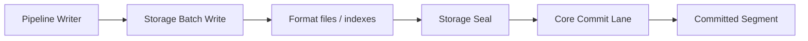
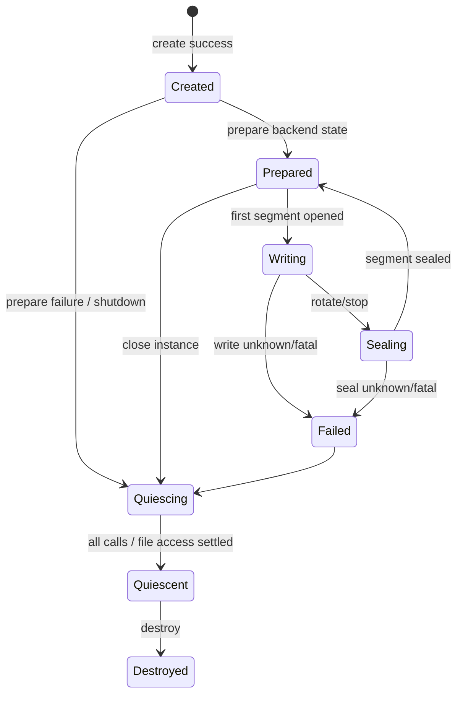

# RoDAQ Storage Plugin 设计

| 文档属性 | 内容 |
| --- | --- |
| 文档类型 | 角色模块详细设计 |
| 状态 | V1 详细设计基线 |
| 适用范围 | 所有 RoDAQ Storage Plugin 的 Descriptor Prepare、Batch Write、Segment、Seal、Durability、Size 与 Failure 规则 |
| 上位设计 | [系统架构设计](architecture.md) |
| 公共插件接口契约 | [Plugin](plugin.md) |
| 关联设计 | [Pipeline](pipeline.md) · [Task](task.md) · [Acquisition](acquisition.md) |

## 1. 目标与角色边界

### 1.1 目标与职责边界

Storage Plugin 负责把 Pipeline 已接纳的 Record 写入某种具体格式，并为 Segment 封口和独立读取提供格式级事实。

它负责：

- 对实际 Canonical Descriptor/payload encoding 执行格式兼容性验证；
- Descriptor/Schema prepare；
- 有界 batch write；
- confirmed prefix / unwritten / Unknown；
- 格式内部索引；
- active segment 物理大小观测；
- `seal_segment()` 格式 finalization；backend 内部可在该调用中 close/checkpoint writer，但没有独立 `close` ABI operation；
- 产物文件清单和格式级 metadata；
- Storage 内部资源与 quiescence。

它不负责：

- 决定 Record 是否被 Admission 接纳；
- 分配 AcceptanceSequence；
- 决定 Task Desired State；
- 直接发布最终 RoDAQ 产物目录可见性；
- 把 write success 等价为 durable Segment commit；
- 在 Unknown 后缀上自行重试并制造重复记录。

**Storage 与 Core 的边界。**



Storage 负责格式内部写入和封口；Core Commit Lane 负责 RoDAQ 持久提交：

```text
fsync files/manifest
→ atomic publish
→ fsync parent
→ publish durable fact
```

因此：

```text
Storage write success != Segment durable commit
```

**Storage Instance 生命周期。**



具体实现可以不使用同名状态机，但必须提供等价可证明的生命周期事实。

## 2. 配置、Descriptor 与 Batch 写入规则

### 2.1 配置与后端差异

**配置规则。**

Storage-specific 参数由插件定义，例如：

- MCAP chunk、compression、summary/index；
- SQLite3 transaction、journal/WAL、checkpoint、metadata layout；
- format-specific mapping 与 reader compatibility；
- backend 自身可配置的 bounded buffering。

Plugin Configuration Schema 负责静态结构约束，插件负责后端语义校验。系统级 Segment 大小、磁盘预算、Volume 水位、文件数/path 上限由 Task/Core/Volume 管理，不复制成 Storage plugin 资源计划。

`validate_config()` 必须拒绝本后端自身无法解释、会导致格式无法独立读回、显式要求插件内部无界缓存或与已发布 Role baseline 冲突的配置。具体 Descriptor/schema 是否可表示，在真正收到 `prepare_descriptor()` 时验证；插件不能在 pre-instance 阶段假装知道未来所有 Descriptor。

**后端差异边界。**

V1 Storage Role 不定义预创建 Capability/ResourcePlan：

- MCAP 可以把一个 Segment 映射为单个 `.mcap` 文件，并在 seal 时完成 chunk/index/summary/footer；
- SQLite3 可以把一个 Segment 映射为 `.db3 + metadata` 等多文件集合，并在 seal 时完成 transaction/checkpoint/WAL 收敛；
- 两者都必须实现同一 `prepare_descriptor/open_segment/write_batch/get_segment_size/seal_segment` 语义；
- `get_segment_size()` 是 V1 Storage baseline，返回当前 backend 实际生成文件集合的物理字节事实；不能可靠提供者不能作为 V1 Storage 实现；
- Core 不关心 backend 内部使用一个还是多个 writer/file handle，只关心实际物理大小、BatchResult 和 seal 后文件清单。

后续新格式只有在现有 Descriptor/Record/Segment/Seal facts 无法表达 **Core 必须理解** 的新语义时才推动 Storage Role minor tail；不同压缩库、数据库 engine、内部 cache 或文件布局本身不构成新增 ABI 的理由。

### 2.2 Descriptor / Schema Prepare

在任何 Record 引用新 Descriptor 前，Pipeline 必须先让 Storage 完成对应 prepare。

prepare 的目标：

- 注册 channel/topic/table/schema；
- 预先分配必要格式结构；
- 确认当前 Segment 可以表示该 Descriptor。

prepare success 只表示：

```text
future writes can reference this descriptor
```

不表示任何业务 Record 已写入。

**Idempotency。**

同一 `descriptor_id` 的 prepare 必须幂等。

重复调用：

- 成功后再次调用返回相同成功语义；
- 不允许产生重复冲突的格式 schema；
- 不允许改变旧 Descriptor 解释。

同 ID 不同内容必须返回 Conflict/DataLoss 类错误。

**Timeout。**

Descriptor prepare timeout 时：

- RoDAQ 不执行 Descriptor Cut；
- 新 Descriptor Record 不被接纳；
- 调用仍可能迟返时，Storage instance 和相关资源保持所有权；
- 到局部清理 deadline 后按进程恢复规则处理。

### 2.3 Batch Write 与结果语义

**Batch Write Contract。**

V1 强制支持同步有界 batch。

RoDAQ 调用：

```text
write_batch(records[0..N))
```

Storage 返回：

```text
confirmed_prefix = K

remainder =
    DefinitelyUnwritten
    OR
    Unknown
```

其中：

```text
0 <= K <= N
```

成功：

```text
K == N
remainder = none
```

**Confirmed Prefix。**

confirmed prefix 表示 Storage 能证明：

- Record 已按照当前格式顺序写入；
- 格式内部不需要 RoDAQ 再重复提交这些 Record；
- Storage 不再把这些 Record 当作“未尝试”。

confirmed prefix 不是 durable commit。

文件系统缓存、插件内部 buffer、数据库 transaction 或格式 chunk 仍可能尚未完成最终持久提交。

**Definitely Unwritten。**

Storage 只有在能够证明 Record 没有被格式写入时，才允许把后缀标记 DefinitelyUnwritten。

例如：

- 在处理第 K 条前发现参数错误；
- 在任何后缀字节写入前明确失败；
- backend transaction 能确定未执行该范围。

RoDAQ 可以把这些 Record 结算为 AcceptedKnownFailed，但默认不会把它们重新塞回当前污染上下文重试。

是否允许业务级重放属于未来扩展规则。

**Unknown。**

如果 Storage 无法证明后缀到底有没有写入：

```text
remainder = Unknown
```

典型来源：

- syscall/DB/API 返回状态不足以判断部分写入；
- timeout 后调用仍在执行；
- plugin crash；
- transaction 状态不可判定；
- malformed plugin result；
- format index/data state 失去一致性证明。

Unknown 的处理：

1. 关闭 Pipeline Admission Gate；
2. 当前 Segment 标记 contaminated；
3. 不对 Unknown Record 自动重写；
4. 不把该 Segment 正常提交；
5. 保存 confirmed prefix、Unknown 范围和故障证据；
6. 进入 quarantine；
7. Coverage 标记 PersistenceUnknown。

**Payload Consumption Boundary。**

Storage write 接收 RoDAQ 借用的 Record/Payload。

同步 V1：

- write_batch 实际返回前，RoDAQ 不释放传入 payload；
- confirmed prefix 不意味着插件已经停止访问所有输入内存，除非 ABI 明确提供更早 consume boundary；
- timeout 不允许 RoDAQ 假设调用已停止；
- pending/late call 的 payload owner 保持旧 instance。

未来异步 Storage 若加入，必须分别表达：

```text
payload_consumed
persistence_result_known
```

两个独立事件。

## 3. Segment 写入、Seal 与 Core Handoff

### 3.1 Writer 与 Segment 生命周期

**Writer Lane。**

同一 Storage instance 的所有变更调用默认由一个逻辑 Storage lane 串行：

```text
prepare_descriptor
open_segment
write_batch
get_segment_size
seal_segment
```

这样 V1 不要求 Storage 自己处理多线程写入顺序。

Storage 不得从内部线程异步修改当前 format session，除非该行为完全封装且不破坏 RoDAQ 单-lane 语义。

**Segment。**

Segment 是 RoDAQ 持久提交单元。

Storage 负责一个 Segment 内的格式文件；Core 负责最终可见性。

Core 的 Segment 记录仍可关联 segment sequence、Task/Pipeline/Instance/control/config/effective-config 等运行事实，但这些全部留在 Core/Manifest/Recovery 域。**Storage Plugin ABI 只接收 `segment_id` 和当前格式写入所需的 SegmentSpec 字段**，不接收 Task/Pipeline/Instance/control identity。`segment_id` 一旦分配即不复用，即使 Segment 最终 quarantine。

**Segment Open。**

Segment 在第一条待写 Record 到达 Writer 时创建，而不是 Start 时强制创建空文件。

Open 前 Storage 已拥有：

- output staging path；
- effective format config；
- prepared base descriptors；
- Core-provided SegmentSpec file/path/seal limits；
- unique segment identity。

空 Recording Instance 不需要产生空 Segment，除非后端格式规范明确要求且通过验收。

### 3.2 Rotation、Physical Size 与 Seal

**Rotation。**

触发：

- duration；
- physical size target；
- Pause/Stop；
- Clock/format policy；
- storage/backend-specific safe boundary。

Record 不跨 Segment。

rotation target 不是严格文件最大字节数；允许完成已开始的有界 Record/Batch。

**Physical Size。**

V1 Storage 必须区分：

- logical payload bytes；
- current physical artifact bytes；
- eventual seal overhead。

`current physical artifact bytes` 的冻结口径是**当前 Segment staging root 下由该 Storage backend 为此 Segment 创建并仍拥有的全部 active files 的当前文件长度之和**。MCAP 主文件、SQLite `.db3`、journal/WAL、backend temp/sidecar 等只要占用当前 Segment 的受管 staging 空间都必须计入；不能只报告“最终读者文件”或 Payload bytes。文件系统 block/metadata 的额外占用不由 Storage 精确报告，由 Core Volume safety margin 和真实文件系统水位保护覆盖。

`get_segment_size()` 对所有 V1 Storage required，返回上述口径的当前值。Core 若启用 physical-size rotation，则按：

```text
reported physical size
+ worst-case bounded next-batch growth
+ seal_reserve_bytes
<= reserved Segment/Volume budget
```

判定是否继续写入；即使当前 Task 只使用 duration rotation，backend 仍必须能可靠报告 physical size 并通过 HWM qualification。无法做到的 backend 不能作为 V1 Storage 实现。

**Seal Reserve。**

seal reserve 覆盖可能发生的：

- index；
- footer；
- metadata；
- compression tail；
- database finalization；
- WAL/checkpoint；
- filesystem-level backend-specific final files。

`seal_reserve_bytes` 是 Storage workload envelope 的固定 Core limit。最坏 finalization 是否可在该 reserve 内完成，必须在 `prepare()` 阶段基于完整 workload envelope 证明；运行期 write/seal 只能验证实际 HWM 未违反该证明，不能到 `open_segment()` 或 `seal_segment()` 才第一次发现普通 reserve 不足。

不能用“平均 seal overhead”做安全容量上界。

**Seal。**

Storage seal 负责：

- 完成格式内部结尾；
- 刷新必要 format buffers；
- 生成最终格式 metadata；
- 返回实际文件清单；
- 返回物理大小；
- 返回格式校验信息；
- 停止修改该 Segment 文件集合。

seal success 之后，该 Segment 才能交给 Core Commit Lane。

Storage seal 仍不等于 RoDAQ durable commit。

**Writer 与 Core Commit 边界。**

Writer 可以在 Core 已经预留下一 Segment/Commit capacity 的前提下，于 Segment N seal 后打开 N+1；具体 CommitQueue、fsync 并发、Volume watermark 和 Admission 保护策略属于 Pipeline/Core。Storage Plugin 只需要保证：`seal_segment()` 返回前格式 finalization 完成，返回后不再修改 sealed file set，并把完整文件清单交给 Core。

### 3.3 Seal 后 Handoff 与 Quiescence

Storage Plugin 的持久化责任在 `seal_segment()` 成功并交回 `SegmentSealResult` 后结束。Seal success 必须证明：

- backend 格式内部 finalization 已完成；
- 返回文件集合足以让对应标准/独立 reader 读取；
- 每个返回文件的相对路径与物理大小是最终事实；
- Storage 不再修改这些 sealed files。

随后文件 sync、RoDAQ Segment Manifest、staging→final 原子发布、parent fsync、Durable Artifact Ledger、Catalog、Recovery、Retention/Reset 都由 Core 接管，完整协议以 [系统架构设计](architecture.md) 与 [Pipeline 设计](pipeline.md) 为权威。Storage Plugin 不提供独立 Manifest contribution bag，也不参与 `RegistrationPending/VerificationRequired/Committed` 状态判定。

**Storage Quiescence。**

Storage mutating calls 默认单 lane。quiesce 前 Core 停止派发新的 descriptor/open/write/seal mutable work，并等待当前调用实际返回；插件随后停止 backend worker、关闭仍由实例拥有且尚未 seal 的格式对象，并证明不再访问 Core 借用的 payload、staging file 或 PluginServices。

如果 write/seal call 在 RoDAQ watchdog 到期后仍未实际返回，该调用继续拥有相关 payload/format state，不能并发 quiesce 或 destroy；长期不迟返时按 Plugin 公共 process-recovery 规则处理。已经 seal 并完成 handoff 的文件不再属于 Storage instance quiescence domain。

**资源、Durability 与 Core 边界。**

Storage Plugin 不拥有系统 Resource Plan、Volume 或 Commit capacity。Task/Core 决定 batch、Record、Segment、disk/seal reserve、pending commit 等预算；Storage 只接受这些限制并在当前 backend 无法满足时明确失败。Compression workspace、SQLite page/WAL memory、MCAP writer buffer、FD/thread 等属于 backend 实现资源：可由插件配置约束的必须有界；无法由 Core 按实例精确控制的通过固定版本/profile、进程级资源限制和真实负载资格验证，不进入 Plugin ABI。

Storage 的格式级职责止于 **seal**：完成格式内部 finalization，停止修改当前 Segment，返回准确的文件清单与物理大小。之后的：

```text
file fsync
manifest write/fsync
atomic rename/publish
parent fsync
Durable Artifact Ledger
Catalog publish
retention / Reset delete
```

全部属于 Core Volume/Commit/Artifact 责任。Storage 不验证 mount identity、不决定磁盘 watermarks、不执行最终产物 publish，也不能把 backend `flush/close` 当成 RoDAQ durable commit。

对 MCAP，seal 可以包含 footer/summary/index/压缩尾；对 SQLite3，seal 可以包含 transaction commit、checkpoint、WAL 收敛以及 metadata 生成。任何仍是 reader 必需的文件都必须出现在 `SegmentSealResult` 文件清单中。

## 4. 后端与运行约束

### 4.1 Backend 特定要求

**MCAP。** backend 文档至少说明 Channel/Schema mapping、Chunk/compression、Summary/index/footer、物理大小计算、seal 所需最坏 reserve、独立 reader 验证以及 ROS 2 projection 如何映射为标准 MCAP schema/channel。对于 V1 MQTT generic JSON profile，Channel topic 使用 Canonical `channel_name`，payload bytes 原样写入；只有 native RETAIN 标记的 Record 额外写入 RoDAQ-defined 稀疏 metadata fact，以 `(stream_id, acceptance_sequence)` 关联 `delivery_flags=RETAINED`。该 metadata 不改变普通 MCAP Message payload，独立 RoDAQ reader 必须能恢复 retained fact；非 RoDAQ 通用工具可忽略该 metadata。

**rosbag2 SQLite3。** backend 文档至少说明 `.db3`/`metadata.yaml`、transaction boundary、journal/WAL mode、checkpoint/seal、物理大小计算、多文件清单、rosbag2 standard playback 与 crash 后独立读回条件。

具体 backend 不得改变通用 Batch Unknown、Payload borrow、Descriptor identity 或 Core Segment commit 语义。

### 4.2 Core Capacity 与 Segment Limits

Volume 的 stop/low/recovery watermark、active write budget、seal reserve 和 pending commit budget 都由 Core/Deployment 管理。稳定的 Storage workload/file/path/seal limits 在 `rodaq_storage_instance_config_t` 中一次下发并于 `prepare()` 验证；`open_segment()` 的 `SegmentSpec` 只携带本次 `segment_id + staging_directory`。Core 自己持有 target/hard rotation threshold，并保证它们不超过已冻结的 workload envelope。

Storage 必须：

- 只在 Core 提供的 staging directory 内创建当前 Segment 文件；
- `prepare()` 已验证 `max_segment_file_count/max_relative_path_bytes/seal_reserve_bytes` 的 backend 上界；`open_segment()` 只做实际 staging I/O，运行期持续校验 HWM 不越 envelope；
- Core 通过 SegmentCapacityToken 保证不会向一个 reservation 提交超过 records/input-bytes/descriptor envelope 的 Accepted Record；若 Storage 实际物理 HWM 仍超过已证明的 `max_segment_physical_bytes`，属于 backend Contract Violation，而不是正常 ResourceExhausted；
- 不读取或修改 Core 的 Volume watermark、Retention、Artifact Ledger。

### 4.3 Observability

Storage Plugin 不提供第二套通用 metrics/snapshot ABI。Core wrapper 可以直接观测 write records/bytes、batch latency、BatchResult、segment size、seal latency/file count、last progress；Writer/Commit/Volume 自己观测 queue/commit/fsync/disk watermarks。插件内部无法从 Role 调用推导的调试信息只通过 Logging 输出，不能成为控制逻辑。RSS/thread/FD、SQLite WAL 行为、MCAP compression workspace 等通过 backend qualification 记录，不由 Plugin ABI 上报资源计划。

## 5. 开发实现设计

### 5.1 内部组成与 Role ABI

**内部组成。**

Storage 角色建议拆分：

| 对象 | 主要职责 |
| --- | --- |
| `StorageInstance` | 一个 plugin storage instance 的角色状态；Core 侧 C ABI wrapper 是 `rodaq::plugin::StorageHandle`，不属于插件内部对象 |
| `DescriptorCatalog` | prepared Descriptor/schema 到 backend channel/table/schema 的映射 |
| `SegmentWriter` | 当前 active Segment 的格式写入与物理大小统计 |
| `SegmentSealer` | 格式 finalization、停止继续修改并返回最终文件清单 |

具体 backend 实现只实现 role ABI。CommitQueue、SegmentCommitter、Volume、Manifest、ArtifactLedger 与 Catalog 都是 Core 组件，不属于 Storage Plugin 内部组成；它们只消费 `SegmentSealResult` 等稳定事实，不依赖 MCAP/SQLite3 类型。

**Storage ABI operation table。**

Storage V1 required role table 固定为：

```c
typedef struct rodaq_storage_instance_config rodaq_storage_instance_config_t;
typedef struct rodaq_storage_record rodaq_storage_record_t;
typedef struct rodaq_storage_descriptor rodaq_storage_descriptor_t;
typedef struct rodaq_segment_spec rodaq_segment_spec_t;
typedef struct rodaq_segment_size rodaq_segment_size_t;
typedef struct rodaq_storage_batch_result rodaq_storage_batch_result_t;
typedef struct rodaq_segment_seal_result rodaq_segment_seal_result_t;
typedef struct rodaq_storage_instance* rodaq_storage_instance_t;

typedef struct rodaq_storage_operations {
    rodaq_abi_header_t header;

    rodaq_result_code_t (*validate_config)(
        const rodaq_config_api_t* config_api,
        rodaq_config_node_t config,
        rodaq_error_buffer_t* error);

    rodaq_result_code_t (*create)(
        const rodaq_config_api_t* config_api,
        rodaq_config_node_t config,
        const rodaq_storage_instance_config_t* instance_config,
        const rodaq_plugin_services_t* services,
        rodaq_storage_instance_t* instance,
        rodaq_error_buffer_t* error);

    rodaq_result_code_t (*prepare)(
        rodaq_storage_instance_t instance,
        const rodaq_deadline_t* deadline,
        rodaq_error_buffer_t* error);

    rodaq_result_code_t (*prepare_descriptor)(
        rodaq_storage_instance_t instance,
        const rodaq_storage_descriptor_t* descriptor,
        const rodaq_deadline_t* deadline,
        rodaq_error_buffer_t* error);

    rodaq_result_code_t (*open_segment)(
        rodaq_storage_instance_t instance,
        const rodaq_segment_spec_t* segment,
        const rodaq_deadline_t* deadline,
        rodaq_error_buffer_t* error);

    rodaq_result_code_t (*write_batch)(
        rodaq_storage_instance_t instance,
        const rodaq_storage_record_t* records,
        uint32_t record_count,
        const rodaq_deadline_t* deadline,
        rodaq_storage_batch_result_t* batch_result,
        rodaq_error_buffer_t* error);

    rodaq_result_code_t (*get_segment_size)(
        rodaq_storage_instance_t instance,
        rodaq_segment_size_t* segment_size,
        rodaq_error_buffer_t* error);

    rodaq_result_code_t (*seal_segment)(
        rodaq_storage_instance_t instance,
        const rodaq_deadline_t* deadline,
        rodaq_segment_seal_result_t* seal_result,
        rodaq_error_buffer_t* error);

    rodaq_result_code_t (*quiesce)(
        rodaq_storage_instance_t instance,
        const rodaq_deadline_t* deadline,
        rodaq_error_buffer_t* error);

    void (*destroy)(rodaq_storage_instance_t instance);
} rodaq_storage_operations_t;
```

`header.version_major/minor` 是 **Storage Role Protocol** 版本，不是 Common ABI 版本；RoDAQ 同时校验 descriptor 的 role protocol、operation table header 与 `role_operations_size`。V1 `RODAQ_STORAGE_OPERATIONS_BASE_SIZE` 覆盖当前列出的 validate/create/prepare/descriptor/segment/write/seal/quiesce/destroy 全部 required operations，base prefix 内函数指针不得为 NULL。ABI Freeze 后函数顺序、required prefix 及 Batch/Seal 输出语义不得在 minor 中改变，只能尾扩展。当前 mutable operation 全部由 RoDAQ 单 lane 串行。`rodaq_storage_instance_t` 只允许传给 Storage operations；不得与 Acquisition 或未来其它 role instance 互转，C/C++ conformance 示例以 `-Werror` 验证类型误传。`role_operations_size` 必须等于 operation table `header.struct_size`，descriptor role protocol version 必须与 table header 完全一致。V1 同时冻结 `RODAQ_STORAGE_INSTANCE_CONFIG_BASE_SIZE`、`RODAQ_STORAGE_RECORD_BASE_SIZE`、`RODAQ_STORAGE_DESCRIPTOR_BASE_SIZE`、`RODAQ_SEGMENT_SPEC_BASE_SIZE`、`RODAQ_SEGMENT_SIZE_BASE_SIZE`、`RODAQ_STORAGE_BATCH_RESULT_BASE_SIZE` 与 `RODAQ_SEGMENT_SEAL_RESULT_BASE_SIZE`。

官方 C++ 开发路径使用 `rodaq::plugin::StorageFactory` 与 `rodaq::plugin::Storage`，由 `export.hpp` adapter 自动生成上述 C operation table。`storage.hpp` 中的 `StorageInstanceConfig`、`StorageDescriptor`、`SegmentSpec`、`StorageBatch`、`StorageBatchResult`、`StorageWriteOutcome`、`SegmentSealResult` 与本节 C ABI 事实一一对应；`prepare()` 当前没有额外参数结构，只接收 `Deadline`。C++ 对象只存在于插件 DSO 内。MCAP、SQLite3 等官方 Storage 后端应优先实现 C++ 接口，避免重复手写 C trampoline、Result 映射和 ownership glue。

**Storage V1 value layout。** 下列结构是 Storage Role Protocol 的正式 C ABI；所有带 `rodaq_abi_header_t` 的 call-scoped value struct 都写当前 negotiated Storage Role version。V1 `*_BASE_SIZE` 固定为下列 required prefix，未来 minor 只能尾扩展。

```c
typedef struct rodaq_storage_instance_config {
    rodaq_abi_header_t header;

    uint64_t max_record_bytes;
    uint64_t max_batch_bytes;
    uint32_t max_batch_records;
    uint32_t max_descriptors_per_segment;

    uint64_t max_segment_records;
    uint64_t max_segment_input_bytes;
    uint64_t max_segment_physical_bytes;
    uint64_t seal_reserve_bytes;

    uint32_t max_segment_file_count;
    uint32_t max_relative_path_bytes;
} rodaq_storage_instance_config_t;
```

`rodaq_storage_instance_config_t` 是 **Core-owned Storage workload envelope**，不是 Plugin Resource Plan。所有字段都由 Task/Core Effective Limits 与 Volume policy 下发：单 Record/Batch 上限约束一次写调用；`max_segment_records / max_segment_input_bytes / max_descriptors_per_segment` 约束一个 Segment 最多承载的工作量；`max_segment_physical_bytes` 约束 seal 前格式对象的最大物理占用；`seal_reserve_bytes` 单独保留给最坏格式 finalization；file/path 上限约束 seal 文件集合。插件不能提高这些值或反向要求 Core 按自身预测分配更多系统资源。

`create()` 复制 backend config 与该 envelope。`prepare()` 必须在不创建正式 Segment 的前提下完成 **format-bound proof**：针对当前固定 backend config，证明任意满足上述 records/input-bytes/descriptors/batch 上限的合法 Segment，其 seal 前物理大小不超过 `max_segment_physical_bytes`，最坏 finalization 额外物理需求不超过 `seal_reserve_bytes`，最终文件数/path 长度不超过对应上限。无法给出保守证明的配置/backend 必须在 Prepare Barrier 前返回 `ResourceExhausted/InvalidArgument/UnsupportedConfiguration`，不能把“也许 seal 时够用”留到第一条 Accepted Record 之后。

这个证明允许非常保守，但必须可实现、可测试：MCAP qualification 至少把 records、payload/input bytes、Descriptor/Channel 数、chunk policy、summary/index/footer 和压缩最坏膨胀纳入 bound；SQLite3 qualification 至少把 page size、row/index amplification、journal/WAL/checkpoint policy、metadata 文件和最终 checkpoint/finalization 纳入 bound。公式属于 backend 实现/资格证明，不进入公共 ABI；官方 backend 必须提供 boundary/golden fixture 证明在 envelope 极值下不会越界。若某 backend 无法证明硬上界，则不能作为 V1 Storage backend，而不能重新引入 ResourcePlan 或在运行时无限扩容。

Task/Pipeline/Instance identity、`control_generation` 和 `effective_config_id` 属于 Core 控制/恢复域，不传给 Storage Plugin；opaque instance handle 已经唯一确定当前 backend instance。

`create()` 只建立本地 backend instance，不打开 Segment、不验证 Volume/mount、不执行文件 I/O。`config_api` 与 config node 只在调用期间 borrowed；`services` 在 create 失败时不得保留，成功后可由实例保存到 destroy 返回。格式库初始化中真正需要外部/可失败工作的部分放到 `prepare()`。

Storage 调用顺序冻结为：

| 调用 | 责任 |
| --- | --- |
| `validate_config` | 纯 backend 配置语义检查，不访问 Volume/文件系统 |
| `create` | 建立本地 instance、复制 backend config 与 Core limits，不创建业务 Segment |
| `prepare` | 初始化可复用的格式/backend 状态，并验证 Core workload envelope 的 format-bound proof；不创建 active Segment |
| `prepare_descriptor` | 为初始/运行期 Descriptor 建立格式解释对象 |
| Prepare Barrier Ready | `prepare` 的 format-bound proof 成功、首个 Core SegmentReservation 已取得、所有 Required 初始 Descriptor 已成功 prepare |
| `open_segment` | 第一条属于某个已预留 SegmentReservation 的 Record 到达或后续 rotation 时，才在 Core staging directory 创建具体格式对象 |

因此一个没有任何 Record 的已启动实例不需要生成空 Segment。Prepare Barrier 的承诺是“所有无正式录制文件即可提前验证的配置、format envelope、初始 Descriptor、Core Segment/Volume/Commit reservation 已闭合”，**不是保证 Operational I/O 永不失败**。Core 在 Gate Open 前已取得首个 SegmentReservation，但真正的目录/文件/SQLite/MCAP writer 创建仍延迟到第一条 Accepted Record 到达 Writer 时。

`open_segment()` 的 staging path 必须由 Core 在调用前完成受管路径、mount/Volume、父目录和权限前置检查；插件仍可能因实际 `open/create` I/O、设备错误或后端库错误失败。如果它在任何 Record 写入前明确失败，则该 reservation 上已经 Accepted 的 Record 结算为 `AcceptedKnownFailed`，payload/token 正常释放，Pipeline 关闭 Admission 并按错误可恢复性进入 Protected/Failed；若 `open_segment()` watchdog 先到且调用未迟返，先保持 PendingCleanup/ownership，不把 Record 错标为 PersistenceUnknown，因为尚未调用 `write_batch()`。

### 5.2 Record、Batch 与 Segment ABI

**StorageRecord ABI。**

Storage 不接收 Acquisition 原始对象，而接收 Core accepted Record 的稳定 role representation。V1 采用固定容量时间戳数组：

```c
#define RODAQ_STORAGE_TIMESTAMP_CAPACITY 6u

typedef struct rodaq_storage_record {
    rodaq_abi_header_t header;

    rodaq_stream_id_t stream_id;
    rodaq_descriptor_id_t descriptor_id;
    uint64_t acceptance_sequence;

    rodaq_system_boot_id_t system_boot_id;
    uint64_t clock_epoch_id;
    uint64_t receive_monotonic_ns;
    int64_t receive_realtime_ns;

    rodaq_source_id_t source_id;
    rodaq_source_session_id_t source_session_id;
    uint64_t source_sequence;

    rodaq_bytes_t payload;
    rodaq_record_timestamp_t timestamps[RODAQ_STORAGE_TIMESTAMP_CAPACITY];

    uint32_t timestamp_count;
    rodaq_sequence_scope_t sequence_scope;
    rodaq_record_delivery_flags_t delivery_flags;
    uint8_t has_source_id;
    uint8_t has_source_session_id;
    uint8_t has_source_sequence;
    uint8_t reserved[5];
} rodaq_storage_record_t;
```

records array、payload bytes 及其 nested views 只在同步 `write_batch()` 实际返回前 borrowed；RoDAQ watchdog timeout 但 backend call 未迟返时 borrow 仍持续。`timestamp_count <= RODAQ_STORAGE_TIMESTAMP_CAPACITY`；unused slots 和 absent source fields 必须清零。Storage 与 Acquisition 使用 Common ABI 的同一 `rodaq_record_timestamp_t / rodaq_timestamp_role_t / rodaq_clock_domain_t / rodaq_sequence_scope_t / rodaq_record_delivery_flags_t`；Storage 的额外 timestamp slots 用于 Core 在接纳后补充仍需保留的规范时间事实，不能重新解释枚举数值。`delivery_flags` V1 只允许 `RETAINED`，其它 bit fail-closed。Storage 只能读取这些事实，不得修改 Record identity、Payload 或 delivery semantics。

**BatchResult ABI。**

BatchResult 必须是结构化结果：

```c
typedef uint32_t rodaq_storage_tail_state_t;

enum {
    RODAQ_STORAGE_TAIL_NONE = 0,
    RODAQ_STORAGE_TAIL_DEFINITELY_UNWRITTEN = 1,
    RODAQ_STORAGE_TAIL_UNKNOWN = 2
};

typedef struct rodaq_storage_batch_result {
    rodaq_abi_header_t header;
    uint32_t confirmed_prefix;
    rodaq_storage_tail_state_t tail_state;
} rodaq_storage_batch_result_t;
```

函数返回的 `rodaq_result_code_t` 是 write operation 的唯一状态码；BatchResult 只表达“哪些 Record 已确认写入、剩余部分的确定性”，不再包含第二个 status。

约束采用完整矩阵，不允许 Adapter 自行解释：

- 合法 `write_batch()` 必须满足 `record_count > 0`、`records != NULL`、`batch_result != NULL`；空 batch 是 `InvalidArgument`，不会进入 backend write。`error` 可以为 NULL，它只影响人类可读错误细节，不影响结果语义；
- `confirmed_prefix <= record_count`；
- `TAIL_NONE` **当且仅当** `confirmed_prefix == record_count`；`TAIL_DEFINITELY_UNWRITTEN/TAIL_UNKNOWN` 只允许在 `confirmed_prefix < record_count`；
- `OK` 只允许 `(confirmed_prefix == record_count, tail_state == TAIL_NONE)`；`OK + partial prefix` 或 `OK + TAIL_UNKNOWN/DEFINITELY_UNWRITTEN` 是 Contract Violation；
- 非 OK 且尚未进入任何 backend write：固定为 `0 + TAIL_DEFINITELY_UNWRITTEN`；
- 非 OK 且已进入 backend write、能够证明后缀未写：`0..record_count-1 + TAIL_DEFINITELY_UNWRITTEN`；
- 非 OK 且已进入 backend write、无法证明后缀未写：`0..record_count-1 + TAIL_UNKNOWN`；`0 + TAIL_UNKNOWN` 合法，表示连第一条是否写入都无法证明；
- 非 OK + `(confirmed_prefix == record_count, tail_state == TAIL_NONE)` 合法，表示所有 Record 已确认进入 backend，但 operation 在随后步骤失败；Pipeline 必须同时保留“records 已确认写入”和“operation failed”两个事实，不能把它归一化成 OK；
- RoDAQ watchdog 先到且 backend call 仍在执行时，在实际迟返前不消费 BatchResult；若最终迟返结果无法证明剩余部分未写，必须返回 `TAIL_UNKNOWN`；
- ABI 参数/header 本身非法时插件必须在任何 backend side effect 前返回，RoDAQ 不读取 BatchResult；其它不在上表中的组合全部是 Plugin Contract Violation，wrapper fail-closed，而不是静默改写为某个合法组合。

**Descriptor Prepare 表示。**

```c
typedef struct rodaq_storage_descriptor {
    rodaq_abi_header_t header;
    rodaq_descriptor_id_t descriptor_id;
    rodaq_stream_id_t stream_id;
    rodaq_data_profile_t data_profile;
    uint32_t reserved0;
    rodaq_string_t channel_name;
    rodaq_string_t message_encoding;
    rodaq_string_t schema_name;
    rodaq_string_t schema_encoding;
    rodaq_bytes_t schema;
    rodaq_string_t ros2_type_description_hash;
    const rodaq_ros2_qos_profile_t* ros2_offered_qos_profiles;
    uint32_t ros2_offered_qos_profile_count;
    uint32_t reserved1;
} rodaq_storage_descriptor_t;
```

所有 string/schema/QoS views 只在 `prepare_descriptor()` 调用实际返回前 borrowed。Storage 收到的是 Core 已规范化并冻结的 Canonical Descriptor，不读取 Acquisition plugin config。`generic` profile 的 `channel_name/message_encoding/schema_name/schema_encoding/schema` 由具体 Storage 判断是否支持；`ros2` profile 则额外提供 optional `ros2_type_description_hash` 与 typed `rodaq_ros2_qos_profile_t[]`。MCAP Storage 负责把 typed QoS 序列化为自身 ROS 2 profile metadata；rosbag2 SQLite3 Storage 负责映射为其 TopicMetadata/metadata 表达。Storage 不接收 Acquisition 提交的 schema digest 或 timestamp-role capability：schema digest 是 Core 内部计算事实，实际 timestamp role/domain 随每条 StorageRecord 自描述。未知 profile/token/QoS enum 是 Contract Violation 或 UnsupportedConfiguration，不能猜测转换。Storage prepare 返回 success 前必须完成所有会导致“这个 Descriptor 根本无法写”的验证。

允许把昂贵但可延迟的格式对象创建放到 prepare 内，但必须受 operation deadline。

**Segment Spec。**

RoDAQ 为 Storage 创建 staging location，并以正式 value struct 传入：

```c
typedef struct rodaq_segment_spec {
    rodaq_abi_header_t header;
    rodaq_segment_id_t segment_id;
    rodaq_string_t staging_directory;
} rodaq_segment_spec_t;

typedef struct rodaq_segment_size {
    rodaq_abi_header_t header;
    uint64_t physical_bytes;
    uint32_t file_count;
    uint32_t reserved0;
} rodaq_segment_size_t;
```

`staging_directory` 只在 `open_segment()` 调用期间 borrowed；Storage 成功 open 后必须保存自己需要的受管路径/目录句柄，不得保存该 string view。V1 不让 Storage 自行选择最终全局目录，也不允许它绕过受管 output root 写任意位置。Segment workload/file/path/seal limits 已在 instance config 中冻结并于 `prepare()` 验证，因此 `SegmentSpec` 不重复携带这些稳定限制，也不携带 Core rotation target/hard threshold。

文件路径参数必须是受管、规范化后的 RoDAQ-provided location。

Storage 对 staging directory 的写入必须受以下路径约束：

- RoDAQ 提供的 staging root 是唯一允许写入根；
- plugin 产生的文件名/SealResult 只允许相对路径；
- 禁止绝对路径、`..`、空路径和路径规范化后逃逸 staging root；
- Core 在接收 SealResult 后重新验证每个文件仍位于该 Segment staging root；
- symlink/hard-link 是否允许由 V1 platform policy 明确，默认 **不允许插件通过链接引用 staging root 外文件**；
- 最终 publish 只移动/发布经过核验的受管目录，不采用插件返回的任意 final path。

实现优先使用目录句柄/受管 path helper 封装路径解析，避免每个 backend 自行拼接安全检查。

为保证目录 rename 的原子性和 crash consistency，V1 还规定：

- 每个 Segment staging directory 直接创建在对应 final Segment parent 下，使用不可冲突的临时名称；
- staging 与 final 必须位于同一文件系统/挂载点；Prepare 阶段发现无法保证时拒绝该输出位置；
- publish 使用同一 parent 内的 directory rename，不跨文件系统 copy；
- staging/final parent 的受管身份由 Core 的 Effective Configuration/Volume contract 固定；Storage Plugin 不接收该 identity，也不能切换到其它 mount/path。

**Segment 文件所有权。**

active Segment 生命周期内：

- Storage 拥有格式文件的写入权；
- Core 拥有 staging namespace 和最终 publish 决策；
- seal success 后 Storage 永久放弃对 sealed files 的修改权；
- Commit Lane 取得 sealed files 的 durability/publish owner；
- Catalog 只从 Durable Artifact Ledger committed facts、Segment 核验结果和合法删除进度重建；自身不拥有 committed authority。

同一文件不能同时由 Storage 和 Committer 修改。

### 5.3 Writer、Rotation 与 Seal

**Write Batch Loop。**

Core wrapper 的单次 batch：

```text
build contiguous bounded record descriptors
→ establish payload borrow lifetime
→ call write_batch(deadline)
→ ABI validate BatchResult
→ record format progress
→ on success/known failure settle payloads
→ on Unknown close admission and contaminate Segment
```

Storage plugin 不能持有 records array pointer 超过同步 call 的实际 return；未来若设计异步 Storage Role，必须另行冻结独立 ownership/completion contract。

**Deadline。**

`prepare/open_segment/write_batch/prepare_descriptor/seal/quiesce` 的 deadline 都是 **operation deadline**。`get_segment_size()` 不允许执行可能长期阻塞的 durable I/O；它返回 Storage 在正常写路径维护的当前物理大小事实，用于 Core rotation/observability。V1 所有 Storage 都必须提供该事实；如果返回值超过 `max_segment_physical_bytes`，立即按 Plugin Contract Violation fail-closed。seal reserve 的正确性不依赖运行期猜测，而依赖 prepare-time workload-envelope proof。

Storage backend 内的多子步骤共享一个 absolute monotonic deadline。

如果 backend API 不支持取消：

- RoDAQ deadline 到期后停止等待/标记 timeout；
- 实际 backend call 可能仍执行；
- instance、payload、format state 和 execution slot 继续归旧 call；
- 不得同时对同一 instance 发新的 mutable call。

因此 timeout 后该 Storage lane 进入 PendingCleanup/Failed，不是简单继续下一 batch。

**SegmentWriter。**

SegmentWriter 是 Core/Pipeline 私有编排对象，至少维护：

```text
segment_id
segment sequence
active descriptor set
logical records/bytes
reported physical bytes
rotation state
contamination state
last storage progress
```

SegmentWriter 不执行最终 fsync/publish。

**Rotation 判定。**

Rotation 是 Core/SegmentWriter policy，不是 Storage Plugin contract；`SegmentSpec` 不再携带 target/hard rotation thresholds。每次 batch 前后 Core 根据：

```text
duration target
reported physical size
max batch overshoot
seal reserve
stop/pause request
clock/format boundary
```

判断是否 seal。

必须确保：

```text
current physical
+ worst-case next accepted batch/record overshoot
+ conservative seal reserve
<= hard volume safety limit
```

如果无法保证，提前停止接纳，而不是写到硬边界后再发现无法 seal。

**SealResult ABI。**

`seal_segment()` 是有副作用且不可安全重放的操作，因此 **V1 禁止 two-pass `required-capacity → 再次 seal`**。容量必须由 Core 在 `open_segment()` 时通过 SegmentSpec 固定，并由 RoDAQ 在单次 seal 调用前按该 Segment limit 预分配：

```c
typedef struct rodaq_path_buffer {
    char* data;
    uint32_t capacity;
    uint32_t size;
} rodaq_path_buffer_t;

typedef struct rodaq_sealed_file {
    rodaq_path_buffer_t relative_path;
    uint64_t physical_size;
} rodaq_sealed_file_t;

typedef struct rodaq_segment_seal_result {
    rodaq_abi_header_t header;
    rodaq_sealed_file_t* files;
    uint32_t file_capacity;
    uint32_t file_count;
    uint64_t total_physical_bytes;
} rodaq_segment_seal_result_t;
```

调用前 RoDAQ 必须令 `file_capacity >= instance_config.max_segment_file_count`，并为每个 `relative_path` 提供 `capacity >= instance_config.max_relative_path_bytes + 1` 的 caller-owned buffer，全部清零。插件在执行任何 seal side effect **之前**验证这些容量；不足则返回 `InvalidArgument`，不得开始 seal。成功或已开始 seal 后，插件绝不能需要超过已声明上界；若实际 `file_count/path bytes` 超过 instance workload envelope/Core 下发上限，属于 Plugin Contract Violation，当前 Segment 进入 quarantine/Unknown 处理，不能通过重调 seal 修复。

`relative_path.capacity` 包含 NUL；`size` 不含 NUL。写出的路径必须有效 UTF-8、NUL-terminated、相对且满足 staging-root 约束。`file_count <= file_capacity`，unused entries 保持全零。`total_physical_bytes` 必须等于所有 `files[i].physical_size` 的 checked sum。Seal success 后 Storage 永久放弃对这些 sealed files 的修改权。`rodaq_path_buffer_t` 与 `rodaq_sealed_file_t` 是 V1 固定 nested layout，不带 `rodaq_abi_header_t`、不在原地尾扩展；未来需要新增 per-file 格式事实时通过 SegmentSealResult 的 Role minor typed tail/新 array type 引入，不能改变现有 array stride。

文件内容 digest 不由 Storage Plugin 计算或声明。Core 在 seal handoff 后、durable publish 前基于只读 sealed files 计算自身 Manifest/Artifact integrity digest；这样 MCAP、SQLite3 等后端不承担 RoDAQ Artifact integrity policy，也不会产生 `plugin digest + Core digest` 双事实。`seal_overhead_bytes` 同样不进入 Plugin ABI；Core 可以根据 seal 前后的物理大小观测计算需要的运行指标。

**SealedSegment。**

Writer → Commit Lane 的内部 move-only handoff 建议包含：

```text
segment identity
staging directory
sealed file list
descriptor set
coverage/write outcome
logical/physical sizes
effective_config_id
commit reservation token
```

handoff 完成后 Writer 不再拥有 sealed file publish 权。

### 5.4 Core Commit 边界

`SegmentSealer` 成功返回后，插件向 Core 的唯一 handoff 是结构化 `SegmentSealResult`（relative path + physical size）加上 Core 已持有的 Descriptor/coverage/effective configuration facts。随后 Core 自己计算文件 digest 并进入 durability/publish。Storage Plugin 不创建或拥有 `CommitQueue`、`SegmentCommitter`、RoDAQ Manifest、Durable Artifact Ledger、Catalog 或 Recovery state。

Core 在打开 Segment 之前自行预留 commit/backlog/Volume capacity；seal 后该 reservation 随 sealed Segment 转移到 Commit lane。因此“Commit queue 是否还有容量”不能成为 Storage seal 后才发现的插件问题。文件系统 durability、Manifest 内容、最终目录 publication、Ledger committed fact 和 crash recovery 的详细算法完全由 [Pipeline](pipeline.md) 和 [系统架构](architecture.md) 定义。

Storage 的扩展性只体现在它能够返回不同的 sealed file set：MCAP 通常是单文件，SQLite3 可以是 DB + metadata 等多文件。Core 对文件列表使用统一的路径/大小/digest contract，不理解 MCAP footer、SQLite WAL 等 backend 内部对象。若未来 Core Manifest 真正需要一个当前 Canonical Descriptor/SealResult 无法表达的 typed fact，应优先扩展对应 Role value struct 的 minor tail，而不是增加任意 metadata contribution map。

### 5.5 Wrapper、后端与开发约束

**Storage C++ Wrapper。**

Core 侧 wrapper 与 Plugin 公共文档中的 `rodaq::plugin::StorageHandle` 对齐：

```cpp
struct StorageWriteOutcome {
    Status status;
    StorageBatchResult batch_result;
};

class StorageHandle {
public:
    Result<void> prepare(Deadline deadline);
    Result<void> prepare_descriptor(
        const StreamDescriptor& descriptor,
        Deadline deadline);
    Result<void> open_segment(
        const SegmentSpec& segment,
        Deadline deadline);
    StorageWriteOutcome write_batch(
        const StorageBatch& batch,
        Deadline deadline);
    Result<SegmentSize> segment_size() const;
    Result<SegmentSealResult> seal_segment(Deadline deadline);
    Result<void> quiesce(Deadline deadline);
};
```

当前 `prepare` 没有独立 request object；`open_segment` 使用已有领域对象 `SegmentSpec`，不再定义 `SegmentOpenRequest`。Wrapper 负责 ABI 校验、Status 映射、deadline/latency metrics 和 error buffer，不让 Pipeline 直接接触 C function table。`StorageWriteOutcome` 在 Core-side namespace 中保留同一双通道语义：`status` 表示操作状态，`batch_result` 始终有效并表示已确认前缀/尾部确定性；尚未进入 backend write 的失败固定为 `0 + DefinitelyUnwritten`，进入 backend write 后按实际事实返回 DefinitelyUnwritten 或 Unknown。Pipeline 不能把非 OK 直接压缩成只有 Status 而丢失 BatchResult。

**Storage Backend Adapter。**

具体 backend 至少分离：

```text
role ABI adapter
backend writer
format/schema mapper
backend config
```

例如 MCAP backend 可以有内部 writer/channel/schema 组件，但这些类型不得泄漏到通用 Storage wrapper。

**SQLite3/WAL 额外约束。**

SQLite backend 详细实现必须明确：

- transaction boundary；
- journal/WAL mode；
- checkpoint timing；
- seal 时哪些文件仍 required；
- crash 后如何证明 DB 可独立读取；
- metadata.yaml 与 DB publication 的一致性边界。

不能只测试正常 backend close/checkpoint 后能播放；必须验证 `seal_segment()` 返回时形成的 file set 已满足独立读回条件。

**MCAP 额外约束。**

MCAP backend 详细实现必须明确：

- Schema/Channel identity mapping；
- chunk target；
- compression workspace；
- index/summary/footer；
- seal reserve 计算；
- `seal_segment()` 内部 writer close/finalize 后的内存/文件访问终止；
- ROS 2 projection/schema-channel mapping；
- independent MCAP reader 验证。

**Failure Mapping。**

Storage wrapper 将后端错误映射为：

| 后端事实 | Core Data Impact |
| --- | --- |
| prepare 在任何 Record 使用前失败 | None / PreAdmissionOnly |
| batch tail definitely unwritten | AcceptedKnownFailed |
| batch tail unknown | PersistenceUnknown |
| seal failure | AcceptedKnownFailed / PersistenceUnknown，按 seal 实际副作用确定性判定 |

映射依据结构化事实，不解析 message string。

**Quiesce 与 Destroy。**

Storage `quiesce()` 继承 Plugin 公共幂等收敛契约，对 create 成功后的 Created/Prepared/active/failed instance 都合法；prepare/open/write/seal 任一步失败后也必须经 quiesce 才能 destroy，已 Quiescent 重复调用返回 OK：

```text
prevent new mutable calls
→ wait current write/prepare/seal call actually return
→ settle/abort active Segment according to known result
→ stop backend workers
→ prove no file/payload access
→ Quiescent
```

RoDAQ watchdog 先到但旧 Storage ABI call 尚未返回时仍是 `TimedOutButInFlight`；同一实例 mutable call 串行规则下，RoDAQ 只登记 quiesce pending，等待旧调用迟返后才真正调用 quiesce。旧调用永久不返则按 Plugin 公共规则升级进程级恢复。`destroy()` 只释放 Quiescent 实例，不负责首次 flush/seal、外部 I/O 或未知线程 join。

**Test Seam。**

Storage Plugin conformance 只注入 Role 边界故障：controlled Batch prefix/Unknown、Descriptor prepare failure、slow/hanging write、wrong physical size、seal failure/hang、malformed/escaping file list、Core workload-envelope violation、late return 和 quiesce race。每个官方 backend 还必须有 **workload-bound fixture**：在 `max_segment_records / max_segment_input_bytes / max_descriptors_per_segment / max_batch_*` 的边界与组合极值下运行到 seal，断言 seal 前 physical HWM 不超过 `max_segment_physical_bytes`、额外 finalization 不超过 `seal_reserve_bytes`、最终 file/path 不超过 instance limits；再对每个上界做 +1/恶意 backend fixture，证明 Core 在 Admission 前拒绝超 workload，而 plugin 实际越界会被识别为 Contract Violation。MCAP/SQLite3 的 bound 公式和 golden evidence 必须随 backend config/version 固定并进入发布支持矩阵。

filesystem sync/publish、Volume full/watermark、Commit executor、Artifact Ledger 与 Catalog crash-window fault injection 属于 Core Pipeline/Artifact integration tests，不是 Storage Plugin conformance。真实 MCAP/SQLite3 仍要参加端到端 crash/readback 测试，但目的是验证格式 handoff 与 Core commit 能组合成立，而不是让插件拥有 commit authority。

**代码组织约束。**

```text
plugins/
  mcap/
    instance.*
    descriptor_catalog.*
    segment_writer.*
    segment_sealer.*
  sqlite3/
    instance.*
    descriptor_catalog.*
    segment_writer.*
    segment_sealer.*
```

插件目录已经表达 backend 领域，因此内部文件不重复 `storage_` 前缀，也不保留 `types.*` 兜底文件。Descriptor 映射、格式写入和 seal 各自独立；共享 Role value type 放在公开 `plugin/storage.hpp`。Core 的 Writer/Commit/Volume/Artifact 实现不放进 `plugins/mcap` 或 `plugins/sqlite3`，具体 backend 第三方头也不得进入 Core 通用模块。

## 6. 不变量与资格

### 6.1 核心不变量

1. Storage 不决定 Admission。
2. write success 不等于 durable commit。
3. batch 结果只允许 confirmed prefix + DefinitelyUnwritten/Unknown。
4. Unknown 不自动重写。
5. Unknown Segment 不进入正常 catalog。
6. payload 在 Storage 可能访问期间保持有效。
7. mutating Storage calls V1 单 lane。
8. Descriptor 在 Record 使用前必须 prepare。
9. seal success 后 Storage 不再修改该 Segment 文件集合。
10. pending commit count/bytes 的硬上限由 Core 管理，Storage Plugin 不申请或扩张该预算。
11. final path 存在不自动等于 committed。
12. quarantine 保留原身份和故障证据。
13. Storage plugin 不拥有 Task Desired State、Volume、Commit、Manifest、Catalog 或资源 admission authority。
14. Core Commit 是正常产物可见性的唯一边界。

### 6.2 资格验证

**Fake Storage Contract。**

可控 Storage 覆盖：

- full success；
- K-prefix + DefinitelyUnwritten；
- K-prefix + Unknown；
- malformed K；
- write hang；
- seal hang；
- descriptor prepare fail；
- wrong physical size；
- Core batch/segment limit violation；
- late return。

**Core Integration Crash Matrix（非 Plugin ABI conformance）。**

对以下位置注入 process termination：

- batch before/after backend write；
- seal before/after footer；
- manifest write；
- file fsync；
- manifest fsync；
- rename；
- parent fsync；
- Artifact Ledger committed fact write/sync/publish；
- catalog publish。

恢复后每个 Segment 只能归入：

```text
Committed
RegistrationPending
Quarantined
VerificationRequired
Missing/Corrupt
```

不能凭猜测进入 Committed。

**Real Backend。**

真实 MCAP/SQLite3 必须验证：

- independent reader；
- standard playback where applicable；
- descriptor evolution；
- rotation；
- physical size；
- compression；
- disk full；
- I/O error；
- slow fsync；
- long-run commit backlog；
- crash recovery；
- exact file set；
- resource HWM。

### 6.3 性能资格

同步 Batch 是 V1 baseline，必须直接参加真实 ROS 2→MCAP 性能资格。

如果同步 Storage：

- queue/commit lag 不能达到有界稳态；
- CPU/latency 不满足生产画像；
- Pause/Stop convergence 超出预算；

则 V1 发布前另行设计明确的异步 Storage Role protocol 演进；不得用更大的无界 queue 掩盖同步路径不合格。


### 6.4 V1 完成条件

Storage 角色契约完成需要：

- Fake Storage conformance 全通过；
- MCAP 实现无需修改 Pipeline 核心语义；
- Unknown 和 timeout 资源所有权可证明；
- physical-size/seal-reserve 规则通过真实数据验证；
- 与 Core 集成后 Writer/Commit backlog（包含 RegistrationPending/Ledger 登记积压）在峰值负载达到有界稳态；
- Core integration crash matrix 覆盖 filesystem durability→Artifact Ledger→Catalog 的全部窗口，不存在“目录存在但无法判定 normal Committed”或“Ledger 已提交但文件丢失却无法识别”的未定义恢复；
- retention/Reset 能在文件删除与 Ledger 清理之间任意崩溃点恢复，且不把合法删除误报为历史丢失；
- 独立读回与标准工具互操作通过；
- 72h/168h 资格中文件数、FD、RSS、pending Segment、Artifact Ledger 活跃事实/字节和 commit lag 无未解释增长。
