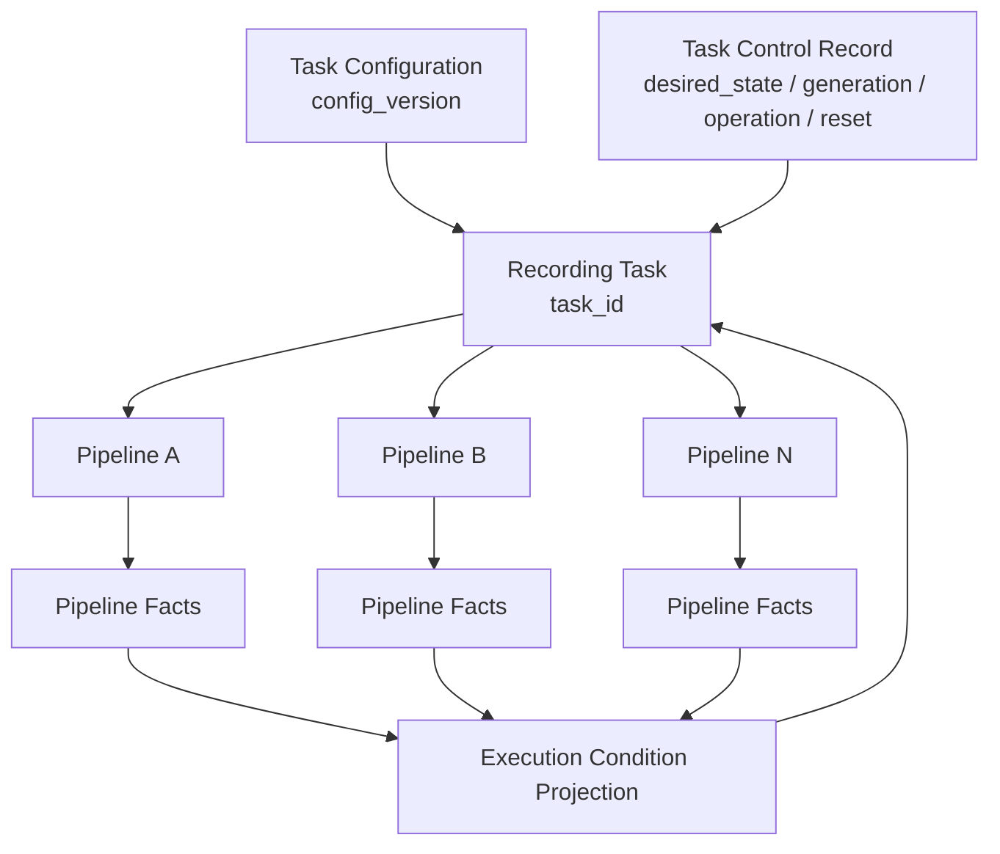
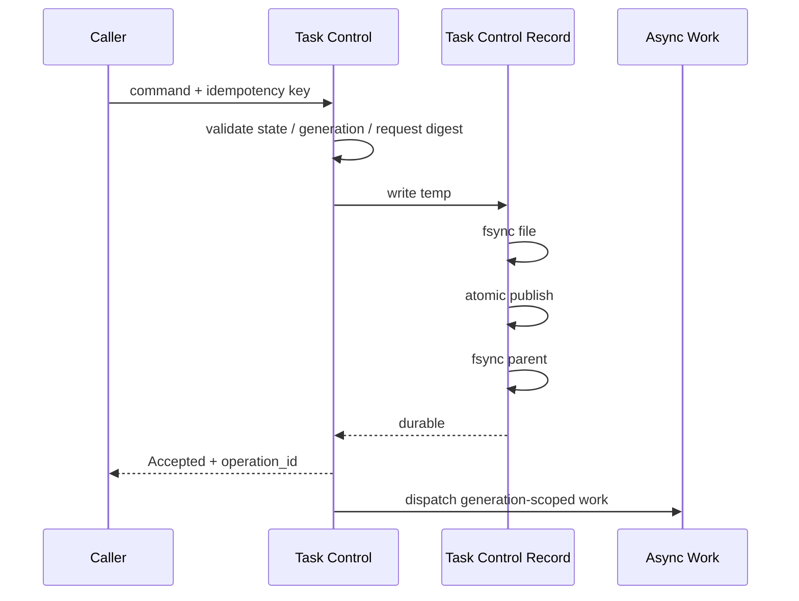
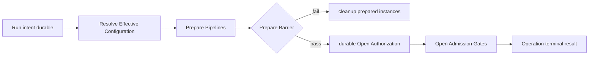
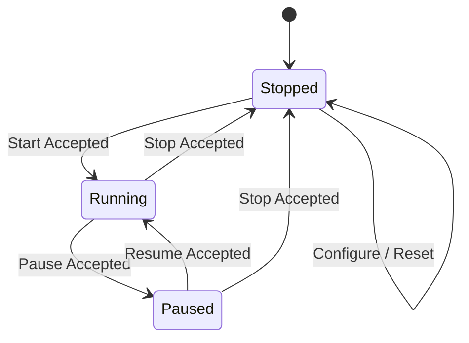

# RoDAQ Task 模块设计

| 文档属性 | 内容 |
| --- | --- |
| 文档类型 | 模块详细设计 |
| 状态 | V1 详细设计基线 |
| 适用范围 | RoDAQ Task 控制面、持久控制事实与跨重启控制恢复 |
| 上位设计 | [系统架构设计](architecture.md) |
| 关联设计 | [Pipeline](pipeline.md) · [Plugin](plugin.md) · [Storage](storage.md) · [术语表](../../GLOSSARY.md) |

## 1. 目标与职责边界

Task 是 RoDAQ 的持久控制对象。它回答“操作者希望录制系统处于什么状态”“当前控制操作是否完成”“重启后应继续什么控制意图”三个问题，不负责直接接收记录、维护热路径队列或写文件。

Task 模块必须：

- 保存不可变 Task Configuration 及当前活动 `config_version`；
- 保存期望控制状态、`control_generation`、`reset_generation` 和有界 Operation Ledger；
- 串行化 Create、Configure、Start、Pause、Resume、Stop、Reset；
- 为 Start/Resume 执行 Pipeline Prepare Barrier 和 Open Authorization；
- 从逐 Pipeline 事实投影 Task Execution Condition；
- 在守护进程重启后执行 Boot Reconciliation；
- 保证幂等请求、旧代次迟返和 Reset 前事实不会推进当前 Task；
- 把结构化失败、逐 Pipeline 结果和 Data Impact 返回给上层。

Task 模块不得：

- 直接操作 Acquisition/Storage 私有对象；
- 直接持有 Pipeline 数据队列、Payload Pool 或 Writer；
- 把 HTTP 请求生命周期作为操作生命周期；
- 用单个 `Running/Failed` 枚举同时表示控制意图、执行事实和录制结果；
- 从日志、文件时间戳或目录扫描猜测用户意图。

## 2. 领域模型与持久状态

### 2.1 领域与配置模型

**Task 领域模型。**



Task 的四类核心事实必须正交：

| 事实 | 含义 | 权威 |
| --- | --- | --- |
| Task Configuration | 数据源、Pipeline、录制/保留策略及逻辑引用 | 不可变配置快照 |
| Desired State | 操作者期望 `Running / Paused / Stopped` | Task Control Record |
| Execution Condition | 当前是否 Active、Preparing、Draining、Protected、PendingCleanup、Degraded、Failed | 逐 Pipeline 事实投影 |
| Operation Result | 某一次控制操作是否 Succeeded / PartiallySucceeded / Failed | Operation Ledger |
| Data Impact | 此次故障对录制数据的影响 | Pipeline/Storage 事实聚合 |

Operation Result、Desired State、Execution Condition、Data Impact 之间不存在自动等价关系。

**Task Configuration 表示。**

Task 配置区分**外部输入表示**和**内部不可变版本**，避免把运行时控制元数据混入可移植配置。

外部 Create/Import 输入至少包含：

```text
format_version
recording_mode
start_policy
segment policy
retention policy
pipelines[]
```

每个 Pipeline 至少包含：

```text
pipeline_id（可选，仅首次创建时允许缺失）
required/optional
resource_profile reference
output_root reference
acquisition plugin id + config schema version + params
storage plugin id + config schema version + params
streams[]
```

每个 Stream 至少包含：

```text
stream_id（可选，仅新建 Stream 时允许缺失）
logical name/address
acquisition-specific stream params
payload/schema expectation（若配置期已知）
readiness policy
```

规则：

- `task_id` 不属于 Task Configuration，由 Task Control/目录归属表达；
- 初次 Create 时缺失的 `pipeline_id / stream_id` 由 Task 模块分配；
- 持久化的不可变 Task Config Version 中所有 Pipeline/Stream ID **必须存在**；
- Configure 保留既有对象时必须携带原 ID；省略 ID 表示创建新对象，不按名称/Topic 猜测身份连续；
- 同一 Task Config 内 ID 必须唯一；
- 导出可保留 Task-scope Pipeline/Stream ID，它们在导入为新 Task 后仍只在新 Task scope 内解释，不造成跨 Task 身份冲突；
- backend-specific `params` 保持 Strict JSON object，由对应 Plugin Schema + semantic validation 负责；
- credential 只保存引用，不保存 secret material。

`config_version` 在 ID 分配、结构/语义校验和规范化完成后计算，因此它标识的是**实际持久化、可运行的 Task 配置**，而不是尚未分配稳定 ID 的原始输入文本。

**TaskConfig 强类型边界。**

Core 解析后使用强类型项目对象，不在 Task/Pipeline API 中传递通用 JSON tree。推荐逻辑模型：

```cpp
struct TaskConfig {
    RecordingMode recording_mode;
    StartPolicy start_policy;
    SegmentPolicy segment;
    RetentionPolicy retention;
    std::vector<PipelineConfig> pipelines;
};

struct PipelineConfig {
    PipelineId pipeline_id;
    bool required;
    ResourceProfileName resource_profile;
    OutputRootName output_root;
    PluginConfig acquisition;
    PluginConfig storage;
    std::vector<StreamConfig> streams;
};
```

这里的 `std::vector` 只是 Core C++ 强类型表示，不跨 C ABI；解析时必须先验证 Deployment cardinality 上限，再分配容器。公开 API 不暴露 `nlohmann::json`。

### 2.2 Task Control Record 与持久受理

**Task Control Record。**

每个 Task 只有一个 Task Control Record：

```text
control/<task_id>.json
```

其最小语义字段包括：

- format version；
- `task_id`；
- active `config_version`；
- Desired State；
- 单调 `control_generation`；
- 单调 `reset_generation`；
- 当前修改生命周期的 `operation_id`；
- 有界 Operation Ledger；
- 当前 Reset intent（若存在）；
- 必要的幂等请求摘要。

Task Control Record 是 Run/Pause/Stop/Reset 控制意图的唯一权威。Recovery Record 不拥有 Desired State 或 Reset intent。

字段级 JSON 规范建议冻结为：

| 字段 | 类型 | 规则 |
| --- | --- | --- |
| `format_version` | string | 独立于应用版本；不支持的 major 拒绝加载 |
| `task_id` | string | 稳定任务身份 |
| `active_config_version` | string | 指向不可变 Task Config |
| `desired_state` | string enum | `running / paused / stopped` |
| `control_generation` | decimal string | 单调 `uint64_t`，JSON 中不使用可能丢精度的 number |
| `reset_generation` | decimal string | 单调 `uint64_t` |
| `current_operation_id` | string/null | 当前生命周期操作；无在途操作时 null |
| `operation_ledger` | bounded array | 只保留恢复窗口内必要条目 |
| `reset_intent` | object/null | 仅 Reset 已受理且未完成时存在 |
| `content_digest` | string | 对规范化 payload（排除 digest 字段本身）计算，用于检测内容损坏；算法在格式版本中冻结 |

所有可能超过 IEEE-754 safe integer 的持久计数、代次和序号统一使用十进制字符串编码；强类型解析后再转换为 `uint64_t` 并做范围检查。这样 Web/JSON canonicalization 不会改变控制身份语义。

**持久受理点。**

修改控制意图的操作按以下顺序受理：



只有父目录同步完成后才允许返回 Accepted。Accepted 只表示控制意图已持久受理，不表示 Pipeline 已经完成准备、排空或提交。

### 2.3 Operation Ledger 与 Recovery

**Operation Ledger。**

Operation Ledger 必须有界，并至少区分：

- `Accepted`；
- `InProgress`；
- Terminal：`Succeeded / PartiallySucceeded / Failed`；
- `Superseded`。

同一幂等键和等价请求摘要必须返回原 `operation_id` 或原终态。相同幂等键配不同摘要必须返回 Conflict。

超过恢复窗口的终态可压缩或淘汰，但仍不得导致仍可见历史操作 ID 与新操作产生歧义。

**Task Recovery Record。**

Task 级 Recovery Record 保存：

```text
recovery/<task_id>.json
```

它是**执行与恢复证据**，不是 Desired State 权威。字段级规范至少包括：

| 字段 | 类型 | 语义 |
| --- | --- | --- |
| `format_version` | string | Recovery 格式版本 |
| `task_id` | string | 所属 Task |
| `observed_control_generation` | decimal string | 最近完成对账的控制代次 |
| `active_config_version` | string | 本记录观察时对应配置 |
| `run_operation` | object/null | 当前 Start/Resume 的 Prepared/Open Authorization 证据 |
| `pipelines` | bounded array | 每条 Pipeline 当前/最近实例事实 |
| `reset_progress` | object/null | 当前权威 reset_generation 对应的逐卷清理进度 |
| `cleanup_intents` | bounded array | 未完成的实例/产物清理事实 |
| `content_digest` | string | 与格式版本绑定的完整性摘要 |

`run_operation` 必须以一个对象原子保存本次授权集合：

```text
operation_id
control_generation
phase = Prepared | OpenAuthorized | Ended
authorized_pipelines[]
authorization_boundary
```

`authorized_pipelines[]` 中每项至少保存：

```text
pipeline_id
instance_id
effective_config_id
prepared_boundary
continuation_permission
opened_observed
ended_boundary
```

`opened_observed` 只是观察事实；`phase=OpenAuthorized` 才是恢复时“可能已经开放”的权威证据。

Task Recovery Record 的持久化由独立 `TaskRecoveryStore` 管理；它和 Task Control Record 是两个不同权威域，不允许一个 serializer 同时根据内存状态“顺手”重建两者。

## 3. 控制生命周期与恢复

### 3.1 Create 与 Configure

**Create。**

Create 是唯一一个在 Task 尚不存在时就需要幂等恢复的操作，因此不能只依赖 per-Task Operation Ledger。Task 模块维护有界的 **Create Receipt**，以 RequestIdentity 为键保存：

```text
request_key_hash
request_digest
assigned_task_id
phase = Allocated | Materializing | Completed
created_at
```

Create：

1. 严格解析并校验 Task Configuration；
2. 在 TaskService 的低频 **Create control lane** 上执行线性化 `claim`：
   - 同 key + 同 digest + Completed：直接返回原 `task_id`；
   - 同 key + 不同 digest：Conflict；
   - 同 key + 未完成：取得原 `assigned_task_id` 并进入 Create Reconciliation；
   - 不存在：原子 claim 本 request key，并绑定新分配的稳定 `task_id`；
3. 新 claim 只有在 `Allocated` Receipt durable 后才允许开始物化 Task；
4. 分配/确认 `pipeline_id` 和初始 `stream_id`，形成规范化配置；
5. 写不可变配置快照；
6. 建立初始 Stream Identity State；
7. 原子发布 `Stopped` Task Control Record；
8. 将 Receipt 更新为 Completed；
9. 完成后 Task 才对正常查询可见并向调用方返回 `task_id`。

如果进程在步骤 3–8 任意位置崩溃，重试同 RequestIdentity 必须恢复或清理原 `assigned_task_id`，不能再创建第二个 Task。Create Receipt 数量受 `max_tasks + create recovery window` 限制；已完成 receipt 至少保留到能够保证客户端重试窗口结束，之后可以压缩为稳定摘要。

半创建目录不进入普通 Task Catalog；恢复扫描只依据 Create Receipt 和完整 Task Control Record 决定继续物化还是清理。

**Configure。**

Configure 仅允许在：

```text
Desired State == Stopped
AND
所有旧 Recording Instance 已静止
```

时执行。

配置变更创建新的不可变 `config_version`，再原子更新 Task Control Record 的 active config 引用。旧版本只要仍被产物、Recovery、审计或保留范围引用就不能删除。

保留既有 Pipeline/Stream 时必须保留其稳定 ID；删除的 ID 不复用。

### 3.2 Start、Resume 与 Open Authorization

**Start / Resume。**

Start 和 Resume 使用相同的两阶段控制协议：



Prepare 阶段完成所有可能失败或阻塞的工作：

- 解析当前 Deployment Generation；
- 形成 `effective_config_id`；
- 资源准入；
- 插件实例创建和配置；
- Stream Descriptor / Storage prepare；
- Prepared instance facts 持久化。

Prepared Pipeline 的 Admission Gate 保持 Closed。

**AllRequired。**

所有 Required Pipeline 都 Ready 后才能通过 Prepare Barrier。任一 Required Prepare 失败时，不允许任何 Required Pipeline 先接纳业务 Record。

**BestEffort。**

所有准备结果确定后，只要至少一条允许运行的 Pipeline Ready，可以通过 Barrier 并开放成功 Pipeline；失败链路形成明确结果和 Degraded/Failed 投影。

**Open Authorization。**

Barrier 通过后，Task 控制域在同一 Task Recovery Record 原子写入 Open Authorization，至少包含：

- `control_generation`；
- 获准的 `pipeline_id / instance_id` 集合；
- `effective_config_id`；
- Prepared boundary；
- continuation permission。

只有授权持久完成后才允许 Pipeline Open Admission。

Open Admission 本身只能是 Core 内部、预先资源完备、不执行插件调用、文件 I/O 或普通资源分配的门切换。

### 3.3 Pause、Stop 与 Reset

**Pause。**

Pause 先持久发布新的 Paused intent 和控制代次，再关闭对应 Pipeline Admission Gate。

Pause 成功要求：

- cut 前 accepted set 全部完成正常 durable commit；
- commit backlog 归零；
- Acquisition callback quiescent；
- Recording Instance 静止并销毁；
- 资源实际归还。

如果存在 AcceptedKnownFailed、PersistenceUnknown 或被隔离产物，Pause Operation = Failed；Desired State 仍保持 Paused。

**Stop。**

Stop 撤销 Run intent 并使旧 Start/Resume、自动恢复和旧 continuation permission 失效。

Stop 允许接管在途 Start/Pause/Resume，但必须先持久建立更高 `control_generation`。旧代次工作只能完成资源结算和诊断。

Stop 最终可以进入 `Stopped + Idle`，但如果 cut 前的已接纳数据存在持久失败或 Unknown，Stop Operation 仍必须为 Failed，并保留 Data Impact。

**Reset。**

Reset 仅在：

```text
Desired State == Stopped
AND
所有 Recording Instance 静止
```

时受理。

Task Control Record 持有唯一 Reset authority：

- `reset_generation`；
- Reset `operation_id`；
- 固定目标范围；
- 目标控制代次。

Recovery Record 只记录逐卷执行进度。

Reset 删除 Task 归属的录制产物和可重建运行事实，但不得回退 Stream Identity State 中的 AcceptanceSequence high-water，不得复用 Task/Pipeline/Stream ID。

### 3.4 状态投影与 Boot Reconciliation

**状态投影。**

Task 状态机只管理控制意图和控制操作，不复制 Pipeline 内部状态。



Execution Condition 由逐 Pipeline 事实投影：

| 条件 | 投影规则 |
| --- | --- |
| Idle | Desired=Stopped 且无旧实例占用 |
| Preparing | 当前确有 Start/Resume prepare 工作 |
| Active | 所有 Required Pipeline 正常开放并推进 |
| Degraded | Optional 缺失或 BestEffort 合法部分运行 |
| Protected | Run intent 保留，但因资源/磁盘/临时条件关闭接纳 |
| Draining | 当前确有 Pause/Stop/收尾工作 |
| PendingCleanup | 旧实例尚未证明静止或资源尚未释放 |
| Failed | Required Pipeline 出现不可恢复错误或恢复预算耗尽 |

**Boot Reconciliation。**

重启先读取：

1. Task Control Record；
2. Stream Identity State；
3. active Task Configuration；
4. Recovery Record；
5. 已提交/隔离产物事实。

Boot Reconciliation 使用证据矩阵：

| 持久事实 | 行为 |
| --- | --- |
| Running + Accepted/InProgress Start/Resume + 仅 Prepared facts | 继续原控制操作；清理或替换旧 Prepared instance，不要求旧 continuation permission |
| Running + Accepted/InProgress Start/Resume + Open Authorization | 旧实例按“可能已开放”处理中断；创建新 instance 继续原 operation |
| Running + 无未完成 Run operation + 有当前代次 Open Authorization/continuation | 将旧实例作为中断实例，按自动恢复策略重新准入 |
| Running + 无可恢复操作且无可验证运行证据 | 进入 Protected/诊断，不猜测 |
| Paused / Stopped | 不自动开放入口，只允许完成旧实例结算 |
| 存在更高代次 Pause/Stop/Reset | 所有旧 Run 工作失效 |

缺失 Opened observation 不能推翻已持久 Open Authorization。

## 4. 生效配置与模块边界

### 4.1 生效配置、并发与失败

**Effective Recording Configuration。**

Task 模块负责在 Start/Resume/恢复准备阶段形成本次实例的运行契约：

```text
Task config_version
+ Deployment Generation
+ exact plugin identities/versions
+ resolved output volume identity
+ resolved non-secret parameters
+ effective protocol/QoS settings
+ Plugin Resource Plans
+ Effective Pipeline Limits
+ credential reference version/fingerprint
= effective_config_id
```

运行中的实例绑定其 `effective_config_id`。Deployment 改变不得原地修改已开放实例。

**并发与所有权。**

每个 Task 只有一个修改生命周期的操作在途。生命周期事件在 Task 控制域串行化。

异步完成事件必须携带：

- `operation_id`；
- `control_generation`；
- `pipeline_id`；
- `instance_id`；
- work type。

旧代次事件不得推进当前状态。

Task 控制域持有结构锁时不得调用插件、执行磁盘 I/O 或等待 Pipeline 热路径。耗时工作通过异步执行域完成，再以事件回到 Task 控制域。

**失败模型。**

Task 对外使用统一结构化失败：

```text
Status Code
+ Retryability
+ Failure Domain
+ Data Impact
+ bounded diagnostics
```

Task 不解析插件错误文本决定恢复策略。

典型映射：

| 场景 | 主要失败域 | Data Impact |
| --- | --- | --- |
| 配置非法 | Task Control | None |
| 资源档位不足，尚未 Open | Pipeline/Resource | None |
| Pause 前已有 AcceptedKnownFailed | Storage/Pipeline | AcceptedKnownFailed |
| Storage Unknown | Storage | PersistenceUnknown |
| 状态目录不可写 | Persistence State | 取决于操作是否已受理 |
| Reset 删除部分卷失败 | Volume | HistoricalArtifactLostOrCorrupt 或 None，按已知事实 |

### 4.2 模块接口边界

Task 模块需要的内部能力按职责而不是具体类名定义：

| 依赖能力 | Task 可做的事 | Task 不可做的事 |
| --- | --- | --- |
| Pipeline Control | prepare/open/close/quiesce/cleanup，读取结构化 Pipeline facts | 操作队列、Payload、Writer |
| Persistence | 原子发布 Config/Control/Recovery/Identity 事实 | 绕过权威对象直接改文件 |
| Capacity | 请求/释放任务级和 Pipeline 资源准入 | 动态超分 |
| Artifact Management | 发起 Reset/查询清理进度 | 直接 unlink 活跃文件 |
| Observability | 读取快照和结果 | 让指标路径成为控制线性化点 |

## 5. 开发实现设计

本章把前述控制语义映射为 C++17 开发边界。类型名用于统一实现方向；私有类型可在不改变契约的前提下调整，但不得重新合并已经分离的职责。

### 5.1 内部组成与公共接口

**内部组成。**

Task 模块建议拆成以下私有责任对象：

| 对象 | 主要职责 | 明确不负责 |
| --- | --- | --- |
| `TaskService` | 面向 server/测试程序的 Task 控制与查询入口 | 不执行插件调用和磁盘扫描 |
| `TaskController` | 串行处理一个 Task 的控制事件、驱动状态机、生成异步工作 | 不直接执行阻塞工作 |
| `TaskStateMachine` | 只实现 Desired State/Operation 的合法转换与 Guard | 不持久化、不调用 Pipeline |
| `TaskStore` | Task Config、Task Control Record 的强类型持久化 | 不解释 Pipeline 运行事实 |
| `TaskCreateStore` | Create Receipt 与半创建 Task 的幂等恢复索引 | 不保存已存在 Task 的生命周期 Operation |
| `TaskRecoveryStore` | Task Recovery Record、Open Authorization、Reset/Cleanup progress 的强类型持久化 | 不拥有 Desired State 或 Reset intent |
| `OperationLedger` | 幂等键、request digest、operation terminal state | 不保存历史审计全文 |
| `TaskWorkCoordinator` | 提交 Prepare/Drain/Reset 等异步工作并回送完成事件 | 不拥有 Task 状态 |
| `TaskSnapshotPublisher` | 发布只读 Task snapshot | 不参与状态线性化 |

不得把上述对象重新折叠成一个同时持有状态机、文件 I/O、Pipeline 对象、HTTP 请求和异步 worker 的单体类。

**公共 C++ 接口形态。**

Task 公共接口只表达稳定业务语义，不暴露 SML、JSON、mutex、future 或线程对象。建议形态：

```cpp
class TaskService {
public:
    Result<TaskId> create_task(const TaskConfig& config,
                               const RequestIdentity& request);
    Result<OperationId> configure(TaskId task_id, const TaskConfig& config,
                                  const RequestIdentity& request);
    Result<OperationId> start(TaskId task_id, const RequestIdentity& request);
    Result<OperationId> pause(TaskId task_id, const RequestIdentity& request);
    Result<OperationId> resume(TaskId task_id, const RequestIdentity& request);
    Result<OperationId> stop(TaskId task_id, const RequestIdentity& request);
    Result<OperationId> reset(TaskId task_id, const RequestIdentity& request);

    Result<TaskSnapshot> get_task(TaskId task_id) const;
    Result<OperationSnapshot> get_operation(TaskId task_id,
                                            OperationId operation_id) const;
};
```

`TaskService` 面向 server 和开发验收程序，允许多个调用线程并发进入。实现必须在内部把同一 Task 的生命周期修改串行化；不同 Task 可以并行。只读查询读取已发布 snapshot，不取得会阻塞 Pipeline 热路径的结构锁。Create 走独立低频 Create control lane。

这里的返回语义是：

- `Result<OperationId>` 成功：控制请求已经完成持久受理；
- 不表示异步工作已经完成；
- 调用方通过 `get_operation()` 查询终态；
- HTTP 层只映射这些项目类型，不增加第二套 operation 状态。

`RequestIdentity` 至少包含幂等键和规范化请求摘要所需信息，不允许 server 自行实现另一套幂等缓存。

### 5.2 控制执行与持久化

**TaskController 事件模型。**

TaskController 的写入路径是单写者。推荐由每 Task 一个串行事件队列或共享控制执行器上的 per-Task 串行调度实现，不要求每 Task 独占线程。

事件至少分为：

```text
UserCommand
PersistenceCompleted
PipelinePrepareCompleted
OpenAuthorizationCompleted
PipelineDrainCompleted
ResetProgress
CleanupCompleted
ShutdownRequested
```

所有异步完成事件必须携带：

```text
task_id
operation_id
control_generation
work_kind
pipeline_id（若适用）
instance_id（若适用）
```

TaskController 收到事件时先验证归属，再更新状态。旧 generation 事件即使业务工作成功，也只能进入原 operation/resource 结算，不能推进当前 Task。

**状态机与副作用分离。**

SML 仅处理：

- 当前 Desired State；
- 当前 Operation kind/state；
- event legality；
- generation/operation Guard；
- 需要启动什么异步工作。

Action 只生成项目内部 command，不执行：

- fsync；
- plugin call；
- Pipeline drain；
- volume scan；
- sleep/wait。

推荐模式：

```text
event
→ state-machine transition
→ produce WorkCommand
→ release Task control lock/domain
→ async executor performs work
→ CompletionEvent
→ TaskController
```

任何可能等待未知时间的操作都不得在状态机 action 中执行。

**持久化接口。**

TaskStore 与 TaskRecoveryStore 分开提供强类型操作：

```cpp
class TaskStore {
public:
    Result<void> create_config(TaskId task_id,
                               const TaskConfigVersion& config);
    Result<void> publish_control(TaskId task_id,
                                 const TaskControlRecord& record);
    Result<TaskControlRecord> load_control(TaskId task_id);
    Result<TaskConfigVersion> load_config(TaskId task_id,
                                          ConfigVersion config_version);
};

enum class CreateClaimState {
    Claimed,
    ExistingInProgress,
    ExistingCompleted,
};

struct CreateClaim {
    CreateClaimState state;
    TaskId task_id;
    CreateReceipt receipt;
};

class TaskCreateStore {
public:
    Result<CreateClaim> claim(const RequestIdentity& request,
                              TaskId candidate_task_id);
    Result<void> publish(const CreateReceipt& receipt);
};

class TaskRecoveryStore {
public:
    Result<void> publish(TaskId task_id,
                         const TaskRecoveryRecord& record);
    Result<TaskRecoveryRecord> load(TaskId task_id);
};
```

三个 Store 可以复用同一个底层原子文件写入组件，但不能共享“谁是权威”的领域语义。`TaskCreateStore::claim()` 必须对同一 request key 线性化；V1 可以由单个 Create control lane 串行调用它，不要求设计无锁全局索引。原子文件写入协议封装在 Store/持久化支持层内部，调用者不能手工拼：

```text
write temp
fsync
rename
fsync parent
```

避免不同控制路径形成不同 durability 语义。

**Operation Ledger 数据结构。**

Operation Ledger 使用有界容器，逻辑条目至少包含：

```text
operation_id
request_key
request_digest
operation_kind
target_control_generation
accepted_at
state
terminal_result
retryability
failure_domain
data_impact
bounded diagnostics
```

不得把完整日志或任意字符串数组塞入 Operation Ledger。

达到上限时：

1. 回收超过恢复窗口的 terminal entries；
2. 保留当前 operation；
3. 保留 Pause/Stop/Reset 和 shutdown 所需紧急容量；
4. 仍不足时拒绝新的非紧急生命周期操作。

### 5.3 Prepare Barrier 与 Open Authorization

**Prepare Barrier 实现。**

TaskWorkCoordinator 对一个 Start/Resume 建立固定 `PrepareSet`：

```text
required_pipeline_count
optional_pipeline_count
per-pipeline prepare state
per-pipeline prepared instance id
effective_config_id
resource reservation owner
```

Prepare completion 只能写入本 operation 的 PrepareSet。

Barrier 判定必须是纯内存确定性函数：

```text
AllRequired:
  all Required == Ready
  AND all Required Prepared facts durable
  AND all Required resource reservations owned

BestEffort:
  all prepare results terminal
  AND at least one eligible pipeline == Ready
```

Barrier 通过后只生成一次 Open Authorization command。

**Open Authorization 的原子范围。**

一个 Task 的同一次 Start/Resume 必须把本次允许开放的 Pipeline 集合放入**同一份 Task Recovery Record 发布事务**，避免：

```text
Pipeline A authorized
crash
Pipeline B not yet authorized
```

造成无法区分是 BestEffort 还是未完成 AllRequired 的状态。

若实现采用单文件 Recovery Record，则一次更新覆盖本 operation 的完整授权集合；若未来改为多文件，必须引入等价事务标识和恢复证明，不能依赖文件修改时间排序。

### 5.4 Timeout、Shutdown 与开发约束

**Timeout 语义。**

Task API 中 caller timeout 与 operation deadline 必须区分。

V1 TaskService 控制提交本身只负责完成持久受理；HTTP 等待超时属于 **caller wait deadline**，不会取消已 Accepted operation。

Pipeline/plugin 相关 deadline 属于异步 WorkCommand 的 **operation deadline**。

示例：

```text
POST /start
→ TaskService.start()
→ Accepted operation_id=42
→ HTTP client disconnects
→ operation 42 继续执行
```

不得因为请求断开回滚控制意图。

**Shutdown。**

守护进程 shutdown：

1. TaskService 停止接收新的非紧急操作；
2. 为所有 Running Task 生成受控 Stop/Shutdown work；
3. 保持 Task 控制查询可用到关停截止；
4. 等待有界期限；
5. 未静止资源保留持久恢复证据；
6. 进程退出交给外部 supervisor 完成最终恢复。

TaskController destructor 不承担业务 Stop，不允许无界等待。完整关停必须走显式 shutdown 流程。

**Test Seam。**

Task 详细实现必须允许注入以下测试替身：

- in-memory/fault-injectable TaskStore；
- deterministic PipelineControl fake；
- deterministic Capacity fake；
- controllable clock；
- controllable work executor；
- fault-injectable Recovery writer。

单元测试不应依赖真实 ROS 2、MCAP 或 HTTP 才能验证状态机与 crash-window 规则。

**代码组织约束。**

实现文件应按真实责任拆分，而不是使用 `runtime/`、`detail/` 等宽泛目录聚合。推荐逻辑文件组：

```text
task/
  task_service.*
  task_controller.*
  task_state_machine.*
  task_store.*
  task_create_store.*
  task_recovery_store.*
  operation_ledger.*
  task_snapshot.*
```

公开头只暴露调用方需要的稳定项目类型；SML、JSON serializer 和持久文件格式实现留在模块内部。

## 6. 不变量与验收

### 6.1 核心不变量

1. Task Control Record 是 Desired State、control generation 和 Reset authority 的唯一权威。
2. 一个 Task 同时最多一个修改生命周期的 Operation。
3. Accepted 只能在控制事实 durable 后返回。
4. AllRequired Barrier 失败前任何 Required Pipeline 都不得接纳业务 Record。
5. Open Authorization 必须先于任何 Admission Gate 打开。
6. OpenAuthorized 但缺失 OpenedObserved 的实例按“可能已开放”恢复。
7. 更高 control generation 永远压制旧 Run/open/recovery 请求。
8. Reset 不回退 Stream identity 或 AcceptanceSequence high-water。
9. Task Execution Condition 只能由逐 Pipeline 事实投影，不能独立写入第二份健康状态。
10. Operation Result、Desired State、Execution Condition 和 Data Impact 保持正交。

### 6.2 验收矩阵

至少覆盖：

- Create/Configure 每个持久提交点崩溃；
- Start/Resume 在 Prepare 前、Prepared 后、Barrier 后、Open Authorization 后、部分 Gate open 后崩溃；
- AllRequired 任意 Required Prepare 失败；
- BestEffort 部分成功；
- Pause/Stop 与高并发提交竞争；
- Stop 接管 Start/Pause/Resume；
- 相同/冲突幂等键；
- 旧 generation 完成事件迟返；
- Reset 受理后逐卷删除期间崩溃；
- Task Control Record / Recovery Record 不可写；
- Deployment Generation 变化后的恢复兼容/不兼容；
- Operation Ledger 达到上限；
- PendingCleanup 长时间占用资源；
- Stop 达到 Stopped+Idle 但 Data Impact 非 None；
- 重启后所有 Boot Reconciliation 组合。

通过条件不是“状态最终看起来正确”，而是每个线性化点、持久事实、资源所有者和迟返结果都能由测试证据证明。
